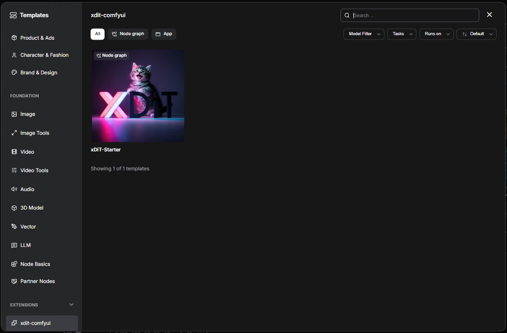
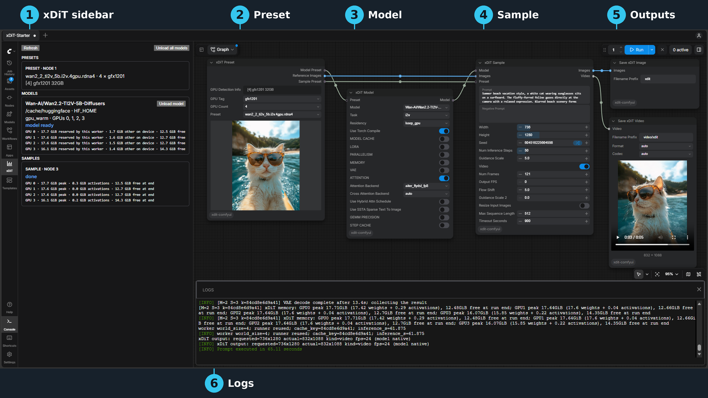
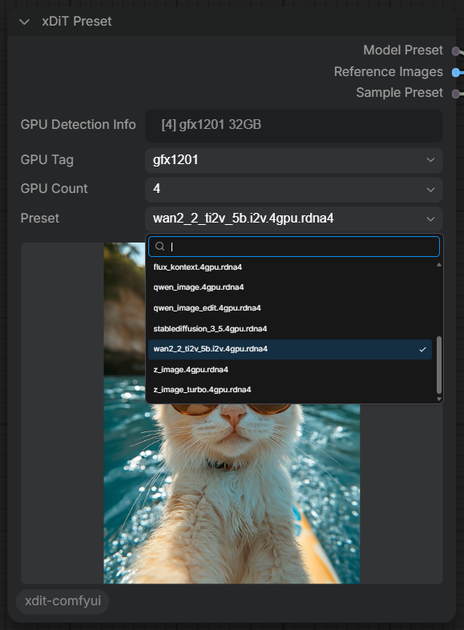
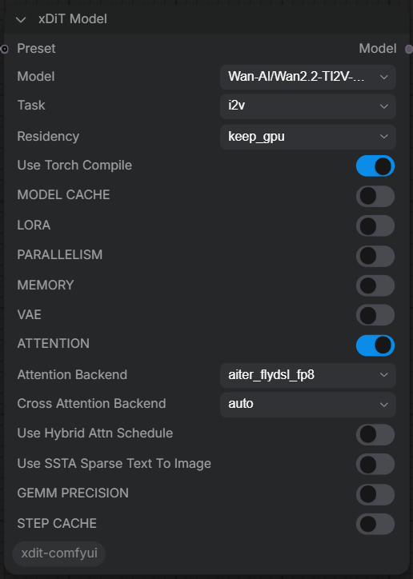
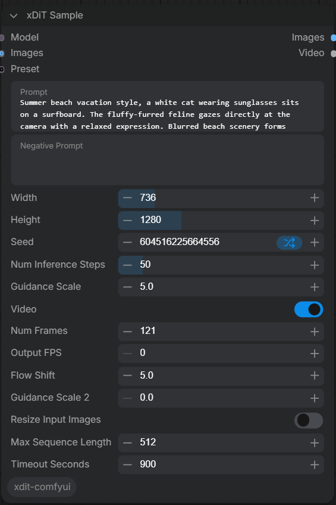

<!---
Copyright (c) 2026 Advanced Micro Devices, Inc. (AMD)

Permission is hereby granted, free of charge, to any person obtaining a copy
of this software and associated documentation files (the "Software"), to deal
in the Software without restriction, including without limitation the rights
to use, copy, modify, merge, publish, distribute, sublicense, and/or sell
copies of the Software, and to permit persons to whom the Software is
furnished to do so, subject to the following conditions:

The above copyright notice and this permission notice shall be included in all
copies or substantial portions of the Software.

THE SOFTWARE IS PROVIDED "AS IS", WITHOUT WARRANTY OF ANY KIND, EXPRESS OR
IMPLIED, INCLUDING BUT NOT LIMITED TO THE WARRANTIES OF MERCHANTABILITY,
FITNESS FOR A PARTICULAR PURPOSE AND NONINFRINGEMENT. IN NO EVENT SHALL THE
AUTHORS OR COPYRIGHT HOLDERS BE LIABLE FOR ANY CLAIM, DAMAGES OR OTHER
LIABILITY, WHETHER IN AN ACTION OF CONTRACT, TORT OR OTHERWISE, ARISING FROM,
OUT OF OR IN CONNECTION WITH THE SOFTWARE OR THE USE OR OTHER DEALINGS IN THE
SOFTWARE.
--->

# Introducing xDiT for ComfyUI

[xDiT](https://github.com/xdit-project/xDiT) is an open-source inference engine for diffusion transformers. It can split a single image or video generation across multiple GPUs and shard large models so they fit in the GPUs' combined memory. xDiT exposes many runtime options, however, and the right combination depends on the model, the hardware, and the number of GPUs.

ComfyUI is a node-based interface for generative AI: each node performs one step, such as loading a model, setting a prompt, or saving an output, and you connect nodes into a workflow graph. Custom nodes are add-ons that extend ComfyUI with new nodes. [xDiT for ComfyUI](https://github.com/xdit-project/xdit-comfyui) is a set of custom nodes that brings the xDiT runtime into ComfyUI. xDiT handles model loading and distributed execution, while ComfyUI provides the visual workflow for prompts, generation settings, inputs, and outputs. Instead of assembling a configuration by hand, you pick a model and a GPU count, select a tested preset, enter a prompt, and run.

This blog shows you how to run the nodes in a ready-to-run container or install them into an existing ComfyUI environment, and walks you through the Starter workflow node by node. You will also learn how to monitor and unload models while you work. For a closer look at how xDiT parallelism works, and when adding GPUs actually helps, see [How to Scale Diffusion Inference Across AMD RDNA 4 GPUs](https://rocm.blogs.amd.com/artificial-intelligence/diffusion-xdit-rdna4/README.html).

## Built on Diffusion Model Inference

AMD's [Diffusion Model Inference](https://github.com/AMD-AGI/diffusion-models-inference) project provides the container build infrastructure for optimized xDiT images, along with benchmark configurations and profiling and tuning data for supported models and GPUs.

xDiT for ComfyUI builds on that work in two ways:

- It adds ComfyUI and the custom nodes on top of a compatible xDiT image, so the image's validated GPU software stack stays in place.
- It bundles a pinned snapshot of the benchmark configurations and offers them as presets.

## Prerequisites

Before you begin, prepare the following:

- A Linux system with a ROCm environment supported by xDiT.
- One or more supported GPUs with enough memory for the model and preset you choose.
- For the container option, Docker configured for GPU workloads. On ROCm, follow the [Run ROCm Docker containers](https://rocm.docs.amd.com/en/latest/install/docker-containers.html) guide to prepare and verify the host.
- For the custom-node option, ComfyUI 0.28.0 or newer.
- Enough disk space for model weights and compilation artifacts.
- A Hugging Face account for gated models. Accept each model's terms on Hugging Face, then authenticate with `HF_TOKEN` or `hf auth login`.

## Set Up xDiT for ComfyUI

There are two ways to get started: run the container stack, which is the recommended path, or install the nodes into an existing compatible ComfyUI environment.

### Option 1: Run the Container

The container option uses a compatible xDiT image as its base, then adds ComfyUI and the custom nodes. The included launcher picks a pinned base image for your hardware profile, builds the ComfyUI layer the first time, and starts the container. This is a quick way to try the whole stack without touching an existing ComfyUI setup.

Clone the repository and change into it:

```bash
git clone https://github.com/xdit-project/xdit-comfyui.git
cd xdit-comfyui
```

Then launch the container with the profile that matches your hardware. For AMD Instinct `gfx942` GPUs, such as the MI300 series, or `gfx950` GPUs, such as the MI350 series, use the `instinct` profile:

```bash
XDIT_PROFILE=instinct \
HF_CACHE_HOST=/data/huggingface \
bash scripts/docker/run_dev.sh
```

For an AMD RDNA 4 `gfx1201` system, such as the Radeon AI PRO R9700S used in [How to Scale Diffusion Inference Across AMD RDNA 4 GPUs](https://rocm.blogs.amd.com/artificial-intelligence/diffusion-xdit-rdna4/README.html), use the `rdna4` profile:

```bash
XDIT_PROFILE=rdna4 \
HF_CACHE_HOST=/data/huggingface \
bash scripts/docker/run_dev.sh
```

`HF_CACHE_HOST` is optional. It sets the host directory where Hugging Face downloads persist between runs. If you leave it out, the launcher uses `$HOME/.cache/huggingface`.

To use another compatible xDiT image, pass it as `BASE_IMAGE`:

```bash
BASE_IMAGE=your-published-xdit-image \
HF_CACHE_HOST=/data/huggingface \
bash scripts/docker/run_dev.sh
```

When the container is ready, open [http://localhost:8188](http://localhost:8188). See the repository's [`docker/README.md`](https://github.com/xdit-project/xdit-comfyui/blob/main/docker/README.md) for the base-image requirements and other launcher options.

### Option 2: Install the Custom Nodes

Clone the repository into `ComfyUI/custom_nodes` and install its dependencies with the same Python interpreter that runs ComfyUI:

```bash
cd ComfyUI/custom_nodes
git clone https://github.com/xdit-project/xdit-comfyui.git
python -m pip install -r xdit-comfyui/requirements.txt
```

The requirements include a pinned xDiT revision, so this step also installs xDiT into your ComfyUI environment. Restart ComfyUI after installation.

## Open the Starter Workflow

The quickest way to your first generation is the bundled Starter workflow:

1. In ComfyUI, open **Templates**.
2. Under **Extensions**, select **xdit-comfyui**, then select **xDiT-Starter**.
3. In the **xDiT Preset** node, choose your GPU count and a preset for the model you want to run.
4. In the **xDiT Sample** node, enter your prompt.
5. Select **Run**.

The figure below shows where to find **xDiT-Starter** in the Templates browser, with the **xdit-comfyui** extension selected.



The template adds a complete workflow with the preset, model, sample, and save nodes already connected. It reads from left to right: **xDiT Preset** supplies a starting configuration, **xDiT Model** loads the model onto your GPUs, and **xDiT Sample** generates the image or video. The result appears in the connected **Save xDiT Image** or **Save xDiT Video** node.

The following figure gives you an overview of the full ComfyUI interface, with the Starter workflow running the Wan 2.2 TI2V 5B image-to-video preset on four RDNA 4 GPUs. The numbered markers identify the xDiT sidebar (**1**), Preset node (**2**), Model node (**3**), Sample node (**4**), output nodes (**5**), and ComfyUI logs (**6**). Use this overview to locate each part of the interface; the following sections show the three main nodes in close-up.



[Open the full-size UI screenshot](images/xdit-comfyui-xdit-starter.png) to inspect the interface in more detail.

The following sections explain what each node controls, so you know which values to change once your first generation succeeds.

## Choose a Starting Point with the xDiT Preset Node

The right xDiT configuration depends on the model and the number of GPUs you use. The **xDiT Preset** node gives you a tested starting point for that combination.

The node shows the GPUs it detected, offers the GPU counts that have presets for that hardware, and lists the presets that match your choice. Selecting a preset fills in the model, parallel layout, precision, step caching, VAE, and generation settings for the Model and Sample nodes. For image-conditioned models, it can also supply a reference image.

A preset is only a starting point. You can override any of its values in the Model and Sample nodes as you tune the workflow, or remove the Preset node altogether and configure the Model and Sample nodes directly.

The figure below shows a close-up of the Preset node (**2** in the full-UI overview), with four detected RDNA 4 GPUs and the matching presets in its dropdown. Use the GPU count selector to choose how many GPUs to run on, then select a preset from the list.



## Load and Run the Model with the xDiT Model Node

The **xDiT Model** node starts an xDiT worker on the selected GPUs and loads the model into it. It holds every setting that affects loading and execution. Beyond the model, task, and GPUs to use, it groups options for LoRA, parallelism, memory, VAE, attention, precision, and step caching, and it controls what happens to the worker after generation.

Most of these controls sit in collapsible groups. You don't need to open them to get started, because the connected preset supplies suitable values. When you want to tune them, the [xDiT documentation](https://xdit-project.github.io/xDiT/) describes each runtime option. Because the model is configured separately from generation, changing only the prompt in **xDiT Sample** does not reload the model.

The **Residency** setting decides what happens to the loaded model after the last Sample node that uses it finishes:

- `keep_gpu` (default) keeps the model in GPU memory, so the next generation starts immediately.
- `park_cpu` moves the model to system memory to free GPU memory, and keeps the worker ready to move it back. Not every configuration can be parked; when it can't, the model stays in GPU memory.
- `release` stops the worker and frees its GPU memory. The model loads again the next time the workflow runs.

**Use Torch Compile** is off by default, even when the underlying benchmark configuration used it, because compiling makes the first generation noticeably slower. If you plan to generate repeatedly with the same model and settings, turn it on: the first generation takes longer while supported model components compile, but later generations can run faster.

The figure below shows a close-up of the Model node (**3** in the full-UI overview) configured for Wan 2.2 TI2V 5B image-to-video generation, with `keep_gpu` residency and Torch compile enabled. The expanded **ATTENTION** group shows the selected attention backend.



## Describe the Output with the xDiT Sample Node

The **xDiT Sample** node describes what to generate. Enter a prompt, then review the seed, width, height, number of inference steps, and guidance scale. Video models add settings such as frame count and output frame rate. Image-conditioned workflows can take reference images from the preset or from another ComfyUI node.

If you're new to diffusion sampling, these settings have the most visible effect on the output:

- **Seed** sets the starting noise. The same seed with the same settings reproduces the same output, so keep it fixed while you compare other changes.
- **Width** and **Height** set the output resolution. Larger outputs take longer and use more GPU memory.
- **Num Inference Steps** sets how many denoising steps refine the output. More steps can add detail but take longer, and distilled models are designed to work with only a few.
- **Guidance Scale** sets how closely the output follows the prompt. Higher values follow it more strictly, while very high values can produce overly saturated or distorted results.
- **Negative Prompt** describes what you want to keep out of the output.

For your first generation, change only the prompt and keep the preset values. Once the output looks right, adjust resolution, steps, or guidance one at a time and compare results with a fixed seed.

The figure below shows a close-up of the Sample node (**4** in the full-UI overview), with its prompt and generation controls for the video workflow, including resolution, inference steps, and frame count. The generated result appears in the connected output nodes (**5** in the overview).



## Monitor and Unload Models with the xDiT Sidebar

Open the **xDiT** sidebar in ComfyUI (**1** in the full-UI overview) to see what is loaded. The panel lists the active presets, models, and samples. For each Model node, it shows the model, its state, its assigned GPUs, and how much GPU memory it uses. Sample nodes show peak memory from their last run.

When you're done with a model, select **Unload model** to stop its worker and free its GPU memory, or select **Unload all models** to release everything at once. The Starter workflow figure earlier in this blog shows the sidebar next to the graph.

xDiT logs appear in the regular ComfyUI console (**6** in the full-UI overview). Watch the terminal running ComfyUI, or the container logs, to follow model loading, worker startup, compilation, generation progress, and any errors without having to find a separate xDiT log.

## What to Expect on the First Run

The first generation takes longer than later ones, because xDiT may need to download model weights and start its workers. With Torch compile enabled, it also compiles model components. Downloads and compilation artifacts are cached, so later runs start faster.

Larger outputs use more GPU memory, and adding GPUs does not make every request faster. Start with a preset for your model and hardware. To understand or tune the parallel method, precision, caching, or VAE settings, see [How to Scale Diffusion Inference Across AMD RDNA 4 GPUs](https://rocm.blogs.amd.com/artificial-intelligence/diffusion-xdit-rdna4/README.html), which explains these tradeoffs in detail.

## Summary

This blog introduced xDiT for ComfyUI, a set of custom nodes that gives you a short path from a tested multi-GPU xDiT configuration to a repeatable visual workflow. You can run it as a container built on an optimized xDiT image for AMD Instinct or RDNA 4 GPUs, or install the nodes into an existing ComfyUI. From there, the Starter workflow takes you to a first generation in a few steps: choose a GPU count and a matching preset, change the prompt, and run. The sidebar and ComfyUI console show what xDiT is doing along the way.

The preset is only the beginning. Once the workflow produces the output you want, you can adjust its generation and runtime settings, choose how long the model stays resident, and enable Torch compile for repeated runs, all without rebuilding a configuration from scratch. Try the Starter workflow on your own hardware, and explore the code, current presets, and supported workflows in the [xDiT for ComfyUI repository](https://github.com/xdit-project/xdit-comfyui).

## Additional Resources

- [xDiT for ComfyUI](https://github.com/xdit-project/xdit-comfyui) provides the custom nodes, presets, Starter workflow, and container launcher.
- [xDiT documentation](https://xdit-project.github.io/xDiT/) covers supported models, parallel methods, and runtime options.
- [Diffusion Model Inference](https://github.com/AMD-AGI/diffusion-models-inference) provides the optimized xDiT container builds and benchmark configurations behind the presets.
- [How to Scale Diffusion Inference Across AMD RDNA 4 GPUs](https://rocm.blogs.amd.com/artificial-intelligence/diffusion-xdit-rdna4/README.html) explains xDiT parallelism, precision, caching, and VAE tuning.

## Disclaimers

Third-party content is licensed to you directly by the third party that owns the content and is not licensed to you by AMD. ALL LINKED THIRD-PARTY CONTENT IS PROVIDED "AS IS" WITHOUT A WARRANTY OF ANY KIND. USE OF SUCH THIRD-PARTY CONTENT IS DONE AT YOUR SOLE DISCRETION AND UNDER NO CIRCUMSTANCES WILL AMD BE LIABLE TO YOU FOR ANY THIRD-PARTY CONTENT. YOU ASSUME ALL RISK AND ARE SOLELY RESPONSIBLE FOR ANY DAMAGES THAT MAY ARISE FROM YOUR USE OF THIRD-PARTY CONTENT.

The information presented in this document is for informational purposes only and may contain technical inaccuracies, omissions, and typographical errors. The information contained herein is subject to change and may be rendered inaccurate for many reasons, including but not limited to product and roadmap changes, component and motherboard version changes, new model and/or product releases, product differences between differing manufacturers, software changes, BIOS flashes, firmware upgrades, or the like. Any computer system has risks of security vulnerabilities that cannot be completely prevented or mitigated. AMD assumes no obligation to update or otherwise correct or revise this information.
However, AMD reserves the right to revise this information and to make changes from time to time to the content hereof without obligation of AMD to notify any person of such revisions or changes.
THIS INFORMATION IS PROVIDED ‘AS IS.” AMD MAKES NO REPRESENTATIONS OR WARRANTIES WITH RESPECT TO THE CONTENTS HEREOF AND ASSUMES NO RESPONSIBILITY FOR ANY INACCURACIES, ERRORS, OR OMISSIONS THAT MAY APPEAR IN THIS INFORMATION. AMD SPECIFICALLY DISCLAIMS ANY IMPLIED WARRANTIES OF NON-INFRINGEMENT, MERCHANTABILITY, OR FITNESS FOR ANY PARTICULAR PURPOSE. IN NO EVENT WILL AMD BE LIABLE TO ANY PERSON FOR ANY RELIANCE, DIRECT, INDIRECT, SPECIAL, OR OTHER CONSEQUENTIAL DAMAGES ARISING FROM THE USE OF ANY INFORMATION CONTAINED HEREIN, EVEN IF AMD IS EXPRESSLY ADVISED OF THE POSSIBILITY OF SUCH DAMAGES.
AMD, the AMD Arrow logo, AMD Instinct, AMD Radeon, Radeon, Radeon AI PRO, and ROCm are trademarks of Advanced Micro Devices, Inc. Other product names used in this publication are for identification purposes only and may be trademarks of their respective companies.
© 2026 Advanced Micro Devices, Inc. All rights reserved
