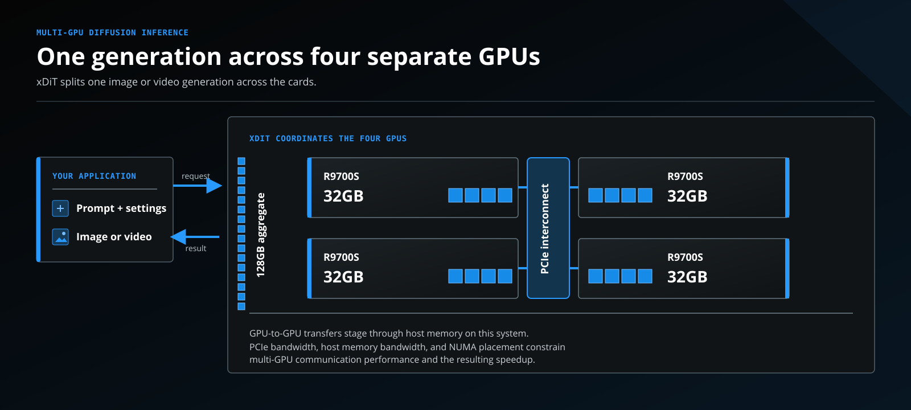
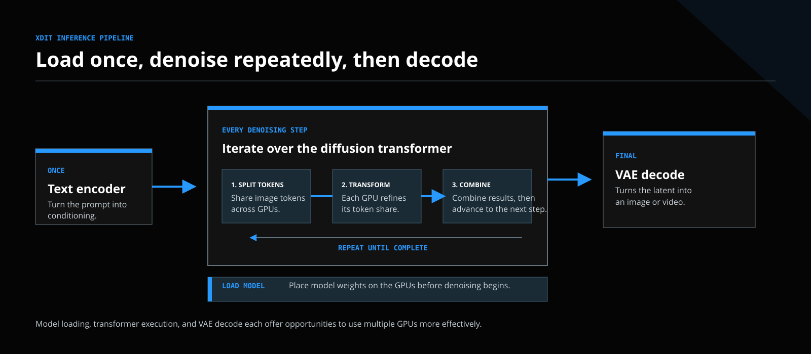
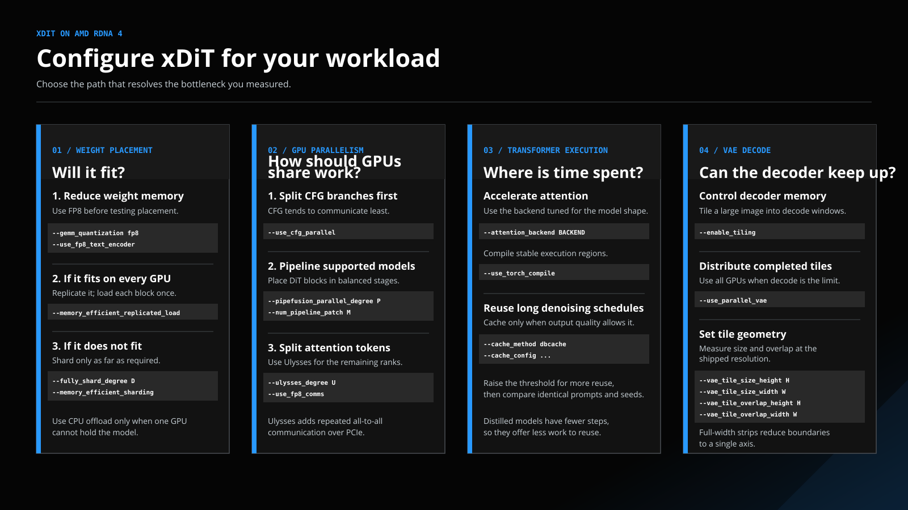
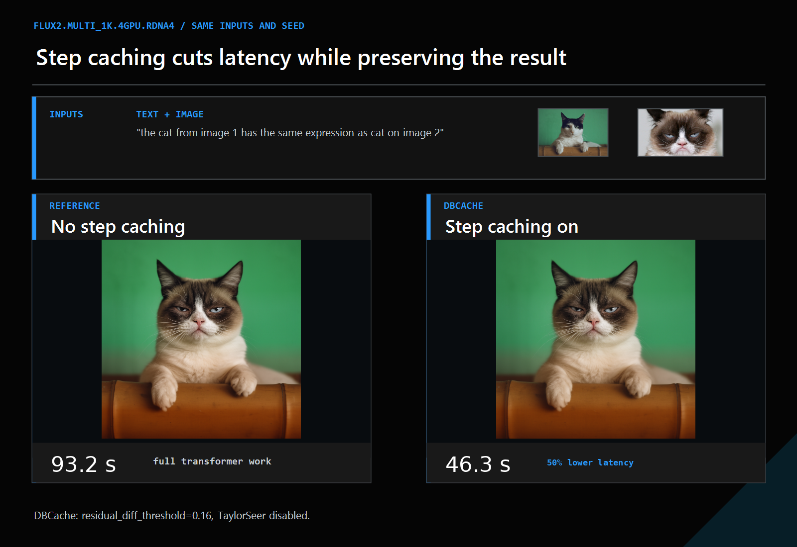
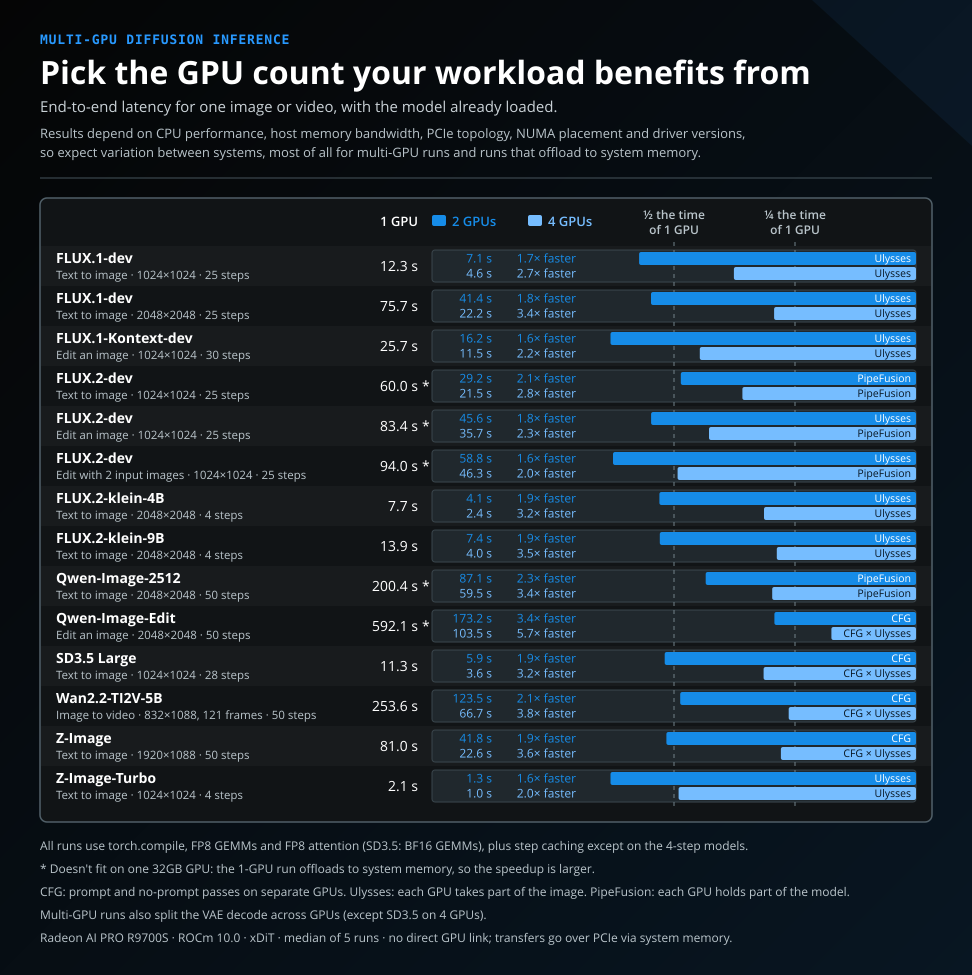

<!---
Copyright (c) 2026 Advanced Micro Devices, Inc. (AMD)

Permission is hereby granted, free of charge, to any person obtaining a copy
of this software and associated documentation files (the "Software"), to deal
in the Software without restriction, including without limitation the rights
to use, copy, modify, merge, publish, distribute, sublicense, and/or sell
copies of the Software, and to permit persons to whom the Software is
furnished to do so, subject to the following conditions:

The above copyright notice and this permission notice shall be included in all
copies or substantial portions of the Software.

THE SOFTWARE IS PROVIDED "AS IS", WITHOUT WARRANTY OF ANY KIND, EXPRESS OR
IMPLIED, INCLUDING BUT NOT LIMITED TO THE WARRANTIES OF MERCHANTABILITY,
FITNESS FOR A PARTICULAR PURPOSE AND NONINFRINGEMENT. IN NO EVENT SHALL THE
AUTHORS OR COPYRIGHT HOLDERS BE LIABLE FOR ANY CLAIM, DAMAGES OR OTHER
LIABILITY, WHETHER IN AN ACTION OF CONTRACT, TORT OR OTHERWISE, ARISING FROM,
OUT OF OR IN CONNECTION WITH THE SOFTWARE OR THE USE OR OTHER DEALINGS IN THE
SOFTWARE.
--->

# How to Scale Diffusion Inference Across AMD RDNA 4 GPUs

Each AMD Radeon AI PRO R9700S GPU combines 32GB of memory with RDNA 4 compute. A four-GPU system has 128GB of aggregate GPU memory, allowing it to run large image and video generation workloads such as FLUX.2, Qwen-Image, Wan 2.2, Stable Diffusion 3.5, and Z-Image.

This blog shows how to use xDiT, an open-source inference engine for diffusion transformers, to run image or video generation requests across one, two, or four Radeon AI PRO R9700S GPUs. It explains when multiple GPUs help, how to fit larger models, and how to reduce the PCIe communication that can limit scaling.

AMD's [Diffusion Model Inference repository](https://github.com/AMD-AGI/diffusion-models-inference) packages xDiT in a container and provides tuned RDNA 4 configurations for the featured workloads.

The following figure shows how a four-GPU system combines distributed memory capacity while exchanging data over PCIe.



## Bring Multi-GPU Diffusion Inference to RDNA 4

Using multiple GPUs can accommodate a model that exceeds 32GB and can reduce generation time. The gain depends on how much data the GPUs exchange: frequent PCIe transfers can erase the time saved by splitting the work. The tuned RDNA 4 configurations limit these transfers, place model weights without creating a host-memory spike, use native FP8 execution, reuse suitable denoising work, and distribute VAE decoding when beneficial.

Split one request across GPUs when you need lower latency for an image or video, or when the model does not fit on one GPU. When the workload fits on each GPU and you want more generations per hour, independent requests usually provide higher throughput because they avoid inter-GPU communication.

## Understanding the Inference Pipeline

A diffusion model turns a prompt into pixels in three stages:

1. A text encoder converts the prompt into a numerical representation.
2. A diffusion transformer (DiT) iteratively refines a compressed image representation called a latent.
3. A variational autoencoder (VAE) decodes the final latent into pixels.

The repeated transformer passes account for most of the inference time in many diffusion workloads. At high image resolutions and for video generation, VAE decoding can also become a significant memory and latency bottleneck.

The following figure traces these stages and highlights the repeated transformer work.



## Quickstart Example: Generate a 2048 by 2048 Image

### Prerequisites

Before you begin, prepare a Linux system with the following:

- One, two, or four AMD Radeon AI PRO R9700S GPUs with a host AMD GPU driver that supports ROCm 10.0. The results in this post were measured with `amdgpu-dkms` 6.19.14 (31.40).
- Docker installed and configured for ROCm workloads, including access to `/dev/kfd` and `/dev/dri`. Follow the official [Run ROCm Docker containers](https://rocm.docs.amd.com/en/latest/install/docker-containers.html) guide to prepare and verify the host.
- A Hugging Face account, an `HF_TOKEN` environment variable, and accepted model terms where required.
- Sufficient local storage for the Hugging Face cache, generated outputs, and first-run compilation artifacts.

The commands use the published [`amdsiloai/pytorch-xdit-custom`](https://hub.docker.com/r/amdsiloai/pytorch-xdit-custom/tags) image.

```bash
export XDIT_IMAGE=amdsiloai/pytorch-xdit-custom:rdna4-rocm10.0.0-ubuntu24.04-py3.12-torch2.13.0-xdit-ecf0f58-20261016
docker pull "$XDIT_IMAGE"
export HF_TOKEN=<your-hugging-face-token>
mkdir -p outputs "$HOME/.cache/huggingface" "$HOME/.cache/xdit"
```

The `xdit_run` helper below wraps the Docker options shared by every example. It gives the container access to the GPUs, reuses your Hugging Face cache, keeps compiled kernels in `~/.cache/xdit` so later runs skip most compilation, and writes results to `./outputs`. Run all commands from the same directory.

```bash
xdit_run() {
    docker run --rm -it \
        --device /dev/kfd --device /dev/dri \
        --ipc=host \
        --security-opt seccomp=unconfined \
        -e HF_TOKEN \
        -e HF_HOME=/hf-cache \
        -e TORCHINDUCTOR_CACHE_DIR=/xdit-cache/inductor \
        -e TRITON_CACHE_DIR=/xdit-cache/inductor/triton \
        -e AITER_JIT_DIR=/xdit-cache/aiter-jit \
        -v "$HOME/.cache/huggingface:/hf-cache" \
        -v "$HOME/.cache/xdit:/xdit-cache" \
        -v "$PWD/outputs:/outputs" \
        "$XDIT_IMAGE" \
        xdit "$@"
}
```

The following command runs FLUX.2 Klein 4B on one RDNA 4 GPU. The model is distilled to produce a high-quality image in fewer denoising steps; for this model `--num_inference_steps 4` is enough. `--gemm_quantization fp8` and `--use_fp8_text_encoder` reduce weight memory. `--attention_backend aiter_flydsl_fp8` and `--use_torch_compile` reduce transformer time. `--enable_tiling` bounds VAE memory at 2048 by 2048.

```bash
xdit_run \
    --model black-forest-labs/FLUX.2-klein-4B \
    --prompt "A spectacular sunset over the ocean" \
    --output-directory /outputs/quickstart \
    --seed 42 \
    --height 2048 --width 2048 \
    --num_inference_steps 4 \
    --guidance_scale 1.0 \
    --gemm_quantization fp8 \
    --use_fp8_text_encoder \
    --attention_backend aiter_flydsl_fp8 \
    --use_torch_compile \
    --enable_tiling
```

The figure below shows the image produced by this prompt and seed.


### Scale the Same Request to Two or Four GPUs

Set `ULYSSES_DEGREE` to `2` for two GPUs or `4` for four GPUs, then run the complete multi-GPU command below. The additional options replicate the model without a host-memory spike, distribute VAE decode, and set an optimized distributed tile geometry by processing the image in horizontal tile strips.

```bash
export ULYSSES_DEGREE=2

xdit_run \
    --model black-forest-labs/FLUX.2-klein-4B \
    --prompt "A spectacular sunset over the ocean" \
    --output-directory "/outputs/quickstart_$ULYSSES_DEGREE" \
    --seed 42 \
    --height 2048 --width 2048 \
    --num_inference_steps 4 \
    --guidance_scale 1.0 \
    --gemm_quantization fp8 \
    --use_fp8_text_encoder \
    --attention_backend aiter_flydsl_fp8 \
    --use_torch_compile \
    --memory_efficient_replicated_load \
    --ulysses_degree="$ULYSSES_DEGREE" \
    --use_fp8_comms \
    --use_parallel_vae \
    --enable_tiling \
    --vae_tile_size_height 352 \
    --vae_tile_size_width 2048 \
    --vae_tile_overlap_height 88 \
    --vae_tile_overlap_width 0
```

Expect the first run to download weights and compile kernels. Later runs reuse the kernels cached in `~/.cache/xdit` and start generating much sooner. Use the [xDiT model runner](https://github.com/xdit-project/xDiT/blob/main/docs/runner/runner.md) if you want to work with the Python library directly in your own Python application.

## Configure xDiT for Your Workload

Tune the workload in this order: place the weights so the model fits, choose how the GPUs share work, tune transformer execution with precision, compilation, and caching options, then tune VAE decode at the resolution you need.

The following figure summarizes these four configuration decisions.



### Make the Model Fit Before Tuning Latency

FP8 is the first option to test. It halves weight storage relative to BF16, and RDNA 4 executes FP8 natively.

- `--gemm_quantization fp8` converts the transformer's weight matrices while they load.
- `--use_fp8_text_encoder` does the same for supported text encoders. It requires `--gemm_quantization fp8`.

Quantizing weights reduces GPU memory use and can improve performance, but reduced precision can also change the generated output. Compare representative prompts and seeds before adopting a quantized configuration.

If the model fits on each GPU, replicate it with `--memory_efficient_replicated_load`. One process reads a checkpoint block and distributes it to the other processes, avoiding a host-RAM spike from every process loading its own copy.

If the model does not fit, split it with Fully Sharded Data Parallel, or FSDP:

- `--fully_shard_degree D` keeps roughly `1/D` of the weights on each GPU. Use `--fully_shard_components text_encoder` to shard only the text encoder. After processing the prompt, xDiT offloads the text encoder to system memory and leaves GPU memory available for the unsharded diffusion transformer.
- `--memory_efficient_sharding` loads directly into the sharded layout.

Use the smallest shard degree that fits. A larger degree lowers per-GPU weight memory, but requires more parameter gathering while the transformer runs.

On one GPU, CPU offload is the fallback for models that exceed 32GB:

- `--enable_model_cpu_offload` moves pipeline components to system memory when they are idle.
- `--enable_group_cpu_offload` moves groups of layers and can be faster than `--enable_sequential_cpu_offload`.

Offload lets a run exceed the 32GB VRAM limit, but transfers add overhead. A large two-GPU speedup may therefore mean both that work was parallelized and that the model no longer needed CPU offload.

### Balance Transformer Work and Communication

The cards communicate over PCIe. That makes the amount and frequency of communication as important as the amount of arithmetic each GPU performs.

- **CFG parallelism.** Some models make two predictions at each denoising step: one follows the prompt, while the other provides a result without prompt guidance. Combining them steers the output toward the prompt. `--use_cfg_parallel` assigns the two predictions to separate GPUs or GPU groups. The prediction paths execute separately before xDiT combines their outputs at each denoising step, so CFG parallelism moves little data between groups. It is available only for models that use CFG.

- **PipeFusion.** PipeFusion works like an assembly line. It places transformer stages on different GPUs and moves latent patches through them. This reduces the model memory required on each GPU and usually moves less data than Ulysses. `--pipefusion_parallel_degree D` sets the number of stages, while `--num_pipeline_patch P` sets the number of patches. The pipeline must remain balanced: if one stage takes longer, other GPUs wait in pipeline bubbles. Use `--attn_layer_num_for_pp N1 N2 ...` to adjust the attention-layer count per stage, then measure because equal layer counts do not always mean equal work.

- **Ulysses sequence parallelism.** Ulysses divides the tokens processed by attention across GPUs with `--ulysses_degree D`. It supports more models, but every attention layer exchanges data between GPUs, so it has the highest communication volume of the three methods. For supported models and attention backends, `--use_fp8_comms` sends these all-to-all transfers in FP8 to reduce the data moved over PCIe. Compare outputs when enabling it because the communication data uses lower precision.

These methods can be composed when the model supports them. For example, `--use_cfg_parallel --ulysses_degree 2` uses four GPUs: two GPUs share the work for each CFG prediction.

More GPUs are not always better for one request. Each additional GPU reduces the compute assigned to each card but can add communication or pipeline idle time. Choose the GPU count and parallel method that minimize measured latency for the workload.

### Select an Attention Backend and Compile the Transformer

The attention backend selects the kernels and precision used for the transformer's attention layers. Use `aiter_flydsl` for BF16 attention or `aiter_flydsl_fp8` for an FP8 path that can improve performance at a possible cost to output quality. Both backends are optimized for the RDNA 4 `gfx1201` architecture used by Radeon AI PRO R9700S GPUs.

`--use_torch_compile` compiles the transformer to reduce generation time. The first run is slower because it includes compilation. Later generations in the same process reuse the compiled code, and later runs reuse the compilation cache in `~/.cache/xdit`. This option is most useful when the model remains loaded for multiple generations, allowing the initial cost to be amortized across requests.

### Skip Transformer Work Only When the Model Has Enough Steps

In longer denoising schedules, consecutive transformer outputs can be very similar. Step caching reuses some of the work from a previous step. Enable DBCache with `--cache_method dbcache --cache_config '{"residual_diff_threshold": 0.12}'`. With PipeFusion, use `--cache_method pipefusion` instead, which applies the same DBCache logic to pipeline patches.

The cache configuration controls the tradeoff between generation speed and output quality:

- A higher `residual_diff_threshold` allows more reuse for greater speed, but increases the chance of visible differences in the output.
- A higher `Fn_compute_blocks` makes the reuse decision after running more transformer blocks, improving its reliability but reducing the work saved.
- Enabling `enable_taylorseer` adds residual-change calibration for a more reliable reuse decision; disabling it removes that calibration overhead but can reduce quality.
- `scm_policy` selects which denoising steps must be fully computed. More aggressive policies cache more steps for greater speed, while conservative policies preserve more computation and quality.
- A higher `max_warmup_steps` delays caching to preserve more early-step computation, while a higher `max_cached_steps` permits longer reuse for greater speed.

These parameters interact and are tuned per model to balance latency and output quality. Begin with the published configuration for your workload, then compare the same prompts and seeds when changing it.

The model used in the quickstart, FLUX.2 Klein 4B, is distilled, so it reaches an output in far fewer denoising steps than is typical and has little redundant work to cache. Full FLUX.2 follows a longer schedule, which gives step caching an opportunity to skip selected transformer work. Measure the same prompts and seeds before increasing the threshold.

The comparison below shows the measured latency and outputs with DBCache disabled and enabled for a four-GPU FLUX.2-dev edit with two input images at 1024 by 1024.



### Tune the VAE at the Resolution You Intend to Ship

The VAE turns the final latent into pixels. At 2048 by 2048 and in video generation, its activation memory and latency can become significant.

- `--use_parallel_vae` distributes decoding across GPUs.
- `--enable_tiling` decodes windows instead of the entire image at once.

Together, these options distribute complete tiles. This reduces the repeated boundary exchanges required by row-sharded decoding, although tiles still need overlap to avoid seams. On one GPU, tiling remains useful because it caps the decoder's working memory.

Tile geometry is part of the configuration:

```bash
--vae_tile_size_height 352 \
--vae_tile_size_width 2048 \
--vae_tile_overlap_height 88 \
--vae_tile_overlap_width 0
```

The best geometry depends on the output resolution, VAE architecture, GPU count, and interconnect. Larger tiles usually reduce the number of decoder calls, seams, and repeated overlap work, but require more memory per tile. Smaller tiles reduce per-tile activation memory and create more work units to balance across GPUs, at the cost of more overlap and decoder calls. The tile count also caps how many GPUs tile parallelism can use.

Start with strips that span the full width. Leaving one axis untiled removes overlap on that axis and reduces repeated work. Then benchmark a few supported geometries at the final output resolution: use the largest tile that fits and keeps all participating GPUs usefully occupied, and compare output quality because tile-local normalization can change the result. The values above are tuned for the 2048 by 2048 Klein 4B configuration, not a universal VAE setting. DistVAE's [tile-window guide](https://github.com/xdit-project/DistVAE/blob/main/docs/tiling.md) explains the tradeoffs and its benchmark can generate candidate geometries for each VAE family and rank count.

## Pick the GPU Count Your Workload Benefits From

No single GPU count is optimal for every workload. Additional cards help most when the transformer and decoder have enough work to offset PCIe communication. As the work per GPU falls, communication, synchronization, and other fixed costs account for more of the generation time.

The chart below shows end-to-end latency and relative single-request speedup using the Docker container referenced in this post. Speedup is the median 1-GPU latency divided by the median latency at each GPU count. A value of `2.0×` means that generation takes half as long as the 1-GPU baseline.



Four independent one-GPU jobs may produce more results per hour. Consider multi-GPU configurations when a workload requires aggregate memory or lower latency for a single result.

These results come from one system on which GPU-to-GPU transfers pass through host memory over PCIe. Latency depends on CPU performance, host memory bandwidth, PCIe topology, GPU placement across NUMA nodes, and driver versions, so expect variation between systems, especially for multi-GPU runs and runs that offload to system memory.

## Troubleshooting and Common Questions

### Will Doubling the GPU Count Halve Image Generation Time?

No. A second GPU can eliminate the need to move model components between system and GPU memory or divide low-communication work, which can produce large gains. It also introduces inter-GPU communication, however, so model architecture, resolution, and the selected parallel method determine the outcome.

### Why Does a Model Fit on Two GPUs but Not One?

The model's weights and peak activations can exceed one GPU's 32GB of memory. A multi-GPU configuration can shard the weights across devices, using their combined capacity to keep the model resident in GPU memory.

### When Should I Use Four GPUs for Diffusion Inference?

Use four GPUs when the model needs their combined capacity or when measurements show that they provide a worthwhile single-request latency improvement. If the model fits on fewer GPUs, communication can limit scaling; for maximum throughput, independent requests often make better use of the available GPUs.

### What Should I Tune First in xDiT?

Start with precision and placement. A model that does not fit cannot be made faster by parallelism or caching.

## Summary

This blog showed how to run xDiT image and video generation on one, two, or four AMD Radeon AI PRO R9700S GPUs. It starts with a containerized FLUX.2 Klein 4B quickstart that scales the same 2048 by 2048 request from one GPU to two or four. It then sets out an order for configuring any workload. First, make the model fit by using FP8 weights, memory-efficient replication, FSDP sharding, or CPU offload on a single GPU. Next, choose CFG parallelism, PipeFusion, or Ulysses based on how much data each method exchanges over PCIe. Then reduce transformer time with an RDNA 4 attention backend, transformer compilation, and step caching for models with longer denoising schedules. Finally, tune distributed, tiled VAE decoding at the output resolution you intend to ship.

The measured results show that the best GPU count depends on the workload. Additional GPUs help most when a model needs their aggregate memory or when the transformer and decoder have enough work to offset inter-GPU communication. For throughput on models that fit on one GPU, independent requests are often the better choice. To apply this guidance, begin with the published RDNA 4 configuration closest to your model, resolution, and GPU count. Confirm that the model fits at the intended precision, select a parallel layout based on measured end-to-end latency, and tune only the measured bottleneck while comparing output quality with fixed prompts and seeds.

In a future blog, we plan to show how the xDiT for ComfyUI custom nodes bring xDiT multi-GPU inference into a familiar visual workflow, making it easier for Radeon users to run supported image and video models. Until then, check the xDiT and Diffusion Model Inference repositories for newly supported models and updated RDNA 4 configurations.

## Additional Resources

- [xDiT](https://github.com/xdit-project/xDiT) documents supported models and parallel methods.
- [Diffusion Model Inference](https://github.com/AMD-AGI/diffusion-models-inference) provides the RDNA 4 configuration references and Dockerfile.
- [DistVAE](https://github.com/xdit-project/DistVAE) provides distributed VAE decode and tiling.
- [AMD Radeon AI PRO graphics](https://www.amd.com/en/products/graphics/workstations/radeon-ai-pro.html) provides product information.

## Disclaimers

The information presented in this document is for informational purposes only and may contain technical inaccuracies, omissions, and typographical errors. The information contained herein is subject to change and may be rendered inaccurate for many reasons, including but not limited to product and roadmap changes, component and motherboard version changes, new model and/or product releases, product differences between differing manufacturers, software changes, BIOS flashes, firmware upgrades, or the like. Any computer system has risks of security vulnerabilities that cannot be completely prevented or mitigated. AMD assumes no obligation to update or otherwise correct or revise this information.
However, AMD reserves the right to revise this information and to make changes from time to time to the content hereof without obligation of AMD to notify any person of such revisions or changes.
THIS INFORMATION IS PROVIDED ‘AS IS.” AMD MAKES NO REPRESENTATIONS OR WARRANTIES WITH RESPECT TO THE CONTENTS HEREOF AND ASSUMES NO RESPONSIBILITY FOR ANY INACCURACIES, ERRORS, OR OMISSIONS THAT MAY APPEAR IN THIS INFORMATION. AMD SPECIFICALLY DISCLAIMS ANY IMPLIED WARRANTIES OF NON-INFRINGEMENT, MERCHANTABILITY, OR FITNESS FOR ANY PARTICULAR PURPOSE. IN NO EVENT WILL AMD BE LIABLE TO ANY PERSON FOR ANY RELIANCE, DIRECT, INDIRECT, SPECIAL, OR OTHER CONSEQUENTIAL DAMAGES ARISING FROM THE USE OF ANY INFORMATION CONTAINED HEREIN, EVEN IF AMD IS EXPRESSLY ADVISED OF THE POSSIBILITY OF SUCH DAMAGES.
AMD, the AMD Arrow logo, AMD Radeon, Radeon, Radeon AI PRO, and ROCm are trademarks of Advanced Micro Devices, Inc. Other product names used in this publication are for identification purposes only and may be trademarks of their respective companies.
© 2026 Advanced Micro Devices, Inc. All rights reserved
