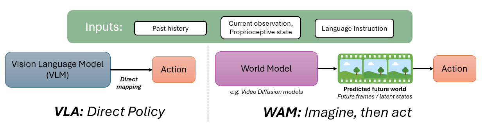

<!---
Copyright (c) 2026 Advanced Micro Devices, Inc. (AMD)

Permission is hereby granted, free of charge, to any person obtaining a copy
of this software and associated documentation files (the "Software"), to deal
in the Software without restriction, including without limitation the rights
to use, copy, modify, merge, publish, distribute, sublicense, and/or sell
copies of the Software, and to permit persons to whom the Software is
furnished to do so, subject to the following conditions:

The above copyright notice and this permission notice shall be included in all
copies or substantial portions of the Software.

THE SOFTWARE IS PROVIDED "AS IS", WITHOUT WARRANTY OF ANY KIND, EXPRESS OR
IMPLIED, INCLUDING BUT NOT LIMITED TO THE WARRANTIES OF MERCHANTABILITY,
FITNESS FOR A PARTICULAR PURPOSE AND NONINFRINGEMENT. IN NO EVENT SHALL THE
AUTHORS OR COPYRIGHT HOLDERS BE LIABLE FOR ANY CLAIM, DAMAGES OR OTHER
LIABILITY, WHETHER IN AN ACTION OF CONTRACT, TORT OR OTHERWISE, ARISING FROM,
OUT OF OR IN CONNECTION WITH THE SOFTWARE OR THE USE OR OTHER DEALINGS IN THE
SOFTWARE.
--->

# Optimizing World Action Models on AMD GPUs

**World Action Models** (WAMs) offer a promising route to more physically grounded robot policies, but their video-model backbones make inference expensive. In this blog you will learn how to remove much of that cost on AMD GPUs without sacrificing task success, using two representative WAMs, FastWAM [[1]](#ref-1) and DiT4DiT [[2]](#ref-2).

The optimizations come in two stages:

- First, training-free changes reduce runtime overhead and leave the released model weights untouched. They combine kernel optimizations found with GEAK, an AMD agentic framework for GPU kernel optimization, with fewer denoising steps.
- Second, architectural changes shrink the action expert and compress raw action chunks into continuous latent actions, cutting the cost of each action-denoising step.

Code and checkpoint are available in the [faster-action-models](https://github.com/AMD-AGI/faster-action-models) repository and on [Hugging Face](https://huggingface.co/collections/amd/compact-action-expert-cae).

The two stages are complementary: together they lower closed-loop inference latency while preserving task performance, making WAMs more practical for robotic control on AMD GPUs.

## What Are WAMs, and How Are They Different from VLAs?

Generalist robot policies are being built on two different starting points [[3]](#ref-3). **Vision-Language-Action (VLA) models** adapt a pretrained vision-language backbone to emit actions directly, whereas World Action Models begin with a pretrained video or world-model backbone, predict how the scene is likely to evolve, and condition an action head on that prediction [[3]](#ref-3), [[4]](#ref-4), [[5]](#ref-5). The motivation is the grounding gap: vision-language pretraining provides broad semantic knowledge but limited experience with causing physical change, while video pretraining already encodes patterns such as reaching, contact, motion, and occlusion. Predicting an action from an imagined outcome may therefore be easier than learning the full language-to-action mapping from scarce robot demonstrations, while future-frame prediction supplies a useful physical regularizer. These advantages remain hypotheses that require broader matched comparisons. Figure 1 contrasts the two approaches.



Figure 1: A VLA maps observations directly to actions, while a WAM first predicts how the world may evolve and then selects an action.

The video prior is not free. Running a video Diffusion Transformer (DiT) prefill at every control step consumes latency and memory to generate internal future representations that are never displayed. That cost becomes a deployment obstacle when closed-loop control operates on millisecond timescales.

## Architectural Design of WAMs

FastWAM [[1]](#ref-1) and DiT4DiT [[2]](#ref-2) share a dual-DiT structure: a pretrained Video DiT produces predictive world features, while an Action DiT uses those features, language, and robot state to denoise an action chunk. Figure 2 shows the generalized architecture.

```{image} ./images/dual-dit-architecture.png
:alt: Generalized dual-DiT World Action Model architecture
:width: 60%
:align: center
```

Figure 2: Generalized dual-DiT architecture. FastWAM couples its experts through shared attention, while DiT4DiT transfers intermediate video features to the Action DiT through cross-attention.

- FastWAM pairs a Wan-based video expert with a 30-layer action expert through shared attention. Future-frame prediction is used during co-training but removed at inference.
- DiT4DiT conditions the Action DiT through cross-attention to intermediate Video DiT features at timestep $\tau_f$ and trains both branches with dual flow matching.

Both policies take a language instruction, two 224 × 224 RGB camera views, and 8-dimensional proprioception. FastWAM predicts a 32-step, 7-DoF action chunk, while the LIBERO configuration of DiT4DiT predicts 8 steps.

## Training-Free Inference Optimizations

Profiling FastWAM on an AMD Instinct™ MI355X GPU shows that the Action DiT's ten-step denoising loop accounts for approximately 87% of end-to-end inference time. This makes repeated action denoising the first optimization target, followed by the Video DiT prefill and the interface between the video and action branches.

### Baseline Reproduction

Before optimizing the runtime, we reproduced the published FastWAM and DiT4DiT results on AMD Instinct™ MI355X and AMD Radeon™ PRO W7900 GPUs across the LIBERO [[6]](#ref-6) and RoboCasa [[7]](#ref-7) benchmarks. Table 1 compares the published success rates with our measurements.

| Model | Benchmark | Reported success (%) | On Instinct™ MI355X (%) | On Radeon™ PRO W7900 (%) |
| --- | --- | ---: | ---: | ---: |
| FastWAM [[1]](#ref-1) | LIBERO | 97.60 | 96.95 | 97.25 |
| DiT4DiT [[2]](#ref-2) | LIBERO | 98.60 | 98.16 | 98.85 |
| DiT4DiT [[2]](#ref-2) | RoboCasa | 56.70 | 57.90 | 57.75 |

Table 1: Reproduction of published FastWAM and DiT4DiT results on AMD hardware across LIBERO and RoboCasa. All values are task success rates. MI355X LIBERO values are the mean of 11 full evaluation runs; RoboCasa values are from a single evaluation run.

On the MI355X, the entire closed loop runs on the GPU: a GPU physics engine and ray tracer for AMD Instinct™ GPUs simulates and renders the scenes, and each benchmark's evaluation code runs unchanged. The Radeon™ PRO W7900 uses the standard setup: MuJoCo physics on the CPU, OpenGL rendering on the GPU.

Across the three workloads, the reproduced results closely match the reported evaluations: within 0.65 percentage points on LIBERO and 1.2 percentage points on RoboCasa, comparable to the 1.1-point spread across the DiT4DiT authors' [five evaluation runs of the same checkpoint](https://github.com/Mondo-Robotics/DiT4DiT#robocasa-gr1-benchmark) (56.3–57.4%). This establishes that the **released checkpoints operate within an acceptable tolerance on both AMD CDNA™ (Instinct™) and RDNA™ (Radeon™) architectures** before optimization.

#### Reproduce the Baseline Results

From the [faster-action-models](https://github.com/AMD-AGI/faster-action-models) repository, run the baseline evaluations in Table 1 with:

```bash
bash scripts/reproduce_baselines.sh
```

Here we explore the following training-free techniques:

1. **Kernel-level changes.** [GEAK](https://github.com/AMD-AGI/GEAK) is an AMD agentic framework for GPU kernel optimization. We use GEAK to profile the real inference path, propose kernel-level optimizations, and evaluate each candidate against correctness and performance gates. The broader workflow is described in the [GEAK V4 technical article](https://www.amd.com/en/developer/resources/technical-articles/2026/geak-v4.html).
2. **Reducing the number of denoising time steps.** We shorten the repeated flow-matching loop and retain a step count only when it passes closed-loop evaluation.

Training-free optimization combines GEAK-based kernel improvements with fewer denoising steps. GEAK alone reduces FastWAM latency from 222.55 ms to 24.17 ms, a 9.2× speedup, and DiT4DiT/LIBERO latency from 81.47 ms to 6.49 ms, a 12.6× speedup[†](#perf-note), while preserving task accuracy. Reducing the number of denoising steps cuts latency further, without retraining or changing checkpoint weights. Overall, GEAK with two denoising steps speeds up FastWAM on LIBERO by about 23× (222.55 → 9.59 ms), DiT4DiT on LIBERO by about 14× (81.47 → 5.65 ms), and DiT4DiT on RoboCasa by about 15× (82.5 → 5.35 ms)[†](#perf-note), with task success at parity: within 0.1 percentage points on LIBERO, and within the noise of a single evaluation run on RoboCasa.

Naive `torch.compile` already helps: the [FastWAM authors](https://github.com/yuantianyuan01/FastWAM) report roughly 2× faster inference from their compiled path, and on MI355X it cuts latency 1.6–2.6× relative to eager PyTorch. GEAK goes well beyond that, running 3.7× faster than `torch.compile` for FastWAM and 7.7–7.9× faster for DiT4DiT[†](#perf-note).

| Optimization | FastWAM on LIBERO | DiT4DiT on LIBERO | DiT4DiT on RoboCasa |
| --- | ---: | ---: | ---: |
| No optimization | 96.95% (222.55 ms) | 98.16% (81.47 ms) | 57.9% (82.5 ms) |
| GEAK | 96.86% (24.17 ms) | 98.24% (6.49 ms) | 58.2% (6.69 ms) |
| GEAK + 2 denoising steps | 97.00% (9.59 ms) | 98.08% (5.65 ms) | 60.9% (5.35 ms) |

Table 2: Training-free optimization results on MI355X; each cell is success rate (latency per policy decision)[†](#perf-note). The reduced-step configuration uses 10 → 2 steps for FastWAM and 4 → 2 steps for DiT4DiT. LIBERO success rates are the mean of 11 full runs; RoboCasa rates are from a single evaluation run.

Reproduce Table 2, including the `torch.compile` comparison, with:

```bash
bash scripts/reproduce_training_free.sh
```

### What Made the Largest Impact

- **HIP graph capture and replay.** Capturing the repeated Video DiT prefill and action-denoising paths removes much of the Python and HIP launch overhead while preserving the original GPU computation.
- **Wider projection operations.** Fusing Q, K, and V projections and grouping cross-attention projections creates larger GEMMs that use the GPU more effectively.
- **Less dispatch and data movement.** Removing repeated module traversal, hoisting loop-invariant work, and producing tensors in their final layouts eliminates small operations from the critical path.
- **Fixed-shape VAE specialization.** Specializing the single-frame workload replaces eligible temporal 3D convolutions with equivalent 2D operations and avoids repeated layout conversions.

Every candidate must clear a 14-episode LIBERO screen: two episodes on each of seven tasks across all four suites. A candidate passes if any of three attempts succeeds on all 14. Retries only absorb random misses, since a broken kernel fails every attempt, and they don't affect the reported success rates, which come from full LIBERO evaluations.

### Post-Optimization Profile

After GEAK optimization, repeated Action DiT denoising is approximately 10× faster, and the Video DiT prefill feeding the Video-Action Coupling Interface is approximately 4.5× faster. Because action denoising represented 87.4% of FastWAM's eager runtime, those improvements produce the observed 9.2× end-to-end gain[†](#perf-note).

## Architectural Optimizations

Under architectural optimizations, we leverage two key dimensions:

1. **Model architectural changes.** We modify the Action DiT in two complementary ways and retrain the model:
   - **Compact Action DiT:** reduce the action expert's hidden dimensions and capacity while retaining task performance.
   - **Action VAE:** compress raw joint-space action chunks into fewer continuous latent tokens, reducing the amount of work performed during denoising.

   Together, we refer to these two changes as the Compact Action Expert (CAE).
2. **Insights from training-free optimization.** Retain the GEAK optimizations and denoising-step improvements from the earlier track so that the architecture and runtime optimizations can be combined.

### Results at a Glance

- **FastWAM/LIBERO:** The Compact Action Expert (CAE) slightly improves on the original FastWAM model's performance (97.28% vs. 96.95%).
- **DiT4DiT/RoboCasa:** The Compact Action Expert (CAE) reaches 56.8% success compared with the reported 56.7%, remaining within the published performance range despite compressing the action representation.

When CAE is combined with GEAK and 10 → 4 denoising steps, FastWAM/LIBERO latency falls from 222.55 ms to 8.83 ms (about 25×)[†](#perf-note) while maintaining 97.33% success.

### FastWAM on LIBERO

The Action VAE compresses each 32 × 7 raw-action chunk into an 8 × 16 continuous latent representation: 4× fewer temporal tokens and 43% fewer scalars for the Action DiT to denoise. Figure 3 compares the native and latent action representations.

```{image} ./images/fastwam-native-vs-latent-actions.png
:alt: Fast-WAM native versus latent action representation
:width: 60%
:align: center
```

Figure 3: FastWAM with native actions and with an Action VAE. The Action VAE shortens the sequence the Action DiT denoises from 32 raw-action steps to 8 latent tokens. Together with the Compact Action DiT, which cuts the hidden size from 1024 to 32, the embedded action sequence shrinks from 32 × 1024 to 8 × 32 values.

Discrete action tokenizers such as ActionCodec [[8]](#ref-8) and VQ-VLA [[9]](#ref-9) are useful for autoregressive VLAs because those models decode one token at a time. WAM action experts instead denoise a complete chunk in parallel through flow matching, making a continuous latent representation a more natural fit.

Table 3 summarizes the FastWAM/LIBERO results as the architectural and training-free optimizations are combined.

| Configuration | Success (%) | Latency (ms) |
| --- | ---: | ---: |
| No optimization | 96.95 ± 0.22 | 222.55 |
| GEAK | 96.86 ± 0.30 | 24.17 |
| GEAK + Compact Action Expert | 97.28 ± 0.20 | 12.82 |
| GEAK + Compact Action Expert + denoising steps 10 to 4 | 97.33 ± 0.26 | 8.83 |

Table 3: FastWAM/LIBERO results for the architectural and training-free optimizations[†](#perf-note). Success rates are the mean ± standard deviation over 11 full LIBERO runs (5 for the 10 → 4-step configuration). The Compact Action Expert configurations improve success slightly, by about 0.4 percentage points over GEAK alone, a gain larger than the run-to-run standard error (at most 0.11 percentage points).

The Compact Action Expert (CAE) roughly halves GEAK-only latency, from 24.17 ms to 12.82 ms, while improving success by 0.42 percentage points (96.86% → 97.28%). Reducing the denoising steps from 10 to 4 brings latency to 8.83 ms at 97.33% success, 0.38 percentage points above the unoptimized baseline (96.95%) and about 25× faster than the 222.55 ms starting point[†](#perf-note).

Reproduce Table 3 with:

```bash
bash scripts/reproduce_cae_fastwam.sh
```

#### Qualitative LIBERO Rollouts

Figures 4 through 7 compare the released FastWAM model (left) with CAE-FastWAM (right) on one task from each LIBERO suite, starting from the same initial scene.

```{video} videos/libero-spatial.mp4
:width: 100%
:controls:
```

Figure 4: LIBERO Spatial. "Pick up the black bowl next to the ramekin and place it on the plate." Both policies succeed.

```{video} videos/libero-object.mp4
:width: 100%
:controls:
```

Figure 5: LIBERO Object. "Pick up the alphabet soup and place it in the basket." Both policies succeed.

```{video} videos/libero-goal.mp4
:width: 100%
:controls:
```

Figure 6: LIBERO Goal. "Open the middle drawer of the cabinet." Both policies succeed.

```{video} videos/libero-long.mp4
:width: 100%
:controls:
```

Figure 7: LIBERO Long. "Put both the cream cheese box and the butter in the basket." Both policies succeed.

### DiT4DiT on RoboCasa

To test whether latent actions generalize beyond one model and benchmark, we apply the same Action VAE recipe to DiT4DiT on RoboCasa-GR1 [[7]](#ref-7). This bimanual tabletop benchmark has 29 active degrees of freedom across two arms, two hands, and a waist, with 24 task families and 720-step episode horizons.

The VAE compresses a 16 × 29 action chunk into 8 × 48 latents. The token count remains `K=8`, as in LIBERO, while the latent width increases to represent RoboCasa's wider per-timestep action. The policy denoises eight latent tokens rather than 16 raw-action steps in four flow-matching iterations.

- **RoboCasa result:** The Action VAE (`K=8`, `d=48`) policy reaches 56.8% success, compared with the reported 56.7% DiT4DiT average.

The 56.8% result lies within the published 56.3–57.4% range and is therefore evidence of parity, not improvement. Although it comes from a single evaluation run, it shows that latent-action compression transfers from a 7-DoF single-arm policy to a 29-DoF bimanual policy without a measurable performance loss.

Reproduce the CAE-DiT4DiT result with a checkpoint you train yourself (see Training the Latent-Action Models):

```bash
bash scripts/reproduce_cae_dit4dit.sh
```

#### Qualitative RoboCasa Rollouts

Figures 8 and 9 compare the released DiT4DiT model (left) with CAE-DiT4DiT (right) on two RoboCasa-GR1 tasks, starting from the same initial scene.

```{video} videos/robocasa-milk.mp4
:width: 100%
:controls:
```

Figure 8: RoboCasa. "Pick up the milk, place it into the microwave, and close the microwave."

```{video} videos/robocasa-bottle.mp4
:width: 100%
:controls:
```

Figure 9: RoboCasa. "Pick up the bottled water, place it into the cabinet, and close the cabinet."

## Training the Latent-Action Models

Train the FastWAM/LIBERO and DiT4DiT/RoboCasa Action VAEs with:

```bash
bash scripts/train_fastwam_libero_action_vae.sh
bash scripts/train_dit4dit_robocasa_action_vae.sh
```

Both Action VAEs train in less than 15 minutes on one AMD Instinct™ MI325X GPU. The two Compact Action Expert (CAE) policies, CAE-FastWAM and CAE-DiT4DiT, use:

```bash
bash scripts/train_fastwam_libero_latent_policy.sh
bash scripts/train_dit4dit_robocasa_latent_policy.sh
```

FastWAM/LIBERO CAE training takes 22.7 hours on two MI325X GPUs, compared with 22.8 hours for compact raw-action training. CAE-DiT4DiT training takes approximately five days on eight MI325X GPUs.

## Summary

In this blog you learned how to make World Action Models much cheaper to run on AMD GPUs without giving up task success. You first saw that the released FastWAM and DiT4DiT checkpoints reproduce their published LIBERO and RoboCasa results on AMD Instinct™ MI355X and AMD Radeon™ PRO W7900 GPUs. You then applied training-free optimizations: GEAK-based kernel improvements deliver an approximately 9.2× speedup for FastWAM and a 12.6× speedup for DiT4DiT on LIBERO[†](#perf-note) while preserving task accuracy, and fewer denoising steps reduce latency further. To learn more about the agentic workflow behind these kernels, read [GEAK v4: From Faster Kernels to Faster Workloads](https://www.amd.com/en/developer/resources/technical-articles/2026/geak-v4.html).

Finally, you saw how architectural changes reduce the cost of each action-denoising step. The Compact Action Expert (CAE) slightly improves on the original FastWAM model's accuracy on LIBERO. Combined with GEAK and 10 → 4 denoising steps, it reduces FastWAM latency from 222.55 ms to 8.83 ms at 97.33% success[†](#perf-note). On DiT4DiT/RoboCasa, CAE-DiT4DiT reaches 56.8% on a single evaluation run, within the published 56.3–57.4% range.

Together, the two optimization tracks show that WAMs can retain their predictive world-model prior while approaching practical closed-loop control latency on AMD GPUs. Future work involves validating these policies on physical robots and testing their robustness and adaptability to new environments.

## Additional Resources

- [faster-action-models repository](https://github.com/AMD-AGI/faster-action-models)
- [Compact Action Expert (CAE) checkpoint on Hugging Face](https://huggingface.co/collections/amd/compact-action-expert-cae)
- [GEAK v4: From Faster Kernels to Faster Workloads](https://www.amd.com/en/developer/resources/technical-articles/2026/geak-v4.html)
- [FastWAM source repository](https://github.com/yuantianyuan01/FastWAM)
- [DiT4DiT source repository](https://github.com/Mondo-Robotics/DiT4DiT)
- [ROCm documentation](https://rocm.docs.amd.com/)

## References

<a id="ref-1">[1]</a> T. Yuan, Z. Dong, Y. Liu, and H. Zhao, “Fast-WAM: Do World Action Models Need Test-time Future Imagination?” *arXiv preprint arXiv:2603.16666*, 2026. [https://arxiv.org/abs/2603.16666](https://arxiv.org/abs/2603.16666)

<a id="ref-2">[2]</a> T. Ma et al., “DiT4DiT: Jointly Modeling Video Dynamics and Actions for Generalizable Robot Control,” *arXiv preprint arXiv:2603.10448*, 2026. [https://arxiv.org/abs/2603.10448](https://arxiv.org/abs/2603.10448)

<a id="ref-3">[3]</a> NVIDIA, “Pretrained to Imagine, Fine-Tuned to Act: The Rise of World-Action Models,” *NVIDIA Technical Blog*, 2026. [https://developer.nvidia.com/blog/pretrained-to-imagine-fine-tuned-to-act-the-rise-of-world-action-models/](https://developer.nvidia.com/blog/pretrained-to-imagine-fine-tuned-to-act-the-rise-of-world-action-models/)

<a id="ref-4">[4]</a> Q. Shen et al., “World Action Models: A Survey,” *arXiv preprint arXiv:2606.20781*, 2026. [https://arxiv.org/abs/2606.20781](https://arxiv.org/abs/2606.20781)

<a id="ref-5">[5]</a> Dyna Robotics, “Dyna-2,” 2026. [https://www.dyna.co/dyna-2](https://www.dyna.co/dyna-2)

<a id="ref-6">[6]</a> B. Liu, Y. Zhu, C. Gao, Y. Feng, Q. Liu, Y. Zhu, and P. Stone, “LIBERO: Benchmarking Knowledge Transfer for Lifelong Robot Learning,” *Advances in Neural Information Processing Systems 36*, 2023. [https://arxiv.org/abs/2306.03310](https://arxiv.org/abs/2306.03310)

<a id="ref-7">[7]</a> S. Nasiriany, A. Maddukuri, L. Zhang, A. Parikh, A. Lo, A. Joshi, A. Mandlekar, and Y. Zhu, “RoboCasa: Large-Scale Simulation of Everyday Tasks for Generalist Robots,” *Robotics: Science and Systems*, 2024. [https://arxiv.org/abs/2406.02523](https://arxiv.org/abs/2406.02523)

<a id="ref-8">[8]</a> Z. Dong et al., “ActionCodec: What Makes for Good Action Tokenizers,” *arXiv preprint arXiv:2602.15397*, 2026. [https://arxiv.org/abs/2602.15397](https://arxiv.org/abs/2602.15397)

<a id="ref-9">[9]</a> Y. Wang, H. Zhu, M. Liu, J. Yang, H.-S. Fang, and T. He, “VQ-VLA: Improving Vision-Language-Action Models via Scaling Vector-Quantized Action Tokenizers,” *Proceedings of the IEEE/CVF International Conference on Computer Vision*, 2025. [https://arxiv.org/abs/2507.01016](https://arxiv.org/abs/2507.01016)

## Bias, Risks & Limitations

The released CAE-FastWAM checkpoint is a research checkpoint evaluated only in simulation (LIBERO). It has not been validated on physical robots and is not intended for safety-critical, medical, or other high-stakes applications. Success rates are simulator measurements and may not transfer to real-world settings. Users are responsible for evaluating the policy and adding appropriate safety mechanisms for their own use cases.

## License

The code is released under the Apache License 2.0. The CAE-FastWAM checkpoint is fine-tuned from `Wan2.2-TI2V-5B` and released under the Apache License 2.0. Third-party code, models, datasets, and simulator assets remain under their original licenses and are not redistributed; see `THIRD_PARTY_NOTICES.md` in the repository.

## System Configuration

All MI355X results in this blog (task success, latency and GEAK optimization runs) use the MI355X configuration below; the W7900 is used only for the Table 1 reproduction.

| Component | Evaluation, latency and GEAK (MI355X) | Reproduction (W7900) | Training |
| --- | --- | --- | --- |
| GPU | AMD Instinct™ MI355X GPU | AMD Radeon™ PRO W7900 | AMD Instinct™ MI325X GPU (×2 FastWAM, ×8 DiT4DiT) |
| CPU | 2× AMD EPYC™ 9575F | AMD Ryzen™ Threadripper™ PRO 5975WX | 2× AMD EPYC™ 9575F |
| ROCm™ | 7.14.0 (HIP 7.14.60850) | 7.14.0 (host 7.2.0) | 7.2.0 (HIP 7.2.26015) |
| PyTorch / Triton / Python | 2.11.0 / 3.7.1 / 3.12.3 | 2.12.0 / 3.7.1 / 3.14.4 | 2.10.0a0 / 3.6.0 / 3.12.3 |
| Simulation | On GPU (physics and rendering; MuJoCo 3.3.2 semantics); robosuite 1.4.0 (LIBERO), 1.5.1 (RoboCasa) | Physics on CPU, OpenGL rendering on GPU; LIBERO: MuJoCo 3.3.2, robosuite 1.4.0; RoboCasa: MuJoCo 3.2.6, robosuite 1.5.1 | not applicable |
| OS / container | Ubuntu 24.04.4 LTS; `rocm/pytorch:rocm7.14_ubuntu24.04_py3.12_pytorch_release_2.11.0` with simulation packages added | Ubuntu 26.04; `rocm/pytorch:rocm7.14_ubuntu26.04_py3.14_pytorch_release_2.12.0` with simulation packages added | Ubuntu 24.04.4 LTS; `rocm/primus:v26.2` |
| Test date | October 12, 2026 | September 11–12, 2026 | September 28, 2026 |

<a id="perf-note"></a>† **Performance note:** Testing conducted by AMD as of October 12, 2026, on an AMD Instinct™ MI355X GPU with ROCm™ 7.14.0 and PyTorch 2.11.0. Latency is per policy decision on a single GPU; success rates are from closed-loop LIBERO and RoboCasa-GR1 simulation. All comparisons are between configurations of the same model on the same system. Results may vary based on configuration, workload, software versions, and system setup.

## Disclaimers

The information presented in this document is for informational purposes only and may contain technical inaccuracies, omissions, and typographical errors. The information contained herein is subject to change and may be rendered inaccurate for many reasons, including but not limited to product and roadmap changes, component and motherboard version changes, new model and/or product releases, product differences between differing manufacturers, software changes, BIOS flashes, firmware upgrades, or the like. Any computer system has risks of security vulnerabilities that cannot be completely prevented or mitigated. AMD assumes no obligation to update or otherwise correct or revise this information. However, AMD reserves the right to revise this information and to make changes from time to time to the content hereof without obligation of AMD to notify any person of such revisions or changes. THIS INFORMATION IS PROVIDED "AS IS." AMD MAKES NO REPRESENTATIONS OR WARRANTIES WITH RESPECT TO THE CONTENTS HEREOF AND ASSUMES NO RESPONSIBILITY FOR ANY INACCURACIES, ERRORS, OR OMISSIONS THAT MAY APPEAR IN THIS INFORMATION. AMD SPECIFICALLY DISCLAIMS ANY IMPLIED WARRANTIES OF NON-INFRINGEMENT, MERCHANTABILITY, OR FITNESS FOR ANY PARTICULAR PURPOSE. IN NO EVENT WILL AMD BE LIABLE TO ANY PERSON FOR ANY RELIANCE, DIRECT, INDIRECT, SPECIAL, OR OTHER CONSEQUENTIAL DAMAGES ARISING FROM THE USE OF ANY INFORMATION CONTAINED HEREIN, EVEN IF AMD IS EXPRESSLY ADVISED OF THE POSSIBILITY OF SUCH DAMAGES. AMD, the AMD Arrow logo, AMD Instinct, Radeon, EPYC, Ryzen, Threadripper, ROCm, and combinations thereof are trademarks of Advanced Micro Devices, Inc. Other product names used in this publication are for identification purposes only and may be trademarks of their respective companies. © 2026 Advanced Micro Devices, Inc. All rights reserved.

## Third-Party Content Disclaimer

Third-party content is licensed to you directly by the third party that owns the content and is not licensed to you by AMD. ALL LINKED THIRD-PARTY CONTENT IS PROVIDED "AS IS" WITHOUT A WARRANTY OF ANY KIND. USE OF SUCH THIRD-PARTY CONTENT IS DONE AT YOUR SOLE DISCRETION AND UNDER NO CIRCUMSTANCES WILL AMD BE LIABLE TO YOU FOR ANY THIRD-PARTY CONTENT. YOU ASSUME ALL RISK AND ARE SOLELY RESPONSIBLE FOR ANY DAMAGES THAT MAY ARISE FROM YOUR USE OF THIRD-PARTY CONTENT.
