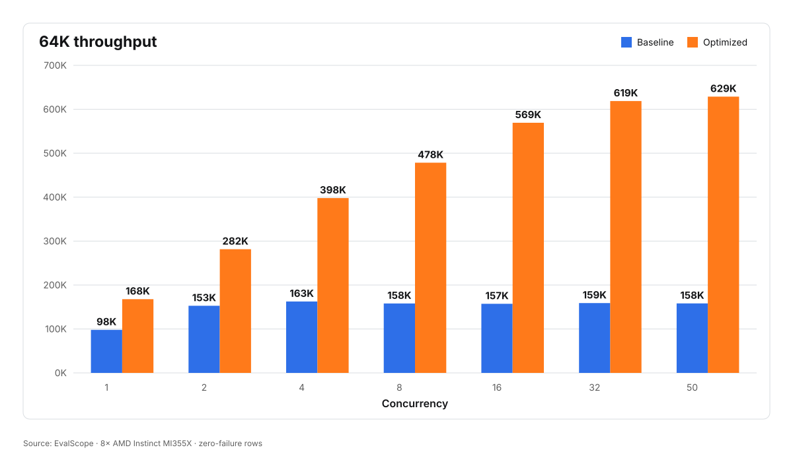
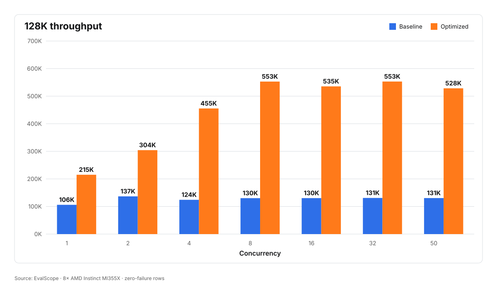
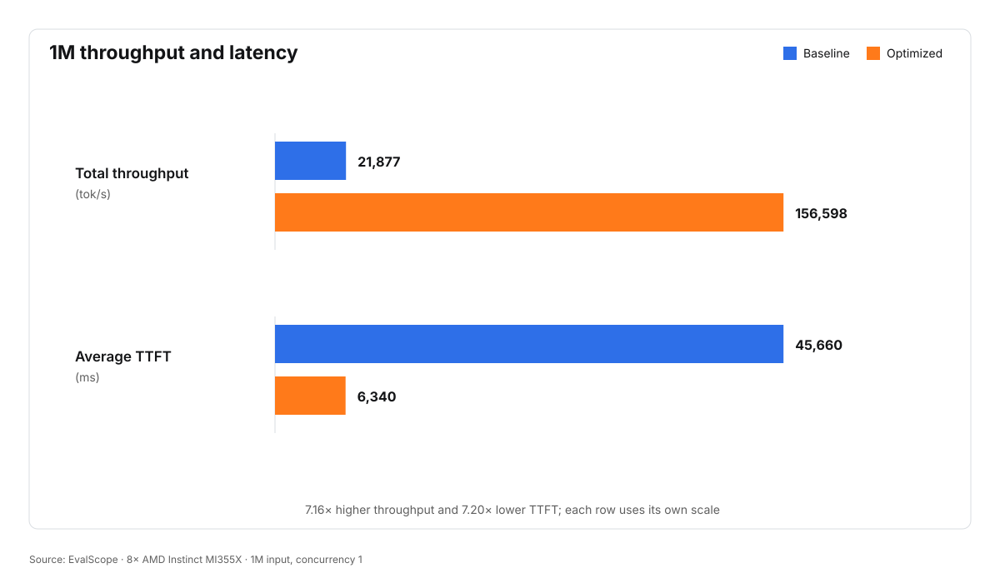

<!---
Copyright (c) 2026 Advanced Micro Devices, Inc. (AMD)

Permission is hereby granted, free of charge, to any person obtaining a copy
of this software and associated documentation files (the "Software"), to deal
in the Software without restriction, including without limitation the rights
to use, copy, modify, merge, publish, distribute, sublicense, and/or sell
copies of the Software, and to permit persons to whom the Software is
furnished to do so, subject to the following conditions:

The above copyright notice and this permission notice shall be included in all
copies or substantial portions of the Software.

THE SOFTWARE IS PROVIDED "AS IS", WITHOUT WARRANTY OF ANY KIND, EXPRESS OR
IMPLIED, INCLUDING BUT NOT LIMITED TO THE WARRANTIES OF MERCHANTABILITY,
FITNESS FOR A PARTICULAR PURPOSE AND NONINFRINGEMENT. IN NO EVENT SHALL THE
AUTHORS OR COPYRIGHT HOLDERS BE LIABLE FOR ANY CLAIM, DAMAGES OR OTHER
LIABILITY, WHETHER IN AN ACTION OF CONTRACT, TORT OR OTHERWISE, ARISING FROM,
OUT OF OR IN CONNECTION WITH THE SOFTWARE OR THE USE OR OTHER DEALINGS IN THE
SOFTWARE.
--->

# Accelerating GLM-5.2 on AMD Instinct MI355X: EvalScope Benchmarks with Prefix Caching

GLM-5.2 combines a large Mixture-of-Experts (MoE) architecture, sparse
attention, and long-context processing. At long input lengths, this
combination creates bottlenecks across GPU compute, memory bandwidth, and
inter-GPU communication. Tuning a single kernel is not enough; the
parallelization strategy, KV-cache layout, collective communication, kernels,
and serving framework must be optimized together.

This study focuses on three production-oriented benchmark choices. First, we
use EvalScope instead of a framework-native benchmark client. Second, the 64K
and 128K workloads use a 90% shared-prefix configuration to represent
prefix-cache-heavy serving. Third, we extend the evaluation to a 1M-token
input. These workloads more closely reflect long-context deployment
service-level objectives (SLOs) than commonly used uncached 1K or 8K input
shapes.

In this blog, we accelerate GLM-5.2 FP8 inference on eight AMD Instinct™
MI355X GPUs through end-to-end optimizations across the inference stack. The
work includes prefill context parallelism (CP8), AITER sparse-attention (DSA)
kernels, PyHIP MoE tuning, custom all-reduce, FP8 KV-cache optimization,
attention-kernel tuning, small-kernel fusion, GEMM tuning, and EAGLE
multi-token prediction (MTP).
EvalScope measurements show peak throughput increasing from 163K to 629K
tok/s at 64K and from 137K to 553K tok/s at 128K. At a 1M-token input length
and concurrency 1, throughput increases from 22K to 157K tok/s, a 7.16×
improvement. GSM8K validation shows that the optimized stack preserves model
accuracy.

## GLM-5.2 Optimization Overview

GLM-5.2 uses 64 attention heads and a hidden size of 6,144. At each layer,
Multi-head Latent Attention (MLA) compresses each token into a 512-dimensional
latent representation and a 64-dimensional rotary position embedding (RoPE)
component. The MoE block contains 256 routed experts and one shared expert,
with each token activating eight routed experts.

We deploy the FP8 model with SGLang on eight AMD Instinct MI355X GPUs,
targeting long-context requests with high prefix-cache hit rates. This workload
stresses sparse attention, KV-cache capacity and bandwidth, MoE communication,
and dense matrix multiplication at different stages of inference. Addressing
only one kernel leaves other parts of the execution path as bottlenecks.

The optimized configuration uses the following core settings:

| Area | Configuration |
| --- | --- |
| Prefill parallelism | CP8 |
| Attention heads per rank | 64 |
| Attention backend | AITER DSA |
| KV cache | FP8 (`fp8_e4m3`) |
| MoE | PyHIP and AITER-optimized execution |
| Speculative decoding | EAGLE: 4 steps, top-k = 1, and 5 draft tokens |

### Context Parallelism for DSA

With tensor parallelism (TP8), each rank processes only eight of the model's
64 attention heads. However, the Lightning Indexer selects one set of KV
indices for each query token and shares it across all heads, so every rank
loads the same selected KV entries. The AITER kernels used by this path also
require supported head counts to be multiples of 16, which means an eight-head
input must be replicated to 16 heads.

Prefill context parallelism **partitions query tokens instead of attention
heads**. Each rank therefore retains all 64 heads while processing one-eighth
of the tokens. This **removes redundant KV loads and head replication** and
lets the MI355X use its native `gqa:64` assembly-optimized MLA kernel
directly.

A query processed on one CP rank can select KV positions anywhere in the full
history, including cached prefixes outside its local token partition. We added
the required SGLang support for CP metadata, KV reconstruction and gathering,
tensor layouts, and numerical edge cases. These changes enable reliable CP8
prefill while presenting a 64-head (H64) input shape to the downstream FP8
attention kernel.

### FP8 KV Cache and Fused Query Quantization

Using `fp8_e4m3` for the KV cache reduces its memory footprint and enables FP8
attention kernels for long contexts. The query projection still produces BF16
output, so the query tensor must be quantized before attention.

The original dynamic quantization path launches multiple operators and
materializes intermediate tensors. We **fuse the quantization pipeline into a
single Triton kernel** and reuse a persistent device buffer, **reducing kernel
launches, temporary allocations, and memory traffic**. Operator-level
comparisons on captured model data verified the numerical behavior, and the
GSM8K validation later in this post confirms end-to-end accuracy.

### 64-Head FP8 Persistent MLA

CP8 preserves all 64 attention heads on each rank. For A8W8 execution with FP8
queries and an FP8 KV cache, AITER handles this H64 shape through its
persistent MLA implementation. We provide the required **scheduling metadata
and buffer lifecycle management** so the **native H64 FP8 MLA kernel runs
reliably on MI355X**.

### MoE Execution and Communication

With CP8, each GPU initially holds one-eighth of the tokens. The standard MoE
path gathers BF16 hidden states and then repeats router and top-k computation
over the full token set on every GPU.

The optimized PyHIP path moves router/top-k and activation quantization before
the collective operation. It **gathers FP8 hidden states, scales, and routing
results instead of BF16 hidden states**, reducing the communication payload
per token **from 12,288 bytes to 6,408 bytes** and avoiding repeated routing
work for non-local tokens. Unsupported shapes fall back to the standard path.
The MoE path also uses AITER's block-scale FP8 kernel and a custom collective
implementation to reduce communication overhead.

### GEMM Tuning

The model architecture and parallel configuration produce a predictable set
of dense GEMM shapes. We **tune the block-scaled FP8 A8W8 and BF16 paths
separately** using offline benchmarks and **store the best configurations in
AITER's tuning table**. At runtime, AITER selects the tuned kernel based on the
matrix shape and quantization type.

### EAGLE Multi-Token Prediction

Long-context prefill is dominated by compute and communication, while decode
is typically memory-bound. The optimized stack enables **EAGLE multi-token
prediction (MTP)** with **request-level data parallelism and expert
parallelism** to improve decode efficiency.

To make EAGLE reliable with sparse data parallelism, we synchronize CUDA Graph
replay and eager execution decisions across ranks, skip metadata generation
for idle ranks, and size draft-token post-processing buffers to the actual
number of active rows. These changes prevent divergent collective sequences
and padded rows from affecting tokens, hidden states, or positions.

## End-to-End Performance on 8× MI355X

### Test Environment

| Component | Version / Configuration |
| --- | --- |
| Hardware | 8× AMD Instinct™ MI355X GPUs (`gfx950`) |
| ROCm | 7.2.4 |
| Baseline server image | `lmsysorg/sglang-rocm:v0.5.13.post1-rocm720-mi35x-20260618` |
| Optimized server image | `sabreshao/sglang:glm_0831` |
| Model | `zai-org/GLM-5.2-FP8` |
| Benchmark framework | EvalScope |
| API | OpenAI-compatible `/v1/completions` |
| Dataset | EvalScope random dataset |
| ISL / OSL | 64K / 1, 128K / 1, and 1M / 1 |

Install EvalScope:

```bash
python3 -m pip install evalscope
evalscope --version
```

The launch and benchmark scripts used in this section are published alongside
this blog: [`launch_baseline.sh`](./scripts/launch_baseline.sh),
[`launch_optimized.sh`](./scripts/launch_optimized.sh), and
[`run_evalscope.sh`](./scripts/run_evalscope.sh). Download them into a
`scripts/` directory next to your working directory and make them executable
before running the commands below.

### Reproducing the Baseline

The baseline uses
`lmsysorg/sglang-rocm:v0.5.13.post1-rocm720-mi35x-20260618`.
Set `MODEL_PATH` to a prepared `zai-org/GLM-5.2-FP8` model directory, and
then launch the server:

```bash
MODEL_PATH=/path/to/GLM-5.2-FP8 ./scripts/launch_baseline.sh
```

Run the three benchmark profiles against port `30000`:

```bash
MODEL_PATH=/path/to/GLM-5.2-FP8 ./scripts/run_evalscope.sh 64k 30000
MODEL_PATH=/path/to/GLM-5.2-FP8 ./scripts/run_evalscope.sh 128k 30000
MODEL_PATH=/path/to/GLM-5.2-FP8 ./scripts/run_evalscope.sh 1m 30000
```

### Reproducing the Optimized Stack

The optimized stack uses `sabreshao/sglang:glm_0831`.
Launch it with the same model:

```bash
MODEL_PATH=/path/to/GLM-5.2-FP8 ./scripts/launch_optimized.sh
```

Run the same profiles against port `30001`:

```bash
MODEL_PATH=/path/to/GLM-5.2-FP8 ./scripts/run_evalscope.sh 64k 30001
MODEL_PATH=/path/to/GLM-5.2-FP8 ./scripts/run_evalscope.sh 128k 30001
MODEL_PATH=/path/to/GLM-5.2-FP8 ./scripts/run_evalscope.sh 1m 30001
```

The benchmark script applies the profile-specific input lengths and
concurrency settings shown in the test environment table. It flushes the
prefix cache before each case.

### Performance Results

The following tables report EvalScope total throughput for cases with zero
request failures. They focus on prefill, which dominates end-to-end time at
this SLO.

#### 64K Throughput

| Concurrency | Baseline (tok/s) | Optimized (tok/s) | Speedup |
| ---: | ---: | ---: | ---: |
| 1 | 97,998 | 167,839 | 1.71× |
| 2 | 152,796 | 281,523 | 1.84× |
| 4 | 162,559 | 397,922 | 2.45× |
| 8 | 157,990 | 478,381 | 3.03× |
| 16 | 157,298 | 569,362 | 3.62× |
| 32 | 158,977 | 618,794 | 3.89× |
| 50 | 158,201 | 628,866 | 3.97× |

Peak throughput increases from **163K tok/s** at concurrency 4 on the
baseline to **629K tok/s** at concurrency 50 on the optimized stack. As
Figure 1 below shows, the baseline flattens after concurrency 4 while the
optimized stack keeps scaling to concurrency 50.



*Figure 1. Baseline and optimized GLM-5.2 throughput across concurrency
levels at a 64K input length. Plotted from the table above; figure source:
[`glm52-prefill-throughput-64k.svg`](./images/glm52-prefill-throughput-64k.svg).*

#### 128K Throughput

| Concurrency | Baseline (tok/s) | Optimized (tok/s) | Speedup |
| ---: | ---: | ---: | ---: |
| 1 | 106,036 | 215,096 | 2.03× |
| 2 | 136,726 | 304,338 | 2.23× |
| 4 | 124,239 | 455,493 | 3.67× |
| 8 | 130,170 | 552,896 | 4.25× |
| 16 | 130,413 | 535,466 | 4.11× |
| 32 | 131,037 | 553,018 | 4.22× |
| 50 | 130,591 | 528,439 | 4.05× |

Peak throughput increases from **137K tok/s** at concurrency 2 to
**553K tok/s** at concurrency 32. Figure 2 below shows the same pattern as at
64K, with the gap between the two stacks widening as concurrency grows.



*Figure 2. Baseline and optimized GLM-5.2 throughput across concurrency
levels at a 128K input length. Plotted from the table above; figure source:
[`glm52-prefill-throughput-128k.svg`](./images/glm52-prefill-throughput-128k.svg).*

#### 1M Throughput and Latency

| Configuration | Total throughput (tok/s) | Average TTFT (ms) |
| --- | ---: | ---: |
| Baseline | 21,877 | 45,660 |
| Optimized | 156,598 | 6,340 |

At concurrency 1, the optimized stack delivers a **7.16×** throughput
improvement at the 1M-token input length. Figure 3 below places that gain
next to the corresponding drop in average TTFT, from 45,660 ms to 6,340 ms.



*Figure 3. Baseline and optimized GLM-5.2 throughput and average TTFT at a 1M
input length and concurrency 1. Plotted from the table above; figure source:
[`glm52-prefill-throughput-1m.svg`](./images/glm52-prefill-throughput-1m.svg).*

## Accuracy Validation

GSM8K (5-shot, full 1,319-sample test set) shows no accuracy regression after
enabling the optimized stack.

| Configuration | Correct / Total | Accuracy |
| --- | ---: | ---: |
| Baseline | 1242 / 1319 | 94.16% |
| Optimized (this work) | 1252 / 1319 | **94.92%** |

Both configurations used sequential `/v1/completions` requests with
deterministic sampling. The optimized run completed with zero request errors.

## Summary

This blog demonstrates how to optimize GLM-5.2 FP8 inference on eight AMD
Instinct MI355X GPUs for production-oriented, long-context workloads. The
EvalScope benchmarks use **90% shared prefixes** at **64K and 128K input
lengths** and also evaluate a **1M-token input**.

Peak prefill throughput increases from **163K to 629K tok/s at 64K** and from
**137K to 553K tok/s at 128K**. At a 1M-token input and concurrency 1,
throughput increases from **22K to 157K tok/s, a 7.16× improvement**. The
optimized stack also achieves **94.92% GSM8K accuracy**, compared with 94.16%
for the baseline.

The gains result from optimizing the full inference path: CP8 prefill, AITER
DSA and persistent MLA kernels, FP8 KV cache, fused query quantization, PyHIP
MoE and communication tuning, tuned GEMM configurations, and EAGLE MTP.
Together, these techniques provide a scalable foundation for serving GLM-5.2
with long inputs and frequently reused prefixes while preserving model
quality.

## Additional Resources

- [GLM-5.2-FP8 on Hugging Face](https://huggingface.co/zai-org/GLM-5.2-FP8)
- [SGLang](https://github.com/sgl-project/sglang)
- [AITER](https://github.com/ROCm/aiter)
- [ATOM](https://github.com/ROCm/ATOM)
- [GLM-5.2 MXFP4 on AMD Instinct MI355X](https://rocm.blogs.amd.com/artificial-intelligence/glm52-mxfp4-mi355/README.html)

## Disclaimers

The information presented in this document is for informational purposes only
and may contain technical inaccuracies, omissions, and typographical errors.
The information contained herein is subject to change and may be rendered
inaccurate for many reasons, including but not limited to product and roadmap
changes, component and motherboard version changes, new model and/or product
releases, product differences between differing manufacturers, software
changes, BIOS flashes, firmware upgrades, or the like. Any computer system has
risks of security vulnerabilities that cannot be completely prevented or
mitigated. AMD assumes no obligation to update or otherwise correct or revise
this information. However, AMD reserves the right to revise this information
and to make changes from time to time to the content hereof without obligation
of AMD to notify any person of such revisions or changes. THIS INFORMATION IS
PROVIDED "AS IS." AMD MAKES NO REPRESENTATIONS OR WARRANTIES WITH RESPECT TO
THE CONTENTS HEREOF AND ASSUMES NO RESPONSIBILITY FOR ANY INACCURACIES, ERRORS,
OR OMISSIONS THAT MAY APPEAR IN THIS INFORMATION. AMD SPECIFICALLY DISCLAIMS
ANY IMPLIED WARRANTIES OF NON-INFRINGEMENT, MERCHANTABILITY, OR FITNESS FOR
ANY PARTICULAR PURPOSE. IN NO EVENT WILL AMD BE LIABLE TO ANY PERSON FOR ANY
RELIANCE, DIRECT, INDIRECT, SPECIAL, OR OTHER CONSEQUENTIAL DAMAGES ARISING
FROM THE USE OF ANY INFORMATION CONTAINED HEREIN, EVEN IF AMD IS EXPRESSLY
ADVISED OF THE POSSIBILITY OF SUCH DAMAGES.

Third-party content is licensed to you directly by the third party that owns
the content and is not licensed to you by AMD. ALL LINKED THIRD-PARTY CONTENT
IS PROVIDED "AS IS" WITHOUT A WARRANTY OF ANY KIND. USE OF SUCH THIRD-PARTY
CONTENT IS DONE AT YOUR SOLE DISCRETION AND UNDER NO CIRCUMSTANCES WILL AMD BE
LIABLE TO YOU FOR ANY THIRD-PARTY CONTENT. YOU ASSUME ALL RISK AND ARE SOLELY
RESPONSIBLE FOR ANY DAMAGES THAT MAY ARISE FROM YOUR USE OF SUCH THIRD-PARTY
CONTENT.

AMD, the AMD Arrow logo, AMD Instinct, ROCm, and combinations thereof are
trademarks of Advanced Micro Devices, Inc. Other product names used in this
publication are for identification purposes only and may be trademarks of
their respective companies. © 2026 Advanced Micro Devices, Inc. All rights
reserved.
