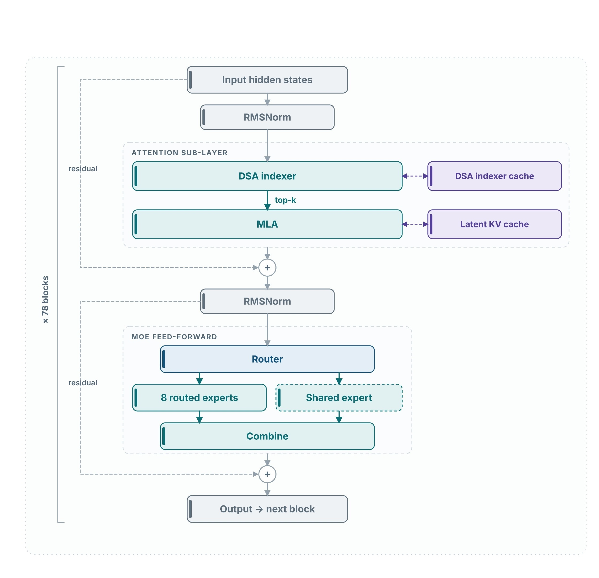
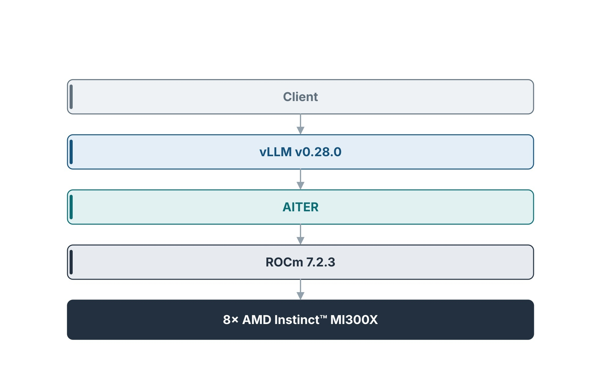
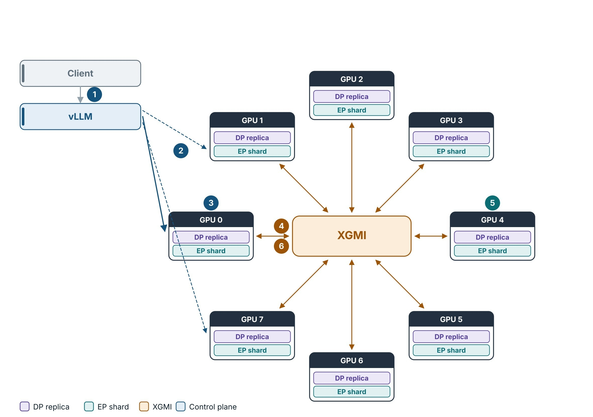
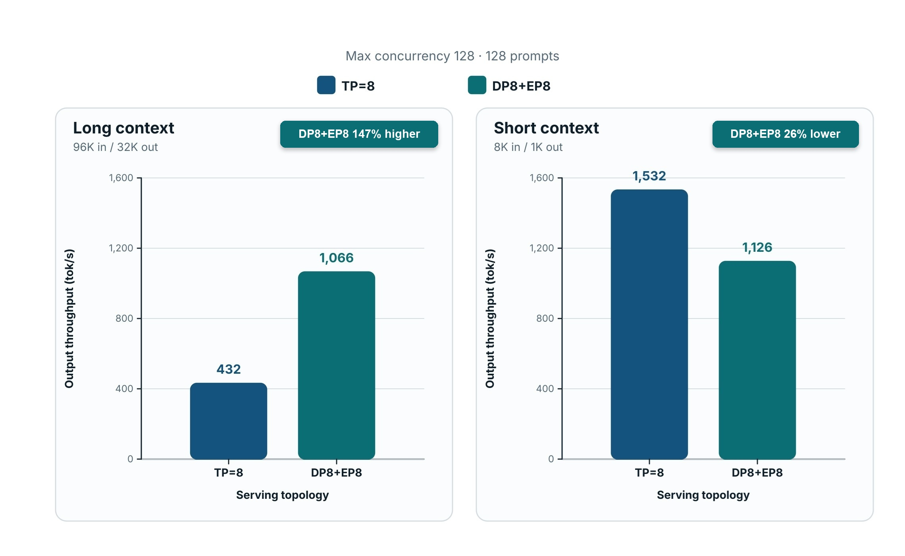

<!---
Copyright (c) 2026 Advanced Micro Devices, Inc. (AMD)

Permission is hereby granted, free of charge, to any person obtaining a copy
of this software and associated documentation files (the "Software"), to deal
in the Software without restriction, including without limitation the rights
to use, copy, modify, merge, publish, distribute, sublicense, and/or sell
copies of the Software, and to permit persons to whom the Software is
furnished to do so, subject to the following conditions:

The above copyright notice and this permission notice shall be included in all
copies or substantial portions of the Software.

THE SOFTWARE IS PROVIDED "AS IS", WITHOUT WARRANTY OF ANY KIND, EXPRESS OR
IMPLIED, INCLUDING BUT NOT LIMITED TO THE WARRANTIES OF MERCHANTABILITY,
FITNESS FOR A PARTICULAR PURPOSE AND NONINFRINGEMENT. IN NO EVENT SHALL THE
AUTHORS OR COPYRIGHT HOLDERS BE LIABLE FOR ANY CLAIM, DAMAGES OR OTHER
LIABILITY, WHETHER IN AN ACTION OF CONTRACT, TORT OR OTHERWISE, ARISING FROM,
OUT OF OR IN CONNECTION WITH THE SOFTWARE OR THE USE OR OTHER DEALINGS IN THE
SOFTWARE.
--->

# Long Context, One Node: Serving GLM-5.3-FP8 on MI300X with DP8+EP8

Serving a frontier Mixture-of-Experts model like GLM-5.3-FP8 at long context and high concurrency is a demanding workload. The model has 744 billion total parameters, with approximately 39 billion active per forward pass, and a native context limit of 1,048,576 tokens, as specified by `max_position_embeddings` in `config.json`. The most demanding serving regime combines long prompts, long generations, and many concurrent requests. That combination stresses both GPU memory and inter-GPU communication, and the layout you pick to spread the model across a node largely determines how much throughput you can sustain under that load.

Even with a very capable MI300X GPU server from AMD, the default parallelism strategy, tensor parallelism (TP), is not always optimal. TP splits every layer across all eight GPUs. It is simple and it works, but at long context and high concurrency it leaves throughput on the table: slicing attention across the node turns each decode step into a tensor collective, and that communication overhead grows with sequence length. On a 96K-in / 32K-out workload at max concurrency 128, which is representative of modern agentic workloads such as coding, complex math, or planning problems, we found that TP=8 was the bottleneck. That bottleneck motivated this recipe.

This post is a complete, validated alternative: serving GLM-5.3-FP8 in **DP8+EP8 (DEP)** mode on a single 8-GPU AMD Instinct™ MI300X node with ROCm 7.2.3 and vLLM v0.28.0. You get a working Dockerfile and launch command, functional tests for reasoning and tool calling, and a same-node throughput comparison against TP=8 that quantifies the gain.

**DP8+EP8 combines data parallelism with expert parallelism across the eight GPUs.** Each GPU is an independent data-parallel rank with its own request stream and latent KV cache, while the model's 256 routed experts are distributed evenly across the eight GPUs, with 32 experts assigned to each GPU. Tensor parallelism is switched off (`--tensor-parallel-size 1`), so Multi-head Latent Attention (MLA) runs wholly on each rank rather than being sliced across the node, and the expert all-to-all traffic stays on the in-node XGMI fabric. The defining flags are:

`--tensor-parallel-size 1 --data-parallel-size 8 --enable-expert-parallel`

Because each rank holds its own KV cache, the context window (`--max-model-len`) is a per-GPU HBM budget rather than a node-wide one. We set it to **202,752 tokens** — the window we actually booted, JIT-compiled, and held at `--gpu-memory-utilization 0.9`, with comfortable room for the 96K-in / 32K-out workload we measured. (The model's native 1,048,576-token rope length is unchanged; we explain why we serve a shorter window under **Serving Topology** below.)

The payoff: at max concurrency 128 with 128 prompts, DP8+EP8 delivered **147% higher output throughput than TP=8 on the long-context 96K/32K workload**, while TP=8 remained faster on the short 8K/1K workload. Both layouts serve any prompt that fits the context window; these two workloads are simply the load points we benchmarked.

**In this blog you will:**

- Build a container recipe (Dockerfile, patch scripts, and launch command) and validate it end to end on AMD MI300X.
- Compare TP=8 against DP8+EP8 with `vllm bench serve` at max concurrency 128 and 128 prompts (96K/32K and 8K/1K).
- Run validation commands for reasoning and tool calling and check them against the exact expected outputs.

---

## Model Architecture

GLM-5.3-FP8 is a sparse Mixture-of-Experts transformer built from 78 identical blocks. Figure 1 shows one of them.



*Figure 1 — One of the 78 transformer blocks. FP8 applies to the weights and the latent KV cache throughout the block, not as a separate stage.*

What matters for serving is how each block spends memory and compute. After the first RMSNorm, a **DeepSeek Sparse Attention (DSA) indexer** selects a top-k set of past tokens, and **MLA** attends only over that set while reading and writing a compact **latent KV cache**. The indexer keeps its own cache, so HBM planning must account for two per-layer structures, not one. After a residual connection and a second RMSNorm, a **router** chooses 8 of the 256 experts, a single **shared expert** always runs, and a **Combine** step merges the weighted results. On this node, the 256 routed experts are sharded across the eight GPUs (as shown in Figure 3 in the [**Serving Topology**](#serving-topology-dp8ep8-dep) section below), while everything else in the block is replicated on every rank.

The following table summarizes the key configuration settings.

| Property | Value |
| --- | --- |
| Total parameters | 744B |
| Active per token | ~39B |
| Transformer blocks | 78 |
| Attention | Multi-head Latent Attention + DeepSeek Sparse Attention |
| Query heads (`num_attention_heads`) | 64 |
| Latent KV rank (`kv_lora_rank`) | 512 |
| Query LoRA rank (`q_lora_rank`) | 2048 |
| Routed experts | 256, top-8 selected per token |
| Shared experts | 1, always active |
| Native rope length | 1,048,576 tokens |
| Serving window in this recipe | 202,752 tokens (`--max-model-len`) |
| Checkpoint precision | FP8 (weights), FP8 KV cache |

### Multi-head Latent Attention (MLA)

Instead of caching full key and value tensors for every token, MLA compresses them into a low-dimensional latent vector (`kv_lora_rank = 512`) and stores only that in the KV cache, reconstructing the full tensors on the fly at attention time. This much smaller per-token footprint is what makes a long context window practical on a single node. Under DP8+EP8, each rank holds the latent KV cache for its own request stream. The model's native rope length is 1,048,576 tokens; this recipe serves a 202,752-token window for the HBM reasons explained under **Serving Topology** below.

### DeepSeek Sparse Attention (DSA)

DSA caps the attention compute per decode step. Rather than attending to the entire sequence, a lightweight indexer selects a relevant subset of past tokens, which keeps decode-phase work tractable as the context grows. The indexer maintains its own per-layer cache alongside the MLA KV cache, so both structures must be counted when sizing memory for a target concurrency level.

### Sparse Mixture of Experts

For each token, the router activates 8 of the 256 routed experts plus the one always-on shared expert. As a result, per-token compute is far lower than the total parameter count implies — roughly 39B parameters active at any step out of 744B total. On MI300X, the routing, sorting, and grouped-GEMM operations all run on AITER kernels tuned for the `gfx942` architecture.

---

## Serving Software Stack

Figure 2 shows the full stack we ran, from the client down to the eight GPUs.



*Figure 2 — Serving software stack on one 8-GPU MI300X node.*

- **Client** — speaks the OpenAI-compatible API (`/v1/chat/completions`).
- **vLLM v0.28.0** — handles continuous batching, the paged KV cache, and DP/EP coordination. `--data-parallel-size 8` launches the eight DP ranks, and this recipe uses the V2 model runner.
- **AITER** — the MI300X compute library, providing FP8 MLA decode, MoE routing and sorting, and grouped GEMM, all tuned for `gfx942`.
- **ROCm 7.2.3** — supplies the HIP runtime, RCCL, and hipBLASLt.
- **8× MI300X** — 192 GB HBM3 per GPU, 1,536 GB per node. The expert all-to-all never leaves the node.

This stack requires two AITER patches on `gfx942`, both applied in the Dockerfile (see the note under **Serving Topology** below).

---

## Serving Topology: DP8+EP8 (DEP)

In DP8+EP8 mode on a single 8-GPU node, each GPU runs an independent data-parallel rank serving its own request stream, while the 256-expert pool is distributed evenly at 32 experts per GPU. When a token routes to an expert that lives on another GPU, it travels over the in-node XGMI fabric.

Each rank **replicates** the non-expert portion of the model: attention, the latent KV cache, the shared expert, and the embeddings. The routed experts are the exception — they are sharded rather than replicated, which is the entire point of this layout. A full 744B-parameter replica simply would not fit in a single GPU's 192 GB.



*Figure 3 — DP8+EP8 topology. Each GPU is one DP rank with an exclusive shard of 32 experts. Numbered badges 1–6 are the token path below.*

**Following a token through Figure 3:**

1. The client sends an OpenAI-format request.
2. vLLM assigns it to one DP rank (the dashed arrows show the other ranks it could have chosen).
3. Attention, the latent KV cache, and the shared expert all run locally on that rank — the **DP replica** band on the GPU card.
4. The router selects 8 of the 256 experts per token, and those tokens are dispatched all-to-all over XGMI.
5. The expert GEMMs run on whichever GPUs own the selected experts — the **EP** band, using AITER kernels.
6. The results are combined back on the originating rank, which returns the response.

Because MoE computation is independent across tokens, the experts can be sharded without an attention-level tensor collective. Attention stays whole on each rank — which is precisely why the context window is a per-GPU HBM budget.

This is also why we serve a 202,752-token window even though `config.json` lists a native rope length of 1,048,576 tokens: the native length is what the model supports, not automatically what a given node can serve. With TP off, every rank keeps all 64 query heads plus a private latent KV cache and DSA indexer cache. At `--gpu-memory-utilization 0.9`, we needed a window that would boot, survive the first cold JIT compile (30–45 minutes), and still leave headroom for 128 in-flight sequences on the long-context benchmark. **202,752 tokens** is that window, comfortably above the 96K/32K point we measured. We have not published a full 1M-token DEP configuration on this node; if you raise `--max-model-len`, watch HBM usage and concurrency closely.

For a same-node baseline in the throughput table, we also ran TP=8 (`--tensor-parallel-size 8`) on the same eight GPUs. That is the only other layout we report numbers for.

> **Required upstream patches**
>
> The Dockerfile applies two AITER fixes that were still under review at the time of writing. Both are required for this DP / TP=1 topology on vLLM v0.28.0 and MI300X:
>
> - **[PR#4365](https://github.com/ROCm/aiter/pull/4365)** — prevents a GPU memory fault in the FP8 MLA decode kernel on `gfx942` when `nhead == 64` (the DP / TP=1 case). TP=8 runs with `nhead=8` and never hits this path.
> - **[PR#5563](https://github.com/ROCm/aiter/pull/5563)** — fixes cold-JIT `__half` compilation failures on the public base image.
>
> Until they land, the build below applies them to the installed AITER package and fails with an error if a patch anchor is missing.

---

## Production Recipe

### Prerequisites

**Hardware.** 8× AMD Instinct™ MI300X (192 GB HBM3 per GPU; 1,536 GB total). All eight GPUs must be free.

**Storage.** The model is roughly 756 GB (141 FP8 safetensors shards), and downloading it requires a Hugging Face account with license acceptance at `huggingface.co/zai-org/GLM-5.3`. You also need a JIT cache volume of at least 10 GB, preserved between restarts. Losing it triggers a 30–45 minute recompile.

**Software.** ROCm 7.2.x on the host, Docker 20.10+ with `DOCKER_BUILDKIT=1`, and a user account in the `video` and `render` groups.

### Download Model Weights

Run the following commands to download the model weights:

```bash
export HF_TOKEN=<your_huggingface_token>
pip install -U huggingface_hub

HF_TOKEN=${HF_TOKEN} hf download \
    zai-org/GLM-5.3 \
    --local-dir /path/to/glm-5.3-fp8

ls /path/to/glm-5.3-fp8/*.safetensors | wc -l  # expect 141
```

### Patch Scripts

Create two Python scripts alongside the Dockerfile before building the Docker image:

**`patch_aiter_pr4365_qh64_pagesize.py`** — prevents a GPU fault at startup:

```python
import importlib.util, os

def main():
    spec = importlib.util.find_spec("aiter")
    mla_py = os.path.join(os.path.dirname(spec.origin), "mla.py")
    print(f"PR#4365: patching {mla_py}")
    with open(mla_py) as f:
        src = f.read()
    if 'get_gfx() == "gfx942"' in src and 'page_size == 64' in src:
        print("PR#4365: already applied."); return
    OLD = ('            or (\n'
           '                get_gfx() in ("gfx942", "gfx950")\n'
           '                and nhead == 64\n'
           '                and q.dtype == dtypes.fp8\n'
           '                and kv_buffer.dtype == dtypes.fp8\n'
           '                and max_seqlen_q == 1\n'
           '            )')
    NEW = ('            or (\n'
           '                get_gfx() == "gfx950"\n'
           '                and nhead == 64\n'
           '                and q.dtype == dtypes.fp8\n'
           '                and kv_buffer.dtype == dtypes.fp8\n'
           '                and max_seqlen_q == 1\n'
           '            )\n'
           '            or (\n'
           '                get_gfx() == "gfx942"\n'
           '                and nhead == 64\n'
           '                and q.dtype == dtypes.fp8\n'
           '                and kv_buffer.dtype == dtypes.fp8\n'
           '                and max_seqlen_q == 1\n'
           '                and page_size == 64\n'
           '            )')
    if OLD not in src:
        print("PR#4365: anchor not found. No change."); return
    with open(mla_py, "w") as f:
        f.write(src.replace(OLD, NEW, 1))
    print(f"PR#4365: applied gfx942 page_size==64 gate to {mla_py}")

if __name__ == "__main__":
    main()
```

**`patch_aiter_pr5563_half_flags.py`** — fixes cold-JIT compilation:

```python
import importlib.util, os

def main():
    spec = importlib.util.find_spec("aiter")
    cpp_ext = os.path.join(os.path.dirname(spec.origin),
                           "jit", "utils", "cpp_extension.py")
    print(f"PR#5563: patching {cpp_ext}")
    if not os.path.exists(cpp_ext):
        print("PR#5563: file not found. Skipping."); return
    with open(cpp_ext) as f:
        src = f.read()
    subs = [('"-D__HIP_NO_HALF_OPERATORS__=1"', '"-U__HIP_NO_HALF_OPERATORS__"'),
            ('"-D__HIP_NO_HALF_CONVERSIONS__=1"', '"-U__HIP_NO_HALF_CONVERSIONS__"')]
    patched, applied = src, 0
    for old, new in subs:
        if old in patched:
            patched = patched.replace(old, new, 1); applied += 1
        elif new in patched:
            applied += 1
    if applied == 0:
        print("PR#5563: anchors not found. Skipping."); return
    with open(cpp_ext, "w") as f:
        f.write(patched)
    print(f"PR#5563: applied __half undefines ({applied}/2) to {cpp_ext}")

if __name__ == "__main__":
    main()
```

### Dockerfile

Create the following Dockerfile and save it as `Dockerfile.glm53_v028_dep`:

```dockerfile
# GLM-5.3-FP8 DP8+EP8 (DEP) on AMD MI300X — vLLM v0.28.0
ARG BASE_IMAGE=vllm/vllm-openai-rocm:v0.28.0

FROM ${BASE_IMAGE}
ENTRYPOINT []
WORKDIR /app
RUN mkdir -p /app && echo "GLM-5.3-FP8 DP8+EP8 v0.28.0" > /app/versions.txt

# PR#4365 — prevent GPU fault in FP8 MLA decode kernel on gfx942
COPY patch_aiter_pr4365_qh64_pagesize.py /tmp/pr4365.py
RUN python3 /tmp/pr4365.py \
    && echo "PR#4365: applied" >> /app/versions.txt \
    || { echo "ERROR: PR#4365 failed"; exit 1; }; rm -f /tmp/pr4365.py

# PR#5563 — fix cold-JIT __half build failures on public v0.28.0 base image
COPY patch_aiter_pr5563_half_flags.py /tmp/pr5563.py
RUN python3 /tmp/pr5563.py \
    && echo "PR#5563: applied" >> /app/versions.txt \
    || { echo "ERROR: PR#5563 failed"; exit 1; }; rm -f /tmp/pr5563.py

# Make VLLM_HANDSHAKE_TIMEOUT_MINS env-configurable
RUN VLLM_CORE=$(python3 -c "import importlib.util,os; \
      print(os.path.join(os.path.dirname(importlib.util.find_spec('vllm').origin),'v1/engine/core.py'))") && \
    sed -i -E 's/^([[:space:]]*)HANDSHAKE_TIMEOUT_MINS[[:space:]]*=.*/\1HANDSHAKE_TIMEOUT_MINS = int(__import__("os").environ.get("VLLM_HANDSHAKE_TIMEOUT_MINS","5"))/' "$VLLM_CORE" \
    && echo "HANDSHAKE_TIMEOUT configurable" >> /app/versions.txt \
    || echo "WARN: handshake patch skipped" >> /app/versions.txt

# vllm-router — optional binary; this recipe does not exec it
ARG ROUTER_REPO=https://github.com/raviguptaamd/router.git
ARG ROUTER_REF=ravgupta/discovery-dp-rank-roundrobin
ARG RUST_TOOLCHAIN=1.88.0
RUN set -e && apt-get update -y -q && \
    apt-get install -y --no-install-recommends libssl-dev pkg-config && \
    rm -rf /var/lib/apt/lists/* && \
    export PATH="/root/.cargo/bin:${PATH}" && \
    curl --proto '=https' --tlsv1.2 -sSf https://sh.rustup.rs | \
      sh -s -- -y --default-toolchain "${RUST_TOOLCHAIN}" && \
    git clone --filter=blob:none "${ROUTER_REPO}" /tmp/vllm-router-src && \
    cd /tmp/vllm-router-src && git checkout "${ROUTER_REF}" && \
    cargo build --release && \
    install -m 755 target/release/vllm-router /usr/local/bin/vllm-router && \
    echo "vllm-router installed" >> /app/versions.txt && \
    rm -rf /tmp/vllm-router-src

ENV AITER_JIT_DIR=/opt/vllm_cache/aiter_jit \
    VLLM_CACHE_ROOT=/opt/vllm_cache/vllm \
    VLLM_ROCM_USE_AITER_FP8BMM=0 \
    VLLM_ROCM_USE_AITER_FP4BMM=0 \
    VLLM_USE_V2_MODEL_RUNNER=1
RUN rm -rf /opt/vllm_cache/aiter_jit /root/.aiter 2>/dev/null || true; \
    echo "JIT_SCRUBBED" >> /app/versions.txt

RUN python3 -c "import vllm; print('OK: vllm', vllm.__version__)"
RUN cat /app/versions.txt
```

### Building

Build the Docker image with the following command:

```bash
# Directory must contain: Dockerfile.glm53_v028_dep + both patch scripts
DOCKER_BUILDKIT=1 docker build \
    -f Dockerfile.glm53_v028_dep \
    -t vllm-glm53-v028-dep:latest . \
    2>&1 | tee /tmp/build_glm53.log
```

The build takes roughly 25–35 minutes. Confirm these two lines appear in the build output:

```text
PR#4365: applied gfx942 page_size==64 gate to .../aiter/mla.py
PR#5563: applied __half undefines (2/2) to .../cpp_extension.py
```

### Prepare Cache Directories

Create two directories for caches:

```bash
mkdir -p /path/to/aiter_jit_glm53_v028
mkdir -p /path/to/aiter_home_glm53_v028
```

```{note}
Reusing a warm cache across restarts with the same AITER flags is expected and speeds up boot (see **Boot time** below). What you must not do is reuse a cache from an earlier build that used *different* AITER flags — start with fresh directories whenever the flags change.
```

### Launch Command

Launch the Docker container and vLLM server with the command:

```bash
docker run -d --name glm53-v028-dp8ep \
    --network host --device /dev/kfd --device /dev/dri \
    --group-add video --group-add render \
    --ipc host --shm-size 128g \
    --cap-add SYS_PTRACE --cap-add IPC_LOCK \
    --security-opt seccomp=unconfined \
    --ulimit nofile=1048576:1048576 \
    -v /path/to/glm-5.3-fp8:/mnt/models/GLM-5.3-FP8:ro \
    -v /path/to/aiter_jit_glm53_v028:/opt/vllm_cache \
    -v /path/to/aiter_home_glm53_v028:/root/.aiter \
    -e HF_HUB_OFFLINE=1 -e TRANSFORMERS_OFFLINE=1 \
    -e VLLM_GCN_ARCH=gfx942 \
    -e AITER_BATON_TIMEOUT=7200 \
    -e VLLM_ENGINE_READY_TIMEOUT_S=21600 \
    -e VLLM_HANDSHAKE_TIMEOUT_MINS=30 \
    -e VLLM_ROCM_USE_AITER=1 \
    -e VLLM_ROCM_USE_AITER_MOE=1 \
    -e VLLM_ROCM_USE_AITER_MLA=1 \
    -e VLLM_ROCM_USE_AITER_FP8BMM=0 \
    -e VLLM_ROCM_USE_AITER_FP4BMM=0 \
    -e VLLM_USE_V2_MODEL_RUNNER=1 \
    -e HSA_NO_SCRATCH_RECLAIM=1 \
    -e AITER_JIT_DIR=/opt/vllm_cache/aiter_jit \
    -e VLLM_CACHE_ROOT=/opt/vllm_cache/vllm \
    vllm-glm53-v028-dep:latest \
    vllm serve /mnt/models/GLM-5.3-FP8 \
        --served-model-name glm-5-3-fp8 \
        --tensor-parallel-size 1 \
        --data-parallel-size 8 \
        --data-parallel-size-local 8 \
        --enable-expert-parallel \
        --trust-remote-code \
        --quantization fp8 \
        --kv-cache-dtype fp8 \
        --max-model-len 202752 \
        --max-num-batched-tokens 8192 \
        --no-enable-prefix-caching \
        --gpu-memory-utilization 0.9 \
        --distributed-timeout-seconds 7200 \
        --enable-auto-tool-choice \
        --tool-call-parser glm47 \
        --port 30000

until curl -sf http://localhost:30000/v1/models >/dev/null; do sleep 30; done && echo "SERVER READY"
```

### Key Configuration Parameters

The following table lists the key settings and their purposes:

| Setting | Why |
| --- | --- |
| `--tensor-parallel-size 1` | TP is off; parallelism comes from DP and EP. |
| `--data-parallel-size 8 / --data-parallel-size-local 8` | One DP rank per GPU, all local to this node. |
| `--enable-expert-parallel` | Shards the 256-expert pool across the 8 ranks, 32 each. |
| `--max-model-len 202752` | Serving cap we booted and measured (see Serving Topology). Native rope is 1,048,576. |
| `VLLM_ROCM_USE_AITER_FP8BMM=0` | Triton FP8 BMM kernels (new in v0.28.0) cause a segfault race on gfx942 at startup. |
| `VLLM_ROCM_USE_AITER_FP4BMM=0` | Same issue for the FP4 BMM kernels. |
| `VLLM_USE_V2_MODEL_RUNNER=1` | Required for DP8+EP8 mode in v0.28.0. |
| `VLLM_HANDSHAKE_TIMEOUT_MINS=30` | The 5-minute default kills workers during first-boot JIT (30–45 min cold). |
| `AITER_BATON_TIMEOUT=7200` | Prevents baton expiry during slow module compilation. |

**Boot time:** expect 30–45 minutes on the first boot with a cold JIT cache, and about 5 minutes on subsequent boots with a warm cache.

### Stale JIT Baton Recovery

If a previous run crashed mid-JIT, a stale baton lock can block all workers on the next boot. Clear it with:

```bash
docker run --rm \
    -v /path/to/aiter_jit_glm53_v028:/opt/vllm_cache \
    vllm-glm53-v028-dep:latest \
    bash -c "rm -f /opt/vllm_cache/aiter_jit/build/lock_module_mla_reduce && \
             rm -rf /opt/vllm_cache/aiter_jit/build/module_mla_reduce && echo done"
```

---

## Functional Validation

### Reasoning

GLM-5.3 controls reasoning depth with `reasoning_effort` (low / high / max) rather than the older `enable_thinking` flag. The default is `max`.

```bash
curl -s http://localhost:30000/v1/chat/completions \
  -H 'Content-Type: application/json' \
  -d '{"model":"glm-5-3-fp8",
       "messages":[{"role":"user","content":"What is 15 * 47? Think step by step."}],
       "max_tokens":512,"temperature":0}' \
  | python3 -c "
import sys,json; d=json.load(sys.stdin); m=d['choices'][0]
print('content:', m['message'].get('content',''))
print('finish_reason:', m['finish_reason'])"
```

Expected output:

```text
content: # Calculating 15 × 47
**Step 1:** 47 = 40 + 7
**Step 2:** 15×40 = 600 · 15×7 = 105
**Step 3:** 600 + 105 = 705
**Answer: 705**

finish_reason: stop
```

### Tool Calling

Test tool calling capability with the following command:

```bash
curl -s http://localhost:30000/v1/chat/completions \
  -H 'Content-Type: application/json' \
  -d '{"model":"glm-5-3-fp8",
       "messages":[{"role":"user","content":"List files in the current directory"}],
       "tools":[{"type":"function","function":{"name":"ls","description":"List files",
         "parameters":{"type":"object","properties":{"path":{"type":"string"}},"required":["path"]}}}],
       "tool_choice":"auto","max_tokens":200}' \
  | python3 -c "
import sys,json; d=json.load(sys.stdin)
tc=d['choices'][0]['message'].get('tool_calls')
print('Tool:', tc[0]['function']['name'] if tc else 'NONE')
print('Args:', tc[0]['function']['arguments'] if tc else '')"
```

Expected output:

```text
Tool: ls
Args: {"path": "."}
```

---

## Throughput Performance: DP8+EP8 Versus TP=8

To isolate the effect of the server layout, we held the client load fixed and changed only the topology. Both runs used **max concurrency 128** with **128 prompts**, at two sequence lengths: 96K in / 32K out, and 8K in / 1K out. Either server will accept any request that fits `--max-model-len`; these two rows are the load points we benchmarked, not a mixed-traffic trace.

**Setup.** We ran GLM-5.3-FP8 on 8× AMD Instinct™ MI300X (`gfx942`) on the same node for both layouts, using the vLLM v0.28.0 image, and measured performance with `vllm bench serve` on synthetic random tokens with prefix caching disabled. **TP=8** is `--tensor-parallel-size 8`; **DP8+EP8** is the `vllm serve` command from this post. Throughput is output tokens per second, and time per output token (TPOT) is reported as the median.

| Workload | TP=8 tok/s | TP=8 TPOT med (ms) | DP8+EP8 tok/s | DP8+EP8 TPOT med (ms) | Δ vs TP=8 |
| --- | ---: | ---: | ---: | ---: | ---: |
| 96K in / 32K out | 431.8 | 26.8 | **1,065.6** | 62.7 | **+147%** |
| 8K in / 1K out | **1,531.9** | 66.4 | 1,125.6 | 81.2 | −26% |



*Figure 4 — Output throughput at matched load (max concurrency 128, 128 prompts). Left: 96K/32K, DP8+EP8 +147% tok/s vs TP=8. Right: 8K/1K, DP8+EP8 −26% tok/s vs TP=8. TPOT is in the table.*

The two layouts trade places depending on sequence length, as shown in Figure 4. On the long-context **96K/32K** workload, DP8+EP8 delivered **147% higher** output throughput than TP=8 (1,066 vs 432 tok/s). On the short **8K/1K** workload, DP8+EP8 delivered **26% lower** output throughput than TP=8 (1,126 vs 1,532 tok/s). Median TPOT is higher on DP8+EP8 in both cases, so the 96K gain reflects more completed decode work at the same prompt count rather than a faster per-token decode. Neither layout is strictly better: DP8+EP8 still serves the short workload (1,126 tok/s) and TP=8 still serves the long one (432 tok/s). Choose the layout that fits your traffic mix and the TPOT you can tolerate.

---

## Summary

In this blog, you served GLM-5.3-FP8 in DP8+EP8 (DEP) mode on a single 8-GPU AMD Instinct™ MI300X node with vLLM v0.28.0, with a 202,752-token context window and full MLA on every rank. Against `--tensor-parallel-size 8` at max concurrency 128 with 128 prompts, DP8+EP8 delivered **+147%** output throughput on the long 96K/32K workload (1,066 vs 432 tok/s) and **−26%** on the short 8K/1K workload (1,126 vs 1,532 tok/s). Reasoning and tool calling both pass. The right choice comes down to your context lengths: DP8+EP8 for long-context serving, TP=8 for short prompts. In a follow-up post, we will explore GLM-5.3 Flash serving on AMD Instinct™ MI300X with DEP for long-context workloads. For more on ROCm inference optimization, see the [AMD AI Developer Hub](https://rocm.docs.amd.com/projects/ai-developer-hub).

## Additional Resources

- **Model weights:** [huggingface.co/zai-org/GLM-5.3](https://huggingface.co/zai-org/GLM-5.3)
- **AITER:** [github.com/ROCm/aiter](https://github.com/ROCm/aiter) (PR#4365 · PR#5563)
- **vLLM:** [github.com/vllm-project/vllm](https://github.com/vllm-project/vllm)
- **AMD AI Developer Hub:** [rocm.docs.amd.com/projects/ai-developer-hub](https://rocm.docs.amd.com/projects/ai-developer-hub)

---

## Disclaimers

The information presented in this document is for informational purposes only and may contain technical inaccuracies, omissions, and typographical errors. The information contained herein is subject to change and may be rendered inaccurate for many reasons, including but not limited to product and roadmap changes, component and motherboard version changes, new model and/or product releases, product differences between differing manufacturers, software changes, BIOS flashes, firmware upgrades, or the like. Any computer system has risks of security vulnerabilities that cannot be completely prevented or mitigated. AMD assumes no obligation to update or otherwise correct or revise this information. However, AMD reserves the right to revise this information and to make changes from time to time to the content hereof without obligation of AMD to notify any person of such revisions or changes. THIS INFORMATION IS PROVIDED 'AS IS." AMD MAKES NO REPRESENTATIONS OR WARRANTIES WITH RESPECT TO THE CONTENTS HEREOF AND ASSUMES NO RESPONSIBILITY FOR ANY INACCURACIES, ERRORS, OR OMISSIONS THAT MAY APPEAR IN THIS INFORMATION. AMD SPECIFICALLY DISCLAIMS ANY IMPLIED WARRANTIES OF NON-INFRINGEMENT, MERCHANTABILITY, OR FITNESS FOR ANY PARTICULAR PURPOSE. IN NO EVENT WILL AMD BE LIABLE TO ANY PERSON FOR ANY RELIANCE, DIRECT, INDIRECT, SPECIAL, OR OTHER CONSEQUENTIAL DAMAGES ARISING FROM THE USE OF ANY INFORMATION CONTAINED HEREIN, EVEN IF AMD IS EXPRESSLY ADVISED OF THE POSSIBILITY OF SUCH DAMAGES.

Performance testing conducted by AMD as of September 2026 on 8× AMD Instinct™ MI300X GPUs using vLLM v0.28.0 and ROCm 7.2.3. Performance results are based on testing as of this date and may not reflect all publicly available security updates. Results may vary based on hardware configuration, software versions, and workload characteristics.

AMD, the AMD Arrow logo, AMD Instinct, ROCm, and combinations thereof are trademarks of Advanced Micro Devices, Inc. Other product names used in this publication are for identification purposes only and may be trademarks of their respective companies. © 2026 Advanced Micro Devices, Inc. All rights reserved.
