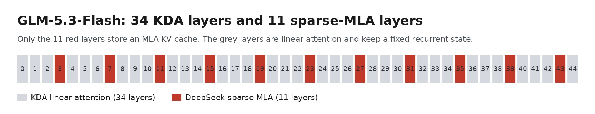
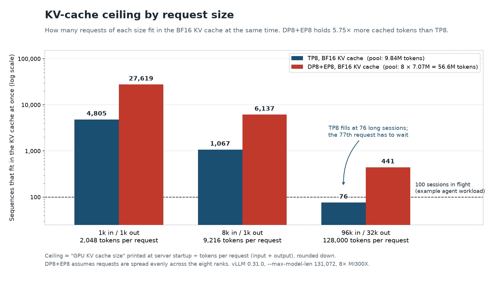
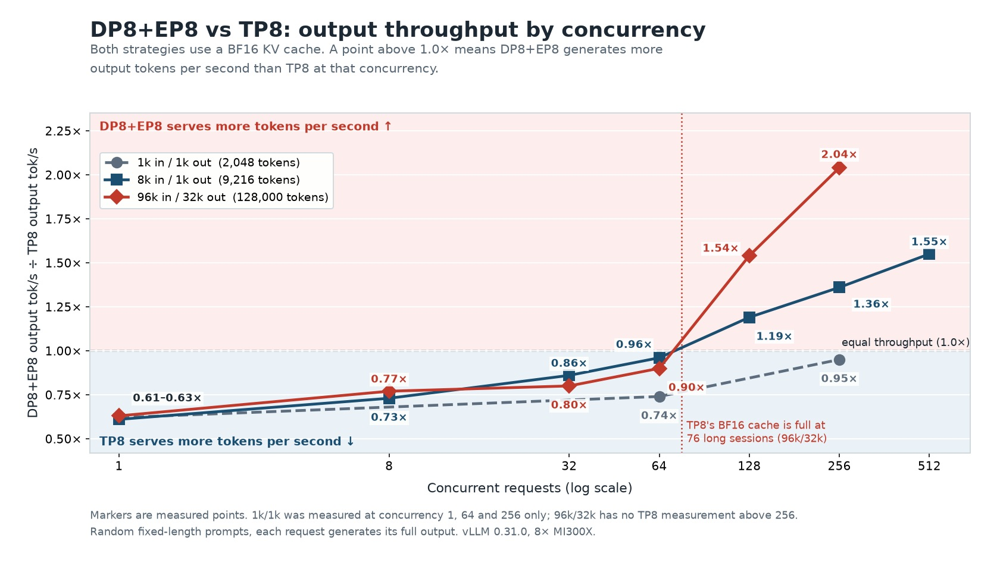
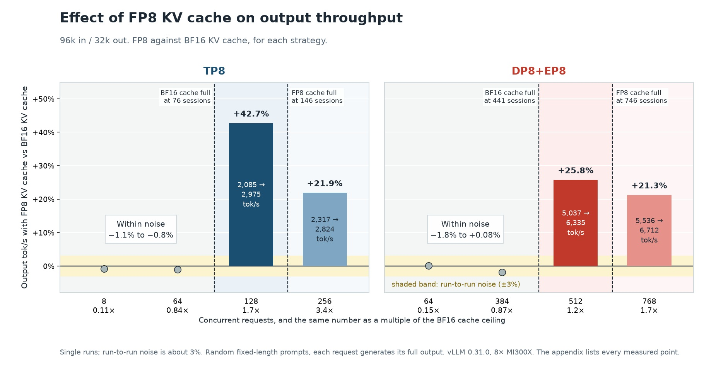

# Parallelism for Long-Context Serving: GLM-5.3-Flash on MI300X

GLM-5.3-Flash runs on a single eight-GPU AMD Instinct™ MI300X node. The FP8 checkpoint is about 306 GB, roughly a fifth of the node's 1,536 GB of HBM. During inference, most of the rest of the memory will be taken by the KV cache.
The KV cache holds the attention keys and values of every token a request has processed, so the model does not recompute them at each decoding step. Its footprint is the sum of the tokens held across all active requests, so it grows with request length and with the number of requests in flight. In long-context, high-concurrency serving it can exceed the weights as the largest consumer of HBM. When the pool is exhausted, the scheduler stops admitting requests; new arrivals queue, and throughput and latency degrade.

Two choices determine the throughput of a long-context, high-concurrency workload:

**Which parallelism strategy?**

- TP8 (tensor parallelism, width 8) keeps one copy of the model, sharded across the eight GPUs. A single request has the lower latency, because each layer's compute is divided among them. Each GPU holds a full copy of every request's KV cache, so the node's cache capacity is that of one GPU.
- DP8+EP8 (data parallelism and expert parallelism, both width 8) runs eight data-parallel ranks, each serving its own requests, and shards the routed experts across them. A single request is slower than on TP8, but each request's cache is stored once instead of being copied onto all eight GPUs, so the node holds far more cached tokens and many more long sessions fit.

**Which KV cache precision? This choice applies on top of either parallelism strategy:**

- BF16 is the default.
- FP8 stores the cached values in one byte instead of two, so the memory pool holds nearly twice as many tokens. In our tests it changed throughput by less than 2% while the BF16 pool could admit the workload, and raised it once the BF16 pool could no longer admit the next request.

To see how these choices play out for long contexts, this blog does three things:

- It identifies which parts of GLM-5.3-Flash store a KV cache, since they set the per-token cost.
- It works out how many sessions of a given length each parallelism strategy can hold: its KV-cache ceiling.
- It measures output throughput against concurrency for TP8 and DP8+EP8, with BF16 and FP8 KV cache, on three request shapes (1k in/1k out, 8k in/1k out, 96k in/32k out), and reads the results against that ceiling.

[The appendix](#appendix-measured-results) lists every measured point.

## GLM-5.3-Flash

[GLM-5.3-Flash](https://huggingface.co/zai-org/GLM-5.3-Flash) is a sparse mixture-of-experts (MoE) model with a hybrid attention stack. It has 320 billion parameters in total and about 18 billion active on each token. The model supports a maximum context length of 1,048,576 tokens (1M). This blog serves requests up to 131,072 tokens (128K). The model used in this blog has weights in FP8 format.

As shown in Figure 1, GLM-5.3-Flash has forty-five layers. Two separate patterns run through them, and they are easy to confuse because both begin at layer 3:

- **Attention type decides the KV cache.** Thirty-four layers use Kimi Delta Attention (KDA), a linear attention whose state does not grow with the prompt. The other eleven, layers 3, 7, 11 and so on through 43 (every fourth layer), use DeepSeek sparse attention with Multi-head Latent Attention (MLA). Only these eleven store a KV cache that grows with the prompt.
- **Feed-forward type decides compute and weights.** Layers 0, 1 and 2 use a dense MLP. Layers 3 through 44, all 42 of them, use mixture-of-experts: each token is routed to 8 of the 288 experts, and one shared expert always runs with them.



*Figure 1. Layers 0 through 44. Red layers store the token KV cache. Grey layers are linear attention and keep a fixed recurrent state.*

The table below summarizes how the 45 layers combine the two patterns.

| Layers | Count | Attention | Stores a growing KV cache? | Feed-forward |
| --- | ---: | --- | --- | --- |
| 0, 1, 2 | 3 | KDA | No | Dense MLP |
| 3, 7, 11, ..., 43 | 11 | Sparse MLA | **Yes** | Mixture-of-experts |
| All other layers from 4 to 44 | 31 | KDA | No | Mixture-of-experts |
| **Total** | **45** | 34 KDA, 11 sparse MLA | **11 of 45** | 3 dense, 42 mixture-of-experts |

Experts run on 42 layers, but a KV cache is stored on only 11. That is about a quarter of the layers. If all 45 layers stored a cache with entries of the same size, the cache per token would be roughly four times larger. Because so few layers store a growing cache, an eight-GPU node can hold millions of KV tokens once the 306 GB of weights are resident. The cache becomes the scarce resource when many long sessions are in flight together.

**Inside the eleven KV layers.** A lightweight indexer scores the past tokens and selects up to 2,048 of them for attention. This makes each step cheaper, but it does not shrink the cache: any past token may be selected later, so every token's entry must stay in memory.

Each cached entry is a 512-element latent vector per token per layer (`kv_lora_rank` is 512). DeepSeek-style MLA adds a 64-element RoPE (rotary position) part to that vector, making a 576-element row. GLM-5.3-Flash has none (`qk_rope_head_dim` is 0), so its row stays at 512. The indexer also keeps its own small key cache, with 128-dimensional keys pooled by four (IndexPool).

The key properties of the GLM-5.3-Flash model and the MI300X server node are summarized in the following table:

| Property | Value |
| --- | --- |
| Checkpoint | FP8, about 306 GB, 62 shards |
| Parameters | 320B total, about 18B active per token |
| Layers | 45: 34 linear attention, 11 sparse MLA |
| Experts | 288 routed, top-8, plus 1 shared |
| KV row | 512-wide latent, no RoPE half |
| Maximum context length | 1,048,576 tokens (served at 131,072 in this blog) |
| MI300X server node | 8× MI300X GPUs, with 192 GB of HBM each |

## Two Parallelism Strategies, One KV Cache Budget

Both parallelism strategies use the same eight GPUs, the same FP8 weights, the same 131,072-token serving window, and the same ROCm sparse-MLA backend. They differ in who owns the cache.

**TP8** slices the attention projections and the experts across the node, so a decode step is quick. In our measurements it had the lowest latency for a single long request. The latent KV is copied onto **every GPU** rather than sliced. With the KV cache in BF16 format, the boot log reports memory available for 9,841,634 tokens in the KV cache for the entire node. A request with 96k-token input length and a 32k-token output length consumes 128,000 of them, so the node can only hold **76** (floor(9,841,634/128000)) such sequences. The 77th request has to wait, because the server stops admitting new requests once the pool is full.

**DP8+EP8** makes each GPU its own data-parallel rank. The rank owns attention for its requests and stores their KV locally. The 288 routed experts are divided across the eight ranks, 36 per GPU, and a token whose expert sits on another GPU crosses the in-node XGMI fabric. There is no tensor-parallel split of attention, so one request does more work on its rank: at a single 96k/32k request, the mean time per output token (TPOT) is **19.7 ms** against **12.6 ms** on TP8, and output throughput is 49.9 tok/s against 78.7. In exchange the cache is no longer a single shared pool. The eight ranks together hold **56,564,848** BF16 KV tokens, **5.75×** the TP8 pool, which translates to **441** concurrent 96k/32k sequences.

The same division, applied to the three request sizes we measured, results in the capacity plan shown in Figure 2, assuming the KV cache is in BF16 format:



*Figure 2. KV-cache ceiling by request size, from the token pool printed at startup divided by the tokens in one request. The short bar on the right is the limit a long-context service on TP8 actually meets.*

As illustrated by the capacity plan, a chat service with a few hundred users and prompts in the order of a thousand tokens (1k/1k and 8k/1k) stays under the ceilings for both parallelism strategies. On the other hand, an agent service that keeps over a hundred 100k-token sessions in flight is already past what TP8 can cache. The rest of this blog focuses on that case.

vLLM reports the pool at startup as `GPU KV cache size: N tokens`. On TP8, N covers the whole node. On DP8+EP8, each of the eight ranks reports its own N, so the node total is 8 × 7,070,606 = 56,564,848 tokens. The ceiling is that pool divided by the tokens in one request (input plus output), rounded down.

## Which Parallelism Strategy Carries the Workload

We compared the two strategies on vLLM 0.31.0 across a concurrency ladder, with the serving window, batch limits, and KV precision held fixed so the only change from point to point is how many requests are in flight. Prompts were random tokens at a fixed length, and generations ran to the full output length. Throughput can vary by up to 1.1 percent across repeated runs on the same server and by up to about 3 percent between different nodes, so gaps of about 3 percent or less are within run-to-run noise and should be ignored. The output throughput ratio between the two strategies is shown in Figure 3.



*Figure 3. Output tokens per second for DP8+EP8 divided by the same quantity for TP8, with a BF16 KV cache. Above the dashed line, DP8+EP8 serves more tokens. Markers are measured points.*

When the concurrency is one, the throughput ratio is 0.61× to 0.63× on every shape, which means TP8 delivers about 1.6× the throughput of DP8+EP8, and the length of the prompt does not create that lead. This is the latency regime: a single session with no memory bottleneck, and TP8 delivered the higher throughput.
However, the curves separate as the server memory fills up with KV cache.

On 1k/1k the ratio climbs from 0.62× at concurrency 1 to 0.95× at concurrency 256, close to a tie. The TP8 ceiling at that length is 4,805 sequences, so a service of this shape is nowhere near a cache limit, and in our measurements DP8+EP8 did not deliver the higher throughput.

Medium requests cross over while the cache still has room. On 8k/1k, DP8+EP8 is already ahead for concurrency 128 (1.19×) and reaches 1.55× at 512. TP8 could still hold about 1,067 such sequences. The gain here is due to the DP8+EP8 strategy: eight ranks decoding at once, experts sharded, attention left whole on the rank that owns the request. DP8+EP8 delivers the higher throughput in this scenario.

Long requests cross over because TP8 runs out of KV cache memory much sooner. At concurrency 64, still under the ceiling of 76, TP8 leads: **2,105** output tok/s against **1,890** tok/s. At concurrency 128, TP8 delivers **2,085** tok/s and DP8+EP8 delivers **3,218** tok/s. At concurrency 256 the figures are **2,317** and **4,719** tok/s, a gap of 2.04×. The crossover is expected between concurrency 64 and 128, consistent with the TP8 ceiling of 76; the measured data confirms TP8 leads at 64 and DP8+EP8 leads at 128 and above. A long-context deployment sized around TP8’s single-request speed loses that advantage once demand passes this ceiling, which is a realistic load for an internal coding or agent service.

## FP8 KV Cache

Since the memory taken up by the KV cache is a key factor that limits the context length and concurrency supported by the MI300X server, one way to mitigate this limitation is to reduce the datatype of the KV cache.
FP8 KV cache stores the cached values in one byte instead of two, which reduces memory pressure significantly. The tokens are dequantized when they are read back from the KV cache.

For cases where the available memory can accommodate the KV cache in BF16 for every in-flight sequence, the extra memory goes unused, so FP8 has nothing to offer. On 96k/32k, FP8 changed throughput by less than 2% at every concurrency below the ceiling that we measured (Figure 4), within run-to-run noise. FP8 KV cache starts to pay off at the concurrency where the BF16 pool can no longer hold another sequence. The table below summarizes the change in throughput from BF16 KV cache to FP8 KV cache for the two parallelism strategies.

| | TP8 (ceiling 76) | DP8+EP8 (ceiling 441) |
| --- | --- | --- |
| Below the ceiling | Within noise (−1.1% to −0.8%) | Within noise (−1.8% to +0.08%) |
| Above the ceiling | **+42.7%** at concurrency 128 | **+25.8%** at concurrency 512 |
| Next point | +21.9% at concurrency 256 | +21.3% at concurrency 768 |

Below the ceiling, FP8 changed throughput by less than 2%, so reading fewer bytes per step made no measurable difference. The gain appears only where the BF16 pool runs out of slots, which points to cache capacity, not memory bandwidth, as the reason.

Once the FP8 pool also fills, the gain narrows. TP8 in FP8 holds 146 long sequences; the 42.7 percent advantage at concurrency 128 is 21.9 percent at 256. DP8+EP8 in FP8 holds 746; the 25.8 percent at concurrency 512 is 21.3 percent at 768. The pool grows by less than 2×.

Figure 4 shows how output throughput changes when the KV cache is switched from BF16 to FP8, for each strategy at concurrencies below and above the BF16 ceiling. Grey points mark concurrencies where the BF16 cache has room; the change there is within run-to-run noise. Dark bars mark concurrencies where the BF16 cache is full but the FP8 cache still has room, and light bars mark concurrencies where both caches are full. Bar labels give output tokens per second, BF16 to FP8.

```{note}
Figure 4 compares FP8 with BF16 within each strategy. It does not compare TP8 with DP8+EP8; Figure 3 does.
```



*Figure 4. Change in output throughput with an FP8 KV cache against a BF16 KV cache, on 96k-in, 32k-out requests. The shaded band is run-to-run noise, about 3%. [The appendix](#appendix-measured-results) lists every measured point.*

```{note}
FP8 KV cache requires [vLLM #57134](https://github.com/vllm-project/vllm/pull/57134). GLM-5.3-Flash stores 512 values per token per layer, while the ROCm sparse-attention kernels are built for DeepSeek's 576-value row. The patch routes GLM-5.3-Flash to a kernel that matches its row and handles FP8. It is included in the image built in the Setup section below.
```

## Set Up the vLLM Server

This section provides the instruction on how to reproduce the measurements described above in four steps: download the model, build the patched image, start the server (mounting the AITER patch) in the configuration you want to measure, and run the benchmark script. You need a host with eight MI300X GPUs, Docker, and room for the 306 GB checkpoint.

The results in this blog were measured with vLLM 0.31.0 (ROCm 7.2.3, PyTorch 2.13.0, AITER 0.1.23) on eight MI300X GPUs. They use the official [`vllm/vllm-openai-rocm:v0.31.0`](https://hub.docker.com/layers/vllm/vllm-openai-rocm/v0.31.0/images/sha256-749f6f3f944f12af49966ac523c1f8573e4b229594b541954bd5f879b4496b1f) image plus three patches. To reproduce the results, you need to apply all three patches.

| Patch | Purpose | How it is applied |
| --- | --- | --- |
| [vLLM #59412](https://github.com/vllm-project/vllm/pull/59412) | Correct long-context retrieval on GLM-5.3-Flash | Patch to `vllm/v1/worker/utils.py`, built into the image |
| [vLLM #57134](https://github.com/vllm-project/vllm/pull/57134) | FP8 KV cache support on GLM-5.3-Flash | Patch to two `rocm_aiter_mla_sparse.py` files, built into the image |
| [AITER 5979](https://github.com/ROCm/aiter/pull/5979) | MoE output stability at low concurrency | Patched `fused_moe.py` mounted into the container at launch |

The two vLLM patches ship with this blog as diffs in the [`src/`](https://github.com/ROCm/rocm-blogs/tree/release/blogs/artificial-intelligence/glm53flash-mi300x-vllm/src) folder: `pr59412_runtime.diff` and `pr57134_runtime.diff`. The steps below apply them to the official image `vllm/vllm-openai-rocm:v0.31.0` and build a new image from the result.  Run the commands from a folder that contains `src/`.

```bash
# Prerequisite: the Hugging Face client used for the model download
pip install huggingface_hub

export HF_TOKEN=<your_huggingface_token>
python3 -c "
from huggingface_hub import snapshot_download
import os
snapshot_download(
    repo_id='zai-org/GLM-5.3-Flash',
    local_dir='/path/to/glm-5.3-flash-fp8',
    token=os.environ.get('HF_TOKEN'),
)
"

docker pull vllm/vllm-openai-rocm:v0.31.0

mkdir -p build
docker run --rm --user "$(id -u):$(id -g)" --entrypoint bash \
  -v "$(pwd)/build:/out" vllm/vllm-openai-rocm:v0.31.0 -c '
  P=/usr/local/lib/python3.12/dist-packages/vllm
  mkdir -p /out/vllm/v1/worker /out/vllm/v1/attention/backends/mla /out/vllm/v1/attention/ops
  cp $P/v1/worker/utils.py                                 /out/vllm/v1/worker/utils.py
  cp $P/v1/attention/backends/mla/rocm_aiter_mla_sparse.py /out/vllm/v1/attention/backends/mla/
  cp $P/v1/attention/ops/rocm_aiter_mla_sparse.py          /out/vllm/v1/attention/ops/
'

cd build
patch -p1 < ../src/pr59412_runtime.diff
patch -p1 < ../src/pr57134_runtime.diff
cd ..
```

Here is the Dockerfile, which checks that both patches are present.  Save it in the same folder that contains `src/`.

```dockerfile
# GLM-5.3-Flash on vLLM v0.31.0
# Patches applied: vllm#59412, vllm#57134.
FROM vllm/vllm-openai-rocm:v0.31.0

ARG VLLM_PKG=/usr/local/lib/python3.12/dist-packages/vllm

RUN cp ${VLLM_PKG}/v1/worker/utils.py \
       ${VLLM_PKG}/v1/worker/utils.py.orig && \
    cp ${VLLM_PKG}/v1/attention/backends/mla/rocm_aiter_mla_sparse.py \
       ${VLLM_PKG}/v1/attention/backends/mla/rocm_aiter_mla_sparse.py.orig && \
    cp ${VLLM_PKG}/v1/attention/ops/rocm_aiter_mla_sparse.py \
       ${VLLM_PKG}/v1/attention/ops/rocm_aiter_mla_sparse.py.orig

COPY build/vllm/v1/worker/utils.py ${VLLM_PKG}/v1/worker/utils.py
COPY build/vllm/v1/attention/backends/mla/rocm_aiter_mla_sparse.py \
     ${VLLM_PKG}/v1/attention/backends/mla/rocm_aiter_mla_sparse.py
COPY build/vllm/v1/attention/ops/rocm_aiter_mla_sparse.py \
     ${VLLM_PKG}/v1/attention/ops/rocm_aiter_mla_sparse.py
COPY src/ /opt/patches/

# Verify the patches are applied. The build fails if either one is missing.
RUN python3 -m py_compile ${VLLM_PKG}/v1/worker/utils.py && \
    python3 -m py_compile ${VLLM_PKG}/v1/attention/backends/mla/rocm_aiter_mla_sparse.py && \
    python3 -m py_compile ${VLLM_PKG}/v1/attention/ops/rocm_aiter_mla_sparse.py && \
    grep -q "Storage-block specs" ${VLLM_PKG}/v1/worker/utils.py && \
    grep -q "_block_size_is_supported" ${VLLM_PKG}/v1/worker/utils.py && \
    grep -q "NoPE routing is geometry-based" \
        ${VLLM_PKG}/v1/attention/backends/mla/rocm_aiter_mla_sparse.py && \
    grep -q "KV_IS_FP8" ${VLLM_PKG}/v1/attention/ops/rocm_aiter_mla_sparse.py && \
    find ${VLLM_PKG}/v1 -name '__pycache__' -type d -exec rm -rf {} +
```

Build the docker image with the command:

```bash
DOCKER_BUILDKIT=1 docker build -f Dockerfile -t glm53flash-vllm-v031:latest .
```

Apply the AITER split-K guard to the `fused_moe.py` from that image and keep the result on the host. The container sees it through a read-only bind mount. The release image bakes in the same patch with an integrity check; the bind-mount approach here avoids a full image rebuild and keeps the patch visible alongside the article.

```bash
docker run --rm --user "$(id -u):$(id -g)" --entrypoint cp \
  -v "$(pwd):/out" glm53flash-vllm-v031:latest \
  /usr/local/lib/python3.12/dist-packages/aiter/fused_moe.py \
  /out/fused_moe.py

python3 - "$(pwd)/fused_moe.py" << 'PYEOF'
import sys
from pathlib import Path

f = Path(sys.argv[1])
src = f.read_text()

OLD = """    tilek = 256
    split_max = (cu_num + tg_num - 1) // tg_num
    # at least split = 2
    for i in reversed(range(2, split_max + 1)):
        if (model_dim % i == 0) and ((model_dim // i) % tilek == 0):
            return i
    return 0"""

NEW = """    tilek = 256
    split_max = (cu_num + tg_num - 1) // tg_num
    # at least split = 2, and at least 2 K-tiles per split (ROCm/aiter #5979)
    for i in reversed(range(2, split_max + 1)):
        if (model_dim % i == 0) and ((model_dim // i) % tilek == 0) and (model_dim // i >= 2 * tilek):
            return i
    return 0"""

assert OLD in src, "Anchor not found — check AITER version"
f.write_text(src.replace(OLD, NEW, 1))
print("ROCm/aiter 5979 applied")
PYEOF
```

The comparison grid used `--max-model-len 131072` and `--max-num-seqs 1024`, with GPU memory utilization 0.8, prefix caching off, and `--attention-backend ROCM_AITER_MLA_SPARSE`. The release launch script uses `--max-model-len 163840` and `--max-num-seqs 512`; the comparison grid uses the values above to let the KV pool fill at lower concurrency and expose the ceiling cleanly. The sequence cap is above the default of 512 so the KV pool fills before the scheduler does. A server left at 512 can still reach the long-context BF16 ceiling on DP8+EP8 (441 sequences) and the FP8 gain at concurrency 512. KV dtype is the default BF16 cache. Add `--kv-cache-dtype fp8` only for the FP8 half of the comparison.

To start the vLLM server with DP8+EP8, the strategy behind the larger KV pool, run the following commands from the folder that contains `fused_moe.py`, since the `fused_moe.py` mount uses the current folder.

```{note}
Before you run the command, replace `/path/to/glm-5.3-flash-fp8` with the path to the folder containing the downloaded model (the folder with `config.json` and the `.safetensors` files).
```

```bash
VIDEO_GID=$(getent group video  | cut -d: -f3)
RENDER_GID=$(getent group render | cut -d: -f3)

docker run -d --name glm53flash-v031 \
  --network host --device /dev/kfd --device /dev/dri \
  --group-add "${VIDEO_GID}" --group-add "${RENDER_GID}" \
  --ipc host --shm-size 128g \
  --cap-add SYS_PTRACE --cap-add IPC_LOCK \
  --security-opt seccomp=unconfined \
  --ulimit nofile=1048576:1048576 \
  `# CHANGE THIS PATH: the folder that contains your downloaded model` \
  -v /path/to/glm-5.3-flash-fp8:/mnt/models/GLM-5.3-Flash:ro \
  -v "$(pwd)/fused_moe.py:/usr/local/lib/python3.12/dist-packages/aiter/fused_moe.py:ro" \
  `# Startup can take over 10 minutes; allow up to an hour` \
  -e VLLM_ENGINE_READY_TIMEOUT_S=3600 \
  `# Offline model loading — prevent HuggingFace hub calls inside the container` \
  -e HF_HUB_OFFLINE=1 -e TRANSFORMERS_OFFLINE=1 \
  `# ROCm and AITER runtime settings` \
  -e AITER_BATON_TIMEOUT=7200 \
  -e HSA_NO_SCRATCH_RECLAIM=1 \
  -e SAFETENSORS_FAST_GPU=1 \
  `# AITER kernel selection — enable AITER, its fused MoE kernels, and the skinny GEMM` \
  -e VLLM_ROCM_USE_AITER=1 \
  -e VLLM_ROCM_USE_AITER_MOE=1 \
  -e VLLM_ROCM_USE_SKINNY_GEMM=1 \
  `# Communication quantization — INT4 quantizes AllReduce traffic across GPUs;` \
  `# reduces inter-GPU bandwidth at the cost of numeric precision` \
  -e VLLM_ROCM_QUICK_REDUCE_QUANTIZATION=INT4 \
  `# FlyDSL FP8 MQA-logits kernel variant` \
  -e FLYDSL_FP8_MQA_LOGITS_VARIANT=mfma_r4_w4 \
  glm53flash-vllm-v031:latest \
  /mnt/models/GLM-5.3-Flash \
    --served-model-name glm-5-3-flash-fp8 \
    --data-parallel-size 8 --enable-expert-parallel \
    --trust-remote-code \
    --max-model-len 131072 \
    --max-num-batched-tokens 8192 \
    --max-num-seqs 1024 \
    --gpu-memory-utilization 0.8 \
    --no-enable-prefix-caching \
    --distributed-timeout-seconds 7200 \
    --enable-auto-tool-choice \
    --tool-call-parser glm47 \
    --reasoning-parser glm47 \
    --attention-backend ROCM_AITER_MLA_SPARSE \
    --port 8000
```

To start the server with TP8, use the same command and replace `--data-parallel-size 8 --enable-expert-parallel` with `--tensor-parallel-size 8`. Everything else stays the same: the mounts, the environment variables, and the remaining flags. Both servers use the container name `glm53flash-v031` and port 8000, so remove the first one with `docker rm -f glm53flash-v031` before you start the second.

Before sending the comparison traffic, confirm the running container actually contains the two vLLM changes with the following commands:

```bash
docker exec glm53flash-v031 bash -lc '
P=/usr/local/lib/python3.12/dist-packages/vllm
grep -q "Storage-block specs" $P/v1/worker/utils.py && echo "PATCH OK #59412"
grep -q "NoPE routing is geometry-based" $P/v1/attention/backends/mla/rocm_aiter_mla_sparse.py && echo "PATCH OK #57134"
grep -q "KV_IS_FP8" $P/v1/attention/ops/rocm_aiter_mla_sparse.py && echo "PATCH OK #57134 fp8"
'
```

Startup takes several minutes. Wait until the log prints `Application startup complete`. A short reasoning request and a tool call are enough to see that the server is the model you think it is. On this tag the reasoning trace comes back in `content`. The `reasoning_content` field is empty.

### Benchmark the Workload

The script below `bench_grid.sh` measures throughput and latency for the three request shapes used in this blog: 1k in and 1k out, 8k in and 1k out, and 96k in and 32k out. For each concurrency level in the list, it sends that many random, fixed-length prompts at once, lets each one generate its full output, and records the output throughput, time to first token (TTFT), and time per output token (TPOT).

```bash
#!/usr/bin/env bash
# Usage: bash bench_grid.sh <TAG> <SHAPE> "<concurrency list>"
#   TAG   server config label: dp8ep8_bf16 | tp8_bf16 | dp8ep8_fp8 | tp8_fp8
#   SHAPE 1k1k | 8k1k | 96k32k
# Example: bash bench_grid.sh dp8ep8_bf16 96k32k "1 8 32 64 128 256 512 1024"
# Re-running skips points that already have a result file.
# WARMUPS=0 skips the built-in warmup request, which is a full-length request (about 11 minutes at 96k/32k).
set -uo pipefail
TAG=${1:?TAG}; SHAPE=${2:?SHAPE}; CONCS=${3:?concurrency list}
CONTAINER=${CONTAINER:-glm53flash-v031}
PORT=${PORT:-8000}
MODEL=${MODEL:-glm-5-3-flash-fp8}
TOKENIZER=${TOKENIZER:-/mnt/models/GLM-5.3-Flash}
NP_MULT=${NP_MULT:-1}          # prompts = concurrency x NP_MULT
IGNORE_EOS=${IGNORE_EOS:-1}    # 1 = force every request to generate its full output length
OUT=${OUT:-$HOME/bench/$TAG}

case $SHAPE in
  1k1k)   ISL=1024;  OSL=1024;  TMO=3600  ;;
  8k1k)   ISL=8192;  OSL=1024;  TMO=7200  ;;
  96k32k) ISL=96000; OSL=32000; TMO=21600 ;;
  *) echo "unknown SHAPE $SHAPE"; exit 1 ;;
esac
mkdir -p "$OUT"
CSV="$OUT/summary_$SHAPE.csv"
[ -f "$CSV" ] || echo "shape,isl,osl,concurrency,num_prompts,duration_s,completed,output_tok_s,total_tok_s,mean_ttft_ms,median_ttft_ms,p99_ttft_ms,mean_tpot_ms,median_tpot_ms,p99_tpot_ms" > "$CSV"

for C in $CONCS; do
  NP=$((C * NP_MULT)); STEM="${SHAPE}_c${C}"
  [ -f "$OUT/$STEM.json" ] && { echo "skip $STEM (already done)"; continue; }
  echo "=== $TAG $SHAPE concurrency=$C prompts=$NP  $(date)"
  EXTRA=""; [ "$IGNORE_EOS" = 1 ] && EXTRA="--ignore-eos"
  docker exec -e AIOHTTP_CLIENT_TIMEOUT="$TMO" "$CONTAINER" vllm bench serve \
    --model "$MODEL" --base-url "http://localhost:$PORT" --tokenizer "$TOKENIZER" \
    --dataset-name random --random-input-len "$ISL" --random-output-len "$OSL" --random-range-ratio 0.0 \
    --num-prompts "$NP" --max-concurrency "$C" --num-warmups "${WARMUPS:-1}" --temperature 0 $EXTRA \
    --save-result --result-dir /tmp/bench_json --result-filename "$STEM.json" 2>&1 | tee "$OUT/$STEM.log"
  docker cp "$CONTAINER:/tmp/bench_json/$STEM.json" "$OUT/$STEM.json"
  python3 - "$OUT/$STEM.json" "$SHAPE,$ISL,$OSL,$C,$NP" >> "$CSV" <<'PY'
import json, sys
d = json.load(open(sys.argv[1]))
r = lambda k, n=2: round(float(d.get(k) or 0), n)
print(sys.argv[2] + "," + ",".join(str(x) for x in [
    r("duration"), d.get("completed", ""), r("output_throughput"), r("total_token_throughput"),
    r("mean_ttft_ms", 1), r("median_ttft_ms", 1), r("p99_ttft_ms", 1),
    r("mean_tpot_ms"), r("median_tpot_ms"), r("p99_tpot_ms")]))
PY
  sleep 30
done
echo "Done: $OUT"; column -s, -t "$CSV" 2>/dev/null || cat "$CSV"
```

Make sure the server is already running before running the script. Run the script once per configuration and use the tag to name it. Use the launch command above with these changes:

| Tag | Server change |
| --- | --- |
| `dp8ep8_bf16` | none (the launch command above) |
| `tp8_bf16` | replace `--data-parallel-size 8 --enable-expert-parallel` with `--tensor-parallel-size 8` |
| `dp8ep8_fp8` | add `--kv-cache-dtype fp8` |
| `tp8_fp8` | `--tensor-parallel-size 8` and `--kv-cache-dtype fp8` |

For example, for the DP8+EP8 server with a BF16 cache, run the script with the three different input/output shapes and corresponding concurrency list:

```bash
bash bench_grid.sh dp8ep8_bf16 1k1k   "1 64 256"
bash bench_grid.sh dp8ep8_bf16 8k1k   "1 8 32 64 128 256 512 1024"
bash bench_grid.sh dp8ep8_bf16 96k32k "1 8 32 64 128 256 512 1024"
```

Results are written to `~/bench/<TAG>/`: a summary CSV for each request shape, plus the full log and JSON for every point. The server must allow at least as many sequences as the concurrency you ask for, so keep `--max-num-seqs 1024` for concurrencies up to 1024. The 96k/32k runs at high concurrency take a long time.

## Summary

In this blog, you explored how KV-cache capacity shapes GLM-5.3-Flash throughput on an eight-GPU MI300X node. You compared TP8 and DP8+EP8 on three request sizes. TP8 was faster at low concurrency, DP8+EP8 pulled ahead once TP8's 76-session cache filled, and FP8 KV cache helped only after the BF16 cache was full. The Set Up section gives you the image, launch commands and benchmark script to repeat the measurements on your own workload.

Dividing the KV cache pool size that vLLM reports at startup (`GPU KV cache size`) by your request length in tokens, input plus output, shows how many sessions fit, and so which case your workload falls in. We measured throughput, not accuracy, so validate FP8 KV cache on your own workload.

**What's next:** This post covers serving on a single eight-GPU node. We plan to look at serving long-context workloads across multiple nodes with prefill/decode (PD) disaggregation. Follow the [ROCm Tech Blogs](https://rocm.blogs.amd.com/) for updates.

(appendix-measured-results)=

## Appendix: Measured Results

All values are output tokens per second, measured with the benchmark script above on eight MI300X GPUs with vLLM 0.31.0. Each point is a single run: random fixed-length prompts, as many requests as the concurrency, and every request generating its full output. Run-to-run noise is about 3%. The KV cache is BF16 unless a table says otherwise. At 96k/32k each high-concurrency point takes an hour or more, so the ladder stops at 256 on TP8 and at 768 on DP8+EP8.

### 1k in, 1k out

| Concurrency | TP8 | DP8+EP8 | DP8+EP8 ÷ TP8 |
| ---: | ---: | ---: | ---: |
| 1 | 85.26 | 52.70 | 0.62× |
| 64 | 2,724.28 | 2,016.18 | 0.74× |
| 256 | 6,167.32 | 5,886.97 | 0.95× |

### 8k in, 1k out

| Concurrency | TP8 | DP8+EP8 | DP8+EP8 ÷ TP8 |
| ---: | ---: | ---: | ---: |
| 1 | 78.15 | 47.39 | 0.61× |
| 8 | 437.07 | 320.45 | 0.73× |
| 32 | 1,107.82 | 956.04 | 0.86× |
| 64 | 1,526.32 | 1,466.10 | 0.96× |
| 128 | 1,957.07 | 2,334.11 | 1.19× |
| 256 | 2,262.00 | 3,087.30 | 1.36× |
| 512 | 2,443.62 | 3,787.57 | 1.55× |
| 1024 | 2,207.27 | 4,250.83 | 1.93× |

### 96k in, 32k out

| Concurrency | TP8 | DP8+EP8 | DP8+EP8 ÷ TP8 |
| ---: | ---: | ---: | ---: |
| 1 | 78.74 | 49.89 | 0.63× |
| 8 | 484.76 | 370.92 | 0.77× |
| 32 | 1,392.09 | 1,118.29 | 0.80× |
| 64 | 2,104.91 | 1,890.31 | 0.90× |
| 128 | 2,084.59 | 3,218.28 | 1.54× |
| 256 | 2,317.08 | 4,719.20 | 2.04× |

### 96k in, 32k out: FP8 against BF16 KV cache

| Strategy | Concurrency | BF16 KV cache | FP8 KV cache | Change |
| --- | ---: | ---: | ---: | ---: |
| TP8 | 8 | 484.76 | 480.73 | −0.8% |
| TP8 | 32 | 1,392.09 | 1,376.76 | −1.1% |
| TP8 | 64 | 2,104.91 | 2,083.36 | −1.0% |
| TP8 | 128 | 2,084.59 | 2,974.96 | +42.7% |
| TP8 | 256 | 2,317.08 | 2,824.43 | +21.9% |
| DP8+EP8 | 64 | 1,890.31 | 1,891.88 | +0.08% |
| DP8+EP8 | 128 | 3,218.28 | 3,217.03 | −0.04% |
| DP8+EP8 | 256 | 4,719.20 | 4,718.11 | −0.02% |
| DP8+EP8 | 384 | 5,851.47 | 5,744.10 | −1.8% |
| DP8+EP8 | 512 | 5,037.15 | 6,334.99 | +25.8% |
| DP8+EP8 | 768 | 5,535.57 | 6,711.95 | +21.3% |

768 is the first concurrency we tested above the DP8+EP8 FP8 ceiling of 746 sessions.

## Disclaimers

The information presented in this document is for informational purposes only and may contain technical inaccuracies, omissions, and typographical errors. The information contained herein is subject to change and may be rendered inaccurate for many reasons, including but not limited to product and roadmap changes, component and motherboard version changes, new model and/or product releases, product differences between differing manufacturers, software changes, BIOS flashes, firmware upgrades, or the like. Any computer system has risks of security vulnerabilities that cannot be completely prevented or mitigated. AMD assumes no obligation to update or otherwise correct or revise this information. However, AMD reserves the right to revise this information and to make changes from time to time to the content hereof without obligation of AMD to notify any person of such revisions or changes. THIS INFORMATION IS PROVIDED ‘AS IS.” AMD MAKES NO REPRESENTATIONS OR WARRANTIES WITH RESPECT TO THE CONTENTS HEREOF AND ASSUMES NO RESPONSIBILITY FOR ANY INACCURACIES, ERRORS, OR OMISSIONS THAT MAY APPEAR IN THIS INFORMATION. AMD SPECIFICALLY DISCLAIMS ANY IMPLIED WARRANTIES OF NON-INFRINGEMENT, MERCHANTABILITY, OR FITNESS FOR ANY PARTICULAR PURPOSE. IN NO EVENT WILL AMD BE LIABLE TO ANY PERSON FOR ANY RELIANCE, DIRECT, INDIRECT, SPECIAL, OR OTHER CONSEQUENTIAL DAMAGES ARISING FROM THE USE OF ANY INFORMATION CONTAINED HEREIN, EVEN IF AMD IS EXPRESSLY ADVISED OF THE POSSIBILITY OF SUCH DAMAGES.

Performance testing conducted by AMD as of November 2026 on 8× AMD Instinct™ MI300X GPUs using vLLM v0.31.0 and ROCm 7.2.3. Performance results are based on testing as of this date and may not reflect all publicly available security updates. Results may vary based on hardware configuration, software versions, and workload characteristics.

AMD, the AMD Arrow logo, AMD Instinct, ROCm, and combinations thereof are trademarks of Advanced Micro Devices, Inc. Other product names used in this publication are for identification purposes only and may be trademarks of their respective companies. © 2026 Advanced Micro Devices, Inc. All rights reserved.
