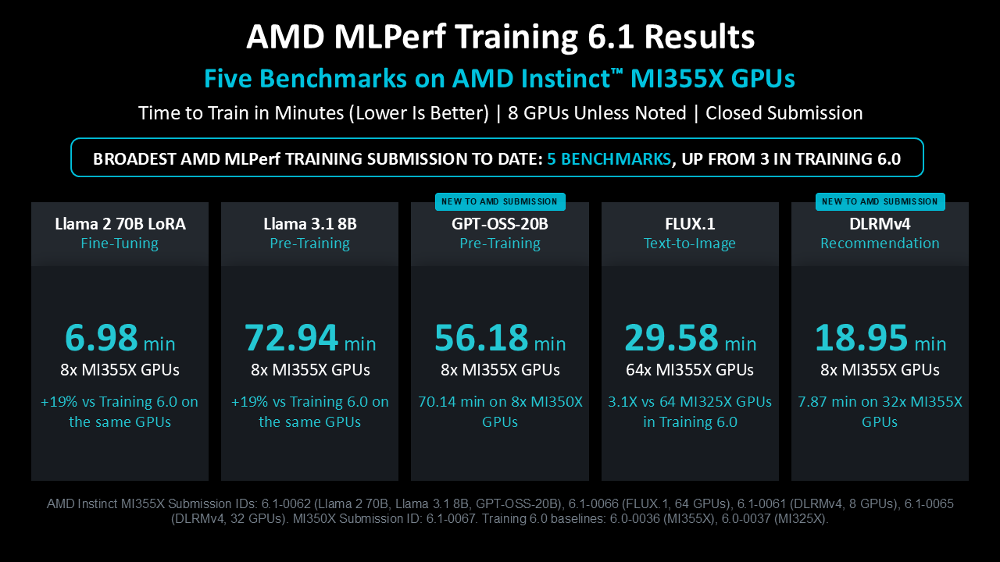
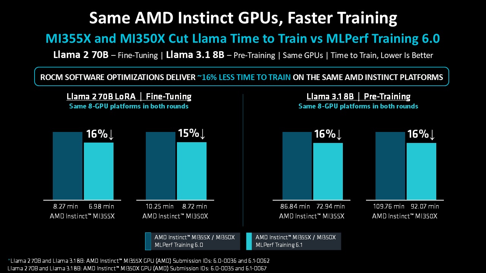
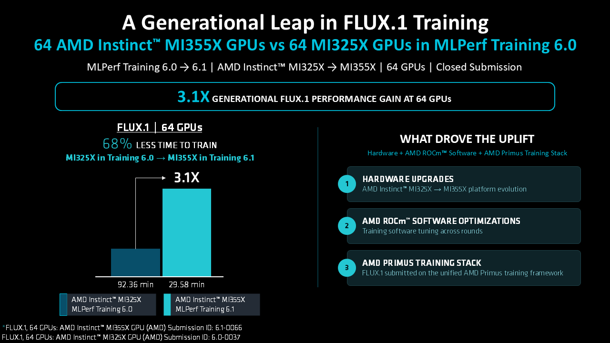
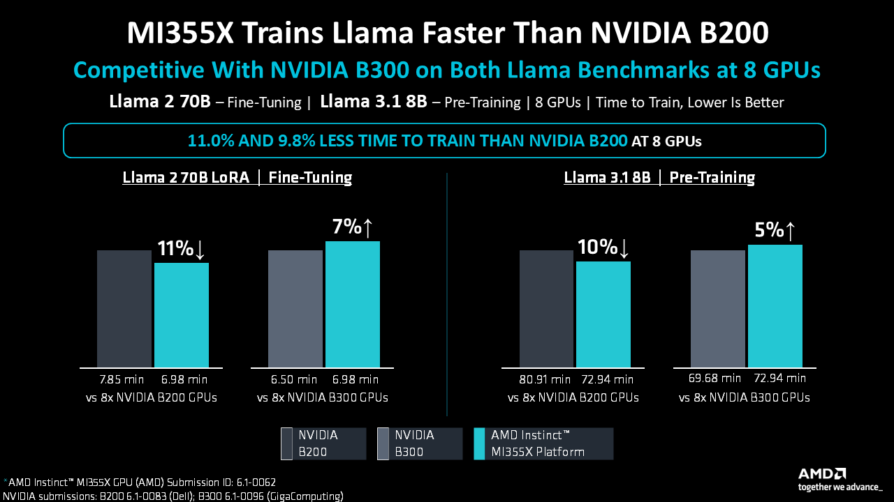
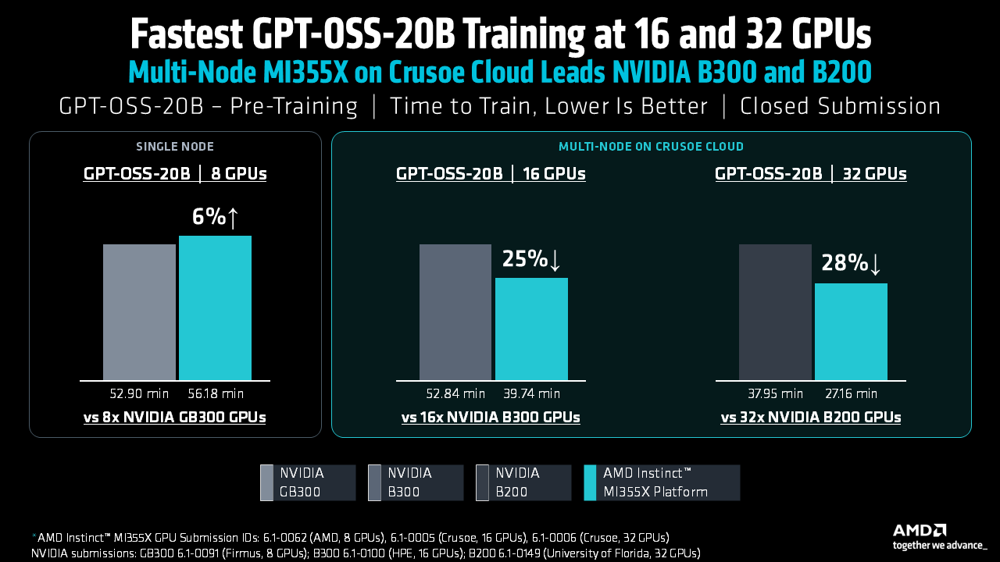
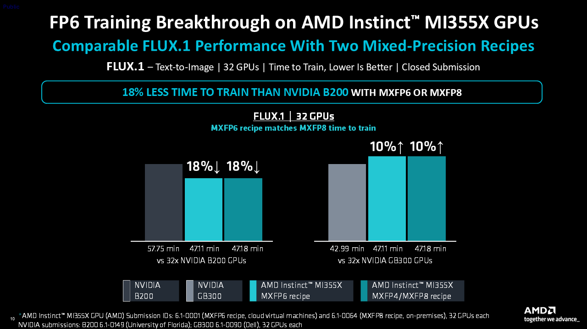
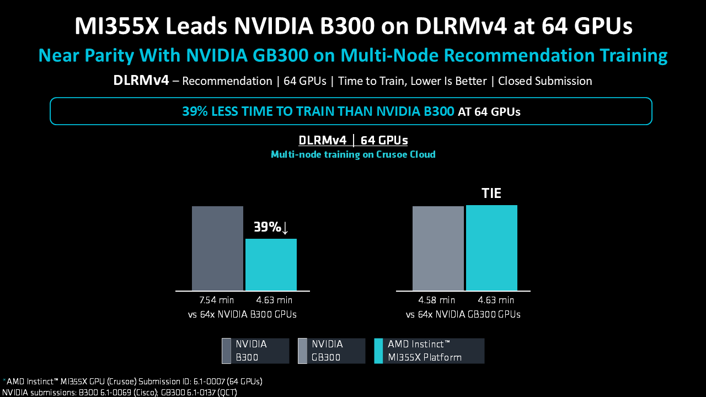
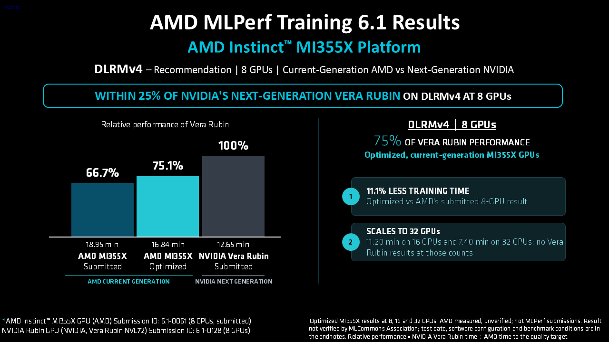
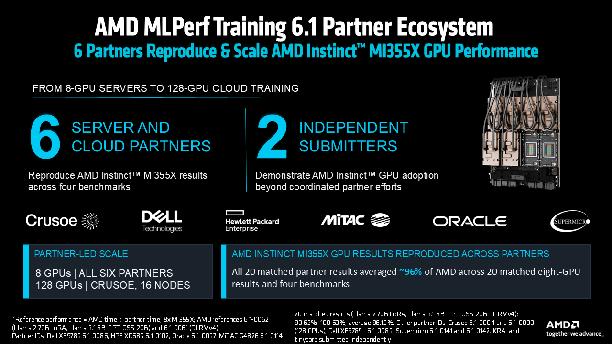

<!---
Copyright (c) 2026 Advanced Micro Devices, Inc. (AMD)

Permission is hereby granted, free of charge, to any person obtaining a copy
of this software and associated documentation files (the "Software"), to deal
in the Software without restriction, including without limitation the rights
to use, copy, modify, merge, publish, distribute, sublicense, and/or sell
copies of the Software, and to permit persons to whom the Software is
furnished to do so, subject to the following conditions:

The above copyright notice and this permission notice shall be included in all
copies or substantial portions of the Software.

THE SOFTWARE IS PROVIDED "AS IS", WITHOUT WARRANTY OF ANY KIND, EXPRESS OR
IMPLIED, INCLUDING BUT NOT LIMITED TO THE WARRANTIES OF MERCHANTABILITY,
FITNESS FOR A PARTICULAR PURPOSE AND NONINFRINGEMENT. IN NO EVENT SHALL THE
AUTHORS OR COPYRIGHT HOLDERS BE LIABLE FOR ANY CLAIM, DAMAGES OR OTHER
LIABILITY, WHETHER IN AN ACTION OF CONTRACT, TORT OR OTHERWISE, ARISING FROM,
OUT OF OR IN CONNECTION WITH THE SOFTWARE OR THE USE OR OTHER DEALINGS IN THE
SOFTWARE.
--->

# Technical Deep Dive into AMD MLPerf Training v6.1 Results

On November 16th, 2026, MLCommons published the MLPerf Training v6.1 results,
with AMD submitting its fourth consecutive round of MLPerf Training. This round
is particularly notable because it is the most complete submission from AMD to
date: AMD submitted to five of the seven available [benchmarks](https://mlcommons.org/benchmarks/training/) in this round, the highest coverage on AMD Instinct
GPUs ever. Pretraining of GPT-OSS-20B MoE model and a new recommendation model,
DLRM v4, are added to the Llama 2 70B LoRA, Llama 3.1 8B, and Flux.1 models
carried over from the previous round. All AMD first-party results were submitted
on the AMD Instinct MI355X and AMD Instinct MI350X GPUs, built on the CDNA 4
architecture.

In addition to quantity, the quality of the submission has also strengthened.
Across all five benchmarks, AMD Instinct GPUs deliver competitive time-to-train
against NVIDIA's Blackwell-generation systems - beating the B200 and matching
B300 within a few points wherever comparable submission exists - establishing the
MI355X as a credible platform for the training jobs that matter most in
production today.

The submissions also demonstrate clear round-over-round improvements. On the
benchmarks carried over from v6.0, time-to-train improved by ~1.19x on identical
MI355X hardware - a pure software result, driven by improvements in training
recipes and the Primus framework. This round also marks the first-ever MXFP6
MLPerf Training submission, pushing low-precision training to a new frontier
while still meeting the benchmark's convergence target.

That competitiveness reaches well beyond AMD systems. Nine submitters - including
Dell, HPE, Supermicro, Oracle, MiTAC, and Crusoe - published AMD Instinct results
in v6.1, and AMD cloud partner Crusoe scaled MI355X deployments up to 128 GPUs
across multiple benchmarks. This demonstrates not just competitive silicon, but a
maturing, production-ready ROCm ecosystem ready to deploy at scale.

The results are peer-reviewed, public, and fully reproducible. Readers interested in reproducing AMD submission results should refer to the companion guide: [Reproducing AMD MLPerf Training v6.1 Submission Results](https://rocm.blogs.amd.com/artificial-intelligence/mlperf-training6.1-repro/README.html).

## Submission Highlights

These are the highlights of AMD v6.1 MLPerf Training submission (illustrated in the figure below)

- Submission on five out of seven available benchmarks, up from three in the previous round (v6.0)
- The submission covers language model pretraining and fine-tuning, and training recommendation and image generation models
- 19% improvement in Llama2-70b and Llama3.1-8b vs last round
- Two new benchmarks submitted: gpt-oss-20b MoE pretraining and DLRM v4 recommendation model
- 3.1x improvement on Flux.1 training with 64 GPUs
- 6 partner submissions, 2 independent submissions

## Primus: Expanding Coverage in MLPerf Training

[Primus](https://github.com/AMD-AGI/Primus) is a unified, modular training framework for large-scale foundation model training on AMD Instinct GPUs. Introduced in MLPerf Training for the first time in v6.0, Primus now powers all three language model benchmarks in v6.1 — Llama3.1-8B pretraining, Llama2-70B LoRA fine-tuning, and GPT-OSS-20B pretraining.

Primus is a three-component ecosystem:

- **Primus (Primus-LM):** The unified training framework, providing the `primus-cli`, configuration templates, workflow orchestration, and ROCm-native integrations with Megatron-LM and TorchTitan backends. A single configuration file selects the correct backend and hyperparameters for each GPU platform and node count.
- **Primus-Turbo:** A high-performance acceleration library that delivers optimized FlashAttention, GEMM, and collective communication kernels for Instinct GPUs via AITER, Composable Kernel, and ROCm Triton — activated as a non-intrusive drop-in over the training framework without source code modification.
- **Primus-SaFE:** A cluster management and fault tolerance layer that provides resilient, self-monitoring training at enterprise scale.

For GPT-OSS-20B, Primus integrates Primus-Turbo's FlyDSL grouped and dense GEMMs, an MXFP4 training recipe with weight deoscillation, specialized BF16 attention, and SDMA collective transfers. Fused routing, normalization, optimizer, and loss operations further reduce memory traffic around the main compute kernels.

Customers and developers interested in evaluating Primus for their own workloads can access it at [github.com/AMD-AGI/Primus](https://github.com/AMD-AGI/Primus).

The following sections provide deep dives into optimizations that were crucial for achieving the results in this round.

## GPT-OSS-20B Pretraining Optimization

GPT-OSS-20B combines mixture-of-experts (MoE) layers, where routing produces uneven token counts across experts, with grouped-query attention (GQA). On AMD Instinct MI355X, we use MXFP4 for matrix operations while keeping attention in BF16. Our optimizations target matrix execution and the surrounding memory and communication costs, alongside numerical controls for stable training.

**MXFP4 training.** MXFP4 represents values with four-bit numbers and a shared scale per block. We implement the [ALTO recipe](https://arxiv.org/abs/2610.32229) with native MI355X operations. Weights use 32 × 32 blocks so forward and backward reuse the same quantized weights, avoiding discrepancies from quantizing each orientation separately. Activations use 1 × 32 blocks. Paired Hadamard transforms redistribute outliers in the activation and output-gradient operands used for weight-gradient computation while preserving the operand product. Output gradients use stochastic rounding to reduce rounding bias. Weight deoscillation addresses small updates that repeatedly flip weights between quantized values. For MXFP4 quantization, we adopt only the Universal Optimal Scaling scale-selection method from [MXAttention](https://arxiv.org/abs/2607.24377) to balance clipping against loss of small values. Attention computation remains in BF16.

**Grouped expert GEMMs.** We tune grouped matrix-multiplication kernels for the different token counts assigned to each expert. Fusing SwiGLU activation and activation-gradient preparation with quantization removes intermediate memory passes. Eligible weight-gradient kernels write directly to destination buffers, avoiding temporary results while preserving gradient accumulation.

**Dense GEMMs.** We tune block sizes for the model's matrix shapes and overlap input loading with computation to hide load latency. Preparing quantization scales in the layout consumed by the GEMM avoids separate repacking. Reusing completed accumulator registers for output packing reduces register demand, while selected output writes bypass L2 to avoid evicting reusable inputs.

**BF16 attention.** Causal and sliding-window kernels skip fully masked blocks, avoiding unnecessary work. The forward kernel processes two query heads in one workgroup so they can reuse loaded keys and values, reducing repeated memory reads. Backward scheduling prepares operands early and places gradient stores alongside independent matrix work to reduce waiting between operations.

**Kernel fusion and memory optimizations.** We fuse token gathering with quantization, RMSNorm with quantization, and Q/K RMSNorm with rotary position embeddings (RoPE), avoiding intermediate tensors and memory passes. Fewer copies and buffer initializations further reduce memory traffic. AdamW and cross-entropy fusions also remove separate gradient-scaling passes.

**Communication.** Compute-unit-based transfers compete with training kernels for GPU resources. We offload eligible transfers to dedicated SDMA copy engines, reducing that contention. AllGather benefits directly because it only moves data. We observe smaller benefits for ReduceScatter because its local reduction still runs on compute units, leaving some contention with training kernels.

## DLRM v4 Optimizations

DLRMv4 trains an HSTU (Hierarchical Sequential Transduction Unit) ranker on the
Yambda dataset, with TorchRec embedding tables feeding HSTU attention layers over
long user-history sequences. It poses a different challenge than the transformer
benchmarks: the large embedding tables make it memory-capacity-bound, and the
MI355X's 288 GB of HBM3E holds the Yambda tables comfortably. But once the tables
fit, step time is dominated by HSTU attention and the dense projection GEMMs, not
by the embedding lookups - so most of the optimization work went into attention
kernels, low precision, and keeping the GPU fed. The main DLRMv4-specific
optimizations are described below.

**Custom FlyDSL attention kernels.** The Triton HSTU forward and backward attention kernels were replaced by hand-written FlyDSL kernels for CDNA4, with K/V tiles staged in LDS, transpose-on-read loads, and Q/K/V read in place from the fused projection output instead of copied out.

**FP8 and MXFP6 compute.** HSTU attention runs in FP8 (E4M3) in both directions, with per-32-token block scales for the attention-output gradient. The HSTU projection GEMMs and their weight and output gradients run in FP8, and the K=512 forward GEMMs use MXFP6 in persistent kernels with register-resident weights. Scales are calibrated over the first steps and then frozen, so the steady-state step needs no amax reduction or host read.

**Host-sync-free training step.** Per-step blocking device-to-host reads (sequence-length statistics, all-to-all split sizes, scale refreshes) were removed or deferred, so the host stays ahead of the GPU.

**Targets-only final layer.** The last HSTU layer computes outputs only for the candidate rows that the loss reads, instead of every sequence position.

**Leaner embedding path.** The embedding collection casts rows to BF16 once per unique ID before expanding them to tokens. Its backward pass uses a sorted segment reduction instead of scattered atomic adds, and the user-history and candidate features share one merged lookup and expand.

**Deduplicated preprocessing.** The per-item preprocessing MLPs run once per unique (item, artist, album) triple in a batch, and the action MLP once per action code; the results are gathered back to the tokens.

**Fused normalization and elementwise work.** LayerNorm and residual adds are folded into the preceding GEMM epilogues, LayerNorm backward runs in pipelined FlyDSL and Triton kernels, and dropout uses a compact 16-bit Philox mask.

**Pinned library choices.** hipBLASLt solutions are pinned for the HSTU projection shapes and Triton autotune results are pinned per shape, avoiding slow default selections and run-to-run variance.

**Input pipeline and startup.** Page-locked dataloader buffers, a prebuilt time-window index, and parallel batch-builder pools keep the GPU fed, while kernel prebuild and synthetic warm-up before `RUN_START` move one-time compilation out of the timed region.

## Flux.1 Optimizations

AMD submitted Flux.1-schnell with 32 GPUs in two ways, each with a separate implementation
that reached nearly the same time-to-train: an A6W4-FP4 recipe at 47.18 minutes
and an MXFP6 recipe at 47.11 minutes. The two submissions demonstrate that MXFP6
training is ready to use in practice. Both recipes are described below.

### Flux.1 Optimizations: A6W4-FP4 Recipe

AMD submitted Flux.1 with 32 and 64 GPUs using the A6W4-FP4 recipe (MXFP6 activations × MXFP4 weights) on the  [Primus](https://github.com/AMD-AGI/Primus) diffusion backend with FSDP2. Flux.1-schnell is a 12-billion-parameter diffusion transformer with 19 double-stream and 38 single-stream blocks. Training time is dominated by Linear GEMMs, the quantization and elementwise operations around them, and FSDP2 weight AllGathers, which can compete with GEMMs for compute resources. Our optimizations increase low-precision compute throughput while reducing the memory traffic and communication overhead that can prevent the GEMMs from running efficiently.
On 4 nodes (32 MI355X GPUs, global batch 1024), time-to-train fell from 98 to 47.18 minutes, a 2.08× speedup over our v6.0 submission. Throughput increased 57.7%, from 1,938 to 3,056 samples/s, while improved convergence reduced samples-to-train from 11.4M at global batch 2048 in v6.0 to 8.65M at global batch 1024. On 8 nodes (64 GPUs), the same recipe trains in 29.58 minutes at global batch 2048 and converges at 10.35M samples. The main optimizations are:

**Mixed-precision recipe.** Lower-precision MXFP4/MXFP6 reduces operand size and increases GEMM throughput, but aggressive quantization can hurt convergence. We run backward GEMMs (dgrad and wgrad) in MXFP4 after Hadamard rotation to control quantization error, while the more sensitive forward pass uses FlyDSL's A6W4 GEMM and switches to FP8 late in training. This preserves the performance benefit of lower precision while matching the convergence of an FP8-forward recipe. FP8 graphs are compiled during warm-up, making the transition nearly overhead-free.

**Cheaper, hidden weight AllGather.** FSDP2 weight gathering can delay GEMMs and compete with them for compute resources. Each rank therefore quantizes only its local shard and AllGathers the smaller quantized weights directly in the order consumed by the backward GEMM. Single-stream blocks move these weights using SDMA copy engines instead of compute units, allowing communication to overlap more effectively with computation. With the gather largely hidden, sharding across all 32 GPUs outperforms two independent 16-GPU replicas.

**Single-read FP8 quantize.** The FP8 phase requires both an FP8 operand for the forward pass and an MXFP4 operand for wgrad. Instead of reading the same Linear input multiple times, one kernel reads it once and produces both representations. FP8 scaling, bias addition, and bias-gradient computation are folded into kernels that already run, reducing HBM traffic and kernel-launch overhead.

**Tuned A6W4 forward GEMM.** The forward GEMM is tuned specifically for Flux.1's training shapes. Larger output tiles increase useful work per tile, deeper LDS buffering better overlaps data movement with compute, and non-temporal stores reduce cache pressure. Together, these changes increase forward-GEMM throughput while preserving bit-identical output.

**Fusions that remove BF16 round trips.** Elementwise operations between GEMMs can become memory-bound when intermediate BF16 tensors are repeatedly written to and read from HBM. GELU and its gradient are therefore fused into neighboring quantization kernels and GEMM epilogues, while RMSNorm and RoPE for the attention heads are combined into a single kernel. Keeping these intermediates on-chip reduces HBM traffic and shortens the critical path between compute-intensive operations.

**Fewer passes, casts and copies.** We further reduce memory traffic by running LayerNorm-modulate backward in one pass, folding the residual gate into gradient quantization, and performing attention in place on the joint text-and-image tensor. Eliminating redundant passes, type conversions, and tensor copies leaves more memory bandwidth available for the operations that drive training throughput.

**Host-side overlap.** GPU optimizations provide less benefit if the accelerator waits for the host between steps. We copy the next batch to the GPU on a side stream while the current batch is running, reduce metric-logging frequency to avoid unnecessary host synchronization, and upload diffusion timesteps from pinned memory without blocking. These changes keep the GPU supplied with work and reduce gaps between training steps.

### Flux.1 Optimizations: MXFP6 Recipe

In this AMD Flux.1 submission, four nodes, each equipped with eight MI355X GPUs, jointly train the model in MXFP6 using [Primus](https://github.com/AMD-AGI/Primus) and its Megatron-LM backend. CDNA4 is first AMD architecture with native FP6 matrix instructions, which run at the same 10.1 peak PFLOPS as MXFP4, twice the dense FP8 rate, with finer value resolution than FP4.

**The recipe.** As in last round's MXFP4 recipe for the Llama models, every GEMM operand gets a deterministic Hadamard rotation (32-point here) and one E8M0 scale per 32 elements, and every quantization rounds to the nearest quantized value. Flux's forward pass is the precision-sensitive part, so it runs in MXFP6, while the backward GEMMs run in MXFP4. The text stream of the double-stream blocks also tolerates an MXFP4 forward pass, and switches back to MXFP6 for roughly the last 15% of training (forward healing). Attention, normalization, AdaLN modulation and communication stay in BF16. This is summarized in the table below.

| Linear layers | Forward | Backward |
| --- | --- | --- |
| Image stream of the double-stream blocks; single-stream blocks | MXFP6 | MXFP4 |
| Text stream: QKV | MXFP6 | MXFP4 |
| Text stream: attention output, MLP | MXFP4, MXFP6 after healing | MXFP4 |

The low precision does not cost convergence: all 10 scored runs reached the quality target, and the number of samples they needed lies within the MLPerf reference convergence points for this batch size.

**Single-pass, fused quantization.** One Primus-Turbo HIP kernel per operand applies the Hadamard rotation, computes the scales, encodes the values and packs them in the GEMM kernel's tile layout. For activations and weights, a single read writes both the MXFP6 forward operand and the transposed MXFP4 copy for the backward GEMMs; gradients are quantized directly to MXFP4, since they have no forward use. The elementwise operation that produces the operand (bias and GELU, GELU backward, QK-norm and RoPE backward, or the gate multiply) runs in the same kernel, so these intermediates never make a BF16 round trip through memory.

**Agent-written assembly GEMMs, tuned per shape.** All MXFP6 and MXFP4 GEMMs on the training path run on CDNA4 assembly kernels that AI coding agents wrote and tuned for each Flux GEMM shape, directed and reviewed by our engineers. They build on [AITER](https://github.com/ROCm/aiter)'s initial MXFP6 support and, like the [Primus-Turbo](https://github.com/AMD-AGI/Primus-Turbo) and Primus changes, are being upstreamed from feature branches. FP6 is demanding for a GEMM kernel: its 6-bit elements do not align to bytes, and because it runs at the FP4 peak rate, it must move 50% more operand bytes per clock than FP4 or FP8 do at their own peak rates. The epilogues also absorb neighboring work. In the single-stream blocks, the attention output and MLP output projections run as one GEMM that applies the bias, the gate and the residual add. The attention output projection's data-gradient GEMM also writes the row sums that the flash-attention backward needs, which removes the attention backward's pre-pass kernel.

**A host-sync-free, overlapped step.** The step boundary adds no CPU/GPU synchronization: logging is timed with GPU events one step late, gradient clipping runs on the GPU, and the next step's inputs are prepared ahead. The distributed optimizer's gradient reduce-scatter and parameter all-gather overlap the backward and forward passes, so during training each GPU processes about as many samples per second on 4 nodes as on a single node.

## Llama 2 70B LoRA Optimizations

Llama 2 70B LoRA fine-tunes a 70-billion-parameter model on one node of 8 MI355X GPUs, at global batch size 8 and sequence length 8,192. The recipe runs on [Primus](https://github.com/AMD-AGI/Primus) with its Megatron-Bridge backend, and every hot kernel is a [Primus-Turbo](https://github.com/AMD-AGI/Primus-Turbo) FlyDSL kernel.

Time to train fell from 8.27 to 6.98 minutes, 1.18× faster than our v6.0 submission. The main optimizations:

**Frozen weights quantized once.** LoRA never updates the base weights, so each one is quantized to MXFP4 once at load time and reused by every forward and backward GEMM.

**FlyDSL GEMMs.** The MXFP4 GEMMs moved from AITER to FlyDSL kernels at the same accuracy. For the final steps, which run in FP8, FlyDSL's FP8 GEMMs replace Transformer Engine's.

**LoRA adapters inside the GEMM.** The GEMM epilogue computes the adapter product and adds it to the output. The adapter's dropout and scaling are folded into the kernel that quantizes the input, so the adapters no longer run as separate small kernels.

**Fused MLP and norm.** SwiGLU and its gradient run in the epilogues of the neighboring GEMMs, and the residual add runs inside RMSNorm, so these intermediates no longer pass through HBM.

**Attention, RoPE and communication.** Attention and RoPE run on FlyDSL kernels, and the gradient reduce-scatter and parameter all-gather run on the copy engines, leaving the compute units to the GEMMs.

## Llama 3.1 8B Optimizations

Llama 3.1 8B pretrains from random weights on C4, on one node of 8 MI355X GPUs, at global batch size 32 and sequence length 8,192. All three GEMMs of every Linear run in MXFP4. The step time is dominated by the MXFP4 GEMMs, attention, and the elementwise and quantize kernels between them.

Time to train fell from 86.84 to 72.94 minutes, 1.19× faster than our v6.0 submission. Almost all of it is per-step speed: at the same 196,608 samples, throughput rose 19.4%. The main optimizations:

**One microbatch on FlyDSL GEMMs.** Each step now runs as one larger microbatch instead of two, so every GEMM is larger, launches half as often, and each weight is quantized once per step. The GEMMs also moved from AITER to autotuned FlyDSL MXFP4 kernels.

**Fused MLP and norm.** SwiGLU and its gradient run in the epilogues of the neighboring GEMMs, which write the next GEMM's MXFP4 input directly, and the residual add runs inside RMSNorm, so these intermediates no longer pass through HBM.

**FlyDSL attention and RoPE.** Attention and RoPE run on FlyDSL kernels, forward and backward, with the attention backward tuned to avoid shared-memory bank conflicts.

**Framework update.** The recipe moved to newer Primus and Primus-Turbo versions, which make FlyDSL attention the default, run the parameter all-gather on the copy engines, and accumulate gradients in FP32.

**Loss, output head and dataloader.** The cross-entropy is deferred with bit-identical results, the output head's weight-gradient GEMM accumulates straight into the gradient buffer, and the dataloader no longer copies an unused attention mask to the GPU.

**Precision recipe and convergence.** Every Linear runs MXFP4 in all three GEMMs, with finer weight scale blocks and stochastic rounding on the weight-gradient GEMM. The output head and attention stay in bf16, and a slightly lower learning rate, checked over matched seeds, keeps convergence on schedule.

Taken together, the Llama results rest on a few simple ideas: quantize once and keep MXFP4 data moving between fused kernels instead of through HBM, keep communication off the compute units, and accept a speedup only when the run still converges on schedule.

## MLPerf Training v6.1 Submission Results

AMD results in MLPerf Training v6.1 are summarized in the table below across scales from 8 to 128 GPUs. For larger scales, the results were obtained in collaboration with Crusoe.

*Time-to-train in minutes (lower is better) and submission IDs. Cells marked * are Crusoe
(AMD cloud partner) submissions at scales AMD did not submit.*

| Benchmark | 8 GPU | 16 GPU | 32 GPU | 64 GPU | 128 GPU |
| :--- | :---: | :---: | :---: | :---: | :---: |
| **Llama 3.1 8B** | 72.94 `6.1-0062` | 43.23* `6.1-0005` | - | - | 14.07* `6.1-0003` |
| **Llama 2 70B LoRA** | 6.98 `6.1-0062` | - | - | - | - |
| **GPT-OSS-20B** | 56.18 `6.1-0062` | 39.74* `6.1-0005` | 27.16* `6.1-0006` | - | - |
| **DLRMv4** | 18.95 `6.1-0061` | 11.35 `6.1-0063` | 7.87 `6.1-0065` | 4.63* `6.1-0007` | - |
| **Flux.1** | - | - | 47.18 `6.1-0064` | 29.58 `6.1-0066` | - |

### Generational Progress: v6.0 to v6.1 on the Same Hardware

The clearest measure of a maturing software stack is improvement on identical
hardware. On the same MI355X and MI350X 8-GPU platforms used in the previous round, ROCm software optimizations cut both Llama time-to-train benchmarks by roughly 16% versus MLPerf Training v6.0. As shown in the figure below, Llama 2 70B LoRA fine-tuning dropped from 8.27 to 6.98 minutes on MI355X (15.6% less) and 10.25 to 8.72 minutes on MI350X, while Llama 3.1 8B pre-training fell from 86.84 to 72.94 minutes on MI355X and 109.76 to 92.07 minutes on MI350X (about 16% each). Because the GPU model and count are unchanged, this is pure round-over-round software progress. See figure below for details.

### Generational Progress: v6.0 to v6.1 Across Hardware Generations

In addition to software-only improvements, this round also lets us compare the
case where both hardware and software evolve. In v6.0, AMD submitted Flux.1 on
64 MI325X GPUs; in v6.1, the same 64-GPU Flux.1 workload runs on MI355X, and it is 3.1x
faster. This gain combines the CDNA 4 architecture of MI355X - with its native
FP4 and FP6 datapaths - with the same software advances driving the rest of this
round. Together, hardware and stack compound into a step-change in training
throughput at scale. See figure below for details.

### Competitive Performance

Turning to comparable platforms, we compare MI355X scores against NVIDIA
Blackwell-generation systems submitted at the same or similar scales. Where
possible we use results submitted by NVIDIA; in their absence, we compare
against the best submission from an NVIDIA partner.

**Llama.** On both Llama benchmarks - Llama 2 70B LoRA and Llama 3.1 8B
pre-training - the MI355X trains in significantly less time than B200 (~12%
faster on both) and lands within a few points of the faster B300, trailing by
7.4% and 4.7% respectively. See figure below for details.

**GPT-OSS-20B.** The only direct 8-GPU comparison is against GB300, where the
two are close: 56.18 minutes on MI355X versus 52.90 minutes on GB300. At larger
scale, the Crusoe partner submission posts the fastest training times of any
submission at 16 and 32 GPUs. See figure below for details.

**Flux.1.** This submission marks the first time AMD demonstrates practical
training in MXFP6 precision in a publicly reproducible way. The technical details
of this MXFP6/MXFP4 recipe are covered [above](#flux1-optimizations-mxfp6-recipe).
AMD also submitted an FP4/FP8 result, and the two approaches landed very closely to each other
at 32 GPUs: 47.11 minutes with MXFP6 and 47.18 minutes with
FP4/FP8. Against NVIDIA submissions at the same scale, the MI355X trains 18.4%
faster than B200 and is competitive with GB300. See figure below for details.

**DLRMv4.** DLRMv4 is a [new recommender-system training benchmark](https://mlcommons.org/2026/10/dlrmv4-training/)
whose development was led by AMD. We submitted at 8, 16, and 32 GPUs; no
Blackwell-generation data exists at these scales for a direct comparison. At
64 GPUs, however, the Crusoe partner submission beats a B300 submission by
39% and ties the GB300 submission. See figure below for details.

One note on the DLRMv4 result: additional throughput improvements narrowly missed
the submission deadline. These raise MI355X throughput by ~15%, which
would have cut the 8-GPU training time from 18.95 minutes to 16.84
minutes (unofficial result, not verified by MLCommons). At this scale, the only NVIDIA submission is on the next-generation Vera
Rubin system; against it, these fully optimized results trail by just
25% - a minor gap across hardware generations. More details are given in the figure below:

### Partner and Ecosystem Submissions

The figure below demonstrates the strength of AMD partner ecosystem. Six server and cloud partners — Crusoe, Dell, HPE, MiTAC, Oracle, and Supermicro — reproduced AMD Instinct MI355X results across four benchmarks, averaging about 96% of AMD reference performance over 20 matched 8-GPU results (range 90.6%–100.6%), with Crusoe's DLRMv4 run slightly beating AMD submissions. Deployments spanned 8-GPU servers up to Crusoe's 128-GPU, 16-node cloud run, and two additional organizations (KRAI and tinycorp) submitted independently on AMD Instinct GPUs — collectively demonstrating that the results rest on a portable, reproducible training stack.

#### Scaling to 128 GPUs

AMD cloud partner Crusoe extended scaling of AMD training code to 16 nodes, 128 GPUs - all using the
same Primus-based Docker images and training code as the AMD first-party
submission, with only the multi-node configuration files changed.

The table below reports those scale out results and also gives scaling efficiency[^1] for Llama 3.1 8B and GPT-OSS-20B.

*Baseline throughput measured at 8 GPUs (6.1-0004). Ideal time assumes linear
throughput scaling with GPU count, adjusted for the RCP-prescribed sample count
at each global batch size.*

| Benchmark | 8-GPU base (min) | Scaled GPUs | Scale-out | Achieved (min) | Ideal (min) | Scaling efficiency | ID |
| :--- | :---: | :---: | :---: | :---: | :---: | :---: | :---: |
| **Llama 3.1 8B** | 78.34 | 16 | 2x | 43.23 | 39.17 | 91% | `6.1-0005` |
| **Llama 3.1 8B** | 78.34 | 128 | 16x | 14.07 | 9.44 | 67% | `6.1-0003` |
| **GPT-OSS-20B** | 58.04 | 16 | 2x | 39.74 | 37.30 | 94% | `6.1-0005` |
| **GPT-OSS-20B** | 58.04 | 32 | 4x | 27.16 | 18.65 | 69% | `6.1-0006` |

These are strong results for communication-heavy, data-parallel training over
RoCE. Llama 3.1 8B holds 91% efficiency at 2x scale-out and sustains 67% at 16x,
where the larger batch size requires nearly twice the samples to converge.
GPT-OSS-20B shows the same pattern - 94% at 2x and 69% at 4x. Critically, these
results were produced using AMD code primarily targeted and optimized for
single-node submissions; we expect further improvements in scaling efficiency in
future rounds.

[^1]: Ideal time projects the 8-GPU throughput linearly to the larger GPU count,
using the MLPerf RCP-prescribed sample count at each scale's global batch size.
Scaling efficiency is ideal time divided by achieved time.

## Summary

The AMD MLPerf Training v6.1 submission is the broadest and most competitive from
AMD to date, expanding from three benchmarks to five with the addition of
GPT-OSS-20B - the first MLPerf MoE training result on AMD Instinct - and DLRMv4,
a new recommender benchmark whose development AMD led. The gains show up in two
directions. On identical 8-GPU MI355X hardware, round-over-round ROCm and Primus
optimizations cut Llama time-to-train by roughly 16% over v6.0 - a pure software
result. And where both hardware and software advanced, the move from MI325X to
MI355X delivered a 3.1x speedup on FLUX.1 at 64 GPUs.

Against NVIDIA at matched GPU counts, MI355X trains faster than B200 on every
benchmark with a direct comparison and lands within a few points of the faster
B300. This round also marks the first publicly reproducible demonstration of
MXFP6 training, used for FLUX.1 - pushing low-precision training to a new
frontier while still meeting the convergence target.

Just as important as the silicon is the ecosystem around it. Eight additional
submitters - six of them direct AMD partners - published AMD Instinct results in
v6.1, reproducing these numbers across on-premise and cloud systems and scaling
them from a single node to a 128-GPU cluster at 67-91% efficiency. Built on AMD ROCm software and the unified AMD Primus framework, the v6.1 results demonstrate that AMD Instinct delivers competitive, reproducible training performance across language, recommendation, and image-generation workloads and continues to improve round over round.

## Related Resources

- Han Wang et al. (2026), [Training an MoE LLM in MXFP4: How We Closed the Gap to BF16](https://arxiv.org/abs/2610.32229) — numerical recipe and convergence evaluation.
- Jianlin Yu et al. (2026), [MXAttention: Data-Free Optimal Scaling and Pre-Normalization Quantization for MXFP4 Attention](https://arxiv.org/abs/2607.24377) — Universal Optimal Scaling and its MXFP4 scale-selection boundary.
- [Primus-Turbo](https://github.com/AMD-AGI/Primus-Turbo) — optimized training operators.
- [Reproducing AMD MLPerf Training 6.1 Submission Results](https://rocm.blogs.amd.com/artificial-intelligence/mlperf-training6.1-repro/README.html)
- [Technical Dive into AMD MLPerf Training 6.0 Submission](https://rocm.blogs.amd.com/artificial-intelligence/mlperf-training-v6.0/README.html)
- [Reproducing AMD MLPerf Training 6.0 Submission Results](https://rocm.blogs.amd.com/artificial-intelligence/mlperf-training6.0-repro/README.html)
- [MLPerf Training 6.1 Official Results — MLCommons](https://mlcommons.org/benchmarks/training/)
- [MLCommons v6.1 Announcement](https://mlcommons.org/2026/09/mlperf-training-llm-post-training/)
- [ROCm Documentation](https://rocm.docs.amd.com)
- [AMD Instinct GPU Product Page](https://www.amd.com/en/products/accelerators/instinct.html)
- [Primus — AMD Large-Scale Training Framework](https://github.com/AMD-AGI/Primus)
- [ROCm GitHub Repository](https://github.com/ROCm/ROCm)

## Appendix: MLPerf Training v6.1 Submission IDs

All results referenced in this post are from the MLPerf Training v6.1 and v6.0
closed divisions. Each ID can be looked up on the MLCommons results page.

### AMD Instinct MI355X - first-party

| ID | System | GPUs | Benchmarks |
| :--- | :--- | :---: | :--- |
| `6.1-0062` | Supermicro AS-4126GS | 8 | Llama 3.1 8B, Llama 2 70B LoRA, GPT-OSS-20B |
| `6.1-0061` | Supermicro AS-4126GS (HSTU) | 8 | DLRMv4 |
| `6.1-0063` | Supermicro AS-4126GS (HSTU) | 16 | DLRMv4 |
| `6.1-0065` | Supermicro AS-4126GS (HSTU) | 32 | DLRMv4 |
| `6.1-0001` | 4xMI355X (cloud) | 32 | Flux.1 (MXFP6) |
| `6.1-0064` | Supermicro AS-4126GS | 32 | Flux.1 (A6W4) |
| `6.1-0066` | Supermicro AS-4126GS | 64 | Flux.1 |

### AMD Instinct MI350X - first-party

| ID | System | GPUs | Benchmarks |
| :--- | :--- | :---: | :--- |
| `6.1-0067` | Supermicro AS-8126GS | 8 | Llama 3.1 8B, Llama 2 70B LoRA, GPT-OSS-20B |
| `6.1-0060` | MI350X EPYC 9655 | 8 | DLRMv4 |
| `6.1-0058` | 2xMI350X EPYC 9655 | 16 | DLRMv4 |
| `6.1-0059` | 4xMI350X EPYC 9655 | 32 | DLRMv4 |

### Crusoe (AMD cloud partner) - MI355X

| ID | System | GPUs | Benchmarks |
| :--- | :--- | :---: | :--- |
| `6.1-0004` | 1xMI355X | 8 | Llama 3.1 8B, GPT-OSS-20B, DLRMv4 |
| `6.1-0005` | 2xMI355X | 16 | Llama 3.1 8B, GPT-OSS-20B, DLRMv4 |
| `6.1-0006` | 4xMI355X | 32 | GPT-OSS-20B, Flux.1 |
| `6.1-0007` | 8xMI355X | 64 | DLRMv4 |
| `6.1-0003` | 16xMI355X | 128 | Llama 3.1 8B |

### NVIDIA comparison systems (cited in Competitive section)

| ID | Submitter | System | GPUs | Benchmark |
| :--- | :--- | :--- | :---: | :--- |
| `6.1-0083` | Dell | 8xB200-SXM | 8 | Llama 3.1 8B, Llama 2 70B LoRA (fastest B200) |
| `6.1-0096` | GigaComputing | 8xB300-SXM | 8 | Llama 3.1 8B, Llama 2 70B LoRA (fastest B300) |
| `6.1-0091` | Firmus | GB300 NVL72 | 8 | GPT-OSS-20B |
| `6.1-0149` | University of Florida | 8xB200 (4 nodes) | 32 | Flux.1 |
| `6.1-0069` | Cisco | 8xB300-SXM | 64 | DLRMv4 |
| `6.1-0137` | Quanta | GB300 | 64 | DLRMv4 |
| `6.1-0128` | NVIDIA | VR NVL72 (Rubin) | 8 | DLRMv4 |

### MLPerf Training v6.0 AMD submissions (previous round, generational comparison)

| ID | System | GPUs | Benchmark |
| :--- | :--- | :---: | :--- |
| `6.0-0036` | MI355X | 8 | Llama 3.1 8B, Llama 2 70B LoRA |
| `6.0-0035` | MI350X | 8 | Llama 3.1 8B, Llama 2 70B LoRA |
| `6.0-0037` | MI325X | 64 | Flux.1 |

## Disclaimers

The information presented in this document is for informational purposes only and may contain technical inaccuracies, omissions, and typographical errors. The information contained herein is subject to change and may be rendered inaccurate for many reasons, including but not limited to product and roadmap changes, component and motherboard version changes, new model and/or product releases, product differences between differing manufacturers, software changes, BIOS flashes, firmware upgrades, or the like. Any computer system has risks of security vulnerabilities that cannot be completely prevented or mitigated. AMD assumes no obligation to update or otherwise correct or revise this information.
However, AMD reserves the right to revise this information and to make changes from time to time to the content hereof without obligation of AMD to notify any person of such revisions or changes.
THIS INFORMATION IS PROVIDED ‘AS IS.” AMD MAKES NO REPRESENTATIONS OR WARRANTIES WITH RESPECT TO THE CONTENTS HEREOF AND ASSUMES NO RESPONSIBILITY FOR ANY INACCURACIES, ERRORS, OR OMISSIONS THAT MAY APPEAR IN THIS INFORMATION. AMD SPECIFICALLY DISCLAIMS ANY IMPLIED WARRANTIES OF NON-INFRINGEMENT, MERCHANTABILITY, OR FITNESS FOR ANY PARTICULAR PURPOSE. IN NO EVENT WILL AMD BE LIABLE TO ANY PERSON FOR ANY RELIANCE, DIRECT, INDIRECT, SPECIAL, OR OTHER CONSEQUENTIAL DAMAGES ARISING FROM THE USE OF ANY INFORMATION CONTAINED HEREIN, EVEN IF AMD IS EXPRESSLY ADVISED OF THE POSSIBILITY OF SUCH DAMAGES.
AMD, the AMD Arrow logo, AMD Instinct, EPYC, ROCm, and combinations thereof are trademarks of Advanced Micro Devices, Inc. The MLPerf name and logo are registered and unregistered trademarks of MLCommons Association in the United States and other countries. All rights reserved. Unauthorized use strictly prohibited. See www.mlcommons.org for more information. Other product names used in this publication are for identification purposes only and may be trademarks of their respective companies. © 2026 Advanced Micro Devices, Inc. All rights reserved
