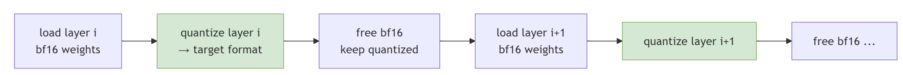
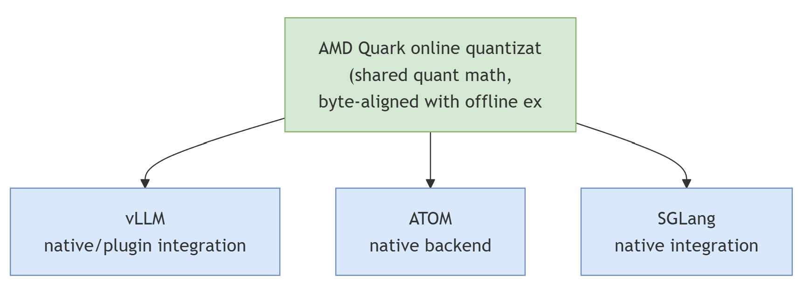

# Online Quantization: Smooth Path from One Checkpoint to Any Desired Serving Scenario

Quantization lowers the numeric precision of a model's weights (and often its activations) — for example from `bf16` to FP8 or MXFP4 — to shrink memory footprint and speed up inference. Traditionally this happens **offline**, *before* serving: you run a quantization script, apply accuracy-recovery algorithms (rotation, SmoothQuant, GPTQ, AWQ) with calibration data, write a new, smaller quantized checkpoint to disk, and later load that checkpoint into the serving engine. It is the right way to produce the final artifact for a model you will serve many times.

We are excited to introduce a new feature: **online quantization**. Instead of running ahead of time, online quantization runs *during* model loading. The serving engine reads an ordinary high-precision checkpoint and quantizes each layer's weights inside its weight-loading hook, just before the model starts serving — no quantization script, no calibration pass, and no new checkpoint written to disk.

Online quantization is very useful in some scenarios, such as rollout in reinforcement training, requantization (serving an already-quantized checkpoint in a different format), fast quantization-scheme exploration and making slight modification to quantized checkpoint. We describe each of these in detail below.

In this blog you will learn:

- **When to use online versus offline quantization**: a side-by-side comparison that helps you pick the right workflow for your task.
- **Typical use cases of online quantization**: RL rollouts with weights that change every step, requantization from one format to another (for example NVFP4 or FP8 to MXFP4), fast mixed-precision and layer-sensitivity searches, and small changes to an existing quantized checkpoint.
- **How it works under the hood**: how quantizing one layer at a time as weights load keeps peak memory bounded and hides most of the quantization cost behind I/O.
- **How to use it in your serving engine**: how AMD Quark online quantization fits into **vLLM**, **ATOM**, and **SGLang**, with accuracy and latency results on models such as DeepSeek-R1 and Qwen3-235B showing that online quantization matches offline quantization.

## Comparison Between Offline and Online Quantization

| | Offline quantization | Online quantization |
| --- | --- | --- |
| **When it runs** | Ahead of time, as a separate export job | At model load time, inside the serving engine |
| **Produces a new checkpoint?** | Yes — a smaller quantized artifact on disk | No — the existing checkpoint is reused as-is |
| **Accuracy recovery** | Yes — rotation, SmoothQuant, GPTQ, AWQ, calibration | No — plain round-to-nearest only |
| **Calibration data** | Often required | Not supported yet |
| **Iteration cost per scheme** | A full export run + a second copy on disk | A config edit; no export, no extra disk |
| **Switching / mixing schemes** | Re-export per variant | Change the config and reload |
| **Best for** | The final production artifact | Exploration, sweeps, validation, dynamic weights |

Even though offline quantization has more control over the quantization pipeline — a dedicated export stage where calibration data, accuracy-recovery algorithms, and per-layer tuning all have room to run — it also has a much longer pipeline: quantize, write a new checkpoint, then load it separately into the serving engine, with a second copy living on disk in between. Online quantization, on the other hand, does quantization (or more generally, checkpoint modification) in a more integrated way, folding the conversion directly into the engine's weight-loading step. This leads to a much shorter pipeline: one high-precision checkpoint goes in, and a quantized model comes out ready to serve, with no intermediate artifact and no separate export job to manage.

That shorter pipeline is exactly what makes online quantization cheap to iterate on — switching or mixing schemes is a config edit and a reload rather than a fresh export run. The cost is that RTN (round to nearest) alone can't match offline quantization's accuracy recovery, and because the engine still reads the full-precision checkpoint, peak host/device memory and load time are higher than loading an already-small offline checkpoint. Layerwise loading (below) keeps that runtime cost bounded.

## Online Quantization Use Cases

Online quantization is the right tool whenever the cost of producing and storing an offline checkpoint outweighs its benefit — typically because you are iterating quickly, or because the weights themselves keep changing. One example of changing weights is rollout in reinforcement training: RL post-training (RLHF, GRPO, and others) updates the policy weights every step, so exporting a fresh offline checkpoint each iteration is a non-starter — the rollout engine instead quantizes the updated weights in memory as it loads them. There are other use cases that deserve a closer look.

### Requantization — Converting One Quantized Format to Another

Some of the most important checkpoints ship *already quantized* — for instance, large MoE models released in FP8 block-scale, or newer models released in NVFP4. If the kernels you want to run expect a *different* format (say MXFP4 on AMD Instinct GPUs), the offline route is heavyweight: dequantize the whole checkpoint, requantize to the target format, and re-export — a disk-hungry operation for a model that may not fit on a single node.

Online **requantization** does this layer-locally at load time, with no new checkpoint. Each tensor is loaded, dequantized to high precision, and requantized to the target format as it streams in. AMD's [NVFP4-to-MXFP4 work](https://rocm.blogs.amd.com/software-tools-optimization/nvfp4-to-mxfp4/README.html) shows this in practice: an NVFP4 checkpoint is served as MXFP4 with throughput on par with a native MXFP4 checkpoint, and no offline conversion step.

### Fast Quantization-Scheme Exploration

The interesting recipes are rarely uniform. On an MoE model you might want experts in an aggressive format (MXFP4) but attention, router/gate, and shared experts kept conservative (FP8 or full precision) — and finding the right split is an empirical, per-layer sensitivity sweep.

Offline, every point in that search is a separate export run and a second copy on disk. Online, each point is a config edit and a reload. That makes online quantization ideal for **mixed-precision search** and **layer-sensitivity sweeps**: you explore the space quickly, converge on a recipe, and only then pay the offline export cost once — for the winning configuration.

### Minor Quantization Modification on Quantized Checkpoints

Sometimes you already have a well quantized checkpoint and only want to change it *slightly* — quantize one or two more layers, bump a single module to a more aggressive format, or leave one layer in higher precision to recover accuracy. Offline, even this tiny change means regenerating the whole checkpoint: for a large MoE model that is a TB-scale write and a second full copy on disk, all to alter a handful of tensors.

Online quantization makes this a simple config edit. The engine loads the existing quantized checkpoint as-is and applies the extra modification to just the affected layers at load time, leaving every other tensor exactly as it was on disk. You get the tweaked model immediately, with no new checkpoint and no terabytes of redundant I/O for weights that didn't change.

## How Is Online Quantization Implemented?

At a high level, online quantization hooks into the serving engine's **weight-loading lifecycle**. The engine already knows how to iterate a checkpoint, map parameter names, shard tensors across tensor-parallel ranks, and place them on device; online quantization reuses all of that and simply inserts a quantize step at the end of each layer's load.

The naive approach — load the entire bf16 model into memory, then walk it and quantize every layer — would require enough memory to hold the *full high-precision model* at its peak, defeating much of the purpose. Instead, the implementations quantize **layer by layer** as weights stream in:

This layerwise scheme has two payoffs:

- **Bounded memory footprint.** Only one layer's high-precision weights need to be resident at a time; once a layer is quantized, its bf16 copy is dropped and the memory reclaimed before the next layer loads. Peak memory is set by the largest single layer, not the whole model. (Requantization follows the same pattern — dequantize one layer to bf16, requantize, free — so an already-quantized checkpoint never has to be fully materialized in high precision.)
- **Overlapped load and quantize.** Because quantization happens per layer as part of loading, the compute of quantizing one layer overlaps the I/O of fetching the next. The quantization cost is largely hidden behind the load that would happen anyway, keeping the added startup latency modest.

The quantization math itself is deliberately kept **byte-aligned with its offline counterpart** — the same scale formulas, rounding, and packing — so an online-quantized layer is indistinguishable at inference time from an offline-quantized one and runs on the identical kernel. Tensor-parallel correctness is handled by quantizing against the *full* (un-sharded) weight where the scale depends on it, then narrowing back to the local shard, so per-channel scales match the offline result regardless of the TP degree.

## Online Quantization Implementations in Inference Engines

Online quantization has been integrated into several popular inference engines — **vLLM**, **ATOM**, and **SGLang** — through each engine's native extension points, rather than forking the engine or patching the checkpoint format. The load-time quant math and its byte-level alignment with offline [Quark](https://quark.docs.amd.com/latest/) are shared; only the per-framework glue differs.

### Online Quantization in vLLM

vLLM has limited native support for [online quantization](https://docs.vllm.ai/en/stable/features/quantization/online/). Its main limitations are that it does not support layer requantization yet, it covers only a narrow set of quantization patterns (linear + MoE), and its config-parsing mechanism is limited. This feature is still under active development by the community.

The Quark team provides another [implementation of online quantization via a vLLM plugin](https://github.com/vllm-project/vllm/blob/main/docs/features/quantization/quark.md#online-quantization), which exposes nearly all the key features of [Quark](https://quark.docs.amd.com/latest/) — arbitrary requantization (from one data type to another), complete config parsing, and nearly arbitrary quantization schemes — which is important for fast exploration and mixed-precision search. Under the hood, the online quantization plugin and Quark offline quantization share the same quantization math and kernels. We tested the Quark online quantization plugin on DeepSeek-R1 and Qwen3-235B-A22B-Instruct-2507, as shown in Table 1.

| Model | TP | Baseline | MXFP4 (offline) | MXFP4 (online) | % recovery |
| --- | --- | --- | --- | --- | --- |
| DeepSeek-R1 | 8 | 0.9644 ± 0.0051 | 0.9568 ± 0.0056 | **0.9573 ± 0.0056** | 99.3% |
| Qwen3-235B-A22B-Instruct-2507 | 4 | 0.9560 ± 0.0056 | 0.9393 ± 0.0066 | **0.9454 ± 0.0063** | 98.9% |

*Table 1: GSM8K accuracy of Quark MXFP4 online quantization versus offline quantization and the unquantized baseline. Online MXFP4 matches offline MXFP4 and stays within noise of the baseline, confirming that the online plugin shares Quark's offline quant math.*

### Online Quantization in ATOM

[ATOM (AiTer Optimized Model)](https://github.com/ROCm/ATOM) is AMD's ROCm-native LLM inference engine, built around [AITER](https://github.com/ROCm/aiter) optimized kernels. Online quantization is a **first-class, native** feature here, exposed through `--online_quant_config`. ATOM can serve standalone or as a plugin backend under vLLM and SGLang; in plugin mode it connects to the host framework's weight-loading lifecycle rather than replacing its serving runtime.

ATOM has the broadest **source-format coverage** of the three, because requantization is central to its design:

- **Linear sources:** float, per-tensor FP8, per-channel FP8, 128×128 block FP8, and MXFP8.
- **Fused MoE sources:** the same set except per-tensor FP8.

When the source is already quantized, ATOM dequantizes it to floating point and re-converts in memory, leaving the checkpoint untouched. Publicly documented targets are `ptpc_fp8`, `per_block_fp8` (also `per_block128_fp8`), and `mxfp4`; the current implementation additionally supports `mxfp8` (FP8 elements with 1×32 microscaling and E8M0 block scales). A streaming mode loads and quantizes module-by-module to further cap peak device memory.

We also evaluated the latency and accuracy of ATOM online quantization, as shown in Table 2.

<table class="table">
  <thead>
    <tr class="row-odd">
      <th class="head" rowspan="2" style="color: inherit;">Model</th>
      <th class="head" colspan="2" style="text-align: center; color: inherit;">TTFT (ms) ↓</th>
      <th class="head" colspan="2" style="text-align: center; color: inherit;">TPOT (ms) ↓</th>
      <th class="head" colspan="2" style="text-align: center; color: inherit;">GSM8K ↑</th>
      <th class="head" rowspan="2" style="text-align: center; color: inherit;">Load-time quant elapsed (s)</th>
    </tr>
    <tr class="row-odd">
      <th style="color: inherit;">offline</th>
      <th style="color: inherit;">online</th>
      <th style="color: inherit;">offline</th>
      <th style="color: inherit;">online</th>
      <th style="color: inherit;">offline</th>
      <th style="color: inherit;">online</th>
    </tr>
  </thead>
  <tbody>
    <tr class="row-even">
      <td style="color: inherit;">Qwen3-30B-A3B-Thinking-2507-ptpc</td>
      <td style="color: inherit;">126.81</td>
      <td style="color: inherit;">126.93</td>
      <td style="color: inherit;">11.65</td>
      <td style="color: inherit;">11.55</td>
      <td style="color: inherit;">0.6861</td>
      <td style="color: inherit;">0.6971</td>
      <td style="color: inherit;">0.834</td>
    </tr>
    <tr class="row-odd">
      <td style="color: inherit;">Qwen3-235B-A22B-Instruct-2507-MXFP4</td>
      <td style="color: inherit;">450.51</td>
      <td style="color: inherit;">445.52</td>
      <td style="color: inherit;">34.16</td>
      <td style="color: inherit;">34.03</td>
      <td style="color: inherit;">0.8961</td>
      <td style="color: inherit;">0.8976</td>
      <td style="color: inherit;">1.398</td>
    </tr>
    <tr class="row-even">
      <td style="color: inherit;">DeepSeek-R1-0528-attn-ptpc-moe-mxfp4</td>
      <td style="color: inherit;">296.06</td>
      <td style="color: inherit;">296.39</td>
      <td style="color: inherit;">65.46</td>
      <td style="color: inherit;">65.22</td>
      <td style="color: inherit;">0.9462</td>
      <td style="color: inherit;">0.9484</td>
      <td style="color: inherit;">8.148</td>
    </tr>
    <tr class="row-odd">
      <td style="color: inherit;">DeepSeek-R1-0528-attn-ptpc-moe-mxfp4 (with MTP)</td>
      <td style="color: inherit;">339.86</td>
      <td style="color: inherit;">339.78</td>
      <td style="color: inherit;">26.39</td>
      <td style="color: inherit;">26.47</td>
      <td style="color: inherit;">0.9439</td>
      <td style="color: inherit;">0.9439</td>
      <td style="color: inherit;">8.975</td>
    </tr>
  </tbody>
</table>

*Table 2: ATOM online quantization versus offline quantization across latency (TTFT, TPOT), GSM8K accuracy, and load-time quantization cost. Online quantization matches offline on both latency and accuracy, while adding only a few seconds of one-time load-time quantization overhead.*

### Online Quantization in SGLang

SGLang provides **native** support for Quark online quantization, selected directly through the `--quantization` flag with ready-to-use presets. No pre-quantized checkpoint is needed: high-precision weights are converted to a lower-precision representation as the model loads, scales and packed weights are created during loading, and activations are quantized dynamically at inference time.

SGLang also natively supports requantization for NVFP4 and FP8 checkpoints through the `quark_mxfp4` preset — each tensor is loaded, dequantized, and requantized to MXFP4 progressively during loading, giving throughput on par with a native MXFP4 checkpoint on AMD GPUs (e.g. MI350X) with no offline conversion step.

The following two presets are shipped natively with SGLang:

| Preset | Online quantization behavior |
| --- | --- |
| `quark_mxfp4` | Converts BF16/FP8/NVFP4 weights to MXFP4 at load time; activations dynamically quantized to MXFP4 |
| `quark_int4fp8_moe` | INT4 MoE expert weights, upcast to FP8 for compute; other linear layers and activations dynamically quantized to FP8 |

Please refer to this [blog post](https://rocm.blogs.amd.com/software-tools-optimization/nvfp4-to-mxfp4/README.html) for more details.

## Summary

In this blog you explored how online quantization turns a slow offline export that uses a lot of disk into a quick config edit at load time. There is no export step, no second copy of the model on disk, and you can switch quantization schemes just by reloading. You compared online and offline quantization side by side and saw typical use cases of online quantization: **RL rollouts**, **Requantization**, **Fast scheme exploration** and **Small changes to existing quantized checkpoints**.

You also looked under the hood. Quantizing one layer at a time as weights load keeps peak memory set by the largest single layer, and hides most of the quantization cost behind loading. Because the quantization math matches Quark's offline export byte for byte, an online-quantized layer runs on the same kernel and gives the same results as an offline-quantized one. The results show this in practice.

Quark online quantization is available today in **vLLM**, **ATOM**, and **SGLang**. Use it to explore quantization schemes and layer sensitivity quickly. Once you have your recipe, switch to offline Quark quantization with calibration and accuracy-recovery algorithms to get the best accuracy and the smallest footprint for the model you ship.

Looking ahead, our team is working with the vLLM community to bring more of Quark's online quantization features into vLLM's native support, including requantization and broader config parsing. We are also expanding the source and target formats supported across all three engines.

## Additional Resources

- [AMD Quark documentation](https://quark.docs.amd.com/)
- [ATOM repository](https://github.com/ROCm/ATOM)
- [ATOM official documentation](https://rocm.docs.amd.com/projects/atom/en/latest/)
- [ATOM online quantization guide](https://rocm.docs.amd.com/projects/atom/en/latest/online_quantization_guide.html)
- [ATOM vLLM plugin guide](https://rocm.docs.amd.com/projects/atom/en/latest/vllm_plugin_backend_guide.html)
- [NVFP4-to-MXFP4 online requantization (ROCm blog)](https://rocm.blogs.amd.com/software-tools-optimization/nvfp4-to-mxfp4/README.html)
- [vLLM documentation](https://docs.vllm.ai/)
- [vLLM online quantization](https://docs.vllm.ai/en/stable/features/quantization/online/)
- [Quark online quantization plugin in vLLM](https://github.com/vllm-project/vllm/blob/main/docs/features/quantization/quark.md#online-quantization)
- [SGLang documentation](https://docs.sglang.ai/)
- [SGLang online quantization](https://docs.sglang.io/docs/advanced_features/quantization#online-quantization)

## Disclaimers

The information presented in this document is for informational purposes only and may contain technical inaccuracies, omissions, and typographical errors. The information contained herein is subject to change and may be rendered inaccurate for many reasons, including but not limited to product and roadmap changes, component and motherboard version changes, new model and/or product releases, product differences between differing manufacturers, software changes, BIOS flashes, firmware upgrades, or the like. Any computer system has risks of security vulnerabilities that cannot be completely prevented or mitigated. AMD assumes no obligation to update or otherwise correct or revise this information. However, AMD reserves the right to revise this information and to make changes from time to time to the content hereof without obligation of AMD to notify any person of such revisions or changes. THIS INFORMATION IS PROVIDED ‘AS IS.” AMD MAKES NO REPRESENTATIONS OR WARRANTIES WITH RESPECT TO THE CONTENTS HEREOF AND ASSUMES NO RESPONSIBILITY FOR ANY INACCURACIES, ERRORS, OR OMISSIONS THAT MAY APPEAR IN THIS INFORMATION. AMD SPECIFICALLY DISCLAIMS ANY IMPLIED WARRANTIES OF NON-INFRINGEMENT, MERCHANTABILITY, OR FITNESS FOR ANY PARTICULAR PURPOSE. IN NO EVENT WILL AMD BE LIABLE TO ANY PERSON FOR ANY RELIANCE, DIRECT, INDIRECT, SPECIAL, OR OTHER CONSEQUENTIAL DAMAGES ARISING FROM THE USE OF ANY INFORMATION CONTAINED HEREIN, EVEN IF AMD IS EXPRESSLY ADVISED OF THE POSSIBILITY OF SUCH DAMAGES. AMD, the AMD Arrow logo, and combinations thereof are trademarks of Advanced Micro Devices, Inc. Other product names used in this publication are for identification purposes only and may be trademarks of their respective companies. © 2026 Advanced Micro Devices, Inc. All rights reserved
