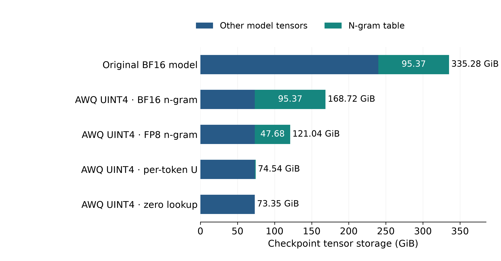
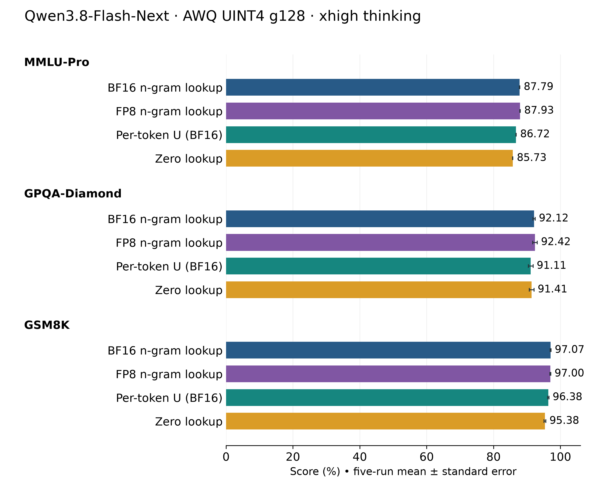
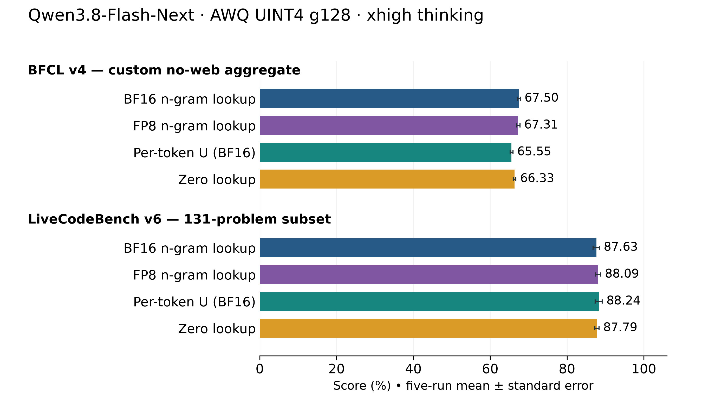
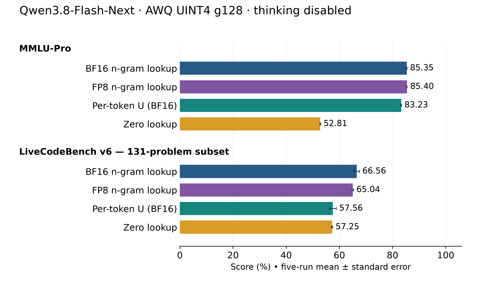
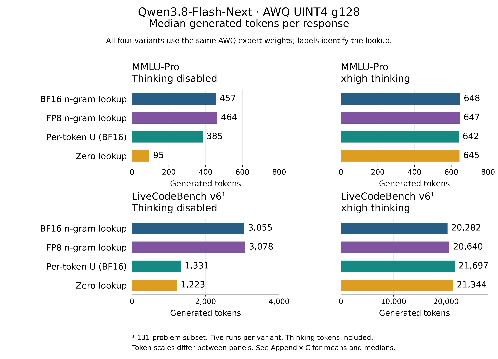
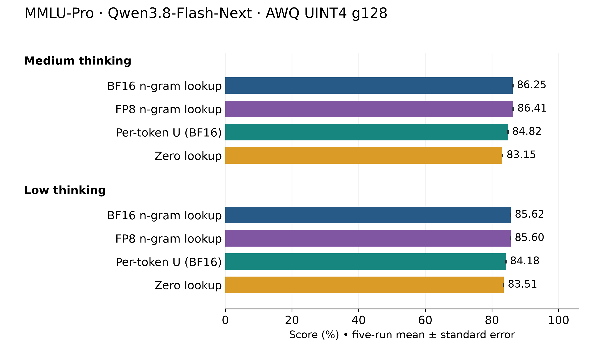

<!---
Copyright (c) 2026 Advanced Micro Devices, Inc. (AMD)

Permission is hereby granted, free of charge, to any person obtaining a copy
of this software and associated documentation files (the "Software"), to deal
in the Software without restriction, including without limitation the rights
to use, copy, modify, merge, publish, distribute, sublicense, and/or sell
copies of the Software, and to permit persons to whom the Software is
furnished to do so, subject to the following conditions:

The above copyright notice and this permission notice shall be included in all
copies or substantial portions of the Software.

THE SOFTWARE IS PROVIDED "AS IS", WITHOUT WARRANTY OF ANY KIND, EXPRESS OR
IMPLIED, INCLUDING BUT NOT LIMITED TO THE WARRANTIES OF MERCHANTABILITY,
FITNESS FOR A PARTICULAR PURPOSE AND NONINFRINGEMENT. IN NO EVENT SHALL THE
AUTHORS OR COPYRIGHT HOLDERS BE LIABLE FOR ANY CLAIM, DAMAGES OR OTHER
LIABILITY, WHETHER IN AN ACTION OF CONTRACT, TORT OR OTHERWISE, ARISING FROM,
OUT OF OR IN CONNECTION WITH THE SOFTWARE OR THE USE OR OTHER DEALINGS IN THE
SOFTWARE.
--->

# Beyond Embedding Quantization: Quark UINT4 Qwen3.8-Flash-Next on Ryzen AI Halo

If you want to run Qwen3.8-Flash-Next [[2]](#ref-2) on a Ryzen AI Halo device with 128 GB of unified memory, you need room for runtime buffers and the key-value (KV) cache. For this evaluation, [AMD Quark](https://github.com/amd/quark) [[5]](#ref-5) quantizes expert weights to 4-bit unsigned integers (UINT4) using activation-aware weight quantization (AWQ). Pairing those weights with an 8-bit floating-point (FP8) n-gram table brings **total checkpoint tensor storage to ~130 GB (~121 GiB)**, including ~51 GB for the table. This footprint leaves limited headroom on a 128 GB Ryzen AI Halo system for **the operating system, KV cache, and runtime buffers**, motivating further reductions in model storage. Actual usable memory depends on system reservations and memory allocation settings.

Further quantization or storage offloading offers other ways to reduce memory pressure. This comparison addresses a different question: **can you replace or entirely omit the large n-gram table, and what accuracy do you give up?**

Compare the original n-gram lookup, an FP8 table, a calibrated per-token replacement, and zero lookup to see how these choices affect checkpoint storage, accuracy, and response length.

## Key Takeaways

Use these results to weigh storage savings against the accuracy requirements of your workload.

- **Checkpoint storage drops from ~130 GB to ~80 GB.** A calibrated per-token table replaces the FP8 n-gram table while keeping the evaluated AMD Quark AWQ UINT4 expert weights fixed. This configuration has run on Ryzen AI Halo.

- **Several evaluated thinking-mode scores remain close without loading the n-gram table.** Zero lookup removes its signal entirely, with accuracy changes that depend on the workload.

- **The calibrated replacement recovers most of the non-thinking loss on the enhanced Massive Multitask Language Understanding benchmark (MMLU-Pro) caused by zero lookup.** Non-thinking coding and parallel tool-call results show that the tradeoffs extend beyond the aggregate scores.

## How the N-Gram Lookup Works

An **n-gram** is a short sequence of tokens; Engram is DeepSeek's named architecture for retrieving learned vectors using those sequences. Qwen3.8-Flash-Next hashes the current token with one preceding token (a bigram) or two (a trigram) to select rows from a learned table. The selected rows are joined into a lookup vector. Unlike an ordinary token embedding, **this vector depends on the token’s local context**. [Section 2.3 of Qwen’s technical report](https://github.com/QwenLM/Qwen3.8-Flash-Next/blob/main/tech_report.pdf) describes the design. [[1]](#ref-1)

Figure 1 follows that vector into Layer 2, where learned projections, gating, and a short causal convolution turn it into a contribution to the model’s hidden representation. Placing the module here allows table prefetching to overlap with first-layer computation.

Qwen uses bigram and trigram lookup at Layer 2; [DeepSeek-V4.1-Flash’s Engram](https://huggingface.co/deepseek-ai/DeepSeek-V4.1-Flash/blob/main/config.json) uses token sequences up to length four at two layers [[7]](#ref-7); [Gemma 4 E2B and E4B](https://gemma.ai/tutorials/visual-guides/gemma-4/#per-layer-embeddings) instead supply token-specific embeddings to each decoder layer. [[8]](#ref-8)

Figure 1. Simplified Qwen3.8-Flash-Next architecture, following the [Qwen technical report](https://github.com/QwenLM/Qwen3.8-Flash-Next/blob/main/tech_report.pdf). **The n-gram table is used during both prefill and decode.** Prefill processes prompt positions to predict the first output token. Each decode step processes the previously generated token, using retained preceding token IDs for hashing, to predict the next. The prompt is not processed again at every decode step.

## Why the N-Gram Table Changes What Fits

The original **Qwen3.8-Flash-Next 16-bit brain floating-point (BF16) checkpoint** occupies ~360 GB, including a ~102 GB n-gram table. Quantizing the routed experts to UINT4 brings the evaluated checkpoint to ~181 GB with the table still in BF16. Quantizing the table to FP8 halves its storage to ~51 GB, bringing the checkpoint to ~130 GB. Figure 2 separates the table from the remaining weights; [Appendix A](#appendix-a-evaluation-details) gives the quantization settings.

Figure 2. Checkpoint tensor storage, including the n-gram lookup component. U denotes the calibrated per-token table. The FP8 total is calculated by replacing the 95.37 GiB BF16 table in the evaluated AWQ checkpoint with its 47.68 GiB FP8 form; values are rounded. Blue includes ordinary token embeddings and other model tensors. These storage totals exclude KV cache and runtime buffers.

Ryzen AI Halo uses a **unified memory architecture**, so moving the table to CPU memory still consumes the same shared capacity. Reducing the table leaves more room for KV cache and runtime buffers, a benefit that also matters on other memory-constrained systems.

## Separate Token Identity from Local Context

The first comparison tests removing the lookup signal. **Zero lookup skips allocating and loading the n-gram table**, supplying zero vectors instead. This tests how the model behaves without that input and provides a baseline for the smaller replacement.

Next, calibration produces a **compact per-token table, called U**, occupying ~1.3 GB. Each token selects one fixed vector, regardless of its preceding tokens. **Ordinary token embeddings, the output head, and downstream computation remain unchanged.** [Appendix A](#appendix-a-evaluation-details) gives U’s dimensions and storage size. For the AWQ configuration with U, see the [TokenPLE AWQ UINT4 model card](https://huggingface.co/amd/Qwen3.8-Flash-Next-Quark-TokenPLE-AWQ-UINT4) [[10]](#ref-10).

SemiAnalysis reports workload-dependent effects when removing Engram from DeepSeek-V4.1-Flash in its [“Removing Engram” analysis](https://newsletter.semianalysis.com/p/engrams-embedding-entendre-codesign). [[6]](#ref-6) The experiments in this blog independently examine removing or replacing the n-gram lookup in Qwen3.8-Flash-Next across quantization and thinking configurations.

FP8 keeps the context-dependent lookup at lower precision; U supplies a calibrated token-specific vector; zero lookup supplies zeros. The AWQ UINT4 g128 expert weights (group size 128) stay fixed across these four choices. **How does each lookup choice affect accuracy under different thinking settings?** Figures 3–5 compare accuracy; Figure 6 examines response length.

## What Survives When the Lookup Disappears

With thinking enabled at the **`xhigh` reasoning-effort setting, several aggregate scores remain close after the large table is removed or replaced.** Figures 3 and 4 focus on one weight configuration, AWQ UINT4 g128, so the four lookup choices are easy to compare. Accuracy and response-length comparisons use AMD Instinct™ systems; all four arms here use MI355X with tensor parallelism (TP) size 1. Bars show five-repeat means with standard-error bars. [Appendix B](#appendix-b-exact-benchmark-results) retains the BF16-model and round-to-nearest (RTN) quantization reference scores and the low- and medium-thinking comparisons.

Figure 3 compares knowledge and reasoning results on MMLU-Pro, the Diamond subset of the Graduate-Level Google-Proof Question and Answer benchmark (GPQA), and Grade School Math 8K (GSM8K).

Figure 3. MMLU-Pro, GPQA-Diamond, and GSM8K with xhigh thinking. Every bar uses Qwen3.8-Flash-Next AWQ UINT4 g128 routed-expert weights; labels identify the n-gram table lookup only. BF16 n-gram lookup therefore does not mean a BF16 model. Error bars show ±1 standard error across five repeats.

Figure 4 compares tool use on the Berkeley Function Calling Leaderboard (BFCL) and coding on LiveCodeBench.

Figure 4. Tool use and coding with the same AWQ weights and xhigh preset. BFCL v4 is the custom no-web-search aggregate. LiveCodeBench uses 131 release_v6 problems with contest dates from February 1 through May 1, 2025, inclusive. These are subset scores; [Appendix A](#appendix-a-evaluation-details) gives the protocols.

On MMLU-Pro, AWQ scores 87.79% with the original BF16 table, 87.93% with FP8 n-gram lookup, 86.72% with U, and 85.73% with zero lookup. BF16-model and RTN reference results show the same ordering between original, U, and zero. Retaining a calibrated token-specific vector recovers part of the lost score without reconstructing the original n-gram lookup.

Across the 18 completed AWQ combinations of benchmarks and presets, FP8 n-gram lookup changes the mean score by −1.53 to +1.01 percentage points relative to the original BF16 table. All paired 95% confidence intervals include zero. That supports FP8 as a useful storage and accuracy reference for this experiment, while **five seeds do not establish equivalence.**

The completed low- and medium-thinking MMLU-Pro comparisons also show U recovering part of the zero-lookup loss in RTN and AWQ. FP8 n-gram lookup remains close to the AWQ original table score at both levels. [Appendix B](#appendix-b-exact-benchmark-results) includes their exact values and an AWQ-only chart, with the hardware mix identified.

The BFCL aggregate exposes a limit of that conclusion. Its RTN xhigh score moves only from 65.71% to 65.54% with U, yet the non-live category falls from 78.98% to 62.93%; zero lookup scores 63.85% in that category. **Gains in other categories offset the regression in the weighted total.** AWQ also shows a larger aggregate loss with U, from 67.50% to 65.55%. [Appendix B](#appendix-b-exact-benchmark-results) lists the RTN category scores, including the parallel-call tasks behind the non-live decline.

Across five repeats for BF16, RTN, and AWQ, too few calls account for 70–79% of the additional failures with zero lookup in the non-live parallel and parallel-multiple tasks. For U, missing calls account for 28–43%; duplicate and additional distinct calls contribute substantially too. [Appendix B](#appendix-b-exact-benchmark-results) gives the counts by precision and lookup method. These observed failures do not establish the underlying mechanism.

## MMLU-Pro Recovery with Thinking Disabled

**With thinking disabled, MMLU-Pro shows a much larger dependence on the lookup signal.** Figure 5 holds AWQ UINT4 g128 routed-expert weights fixed and compares all four lookup choices on MI355X, TP=1. BF16-model and RTN results remain in [Appendix B](#appendix-b-exact-benchmark-results). The non-thinking preset also changes sampling and generation limits, so this comparison does not isolate reasoning effort as the cause.

Figure 5. Qwen3.8-Flash-Next AWQ UINT4 g128 with thinking disabled. FP8 n-gram lookup retains the context-dependent table at lower precision; U and zero change the lookup information. Bars show five-repeat means ±1 standard error. LiveCodeBench uses the same 131-problem subset as Figure 4.

For non-thinking MMLU-Pro, removing the lookup costs 17.43 percentage points with RTN and 32.54 with AWQ. **U reduces those gaps to 1.61 and 2.12 points, respectively.** Retaining a calibrated token-specific vector matters here, even though it occupies a small fraction of the original table. BF16 also loses score: 85.75% with the original table becomes 72.47% with zero lookup and 84.00% with U. This dependence on the lookup signal is present even without routed-expert quantization.

FP8 n-gram lookup gives 85.40% on non-thinking MMLU-Pro, compared with 85.35% for the original table and 83.23% for U. On the coding subset, FP8 scores 65.04%, versus 66.56% for the original and 57.56% for U. Quantizing the table and removing its contextual detail are different interventions, with different measured tradeoffs.

For non-thinking RTN MMLU-Pro, responses without an extractable answer rise from 1.57% with the original table to 19.54% with zero lookup; U brings that rate back to 1.89%.

Coding gives a different answer. On the 131-problem non-thinking LiveCodeBench subset, **RTN falls from 66.26% with the original table to 60.61% with U; AWQ falls from 66.56% to 57.56%.** BF16 likewise falls from 66.11% to 56.03% with U.

Across all 45 non-thinking coding runs, only 5 of 5,895 submissions reached the 32,768-token generation cap; none came from zero or U. Additional failures are mainly **wrong outputs, execution timeouts, and runtime or code-loading errors.** Missing code does not account for the gap. Losses span dozens of problems, concentrated in medium and hard tasks. [Appendix B](#appendix-b-exact-benchmark-results) gives the failure counts. Stored grader results cannot distinguish slow code from non-termination or grader-load effects.

## What Response Length Tells Us

**With thinking disabled, zero lookup produces much shorter median responses on both tasks**; U brings MMLU-Pro closer to the original table, but coding remains shorter. **With xhigh thinking, median lengths stay much closer across lookup choices.** Figure 6 shows these patterns; [Appendix C](#appendix-c-response-lengths) gives the full mean and median results and other benchmarks.

Figure 6. Median generated tokens per response, pooled across five runs per variant. All bars use Qwen3.8-Flash-Next AWQ UINT4 g128; labels identify the lookup only. Thinking tokens are included. Panel scales differ. LiveCodeBench uses the same 131-problem subset as Figure 4. Length does not measure speed or explain accuracy changes. See [Appendix C](#appendix-c-response-lengths) for details.

## Summary

This blog shows how changing the n-gram lookup reduces Qwen3.8-Flash-Next’s storage requirements while keeping the evaluated AMD Quark AWQ UINT4 expert weights fixed. Replacing the FP8 n-gram table with a calibrated per-token table reduces checkpoint storage from **~130 GB to ~80 GB**, and the smaller configuration has run on Ryzen AI Halo.

The comparisons show where the lookup contributes to accuracy. The calibrated replacement recovers most of the non-thinking MMLU-Pro loss caused by zero lookup, while coding and parallel tool calls remain more affected. Several evaluated thinking-mode scores remain close without loading the n-gram table, and removing it does not consistently increase response length. These findings help you assess the memory savings alongside the capabilities your workload needs.

When exploring local inference, consider both the precision of a large table and the information its lookup supplies. Explore the [AWQ UINT4 model card](https://huggingface.co/amd/Qwen3.8-Flash-Next-Quark-AWQ-UINT4) and the [TokenPLE AWQ UINT4 model card](https://huggingface.co/amd/Qwen3.8-Flash-Next-Quark-TokenPLE-AWQ-UINT4) for the corresponding checkpoints. Follow the [AMD Quark repository](https://github.com/amd/quark) for quantization tools, examples, and development updates, and explore more inference optimization work on ROCm Blogs.

## Review Contributors

Colin Zeng, Patrick Schlangen, and the AMD Quark team reviewed this work and provided feedback.

## Appendix A: Evaluation Details

**Hardware and software:** The main xhigh and non-thinking comparisons use AMD Instinct MI355X: TP=4 for BF16 and TP=1 for RTN or AWQ UINT4. The supplementary low- and medium-thinking MMLU-Pro comparisons span MI355X and MI350X, all at TP=1. The production stack uses ROCm™ 7.2.3, the study’s modified vLLM 0.31.1rc1 build, PyTorch 2.13.0, Transformers 5.19.0, and lm-eval 0.4.13. Each reported score is a mean ± standard error over five repeats, seeds 1234–1238.

**Quantization and U:** AMD Quark quantizes routed-expert gate, up, and down projection weights to asymmetric UINT4, group size 128, using RTN or calibrated AWQ. The AWQ FP8 n-gram lookup arm replaces only the n-gram table with per-tensor FP8 E4M3 values and a BF16 scale, sourced from AMD's FP8 n-gram checkpoint [[4]](#ref-4); it does not change the AWQ expert weights to microscaling 4-bit floating point (MXFP4). The calibration-derived BF16 U table has shape 248,320 × 2,560 and occupies 1.18 GiB.

**Thinking settings:** Thinking is enabled with the named effort: `xhigh`, `medium`, or `low`. The settings are temperature 1.0, top-p 0.95, top-k 20, and presence penalty 0. The configured generation cap is 253,952 tokens for MMLU-Pro, GPQA, GSM8K, and LiveCodeBench; this is an upper limit, not a measured response length. Thinking-mode BFCL requests do not send `max_tokens`. The server context limit is 262,144 tokens, including the prompt. All presets use min-p 0 and repetition penalty 1.0.

**Non-thinking settings:** Thinking is disabled with temperature 0.7, top-p 0.8, top-k 20, and presence penalty 1.5. Generation limits are 8,192 tokens for MMLU-Pro, GSM8K, and each BFCL request, and 32,768 for GPQA-Diamond and LiveCodeBench, with the same model context limit. Comparing this preset with thinking also changes sampling and token limits.

**Benchmark scope:** MMLU-Pro uses 5-shot prompts and 12,032 questions; unclosed thinking is scored as no answer. GPQA-Diamond has 198 questions. GSM8K uses 5-shot prompts, 1,319 questions, and strict-match scoring. BFCL v4 excludes web search; its custom aggregate assigns weights of 10%, 10%, 10%, 30%, and 40% to the non-live, live, irrelevance, multi-turn, and memory categories, respectively. LiveCodeBench uses 131 release_v6 problems with contest dates February 1–May 1, 2025 inclusive, one solution per problem per run, scored as pass@1. This is a date-filtered subset, not the full release score.

**Ryzen AI Halo deployment configuration:** The configuration uses gfx1151; vLLM 0.31.1rc1.dev88+g81198e97b with the study's n-gram lookup changes and PR #62480 [[3]](#ref-3), ROCm 7.2.3, and PyTorch 2.13. [AWQ UINT4 g128 with U](https://huggingface.co/amd/Qwen3.8-Flash-Next-Quark-TokenPLE-AWQ-UINT4); model dtype BF16; `--moe-backend rdna3_w4a8`; eager execution; prefix caching and CPU offload disabled. Precision note: the Instinct RTN and AWQ accuracy and response-length evaluations used UINT4 weights with BF16 activations (W4A16), including the FP8 n-gram lookup arm. The W4A8 backend (4-bit weights and 8-bit decode activations) was used only for Ryzen AI Halo deployment and quantizes mixture-of-experts (MoE) decode activations to 8-bit signed integers (INT8). This deployment establishes local execution of the U configuration; the accuracy and response-length comparisons use the Instinct systems described above. Narrative storage values use approximate decimal GB (10⁹ bytes); figures retain GiB (2³⁰ bytes). For example, 74.54 GiB is ~80 GB.

Performance and accuracy results depend on configuration, models, software versions, and workload, and may vary.

## Appendix B: Exact Benchmark Results

Exact benchmark values for Qwen3.8-Flash-Next. Values are percentage means ± standard errors over five repeats. Weight precision is identified in each row; FP8 n-gram lookup applies only to AWQ UINT4 g128. A dash means that configuration is not reported. BF16-model and RTN rows provide references for the AWQ-focused figures. The category and failure tables retain the earlier audits of the original table, U, and zero lookup; they do not include FP8 n-gram lookup.

### Qwen Results with `xhigh` Thinking

Compare the lookup choices for each benchmark and weight precision with the `xhigh` thinking preset.

| Benchmark and weight precision                       | Original n-gram table | Zero lookup  | Per-token U  | FP8 n-gram lookup (AWQ only) |
| ---------------------------------------------------- | --------------------- | ------------ | ------------ | ---------------------------- |
| MMLU-Pro 5-shot full · BF16                          | 87.97 ± 0.11          | 86.12 ± 0.11 | 86.79 ± 0.06 | —                            |
| MMLU-Pro 5-shot full · RTN UINT4 g128                | 87.87 ± 0.09          | 85.97 ± 0.09 | 86.73 ± 0.08 | —                            |
| MMLU-Pro 5-shot full · AWQ UINT4 g128                | 87.79 ± 0.07          | 85.73 ± 0.06 | 86.72 ± 0.03 | 87.93 ± 0.07                 |
| GPQA-Diamond · BF16                                  | 92.12 ± 0.72          | 91.62 ± 0.20 | 92.02 ± 0.49 | —                            |
| GPQA-Diamond · RTN UINT4 g128                        | 91.82 ± 0.56          | 90.71 ± 0.65 | 90.71 ± 0.82 | —                            |
| GPQA-Diamond · AWQ UINT4 g128                        | 92.12 ± 0.34          | 91.41 ± 0.70 | 91.11 ± 0.71 | 92.42 ± 0.68                 |
| GSM8K 5-shot strict-match · BF16                     | 97.00 ± 0.08          | 95.74 ± 0.19 | 95.98 ± 0.16 | —                            |
| GSM8K 5-shot strict-match · RTN UINT4 g128           | 96.47 ± 0.18          | 94.27 ± 0.17 | 95.71 ± 0.15 | —                            |
| GSM8K 5-shot strict-match · AWQ UINT4 g128           | 97.07 ± 0.11          | 95.38 ± 0.25 | 96.38 ± 0.20 | 97.00 ± 0.12                 |
| BFCL v4 custom no-web aggregate · BF16               | 66.21 ± 0.23          | 66.07 ± 0.19 | 66.46 ± 0.20 | —                            |
| BFCL v4 custom no-web aggregate · RTN UINT4 g128     | 65.71 ± 0.21          | 65.16 ± 0.44 | 65.54 ± 0.17 | —                            |
| BFCL v4 custom no-web aggregate · AWQ UINT4 g128     | 67.50 ± 0.34          | 66.33 ± 0.36 | 65.55 ± 0.37 | 67.31 ± 0.43                 |
| LiveCodeBench v6 131-problem subset · BF16           | 88.09 ± 1.17          | 85.34 ± 0.78 | 86.41 ± 1.04 | —                            |
| LiveCodeBench v6 131-problem subset · RTN UINT4 g128 | 87.02 ± 0.93          | 87.02 ± 0.64 | 87.63 ± 0.74 | —                            |
| LiveCodeBench v6 131-problem subset · AWQ UINT4 g128 | 87.63 ± 0.82          | 87.79 ± 0.54 | 88.24 ± 0.92 | 88.09 ± 0.67                 |

### Qwen Results with Thinking Disabled

Compare the lookup choices on MMLU-Pro and the LiveCodeBench subset with thinking disabled.

| Benchmark and weight precision                       | Original n-gram table | Zero lookup  | Per-token U  | FP8 n-gram lookup (AWQ only) |
| ---------------------------------------------------- | --------------------- | ------------ | ------------ | ---------------------------- |
| MMLU-Pro · BF16                                      | 85.75 ± 0.06          | 72.47 ± 0.27 | 84.00 ± 0.07 | —                            |
| MMLU-Pro · RTN UINT4 g128                            | 85.68 ± 0.06          | 68.25 ± 0.11 | 84.07 ± 0.10 | —                            |
| MMLU-Pro · AWQ UINT4 g128                            | 85.35 ± 0.10          | 52.81 ± 0.16 | 83.23 ± 0.09 | 85.40 ± 0.05                 |
| LiveCodeBench v6 131-problem subset · BF16           | 66.11 ± 1.38          | 55.88 ± 1.24 | 56.03 ± 1.48 | —                            |
| LiveCodeBench v6 131-problem subset · RTN UINT4 g128 | 66.26 ± 1.63          | 56.34 ± 1.19 | 60.61 ± 0.92 | —                            |
| LiveCodeBench v6 131-problem subset · AWQ UINT4 g128 | 66.56 ± 1.01          | 57.25 ± 0.24 | 57.56 ± 1.29 | 65.04 ± 0.29                 |

### AWQ FP8 N-Gram Lookup across the Evaluated Presets

Qwen3.8-Flash-Next AWQ UINT4 g128. Five seeds per cell; values are mean ± standard error (%). Only the n-gram table changes. LiveCodeBench was evaluated at xhigh and with thinking disabled; other thinking levels were not run for that benchmark.

| Preset and benchmark     | BF16 n-gram lookup | FP8 n-gram lookup | Difference (points) |
| ------------------------ | ------------------ | ----------------- | ------------------- |
| Disabled / MMLU-Pro      | 85.35 ± 0.10       | 85.40 ± 0.05      | +0.05               |
| Disabled / GSM8K         | 93.69 ± 0.13       | 93.89 ± 0.10      | +0.20               |
| Disabled / GPQA          | 83.64 ± 0.52       | 84.14 ± 1.05      | +0.51               |
| Disabled / LiveCodeBench | 66.56 ± 1.01       | 65.04 ± 0.29      | -1.53               |
| Disabled / BFCL          | 45.88 ± 0.99       | 46.85 ± 0.43      | +0.97               |
| xhigh / MMLU-Pro         | 87.79 ± 0.07       | 87.93 ± 0.07      | +0.15               |
| xhigh / GSM8K            | 97.07 ± 0.11       | 97.00 ± 0.12      | -0.08               |
| xhigh / GPQA             | 92.12 ± 0.34       | 92.42 ± 0.68      | +0.30               |
| xhigh / LiveCodeBench    | 87.63 ± 0.82       | 88.09 ± 0.67      | +0.46               |
| xhigh / BFCL             | 67.50 ± 0.34       | 67.31 ± 0.43      | -0.19               |
| medium / MMLU-Pro        | 86.25 ± 0.09       | 86.41 ± 0.10      | +0.16               |
| medium / GSM8K           | 97.66 ± 0.04       | 97.62 ± 0.12      | -0.05               |
| medium / GPQA            | 84.75 ± 0.85       | 85.76 ± 0.76      | +1.01               |
| medium / BFCL            | 69.98 ± 0.32       | 70.11 ± 0.36      | +0.13               |
| low / MMLU-Pro           | 85.62 ± 0.05       | 85.60 ± 0.08      | -0.02               |
| low / GSM8K              | 97.56 ± 0.11       | 97.45 ± 0.06      | -0.11               |
| low / GPQA               | 86.26 ± 0.96       | 85.86 ± 0.58      | -0.40               |
| low / BFCL               | 66.95 ± 0.32       | 67.42 ± 0.31      | +0.48               |

### BFCL Category Scores with `xhigh` Thinking

Qwen3.8-Flash-Next, RTN UINT4 g128, MI355X, TP=1. These five category aggregates explain the custom overall score discussed above. The final two rows expand the non-live aggregate to show parallel-call performance; they are not additional terms in the overall score. Values are percentage means ± standard errors over five repeats. The irrelevance aggregate averages the non-live and live irrelevance scores within each run.

| BFCL category or aggregate | Original n-gram table | Zero lookup  | Per-token U  |
| -------------------------- | --------------------- | ------------ | ------------ |
| Non-live aggregate         | 78.98 ± 0.52          | 63.85 ± 0.44 | 62.93 ± 0.51 |
| Live aggregate             | 74.83 ± 0.39          | 74.33 ± 0.36 | 74.24 ± 0.37 |
| Irrelevance aggregate      | 77.42 ± 0.27          | 79.00 ± 0.23 | 79.81 ± 0.16 |
| Multi-turn aggregate       | 50.10 ± 0.63          | 51.22 ± 0.13 | 51.17 ± 0.31 |
| Memory aggregate           | 68.90 ± 0.34          | 70.19 ± 1.09 | 71.23 ± 0.55 |
| Non-live parallel          | 75.80 ± 1.32          | 50.20 ± 0.96 | 51.70 ± 0.66 |
| Non-live parallel multiple | 79.60 ± 0.48          | 50.50 ± 1.62 | 50.70 ± 0.98 |

### MMLU-Pro at Other Thinking Levels

The following MMLU-Pro reference results use low and medium thinking. U scores above zero and below the original in each comparison using RTN or AWQ. The runs with the original table, U, and zero lookup span MI355X and MI350X; the FP8 n-gram lookup runs use MI355X. These provide context rather than a hardware-controlled comparison of thinking levels. Figure B1 focuses on AWQ for readability; the table includes RTN.

Figure B1. MMLU-Pro with low and medium thinking, AWQ UINT4 g128 weights throughout. Four labeled lookup choices; means ±1 standard error over five repeats. The AWQ runs with the original table, U, and zero lookup include 10 MI355X and 5 MI350X runs at medium and 9 MI355X and 6 MI350X runs at low; all ten FP8 n-gram lookup runs use MI355X.

| Thinking level and weight precision | Original n-gram table | Zero lookup  | Per-token U  | FP8 n-gram lookup (AWQ only) |
| ----------------------------------- | --------------------- | ------------ | ------------ | ---------------------------- |
| MMLU-Pro medium · RTN UINT4 g128    | 86.31 ± 0.04          | 83.22 ± 0.15 | 84.65 ± 0.13 | —                            |
| MMLU-Pro medium · AWQ UINT4 g128    | 86.25 ± 0.09          | 83.15 ± 0.12 | 84.82 ± 0.07 | 86.41 ± 0.10                 |
| MMLU-Pro low · RTN UINT4 g128       | 85.67 ± 0.10          | 83.91 ± 0.05 | 84.83 ± 0.06 | —                            |
| MMLU-Pro low · AWQ UINT4 g128       | 85.62 ± 0.05          | 83.51 ± 0.11 | 84.18 ± 0.06 | 85.60 ± 0.08                 |

### Coding Failure Types with Thinking Disabled

The following results use Qwen3.8-Flash-Next with BF16 weights or with UINT4 g128 weights quantized using RTN or AWQ. Counts pool five repeats of the 131-problem LiveCodeBench subset: 655 submissions per row. The four failure columns partition the failed submissions. The runtime or load category includes execution or code-loading errors; Other combines missing extracted code, syntax errors, and generation-cap failures. Execution timeout is the grader's six-second per-test limit, distinct from the generation cap. Only the first failing test's outcome is stored; memory-limit failures cannot be separated.

| Weights and lookup   | Failed | Wrong output | Execution timeout | Runtime or load | Other |
| -------------------- | ------ | ------------ | ----------------- | --------------- | ----- |
| BF16 · Original      | 222    | 179          | 22                | 11              | 10    |
| BF16 · Zero          | 289    | 192          | 53                | 40              | 4     |
| BF16 · U             | 288    | 178          | 45                | 39              | 26    |
| RTN UINT4 · Original | 221    | 166          | 31                | 11              | 13    |
| RTN UINT4 · Zero     | 286    | 207          | 51                | 19              | 9     |
| RTN UINT4 · U        | 258    | 195          | 41                | 12              | 10    |
| AWQ UINT4 · Original | 219    | 166          | 19                | 10              | 24    |
| AWQ UINT4 · Zero     | 280    | 207          | 52                | 17              | 4     |
| AWQ UINT4 · U        | 278    | 179          | 60                | 22              | 17    |

### Parallel Tool Call Failures with `xhigh` Thinking

The following results use Qwen3.8-Flash-Next with BF16 weights or with UINT4 g128 weights quantized using RTN or AWQ. Counts pool the non-live parallel and parallel-multiple categories across five repeats: 2,000 entries per row. The four failure columns partition the failed entries. Duplicates means excess calls consisting only of exact repeats; Extra distinct means too many calls including distinct ones. Other covers no call, unknown or incorrect functions, and wrong arguments. Entries with multiple defects receive one primary category under a fixed classification order. These are xhigh results; the audit does not cover non-thinking BFCL.

| Weights and lookup   | Failed | Too few calls | Duplicates | Extra distinct | Other |
| -------------------- | ------ | ------------- | ---------- | -------------- | ----- |
| BF16 · Original      | 428    | 172           | 40         | 22             | 194   |
| BF16 · Zero          | 873    | 522           | 73         | 107            | 171   |
| BF16 · U             | 794    | 315           | 154        | 121            | 204   |
| RTN UINT4 · Original | 446    | 199           | 52         | 25             | 170   |
| RTN UINT4 · Zero     | 993    | 615           | 103        | 102            | 173   |
| RTN UINT4 · U        | 976    | 427           | 186        | 120            | 243   |
| AWQ UINT4 · Original | 473    | 211           | 42         | 36             | 184   |
| AWQ UINT4 · Zero     | 1037   | 606           | 97         | 112            | 222   |
| AWQ UINT4 · U        | 912    | 332           | 227        | 126            | 227   |

## Appendix C: Response Lengths

Qwen3.8-Flash-Next AWQ UINT4 g128. Each cell gives the mean and median generated completion token counts, separated by a slash. Counts are rounded to the nearest token and pooled across five valid runs. Thinking tokens are included. Counts come directly from the evaluation logs; no responses were re-tokenized and no inference was rerun. Compare lookup choices within a row: BFCL counts tokens per model request, whereas the other benchmarks count one response per question or coding problem.

| Benchmark and preset        | BF16 n-gram lookup | FP8 n-gram lookup | Per-token U     | Zero lookup     |
| --------------------------- | ------------------ | ----------------- | --------------- | --------------- |
| MMLU-Pro · Disabled         | 791 / 457          | 796 / 464         | 716 / 385       | 358 / 95        |
| GSM8K · Disabled            | 155 / 133          | 155 / 133         | 161 / 136       | 164 / 137       |
| GPQA · Disabled             | 3,009 / 1,880      | 2,937 / 1,847     | 2,966 / 1,818   | 2,960 / 1,902   |
| LiveCodeBench · Disabled    | 4,979 / 3,055      | 5,071 / 3,078     | 3,261 / 1,331   | 1,706 / 1,223   |
| BFCL per request · Disabled | 103 / 63           | 104 / 63          | 91 / 53         | 91 / 52         |
| MMLU-Pro · xhigh            | 2,829 / 648        | 2,823 / 647       | 2,753 / 642     | 2,488 / 645     |
| GSM8K · xhigh               | 373 / 251          | 380 / 248         | 399 / 258       | 425 / 276       |
| GPQA · xhigh                | 15,614 / 7,450     | 15,341 / 7,018    | 16,050 / 8,076  | 14,729 / 7,016  |
| LiveCodeBench · xhigh       | 30,437 / 20,282    | 30,600 / 20,640   | 30,894 / 21,697 | 29,369 / 21,344 |
| BFCL per request · xhigh    | 355 / 171          | 356 / 172         | 359 / 163       | 329 / 157       |

The AWQ xhigh FP8 BFCL cell includes one run with context-overflow entries; logged requests are retained, while failed entries can contribute fewer or no requests. These pooled lengths do not test statistical significance or establish equal generation cost. At low and medium thinking, respectively, AWQ MMLU-Pro medians are 582 and 665 tokens for the original table, 580 and 664 for FP8, 523 and 600 for U, and 533 and 642 for zero lookup; those comparisons span hosts as described in [Appendix B](#appendix-b-exact-benchmark-results).

## Sources and Further Reading

These sources describe the model architectures, quantization tools, and related research discussed in this blog.

1.  Qwen Team. [On the Design of Qwen3.8-Next Architecture: Evaluation, Efficiency, and Training Stability](https://github.com/QwenLM/Qwen3.8-Flash-Next/blob/main/tech_report.pdf), Section 2.3, “N-Gram Embedding.” Architecture and original lookup design.

2.  Qwen Team. [Qwen3.8-Flash-Next model card](https://huggingface.co/Qwen/Qwen3.8-Flash-Next) and [Qwen Community License 1.0](https://huggingface.co/Qwen/Qwen3.8-Flash-Next/blob/main/LICENSE). Source model and usage terms. The modified configurations evaluated here are derivatives and have not been evaluated or endorsed by the Qwen team.

3.  vLLM. [PR #62480: W4A8 MoE decode kernel for RDNA3/RDNA3.5](https://github.com/vllm-project/vllm/pull/62480). The Ryzen AI Halo deployment uses this opt-in backend; it quantizes MoE decode activations to INT8 while the model dtype is BF16.

4.  AMD. [FP8 n-gram checkpoint model card](https://huggingface.co/amd/Qwen3.8-Flash-Next-Quark-MXFP4-PLEFP8). Source of the FP8 n-gram table only; this article evaluates that table with AWQ UINT4 g128 routed experts.

5.  AMD. [AMD Quark GitHub repository](https://github.com/amd/quark). Source code and documentation for AMD Quark.

6.  SemiAnalysis. [“Removing Engram”](https://newsletter.semianalysis.com/p/engrams-embedding-entendre-codesign), in *Engrams Embedding Entendre: Codesign for Efficient DRAM/SSD Offloading*. Related research on removing Engram from DeepSeek-V4.1-Flash.

7.  DeepSeek. [DeepSeek-V4.1-Flash configuration](https://huggingface.co/deepseek-ai/DeepSeek-V4.1-Flash/blob/main/config.json). Engram layer placement and maximum n-gram length.

8.  Google. [A Visual Guide to Gemma 4](https://gemma.ai/tutorials/visual-guides/gemma-4/#per-layer-embeddings), “Per-Layer Embeddings.” Token-specific embeddings in Gemma 4 E2B/E4B.

9.  AMD. [Qwen3.8-Flash-Next-Quark-AWQ-UINT4 model card](https://huggingface.co/amd/Qwen3.8-Flash-Next-Quark-AWQ-UINT4). AWQ UINT4 checkpoint.

10.  AMD. [Qwen3.8-Flash-Next-Quark-TokenPLE-AWQ-UINT4 model card](https://huggingface.co/amd/Qwen3.8-Flash-Next-Quark-TokenPLE-AWQ-UINT4). AWQ UINT4 checkpoint with the per-token replacement.

## Disclaimers

The information presented in this document is for informational purposes only and may contain technical inaccuracies, omissions, and typographical errors. The information contained herein is subject to change and may be rendered inaccurate for many reasons, including but not limited to product and roadmap changes, component and motherboard version changes, new model and/or product releases, product differences between differing manufacturers, software changes, BIOS flashes, firmware upgrades, or the like. Any computer system has risks of security vulnerabilities that cannot be completely prevented or mitigated. AMD assumes no obligation to update or otherwise correct or revise this information. However, AMD reserves the right to revise this information and to make changes from time to time to the content hereof without obligation of AMD to notify any person of such revisions or changes.

THIS INFORMATION IS PROVIDED "AS IS." AMD MAKES NO REPRESENTATIONS OR WARRANTIES WITH RESPECT TO THE CONTENTS HEREOF AND ASSUMES NO RESPONSIBILITY FOR ANY INACCURACIES, ERRORS, OR OMISSIONS THAT MAY APPEAR IN THIS INFORMATION. AMD SPECIFICALLY DISCLAIMS ANY IMPLIED WARRANTIES OF NON-INFRINGEMENT, MERCHANTABILITY, OR FITNESS FOR ANY PARTICULAR PURPOSE. IN NO EVENT WILL AMD BE LIABLE TO ANY PERSON FOR ANY RELIANCE, DIRECT, INDIRECT, SPECIAL, OR OTHER CONSEQUENTIAL DAMAGES ARISING FROM THE USE OF ANY INFORMATION CONTAINED HEREIN, EVEN IF AMD IS EXPRESSLY ADVISED OF THE POSSIBILITY OF SUCH DAMAGES.

Third-party content is provided for convenience and information. AMD does not control third-party materials or warrant their accuracy or suitability. Access to and use of third-party materials are subject to their applicable terms and licenses.

AMD, the AMD Arrow logo, AMD Instinct, ROCm, AMD Quark, and combinations thereof are trademarks of Advanced Micro Devices, Inc. Other product names used in this publication are for identification purposes only and may be trademarks of their respective companies.

© 2026 Advanced Micro Devices, Inc. All rights reserved.
