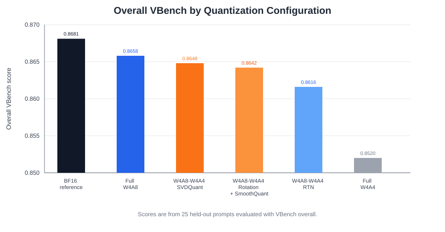
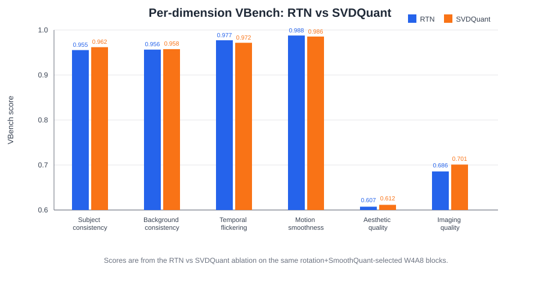

<!---
Copyright (c) 2026 Advanced Micro Devices, Inc. (AMD)

Permission is hereby granted, free of charge, to any person obtaining a copy
of this software and associated documentation files (the "Software"), to deal
in the Software without restriction, including without limitation the rights
to use, copy, modify, merge, publish, distribute, sublicense, and/or sell
copies of the Software, and to permit persons to whom the Software is
furnished to do so, subject to the following conditions:

The above copyright notice and this permission notice shall be included in all
copies or substantial portions of the Software.

THE SOFTWARE IS PROVIDED "AS IS", WITHOUT WARRANTY OF ANY KIND, EXPRESS OR
IMPLIED, INCLUDING BUT NOT LIMITED TO THE WARRANTIES OF MERCHANTABILITY,
FITNESS FOR A PARTICULAR PURPOSE AND NONINFRINGEMENT. IN NO EVENT SHALL THE
AUTHORS OR COPYRIGHT HOLDERS BE LIABLE FOR ANY CLAIM, DAMAGES OR OTHER
LIABILITY, WHETHER IN AN ACTION OF CONTRACT, TORT OR OTHERWISE, ARISING FROM,
OUT OF OR IN CONNECTION WITH THE SOFTWARE OR THE USE OR OTHER DEALINGS IN THE
SOFTWARE.
--->

# Quark Mixed-Precision Quantization for Wan2.2 Video Generation on AMD Instinct GPUs

Video generation models are becoming a central workload for generative AI. Recent ROCm blogs have covered the broader Wan and diffusion ecosystem, including Wan2.2 fine-tuning [[1]](#references), Wan2.2 distributed serving [[2]](#references), audio-driven Wan2.2-S2V generation [[3]](#references), ComfyUI workflows for Wan2.2 [[4]](#references), and Quark acceleration for diffusion transformers with xDiT [[5]](#references).

This blog focuses on MXFP4-weight quantization for Wan2.2 video generation, and asks where mixed activation precision is worth using. Instead of quantizing every layer identically, we use AMD Quark [[6]](#references) to evaluate each transformer block and promote only the sensitive blocks from MXFP4 W4A4 to W4A8. On `Wan2.2-T2V-A14B`, this calibration-driven mixed-precision policy reaches **0.8648 VBench overall**, improving over Full W4A4 MXFP4 at **0.8520**, which has a visible quality drop. A full-model W4A8 RTN sweep reaches **0.8658**, showing that FP8 activations can nearly close the remaining quality gap when applied model-wide. All W4A8 numbers in this blog are measured with quantize-dequantize (QDQ) emulation and are reported as a quality study, not a performance result. Native W4A8 execution is available in [AMD Quark](https://github.com/amd/quark) 0.13.

The main takeaway is practical: for Wan2.2-T2V-A14B, Full W4A4 MXFP4 is efficient but shows a visible quality drop even when VBench looks close to BF16. Full W4A8 reached the highest measured quantized quality in our tests, and a small calibration pass can recover most of that quality while keeping most blocks on the efficient W4A4 path.

## Why Mixed Precision for Wan2.2?

Wan2.2-T2V-A14B is a large diffusion transformer model for text-to-video generation. In the Diffusers pipeline, it uses a two-expert design:

- `transformer` handles the high-noise portion of the denoising trajectory.
- `transformer_2` handles the low-noise portion.
- The model uses a `boundary_ratio` of `0.875`, so calibration needs to cover both sides of the denoising schedule.

This dual-expert structure matters for quantization. A single global policy can easily overfit one expert and under-sample the other. In our experiments, the two experts selected different blocks for higher precision, suggesting that, for the path we explored, deciding mixed precision **per expert and per block** is a promising way to optimize an MXFP4-quantized diffusion model. Other strategies may also work; this is one effective approach.

## Quantization formats

We use the following precision levels:

| Format | Meaning | Role in this study |
| :--- | :--- | :--- |
| BF16 | Full-precision reference | Quality ceiling |
| W4A4 | OCP MXFP4 [[7]](#references) weights and dynamic MXFP4 activations | Default fast path |
| W4A8 | OCP MXFP4 [[7]](#references) weights and FP8 E4M3 static activations | Promotion path for sensitive blocks or full-model quality reference |

The W4A4 path maps to native MXFP4 execution and is the preferred default. The W4A8 path improves activation precision for low-SQNR blocks. In this experiment, W4A8 was evaluated through QDQ emulation, so the W4A8 results should be read as a **quality study**, not a performance claim. [AMD Quark](https://github.com/amd/quark) 0.13 adds native W4A8 support for this mixed-precision path.

**Kernel note:** For native MXFP4 W4A4 execution, this study uses the Quark/AITER ASM GEMM path on MI350. BF16 uses the standard PyTorch BF16 path. The W4A8 rows use QDQ emulation on Quark 0.12 and are reported for quality evaluation only. Native W4A8 is available starting in Quark 0.13.

## Experimental setup

| Component | Setting |
| :--- | :--- |
| Hardware | Single AMD Instinct MI350 GPU (`gfx950`) |
| Docker image | `rocm/pytorch-xdit:v26.5` |
| Quark version | AMD Quark 0.12 (W4A8 QDQ quality study); native W4A8 in [Quark](https://github.com/amd/quark) 0.13 |
| Model | `Wan2.2-T2V-A14B-Diffusers` |
| Pipeline | Diffusers `WanPipeline`, single GPU |
| Resolution | 832 x 480 |
| Frames | 81 frames at 16 fps |
| Denoising steps | 30 |
| Guidance scale | 5.0 |
| Seed | 42 |
| Calibration set | 50 train prompts x 6 denoise steps |
| Evaluation set | 25 held-out prompts |
| Quality metric | VBench [[8]](#references) dimensions and overall score |

The calibration and evaluation prompts are disjoint. The same 25 held-out evaluation prompts are used across BF16, full W4A4, full W4A8, and fixed-rotation/SmoothQuant-selected W4A8 configurations.

## Calibration-driven block selection

The selection pass replays captured BF16 block inputs through two quantized versions of the same block:

- `OFF`: plain dynamic MXFP4.
- `ON`: MXFP4 plus a transform, such as SVDQuant or fixed Hadamard rotation followed by SmoothQuant.

For each block, we compute whole-block output SQNR against the BF16 reference. Higher SQNR means the quantized block is closer to BF16. The policy is:

| Rule | Condition | Decision |
| :--- | :--- | :--- |
| BF16 fallback | `max(sqnr_off, sqnr_on) < floor` | Keep block in BF16 |
| W4A8 promotion | `max(sqnr_off, sqnr_on) < w4a8_sqnr` | Use W4A8 |
| Transform on | `sqnr_on - sqnr_off > margin` | Keep W4A4 and enable transform |
| Plain MXFP4 | Otherwise | Use plain W4A4 |

For the high-quality tier used here:

| Tier | Intent | `floor` | `w4a8_sqnr` | `margin` |
| :--- | :--- | ---: | ---: | ---: |
| Low | Speed | 8 dB | 21 dB | 0.5 dB |
| Mid | Balanced | 10 dB | 23 dB | 0.5 dB |
| High | Quality | 12 dB | 25 dB | 0.5 dB |

On Wan2.2-T2V-A14B, every tested block stayed above the BF16 fallback floor, so no block needed BF16. The active lever was W4A8 promotion for blocks below the 25 dB high-tier threshold.

## Mixed-Precision selection

The selection transform can use either SVDQuant or fixed deterministic Hadamard rotations plus SmoothQuant to reveal which blocks are sensitive to MXFP4 activation quantization. SVDQuant combines activation smoothing with low-rank correction, while the rotation path uses lightweight deterministic preprocessing. In this experiment, we use fixed rotation plus SmoothQuant for the selector:

- R1 applies a residual-stream rotation.
- R2 rotates inside the attention head dimension.
- SmoothQuant then rescales remaining per-channel activation outliers into weights.
- The selector uses this transform to decide block sensitivity.

In this experiment, the rotations are fixed, not learned. The `trainable` machinery is available in Quark, but this selection run does not perform a training loop. That makes the selector much faster than SVD-heavy workflows.

> **Note:** Both transforms have additional quality headroom we did not exploit here. SVDQuant supports a per-layer smoothing-strength search (`search_alpha` in `SVDQuantConfig`) that tunes `alpha` to minimize each layer's output error, and the rotation path can use learned rotations (`trainable=True` in `RotationConfig`) optimized on the Stiefel manifold instead of fixed Hadamard rotations. We used the faster fixed-rotation/SmoothQuant selector for this study; alpha search and learned rotations are natural next steps for pushing quality further.

Using fixed rotation plus SmoothQuant as the selection transform, the high-tier policy selected:

| Expert | W4A8 blocks | W4A8 count | W4A4 count | % W4A8 |
| :--- | :--- | ---: | ---: | ---: |
| `transformer` | `[1, 10, 11, 12, 14, 27, 28, 29, 30, 31, 32, 33, 34, 35]` | 14 / 40 | 26 / 40 | 35% |
| `transformer_2` | `[0, 4, 5, 6, 7, 8, 9, 10, 11, 12, 13, 14, 15, 16, 17, 18, 19, 20, 21, 22, 24, 25, 26, 27, 29, 33, 34]` | 27 / 40 | 13 / 40 | 67.5% |

Each expert has 40 transformer blocks, so the high-tier policy promotes **41 of 80 blocks (~51%)** to W4A8 and keeps the remaining **39 blocks (~49%)** at native W4A4. The two experts behave very differently: `transformer` stays mostly W4A4 (35% promoted), while `transformer_2` needs W4A8 on most blocks (67.5%), which is why a single global precision setting would either over-quantize one expert or waste bits on the other.

This configuration reached **0.8648 VBench overall** with SVDQuant enabled at generation time, the highest-scoring calibrated mixed-precision result in this study. In the latest ablation, running the same selected blocks with plain RTN reached **0.8616**, so SVDQuant improves the VBench score on this block policy.

## Results

The table below compares all tested configurations on the same 25 held-out prompts. As you can see in Figure 1, below, the overall VBench ranking is BF16, then full W4A8, then the mixed W4A8-W4A4 policies, with full W4A4 clearly lower.

| Configuration | Selection method | Generation transform | VBench overall | Delta vs BF16 | Delta vs Full W4A4 |
| :--- | :--- | :--- | ---: | ---: | ---: |
| BF16 reference | None | None | **0.8681** | 0.0000 | +0.0161 |
| Full W4A8 | All eligible blocks | RTN | **0.8658** | -0.0023 | +0.0138 |
| W4A8 - W4A4 | Mixed-precision selection | SVDQuant | **0.8648** | -0.0033 | +0.0128 |
| W4A8 - W4A4 | Mixed-precision selection | Fixed rotation + SmoothQuant | 0.8642 | -0.0039 | +0.0122 |
| W4A8 - W4A4 | Mixed-precision selection | RTN | 0.8616 | -0.0065 | +0.0096 |
| Full W4A4 | None | RTN | 0.8520 | -0.0161 | 0.0000 |

Figure 1. Overall VBench comparison across BF16, full W4A8, mixed W4A8-W4A4, and full W4A4 configurations.

The latest ablation compares RTN and SVDQuant on the same fixed-rotation/SmoothQuant-selected W4A8 blocks. Figure 2, below, shows the per-dimension breakdown: SVDQuant helps most on imaging quality and subject consistency, while RTN is slightly stronger on temporal flickering and motion smoothness.

| Dimension | RTN | SVDQuant | Delta (SVDQuant - RTN) |
| :--- | ---: | ---: | ---: |
| Subject consistency | 0.9553 | 0.9619 | +0.0066 |
| Background consistency | 0.9564 | 0.9575 | +0.0012 |
| Temporal flickering | 0.9772 | 0.9716 | -0.0056 |
| Motion smoothness | 0.9877 | 0.9855 | -0.0023 |
| Aesthetic quality | 0.6074 | 0.6115 | +0.0042 |
| Imaging quality | 0.6858 | 0.7009 | +0.0151 |
| **Overall** | **0.8616** | **0.8648** | **+0.0032** |

Figure 2. Per-dimension VBench comparison for RTN and SVDQuant on the same rotation+SmoothQuant-selected W4A8 blocks.

These results support four conclusions:

1. **Full W4A4 MXFP4 can look close on VBench while still showing a visible quality drop.** Full W4A4 scored 0.8520 overall, only 0.0161 below BF16, but human inspection still showed noticeable degradation. VBench is useful for ranking, not a substitute for watching the videos.
2. **Full W4A8 reached the highest measured quantized quality in our tests.** RTN full W4A8 reached 0.8658, 0.0023 below BF16, and did not need SVDQuant.
3. **Targeted precision beats position heuristics.** Calibration-driven W4A8 selection recovered most of the full-W4A8 gain while promoting only selected blocks.
4. **Fixed rotation plus SmoothQuant form an effective selector.** It produced the highest-scoring calibrated mixed-precision result in our tests and was faster to select than SVD-heavy approaches in the current workflow.

Because the evaluation uses 25 videos, differences below roughly 0.01 should be interpreted cautiously. Full W4A4 is a clearer exception: the 0.0161 VBench gap is larger, and it matched a visible quality drop in human observation. The safest reading is that full W4A8 and fixed-rotation/SmoothQuant-selected W4A8 are both near-BF16 quality, while the selected policy is the more practical current path because it uses W4A8 only where calibration indicates a benefit. The latest RTN-vs-SVDQuant ablation shows that block selection carries most of the quality on A14B; SVDQuant is a marginal add-on for this policy.

## Practical workflow

A production-oriented Quark workflow for Wan2.2 mixed precision should look like this:

1. Start from native MXFP4 W4A4 for all eligible transformer blocks.
2. Exclude Wan structural modules and timestep embedding modules from quantization.
3. Capture a small calibration set that crosses the `boundary_ratio` and exercises both experts.
4. Replay each block with transform `OFF` and `ON`.
5. Compute block-level SQNR or cosine similarity against BF16 outputs.
6. Emit a per-expert policy with `plain_mxfp4`, `transform_on`, `w4a8`, and optional `bf16`.
7. Validate the final policy on a held-out prompt set with VBench or a deployment-specific video quality gate.

The policy artifact is the important output. It lets the runtime keep most layers on the fast native MXFP4 path, while spending higher precision only where calibration shows that it matters.

## Recommendations

For Wan2.2-T2V-A14B, use native MXFP4 W4A4 as the default and add a calibration-driven mixed-precision policy when quality targets require it. Full W4A8 is a strong quality target; the W4A8 results here are measured with QDQ emulation on Quark 0.12 and should be read as a quality study. Native W4A8 support is available in [AMD Quark](https://github.com/amd/quark) 0.13.

Use SVDQuant as an optional consistency booster and selector, but account for its setup cost. The full-W4A8 sweep shows that once activations are FP8 model-wide, RTN can match or edge SVDQuant, so SVDQuant should be applied selectively where block replay shows a measurable gain. Full SVD on Wan-sized linear layers can be expensive, so randomized or truncated SVD, per-layer parallelism, and selective SVD application are promising next steps.

Use fixed Hadamard rotation plus SmoothQuant as a fast selector. It is not a blanket recommendation to rotate every block; some blocks improve substantially, while others do not. The block A/B signal should determine the choice.

## Summary

In this blog you explored a calibration-driven mixed-precision workflow for Wan2.2-T2V-A14B on AMD Instinct GPUs: use AMD Quark to score each transformer block, keep native MXFP4 W4A4 as the default, and promote only sensitive blocks to W4A8. You compared full W4A4, full W4A8, and mixed W4A8-W4A4 policies on the same held-out prompts, and you saw how a fast fixed-rotation plus SmoothQuant selector recovers most of the full-W4A8 quality while leaving many blocks on the efficient W4A4 path. On `Wan2.2-T2V-A14B`, full RTN W4A8 reached **0.8658 VBench overall**, close to the **0.8681** BF16 reference, while calibrated W4A8 promotion with this selector reached **0.8648** and stayed well above the **0.8520** Full W4A4 baseline.

[AMD Quark](https://github.com/amd/quark) 0.13 now provides native W4A8 support, so mixed-precision policies can move from this QDQ quality study onto a native execution path. Next steps on the quantization side include SVDQuant `search_alpha`, learned rotations (`trainable=True`), and cheaper SVD variants for Wan-sized layers. Watch the [ROCm Blogs](https://rocm.blogs.amd.com/) for related Quark, Wan2.2, and video-generation posts, including the earlier [Quark xDiT MXFP4 image-generation blog](https://rocm.blogs.amd.com/artificial-intelligence/quark-xdit/README.html) and the Wan2.2 serving and fine-tuning series linked in the references.

## References

[1] [Wan2.2 Fine-Tuning: Tailoring an Advanced Video Generation Model on a Single GPU](https://rocm.blogs.amd.com/artificial-intelligence/finetuning-wan-part1/README.html)

[2] [A Simple Design for Serving Video Generation Models with Distributed Inference](https://rocm.blogs.amd.com/artificial-intelligence/serving-videogen-v1/README.html)

[3] [Accelerating Audio-Driven Video Generation: WAN2.2-S2V on AMD ROCm](https://rocm.blogs.amd.com/artificial-intelligence/audio-driven-videogen/README.html)

[4] [ComfyUI - a graphical user interface for video generation](https://rocm.blogs.amd.com/software-tools-optimization/comfyui-on-amd/README.html)

[5] [Accelerating Diffusers and xDiT Image Generation with MXFP4 using AMD Quark on AMD Instinct MI350 GPUs](https://rocm.blogs.amd.com/artificial-intelligence/quark-xdit/README.html)

[6] [AMD Quark](https://github.com/amd/quark) (native W4A8 support in v0.13)

[7] [OCP Microscaling Formats (MX) Specification](https://www.opencompute.org/documents/ocp-microscaling-formats-mx-v1-0-spec-final-pdf)

[8] [VBench: Comprehensive Benchmark Suite for Video Generative Models](https://github.com/Vchitect/VBench)

## Disclaimers

Third-party content is licensed to you directly by the third party that owns the
content and is not licensed to you by AMD. ALL LINKED THIRD-PARTY CONTENT IS
PROVIDED "AS IS" WITHOUT A WARRANTY OF ANY KIND. USE OF SUCH THIRD-PARTY CONTENT
IS DONE AT YOUR SOLE DISCRETION AND UNDER NO CIRCUMSTANCES WILL AMD BE LIABLE TO
YOU FOR ANY THIRD-PARTY CONTENT. YOU ASSUME ALL RISK AND ARE SOLELY RESPONSIBLE
FOR ANY DAMAGES THAT MAY ARISE FROM YOUR USE OF THIRD-PARTY CONTENT.

The information presented in this document is for informational purposes only and may
contain technical inaccuracies, omissions, and typographical errors. The information
contained herein is subject to change and may be rendered inaccurate for many reasons,
including but not limited to product and roadmap changes, component and motherboard
version changes, new model and/or product releases, product differences between
differing manufacturers, software changes, BIOS flashes, firmware upgrades, or the
like. Any computer system has risks of security vulnerabilities that cannot be completely
prevented or mitigated. AMD assumes no obligation to update or otherwise correct
or revise this information.

However, AMD reserves the right to revise this information and to make changes from
time to time to the content hereof without obligation of AMD to notify any person of
such revisions or changes.

THIS INFORMATION IS PROVIDED "AS IS." AMD MAKES NO REPRESENTATIONS OR WARRANTIES
WITH RESPECT TO THE CONTENTS HEREOF AND ASSUMES NO RESPONSIBILITY FOR ANY
INACCURACIES, ERRORS, OR OMISSIONS THAT MAY APPEAR IN THIS INFORMATION. AMD
SPECIFICALLY DISCLAIMS ANY IMPLIED WARRANTIES OF NON-INFRINGEMENT, MERCHANTABILITY,
OR FITNESS FOR A PARTICULAR PURPOSE. IN NO EVENT WILL AMD BE LIABLE TO ANY PERSON
FOR ANY RELIANCE, DIRECT, INDIRECT, SPECIAL, OR OTHER CONSEQUENTIAL DAMAGES ARISING
FROM THE USE OF ANY INFORMATION CONTAINED HEREIN, EVEN IF AMD IS EXPRESSLY ADVISED
OF THE POSSIBILITY OF SUCH DAMAGES.

AMD, the AMD Arrow logo, ROCm, Instinct, and combinations thereof are trademarks of
Advanced Micro Devices, Inc. Other product names used in this publication are for
identification purposes only and may be trademarks of their respective companies.
© 2026 Advanced Micro Devices, Inc. All rights reserved.
