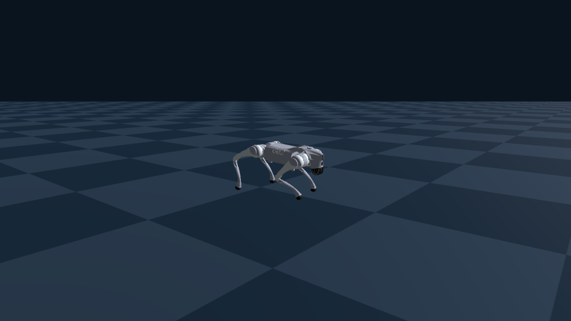
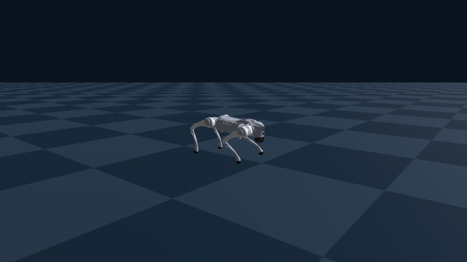
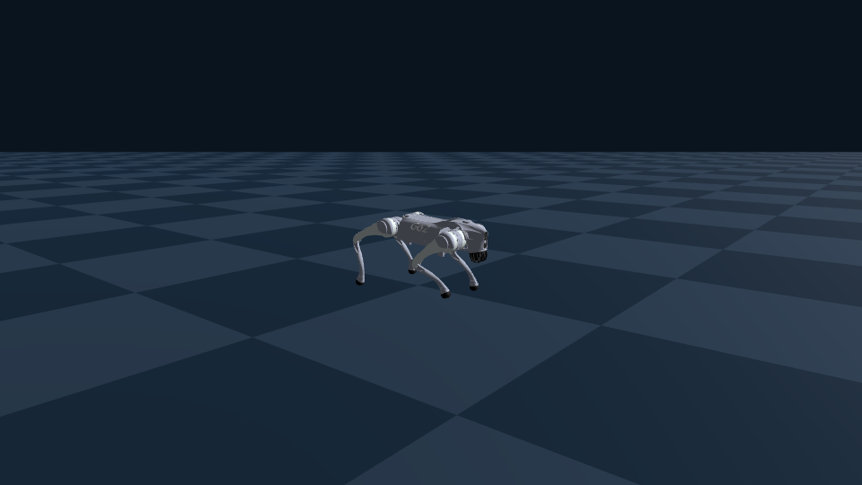
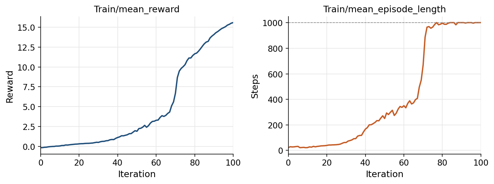
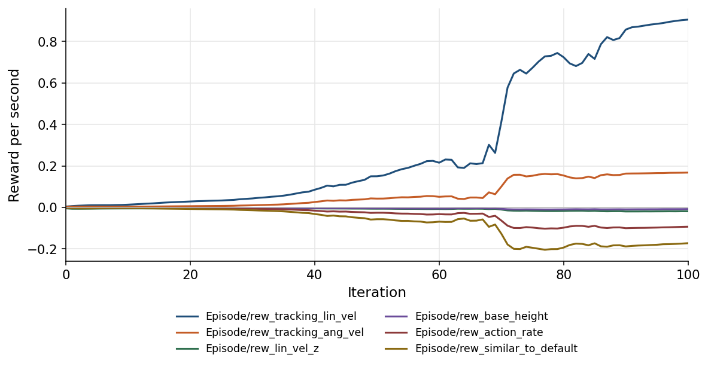
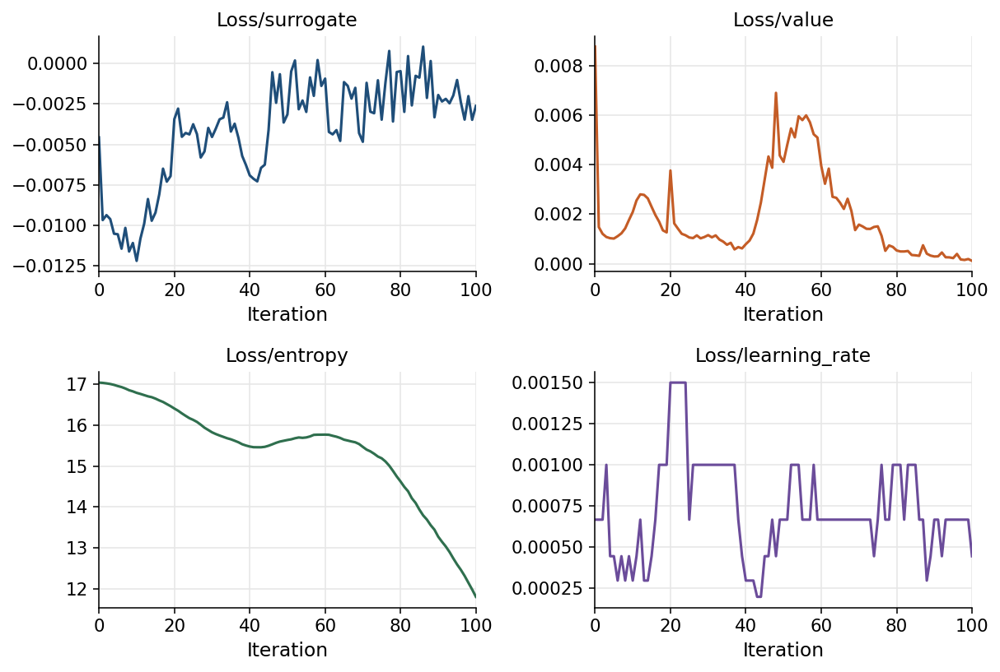
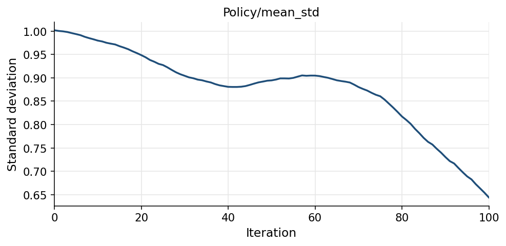
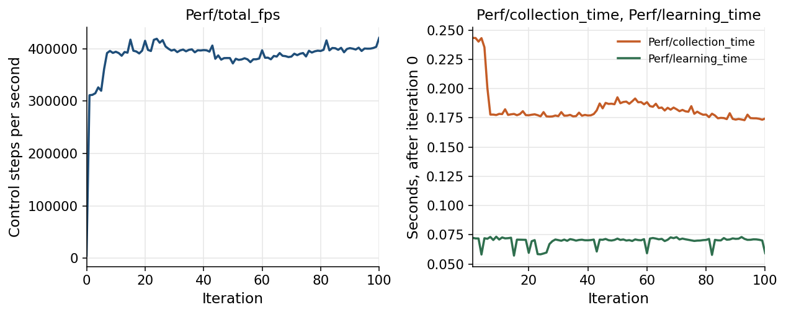

<!---
Copyright (c) 2026 Advanced Micro Devices, Inc. (AMD)

Permission is hereby granted, free of charge, to any person obtaining a copy
of this software and associated documentation files (the "Software"), to deal
in the Software without restriction, including without limitation the rights
to use, copy, modify, merge, publish, distribute, sublicense, and/or sell
copies of the Software, and to permit persons to whom the Software is
furnished to do so, subject to the following conditions:

The above copyright notice and this permission notice shall be included in all
copies or substantial portions of the Software.

THE SOFTWARE IS PROVIDED "AS IS", WITHOUT WARRANTY OF ANY KIND, EXPRESS OR
IMPLIED, INCLUDING BUT NOT LIMITED TO THE WARRANTIES OF MERCHANTABILITY,
FITNESS FOR A PARTICULAR PURPOSE AND NONINFRINGEMENT. IN NO EVENT SHALL THE
AUTHORS OR COPYRIGHT HOLDERS BE LIABLE FOR ANY CLAIM, DAMAGES OR OTHER
LIABILITY, WHETHER IN AN ACTION OF CONTRACT, TORT OR OTHERWISE, ARISING FROM,
OUT OF OR IN CONNECTION WITH THE SOFTWARE OR THE USE OR OTHER DEALINGS IN THE
SOFTWARE.
--->

# Train a Walking Robot with Genesis on AMD GPUs

This blog shows how to run robot simulation and training on an AMD Instinct™ (CDNA) GPU with ROCm™ software release 10.1. The work is done by Genesis, a physics simulator, with Quadrants, a Python-based kernel language and compiler, running underneath.

You will build one container, start it on a single GPU, and train a walking policy for a simulated four-legged robot. Training happens entirely in simulation. The container does not control a physical robot. When the run finishes you have a saved policy and a training log.

The walkthrough below is one path through that setup. The same image can run other Genesis scenes. The Next steps section at the end suggests a few things to try after this example.

## Genesis

[Genesis](https://github.com/AMD-Ecosystem/Genesis/tree/rocm10.1.0_r26.10) is a physics simulator with a Python API. You describe a scene, such as a floor and a robot loaded from its description file, and Genesis steps that scene forward in time. It covers rigid robots and other kinds of physics in the same scene, and it can run thousands of copies of a scene at once. That batching is what makes robot learning practical: a learning algorithm needs a huge number of attempts, and a GPU can simulate them together.

This blog uses ROCm 10.1 and the `rocm10.1.0_r26.10` branch of `AMD-Ecosystem/Genesis`. The numeric work inside the simulator is compiled by Quadrants.

## Quadrants

[Quadrants](https://github.com/AMD-Ecosystem/quadrants/tree/rocm10.1.0_r26.10) is the compiler that makes the simulator run on this GPU. The physics inside Genesis is written in Python. Quadrants compiles that Python into HIP programs for an AMD CDNA™ architecture, through ROCm. The compile is specific to the GPU in the machine, which is why the first training iteration is slower than the rest. Genesis calls Quadrants for you. This walkthrough does not ask you to write a kernel.

## What This Example Shows

A robot learning to walk in the real world would fall over thousands of times before it got it right. That is slow, and it breaks hardware. Robotics teams therefore train in simulation. A physics engine computes how the robot's body, joints, and the ground push against each other. A learning algorithm then tries out movements in that simulated world and keeps the ones that work.

The example is `examples/locomotion/go2_train.py`, which ships with Genesis. It teaches a simulated Unitree Go2, a four-legged robot about the size of a small dog with 12 motorized joints, to walk forward at a steady 0.5 m/s. Nothing in this example talks to a real robot. The whole thing happens inside the simulator.

The robot learns by reinforcement learning, which is trial and error with a score:

- **What the robot senses.** Every 0.02 seconds (50 times a second, the same rate as the real robot's controller), the policy gets 45 numbers: how fast the body is turning, which way is down relative to the body, the speed it has been told to walk at, how far each of the 12 joints is from the standing pose, the speed of each joint, and the action it took last time.
- **What it controls.** It outputs a target angle for each of the 12 joints. Simulated motors then drive the joints toward those angles.
- **How it is scored.** The reward goes up when the robot walks forward at the commanded speed and does not turn. It goes down when the body bounces up and down, sags away from a target base height of 0.3 m, makes jerky movements, or holds its legs in unnatural poses.
- **When it starts over.** If the body tilts more than 10 degrees in roll or pitch, or 20 seconds pass, that robot is reset to standing and tries again.

The policy is a small neural network. It reads the 45 numbers and picks the 12 joint targets. Training it is reinforcement learning: the loop above, where the policy tries an action, the simulator returns a reward, and the network is changed so actions that scored better become more likely.

The algorithm that makes those changes is PPO (Proximal Policy Optimization), from the open-source [rsl-rl](https://github.com/leggedrobotics/rsl_rl) library. PPO lets the policy act, measures the reward, and updates the network. Proximal means each update is limited, so the new policy stays close to the one that just collected the experience. One iteration cannot throw away a gait that was starting to work. Schulman, Wolski, Dhariwal, Radford, and Klimov describe the method in [Proximal Policy Optimization Algorithms](https://arxiv.org/abs/1707.06347) (2017).

The reason to do this on a GPU is scale. By default the example simulates **4096 robots at once**, in one scene, on one GPU. Each robot is independent, so each one gives the learner its own attempt. Every training iteration runs all 4096 robots for 24 control steps, then updates the policy from everything they experienced. The default 101 iterations amount to about 10 million robot-steps of experience. On a CPU you would wait a very long time for that. On the MI300X this walkthrough was run on, those 101 iterations took about 45 seconds. The first iteration is slower, because Quadrants compiles the physics. After that, `Perf/total_fps` stays near 400,000 simulated control steps per second.

## Requirements

- An AMD Instinct GPU from the CDNA family supported by ROCm 10.1. This walkthrough was run on MI300X.
- A host kernel driver that matches ROCm 10.1. See the [ROCm documentation](https://rocm.docs.amd.com/) for supported GPUs and drivers.
- Docker.
- Network access during the build, and enough disk for the image (about 50 GB).

You do not need ROCm, PyTorch, Quadrants, or Genesis installed on the host. The image provides all of them.

## Step 1: Clone the Repository

```bash
git clone -b rocm10.1.0_r26.10 https://github.com/AMD-Ecosystem/Genesis.git
cd Genesis
```

The `rocm10.1.0_r26.10` branch is the ROCm 10.1 release of Genesis. Its `Dockerfile` clones Quadrants from the matching `rocm10.1.0_r26.10` branch during the build, so you do not need a separate Quadrants checkout to run this example.

## Step 2: Build the Image

From the `Genesis` directory:

```bash
docker build -t genesis-release-rocm10.1 .
```

This builds one image that contains everything the example needs:

- The ROCm 10.1 userspace, from the `rocm/dev-ubuntu-24.04:10.1.0-full` base image.
- PyTorch `2.13.0+rocm10.1.0`, which the training code uses for the neural network.
- Quadrants, compiled from source for AMD GPUs.
- Genesis, installed from this repository on top of that Quadrants build.

The build compiles Quadrants, so expect it to take a while the first time.

## Step 3: Start the Container

First make a directory on the host for the training output. The container below is started with `--rm`, so anything not written to a mounted directory is deleted when it exits.

```bash
mkdir -p ~/go2-runs
```

Then start an interactive shell in the image:

```bash
docker run --rm -it \
  --device=/dev/kfd --device=/dev/dri \
  --group-add "$(stat -c '%g' /dev/kfd)" \
  -e HIP_VISIBLE_DEVICES=0 \
  -e ROCR_VISIBLE_DEVICES=0 \
  -e CUDA_VISIBLE_DEVICES=0 \
  -v ~/go2-runs:/workspace \
  -w /workspace \
  genesis-release-rocm10.1 \
  bash
```

What each part does:

- `--device=/dev/kfd --device=/dev/dri` give the container access to the AMD GPU. `/dev/kfd` is the ROCm compute interface, and `/dev/dri` holds the GPU device nodes.
- `--group-add "$(stat -c '%g' /dev/kfd)"` adds the container user to the group that owns `/dev/kfd`, so it is allowed to open the GPU.
- `HIP_VISIBLE_DEVICES`, `ROCR_VISIBLE_DEVICES`, and `CUDA_VISIBLE_DEVICES` select which GPU the run uses. This example uses one GPU, so expose one. Use the index of an Instinct GPU here, not a display GPU. On a machine where the Instinct GPU is GPU 0, use the three lines as written.
- `-v ~/go2-runs:/workspace -w /workspace` mounts the output directory and starts the shell inside it. The training script writes its logs relative to the current directory, so they end up on the host.

The container does not need `--privileged`.

Check that the GPU is visible and the stack loads:

```bash
python -c "import torch, quadrants, genesis; print('torch', torch.__version__); print('quadrants', quadrants.__version_str__); print('GPU', torch.cuda.get_device_name(0))"
```

You should see `torch 2.13.0+rocm10.1.0`, the Quadrants version, and the name of your AMD GPU. PyTorch on ROCm uses the `torch.cuda` API names, which is why the call says `cuda` on an AMD GPU.

## Step 4: Install the Training Libraries

The image contains Genesis and PyTorch but not the reinforcement learning library or the logger. Install them inside the container:

```bash
pip install tensorboard "rsl-rl-lib>=5.5.0"
```

`rsl-rl-lib` provides the PPO implementation, and `tensorboard` records the training curves. Install 5.5.0 or newer. Releases 5.0.0 through 5.4.2 depend on `torchvision`, and the `torchvision` packages on PyPI each require one specific CUDA build of PyTorch. Pip would remove the image's ROCm build, install that CUDA build, and the GPU path would stop working. Version 5.5.0 dropped the `torchvision` dependency, so this command leaves `torch 2.13.0+rocm10.1.0` in place. Because the container uses `--rm`, repeat this step each time you start a new container.

## Step 5: Train

```bash
python /src/Genesis/examples/locomotion/go2_train.py --exp-name go2-walking --num-envs 4096 --max-iterations 101
```

These are the script's defaults, written out so you can see what to change:

- `--exp-name go2-walking` names the run. Output goes to `logs/go2-walking/`.
- `--num-envs 4096` is the number of robots simulated in parallel.
- `--max-iterations 101` is the number of PPO training iterations.

Here is what happens when you run it:

1. **Genesis starts on the GPU.** The script calls `gs.init(backend=gs.gpu, ...)`, which selects the AMD GPU.
2. **The scene is built.** `go2_env.py` creates a floor and 4096 copies of the Go2, loaded from the robot description file that ships with Genesis. The robots do not collide with each other. Each one lives in its own copy of the world, and the GPU steps all of them together.
3. **The physics is compiled.** On the first run, Quadrants compiles Genesis's physics code for your GPU. Physics runs with Genesis's default Newton constraint solver, which is what keeps feet from passing through the floor and joints from coming apart.
4. **Training runs.** `go2_train.py` hands the environment to the `rsl-rl` PPO runner. Each iteration steps all 4096 robots for 24 control steps, computes their rewards, and updates the policy network on the GPU.

The runner prints a summary after every iteration.

## What You Get

When the run finishes, the host directory `~/go2-runs/logs/go2-walking/` contains:

- `model_100.pt`, the trained policy. The number in the filename is the iteration that was saved. Iterations are numbered from 0, so the 101 iterations in this run are 0 through 100, and the checkpoint from the last iteration is `model_100.pt`.
- `cfgs.pkl`, the environment and training settings used for this run.
- TensorBoard event files with the training curves.

The files are created by the container's root user, so they may be owned by root on the host.

Training does not draw the robots. The frames below are a separate rollout: one copy of the Go2, the saved policy, and a camera, rendered from the checkpoint this walkthrough trained on an MI300X. Figure 1 shows the robot at 0.8 seconds. Figure 2 shows it at 1.6 seconds, and Figure 3 shows it at 2.4 seconds.



<p align="center"><i>Figure 1. One simulated Go2, 0.8 seconds after the rollout starts. The base is 0.26 m forward of the start. The camera follows the body, so the robot stays in the middle of the frame while the floor moves past.</i></p>



<p align="center"><i>Figure 2. The same rollout at 1.6 seconds. The base is 0.69 m forward. The robot is still centered because the camera is tracking the body.</i></p>



<p align="center"><i>Figure 3. The same rollout at 2.4 seconds. The base is 1.12 m forward and has settled near the 0.3 m target height.</i></p>

To render the same frames from your own checkpoint, stay in the training container. `rsl-rl-lib` is already installed there. The scene in `go2_env.py` is built inside its constructor, and a camera has to be added before that build, so the script below wraps `Scene.build` and adds one camera on the way in. The rollout uses one robot on the same GPU as training. The first launch compiles physics for that scene.

Save the following as `/workspace/go2_snapshots.py`:

```python
"""Render stills of a trained Go2 policy.

Go2Env builds its scene inside the constructor, and a Genesis camera has to be
added before that build. The wrapper below adds one camera on the way in.
"""

import argparse
import os
import pickle
import sys
from importlib import metadata

import numpy as np
import torch
from PIL import Image

try:
    version = tuple(int(part) for part in metadata.version("rsl-rl-lib").split(".")[:2])
    if version < (5, 5):
        raise ImportError
except (metadata.PackageNotFoundError, ImportError, ValueError) as e:
    raise ImportError("Please install 'rsl-rl-lib>=5.5.0'.") from e
from rsl_rl.runners import OnPolicyRunner

import genesis as gs


def _build_with_camera(build):
    def wrapped(scene, *args, **kwargs):
        scene.walk_cam = scene.add_camera(
            res=(960, 540),
            pos=(1.8, -2.2, 1.0),
            lookat=(0.0, 0.0, 0.3),
            fov=45,
            GUI=False,
        )
        return build(scene, *args, **kwargs)

    return wrapped


def as_rgb_uint8(rgb):
    if hasattr(rgb, "detach"):
        rgb = rgb.detach().cpu().numpy()
    rgb = np.asarray(rgb)
    if rgb.ndim == 4:
        rgb = rgb[0]
    if rgb.dtype != np.uint8:
        scale = 255.0 if rgb.size and float(np.max(rgb)) <= 1.0 else 1.0
        rgb = np.clip(rgb * scale, 0, 255).astype(np.uint8)
    return rgb


def main():
    parser = argparse.ArgumentParser()
    parser.add_argument("--log-dir", default="logs/go2-walking")
    parser.add_argument("--ckpt", type=int, default=100)
    parser.add_argument("--out-dir", default="go2-walking-frames")
    parser.add_argument("--steps", type=int, default=160, help="Control steps to roll out, at 50 Hz")
    parser.add_argument(
        "--save-every",
        type=int,
        default=20,
        help="Save one frame every this many control steps",
    )
    args = parser.parse_args()

    gs.init(backend=gs.gpu, precision="32", logging_level="warning", seed=1)
    gs.Scene.build = _build_with_camera(gs.Scene.build)

    # Go2Env lives next to the example, not on the default module path.
    sys.path.insert(0, os.environ.get("GO2_EXAMPLE_DIR", "/src/Genesis/examples/locomotion"))
    from go2_env import Go2Env

    with open(os.path.join(args.log_dir, "cfgs.pkl"), "rb") as f:
        env_cfg, obs_cfg, reward_cfg, command_cfg, train_cfg = pickle.load(f)
    reward_cfg["reward_scales"] = {}

    env = Go2Env(
        num_envs=1,
        env_cfg=env_cfg,
        obs_cfg=obs_cfg,
        reward_cfg=reward_cfg,
        command_cfg=command_cfg,
        show_viewer=False,
    )
    cam = env.scene.walk_cam

    runner = OnPolicyRunner(env, train_cfg, args.log_dir, device=gs.device)
    runner.load(os.path.join(args.log_dir, f"model_{args.ckpt}.pt"))
    policy = runner.get_inference_policy(device=gs.device)

    os.makedirs(args.out_dir, exist_ok=True)
    obs = env.reset()
    saved = 0

    with torch.no_grad():
        for step in range(args.steps):
            actions = policy(obs)
            obs, _, _, _ = env.step(actions)
            if step % args.save_every != 0:
                continue
            base = env.base_pos[0].detach().cpu().numpy()
            cam.set_pose(
                pos=(float(base[0] + 1.8), float(base[1] - 2.2), float(base[2] + 0.5)),
                lookat=(float(base[0]), float(base[1]), 0.25),
            )
            rgb, _, _, _ = cam.render(rgb=True, depth=False, segmentation=False, normal=False)
            path = os.path.join(args.out_dir, f"go2-walk-{saved:02d}-t{step * 0.02:.2f}s.png")
            Image.fromarray(as_rgb_uint8(rgb)).save(path)
            print(f"saved {path} base=({base[0]:.2f}, {base[1]:.2f}, {base[2]:.2f})", flush=True)
            saved += 1


if __name__ == "__main__":
    main()
```

Then run it from `/workspace`, which is the mounted `~/go2-runs` directory:

```bash
python /workspace/go2_snapshots.py --log-dir /workspace/logs/go2-walking --out-dir /workspace/go2-walking-frames
```

The script loads `model_100.pt`, steps one robot for 3.2 seconds, and saves a PNG every 0.4 seconds. The camera is the default rasterizer, rendered headless, so the container does not need a display. The PNGs are written to `~/go2-runs/go2-walking-frames/` on the host. Each line of output includes the base position, which is the check that the robot is moving forward rather than standing in place.

If the training container has already exited, start a new one with the same GPU devices and the same mount as in Step 3, repeat the Step 4 install, and run the command above.

TensorBoard reads the event files saved during training and draws the training curves in a browser. Pass the log directory as `--logdir`.

The training container was started with `--rm`, so the TensorBoard install from step 4 is gone when it exits. Start a second container that publishes port 6006 and mounts the same output directory:

```bash
docker run --rm -it \
  -p 6006:6006 \
  -v ~/go2-runs:/workspace \
  -w /workspace \
  genesis-release-rocm10.1 \
  bash
```

Inside that container, install TensorBoard and start it. The log directory here is the path inside the container, not the path on the host. `~/go2-runs` does not exist in the container. The `-v` flag mounted that host directory at `/workspace`.

```bash
pip install tensorboard
tensorboard --logdir /workspace/logs/go2-walking --host 0.0.0.0 --port 6006
```

Leave that process running. `--host 0.0.0.0` is required. Without it, TensorBoard listens only on localhost inside the container. Docker still accepts connections to port 6006, and the browser reports that no data was sent. With `--host 0.0.0.0`, the published port reaches TensorBoard.

If the browser is on the same machine as Docker, open `http://localhost:6006`.

If the browser is on your laptop and the GPU machine is remote, open a second terminal on the laptop and forward the port. Replace `user@gpu-host` with the login you use for that machine:

```bash
ssh -L 6006:127.0.0.1:6006 user@gpu-host
```

`-L 6006:127.0.0.1:6006` connects port 6006 on the laptop to port 6006 on the GPU machine, which is the port Docker published. Then open `http://localhost:6006` in the laptop browser. Keep both the TensorBoard process and this SSH session open. Closing the SSH session closes the tunnel.

If TensorBoard is already installed on the GPU machine itself, skip the second container and run it on the host. This command uses the host path:

```bash
tensorboard --logdir ~/go2-runs/logs/go2-walking --host 0.0.0.0 --port 6006
```

Use the same SSH forward when the browser is on another machine.

### What the Graphs Show

The left sidebar lists one curve for each quantity `rsl-rl` recorded. Each point is one training iteration, numbered from 0 through 100. A name that ends in `/time` is that same quantity drawn against seconds of wall-clock time instead of iteration number. The figures here are those curves from the MI300X run in this walkthrough. Your own log has the same tags.

**Train** is the score of the episodes that finished during that iteration.

- `Train/mean_reward` is the average total reward. Early on the robots fall, so this number is low. A curve that rises and then levels off means the policy has settled on a way of walking.
- `Train/mean_episode_length` is how many control steps those episodes lasted. The run resets a robot after 20 seconds, which is 1000 steps at 50 steps per second, or sooner if the body tips more than 10 degrees. A length that grows toward 1000 means robots are staying upright until the time limit.



<p align="center"><i>Figure 4. Mean reward (left) and mean episode length (right) over the 101 training iterations.</i></p>

In this run, as you can see in Figure 4, the mean reward is still rising at iteration 100, from about zero to about 16. The episode length reaches the 1000-step time limit, drawn as a dashed line, by iteration 80 and stays there. The reward has not leveled off, which is why the checkpoint is an example rather than a finished gait.

**Episode** splits that score into the six terms from `go2_env.py`. Each value is the average of that term over the finished episodes, divided by the 20-second episode length, so it reads as reward per second. A positive term should rise. A penalty is stored with its negative weight already applied, so a value closer to zero is better.

- `Episode/rew_tracking_lin_vel` rewards walking forward at the commanded 0.5 m/s.
- `Episode/rew_tracking_ang_vel` rewards not turning. The commanded yaw rate is zero.
- `Episode/rew_lin_vel_z` penalizes the body bouncing up and down.
- `Episode/rew_base_height` penalizes standing away from the 0.3 m target height.
- `Episode/rew_action_rate` penalizes abrupt changes in the joint targets.
- `Episode/rew_similar_to_default` penalizes joint angles far from the standing pose.



<p align="center"><i>Figure 5. The six episode reward terms, in reward per second, over the 101 training iterations.</i></p>

The legend uses the same names as the list above. As you can see in Figure 5, `Episode/rew_tracking_lin_vel` climbs through the run and finishes near 0.9 per second. A perfect score on that term is 1. `Episode/rew_tracking_ang_vel` finishes near 0.17 per second, under its weight of 0.2. `Episode/rew_lin_vel_z` and `Episode/rew_base_height` stay near zero. `Episode/rew_action_rate` and `Episode/rew_similar_to_default` grow once the robots are walking, then level off. Closer to zero is still better for those two. They are the cost of a gait that moves the joints.

**Loss** is the PPO update, separate from the robot's score.

- `Loss/surrogate` is the clipped policy loss, the term that nudges the network toward the actions that scored better.
- `Loss/value` is how far the critic's predicted return is from the return the robots actually received.
- `Loss/entropy` measures how spread out the action distribution still is. It starts near the initial randomness and falls as the policy commits to particular joint targets.
- `Loss/learning_rate` is the step size for that update. The schedule is adaptive, so this line moves when an update is larger or smaller than the target.



<p align="center"><i>Figure 6. The four PPO panels: surrogate loss, value loss, entropy, and learning rate, over the 101 training iterations.</i></p>

Figure 6 shows the four PPO panels over the 101 iterations. It shows entropy falling from about 17 to about 12, the learning rate moving between about 0.0002 and 0.0015, and how the surrogate loss stays within about -0.012 to 0.001, while the value loss stays below 0.01.

**Policy** has one curve. `Policy/mean_std` is the average standard deviation of the 12 joint targets. It starts at 1.0. A falling curve means the actions are becoming more consistent.



<p align="center"><i>Figure 7. Mean standard deviation of the 12 joint targets over the 101 training iterations.</i></p>

Figure 7 shows that, in this run, the standard deviation ends near 0.64, that the joint targets are more consistent than they were at the start, and that the policy has not collapsed to a single gait.

**Perf** is speed, not learning.

- `Perf/total_fps` is simulated control steps per second, counting all 4096 robots.
- `Perf/collection_time` is the seconds that iteration spent stepping the simulator.
- `Perf/learning_time` is the seconds it spent updating the network.



<p align="center"><i>Figure 8. Simulation throughput (left) and time per iteration (right) over the 101 training iterations.</i></p>

As you can see in Figure 8, iteration 0 is the physics compile. It is the low point on the left, about 5,100 steps per second, and it is left off the right-hand plot: 16.7 seconds collecting and 2.6 seconds updating. From iteration 1 on, the step rate settles near 400,000 per second, collection stays near 0.2 seconds, and the update stays near 0.07 seconds. The reward in Figure 4 rises across that same stretch. The robots improved while the simulation held its pace.

This is a training example, not a finished controller. 101 iterations is the example's default, and the checkpoint is not ready to run on a physical Go2. Moving a policy from simulation to a real robot takes more work, and that is a topic for another post.

## Next Steps

These are listed in the order to try them. The first four stay with the walking example. The last one is for writing your own GPU kernels. The walking run does not require it.

**Try another batch size.** Do this first. It changes one flag and leaves the walking task alone, so `Perf/total_fps` is comparable to the run above. 4096 is the example default, not a tuned setting for every card. Run the same command with `--num-envs 2048`, then 4096, then one larger value that still fits in GPU memory. On this MI300X, with 4096 environments, that line sits near 400,000 simulated control steps per second after the first iteration. Stop increasing the batch when the number stops rising.

A second GPU does not take part of this batch. Every robot is placed on the one device selected when the container starts. `examples/rigid/multi_gpu.py` starts a separate scene on each GPU. It does not split these 4096 robots, and it does not make the 101 iterations faster.

**Change the walking task.** Do this after the batch-size check, so a different reward curve is not mixed up with a different GPU load. `go2_train.py` and `go2_env.py` are ordinary Python. The commanded speed, the reward weights, `--max-iterations`, and `--seed` are in those two files or on the command line. A longer run, or a different target speed, shows how the reward curves change. Genesis's locomotion documentation covers how the observations and rewards are designed.

**Run a second scene.** The same container can do more than Go2 training. `examples/speed_benchmark/anymal_c.py` steps another quadruped, the ANYmal C, and reports frames per second. It is a short way to see the simulator without the learning loop.

The 4096 Go2s in the training scene do not collide. Each is its own copy of the world, and the copies do not interact. To see bodies hit each other, run `examples/collision/tower.py`. It stacks shapes in one scene and lets them fall into each other. That script runs on the CPU, and it is not a walking policy.

**See where the time goes.** A GPU profiler shows whether a step is spent in the physics or in the policy update. `rocprof`, or the PyTorch profiler, can report GPU busy time and memory for one training iteration. That is the useful next measurement once the example itself is running.

**Write a kernel with Quadrants.** The Genesis image already contains Quadrants, because the simulator needs the compiler. You do not build a second image to run this example.

A separate image is for a different job. Quadrants compiles a Python function into a parallel kernel. Genesis's physics is one program written that way. If the work is the kernel itself, a numerical routine or a new piece of physics, the robot models and the training stack are not part of it. `perf_dispatch` is one tool for that work: it times a few implementations of a kernel and keeps the fastest. The image below has Quadrants and PyTorch, and it does not install Genesis.

The `Dockerfile` in the Genesis repository already clones Quadrants during the image build. To build this smaller image, check Quadrants out beside `Genesis` and build from there. These commands start inside `Genesis`:

```bash
cd ..
git clone -b rocm10.1.0_r26.10 https://github.com/AMD-Ecosystem/quadrants.git
cd quadrants
docker build -t quadrants-release-rocm10.1 .
```

Start that container with the same GPU devices and device variables as the Genesis container. Inside it, this is a complete kernel. `qd.init(arch=qd.amdgpu)` selects the AMD GPU. `@qd.kernel` compiles the function, and the `for` loop runs in parallel, one GPU thread per element. The call writes `i * 2` into each slot, and the last line prints the array.

```python
import quadrants as qd

qd.init(arch=qd.amdgpu)

@qd.kernel
def double(a: qd.types.NDArray[qd.i32, 1]) -> None:
    for i in range(a.shape[0]):
        a[i] = i * 2

a = qd.ndarray(qd.i32, (10,))
double(a)
print(a.to_numpy())
```

The printed line is `[0 2 4 6 8 10 12 14 16 18]`.

## Summary

In this blog you learned how to train a walking policy for a simulated Unitree Go2 on an AMD Instinct GPU with ROCm 10.1. One container supplies Genesis, Quadrants, and PyTorch. Quadrants compiles the simulator's physics into HIP for that GPU. Inside the container, `go2_train.py` simulates 4096 robots at once and writes a policy checkpoint and TensorBoard logs to the host. A short follow-up script renders stills of one robot walking with that policy.
This was a simple example to introduce you to running Genesis and Quadrants on an AMD Instinct GPU with ROCm 10.1. We hope you come back to explore more complex use cases that we will cover in future blogs.

## Disclaimers

Testing conducted by AMD as of October 30, 2026.
Hardware configuration: 1x AMD Instinct™ MI300X (gfx942, 192 GB HBM3), 1× AMD Ryzen™ 9 7950X 16-Core Processor, Ubuntu 22.04.2 LTS (Linux kernel 5.18.2), amdgpu driver 6.19.9.31400000.

Results shown are from specific test configurations and may vary based on workload, model, and system configuration.
The information presented in this document is for informational purposes only and may contain technical inaccuracies, omissions, and typographical errors. The information contained herein is subject to change and may be rendered inaccurate for many reasons, including but not limited to product and roadmap changes, component and motherboard version changes, new model and/or product releases, product differences between differing manufacturers, software changes, BIOS flashes, firmware upgrades, or the like. Any computer system has risks of security vulnerabilities that cannot be completely prevented or mitigated. AMD assumes no obligation to update or otherwise correct or revise this information.
However, AMD reserves the right to revise this information and to make changes from time to time to the content hereof without obligation of AMD to notify any person of such revisions or changes.
THIS INFORMATION IS PROVIDED ‘AS IS.” AMD MAKES NO REPRESENTATIONS OR WARRANTIES WITH RESPECT TO THE CONTENTS HEREOF AND ASSUMES NO RESPONSIBILITY FOR ANY INACCURACIES, ERRORS, OR OMISSIONS THAT MAY APPEAR IN THIS INFORMATION. AMD SPECIFICALLY DISCLAIMS ANY IMPLIED WARRANTIES OF NON-INFRINGEMENT, MERCHANTABILITY, OR FITNESS FOR ANY PARTICULAR PURPOSE. IN NO EVENT WILL AMD BE LIABLE TO ANY PERSON FOR ANY RELIANCE, DIRECT, INDIRECT, SPECIAL, OR OTHER CONSEQUENTIAL DAMAGES ARISING FROM THE USE OF ANY INFORMATION CONTAINED HEREIN, EVEN IF AMD IS EXPRESSLY ADVISED OF THE POSSIBILITY OF SUCH DAMAGES.
AMD, the AMD Arrow logo, and combinations thereof are trademarks of Advanced Micro Devices, Inc. Other product names used in this publication are for identification purposes only and may be trademarks of their respective companies.
© 2026 Advanced Micro Devices, Inc. All rights reserved
