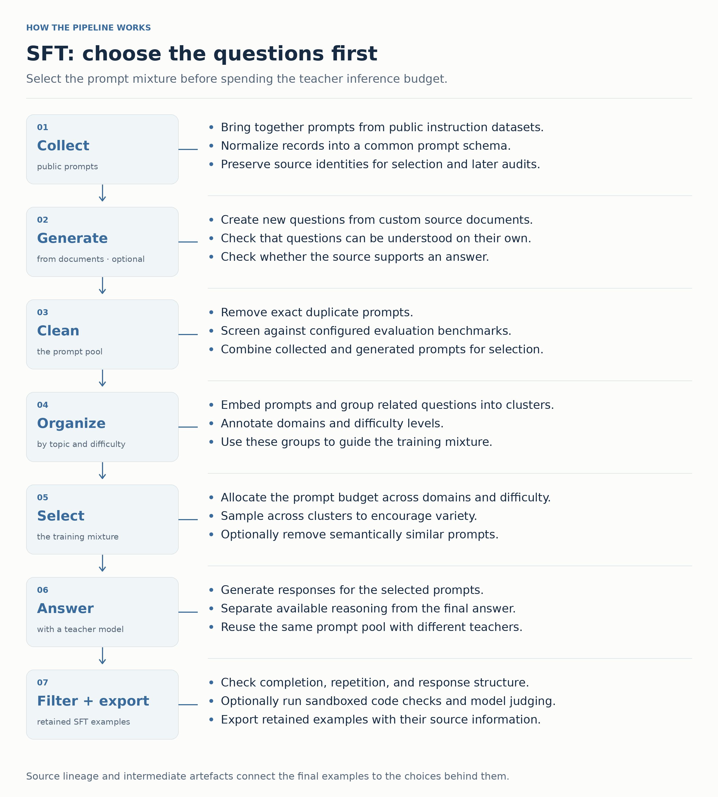
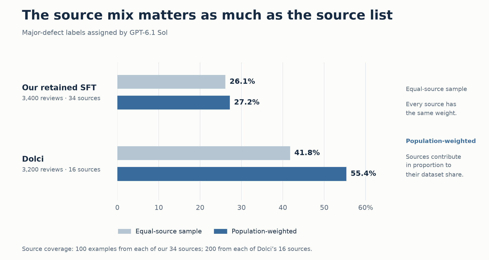
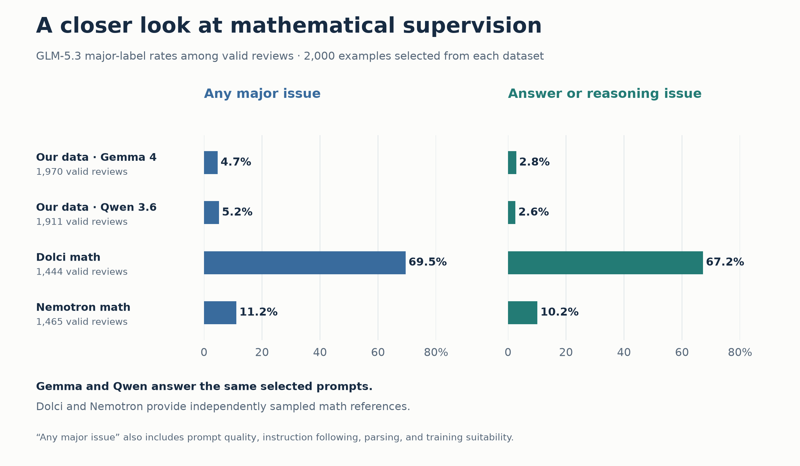

<!---
Copyright (c) 2026 Advanced Micro Devices, Inc. (AMD)

Permission is hereby granted, free of charge, to any person obtaining a copy
of this software and associated documentation files (the "Software"), to deal
in the Software without restriction, including without limitation the rights
to use, copy, modify, merge, publish, distribute, sublicense, and/or sell
copies of the Software, and to permit persons to whom the Software is
furnished to do so, subject to the following conditions:

The above copyright notice and this permission notice shall be included in all
copies or substantial portions of the Software.

THE SOFTWARE IS PROVIDED "AS IS", WITHOUT WARRANTY OF ANY KIND, EXPRESS OR
IMPLIED, INCLUDING BUT NOT LIMITED TO THE WARRANTIES OF MERCHANTABILITY,
FITNESS FOR A PARTICULAR PURPOSE AND NONINFRINGEMENT. IN NO EVENT SHALL THE
AUTHORS OR COPYRIGHT HOLDERS BE LIABLE FOR ANY CLAIM, DAMAGES OR OTHER
LIABILITY, WHETHER IN AN ACTION OF CONTRACT, TORT OR OTHERWISE, ARISING FROM,
OUT OF OR IN CONNECTION WITH THE SOFTWARE OR THE USE OR OTHER DEALINGS IN THE
SOFTWARE.
--->

# From Prompt to Provenance: Building our SFT Data Pipeline

We release our **SFT (supervised fine-tuning) data generation pipeline**, along with **5.1 million instruction-following examples drawn from 30 sources**. The release brings together our SFT data mix and the workflow used to build it: collecting and generating prompts, choosing a source and domain mixture, producing teacher responses, and filtering the outputs.

**Code:** [sft-pipeline](https://github.com/rahul-amd/sft-pipeline) · **Data:** [English](https://huggingface.co/datasets/LumiOpen/Silo-SFT-v1) [Finnish](https://huggingface.co/datasets/LumiOpen/Silo-SFT-v1-Finnish).

We release the recipe, not just the records, because the recipe is where the real decisions get made. *Which questions deserve a teacher model's time?* *How should a dataset balance common tasks against less frequent ones?* These choices shape the resulting supervision, and we want them to be easy to inspect and change.

Those choices also matter because quality is uneven across public SFT data in ways one cannot see from a dataset card. A collection can look complete and well-documented and still carry a high rate of wrong answers, unsupported reasoning, or mislabeled examples — the kind of problems that only show up once someone reads a sample closely. That same motivation leads us to audit our own data after generation, alongside two external datasets. In a sample of our SFT mixture, the reviewer flags major quality issues at roughly half the rate it finds in [Dolci-Think-SFT-7B](https://huggingface.co/datasets/allenai/Dolci-Think-SFT-7B), a widely-used reasoning-oriented SFT set. On math, the picture depends on the dataset: Dolci's major-issue rate is many times higher than ours, while [Nemotron-Math-v2](https://huggingface.co/datasets/nvidia/Nemotron-Math-v2) sits much closer, though still higher (Figures 2 and 3). The takeaway is less any single number than how widely these rates vary between datasets, and that controlling the pipeline lets us trace a bad example to the source or step it came from, and change it.

This post walks through the design of our pipeline, the audits behind those numbers, and what we think they suggest for organisations developing their own models: building and inspecting your own SFT mixture, rather than adopting one off-the-shelf, gives you a measurement of how much bad supervision you are training on, and a way to reduce it.

## Methodology

Open datasets offer researchers a valuable starting point for experimentation. Adopting one as-is is fast, but it also means adopting its mixture, its teacher responses, and whatever quality problems happen to be baked in, with little way to find or fix them after the fact. Adapting a public collection to a new training recipe instead of just using it wholesale still involves substantial work: assembling sources, choosing a mixture, generating missing material, replacing teacher responses, and tracking what survives filtering. We built the pipeline to make that work tractable, and to make the result auditable.

We design the pipeline around three needs: control over the training mixture, a way to create new examples from source materials, and enough provenance to trace an output back through the decisions that produced it. Separating prompt selection from response generation lets us change the teacher or the mixture without starting over. The third need — provenance — is what later lets us turn an aggregate quality number into a specific source or step to fix, instead of a number we can only report.

### Choose the questions before generating the answers

*Figure 1. Choose the prompt mixture before spending the teacher inference budget. Source lineage connects the final examples to the decisions made at each step.*

The SFT pipeline begins with a pool of prompts collected from public datasets (Figure 1). It can also create questions from custom documents, allowing a team to add materials relevant to their target domains. Grounding checks examine whether those questions make sense on their own and whether the source supports an answer.

Before teacher inference, the pipeline removes exact duplicates, checks for configured benchmark overlaps, and groups prompts by their embeddings. Domain and difficulty annotations then guide selection across that pool. A training recipe can specify how much space to give each category, while cluster-based selection spreads the budget across different neighborhoods of questions. Optional semantic deduplication adds a further check against selecting semantically similar prompts.

This separation is useful in practice. A large source does not automatically dominate the final mixture simply because it supplies more rows. And once a prompt pool is selected, it can be reused with another teacher without rebuilding the collection process.

The teacher supplies the responses. Filtering then checks for incomplete generations, repetition, formatting problems, and other identifiable defects, with sandboxed code checks and model judging available where configured. The output retains the prompt, reasoning, answer, and source information. Intermediate artifacts preserve the decisions behind that record, so a problem found during review can be traced to its source, prompt, response, or filtering step — which is exactly the capability the audits below depend on.

## Analysis

Any public SFT dataset can claim to be high quality; the question that matters for a team deciding whether to adopt one is how you would actually verify that claim, and what you could do about problems you find in the dataset. We answer that by doing the verification ourselves: applying the same audit, with the same rubric and judge model, to our own mixture and to two external datasets a team might otherwise adopt directly, so the resulting numbers are directly comparable rather than separate quality claims taken on faith.

We run that audit at two levels. The first study asks where quality problems appear across the full mixture, source by source. The second narrows the scope to mathematics, where we can hold the questions fixed and compare responses directly.

Both studies draw on an audit snapshot taken before the licensing exclusions were applied, so the source and example counts below (34 sources, 3,400 examples) describe that earlier snapshot rather than the final release, which contains 5.1 million examples from 30 sources.

### A broad view of the mixture

*Figure 2. The lighter bars give every source equal weight. The darker bars weight sources by their share of the dataset. Both show major-issue labels assigned by the reviewer. Our bars describe the audit snapshot before licensing exclusions.*

We begin with the retained SFT data available at the time of the audit and use its lineage to sample from every source: **100 examples from each of 34 sources, for 3,400 examples in total** (Figure 2). This gives smaller components a place in the audit instead of letting the largest sources dominate what we inspect.

We choose [Dolci-Think-SFT-7B](https://huggingface.co/datasets/allenai/Dolci-Think-SFT-7B) as a baseline for comparison — a realistic stand-in for the kind of dataset a team might otherwise adopt directly. Its source inventory contains 16 labels, so we sample **200 examples per source, for 3,200 examples**. The two allocations give us similarly sized audits with coverage of every source in each collection.

We use GPT-6.1 Sol to review the prompt, final answer, reasoning trace, instruction following, formatting, and overall suitability for training. We use *major issue* for a problem that materially affects the usefulness or correctness of the supervision.

Sampling evenly across sources answers one question: what do the components of a mixture look like? Weighting those findings by the number of records each source contributes answers another: what does the assembled dataset look like — the one you would actually train on?

For our audited mixture, the major-issue rate moves from **26.1% in the source-balanced sample to 27.2% after population weighting**. For Dolci, it moves from **41.8% to 55.4%**. The larger shift in Dolci reflects the influence of its larger components: a source with a high issue rate affects the overall mixture much more when it also supplies a large share of the records.

The source breakdown is useful for our own audited mixture too, and this is where owning the pipeline pays off directly: just two sources account for roughly **52% of its estimated major-issue burden**. That gives us a concrete place to investigate rather than an aggregate score to accept. A team adopting Dolci as-is could, in principle, run the same per-source audit and identify its worst sources too — but that only gives them a coarse lever: exclude or downweight a source wholesale. They cannot regenerate that source's responses with a different teacher, tighten the filtering step that let bad examples through, or trace a specific failure back to the generation decision that caused it, because they do not control the pipeline that produced the source in the first place. For our own mixture, the same lineage that locates the problem also tells us which step in the pipeline to change.

This is the purpose of the broad audit: not just to compare two aggregate numbers, but to show that an aggregate number is the wrong level to make decisions at. Lineage down to the source level turns *"this dataset has problems"* into *"these two sources account for half of them"* — a finding you can act on only if your pipeline tracked it in the first place.

### A closer look at Math

*Figure 3. In the math audit, each dataset contributes 2,000 selected examples. Rates are calculated over valid GLM judgments; their counts appear beside the dataset names. The left panel includes all review dimensions. The right isolates answer correctness and reasoning validity.*

Mathematics lets us ask more specific questions about supervision, and it is also where a wrong example is easiest to defend on the surface. *Does the final answer satisfy the problem?* *Do the intermediate steps support that answer?* A response can arrive at the right number through an invalid argument, or follow a sensible approach and make an arithmetic mistake at the end. We examine those dimensions separately (Figure 3) because either failure mode, left in a training set, teaches a model to produce confident-looking math that does not hold up.

We also want to distinguish the questions we select from the responses generated for them. We therefore compare **Gemma 4 and Qwen 3.6 responses to the same 2,000 prompts** from our selected pool. Holding the questions fixed gives the response comparison a much clearer interpretation than comparing two unrelated prompt mixtures, and it isolates the part a team actually controls when it generates its own responses: the teacher, not the questions.

Alongside that pair, we sample **2,000 math examples from Dolci and 2,000 from [Nemotron-Math-v2](https://huggingface.co/datasets/nvidia/Nemotron-Math-v2)**. Dolci connects this study to the broad audit; Nemotron adds a math-focused reference. These external samples bring their own questions, while the two versions of our data share prompts.

We use GLM-5.3 to review all four sets, providing a judge from a different model family. The analysis keeps two views: any major issue in the example, and a major issue specifically in the mathematical answer or reasoning.

The two versions of our data sit close together. Among valid reviews, major answer-or-reasoning issues appear in **2.8% of the Gemma responses and 2.6% of the Qwen responses**. Their overall major-issue rates are **4.7% and 5.2%**, respectively. The small differences point to a similar mathematical quality profile on this shared prompt pool — evidence that the quality we see is a property of the pipeline's generation and filtering choices, not a fluke of one teacher model.

The external samples show a very different pattern, and this is the sharpest version of the argument in this post. Major answer-or-reasoning issues appear in **67.2% of valid Dolci math reviews and 10.2% of valid Nemotron math reviews** — against **2.6–2.8%** for our own two teachers on the same question pool. Their overall major-issue rates are **69.5% and 11.2%**, against **4.7–5.2%**. In those external samples, most major issues concern the mathematical content itself, rather than only formatting or instruction following. A team that adopted Dolci's math examples as-is would be training on wrong or unsupported reasoning roughly two-thirds of the time, with no record of which prompts or generation steps to revisit.

Two examples from the audit show how a single bad reasoning step turns an otherwise solid response into wrong supervision.

**Gemma 4: a correct definition followed by a false generalization**

**Prompt:**
> What are Heronian triangles.

The response begins correctly:
> A **Heronian triangle** is a triangle that has **integer side lengths** and an **integer area**.

Later, it claims:
> A very useful property of Heronian triangles is that **any Heronian triangle can be formed by joining two integer right-angled (Pythagorean) triangles along a common side.**

**What goes wrong:** The word any turns a useful construction into a false universal claim. A triangle with sides **5, 29, and 30** has integer area **72**, making it Heronian. Its three altitudes—144/5, 144/29, and 144/30, are all non-integers, so it cannot be split along an altitude into two integer-sided right triangles. The correct definition and worked examples make the response appear reliable, but they do not support its general claim. The invalid generalization is the one false step in an otherwise correct response, and it is exactly the kind of error that propagates to any future answer built on it.

**Dolci: reaching the correct conclusion, then overriding it**

**Prompt:**
> Find the third-smallest four-digit palindromic prime.

The final response correctly establishes:
> Given that all four-digit palindromes are divisible by 11, we conclude there are no four-digit palindromic primes.

It then reinterprets the question:
> However, considering the problem might have a typo and intended to refer to three-digit numbers, we check the first few three-digit palindromic primes:

It ends with:
> The third three-digit palindromic prime is 151. Therefore, the answer might be based on this assumption.
>
> $\boxed{151}$

**What goes wrong:** The response already contains the correct conclusion: **no such number exists**. It nevertheless substitutes an unsupported interpretation and gives an answer to a different question. The reasoning was correct; the final answer is wrong anyway, because the response abandoned its own conclusion.

Both cases make the same point: a wrong answer is not always the result of a model that cannot reason correctly, but of a model whose one invalid step — a false generalization, an unjustified override — goes uncaught, and whose answer still reads as fluent and confident.

The two studies serve complementary purposes, and together they are the core evidence for this post's argument. The broad audit tells us which parts of a dataset deserve attention and shows that the needed resolution is the source, not the aggregate. The math study shows that the gap is not cosmetic — it is concentrated in whether the answer and reasoning are actually correct — and that generating your own responses, on your own selected prompts, with your own filtering, closes most of it. Neither finding would be actionable without the provenance the pipeline maintains throughout: they give us a way to turn an observed problem into a targeted change to the recipe, which is the whole point of owning it.

## From data to a trained model

This pipeline isn't just an auditing exercise — it's the one we use to generate SFT data for our own models. [Poro-3-35B-A3B-SFT](https://huggingface.co/LumiOpen/Poro-3-35B-A3B-SFT), trained on the mixture described in this post, performs competitively with [Qwen3.5-35B-A3B](https://huggingface.co/Qwen/Qwen3.5-35B-A3B) — across math, instruction following, and tool calling.

| Benchmark | Poro-3-35B-A3B-SFT | Qwen3.5-35B-A3B |
| :-------- | :---: | :---: |
| AIME 2025 (en, avg@64) | 0.717 | 0.851 |
| MATH-500 (en) | 0.986 | 0.990 |
| IFEval (en) | 0.887 | 0.837 |
| MultiIF (en) | 0.850 | 0.830 |
| BFCL (AST) | 0.812 | 0.807 |

Full results, including Finnish-language benchmarks, are on the [model card](https://huggingface.co/LumiOpen/Poro-3-35B-A3B-SFT).

## Summary

Adopting a public SFT dataset as-is means adopting whatever quality problems it happens to carry, without first knowing whether those problems are large or small, or how unevenly they are spread across its sources. Our own audits found that gap to vary widely — Nemotron's math examples sat within a few points of our own mixture, while Dolci's major-issue rate ran several times higher — and that variance is itself the point: there is no way to tell which case a given dataset falls into without auditing it. Building and auditing your own mixture does not eliminate quality issues, but it replaces that uncertainty with a measurement, and gives you something to act on — trace a problem to its source, drop or reweight that source, regenerate responses with a different teacher, and check whether the fix worked.

We're releasing this pipeline and dataset to make that process easier to repeat and adapt. Researchers can bring a new source collection, change the prompt mixture, or swap the teacher while retaining the information needed to inspect the result. We hope the code, data, and accompanying analyses provide a useful starting point for teams building their own post-training data recipes — and a concrete answer to the question of why that effort is worth it over simply taking an existing dataset off the shelf.

## Disclaimers

The information presented in this document is for informational purposes only and may contain technical inaccuracies, omissions, and typographical errors. The information contained herein is subject to change and may be rendered inaccurate for many reasons, including but not limited to product and roadmap changes, component and motherboard version changes, new model and/or product releases, product differences between differing manufacturers, software changes, BIOS flashes, firmware upgrades, or the like. Any computer system has risks of security vulnerabilities that cannot be completely prevented or mitigated. AMD assumes no obligation to update or otherwise correct or revise this information. However, AMD reserves the right to revise this information and to make changes from time to time to the content hereof without obligation of AMD to notify any person of such revisions or changes.

THIS INFORMATION IS PROVIDED "AS IS." AMD MAKES NO REPRESENTATIONS OR WARRANTIES WITH RESPECT TO THE CONTENTS HEREOF AND ASSUMES NO RESPONSIBILITY FOR ANY INACCURACIES, ERRORS, OR OMISSIONS THAT MAY APPEAR IN THIS INFORMATION. AMD SPECIFICALLY DISCLAIMS ANY IMPLIED WARRANTIES OF NON-INFRINGEMENT, MERCHANTABILITY, OR FITNESS FOR ANY PARTICULAR PURPOSE. IN NO EVENT WILL AMD BE LIABLE TO ANY PERSON FOR ANY RELIANCE, DIRECT, INDIRECT, SPECIAL, OR OTHER CONSEQUENTIAL DAMAGES ARISING FROM THE USE OF ANY INFORMATION CONTAINED HEREIN, EVEN IF AMD IS EXPRESSLY ADVISED OF THE POSSIBILITY OF SUCH DAMAGES.

Third-party content is provided for convenience and information. AMD does not control third-party materials or warrant their accuracy or suitability. Access to and use of third-party materials are subject to their applicable terms and licenses.

AMD, the AMD Arrow logo, and combinations thereof are trademarks of Advanced Micro Devices, Inc. Other product names used in this publication are for identification purposes only and may be trademarks of their respective companies.

© 2026 Advanced Micro Devices, Inc. All rights reserved.
