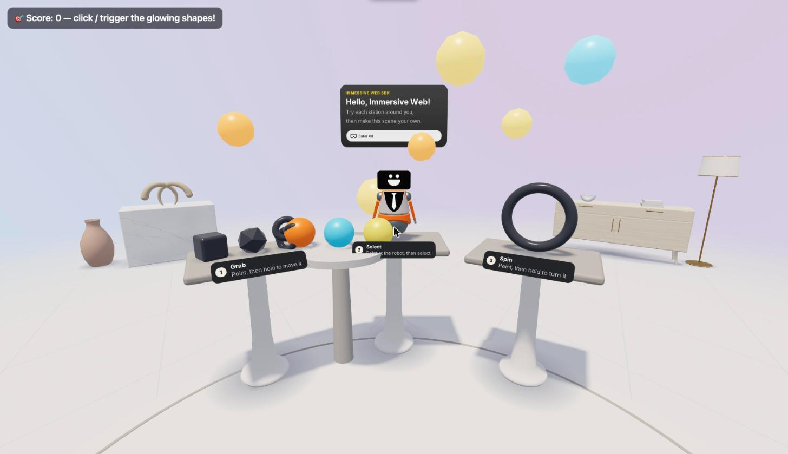
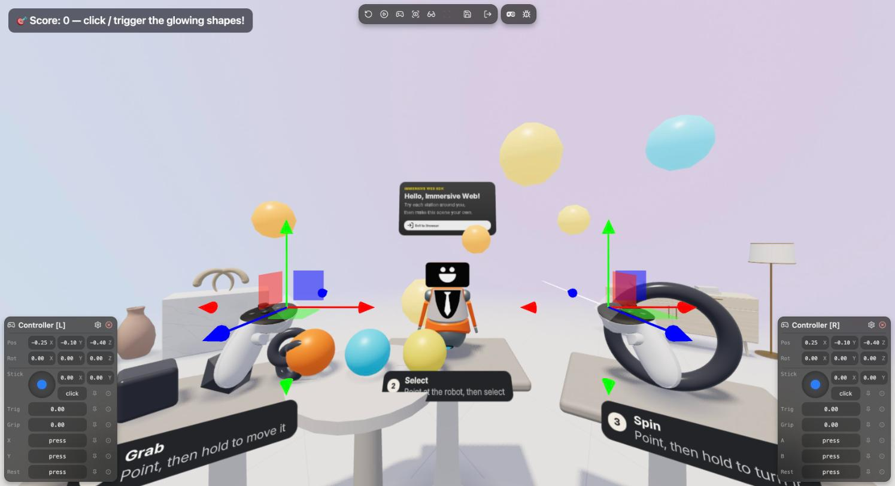

# Hosting a Vision LLM on an AMD MI300X with vLLM — and the mllama Bug Nobody Documents

<span style="font-size:0.7em;">19 Nov, 2026 by {hoverxref}`Srikanth Arun<srikantharun>`. </span>

*Self-hosting a vision-language model on AMD Instinct for AI-assisted testing of a WebXR game — including the Llama 3.2 Vision wall I hit, how I diagnosed it, and the pipeline that came out the other side.*

---

## TL;DR

- I set out to self-host **Meta Llama 3.2 Vision** on a single **AMD Instinct MI300X** (via AMD Developer Cloud + vLLM) to drive **AI-assisted test generation** for a WebXR game.
- **Text models work great** (Llama 3.1 8B served in seconds). But **Llama 3.2 Vision (the `mllama` architecture) does not load on any current ROCm vLLM image** — it crashes with `AttributeError: 'MllamaProcessor' object has no attribute '_get_num_multimodal_tokens'`.
- Root cause: **vLLM removed its native `mllama` implementation** (last present in ~v0.6.6), so Llama 3.2 Vision falls back to vLLM's generic *transformers* multimodal backend — which calls a processor method that **`MllamaProcessor` never implements**. Reproduced across vLLM 0.11rc / 0.27.1 / 0.34.0 and transformers 4.56 / 5.15 / 5.22.
- The fix that actually works today: **`Qwen/Qwen2.5-VL-7B-Instruct`**, which vLLM supports natively on ROCm. Drop-in OpenAI-compatible vision endpoint, ~**2.3 s/request, ~71 tok/s, 100% GPU utilization** on the MI300X.
- The payoff: a **capture → feedback → verify → continue** pipeline where the vision LLM *proposes* tests from a screenshot and a deterministic oracle *keeps only the true ones* — then emits Playwright tests that run in CI with **no GPU**.

---

## Why a vision LLM for game testing?

I'm building a small WebXR game (Immersive Web SDK / Three.js) — a target-shooting + grab-and-throw scene that runs in the browser and on Meta Quest.



For a game — and *especially* for anything with user-generated content — you can't hand-write a test for every scene. The idea: let a **vision-language model look at a screenshot and propose test cases**, then verify those proposals against ground truth. To keep data private and learn the AMD stack, I wanted the model **self-hosted on an MI300X**, not a hosted API.

## Setup: MI300X + vLLM in a few minutes

On [AMD Developer Cloud](https://www.amd.com/en/developer/resources/cloud-access/amd-developer-cloud.html) I spun up a **single MI300X GPU Droplet** (192 GB HBM3, $1.99/hr) with the **vLLM** quick-start image, and served a text model to sanity-check the stack:

```bash
docker run -d --name vllm \
  --device=/dev/kfd --device=/dev/dri \
  --group-add video --group-add render \
  --ipc=host --shm-size=16g -p 8001:8000 \
  -v ~/.cache/huggingface:/root/.cache/huggingface \
  vllm/vllm-openai-rocm:v0.27.1 \
  --model NousResearch/Meta-Llama-3.1-8B-Instruct \
  --served-model-name llama-3.1-8b \
  --host 0.0.0.0 --port 8000 --api-key "$KEY" --max-model-len 8192
```

`GET /v1/models` and a chat completion came back in seconds. `rocm-smi` confirmed the MI300X was doing the work. So far, textbook.

## The wall: Llama 3.2 Vision won't load

Swapping the model to Meta's multimodal **Llama 3.2 Vision**:

```bash
--model unsloth/Llama-3.2-11B-Vision-Instruct   # mllama architecture
```

…crashes on startup, every time:

```text
AttributeError: 'MllamaProcessor' object has no attribute '_get_num_multimodal_tokens'
  File ".../vllm/model_executor/models/transformers/multimodal.py", line 208, in _get_num_mm_tokens
    return processor._get_num_multimodal_tokens(**sizes, **mm_processor_kwargs)
```

This is not a config problem. I reproduced it across a matrix of versions:

| vLLM | transformers | Native `mllama`? | `MllamaProcessor._get_num_multimodal_tokens`? | Result |
|---|---|---|---|---|
| 0.11.0rc | 4.56.2 | ❌ | ❌ | crash |
| 0.27.1 | 5.15.0 | ❌ | ❌ | crash |
| 0.34.0 | 5.22.0 | ❌ | ❌ | crash |

Two independent facts combine into the bug:

1. **vLLM no longer ships a native `MllamaForConditionalGeneration`.** `ModelRegistry.get_supported_archs()` doesn't contain it on any current build (native mllama was last present around vLLM **v0.6.6**, before the switch to the generic transformers backend). So Llama 3.2 Vision is routed through vLLM's generic *transformers multimodal* path.
2. **That path calls `processor._get_num_multimodal_tokens(...)`, which `MllamaProcessor` never implements** — not in transformers 4.56, 5.15, or 5.22. (You can confirm straight from upstream: the mllama processor source has no such method.)

So the generic backend assumes an interface mllama's processor doesn't satisfy, and vLLM has no native path to fall back to. **Llama 3.2 Vision is effectively unsupported on current vLLM + ROCm.** A one-line monkeypatch returning a dummy token count lets it *load* but produces wrong accounting — not something to ship.

## The pivot that works: Qwen2.5-VL on ROCm

Since Meta's mllama is a dead end here, the pragmatic move is a vision model vLLM supports **natively** on ROCm. **`Qwen/Qwen2.5-VL-7B-Instruct`** does, cleanly:

```bash
docker run -d --name vllm \
  --device=/dev/kfd --device=/dev/dri \
  --group-add "$(getent group video|cut -d: -f3)" \
  --group-add "$(getent group render|cut -d: -f3)" \
  --ipc=host --shm-size=16g -p 8001:8000 \
  -v ~/.cache/huggingface:/root/.cache/huggingface \
  vllm/vllm-openai-rocm:latest \
  --model Qwen/Qwen2.5-VL-7B-Instruct \
  --served-model-name qwen2.5-vl \
  --host 0.0.0.0 --port 8000 --api-key "$KEY" \
  --trust-remote-code --enforce-eager \
  --max-model-len 16384 --gpu-memory-utilization 0.90
```

> Gotcha: the newer image has no named `render` group, so `--group-add render` fails — pass the numeric GID instead.

It came up healthy in ~125 s and serves an OpenAI-compatible `/v1/chat/completions` that accepts images as base64 `image_url`.

### Performance on the MI300X

Sending a game screenshot (≈1,593 vision tokens) + a 160-token completion, measured end-to-end (including ATL1→client network):

| Metric | Value |
|---|---|
| Avg latency / image request | **2.27 s** |
| Throughput | **~71 completion tok/s** |
| GPU utilization (idle → inference) | **0% → 100%** |
| Power draw | 233 W |
| VRAM in use | ~173 GB / 192 GB |

The model saw the scene correctly — HUD text, the floating targets, the three interaction stations, and in the XR/emulator view, the controller gizmos:



## The real payoff: capture → feedback → verify → continue

A vision LLM that looks at a screenshot and lists test cases is nice. But **its suggestions are hypotheses, not tests** — it will also confidently propose things that are wrong. The value is in *closing the loop*:

```
1. CAPTURE   Playwright drives the game → screenshot + ground-truth scene metrics
2. FEEDBACK  screenshot → Qwen2.5-VL (MI300X) → structured JSON test candidates
3. VERIFY    each candidate checked against the deterministic oracle → PASS/FAIL
4. CONTINUE  FAILs fed back to the LLM → REAL_BUG vs BAD_SUGGESTION; PASSes promoted
```

The game exposes a tiny test hook so the oracle is deterministic:

```ts
window.__GAME__ = {
  counts() {
    let targets = 0, balls = 0;
    world.scene.traverse(o => { if (o.name === 'target') targets++; else if (o.name === 'ball') balls++; });
    const m = document.getElementById('score-hud')?.textContent?.match(/Score:\s*(\d+)/);
    return { targets, balls, score: m ? +m[1] : null };
  },
};
```

A real run (ground truth: `targets:6, balls:3, score:0`):

```text
3. VERIFY   [PASS] targets > 5          (actual 6)
3. VERIFY   [PASS] balls == 3           (actual 3)
3. VERIFY   [PASS] score == 0           (actual 0)
3. VERIFY   [FAIL] targets == 4         (actual 6)
4. CONTINUE targets==4 → BAD_SUGGESTION ("actual is 6")
3. VERIFY   [FAIL] balls == 5           (actual 3)
4. CONTINUE balls==5  → BAD_SUGGESTION ("actual is 3")
→ 7 raw passes → hardened to 3 exact, deduped tests
```

The loop **caught the hallucinations** and kept only verified invariants. The pipeline then **hardens** the loose bounds (`targets>5`, `targets>2`, …) into one exact assertion per metric and **generates a Playwright spec**:

```ts
test("targets === 6", async ({ page }) => {
  await gotoGame(page);
  const actual = await page.evaluate(() => window.__GAME__.counts().targets);
  expect(actual).toBe(6);
});
```

Which runs deterministically in CI — **with no GPU**:

```text
✓ targets === 6   ✓ balls === 3   ✓ score === 0     3 passed (27.8s)
```

## Takeaways

1. **Llama 3.2 Vision (mllama) is currently a dead end on vLLM + ROCm.** If you need Meta multimodal today, budget for it — or use a natively-supported VLM like Qwen2.5-VL. (Verify with a one-line registry/processor check before pulling a 20 GB image: is `MllamaForConditionalGeneration` in `ModelRegistry.get_supported_archs()`, and does `MllamaProcessor` have `_get_num_multimodal_tokens`? If both are "no," it won't load.)
2. **Use the GPU where it's worth it.** The MI300X earns its keep at two steps — *generating* candidate tests and *judging* the hard-to-codify semantic/visual stuff. The standing CI suite is deterministic and GPU-free.
3. **LLM proposes, oracle disposes.** Never let the generator be its own only judge. A deterministic ground-truth oracle + a feedback step is what separates real tests from plausible nonsense.
4. **This is the pattern for UGC/AR/VR.** You can't hand-write assertions for infinite user scenes; you *can* let a vision model propose coverage per scene and keep only what verifies.

## Reproduce

- Quick "will it even load?" check for any VLM on your vLLM image:
  ```bash
  docker run --rm --entrypoint python3 <image> -c \
   "from vllm.model_executor.models.registry import ModelRegistry as R; \
    print('native:', 'MllamaForConditionalGeneration' in R.get_supported_archs())"
  ```
- Serve Qwen2.5-VL: see the `docker run` above.
- The testing pipeline and generated Playwright spec: `pipeline.mjs` → `verified-tests.json` → `tests/generated.spec.ts`.

*Hardware: AMD Instinct MI300X (192 GB) on AMD Developer Cloud. Software: vLLM on ROCm, Qwen2.5-VL-7B-Instruct, Playwright.*
