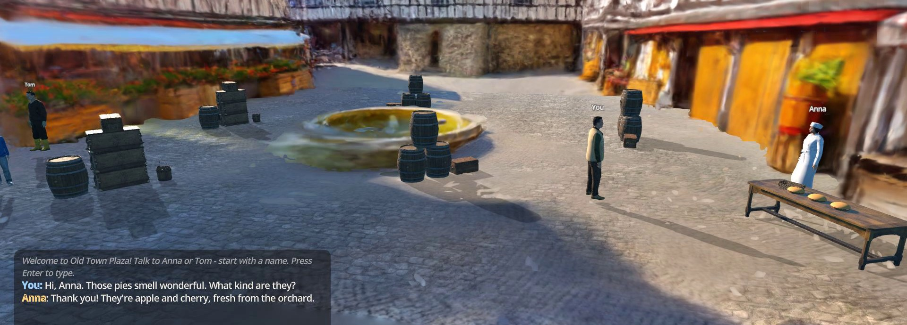
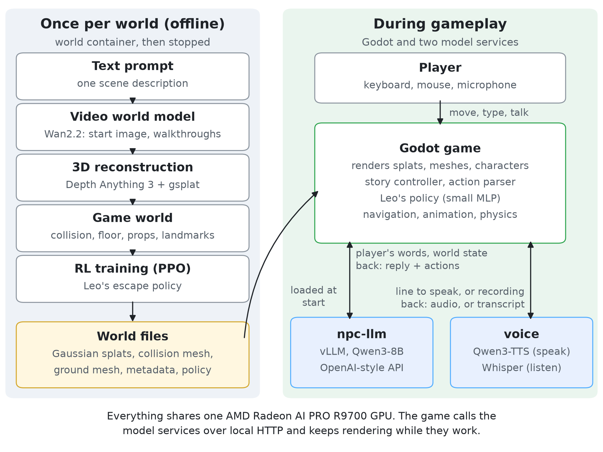
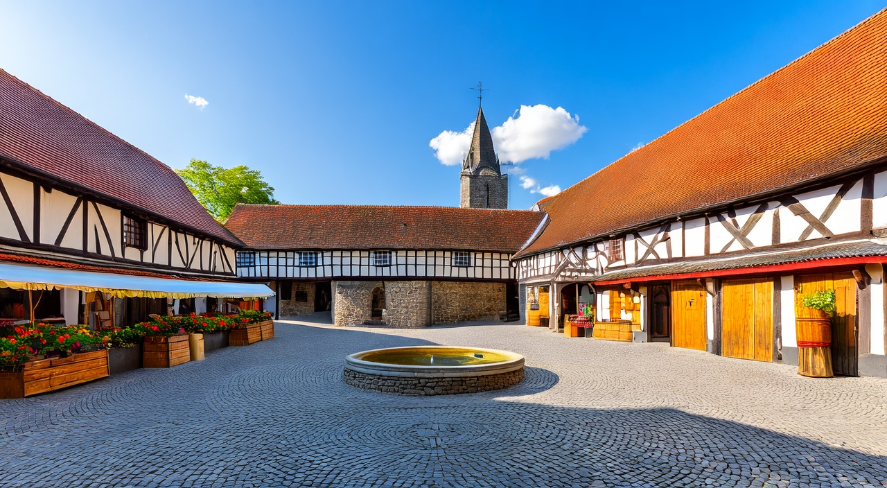
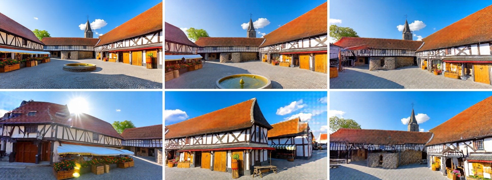
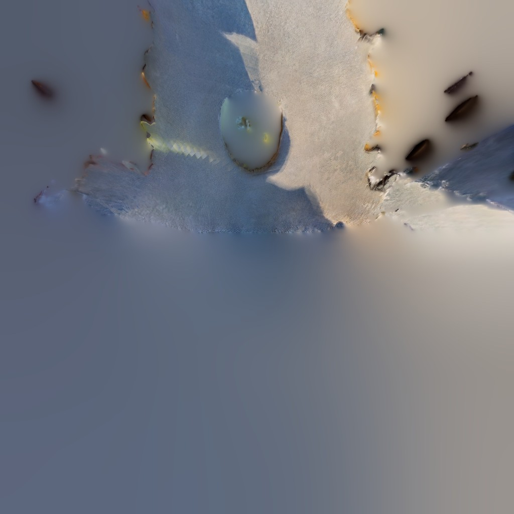
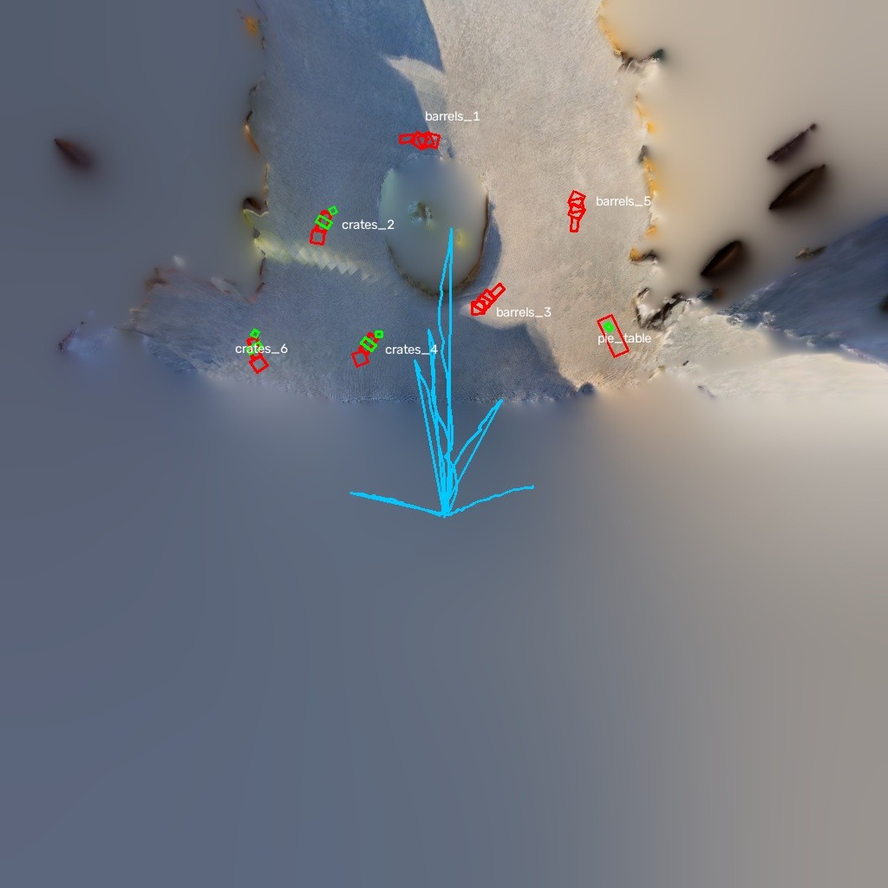
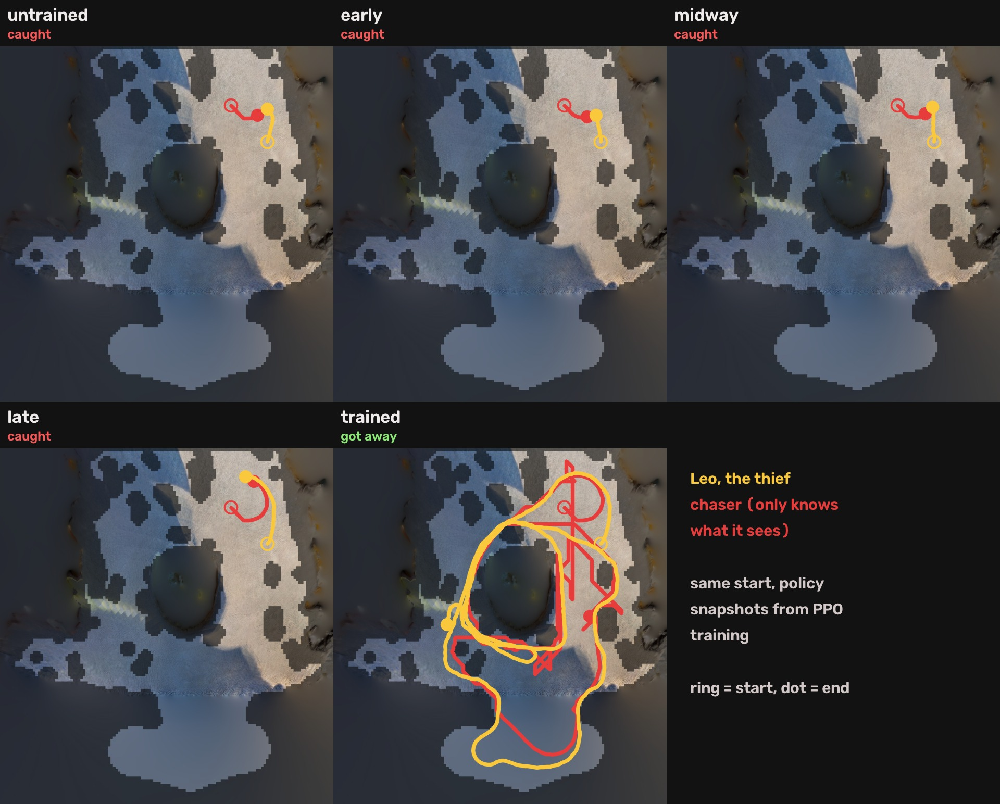
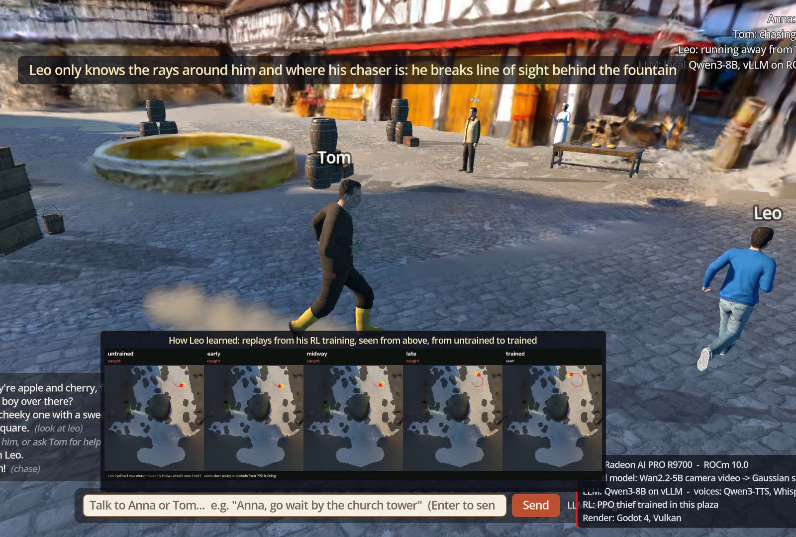

<!---
Copyright (c) 2026 Advanced Micro Devices, Inc. (AMD)

Permission is hereby granted, free of charge, to any person obtaining a copy
of this software and associated documentation files (the "Software"), to deal
in the Software without restriction, including without limitation the rights
to use, copy, modify, merge, publish, distribute, sublicense, and/or sell
copies of the Software, and to permit persons to whom the Software is
furnished to do so, subject to the following conditions:

The above copyright notice and this permission notice shall be included in all
copies or substantial portions of the Software.

THE SOFTWARE IS PROVIDED "AS IS", WITHOUT WARRANTY OF ANY KIND, EXPRESS OR
IMPLIED, INCLUDING BUT NOT LIMITED TO THE WARRANTIES OF MERCHANTABILITY,
FITNESS FOR A PARTICULAR PURPOSE AND NONINFRINGEMENT. IN NO EVENT SHALL THE
AUTHORS OR COPYRIGHT HOLDERS BE LIABLE FOR ANY CLAIM, DAMAGES OR OTHER
LIABILITY, WHETHER IN AN ACTION OF CONTRACT, TORT OR OTHERWISE, ARISING FROM,
OUT OF OR IN CONNECTION WITH THE SOFTWARE OR THE USE OR OTHER DEALINGS IN THE
SOFTWARE.
--->

# From a Text Prompt to a Playable 3D World: World Models, LLM NPCs, and RL on AMD Radeon™ Graphics

World models can now generate camera-controlled video of places that never existed. Turning that video into something you can *play* takes a few more steps: the scene needs real 3D geometry to walk on, characters that understand what the player says, and agents that behave sensibly in a space nobody designed by hand.

This post walks through a complete, local pipeline that does exactly that on a single AMD Radeon™ AI PRO R9700 GPU with ROCm™ software. We build a small playable scene in which a thief steals a pie, and the player and the villagers try to catch him:

- **The world** is generated from one text prompt by a video world model ([Wan2.2](https://github.com/Wan-Video/Wan2.2)). [Depth Anything 3](https://github.com/ByteDance-Seed/Depth-Anything-3) and the [AMD ROCm port of gsplat](https://github.com/AMD-Ecosystem/gsplat) then lift the video into 3D Gaussians: millions of small, semi-transparent colored blobs that together reproduce the scene from any viewpoint (Step 5 explains how).
- **The villagers** are driven by an LLM ([Qwen3-8B](https://huggingface.co/Qwen/Qwen3-8B-FP8) served by [vLLM](https://github.com/vllm-project/vllm)) that turns plain English into game actions, with voices from [Qwen3-TTS](https://huggingface.co/Qwen/Qwen3-TTS-12Hz-0.6B-CustomVoice) and speech input through [Whisper](https://huggingface.co/openai/whisper-large-v3-turbo).
- **The thief** escapes with a policy trained by reinforcement learning (PPO) inside the generated world itself.
- **The game** runs in [Godot 4](https://godotengine.org/), which renders the Gaussians next to regular meshes and characters.

**How a play session goes.** You are a traveller in the plaza, seen from behind in third person. You talk to the villagers by typing or with push-to-talk, and they answer in their own voices. Shortly after you greet Anna, the baker, Leo snatches one of her pies and runs. You can chase him yourself, but he heads for cover and breaks line of sight, so it helps to recruit Tom: tell him to catch Leo, and point him to where you last saw Leo. Whoever gets close enough catches Leo, who returns the pie, and Anna reacts. If nobody catches him in time, he gets away with it. There are no dialogue menus: everything happens through conversation. The figure below shows the finished plaza.



## Prerequisites

- An AMD Radeon graphics card with enough memory for a 5B-parameter video model. This post was developed on an AMD Radeon AI PRO R9700 (AMD RDNA™ 4 architecture, `gfx1201`, 32 GB).
- Linux® with a recent release of ROCm software (this post used ROCm 10.0), [Docker®](https://docs.docker.com/engine/install/), and access to `/dev/kfd` and `/dev/dri`.
- [Godot 4](https://godotengine.org/download/).
- Basic familiarity with PyTorch, Docker, and a game engine.

## Pipeline Overview

| Stage | What it does | Model or tool | Output | When it runs |
| --- | --- | --- | --- | --- |
| 1. Start image | Text prompt to the first frame | Wan2.2-TI2V-5B | One image | Once per world |
| 2. Walkthroughs | Camera-controlled video from the start frame along planned paths | Wan2.2-Fun-5B-Control-Camera + VideoX-Fun | Short video clips | Once per world |
| 3. Cameras and depth | Joint pose and depth estimation over all frames | Depth Anything 3 Base | Poses, depth maps | Once per world |
| 4. 3D Gaussians | Optimize Gaussians against the frames | gsplat, AMD ROCm port | Gaussian splat file | Once per world |
| 5. Game world | Ground, scale, collision, hybrid floor, props, landmarks | OWLv2, Poly Haven | Collision, navmesh input, world metadata (landmarks, camera path, sun direction) | Once per world |
| 6. NPC brains | Plain English to JSON actions | Qwen3-8B on vLLM | Villager lines and actions | During gameplay |
| 7. Voices | Speech out and speech in | Qwen3-TTS, Whisper large-v3-turbo | Audio, transcripts | During gameplay |
| 8. RL agent | PPO policy trained in the generated world | PyTorch on ROCm software | Policy (JSON and ONNX) | Trained once per world; the policy runs during gameplay |
| 9. Game | Render splats, meshes, characters; run the story | Godot 4, gdgs, Microsoft® Rocketbox avatars | Playable scene | During gameplay |

Stages 1 to 5 and the RL training build the world once, offline, and leave files behind. The game loads those files when it starts. During gameplay only three things run: Godot, the LLM server, and the voice server. Godot sends each request to the two servers as an asynchronous HTTP call on `localhost`, so the game keeps running while a villager thinks or speaks. The trained RL policy is a small network that Godot evaluates itself, with no extra service. The figure below shows how the containers and the game connect.



## Step 1: Set Up the Containers

The pipeline runs in three containers that share the GPU:

| Container | Starts from | Used for | Runs during gameplay? |
| --- | --- | --- | --- |
| `npc-llm` | the ROCm vLLM image | vLLM serving the NPC brain | Yes |
| `voice` | the same image, plus the voice packages | Qwen3-TTS and Whisper | Yes |
| `world` | the same image, plus the world pipeline | Video generation, Depth Anything 3, gsplat, OWLv2, RL training | No, only while a world is built |

The model CPU offload in Steps 2 and 3 belongs to the `world` container, which has finished before the game starts. During gameplay, the LLM and voice models stay on the GPU.

Start all three from a current [ROCm vLLM image](https://hub.docker.com/r/rocm/vllm/tags). It comes with a ROCm build of PyTorch, so the containers share one GPU software stack. We used the ROCm 10.0 image with PyTorch 2.12. Giving vLLM its own container keeps the LLM server stable and leaves the other two images free to use whatever library versions they need.

**The voice image** adds Qwen3-TTS and a small web service on top. **The world image** adds the video, depth and Gaussian splatting libraries, installed as each project's own instructions describe. Two tips keep the setup smooth on a Radeon graphics card:

- **Use the ROCm PyTorch from the base image.** It is already built for ROCm software and ready to go. Pin it, and every package you add later reuses it.
- **Build gsplat for your GPU.** The AMD HIP port of gsplat supports Radeon graphics cards with the RDNA architecture. Use [this version](https://github.com/AMD-Ecosystem/gsplat/tree/sync/mi45x_support).

## Step 2: Generate the Start Image

The world starts from a single frame. [Wan2.2-TI2V-5B](https://huggingface.co/Wan-AI/Wan2.2-TI2V-5B-Diffusers) is a text-and-image-to-video model; asking it for one frame gives a start image whose style matches the video model used in the next step. We used this prompt for both the start image and the walkthroughs:

```text
A sunny medieval market square seen from slightly above head height, in clear afternoon light with the
sun behind the viewer. A wide open plaza of grey cobblestones with a round stone fountain in the middle,
timber-framed houses with red tiled roofs, flower boxes and wooden doors all around, two market stalls
with striped awnings, wooden benches and barrels, a stone church tower behind the houses, clear blue sky
with a few white clouds. Photorealistic, sharp details, natural colours, no people.
```

Load Wan2.2-TI2V-5B with diffusers' `WanPipeline` and model CPU offload, and ask for a single 1280×704 frame with a fixed seed.

Two phrases in the prompt help later: "seen from slightly above head height" matches a third-person game camera, and "no people" keeps the scene empty for our own characters. The figure below shows the resulting start image.



## Step 3: Walk the Camera Through the World

[Wan2.2-Fun-5B-Control-Camera](https://huggingface.co/alibaba-pai/Wan2.2-Fun-5B-Control-Camera) generates video from a start image while following a camera trajectory. We drive it with [VideoX-Fun](https://github.com/aigc-apps/VideoX-Fun).

Write each camera path as a pose file in the RealEstate10K format that VideoX-Fun reads.

Plan several paths from the same start frame. Describe each path by how far it walks forward, how far it turns by the end, how much it sways side to side, and how far it moves sideways. We used six paths:

- a forward walk with a gentle sway;
- a turn to the left and a turn to the right, both while walking forward;
- short sideways moves to the left and to the right;
- a longer forward walk deeper into the square.

A few tips for planning the paths:

- **Turn while walking.** Turning as the camera moves forward keeps the video consistent.
- **Add a little sway.** A small side-to-side turn on forward paths shows surfaces from slightly different angles, which helps the reconstruction.
- **Point the camera where the player will look.** The areas the walkthroughs cover come out sharpest, so aim paths at the parts of the level that matter for gameplay.

Load the Wan2.2-Fun control pipeline once, with model CPU offload, and reuse it for every path. VideoX-Fun turns each pose file into camera control, and the start image stays fixed as the first frame of every clip. The figure below shows frames from three of the walkthroughs.



## Step 4: Recover Cameras and Depth with Depth Anything 3

A video model follows the requested camera closely but not exactly, so the sharpest reconstruction comes from the cameras it actually used. [Depth Anything 3](https://github.com/ByteDance-Seed/Depth-Anything-3) estimates them. Give the Base checkpoint all sampled frames in one call, so the poses and depth come out consistent with each other, and keep the pose, depth and confidence it returns for every view. Then express everything relative to the planned first camera, so the first view stays where you placed it. We sample every third frame from each clip.

## Step 5: Optimize 3D Gaussians with gsplat

**How Gaussian splatting works.** A Gaussian splat scene represents a place as a large number of small, semi-transparent ellipsoids. Each Gaussian has a position, a shape (scale and rotation), an opacity, and a color that can vary with the viewing direction. To render a view, the Gaussians are projected onto the image as 2D ellipses, sorted by depth, and blended front to back in small screen tiles. Every part of that is differentiable, so the Gaussians can be fitted to images by gradient descent: render a training view, compare it with the real frame, and update every Gaussian's parameters. During training, densification adds Gaussians where the image error stays high and removes ones that become transparent. [gsplat](https://github.com/nerfstudio-project/gsplat) is an open-source library of these rendering and training kernels, and the AMD port runs them on ROCm software through HIP. The result can be rendered interactively and keeps the look of the source images, but it has no surfaces or collision of its own, which is what Step 6 adds.

The Gaussians are seeded from Depth Anything 3's confident depth (with a far sky shell) and then optimized against the frames with gsplat. The loop uses the default gsplat densification strategy plus three additions that matter for generated video:

1. **Depth supervision.** gsplat renders depth alongside color, and a loss against the confident Depth Anything 3 depth keeps surfaces in place. Its weight decays over training, so color takes over for the fine detail.
2. **Small per-view pose corrections.** Each view learns a small camera adjustment that refines the estimated poses.
3. **Held-out views.** Every tenth view is kept out of training, to check how the world looks from positions the optimizer never fitted.

The color loss mixes L1 and SSIM, and a small penalty keeps Gaussians from turning into long needles. We optimize for 15,000 iterations over the 157 sampled views.

The sharpest results come from clips that agree with each other, so pick consistent clips over simply more of them.

## Step 6: Turn the Gaussians into a Game World

A cloud of Gaussians is not yet a level: it has no scale, no floor to walk on, and no collision. This step adds them.

**Level and scale.** Fit the ground plane to depth points from the lower part of the frames with RANSAC, rotate it to Y-up, and scale the scene so the first camera stands at the intended camera height. Because the prompt asked for a view from just above head height, a third-person camera height gives a plausible metric scale.

**Collision and navigation.** Derive collision geometry from the Gaussians, so the level has a floor and walls. Godot uses the resulting collision mesh for physics and for baking the navigation mesh.

**A hybrid floor.** The floor is the part of a splat world players look at most, so we give it a real mesh:

1. Measure the visible ground surface from rendered depth.
2. Project every walkthrough frame onto that surface, keeping each spot's color from the closest, most top-down view that sees it. This gives a top-down photo of the generated floor, shadows included.
3. Remove the ground splats on flat floor only. Basins, kerbs and steps stay as splats, and are marked solid in the collision.
4. Add fine detail in the shader. A cobblestone scan ([Poly Haven](https://polyhaven.com/a/cobblestone_floor_001)) modulates only the brightness, so the generated colors and baked shadows stay. The ground receives Godot shadows from characters and props.

The figure below shows the resulting floor photo.



**Real props for cover.** We place Poly Haven models (barrels, crates, a table) on the floor the world model actually showed and add them to the collision, so characters can use them as cover. Each cluster also becomes a named place, such as the pie table. The figure below shows where the props sit on the floor photo.



**Landmarks the LLM can talk about.** An open-vocabulary detector, [OWLv2](https://huggingface.co/google/owlv2-base-patch16-ensemble), finds objects such as the stone fountain, the wooden doors and the church tower in the walkthrough frames, and each becomes a named place the villagers can refer to.

**Match the lighting.** The sun is visible in some generated frames. Back-projecting the saturated disc through the estimated cameras gives a sun direction, so Godot's shadows fall the same way as the shadows in the generated imagery.

## Step 7: Render the World in Godot

The Gaussians are rendered with [gdgs](https://github.com/ReconWorldLab/godot-gaussian-splatting), a Godot plugin that composites splats into the frame through a compositor effect and depth-tests them against regular meshes. Three settings matter:

- Set **Display → Window → Stretch → Mode** to `disabled`, and disable MSAA in splat scenes. The compositor reads single-sample color and depth buffers.
- Remove `.glb` and `.gltf` from the gdgs import extensions, so Godot's own importer handles the collision and prop meshes.
- Keep game cameras near the world model's camera heights and directions. Splats look sharpest close to where the video was "filmed", and the walkthrough path saved with the world gives the director (the scripted camera used for the recorded video) a safe forward direction.

**The camera during play.** The player controls a third-person orbit camera that follows them: the keyboard moves the traveller, the right mouse button or Q and E orbit, and the mouse wheel zooms. The traveller starts on the world model's camera path, facing the way it filmed. The recorded video in this post uses the director instead, which frames the characters of each story beat at eye height.

Characters are [Microsoft Rocketbox](https://github.com/microsoft/Microsoft-Rocketbox) avatars, which share one skeleton and animation set. Two details avoid foot sliding:

- **Remove root drift.** The motion-capture walk and run cycles move the character forward in the root bone and jump back when they loop. Strip that straight-line drift on import.
- **Match the speeds.** Move characters at the speed each cycle was captured at (measured from that same drift), and scale animation playback with the actual ground speed.

The child avatar has different bone names and proportions. Retarget its animations by bone name and scale its root motion to its height.

## Step 8: LLM-Driven NPCs with vLLM on ROCm Software

**Why an LLM as an NPC controller.** Game characters are usually driven by dialogue trees and behavior trees that designers write by hand. A language model lets a character respond to free-form speech and decide what to do, but its raw output is text, which a game cannot execute. A common pattern is to keep the model on the decision layer and leave execution to the engine. The model receives a short description of the current state (who is nearby, which landmarks exist, what just happened) and returns a structured action from a small, fixed vocabulary. The game validates the action and carries it out with its usual systems: navigation, animation, and physics. That split keeps the model's job small, lets the game validate every action, and turns a wrong or malformed answer into a harmless line of dialogue rather than a broken game state.

Each villager has a short persona and a small brain that sends the world state and the player's words to a local OpenAI-compatible endpoint. Serve [Qwen3-8B-FP8](https://huggingface.co/Qwen/Qwen3-8B-FP8) with the ROCm vLLM image:

1. Start a container from the image with the GPU devices and host networking, and mount your models folder.
2. Run `vllm serve` on Qwen3-8B-FP8 on localhost, so only the game can reach it.
3. Allocate slightly more than half of the GPU memory to vLLM, leaving room for the voice service and the world pipeline. Set the context length to 8,192 tokens.

For interactive characters, turn off the model's thinking mode per request if it has one. For Qwen3, pass `"chat_template_kwargs": {"enable_thinking": false}`.

**A small action language.** The system prompt asks for one JSON object with two fields. `reply` holds what the character says, and `actions` is a list of actions from a fixed vocabulary. For example, when told to catch Leo, Tom answers "Right behind him!" with one action: `chase`, with the target `leo`, for 60 seconds.

The vocabulary covers `go_to`, `follow`, `chase`, `flee`, `talk_to`, `find`, `dance`, `fight` (friendly sparring), `emote`, `look_at`, `say`, `idle`, and `stop`. Targets must be landmark or villager names from the world state the model receives with each request.

**Validate before acting.** An action parser in the game extracts the JSON, maps synonyms ("catch", "pursue", "run after" all become `chase`), clamps numbers, and drops unknown targets.

**Shared events.** Story beats ("Leo just snatched one of Anna's pies") are appended to a short event list in every villager's world state, so later replies stay consistent without per-character memory.

**What the model can and cannot change.** A villager answers anything in character, but the model only chooses what the villager says and which actions from the vocabulary it takes. Questions get an empty action list, so the villager keeps doing what it was doing. For a request the game cannot carry out, the model usually picks the closest action it has, and the parser drops any action outside the vocabulary or aimed at a name that is not in the world. Two exchanges from the plaza:

- "Anna, can you explain how a steam engine works?" Anna: "I'm more of a pie baker than an engineer, but I'll try to explain!" No actions.
- "Tom, fly up to the top of the church tower!" Tom: "I can't fly, but I can climb!" Action: walk to the `church_tower` landmark.

The story itself is not up to the model. The story controller decides when the theft happens and when Leo gets away, and a catch is a distance check in the game. No reply can skip a story beat or end the chase early.

**Voices.** A small FastAPI service in the `voice` container handles speech. Godot calls it over HTTP, so the game keeps working with text bubbles when the service is down:

- `POST /tts` synthesises a line in the speaker's designed voice, as described below.
- `POST /asr` transcribes push-to-talk audio with Whisper large-v3-turbo through `transformers`.

**A voice for every villager.** On the first run, we describe each villager's voice in a sentence to `Qwen3-TTS-12Hz-1.7B-VoiceDesign` (Anna is a warm, friendly village baker in her forties) and save a short reference clip. The voice server then clones every line from that clip with `Qwen3-TTS-12Hz-0.6B-Base`, so a character keeps the same voice all game. The player gets a designed voice too. To keep lines clean, the server checks each new line with Whisper and regenerates it if it hears a stretched word or a filler such as "uh".

## Step 9: Train an Agent Inside the Generated World

**Why reinforcement learning.** In reinforcement learning (RL), an agent learns a policy, a mapping from what it observes to what it does, by trial and error. It acts in an environment, receives a reward signal, and adjusts the policy to collect more reward over time. PPO (proximal policy optimization) is a widely used policy-gradient method: it gathers batches of experience with the current policy, then makes small, clipped updates, so each update stays close to the policy that collected the data. For games, RL can produce behavior that is hard to script by hand, such as using cover, dodging, or searching, from a reward that only describes what a good outcome looks like. The usual cost is building a training environment for every level. Here the generated world itself is the training ground, and training runs many episodes in parallel on the GPU.

Leo, the thief, does not use the navigation mesh. His escape is a PPO policy trained inside the generated level.

**What Leo learns.** Leo senses his surroundings and his pursuer, and chooses how fast to run and how sharply to turn. The reward pays him for staying free and out of sight, and being caught costs a large penalty. One lesson from training: without a penalty for standing still, the best policy is to find one hidden pocket and wait there for the rest of the episode.

**A chaser that has to find him.** If the chaser always knows the thief's position and is faster, escape is impossible and the policy learns little. Leo trains against a chaser that behaves more like a person, so he learns line-of-sight tricks such as circling the fountain and breaking contact behind the props.

**Training budget and the final policy.** Training runs for a fixed budget of 150 million environment steps across 8,192 parallel episodes, and the game uses the policy from the end of training. There is no best-checkpoint selection. To check the result, the policy is evaluated before and after training on thousands of episodes, comparing how long the thief survives and how often he lasts the full minute. Snapshots saved along the way (at 0, 5, 20, 50 and 100 percent of the budget) only feed the time-lapse below.

**One fixed policy.** Leo's policy does not change during play, and adaptive difficulty is not implemented here. One straightforward way to add it is to use the earlier snapshots as easier thieves.

**Export and run in the game.** The trained actor is a small multilayer perceptron (two hidden layers of 128 units). It is exported as JSON weights for a few lines of GDScript inference, and as ONNX for other engines and runtimes. In the game, Leo runs from the player or from a villager the LLM sends after him.

The figure below replays the same chase with snapshots from different points in training, so you can see how Leo's escape changes as he learns.



## Putting It Together: The Chase

A story controller ties the three systems together:

1. The player greets Anna, the baker. Her reply comes from the LLM and is voiced.
2. Leo walks to her table, takes a pie (attached to his hand bone), and runs on his learned policy. Anna shouts after him with a line generated for the moment.
3. The player tells Tom to catch Leo. The LLM answers with a `chase` action, and Tom goes after Leo.
4. Leo breaks line of sight behind cover and taunts his pursuers. He is a little faster than Tom, so Tom alone usually loses him.
5. The player, who can see where Leo went, tips Tom off. In the recorded scene, the director then gives Tom Leo's position and heading, and Tom sprints to cut him off. Leo's policy was never trained against a chaser like that.
6. Tom catches Leo, who apologises and returns the pie, and Anna reacts.

**What is scripted and what is generated.**

- **Scripted by the story controller:** when the theft happens (shortly after the player greets Anna, or after a short wait), Leo's walk to the table and the grab, the catch check, returning the pie, and the time limit after which Leo gets away.
- **Generated by the LLM:** every spoken line, and every action a villager takes in response to the player. For story beats such as Anna's shout, Leo's taunts and apology, and Anna's thanks, the controller sends the model a short stage direction (for Anna: "Leo, the cheeky boy, just snatched one of your apple pies from your table and is running off with it! Shout after him, and ask the traveller to help you catch him."), and the model writes the line. Each beat has a fallback line in case the model does not answer.
- **Learned:** Leo's movement during the chase, from the PPO policy.
- **Directed, in the recorded video only:** the director types the player's commands, the LLM answers them live, and after the tip-off the director switches Tom to the informed chase. In free play, a tip-off is an ordinary command: the LLM turns it into an action such as `chase` or `go_to`.

The tip-off and the catch, from the recorded scene:

```{video} videos/chase_catch.mp4
:width: 100%
:controls:
```

The figure below is a frame from the same scene, with Leo's training replayed in the inset.



## Summary

This post built a playable scene from a text prompt, all on a single AMD Radeon graphics card with ROCm software:

- **World:** a video world model generated camera-controlled walkthroughs, Depth Anything 3 recovered the cameras the model actually used, and gsplat lifted the frames into 3D Gaussians.
- **Game level:** a ground fit, collision, a floor photo projected from the generated frames, and props turned the Gaussians into a level.
- **Characters:** an LLM served by vLLM turned plain English into validated game actions, with voices from Qwen3-TTS and Whisper.
- **Agent:** a PPO agent learned to escape inside the generated level.

The same building blocks extend in several directions: more walkthrough paths toward gameplay areas, larger LLMs for richer dialogue, and exporting the world and ONNX policies to other engines for agent training at scale.

**What's next.** Putting these pieces together opens new possibilities for games and interactive media. A world model turns a short text prompt into a place you can walk through, an LLM gives the characters in it something to say and a reason to act, and RL teaches agents to move sensibly in a space nobody designed by hand. Together they point toward worlds that are generated, populated and played in, all on one local GPU. Try these building blocks with ROCm software on your own AMD Radeon graphics card, and build your own worlds, characters and agents on top of them.

## Additional Resources

[Wan2.2](https://github.com/Wan-Video/Wan2.2)  
[VideoX-Fun](https://github.com/aigc-apps/VideoX-Fun)  
[Depth Anything 3](https://github.com/ByteDance-Seed/Depth-Anything-3)  
[gsplat for ROCm software](https://github.com/AMD-Ecosystem/gsplat), the AMD ROCm port of [gsplat](https://github.com/nerfstudio-project/gsplat)  
[OWLv2](https://huggingface.co/google/owlv2-base-patch16-ensemble)  
[vLLM](https://github.com/vllm-project/vllm)  
[Qwen3](https://huggingface.co/Qwen/Qwen3-8B-FP8) and Qwen3-TTS ([CustomVoice](https://huggingface.co/Qwen/Qwen3-TTS-12Hz-0.6B-CustomVoice), [VoiceDesign](https://huggingface.co/Qwen/Qwen3-TTS-12Hz-1.7B-VoiceDesign), [Base](https://huggingface.co/Qwen/Qwen3-TTS-12Hz-0.6B-Base))  
[Whisper large-v3-turbo](https://huggingface.co/openai/whisper-large-v3-turbo)  
[Godot Engine](https://godotengine.org/) and [gdgs](https://github.com/ReconWorldLab/godot-gaussian-splatting)  
[ROCm Documentation](https://rocm.docs.amd.com/)

## Third-Party Licenses

The models, code, and assets used in this post are available under these licenses:

- **Apache-2.0:** Wan2.2 and Wan2.2-Fun (Wan team and Alibaba PAI), VideoX-Fun, Depth Anything 3 Base (ByteDance Seed; its larger checkpoints have a non-commercial license), gsplat (nerfstudio) and its AMD ROCm port, OWLv2 (Google®), Qwen3 and Qwen3-TTS (Qwen team), vLLM.
- **MIT:** Whisper (OpenAI), Godot Engine, gdgs, Microsoft Rocketbox avatars and animations.
- **CC0:** Poly Haven models and textures.

## Disclaimers

The information contained herein is for informational purposes only and is subject to change without notice. While every precaution has been taken in the preparation of this document, it may contain technical inaccuracies, omissions and typographical errors, and AMD is under no obligation to update or otherwise correct this information. Advanced Micro Devices, Inc. makes no representations or warranties with respect to the accuracy or completeness of the contents of this document, and assumes no liability of any kind, including the implied warranties of noninfringement, merchantability or fitness for particular purposes, with respect to the operation or use of AMD hardware, software or other products described herein. No license, including implied or arising by estoppel, to any intellectual property rights is granted by this document. Terms and limitations applicable to the purchase or use of AMD products are set forth in a signed agreement between the parties or in AMD's Standard Terms and Conditions of Sale. GD-18u.

Third-party content is licensed to you directly by the third party that owns the content and is not licensed to you by AMD. ALL LINKED THIRD-PARTY CONTENT IS PROVIDED "AS IS" WITHOUT A WARRANTY OF ANY KIND. USE OF SUCH THIRD-PARTY CONTENT IS DONE AT YOUR SOLE DISCRETION AND UNDER NO CIRCUMSTANCES WILL AMD BE LIABLE TO YOU FOR ANY THIRD-PARTY CONTENT. YOU ASSUME ALL RISK AND ARE SOLELY RESPONSIBLE FOR ANY DAMAGES THAT MAY ARISE FROM YOUR USE OF THIRD-PARTY CONTENT.

© 2026 Advanced Micro Devices, Inc. All rights reserved. AMD, the AMD Arrow logo, Radeon, RDNA, ROCm, and combinations thereof are trademarks of Advanced Micro Devices, Inc. "ALIBABA" and related icons and logos are registered trade marks or trade marks or service marks of Alibaba Group Holding. Apache and the Apache feather logo are trademarks of The Apache Software Foundation. Docker and the Docker logo are trademarks or registered trademarks of Docker, Inc. Google is a registered trademark of Google LLC. Linux® is the registered trademark of Linus Torvalds in the U.S. and other countries. Microsoft is a registered trademark of Microsoft Corporation in the US and/or other countries. Python is a trademark of the Python Software Foundation. PyTorch, the PyTorch logo and any related marks are trademarks of The Linux Foundation. Other product names used in this publication are for identification purposes only and may be trademarks of their respective owners. Certain AMD technologies may require third-party enablement or activation. Supported features may vary by operating system. Please confirm with the system manufacturer for specific features. No technology or product can be completely secure.
