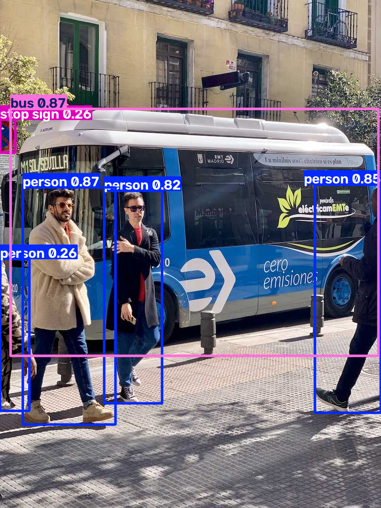
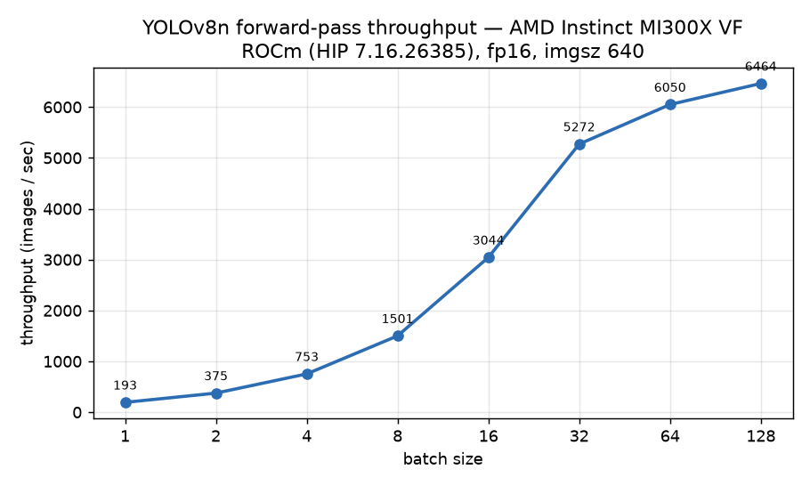

# Running YOLOv8 object detection on an AMD Instinct MI300X with ROCm

I spend most of my time on security and platform engineering, but I wanted to answer a narrower question for myself: if I take an ordinary computer-vision workflow that everyone writes against CUDA — Ultralytics YOLOv8 — and point it at an AMD Instinct MI300X, how much has to change?

The short answer is almost nothing in the code, and a couple of things in the environment. This post is the long answer: the exact setup, the real training and inference numbers I measured, the two or three things that tripped me up, and a repo you can clone to repeat all of it. I've tried to leave the rough edges in, because those are the parts a benchmark table never tells you.

## The setup

I ran everything on a single MI300X on the AMD Developer Cloud (a GPU Droplet, powered by DigitalOcean), using the stock PyTorch image. Here's the exact environment, read straight off the box:

| Component | Version / detail |
|---|---|
| GPU | AMD Instinct **MI300X** (`gfx942`), 192 GB, single GPU |
| Host | AMD Developer Cloud GPU Droplet, Ubuntu 24.04 |
| ROCm / HIP | HIP 7.16 (ROCm 10.1 image) |
| PyTorch | `2.14.0+rocm10.1.0` |
| Ultralytics (YOLOv8) | 8.4.203 |

The first thing worth checking, before anything else, is that PyTorch actually sees the GPU through HIP:

```bash
rocminfo | grep -m1 gfx          # gfx942
python3 -c "import torch; print(torch.__version__, torch.version.hip, torch.cuda.get_device_name(0))"
# 2.14.0+rocm10.1.0 7.16.26385 AMD Instinct MI300X VF
```

That `torch.version.hip` being set is the whole trick. On a ROCm build of PyTorch the entire `torch.cuda.*` API maps onto HIP underneath, so `device=0` targets the MI300X and you keep writing `cuda` in your code. Nothing in the training script below knows or cares that it isn't on an NVIDIA card.

One note on the hardware string: it reads `MI300X VF`. VF means a virtualised (SR-IOV) slice, which is normal for a cloud instance and matters in exactly one place later on — the partitioning section.

### The one install snag

Installing Ultralytics was a single `pip install ultralytics`, and then it immediately fell over on import:

```
ImportError: libxcb.so.1: cannot open shared object file: No such file or directory
```

This isn't a ROCm or AMD problem at all — it's the standard headless-server issue. The default `opencv-python` wheel links against X11 libraries that a GPU container has no reason to ship. The fix is the headless OpenCV build, which is a drop-in for anything that isn't drawing windows:

```bash
pip uninstall -y opencv-python
pip install opencv-python-headless
```

After that, `import ultralytics` was clean. I mention it only because it's the kind of thing that costs you ten minutes if you've never seen it, and zero if you have.

## Training a detector — the code is the boring part

To get a real mAP number rather than a hand-wave, I ran a short training job on COCO128, the 128-image subset Ultralytics downloads for you. Three epochs, starting from the pretrained `yolov8n` weights. This is a smoke test, not a production run — I'll be upfront about that — but it produces honest numbers on real data in about a minute.

```python
from ultralytics import YOLO

model = YOLO("yolov8n.pt")
model.train(data="coco128.yaml", epochs=3, imgsz=640, batch=64, device=0)  # device 0 = MI300X
metrics = model.val(data="coco128.yaml", imgsz=640, device=0)
print(metrics.box.map50, metrics.box.map)
```

That is the entire change from a CUDA workflow: there isn't one. The same four lines run unmodified on an NVIDIA box. What it produced on the MI300X:

| Metric | Value |
|---|---|
| Epochs | 3 (from pretrained `yolov8n`) |
| Dataset | COCO128 (128 images, 80 classes) |
| Training time | **69 seconds** |
| mAP@50 | **0.604** |
| mAP@50-95 | **0.443** |

The mAP is respectable because `yolov8n` already knows the COCO classes; three epochs on 128 images is nudging weights, not learning from scratch. The point of the number isn't the number — it's that the whole train-then-validate loop ran end to end on AMD silicon with code I copied verbatim from the CUDA tutorials.

Here's a prediction from the trained model on the Ultralytics sample image, so you can see it's actually detecting things and not just reporting metrics into the void:



### What actually changed, CUDA → ROCm

| Layer | CUDA (NVIDIA) | ROCm (AMD) |
|---|---|---|
| GPU runtime | CUDA | HIP (drop-in) |
| PyTorch | CUDA build | ROCm build (`torch.version.hip` set) |
| Ultralytics / YOLOv8 | works | works, unchanged |
| Your training code | `device=0` | `device=0` |
| Environment | your CUDA image | ROCm PyTorch image + headless OpenCV |

For anything built on a framework — which is most computer vision these days — the port is an environment swap, not a code migration.

## Inference throughput, and why my first numbers were wrong

This is the part I had to do twice, so it's worth being honest about.

My first instinct for an "inference throughput" number was to time `model.predict()` in a loop across batch sizes. The resulting curve was nonsense: 106, 167, 206, then a sudden **1095 img/s** at batch 8, then back down to 190. A single point five times higher than its neighbours isn't a throughput measurement, it's an artifact — the `predict()` path carries Python overhead, per-call logging, and preprocessing that drown out the GPU at small batches and warm up unevenly. If I'd published that table, the first person to try to reproduce it would have caught me out.

So I threw it away and measured the thing I actually meant: the model forward pass. Preallocate an fp16 input tensor on the GPU, warm up per batch size, then time a tight loop with a HIP synchronize on each end so I'm timing compute and not the queue:

```python
import time, torch
from ultralytics import YOLO

net = YOLO("yolov8n.pt").model.to("cuda").eval().half()
x = torch.randn(batch, 3, 640, 640, device="cuda", dtype=torch.float16)
with torch.inference_mode():
    for _ in range(10):            # warm up
        net(x)
    torch.cuda.synchronize()
    t0 = time.perf_counter()
    for _ in range(iters):
        net(x)
    torch.cuda.synchronize()
fps = iters * batch / (time.perf_counter() - t0)
```

This excludes preprocessing and NMS on purpose — it's the GPU-compute number, and it's reproducible. The curve this time behaves the way a throughput curve should: it climbs steadily as the batch grows and flattens out once the GPU is saturated.



| Batch | Throughput (img/s) | Latency (ms/img) |
|------:|-------------------:|-----------------:|
| 1   | 193   | 5.17 |
| 2   | 375   | 2.67 |
| 4   | 753   | 1.33 |
| 8   | 1,501 | 0.67 |
| 16  | 3,044 | 0.33 |
| 32  | 5,272 | 0.19 |
| 64  | 6,050 | 0.17 |
| 128 | **6,464** | **0.155** |

`yolov8n` is a tiny model, so a 192 GB GPU is wildly overprovisioned for it — which is exactly why throughput keeps climbing until batch 128 before it plateaus around 6,400 images/sec. The honest reading of this chart isn't "the MI300X does 6,464 FPS"; it's "a nano detector can't come close to filling this card, so you'd either run a much larger model or pack many streams onto it." Which leads straight into the one thing I couldn't do.

## A note on compute partitioning (and an honest dead end)

The MI300X has a genuinely interesting feature for a workload like this: **compute partitioning**. The card is eight XCDs, and it can present itself as one logical GPU (SPX), or split into two, four, or eight independent partitions (DPX/QPX/**CPX**). For small models that can't saturate the whole device, carving it into eight and running eight inference streams is the natural way to use it well. That was going to be the centrepiece of this post.

I couldn't do it on this instance, and the reason is worth writing down. The card advertised the profiles happily:

```bash
amd-smi partition
# ... CPX  PROFILE_INDEX 3  NUM_PARTITIONS 8  (one XCC each)
```

But it's currently in SPX, and trying to change that failed — not with a permissions error, but because the guest's `amd-smi set` has **no partition flag at all**:

```bash
amd-smi set --gpu all --compute-partition CPX
# AmdSmiInvalidParameterException: Parameter '--compute-partition cpx' is invalid.
```

That's the `VF` from earlier coming back around. On an SR-IOV virtual function, the partition layout is fixed by the host; the guest can read which profile it's in but can't switch it. So CPX on MI300X is real and worth building around — but you need bare-metal or host-level access to set it, not a virtualised cloud slice. I'd rather say that plainly than fake a partitioned run. If you have a bare-metal MI300X, the workflow above (small model, many streams) is exactly where CPX earns its keep, and I'd love to see someone finish this experiment.

## Bonus: the harder half — porting a CUDA *kernel*, with proof

Framework models port for free. The skill that doesn't is taking a hand-written CUDA kernel to AMD and knowing it's still correct afterwards. While I had the MI300X, I did a small version of that too, and it turned into a real contribution.

I added an RGB→grayscale kernel to [hipbridge](https://github.com/Core-Creates/hipbridge), a tool that verifies CUDA-to-AMD kernel substitutions numerically: it compiles the original `.cu` on the device, runs a Triton replacement, and arbitrates every disagreement against a float64 oracle. The grayscale kernel passed across all three precisions on `gfx942`:

| Precision | Cases | Worst ULP |
|-----------|-------|-----------|
| float32   | 45/45 | 8 |
| float16   | 34/34 | 0 |
| bfloat16  | 34/34 | 0 |

Getting there meant the verification caught three things that had never actually run on hardware: a device probe that only knew the old `rocm-smi` (modern ROCm ships `amd-smi`/`rocminfo`), a Triton kernel reading module globals it's not allowed to, and a reference kernel that hardcoded a `float` output and so refused to compile in half precision. All three are fixed in the pull request. That's the real lesson of kernel porting on any platform: the port is quick, and knowing it's right is the work.

## Reproduce all of it

Everything here is in one repo:

```bash
git clone https://github.com/srikantharun/CUDA-ROCm-Migration
cd CUDA-ROCm-Migration
pip install ultralytics opencv-python-headless matplotlib
# YOLOv8 notebook:
jupyter notebook notebooks/yolov8_custom_training.ipynb
# the CUDA->ROCm kernel-migration lab:
jupyter notebook notebooks/cuda_to_rocm_migration_mi300.ipynb
```

The throughput and training scripts that produced the numbers above are in the repo as well, so you can run them on your own MI300X and tell me where my numbers are wrong.

## What I'd take away

Three things. Running a mainstream PyTorch vision stack on an MI300X was genuinely uneventful — the one install fix aside, nothing about the code was AMD-specific. The hardware is so far ahead of a nano model that the interesting question isn't raw FPS but how you pack work onto it, which is what partitioning is for and what I'd chase next on bare metal. And the kernel-level story is the one that actually rewards attention: the port is easy, the proof is the point.

**Acknowledgements:** the AMD AI Developer Program for the cloud credits, and the Ultralytics team.

---

*Srikanth Arunachalam — [github.com/srikantharun](https://github.com/srikantharun)*
