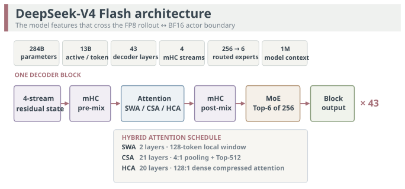
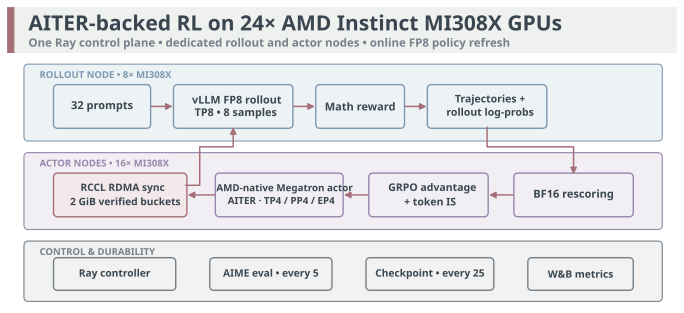
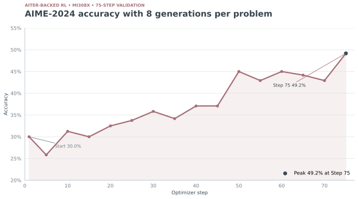
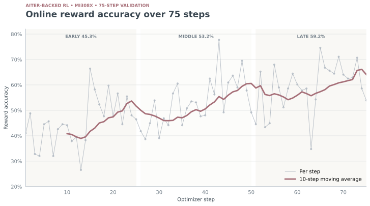
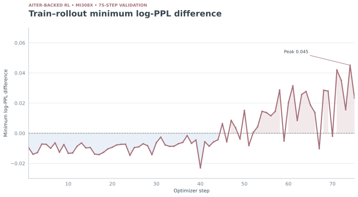

<!---
Copyright (c) 2026 Advanced Micro Devices, Inc. (AMD)

Permission is hereby granted, free of charge, to any person obtaining a copy
of this software and associated documentation files (the "Software"), to deal
in the Software without restriction, including without limitation the rights
to use, copy, modify, merge, publish, distribute, sublicense, and/or sell
copies of the Software, and to permit persons to whom the Software is
furnished to do so, subject to the following conditions:

The above copyright notice and this permission notice shall be included in all
copies or substantial portions of the Software.

THE SOFTWARE IS PROVIDED "AS IS", WITHOUT WARRANTY OF ANY KIND, EXPRESS OR
IMPLIED, INCLUDING BUT NOT LIMITED TO THE WARRANTIES OF MERCHANTABILITY,
FITNESS FOR A PARTICULAR PURPOSE AND NONINFRINGEMENT. IN NO EVENT SHALL THE
AUTHORS OR COPYRIGHT HOLDERS BE LIABLE FOR ANY CLAIM, DAMAGES OR OTHER
LIABILITY, WHETHER IN AN ACTION OF CONTRACT, TORT OR OTHERWISE, ARISING FROM,
OUT OF OR IN CONNECTION WITH THE SOFTWARE OR THE USE OR OTHER DEALINGS IN THE
SOFTWARE.
--->

# DeepSeek-V4 Flash RL on AMD Instinct MI308X GPUs with an AITER-Backed RL Stack

We demonstrate end-to-end DeepSeek-V4 Flash reinforcement learning with an
[AITER](https://github.com/ROCm/aiter)-backed AMD RL stack on 24 AMD Instinct
MI308X GPUs. Our test covers the complete workflow on three MI308X OAM
nodes—not only inference or an
isolated training step, but long-context FP8 rollout, BF16 MoE actor training,
online RDMA weight updates, evaluation, and checkpoint recovery. Training and
inference run as disaggregated services: two MI308X nodes host a BF16 actor
that preserves the numerical stability required by gradient computation and
optimizer updates, while a dedicated third MI308X node hosts an FP8 rollout
engine whose smaller per-parameter footprint leaves more GPU memory available
for KV cache and longer generated sequences.
[Ray](https://docs.ray.io/) places and coordinates both GPU groups. This
experiment demonstrates one tested three-node configuration
for running both rollout inference and RL training on MI308X GPUs.

This post reports the first 75 optimizer steps of a long-context
[GRPO](https://arxiv.org/abs/2402.03300) run on three eight-GPU AMD Instinct
MI308X nodes. The AITER-backed workflow combines
distributed orchestration, rollout correction, routing replay, weight
transfer, evaluation, and checkpoint recovery around an FP8 rollout engine
and a BF16 actor.

## Key Takeaways

- **DeepSeek-V4 Flash RL was tested on MI308X.** The complete 24-GPU,
  three-node AITER-backed workflow ran on AMD Instinct MI308X OAM systems.
- **The MI308X deployment supports disaggregated training and inference.** Two
  MI308X nodes run a 16-worker Megatron actor through an AMD-native training
  backend with AITER-backed kernels; a third MI308X node runs an eight-way
  tensor-parallel vLLM rollout server.
- **The first 75 optimizer steps maintained stable generation throughput.**
  Mean rollout throughput was 311 generated tokens/s, with a measured range of
  287–331 generated tokens/s.<sup>[[1]](#endnote-1)</sup>
- **Online reward improved over the run.** Mean reward accuracy increased from
  45.3% in Steps 1–25 to 53.2% in Steps 26–50 and 59.2% in
  Steps 51–75.<sup>[[1]](#endnote-1)</sup>
- **Held-out AIME-2024 accuracy improved.** Accuracy over eight generations per
  problem increased from 30.0% at Step 1 to 49.2% at
  Step 75.<sup>[[1]](#endnote-1)</sup>

## DeepSeek-V4 Flash in the AITER-Backed RL Stack

According to the [DeepSeek-V4 technical report](https://arxiv.org/abs/2606.19348),
DeepSeek-V4 Flash is a 284-billion-parameter mixture-of-experts model with
roughly 13 billion active parameters per token. The model supports a
one-million-token context window and has 43 decoder layers with a hidden size
of 4,096 and a 129,280-token vocabulary. The run reported here limits the
model context and total sequence length to 16,384 tokens. Every decoder block
contains one shared expert and 256 routed experts, with six routed experts
activated per token. The first three MoE layers use deterministic hash
routing; later layers use the learned router.

The attention schedule interleaves three layer types. The first two layers use
dense sliding-window attention (SWA) over 128 tokens. The remaining 41 layers
alternate between 21 Compressed Sparse Attention (CSA, or C4) layers and 20
Heavily Compressed Attention (HCA, or C128) layers. CSA pools the sequence at
4:1 and selects the top 512 compressed entries; HCA pools at 128:1 and attends
densely over the compressed sequence. Both retain the 128-token local branch,
preserving recent-token resolution alongside long-context access.

Each attention module has 64 query heads reading a shared 512-dimensional
key/value latent. Queries use a rank-1,024 low-rank path shared with the sparse
indexer, while the output projection is divided into eight groups with
1,024-dimensional bottlenecks. These shapes are important to the specialized
ROCm attention and projection kernels used by the AMD-native training backend.

DeepSeek-V4 Flash replaces a conventional residual connection with
manifold-constrained hyper-connections (mHC) over four parallel residual
streams. A pre-mixer collapses the streams into the tensor consumed by each
sub-layer; a post-mixer expands the result back into the four-stream state.
The rollout and actor engines must preserve this mapping, the hybrid-attention
schedule, and expert assignments even though they execute different kernels
and numerical formats. In this workflow,
[vLLM](https://github.com/vllm-project/vllm) generates trajectories from an
FP8 representation, while
[Megatron-LM](https://github.com/NVIDIA/Megatron-LM) uses the AMD-native
DeepSeek-V4 backend and AITER-backed training kernels to score and update the
policy in BF16.

Figure 1 summarizes the model components and routing path that the rollout and
actor engines must preserve.



**Figure 1.** Simplified DeepSeek-V4 Flash block showing four-stream mHC
mixing, the SWA/CSA/HCA layer schedule, and top-6 routing over 256 experts.
Adapted from the
[DeepSeek-V4 technical report](https://arxiv.org/abs/2606.19348).

### Why MI308X Support Matters

This experiment shows that the tested MI308X configuration—together with the
ROCm, AITER, and vLLM ecosystem around it—can support an RL training pipeline:
distributed BF16 actor training with Megatron, FP8 rollout generation with
vLLM, online RDMA weight updates, evaluation, and checkpoint recovery.
The result is specific to the three-node configuration and software versions
reported in the test configuration below.

DeepSeek-V4 Flash stresses several MI308X subsystems at once: large-capacity
HBM for a 284B-class MoE policy, high-throughput FP8 execution for rollout,
multi-node collectives for TP/PP/EP actor training, and RDMA for repeated
online policy updates. Passing only a model-load or single-step test would not
exercise this complete path.

Our 75-step result exercises this integrated workflow across all three nodes.
The actor topology, optimizer offload, activation recomputation, vLLM memory
headroom, AITER kernel path, and RCCL transport settings were selected
specifically to make long-context DeepSeek-V4 Flash RL practical on MI308X.
The MI308X actor uses TP4/PP4/EP4, while rollout uses TP8 on a dedicated node.

The AMD-native training backend supplies the DeepSeek-V4 Megatron layer
specification, architecture modules, ROCm compatibility paths, quantization
lifecycle abstractions, and AITER-backed operators. The surrounding RL
orchestration layer provides inference integration, rollout correction, reward
processing, online weight updates, evaluation, and recovery.

## The AITER-Backed Execution Flow

Figure 2 shows how the three-node deployment separates rollout from actor
training while coordinating online policy updates.



**Figure 2.** The disaggregated DeepSeek-V4 Flash RL workflow spans three
MI308X nodes. An AMD-native backend connects the Megatron actor to the
DeepSeek-V4 model specification and AITER-backed training kernels. The actor
and rollout engines use independent parallel layouts and exchange updated
policy weights through RCCL RDMA.

The RL orchestration layer manages the lifecycle around those engines:

1. sample prompts from
   [DAPO-Math-17K](https://arxiv.org/abs/2503.14476);
2. generate eight responses per prompt with vLLM;
3. score the responses with the math reward;
4. rescore generated tokens with the Megatron actor;
5. form group-relative advantages;
6. apply token-level rollout importance-sampling correction;
7. update the BF16 actor;
8. transfer and quantize the new policy for the FP8 rollout engine;
9. periodically evaluate on AIME-2024 and save distributed checkpoints.

### 1. Ray Separates Training and Rollout

The run uses three nodes with eight GPUs each. Ray pins 16 actor workers to two
nodes and eight rollout workers to the third node. This separation lets the
Megatron actor use a memory-oriented parallel layout while vLLM uses a
throughput-oriented tensor-parallel layout. On the training side, the
AMD-native backend provides the DeepSeek-V4 Megatron layer specification and
connects AITER-backed kernels for model operations on MI308X.

The actor uses:

- tensor parallelism: 4;
- pipeline parallelism: 4;
- expert parallelism: 4;
- expert tensor parallelism: 1;
- sequence parallelism and full activation recomputation;
- 11 layers in the first pipeline stage and 10 in the last;
- distributed Adam with full optimizer-state CPU offload;
- BF16 optimizer moments with 256 MiB streamed-Adam chunks.

The rollout engine uses:

- vLLM AsyncLLM with tensor parallelism 8;
- FP8 per-block weights and FP8 E4M3 KV cache;
- AITER kernels where supported;
- a 16,384-token model context and 4,096-token response cap;
- up to 8,192 batched tokens and 48 concurrent sequences;
- 90% GPU-memory utilization.

The 90% memory target reserves GPU memory for online policy updates while
retaining KV-cache capacity for long generated sequences.

### 2. GRPO Keeps the Policy Loop Explicit

Each optimizer step samples 32 prompts and generates eight responses per
prompt, producing a global batch of 256 trajectories. The RL orchestration
layer evaluates the responses with the DAPO math reward, computes
group-relative advantages, and aggregates the policy loss with
sequence-mean/token-mean semantics.

The policy update uses a learning rate of `1e-6`, a GRPO clipping ratio of
`0.2`, and an upper clipping ratio of `0.28`. No explicit KL reward penalty is
enabled in this experiment.

Because rollout and training use different numerical representations,
the workflow applies token-level importance-sampling correction. The
correction clamps the train-versus-rollout ratio at 2.0 and applies it directly
to the per-token GRPO loss. For the MoE path, hard-assignment
[R3 replay](https://arxiv.org/abs/2510.11370) preserves the recorded rollout
routing decisions during actor rescoring.

### 3. RDMA Updates a Live FP8 Rollout Engine

After each actor update, the workflow transfers the updated policy through an
RCCL-backed RDMA group. The actor remains BF16, while the rollout engine
prepares the FP8 representation before the next generation cycle. Rollout
resumes only after the distributed update has completed.

### 4. Checkpoints Make Long Runs Recoverable

The orchestration layer saves a distributed checkpoint every 25 optimizer
steps and retains the latest two checkpoints. The actor checkpoint includes
model, optimizer, and scheduler state across the Megatron topology. Resume
restores the actor before rebuilding the RDMA group and reloading the rollout
workers.

## Seventy-Five-Step Results

All measurements in this section use the test configuration described in
[Endnote 1](#endnote-1).

### Held-Out AIME-2024 Evaluation

The workflow evaluates AIME-2024 every five optimizer steps with eight
generations per problem. Accuracy increased from 30.0% at Step 1 to 49.2% at
Step 75, the best observed value in this window. Figure 3 shows the evaluation
trajectory across the measured window.



**Figure 3.** Held-out AIME-2024 mean accuracy over eight sampled generations
per problem. Individual evaluations are noisy on a 30-problem benchmark, so
the multi-evaluation trend is more informative than any single point.

### Online Reward

Reward accuracy is noisy from step to step, ranging from 26.6% to 77.7%.
Aggregating the run into thirds shows the useful trend:

- Steps 1–25: **45.3%**
- Steps 26–50: **53.2%**
- Steps 51–75: **59.2%**

Figure 4 shows the per-step reward signal and its 10-step moving average.



**Figure 4.** Online reward accuracy for each optimizer step and its 10-step
moving average. The per-step signal is noisy, while the grouped means show a
sustained increase relative to the first third.

### Train-Versus-Rollout Minimum Log-PPL Difference

For this analysis, the train-versus-rollout diagnostic is the signed minimum
log-PPL difference recorded by the RL workflow for each step
(`rollout_corr/log_ppl_diff_min`). It ranged from -0.0230 to 0.0451:

- Steps 1–25 mean: **-0.0102**
- Steps 26–50 mean: **-0.0049**
- Steps 51–75 mean: **0.0170**

Figure 5 tracks this minimum diagnostic throughout the 75-step run.



**Figure 5.** Signed minimum train-versus-rollout log-PPL difference over the
first 75 optimizer steps. This minimum statistic captures one edge of the
per-step distribution and must not be read as a complete alignment measure.

Correction diagnostics evolved alongside the policy during the run. By Step
75, `rollout_corr/kl` was 0.4706 and effective sample size was 79.1%. We use
these measurements as calibration signals for continued refinement of
training–inference consistency, particularly for long sequences and online
FP8 policy reloads.

### Throughput

Despite long responses and repeated online weight updates, rollout throughput
remained stable:

- overall mean: **311.2 generated tokens/s**;
- observed range: **287.0–331.0 generated tokens/s**;
- Steps 1–25 mean: **315.2 generated tokens/s**;
- Steps 26–50 mean: **309.7 generated tokens/s**;
- Steps 51–75 mean: **308.6 generated tokens/s**.

The small decline across thirds is modest compared with the variation in
sample length over this measured window.

## What We Learned

**Training–inference separation makes model-specific tuning practical.**
Megatron and vLLM need different parallel layouts for this model. Ray role
placement lets the RL stack tune each engine independently without conflating
their memory and communication constraints.

**Online FP8 updates require a coordinated synchronization boundary.** Weight
transfer, inference-side quantization, and activation of the updated policy
must complete before rollout resumes.

**Memory headroom is part of the communication design.** The rollout KV cache
and online policy update share GPU memory. The 90% vLLM utilization setting
reserved update headroom without changing the model context or response
budget.

**Held-out evaluation and online reward answer different questions.** Online
reward reflects the sampled training distribution. Periodic AIME-2024
evaluation provides a separate view of capability. Both improved relative to
the start over 75 steps. Neither signal removes the need to validate
cross-engine policy agreement.

**Recovery is part of the workflow.** A 75-step trajectory at this scale spans
rollout, actor, transfer, evaluation, and checkpoint phases. Versioned
checkpoints and deterministic step-indexed metrics preserve continuity over
the measured window.

## Reproducing the Deployment

The exact source revisions and container images used for this experiment were
pinned across all three nodes. To reproduce the topology in another
environment, use equivalent pinned builds that include the RL orchestration
layer, the AMD-native DeepSeek-V4 Megatron backend, AITER, ROCm Megatron-LM,
ROCm vLLM, Ray, and RCCL.

### 1. Check the Three MI308X Hosts

Docker, the AMD GPU device files, and the RoCE device must be available on all
three hosts:

```bash
docker info >/dev/null
test -e /dev/kfd
test -d /dev/dri
test -d /dev/infiniband
rocminfo | grep -c 'Name:.*gfx942'
```

The final command should report eight GPU agents on each host. RDMA interface,
HCA, and GID values are cluster-specific; discover them from
`/sys/class/infiniband` instead of copying the values from our test cluster.

### 2. Pin the Software Components

Use the same revisions on every node for:

- the RL orchestration and AMD-native DeepSeek-V4 training backend;
- ROCm Megatron-LM and AITER-backed training kernels;
- ROCm vLLM with FP8 weights and FP8 E4M3 KV cache support;
- Ray and the RCCL-based RDMA weight-transfer layer.

The published trainer and rollout images already contain the pinned Python,
PyTorch, ROCm, Megatron, AITER, vLLM, and RL integration code. Users can pull
and start them directly instead of rebuilding the software stack on each host.
The model, datasets, writable runtime directories, and cluster-specific RDMA
configuration remain external.

### 3. Prepare Model, Data, and Runtime Directories

The launch environment uses the following layout:

```text
/path/to/runtime/
├── models/DeepSeek-V4-Flash-BF16/
├── data/dsv4-flash/dapo-math-17k/data/dapo-math-17k.parquet
├── data/dsv4-flash/aime-2024/test-00000-of-00001.parquet
├── logs/
└── ckpts/
```

Create the writable directories before starting containers:

```bash
export DATA_ROOT=/path/to/runtime
mkdir -p "$DATA_ROOT/logs" "$DATA_ROOT/ckpts"
```

Download the model and datasets from Hugging Face. The script below uses
[huggingface_hub](https://huggingface.co/docs/huggingface_hub/) with
[Xet](https://huggingface.co/docs/hub/storage-backends#xet-storage-backend)
for fast parallel transfers:

```bash
python3 -m venv "${HOME}/.cache/dsv4-hf-venv"
"${HOME}/.cache/dsv4-hf-venv/bin/pip" install -U \
'huggingface_hub[hf_xet]'
```

Then download the model and datasets:

```bash
HF_XET_HIGH_PERFORMANCE=1 \
"${HOME}/.cache/dsv4-hf-venv/bin/python" - <<'PY'
import os

from huggingface_hub import snapshot_download

data_root = os.environ["DATA_ROOT"]

snapshot_download(
  "RedHatAI/DeepSeek-V4-Flash-BF16",
  revision="8c9b4490a493fba692221ed92162badcbc4dde0c",
  local_dir=f"{data_root}/models/DeepSeek-V4-Flash-BF16",
  max_workers=16,
)
snapshot_download(
  "BytedTsinghua-SIA/DAPO-Math-17k",
  revision="65877096c24ffa7abc4e4fa5edb95cf3413a5674",
  repo_type="dataset",
  local_dir=f"{data_root}/data/dsv4-flash/dapo-math-17k",
  max_workers=8,
)
snapshot_download(
  "math-ai/aime24",
  revision="83a7f387baaa524a8bda0022eac0541582297103",
  repo_type="dataset",
  local_dir=f"{data_root}/data/dsv4-flash/aime-2024",
  max_workers=8,
)
PY
```

The commands use the canonical
[DAPO-Math-17K](https://huggingface.co/datasets/BytedTsinghua-SIA/DAPO-Math-17k)
and [AIME 2024](https://huggingface.co/datasets/math-ai/aime24) repositories.
Preprocess the downloaded Parquet files into the prompt-and-label format
expected by the RL configuration before launching the job.

### 4. Start the Docker Containers

The tested images are publicly available from the ROCm organization on Docker
Hub:

```bash
# Run on both actor nodes.
docker pull rocm/atom-dev:rl-dsv4-308-train

# Run on the rollout/Ray-head node.
docker pull rocm/atom-dev:rl-dsv4-308-rollout
```

These images contain the corresponding application code and software
dependencies, so no source checkout or package installation is required on
the deployment nodes. Use the rollout image on the Ray-head node and the
trainer image on both actor nodes:

```bash
COMMON_ARGS=(
  --privileged --network=host --ipc=host
  --device=/dev/kfd --device=/dev/dri
  -v /dev/infiniband:/dev/infiniband
  --group-add=video --group-add=render
  --cap-add=SYS_PTRACE --security-opt seccomp=unconfined
  --shm-size=256g
  -v "$DATA_ROOT:/runtime"
)

docker run -d --name dsv4-rollout "${COMMON_ARGS[@]}" \
  --entrypoint /usr/bin/sleep \
  rocm/atom-dev:rl-dsv4-308-rollout infinity

docker run -d --name dsv4-trainer "${COMMON_ARGS[@]}" \
  --entrypoint /usr/bin/sleep \
  rocm/atom-dev:rl-dsv4-308-train infinity
```

Run the rollout command only on the rollout node and the trainer command on
each actor node. The image is ready to run, but the host must still provide
the model and dataset paths, persistent checkpoint and log storage, GPU and
RDMA devices, and the correct network-interface settings.

### 5. Start the Ray Cluster

Choose reachable addresses for the rollout node and two actor nodes:

```bash
read -r -p "Rollout node IP: " ROLLOUT_IP
read -r -p "This actor node IP: " THIS_ACTOR_IP
export ROLLOUT_IP THIS_ACTOR_IP
```

Start the Ray head inside the rollout container:

```bash
docker exec dsv4-rollout bash -lc "
  ray stop --force || true
  ray start --head \
    --node-ip-address=$ROLLOUT_IP \
    --port=6379 --num-gpus=8
"
```

On each actor host, set `THIS_ACTOR_IP` to that host's address and join the
cluster:

```bash
docker exec dsv4-trainer bash -lc "
  ray stop --force || true
  ray start \
    --address=$ROLLOUT_IP:6379 \
    --node-ip-address=$THIS_ACTOR_IP \
    --num-gpus=8
"
```

Configure the actor placement for the two trainer-node addresses and rollout
placement for the Ray-head address. Set the discovered RDMA HCA, interface, and
GID index in the weight-synchronization configuration.

### 6. Match the Tested RL Configuration

Before launching, confirm these settings:

- actor: 16 workers using TP4, PP4, EP4, BF16, sequence parallelism, full
  activation recomputation, and CPU optimizer-state offload;
- rollout: eight workers using TP8, FP8 weights, FP8 E4M3 KV cache, 16,384
  model context, 4,096 response cap, and 90% GPU-memory utilization;
- GRPO: 32 prompts, eight responses per prompt, learning rate `1e-6`, clipping
  ratios `0.2` and `0.28`, and token importance-sampling cap `2.0`;
- synchronization: RCCL RDMA for online policy transfer;
- durability: evaluation every five optimizer steps and checkpointing every
  25 steps.

### 7. Run a Smoke Test, Then the 75-Step Job

First run three optimizer steps and require one successful rollout, actor
update, RDMA reload, evaluation, and checkpoint cycle. Then launch the measured
75-step configuration from the rollout/Ray-head container. Before committing a
long allocation, verify that `ray status` reports 24 GPUs and that no worker
reports an out-of-memory error or collective timeout.

## Summary

This experiment demonstrates an end-to-end DeepSeek-V4
Flash workflow on AMD Instinct MI308X GPUs: FP8 vLLM rollout, BF16 Megatron
training with AITER-backed kernels, token-level rollout correction, R3 routing
replay, RDMA policy updates, distributed checkpointing, and periodic held-out
evaluation across three MI308X nodes.

Across the first 75 optimizer steps, online reward improved, AIME-2024
accuracy rose from 30.0% to 49.2%, and rollout throughput averaged 311
generated tokens/s. This 75-step result demonstrates the complete tested
workflow on the described 24-GPU MI308X configuration.<sup>[[1]](#endnote-1)</sup>

For practitioners, the main takeaway is that reproducibility depends on
treating rollout and training as separate distributed systems while pinning
model and dataset revisions, numerical formats, parallel layouts, and
synchronization boundaries. The deployment checklist provides a starting
point for validating the complete path with a smoke test before a longer run.

## Endnotes

<a id="endnote-1"></a>
[1] Test Configuration

The author team ran the reported experiment from August 17–21, 2026, on three
Supermicro AS-8125GS-TNMR2 nodes. Each node contained two AMD EPYC 9454
48-core processors and eight AMD Instinct MI308X OAM GPUs, for 24 GPUs total.
The actor used BF16 with TP4, PP4, and EP4 across two nodes; rollout used FP8
weights, an FP8 E4M3 KV cache, and TP8 on the third node.

Each node provided AMD Pensando DSC Ethernet controllers for RoCE; the tested
RDMA path used the `ionic_0` HCA with firmware `1.117.5-a-77`. An Intel XXV710
25GbE SFP28 interface provided the `ens50f0` network interface used by the
distributed configuration.

The pinned trainer and rollout containers used:

- Ubuntu 22.04.5 LTS, ROCm 7.2, Python 3.12.13, and PyTorch
  `2.11.0+gitd0c8b1f`;
- AITER 0.1.0, Ray 2.56.1, Transformers 5.13.1, and vLLM
  `0.25.1+rocm723` (source commit `752a3a504`);
- ROCm Megatron-LM `rocm_dev` at commit
  `fb4552449f9b33c6f72207a80e80045eadf5267e`;
- trainer-side ROCm flash-attention at commit
  `b3ae4966b2567811880db10d9e040a775b99c7d7` and ROCm Triton
  `3.7.0+amd.rocm7.2.0.git89002410`; and
- rollout-side flash-attn 2.8.3, TileLang 0.1.10, and Triton 3.6.0.

Throughput is aggregate generated tokens/s over the first 75 optimizer steps.
AIME-2024 results use eight sampled generations for each of the benchmark's 30
problems. Results apply only to this configuration; performance can vary with
system configuration, software versions, and workload.

## Additional Resources

- [DeepSeek-V4 technical report](https://arxiv.org/abs/2606.19348)
- [DeepSeek-V4-Flash model card](https://huggingface.co/deepseek-ai/DeepSeek-V4-Flash)
- [DeepSeek-V4-Flash BF16 model card](https://huggingface.co/RedHatAI/DeepSeek-V4-Flash-BF16)
- [DeepSeekMath and GRPO](https://arxiv.org/abs/2402.03300)
- [DAPO paper](https://arxiv.org/abs/2503.14476) and
  [DAPO project](https://github.com/BytedTsinghua-SIA/DAPO)
- [R3: Rollout Routing Replay](https://arxiv.org/abs/2510.11370)
- [AIME 2024 dataset](https://huggingface.co/datasets/math-ai/aime24)
- [vLLM](https://github.com/vllm-project/vllm)
- [Megatron-LM](https://github.com/NVIDIA/Megatron-LM)
- [Ray](https://docs.ray.io/)
- [AITER](https://github.com/ROCm/aiter)

## Disclaimers

The information presented in this document is for informational purposes only
and may contain technical inaccuracies, omissions, and typographical errors.
The information contained herein is subject to change and may be rendered
inaccurate for many reasons, including but not limited to product and roadmap
changes, component and motherboard version changes, new model and/or product
releases, product differences between differing manufacturers, software
changes, BIOS flashes, firmware upgrades, or the like. Any computer system has
risks of security vulnerabilities that cannot be completely prevented or
mitigated. AMD assumes no obligation to update or otherwise correct or revise
this information. However, AMD reserves the right to revise this information
and to make changes from time to time to the content hereof without obligation
of AMD to notify any person of such revisions or changes. THIS INFORMATION IS
PROVIDED "AS IS." AMD MAKES NO REPRESENTATIONS OR WARRANTIES WITH RESPECT TO
THE CONTENTS HEREOF AND ASSUMES NO RESPONSIBILITY FOR ANY INACCURACIES, ERRORS,
OR OMISSIONS THAT MAY APPEAR IN THIS INFORMATION. AMD SPECIFICALLY DISCLAIMS
ANY IMPLIED WARRANTIES OF NON-INFRINGEMENT, MERCHANTABILITY, OR FITNESS FOR
ANY PARTICULAR PURPOSE. IN NO EVENT WILL AMD BE LIABLE TO ANY PERSON FOR ANY
RELIANCE, DIRECT, INDIRECT, SPECIAL, OR OTHER CONSEQUENTIAL DAMAGES ARISING
FROM THE USE OF ANY INFORMATION CONTAINED HEREIN, EVEN IF AMD IS EXPRESSLY
ADVISED OF THE POSSIBILITY OF SUCH DAMAGES.

Third-party content is licensed to you directly by the third party that owns
the content and is not licensed to you by AMD. ALL LINKED THIRD-PARTY CONTENT
IS PROVIDED "AS IS" WITHOUT A WARRANTY OF ANY KIND. USE OF SUCH THIRD-PARTY
CONTENT IS DONE AT YOUR SOLE DISCRETION AND UNDER NO CIRCUMSTANCES WILL AMD BE
LIABLE TO YOU FOR ANY THIRD-PARTY CONTENT. YOU ASSUME ALL RISK AND ARE SOLELY
RESPONSIBLE FOR ANY DAMAGES THAT MAY ARISE FROM YOUR USE OF SUCH THIRD-PARTY
CONTENT.

AMD, the AMD Arrow logo, AMD Instinct, ROCm, and combinations thereof are
trademarks of Advanced Micro Devices, Inc. Other product names used in this
publication are for identification purposes only and may be trademarks of
their respective companies. © 2026 Advanced Micro Devices, Inc. All rights
reserved.
