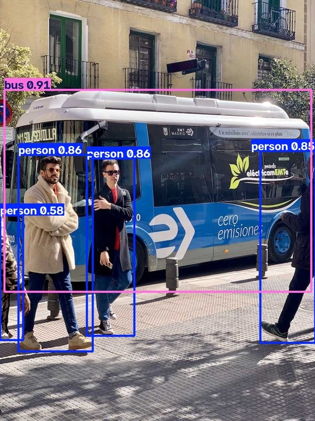

<!---
Copyright (c) 2026 Advanced Micro Devices, Inc. (AMD)

Permission is hereby granted, free of charge, to any person obtaining a copy
of this software and associated documentation files (the "Software"), to deal
in the Software without restriction, including without limitation the rights
to use, copy, modify, merge, publish, distribute, sublicense, and/or sell
copies of the Software, and to permit persons to whom the Software is
furnished to do so, subject to the following conditions:

The above copyright notice and this permission notice shall be included in all
copies or substantial portions of the Software.

THE SOFTWARE IS PROVIDED "AS IS", WITHOUT WARRANTY OF ANY KIND, EXPRESS OR
IMPLIED, INCLUDING BUT NOT LIMITED TO THE WARRANTIES OF MERCHANTABILITY,
FITNESS FOR A PARTICULAR PURPOSE AND NONINFRINGEMENT. IN NO EVENT SHALL THE
AUTHORS OR COPYRIGHT HOLDERS BE LIABLE FOR ANY CLAIM, DAMAGES OR OTHER
LIABILITY, WHETHER IN AN ACTION OF CONTRACT, TORT OR OTHERWISE, ARISING FROM,
OUT OF OR IN CONNECTION WITH THE SOFTWARE OR THE USE OR OTHER DEALINGS IN THE
SOFTWARE.
--->

# Ultralytics YOLO on AMD GPUs: Train, Run, and Deploy with ROCm™

[Ultralytics YOLO](https://www.ultralytics.com/yolo) is the most popular open-source framework for real-time computer vision. With just a few lines of Python, developers can train and deploy YOLO models for a range of [tasks](https://docs.ultralytics.com/tasks), including object detection, segmentation, tracking, pose estimation, and image classification.

Ultralytics YOLO now officially supports AMD GPUs. **Train and run [Ultralytics YOLO26](https://www.ultralytics.com/yolo/yolo26) models on AMD GPUs with the same Ultralytics API**: PyTorch on AMD ROCm™ software handles training and inference, and AMD MIGraphX runs exported ONNX models. Built together with the Ultralytics team, this integration has been tested on AMD Instinct™ GPUs, AMD Radeon™ GPUs, and AMD Ryzen™ AI processors, from data center servers to embedded devices.

In this blog, you'll learn to install Ultralytics on a system with an AMD GPU, train a YOLO26 model, run it, and deploy it with MIGraphX. For the full reference, see the [Ultralytics AMD integration guide](https://docs.ultralytics.com/integrations/amd/). Figure 1 shows the results of each YOLO26 task.

```{video} videos/ultralytics-amd-hero.mp4
:width: 100%
:autoplay:
:loop:
:muted:
:playsinline:
:alt: Ultralytics YOLO26 running seven computer vision tasks and multi-object tracking
```

*Figure 1: Ultralytics YOLO26 running its seven tasks plus multi-object tracking. The sample clips are fully AI-generated and provided for demonstration purposes only. Sample media generated using [Qwen-Image-2512](https://huggingface.co/Qwen/Qwen-Image-2512) and [Wan 2.2 I2V-A14B](https://huggingface.co/Wan-AI/Wan2.2-I2V-A14B) (Apache 2.0 licensed models) on an AMD Instinct MI350X GPU.*

## What's New

* **Train** YOLO26 models with PyTorch on ROCm: fine-tune pretrained models or train from scratch, on one AMD GPU or several.
* **Run inference** with pretrained and custom models with PyTorch on ROCm.
* **Deploy** exported ONNX models with [MIGraphX](https://rocm.docs.amd.com/projects/AMDMIGraphX/en/latest/), the AMD graph inference engine, through ONNX Runtime. In the [Ultralytics validation tests](https://github.com/ultralytics/ultralytics/pull/24137#issuecomment-5837545959), MIGraphX ran YOLO26 models with up to 67% lower latency than PyTorch at the same accuracy[^perf]. Ultralytics installs the required packages on first use.
* **Cover** all seven YOLO26 tasks: detection, instance and semantic segmentation, classification, pose estimation, oriented bounding boxes, and depth estimation. Pass the matching model and dataset, such as `yolo26n-seg.pt` with `coco8-seg.yaml`.
* **Start** from the `ultralytics/ultralytics:latest-amd` Docker image, which has the required packages preinstalled.

AMD contributed the integration in [pull request #24137](https://github.com/ultralytics/ultralytics/pull/24137), and Ultralytics now runs AMD GPU tests in its [daily CI run](https://github.com/ultralytics/ultralytics/blob/main/.github/workflows/ci.yml).

### Tested Platforms

We tested the integration on the following platforms:

| Platform                    | GPU architecture | Train | Run with PyTorch | Deploy with MIGraphX |
| --------------------------- | ---------------- | :---: | :--------------: | :------------------: |
| AMD Instinct MI350X         | `gfx950`         |   ✓   |        ✓         |          ✓           |
| AMD Radeon™ AI PRO R9700    | `gfx1201`        |   ✓   |        ✓         |          ✓           |
| AMD Ryzen™ AI Max+ PRO 395  | `gfx1151`        |   —   |        ✓         |          ✓           |
| AMD Ryzen™ AI Embedded X100 | `gfx1151`        |   —   |        ✓         |          ✓           |
| AMD Ryzen™ AI Embedded P185 | `gfx1150`        |   —   |        ✓         |          ✓           |

A dash means that the workflow was not tested on that platform. The tests used Ubuntu 24.04, the `amdgpu` driver included in the Linux kernel, and ROCm 10.0.0 from the PyTorch wheels.

## Installation

AMD GPU support in Ultralytics is available on Linux x86_64. Windows is not supported, and WSL has not been tested. Before you install, check that your GPU is listed in the [ROCm compatibility matrix](https://rocm.docs.amd.com/en/latest/compatibility/compatibility-matrix.html) and that the `amdgpu` driver for your GPU is installed. You'll then be able to choose one of two options:

### Option 1: Docker Image

To start without installing packages yourself, use the `ultralytics/ultralytics:latest-amd` image. It includes PyTorch on ROCm, Ultralytics, ONNX Runtime, and MIGraphX:

```bash
docker run -it --ipc=host --device=/dev/kfd --device=/dev/dri --group-add video \
  -v "$PWD/runs":/ultralytics/runs ultralytics/ultralytics:latest-amd
```

The command opens a shell in the container, where you can run the examples from the next section. The `-v` option keeps the results in a `runs` folder on the host after the container exits. For more options, see the [Ultralytics Docker Quickstart](https://docs.ultralytics.com/guides/docker-quickstart/#using-gpus).

### Option 2: pip

To install into your own Python environment, use Python 3.11 or newer. Check that your GPU is listed on the [Install PyTorch for ROCm](https://rocm.docs.amd.com/projects/ai-ecosystem/en/latest/frameworks/pytorch/install.html) page. The commands below are for Ubuntu 24.04.

**One-time setup:** add your user to the `render` and `video` groups for GPU access, and install the libraries that PyTorch and OpenCV need. Most of them are already installed on Ubuntu Desktop. Then sign out and sign in again:

```bash
sudo usermod -aG render,video $USER &&
  sudo apt update && sudo apt install -y python3-venv libc6-dev libgomp1 libgl1 libglib2.0-0 libsm6
```

Next, install PyTorch for your GPU and Ultralytics:

```bash
python3 -m venv yolo-amd && source yolo-amd/bin/activate

# Detect your GPU architecture, for example device-gfx1201 for Radeon AI PRO R9700
GPU_ARCH=$(grep -rhs '^gfx_target_version' /sys/class/kfd/kfd/topology/nodes |
  awk '$2 {printf "device-gfx%d%d%x\n", int($2/10000), int($2/100)%100, $2%100}' | sort -u | paste -sd, -)

pip install --index-url https://stable.repo.amd.com/rocm/whl-next/ \
  "torch[${GPU_ARCH:?No AMD GPU found}]==2.13.0+rocm10.0.0" "torchvision[$GPU_ARCH]==0.28.0+rocm10.0.0" &&
  pip install ultralytics

# Check the installation: prints the GPU that device=0 selects
python -c "import torch; print(torch.cuda.get_device_name(0))"
```

The PyTorch wheels include the ROCm libraries for your GPU, so you do not need a system-wide ROCm installation. If a step fails:

* **`No AMD GPU found`:** the `GPU_ARCH` command found no AMD GPU, so nothing was installed. Check that the `amdgpu` driver is loaded.
* **pip warns that torch `does not provide the extra`:** the index has no package for your GPU.
* **The check prints `No CUDA GPUs are available`:** your user does not have GPU access yet. Run the one-time setup, then sign out and sign in again.

## Train, Run, and Deploy a Model

The examples below train a YOLO26 model, run inference with it, and deploy it with MIGraphX. PyTorch on ROCm exposes AMD GPUs as `cuda` devices, so `device=0` selects the first AMD GPU, as it does on other GPUs. Run the examples in order from the same folder. On first use, Ultralytics downloads the YOLO26n weights, the coco8 dataset, and the test image.

### Train a Model

The example below trains YOLO26n on coco8, an eight-image sample dataset, starting from pretrained weights:

```python
from ultralytics import YOLO

model = YOLO("yolo26n.pt")  # load a pretrained model
model.train(data="coco8.yaml", epochs=3, device=0)  # train with PyTorch on ROCm
```

Training prints the losses for each epoch and saves the best model as `best.pt`, which the next two examples load. Each new training run is saved to a new folder, such as `runs/detect/train-2`, so update the path in the next examples if you train more than once. The same `train()` call covers other training scenarios:

* **Fine-tuning**, as in the example above: start from pretrained weights such as `yolo26n.pt`.
* **Training from scratch**: load `yolo26n.yaml` instead of `yolo26n.pt`, with a larger dataset and more epochs.
* **Multi-GPU training**: pass `device=[0, 1]` to train on two GPUs.

### Run Inference

The example below runs the trained model with PyTorch on a test image:

```python
from ultralytics import YOLO

model = YOLO("runs/detect/train/weights/best.pt")  # load the trained model
results = model("https://ultralytics.com/images/bus.jpg", device=0, save=True)  # run with PyTorch on ROCm
```

The output lists 4 persons and 1 bus, and `save=True` saves the annotated image in the `runs/detect` folder.

### Deploy with ONNX and MIGraphX

The example below exports the trained model to ONNX and runs the ONNX model with MIGraphX through ONNX Runtime:

```python
from ultralytics import YOLO

model = YOLO("runs/detect/train/weights/best.pt")  # load the trained model
onnx_file = model.export(format="onnx")  # export to ONNX
onnx_model = YOLO(onnx_file)  # load the ONNX model
results = onnx_model("https://ultralytics.com/images/bus.jpg", device=0, save=True)  # run with MIGraphX
```

With pip, Ultralytics installs ONNX Runtime from PyPI and the MIGraphX packages from the AMD [ONNX Runtime](https://stable.repo.amd.com/rocm/onnxruntime/whl-next/) and [MIGraphX](https://stable.repo.amd.com/rocm/migraphx/whl-next/) package indexes the first time you need them. They use the same ROCm libraries as PyTorch, so no system-wide ROCm installation is needed. The Docker image already includes them.

The first ONNX inference takes a minute or two while MIGraphX compiles the model for your GPU. Ultralytics caches the compiled model, so later runs of the same ONNX file start right away. Each export creates a new ONNX file, which MIGraphX compiles again. The output looks similar to the following:

```text
Loading runs/detect/train/weights/best.onnx for ONNX Runtime inference...
MIGraphX is compiling the model; this runs once per model and the result is cached...
Using ONNX Runtime 1.29.0 with MIGraphXExecutionProvider
image 1/1 /ultralytics/bus.jpg: 640x640 4 persons, 1 bus, 3.3ms
```

The line that ends with `MIGraphXExecutionProvider` confirms that the model runs with MIGraphX. The ONNX model detects the same 4 persons and 1 bus, as shown in Figure 2.

<div align="center">



*Figure 2: YOLO26n detections with MIGraphX on an AMD Radeon AI PRO R9700 GPU.*

</div>

You can run the same steps from the command line. The commands below export the pretrained YOLO26n model to ONNX and run it on a video with MIGraphX:

```bash
yolo export model=yolo26n.pt format=onnx
yolo predict model=yolo26n.onnx source=park.mp4 device=0
```

Replace `park.mp4` with your own video, or download the [sample clip](videos/park.mp4) used in Figure 3. Ultralytics saves the annotated video to the `runs/detect` folder.

```{video} videos/ultralytics-amd-cli-demo.mp4
:width: 100%
:autoplay:
:loop:
:muted:
:playsinline:
:alt: Terminal recording that installs Ultralytics, exports YOLO26n to ONNX, and runs it on a video with MIGraphX
```

*Figure 3: Installing Ultralytics, exporting YOLO26n to ONNX, and running it with MIGraphX on an AMD Radeon AI PRO R9700 GPU. The one-time MIGraphX compilation is trimmed. The sample clip is AI-generated.*

PyTorch models can run on any GPU with `device=1`, `device=2`, and so on, but ONNX models with MIGraphX currently run only on the first visible GPU. To run an ONNX model on another GPU, make it the first visible GPU with `HIP_VISIBLE_DEVICES` and keep `device=0`, for example `HIP_VISIBLE_DEVICES=1 yolo predict model=yolo26n.onnx source=park.mp4 device=0`.

## Summary

In this blog, you learned how to install Ultralytics 8.4.171 or later on an AMD GPU system, then train, run, and deploy a YOLO26 model. The same workflow works across the tested AMD Instinct™ GPUs, AMD Radeon™ GPUs, and AMD Ryzen™ AI processors.

The [Ultralytics AMD integration guide](https://docs.ultralytics.com/integrations/amd/) covers installation options, the compiled-program cache, frequently asked questions, and benchmarks, and the [8.4.171 release notes](https://github.com/ultralytics/ultralytics/releases/tag/v8.4.171) list all changes. To report a problem, open an issue in the [Ultralytics repository](https://github.com/ultralytics/ultralytics/issues).

For a video pipeline that keeps frames on the GPU from decode to detection, see our earlier blog, [Building a GPU-Resident YOLO26 Object Detection Pipeline on the AMD Radeon™ AI PRO R9700 GPU](https://rocm.blogs.amd.com/artificial-intelligence/gpu-resident-yolo26/README.html).

## Acknowledgements

We thank everyone who helped make this release possible:

* **The Ultralytics team**, Glenn Jocher, Lakshantha Dissanayake, Mohammed Yasin, and Manuel Calve, for reviewing and contributing to the integration.
* **Steph Gauthier**, for bringing AMD and Ultralytics together, leading the partnership, and driving the strategy to make this possible.
* **The AMD MIGraphX team** for their support with the ONNX Runtime integration.
* **The AMD Embedded team** for reviewing the integration code, extending support to the integrated GPUs in AMD Ryzen™ AI Embedded X100 and P100 series processors, and enabling CI Infrastructure for Ultralytics.

## Additional Resources

* [Ultralytics AMD integration guide](https://docs.ultralytics.com/integrations/amd/)
* [AMD MIGraphX documentation](https://rocm.docs.amd.com/projects/AMDMIGraphX/en/latest/)
* [ROCm compatibility matrix](https://rocm.docs.amd.com/en/latest/compatibility/compatibility-matrix.html)
* [Building a GPU-Resident YOLO26 Object Detection Pipeline on the AMD Radeon™ AI PRO R9700 GPU](https://rocm.blogs.amd.com/artificial-intelligence/gpu-resident-yolo26/README.html)
* [ONNX Runtime execution providers](https://onnxruntime.ai/docs/execution-providers/)
* [PyTorch HIP semantics](https://docs.pytorch.org/docs/stable/notes/hip.html)

[^perf]: Based on testing by Ultralytics as of September 25, 2026, on an AMD Ryzen™ AI Max+ PRO 395 processor with AMD Radeon™ 8060S Graphics, Ubuntu 24.04.4 LTS, Linux kernel 7.0.0-28-generic with the included `amdgpu` driver, ROCm 10.0.0, Python 3.12, PyTorch 2.13.0, ONNX Runtime 1.29.0 with the MIGraphX execution provider (`onnxruntime-ep-migraphx` 1.0.0, MIGraphX 2.17.0), the AMD integration code released in Ultralytics 8.4.171, and FP32 precision. Latency is the average inference time per image reported by `yolo val` for YOLO26 PyTorch models and the same models exported to ONNX. Five model sizes (n, s, m, l, x) were tested across seven tasks on COCO, Cityscapes, NYU Depth V2, ImageNet, and DOTAv1. The largest reduction was measured for YOLO26n classification on ImageNet at 224×224: 1.8 ms with PyTorch and 0.6 ms with MIGraphX. Results may vary by system configuration.

## Disclaimers

The information presented in this document is for informational purposes only and may contain technical inaccuracies, omissions, and typographical errors. The information contained herein is subject to change and may be rendered inaccurate for many reasons, including but not limited to product and roadmap changes, component and motherboard version changes, new model and/or product releases, product differences between differing manufacturers, software changes, BIOS flashes, firmware upgrades, or the like. Any computer system has risks of security vulnerabilities that cannot be completely prevented or mitigated. AMD assumes no obligation to update or otherwise correct or revise this information.
However, AMD reserves the right to revise this information and to make changes from time to time to the content hereof without obligation of AMD to notify any person of such revisions or changes.
THIS INFORMATION IS PROVIDED ‘AS IS.” AMD MAKES NO REPRESENTATIONS OR WARRANTIES WITH RESPECT TO THE CONTENTS HEREOF AND ASSUMES NO RESPONSIBILITY FOR ANY INACCURACIES, ERRORS, OR OMISSIONS THAT MAY APPEAR IN THIS INFORMATION. AMD SPECIFICALLY DISCLAIMS ANY IMPLIED WARRANTIES OF NON-INFRINGEMENT, MERCHANTABILITY, OR FITNESS FOR ANY PARTICULAR PURPOSE. IN NO EVENT WILL AMD BE LIABLE TO ANY PERSON FOR ANY RELIANCE, DIRECT, INDIRECT, SPECIAL, OR OTHER CONSEQUENTIAL DAMAGES ARISING FROM THE USE OF ANY INFORMATION CONTAINED HEREIN, EVEN IF AMD IS EXPRESSLY ADVISED OF THE POSSIBILITY OF SUCH DAMAGES.
AMD, the AMD Arrow logo, AMD Instinct, AMD Radeon, AMD ROCm, AMD Ryzen, and combinations thereof are trademarks of Advanced Micro Devices, Inc. Other product names used in this publication are for identification purposes only and may be trademarks of their respective companies. © 2026 Advanced Micro Devices, Inc. All rights reserved.

## Third-Party Content Disclaimer

Third-party content is licensed to you directly by the third party that owns the content and is not licensed to you by AMD. ALL LINKED THIRD-PARTY CONTENT IS PROVIDED “AS IS” WITHOUT A WARRANTY OF ANY KIND. USE OF SUCH THIRD-PARTY CONTENT IS DONE AT YOUR SOLE DISCRETION AND UNDER NO CIRCUMSTANCES WILL AMD BE LIABLE TO YOU FOR ANY THIRD-PARTY CONTENT. YOU ASSUME ALL RISK AND ARE SOLELY RESPONSIBLE FOR ANY DAMAGES THAT MAY ARISE FROM YOUR USE OF THIRD-PARTY CONTENT.
