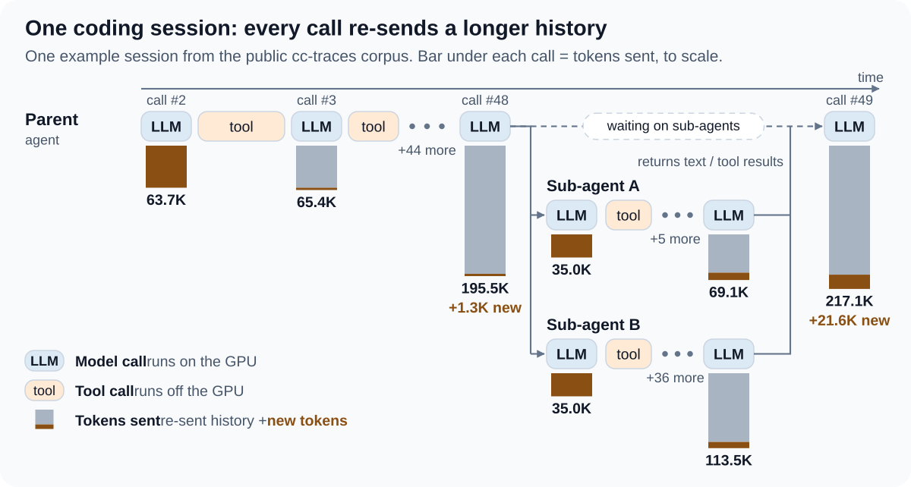
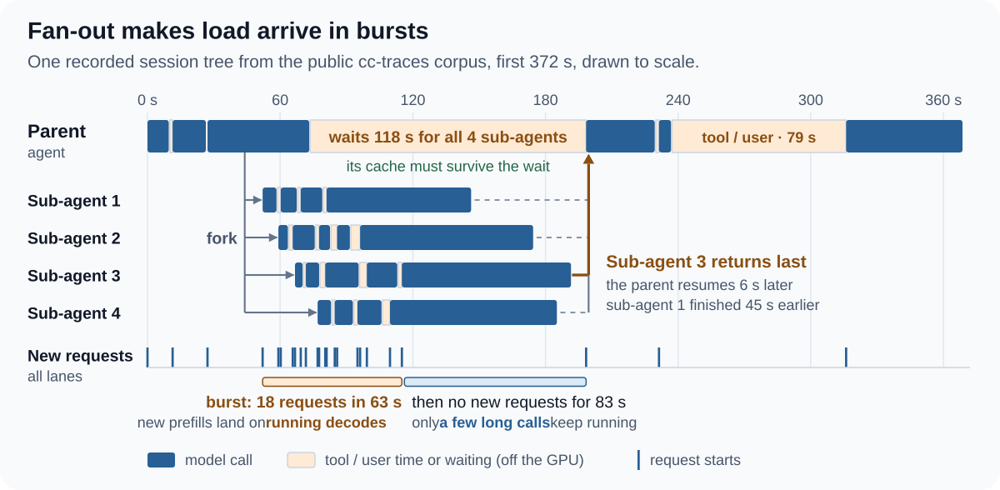
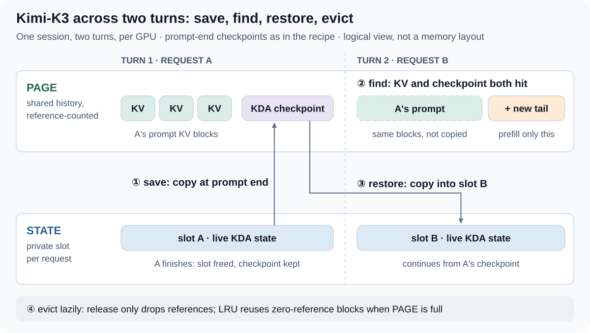
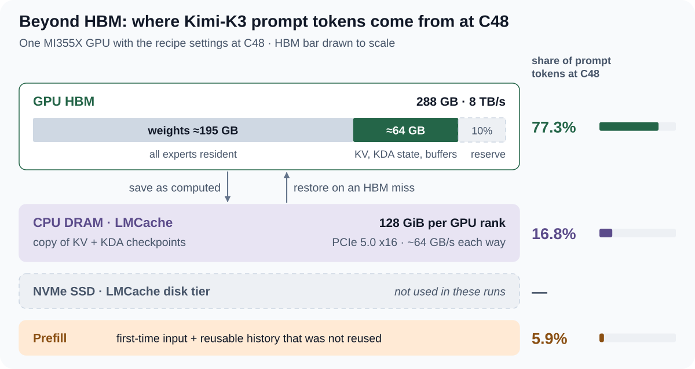
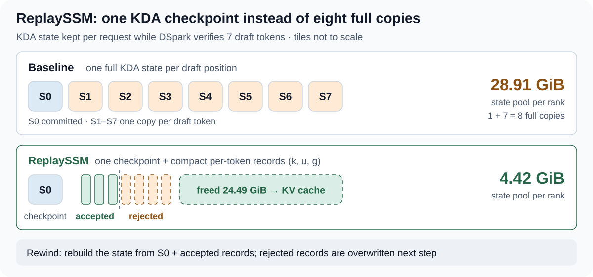
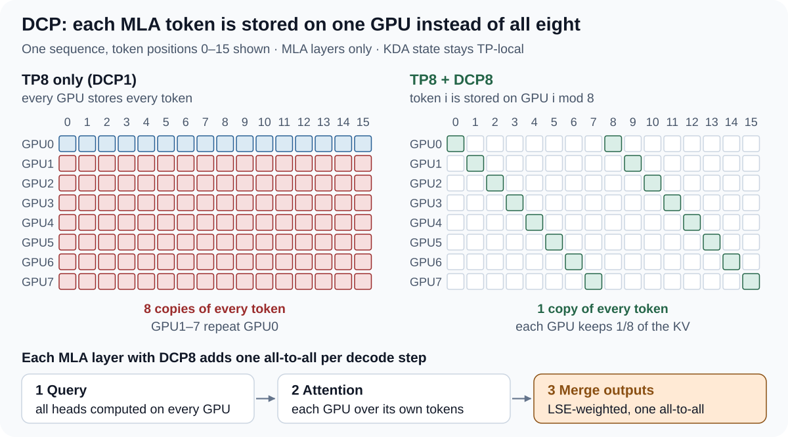
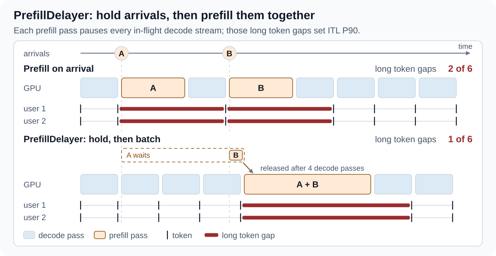
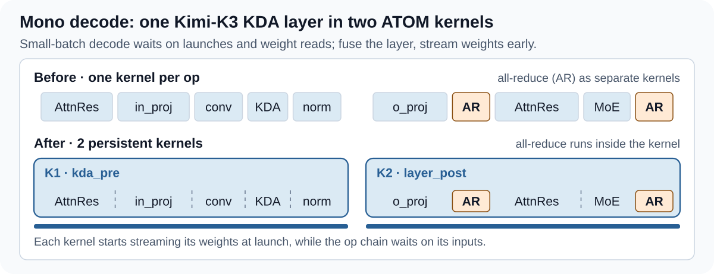
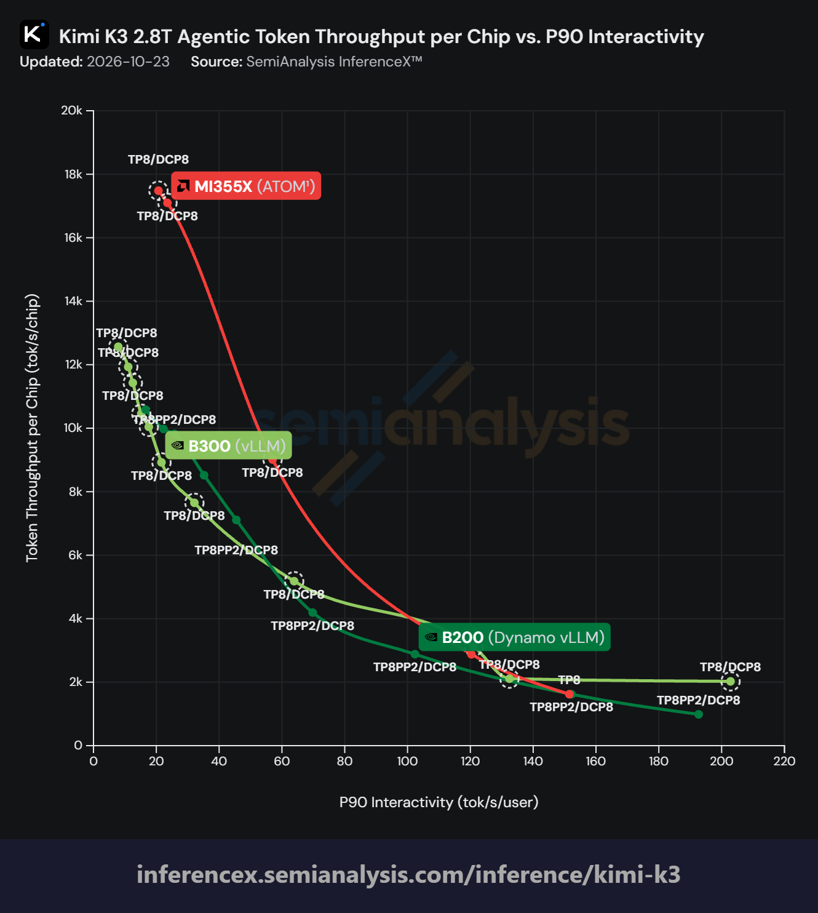

<!---
Copyright (c) 2026 Advanced Micro Devices, Inc. (AMD)

Permission is hereby granted, free of charge, to any person obtaining a copy
of this software and associated documentation files (the "Software"), to deal
in the Software without restriction, including without limitation the rights
to use, copy, modify, merge, publish, distribute, sublicense, and/or sell
copies of the Software, and to permit persons to whom the Software is
furnished to do so, subject to the following conditions:

The above copyright notice and this permission notice shall be included in all
copies or substantial portions of the Software.

THE SOFTWARE IS PROVIDED "AS IS", WITHOUT WARRANTY OF ANY KIND, EXPRESS OR
IMPLIED, INCLUDING BUT NOT LIMITED TO THE WARRANTIES OF MERCHANTABILITY,
FITNESS FOR A PARTICULAR PURPOSE AND NONINFRINGEMENT. IN NO EVENT SHALL THE
AUTHORS OR COPYRIGHT HOLDERS BE LIABLE FOR ANY CLAIM, DAMAGES OR OTHER
LIABILITY, WHETHER IN AN ACTION OF CONTRACT, TORT OR OTHERWISE, ARISING FROM,
OUT OF OR IN CONNECTION WITH THE SOFTWARE OR THE USE OR OTHER DEALINGS IN THE
SOFTWARE.
--->

# Keep the Agent Warm: How ATOM Serves AgentX Workloads on AMD Instinct MI355X GPUs

A coding agent makes many model calls in one session, and each one re-sends almost everything before it: one recorded session makes 198 calls, and call #48 sends 195.5K tokens, only 1.3K of them new. Agentic workloads combine long shared histories and short outputs, interrupted by tool calls and parallel sub-agents. Serving them well takes more than raw GPU compute: it means keeping the agent *warm*, with its history cached and its decode moving when new requests arrive.

**In short.** On eight AMD Instinct™ MI355X GPUs, ATOM serves Kimi-K3 at up to **17.5K total tok/s per chip with 56 concurrent sessions** (input plus output tokens, cached input included) and a P90 interactivity of **152 tok/s per user with a single session** on the SemiAnalysis InferenceX AgentX benchmark (run of 2026-10-15, chart as of 2026-10-23; [Figure 9](#inferencex-cross-system-view)).

This post uses Kimi-K3, a hybrid model with multi-head latent attention (MLA) and Kimi Delta Attention (KDA) layers, as the case study. It runs on [ATOM](https://rocm.blogs.amd.com/software-tools-optimization/atom-inference-engine/README.html), AMD's ROCm-native inference engine, and is measured with the AgentX benchmark.

We'll cover three parts:

- **The AgentX workload and its challenges.** Two recorded sessions show long shared histories, bursty sub-agent fan-out and idle gaps. Together they pose three serving challenges: keep history reusable, balance new requests against ongoing decode, and cut per-step cost when batches are small.
- **ATOM optimizations at three levels: memory, scheduling and compute.** Memory: reuse history across GPU HBM and CPU DRAM (LMCache), compact speculative state (ReplaySSM) and shard MLA KV across GPUs (DCP). Scheduling: hold and coalesce short prefills (PrefillDelayer) so active agents keep generating. Compute: fuse each decode step into persistent kernels (Mono decode, written in FlyDSL).
- **Results and summary.** InferenceX results, deployment settings by concurrency, and a summary that maps each challenge to its technique and measured effect.

## AgentX Workload: Real Coding Sessions, Branching Requests

**AgentX.** SemiAnalysis provides **AgentX** within **InferenceX** to evaluate serving performance under agentic workload patterns.[1]

**Trace dataset.** AgentX replays the public `cc-traces-weka-062126` corpus of Claude Code sessions: **393 sessions and 98,827 model requests**.[2] Median input is **142,016 tokens** and median output **444 tokens**—long histories, short continuations.[3] Replay keeps each request's size, shared prefixes, dependencies and timing, but sends synthetic tokens instead of the original code and tool output.[2], [4] Token counts come from the trace's 64-token blocks, not the Kimi-K3 tokenizer.[2]

**Workload characteristics.** Following the [InferenceX workload overview](https://inferencex.semianalysis.com/blog/brief-overview-of-agentic-workloads) and [AgentX methodology](https://inferencex.semianalysis.com/agentx/methodology),[1], [4] three patterns recur. Figures 1 and 2 show them in two recorded sessions: Figure 1 in tokens, Figure 2 in time. We picked these sessions because each pattern is easy to see in them; they are examples, not corpus averages, and the corpus-wide statistics are given alongside.

- **Growing, reusable history.** Every call re-sends the conversation so far. In Figure 1, call #48 sends 195.5K tokens, and only 1.3K of them are new. If the server still holds the state for the rest, **prefix-cache reuse** limits prefill—the computation that processes input before generation—to those new tokens.[1], [4]
- **Sub-agent fan-out and dependencies.** A parent agent forks sub-agents and waits for their results. A sub-agent may inherit a prefix or start without one: Figure 1 shows two of the three sub-agents forked after call #48, and each starts with a 35.0K-token call that re-sends none of the parent's history. The initial calls from all three sub-agents are almost identical to one another, so only the first is fully cold. In Figure 2, four sub-agents send 18 requests in 63 s, and the parent waits 118 s for the last one, then resumes 6 s later; these times were recorded against the original model API, not in an ATOM replay. The corpus has **42,029 sub-agent requests in 1,697 groups**.[2] Benchmark concurrency counts **live session trees**, not requests, so one session can keep several requests in flight.[1]
- **Idle gaps.** Tool runs and user think time leave gaps between calls, such as the parent's 79 s gap in Figure 2. AgentX replays the recorded gaps, within its idle-gap limits, not the activities behind them.[1], [4]

Figure 1. One coding session in tokens: each call re-sends the whole history and adds only a little new input.[2]

Figure 2. One session tree in time: sub-agents arrive in a burst, and the parent's cache must survive its wait.[2]

## Challenges: Memory, Scheduling and Compute

### Memory: Keep Reusable History Available

**Why long context puts pressure on the cache.** Long conversations and overlapping branches compete for the cache capacity left after model weights, runtime buffers and active requests. If useful history is evicted and cannot be recovered from another tier, it must be processed again. Fixed-length, independent-request tests do not expose this cross-request retention pressure. ([InferenceX workload overview](https://inferencex.semianalysis.com/blog/brief-overview-of-agentic-workloads))

**A small hit-rate loss can add thousands of prefill tokens.** Here, effective prefix-cache hit rate means the fraction of input tokens reused without recomputing their prefill, including history restored from another tier. For an input of length N, a drop in effective reuse from 96% to 95% (one percentage point) adds approximately N × 1% input tokens to prefill:

- At the full corpus's **142,016-token median input length**, that is approximately **1,420 additional tokens**.
- At its **682,880-token P95 input length**—the threshold for roughly the longest 5% of requests, not their average—the same loss adds approximately **6,829 tokens**.[3]

These are sensitivity calculations on the corpus's 64-token input-length proxy, not measured cache misses. More prefill tokens do not imply the same proportional change in FLOPs or time to first token (TTFT).

Where that cost lands for one request is simple: a full hit restores the cached prefix and prefills only the uncached suffix; a partial hit resumes from an earlier cached boundary and prefills the rest; a miss prefills the whole input before the first token. The two user-facing metrics in this post follow from it: **TTFT**, and **interactivity**, the output tokens per second each user receives (see the [InferenceX glossary](https://inferencex.semianalysis.com/glossary/interactivity)).

### Scheduling: Balance Arrivals and Decode Progress

Tool results, new branches and cache misses bring new prefills that compete with ongoing decode. Admitting each one immediately keeps interrupting active agents; holding them builds a queue and raises TTFT. The scheduler has to balance the two as load changes. Delays also add up across a session tree: a parent waiting on its sub-agents, as in Figure 2, cannot continue until the last one returns, so a delay on whichever branch returns last delays the whole task.

### Compute: Reduce Per-Step Overhead

A warm prefix avoids recomputation, not attention over history or per-step execution costs:

- **Per-token work.** Each generated token still traverses the model, and small decode batches expose kernel-launch overhead and repeated memory traffic.
- **Speculation cost.** Speculation adds draft and verification work.

## ATOM Optimizations: Memory, Scheduling and Compute

ATOM coordinates state and scheduling policies and implements the fused decode kernels; LMCache provides the CPU DRAM tier. Concurrency-specific configurations appear in [deployment recommendations](#agentx-deployment-and-performance).

### Memory: Share, Extend, Compact and Shard Cached State

**Use a cache hierarchy to reduce repeated prefill ([memory challenge](#memory-keep-reusable-history-available)).** GPU HBM keeps history close to execution. LMCache extends retention into CPU DRAM, trading capacity for transfer cost before reuse. SSD offers another tier with further I/O costs, but is not used in the configuration discussed here. ([InferenceX workload overview](https://inferencex.semianalysis.com/blog/brief-overview-of-agentic-workloads), [ATOM #2053](https://github.com/ROCm/ATOM/pull/2053))

Kimi-K3 interleaves two layer types: **MLA** layers keep a KV cache that grows with the history, and **KDA** layers keep a fixed-size convolution and recurrent state. The mechanisms below use ATOM’s native paged-cache path for Kimi-K3 (PAGE: the paged capacity shared by KV blocks and retained KDA checkpoints) at a [fixed source revision](https://github.com/ROCm/ATOM/tree/d8cdd4e2908518cddb77ed7b3f057108fc638145).

#### Share KV and KDA Checkpoints in HBM

**Kimi-K3 requires a joint cache hit.** A request can resume from a cached boundary only if the MLA KV and a KDA checkpoint both exist for that boundary. If only the KV matches, ATOM falls back to the latest earlier boundary where both exist, or prefills from the start. ([ATOM #2045](https://github.com/ROCm/ATOM/pull/2045))

- **Share KV blocks.** Each full KV block is found by a hash of all the history up to its end, so requests with the same history point to the same blocks instead of copying them. ([ATOM #1771](https://github.com/ROCm/ATOM/pull/1771))
- **Copy KDA state into checkpoints.** A request's live KDA state keeps changing, so at a chosen boundary ATOM copies it into a checkpoint in the same pool as the KV blocks. A later hit copies the checkpoint into the new request's own state slot and continues from there. ([ATOM #1771](https://github.com/ROCm/ATOM/pull/1771), [ATOM #2045](https://github.com/ROCm/ATOM/pull/2045))
- **Keep finished history until space is needed.** When a request ends, its cached blocks stay reusable until the pool needs the space. ([ATOM #1771](https://github.com/ROCm/ATOM/pull/1771))

Figure 3. Kimi-K3 prefix reuse across two turns: KV blocks and the KDA checkpoint are saved, found and restored together.

**Balance checkpoint density against retained history.** Preserving more historical KDA checkpoints offers more potential resume boundaries, but each copy consumes capacity and copy bandwidth that could otherwise retain KV. Sparse placement saves storage but may leave a long KV match without the state needed to use its full length.

**Choose useful checkpoint boundaries.** ATOM supports an interval ladder with token-based spacing, demand checkpoints at reuse positions previously declined because state was missing, and prompt-end anchors near the last matchable block boundary. Anchors target later requests that extend an earlier prompt; they need not coincide with its final token. These are boundary-selection rules, not percentage sampling. On this Kimi-K3 PAGE path, the saved state must represent the exact selected boundary, so prefill chunks may need to end there before copying. The deployed recipe uses prompt-end anchors only (Figure 3); interval and demand checkpoints remain available for other workloads. ([ATOM #2045](https://github.com/ROCm/ATOM/pull/2045))

#### Extend Reuse to CPU DRAM with LMCache

**HBM alone is not enough at high concurrency.** Each AMD Instinct MI355X GPU provides **288 GB HBM3E**.[5] All experts stay resident (MoE sparsity cuts compute, not memory), so the weights take about 195 GB per GPU (estimated as the 1.56 TB checkpoint split across eight GPUs, not measured).[9] After a 10% reserve, roughly 64 GB is left for runtime buffers, KV and KDA state. At C48 the recipe adds 128 GiB of CPU DRAM per GPU rank through LMCache.

**Where C48 prompt tokens came from.** In the run of 2026-10-15, 77.3% of prompt tokens were reused from HBM and 16.8% restored from DRAM, **94.1%** in total (Figure 4).[10] The trace allows at most 97.2% reuse, the hit rate an unlimited cache would reach. Of the 5.9% prefilled, 2.8% is input seen for the first time and about 3.1% is history that could have been reused but was not. This is a split within one run, not an LMCache on/off comparison.

Figure 4. Where prompt tokens come from at C48: GPU HBM, CPU DRAM through LMCache, or prefill.[10]

**Restore from DRAM under the same joint-hit rule.** KV chunks and KDA checkpoints share one LMCache CPU storage manager but return to different places: KV to PAGE blocks, KDA state to a request-private slot. ATOM resumes at the shared boundary only after both loads finish; if either load fails, ATOM does not reuse that boundary and recomputes instead. ([ATOM #2053](https://github.com/ROCm/ATOM/pull/2053), [ATOM #2045](https://github.com/ROCm/ATOM/pull/2045))

#### Compact Speculative KDA State with ReplaySSM for DSpark

**What it is and where it fits.** ReplaySSM (*ReplaySSM: Cache SSM Inputs, Not State*; SSM stands for *state space model*) changes how recurrent state is stored during decoding. Here, ATOM uses it to reduce KDA rollback storage for DSpark—not to replay an execution graph. ([ReplaySSM](https://tridao.me/blog/2026/replayssm/), [ATOM #1883](https://github.com/ROCm/ATOM/pull/1883))

**Why speculation creates a state problem.** DSpark proposes draft tokens for the target model to verify. If only a prefix is accepted, KDA must continue from that boundary, excluding rejected tokens. The baseline retains a full recurrent-state snapshot for each speculative position, so longer verification windows require more large state copies.

**Keep one checkpoint and compact update records.** ReplaySSM retains one recurrent checkpoint and a short `(k, u, g)` buffer: keys, delta-corrected updates and decay information. The checkpoint plus committed records reconstructs the required state as a decayed checkpoint plus weighted outer-product updates. Storing corrected `u` rather than raw `v` allows these updates to be combined without recomputing each correction through the preceding state.

**Commit the accepted prefix; periodically fold it.** At the next forward, ATOM applies the previous step's accepted count to advance a cursor. Rejected records remain outside the committed prefix and are overwritten later. Periodic folding absorbs committed records into the checkpoint and reuses the buffer, trading snapshot storage for record storage and replay/fold computation. This manages the active decoding window, unlike prefix checkpoints retained for later requests. ([ATOM #1883](https://github.com/ROCm/ATOM/pull/1883))

Figure 5. ReplaySSM keeps one KDA checkpoint plus per-token records instead of a full state per draft position, freeing memory for KV cache.

In a local experiment on MI355X with Kimi-K3, DSpark at 7 draft tokens (the recipe uses 4 from C8 up) and 8-way tensor parallelism (TP8), ReplaySSM frees **24.49 GiB per rank** and raises available KV blocks from 8,325 to 18,813 (**2.26×**) for retaining history—not 2.26× throughput or cache-hit rate.

#### Shard MLA KV Across GPUs with DCP

Decode context parallelism (DCP) shards MLA KV across the existing TP ranks; KDA state stays TP-local.[7] ([ATOM #847](https://github.com/ROCm/ATOM/pull/847), [ATOM #1701](https://github.com/ROCm/ATOM/pull/1701))

Figure 6 shows the layout. MLA keeps one latent KV entry per token that every attention head reads, so splitting heads does not split the KV: with TP8 alone, every GPU stores all of it. DCP8 deals the tokens round-robin across the eight GPUs (token i on GPU i mod 8, ATOM's default), so each token is stored once. For 48 sessions at the corpus median of 142K tokens (an estimate, not a measured C48 working set), MLA KV is 24 layers × 576 B per token in FP8 × 48 × 142K ≈ 94 GB per GPU, more than the roughly 64 GB left after weights and reserve; DCP8 brings it to about 12 GB. The cost is one extra all-to-all per MLA layer in each decode step, which merges the partial attention outputs; with ATOM's default query replication, each GPU computes all query heads itself, so no query gather is needed. Prefilling a cached prefix also needs a KV gather.

Figure 6. MLA KV layout: with TP8 alone every GPU stores every token; with DCP8 each token is stored on one GPU.

### Scheduling: Coalesce Prefills with PrefillDelayer

**Coalescing policy ([scheduling challenge](#scheduling-balance-arrivals-and-decode-progress)).** After each prefill, PrefillDelayer lets a set number of decode passes (not generated tokens) run while it holds new arrivals, so they prefill together instead of pausing decode one at a time. ATOM extends it to TP/DCP. The hold is bounded, but it is not an end-to-end TTFT guarantee. ([ATOM #2238](https://github.com/ROCm/ATOM/pull/2238))

Figure 7. PrefillDelayer holds new arrivals and prefills them together, so decode streams pause once instead of twice.

Figure 7 is schematic. In ATOM #2238, enabling the four-pass delay on Kimi-K3 AgentX at C16 cuts P90 inter-token latency (ITL) by 22% (31.6 → 24.6 ms), so active agents get steadier tokens. New arrivals pay for it: median TTFT rises 49% (1,182 → 1,766 ms). The recipe therefore enables the delay from C16 upward, not in the interactive band. ([ATOM #2238](https://github.com/ROCm/ATOM/pull/2238))

### Compute: Fuse Each Decode Step with Mono Decode

**Mono decode for single-session latency ([compute challenge](#compute-reduce-per-step-overhead)).** At C1, a speculative step that verifies one request's seven draft tokens plus one runs the target model over only eight rows. At that size, launch overhead and weight streaming dominate, not arithmetic. Mono decode replaces the chain of small kernels in each eligible KDA layer with two persistent kernels written in FlyDSL and shipped inside ATOM: K1 runs from the attention input through the KDA recurrence, and K2 covers the output projection and the latent MoE, including the tensor-parallel all-reduce; each kernel starts streaming its weights at launch. MLA layers and a few other layers keep the standard path. The design of these FlyDSL mono kernels, and their use in ATOM, vLLM and SGLang, is in [FlyDSL Mono Kernels for High-Interactivity LLM Serving in ATOM](https://rocm.blogs.amd.com/software-tools-optimization/flydsl-mono-atom/README.html).[11]

**Measured effect.** In a single-request test in ATOM #2535 (seven draft tokens, fixed acceptance length, TP8), target-model forward time drops from 22.0 to 16.4 ms against a reference that keeps three KDA projections in BF16. ([ATOM #2535](https://github.com/ROCm/ATOM/pull/2535))

Figure 8. Mono decode runs each eligible KDA layer as two persistent kernels, with the all-reduce inside.

**Where it applies.** The first Kimi-K3 mono kernels served decode steps of at most eight rows, which fits one request with seven draft tokens. [ATOM #2659](https://github.com/ROCm/ATOM/pull/2659) raised the limit to 16 rows and also fused the output projection and MoE of the MLA layers; [ATOM #2871](https://github.com/ROCm/ATOM/pull/2871) raised it to 64 rows. Steps that include a prefill still take the standard path. The recipe enables Mono decode at C1 only, because the other bands have not yet been measured with it on.

## Results and Deployment Recommendations

### Performance and AgentX Deployment

Figure 9 shows the throughput–interactivity trade-off reported by InferenceX for Kimi-K3 across hardware/framework combinations. As a rough guide, moving a point **up** (more tokens per chip) depends mostly on memory, because reused history skips prefill; moving it **right** (faster responses for each user) depends more on scheduling and per-step compute. This cross-system comparison is not an ablation of individual optimizations.

Figure 9. Kimi-K3 total token throughput per chip versus P90 interactivity across systems. Source: [SemiAnalysis InferenceX](https://inferencex.semianalysis.com/inference/kimi-k3), updated 2026-10-23.

The Kimi-K3 AgentX recipe[6] gives concurrency-specific starting points for ATOM on **8× AMD Instinct MI355X GPUs**, summarized in the table below. All bands use FP8 KV and GPU prefix caching, and Mono decode is on at C1 only. The MI355X/ATOM points in Figure 9 come from the InferenceX run configuration,[8] an ATOM nightly build from 2026-10-13, with FlyDSL mono kernels off at every plotted concurrency, including C1. On that run the KDA state stays in FP16; Mono decode keeps it in FP32. A few environment and quantization settings also differ from the later recipe. The **152 tok/s per user (P90) at C1** and **17.5K tok/s per chip at C56** in this chart therefore do not include Mono decode yet.

In Kimi-K3 AgentX runs at C1 on the same build, turning Mono decode on cuts median ITL from 6.27 to 5.01 ms and raises output throughput by 10.9%. The same FlyDSL mono approach also runs in ATOM for GLM-5.2, DeepSeek-V4.1 and MiniMax-M3.[11]

| Serving band | Optimization focus | Recipe: parallelism and speculation | Recipe: cache and scheduling |
| --- | --- | --- | --- |
| Interactive, C1/C2/C4 | Lowest per-user latency | TP8, DCP1, DSpark with 7 draft tokens; synthetic acceptance length (AL) 3.84 | GPU prefix cache; no LMCache; ReplaySSM off; Mono decode at C1 only |
| Mid-concurrency, C8/C12/C14/C16 | Steady decode under bursty prefills | TP8, DCP8, DSpark with 4 draft tokens; synthetic AL 3.36 | LMCache 128 GiB; ReplaySSM on; PrefillDelayer at C16 |
| Throughput, C32–C80 | Most retained history and sessions per GB | TP8, DCP8, DSpark with 4 draft tokens; synthetic AL 3.36 | ReplaySSM on; LMCache 128 GiB at C32–C48, 192 GiB at C56–C80; PrefillDelayer; larger in-flight window |

**Checkpoint policy.** The recipe keeps only prompt-end anchors: `--state-checkpoint-interval-tokens -1` turns off the interval ladder (default 8192 tokens), and `ATOM_STATE_CHECKPOINT_DEMAND=0` turns off demand checkpoints. ([ATOM #2045](https://github.com/ROCm/ATOM/pull/2045))

### Deployment Checks

Start a fresh server for each concurrency, and save the model, hardware, software versions and serving configuration for each point. Synthetic acceptance is for performance runs only; turn it off for correctness and task-quality evaluation. Under the target workload, check recomputed prefill, restore failures and kernel dispatch, then test long-context continuation, checkpoint forks and tool use. The bands are recipe choices, not universal thresholds: use these checks to pick an operating point that meets your latency and quality requirements.

## Summary

In this blog, you explored how ATOM serves agentic coding workloads from the SemiAnalysis InferenceX AgentX benchmark on eight AMD Instinct MI355X GPUs, using Kimi-K3 as the case study. You saw how replayed coding sessions differ from fixed-length request tests: each call re-sends a long, growing history (Figure 1), sub-agents arrive in bursts, and idle gaps separate calls (Figure 2). These patterns pose three serving challenges: keeping history reusable, balancing new prefills against ongoing decode, and cutting per-step cost when batches are small.

You then saw how ATOM answers each challenge. For memory, ATOM shares MLA KV blocks and KDA checkpoints in GPU HBM and extends reuse to CPU DRAM through LMCache, so 94.1% of prompt tokens at C48 are reused instead of prefilled. ReplaySSM compacts speculative KDA state to fit 2.26× as many KV blocks in a seven-draft experiment, and DCP8 stores each MLA KV token on one GPU instead of all eight. For scheduling, PrefillDelayer holds and coalesces new arrivals, cutting P90 ITL by 22% at C16 at the cost of 49% higher median TTFT. For compute, Mono decode fuses each eligible KDA layer into two persistent FlyDSL kernels, cutting target-model forward time from 22.0 to 16.4 ms in a single-request test and median ITL from 6.27 to 5.01 ms in AgentX runs at C1.

On InferenceX, the run of 2026-10-15 measured ATOM on MI355X at **17.5K total tok/s per chip at C56** and **152 tok/s per user (P90) at C1**, with FlyDSL mono kernels off. These are operating points of the whole measured stack, not gains attributed to individual techniques. To try these settings, start from the [Kimi-K3 AgentX recipe](https://github.com/ROCm/ATOM/blob/main/recipes/Agentic-Kimi-K3.md) and run the [deployment checks](#what-to-validate-next) against your own traffic.

Looking ahead, we plan to measure Mono decode beyond C1, now that [ATOM #2871](https://github.com/ROCm/ATOM/pull/2871) supports decode steps of up to 64 rows, and to bring it into the InferenceX runs. We are also working to close the remaining gap to the trace's 97.2% reuse ceiling and to evaluate SSD as a further cache tier for longer sessions and higher concurrency. Follow the ROCm Blogs for upcoming posts as these results land.

## Acknowledgments

We thank the ATOM, AITER and FlyDSL teams and the LMCache community for their contributions.

## References

1. [SemiAnalysis AgentX harness: AgentX MVP tutorial](https://github.com/SemiAnalysisAI/agentx-harness/blob/fbcfc8923e46d489621d177c50fe05fe792213eb/docs/tutorials/agentx-mvp.md)
2. [`cc-traces-weka-062126` dataset card (Hugging Face)](https://huggingface.co/datasets/semianalysisai/cc-traces-weka-062126/blob/23f152f6f0f9399a85901b89a6458def0ef16729/README.md)
3. [InferenceX dataset statistics for the Claude Code trace corpus](https://inferencex.semianalysis.com/api/v1/datasets/cc-traces-weka-062126)
4. [SemiAnalysis AgentX harness: trace replay tutorial](https://github.com/SemiAnalysisAI/agentx-harness/blob/fbcfc8923e46d489621d177c50fe05fe792213eb/docs/tutorials/weka-trace.md)
5. [AMD Instinct MI355X GPU product page](https://www.amd.com/en/products/accelerators/instinct/mi350/mi355x.html)
6. [ATOM Kimi-K3 AgentX recipe (pinned revision)](https://github.com/ROCm/ATOM/blob/53e4fb52403707ab07b69ee909501ea3cc25ca5c/recipes/Agentic-Kimi-K3.md)
7. [ATOM MLA attention implementation (pinned revision)](https://github.com/ROCm/ATOM/blob/d8cdd4e2908518cddb77ed7b3f057108fc638145/atom/model_ops/attention_mla.py)
8. [InferenceX Kimi-K3 ATOM MI355X AgentX run configuration (pinned revision)](https://github.com/SemiAnalysisAI/InferenceX/blob/d451db102c8b75e49575adaf795b89a932978dc8/inferencex-e2e/benchmarks/single_node/srt-slurm-recipes/kimik3/atom/mi355x-fp4-mtp/agentic.yaml)
9. [Kimi-K3 model files (Hugging Face)](https://huggingface.co/moonshotai/Kimi-K3/tree/main)
10. [InferenceX benchmark results for Kimi-K3, 2026-10-23 (API)](https://inferencex.semianalysis.com/api/v1/benchmarks?model=Kimi-K3&date=2026-10-23)
11. [FlyDSL Mono Kernels for High-Interactivity LLM Serving in ATOM](https://rocm.blogs.amd.com/software-tools-optimization/flydsl-mono-atom/README.html)

## Disclaimers

The information presented in this document is for informational purposes only
and may contain technical inaccuracies, omissions, and typographical errors.
The information contained herein is subject to change and may be rendered
inaccurate for many reasons, including but not limited to product and roadmap
changes, component and motherboard version changes, new model and/or product
releases, product differences between differing manufacturers, software
changes, BIOS flashes, firmware upgrades, or the like. Any computer system has
risks of security vulnerabilities that cannot be completely prevented or
mitigated. AMD assumes no obligation to update or otherwise correct or revise
this information. However, AMD reserves the right to revise this information
and to make changes from time to time to the content hereof without obligation
of AMD to notify any person of such revisions or changes. THIS INFORMATION IS
PROVIDED "AS IS." AMD MAKES NO REPRESENTATIONS OR WARRANTIES WITH RESPECT TO
THE CONTENTS HEREOF AND ASSUMES NO RESPONSIBILITY FOR ANY INACCURACIES, ERRORS,
OR OMISSIONS THAT MAY APPEAR IN THIS INFORMATION. AMD SPECIFICALLY DISCLAIMS
ANY IMPLIED WARRANTIES OF NON-INFRINGEMENT, MERCHANTABILITY, OR FITNESS FOR
ANY PARTICULAR PURPOSE. IN NO EVENT WILL AMD BE LIABLE TO ANY PERSON FOR ANY
RELIANCE, DIRECT, INDIRECT, SPECIAL, OR OTHER CONSEQUENTIAL DAMAGES ARISING
FROM THE USE OF ANY INFORMATION CONTAINED HEREIN, EVEN IF AMD IS EXPRESSLY
ADVISED OF THE POSSIBILITY OF SUCH DAMAGES.

Third-party content is licensed to you directly by the third party that owns
the content and is not licensed to you by AMD. ALL LINKED THIRD-PARTY CONTENT
IS PROVIDED "AS IS" WITHOUT A WARRANTY OF ANY KIND. USE OF SUCH THIRD-PARTY
CONTENT IS DONE AT YOUR SOLE DISCRETION AND UNDER NO CIRCUMSTANCES WILL AMD BE
LIABLE TO YOU FOR ANY THIRD-PARTY CONTENT. YOU ASSUME ALL RISK AND ARE SOLELY
RESPONSIBLE FOR ANY DAMAGES THAT MAY ARISE FROM YOUR USE OF SUCH THIRD-PARTY
CONTENT.

AMD, the AMD Arrow logo, AMD Instinct, ROCm, and combinations thereof are
trademarks of Advanced Micro Devices, Inc. Other product names used in this
publication are for identification purposes only and may be trademarks of
their respective companies. © 2026 Advanced Micro Devices, Inc. All rights
reserved.
