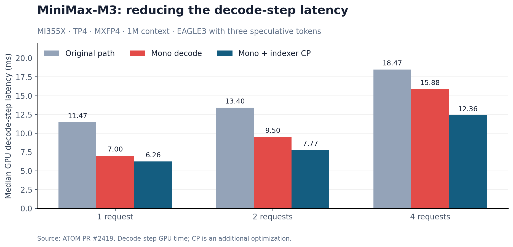

# Mono Kernels on AMD Instinct: Faster LLM Decode with FlyDSL and ATOM

**Mono kernels turn a chain of GPU operators into a programmable resident execution schedule.** On AMD Instinct MI355X, ATOM's FlyDSL mono decode plus indexer context parallelism delivers a **1.83× faster MiniMax-M3 GPU decode step at a one-million-token context**: 11.47 ms becomes 6.26 ms. Mono alone delivers 1.64×; context parallelism adds the next increment. [1]

**ROCm currently has no equivalent of CUDA's Programmatic Dependent Launch (PDL).** Mono kernels address that scheduling gap inside one resident grid: load a consumer's weights early, hand off a producer's output as it becomes ready, and integrate tensor-parallel reductions with the work around them. FlyDSL makes those decisions programmable; ATOM brings the resulting kernels into a model-serving runtime.

M3 is the main example in this article, with **EAGLE3 using three speculative tokens**—four target-model rows per request. Results from Kimi-K3, DeepSeek-V4.1, and GLM-5.2 show how the technique extends to different layer structures and fusion boundaries.

## Mono benefits across four models

| Model and mono path | Comparison and configuration | Reported benefit |
| --- | --- | --- |
| **MiniMax-M3**: fused sparse layer | Original path → mono; MI355X, TP4, MXFP4, 1M context, batch 1, EAGLE3 with three speculative tokens | **39.0% lower GPU decode-step latency**; indexer CP raises the combined speedup to **1.83×**. [1] |
| **Kimi-K3**: fused MoE tail | Reference → mono; MI355X, TP8, concurrency 1, `DCP1`, DSpark7, graph mode | Output throughput **169.15 → 197.92 tokens/s (+17.01%)**; time per output token (TPOT) **5.55–5.60 → 4.70 ms**. [8] |
| **DeepSeek-V4.1-Flash**: fused sublayers | Previous mono schedule → updated mono schedule; TP4, batches 1/2/4/8 | Decode-step time improves **4% / 10% / 11% / 12%**, respectively. [9] |
| **GLM-5.2**: decoder-layer mono | Production → mono; MI355X, TP4, MXFP4, FP8 KV, MTP4, graph mode | At concurrency 1, Agentic throughput **+15.92%**, TPOT **6.897 → 5.380 ms**. At concurrency 2, throughput **+16.8%**, TPOT **26.2% lower**. [8] |

### Scope and methodology

These are PR-reported comparisons against the baselines named in the table. GPU step time, layer-harness time, and serving throughput measure different scopes. M3's headline includes indexer CP; its mono-only and CP results are separated below. DeepSeek-V4.1 measures an increment over an existing mono implementation. **The Kimi-K3 and GLM-5.2 paths in ATOM #2435 remain in progress: the PR was open when checked on October 13, 2026.** Its results apply to Kimi concurrency 1 and GLM MTP4 at concurrency 1–2. No new GPU benchmarks were run for this article. The [comparison CSV](data/mono-benefits.csv) records the reported metrics and configurations. [1], [8], [9]

## Why mono on AMD

Small decode batches leave each operator with little work, so kernel launch latency and synchronization can become a substantial part of the layer's critical path. HIP graph replay reduces host submission overhead, but each separate kernel still has a device execution boundary.

PDL lets a dependent kernel begin independent preparation before its producer finishes, then synchronize at the point of consumption. A mono kernel creates that opportunity within one GPU program. Its blocks execute different stage tasks, prefetch independent operands, and synchronize on the data each task needs.


*Figure 1. A schematic of three opportunities inside a mono kernel: cross-stage prefetch, data-dependent handoffs without a grid-wide barrier between every stage, and AllReduce progressing alongside its producers and consumers. Bars show execution order, not measured durations.*

### From multiple launches to a resident layer

FlyDSL PR #1204 gives a concrete launch-count comparison for the Kimi-K3 KDA layer, including its ordered speculative-state updates. M3 extends the fusion boundary through its sparse indexer and both layer reductions. [1], [5]

| Layer path | Token rows | Staged launches per layer and rank | Mono launches per layer and rank |
| --- | ---: | ---: | ---: |
| Kimi-K3 KDA, true MTP, FlyDSL #1204 | 4 | 7 | **1** |
| Kimi-K3 KDA, true MTP, FlyDSL #1204 | 8 | 9 | **1** |
| MiniMax-M3 sparse layer, ATOM #2419 | 1–16 | Count not reported | **1** |

*Launch count describes the fusion boundary. The Kimi whole-layer experiment is distinct from the MoE-tail path in the results table: its staged implementation was faster at these widths (120.83 versus 153.11 µs at four rows; 155.75 versus 243.15 µs at eight). This is why the fusion boundary remains a measured design choice. [5]*

The design follows the **TileRT MonoKernel work**, carried into FlyDSL and ATOM. FlyDSL #1204 cites the TileRT InferenceMAX/InferenceX submission at [snapshot `8ac9834`](https://github.com/SemiAnalysisAI/InferenceX/tree/8ac98344b038a3f2da20a565fe9b974772a67ef9), associated with [#3389](https://github.com/SemiAnalysisAI/InferenceX/pull/3389). M3's source documents the reuse of FlyDSL wave reductions, tagged mailboxes, and matrix-vector loops. [5], [6], [7]

## Why FlyDSL fits mono kernels

**FlyDSL is a Python domain-specific language with explicit tensor layouts, tiling, memory operations, and GPU instruction control.** Its layout algebra describes how tensors map to storage and threads; its MLIR compiler pipeline lowers the specialized program to GPU code. This lets one implementation express the arithmetic, the placement of its operands, and the schedule that moves those operands between stages. [2]

M3 makes that control tangible. Its Python planning code computes task assignments and LDS storage, while the kernel builder specializes every supported row count from 1 through 16. The following excerpt from `layout.py` selects the wider expert schedule and pads the activation and scale rows: [11]

```python
WIDE_FROM = 5

def wide_moe(tokens: int) -> bool:
    return tokens >= WIDE_FROM

XN8_ROW = HIDDEN // 4 + 4
XSC_ROW = HIDDEN // 32 + 4
```

With a hidden width of 6,144, an MXFP8 activation row occupies 1,536 words and its scale row occupies 192 words. Each pitch gains four words—16 bytes. At 16 token rows, the natural pitches put the matrix operand's gathers in the same LDS bank group; padding spreads those accesses across banks. A small Python layout change therefore changes the hardware access pattern of the fused expert computation. [11]

| FlyDSL control | What M3 does with it |
| --- | --- |
| Compile-time row count | Builds a distinct schedule and storage plan for each of 1–16 token rows. |
| Layout and LDS pitch | Changes activation packing, scale placement, and bank access alongside task placement. |
| Instruction and memory order | Issues independent weight loads before input waits and uses explicit matrix instructions. |
| Device synchronization | Polls tagged payloads with device scope locally and system scope across peer GPUs. |

The M3 work also consolidated low-level operations around `fx.rocdl.readlane`, `fx.rocdl.ballot`, `fx.ctpop`, and shared `permlane_swap` and `memrealtime` helpers. These operations support wave-level data exchange, selection, and instrumentation without hiding the execution details from the kernel author. [1], [7]

Reusable kernels live under FlyDSL's `kernels/monokernel/`, including **gfx950 GEMM, MXFP8 linear, and tagged symmetric AllReduce**. ATOM's shared `atom/mono` framework provides runtime, planning, and device components around model-specific schedules. That separation lets a scheduling idea carry into another model while preserving the model's own attention, routing, and state semantics. [5], [10]

## Inside M3: one launch through the sparse layer

M3's mono kernel fuses input normalization, Q/K/V and index projections, head normalization and rotary position embedding (RoPE), cache insertion, index scoring and selection, sparse attention, routing, and mixture-of-experts (MoE) computation. Attention and MoE AllReduce execute in the same launch. The first three dense layers use ATOM's original modules; every supported sparse layer uses one launch per TP rank. [3]


*Figure 2. M3's sparse-layer dependency chain. In the source, the pre-attention stages are named K1 and the layer kernel K4; K1 is fused into K4. Blocks exchange intermediates through tagged memory, while registers and LDS hold local working data.*

### A grid whose blocks change jobs

The launch uses **256 workgroups of 512 threads**, targeting one resident workgroup per MI355X compute unit. A block walks its stage tasks in dependency order. Producers remain resident while consumers wait, so the schedule can make progress without a grid-wide barrier at every stage boundary. Workgroup-local barriers still coordinate wavefronts inside a block. [3]

Task `t` of a stage runs on block `(stage_base + t) % 256`. At four rows, the placement is concrete:

| Stage | Task placement |
| --- | --- |
| Split attention | Blocks 0–31: eight context partitions for each of four rows. |
| Attention merge | Blocks 32–35: one task per row. |
| Output projection | Blocks 36–227: 192 tasks spanning the hidden dimension. |
| Router | Starts at block 228 and wraps to block 35. |

The router therefore reuses blocks that earlier executed attention tasks. Expert work has its own placement: at four rows, grouping routed up/gate tasks by token lets a block reuse one staged activation. At wider shapes, the schedule groups tokens by their selected expert and places them in matrix columns, reusing that expert's weights across tokens. [11]

### Use a dependency wait to prepare the next computation

In the narrow MoE path, a block starts loading its down-projection weights while its up/gate computation runs. Shared-expert tasks are assigned according to the blocks' routed-work load; where the load is balanced, shared-expert work runs while the first routed task's weights are in flight. [3], [11]

Storage follows the same schedule. M3 sizes one LDS activation pool for the largest simultaneously live requirements and reuses it between stages. It also replicates the router's score mailbox eight ways, with block `b` polling copy `b % 8`, to spread the many expert consumers' traffic across cache lines. The optimization reaches beyond arithmetic into the contention created by the schedule itself. [11]

### A mailbox carries both data and its generation

Each mailbox payload word is paired with an epoch tag. Consumers reload the requested pairs until every tag matches the current launch. The poll loop in `common.py` is short; its `load_all` callback emits the coherent loads and its `pending` callback checks the tags. The source excerpt below omits only the docstring: [7]

```python
@traced
def _spin(load_all, pending):
    v = load_all()
    while pending(v):
        rocdl.s_sleep(1)
        v = load_all()
    return v
```

The epoch is `decode_step × 128 + layer_id + 1`. A device counter advances between decode steps, so replaying a captured graph cannot mistake an earlier step's payload for a new result. Local mailboxes use device-scope accesses; peer mailboxes use system scope. Polls are batched in groups of at most 12 mailbox specifications to bound live registers. ATOM owns the buffers and alternates layer-output storage by layer parity. [3], [7]

### AllReduce becomes a stage in the dataflow

An output-projection task publishes its partial hidden rows to peer memory. Once all rank contributions for those rows arrive, the reduction sums them in rank order and feeds the residual update, normalization, and router. Other blocks can still be producing different rows. MoE reduction uses the same producer–reduction–consumer organization to prepare the next layer's inputs. [3]

The schedule changes with row count:

| Token rows | Expert computation | Attention and MoE AllReduce |
| --- | --- | --- |
| 1–4 | Tasks organized by token and expert slot | Push partial rows to peers; each rank accumulates them. |
| 5–11 | Tokens grouped by distinct expert | Same direct peer exchange. |
| 12–16 | Tokens grouped by distinct expert | Reduce-scatter to each row's owner, then all-gather the sums. |

For the wider steps, the extra reduction hop buys fewer bytes per link. FlyDSL specializes these choices together with the matrix tiles and LDS layout, keeping the numerical accumulation order explicit. [3], [11]

### Indexer CP: reuse the long-context cache across heads

M3 selects **16 blocks of 128 tokens**, then divides the resulting sparse keys among eight attention partitions of 256 keys. At a 1M context, discovering those blocks is itself significant work. Indexer context parallelism (CP) changes which rank reads the index cache. [1], [3]

In the TP path, each rank scans the cache for its own index-query head. In the CP path, each rank scans **one quarter of the context for all four heads**. Each head's owning rank receives the candidates and completes selection. CP activates past **288 index blocks**, approximately 36K tokens, near the measured break-even range of 258–297 blocks. [1]


*Figure 3. For each head, four ranks contribute two partitions each. The eight partitions each return their top 16 candidates; the owning rank merges 128 candidates into the final selection of 16 blocks.*

The extra index-query projections run only when a step contains a request above the threshold. Long-context selection also occupies a separate cold stage inside the fused kernel, keeping that code out of the short-context hot path. At 1M context with 16 rows and four query tokens per request, the graph-replay layer harness improves from **222.2 to 156.7 µs** with CP: **1.42× faster**. Short-context changes stay within the PR's reported ±0.9 µs. [1]

### Why the gain changes with batch size

The server measurements use MI355X, TP4, MiniMax-M3-MXFP4, a 1M context, and EAGLE3 with three speculative tokens. Batches of 1, 2, and 4 produce 4, 8, and 16 target-model rows before graph padding. [1]

Latencies are in milliseconds; gains are mono / mono + CP speedups relative to the original path.

| Batch | Original | Mono | Mono + CP | Gain |
| ---: | ---: | ---: | ---: | ---: |
| 1 | 11.47 | 7.00 | 6.26 | 1.64× / 1.83× |
| 2 | 13.40 | 9.50 | 7.77 | 1.41× / 1.72× |
| 4 | 18.47 | 15.88 | 12.36 | 1.16× / 1.49× |



*Figure 4. Median GPU decode-step latency; lower is better. The [decode-step CSV](data/minimax-decode-step.csv) and [CP layer-harness CSV](data/minimax-indexer-cp-layer.csv) retain the reported values and scopes.*

At batch one, mono saves **4.47 ms** and CP saves a further **0.74 ms**. At batch four, mono saves **2.59 ms** and CP saves another **3.52 ms**. As rows grow, launch and synchronization overhead is amortized over more work, consistent with the smaller mono speedup; weight traffic, expert computation, and long-context scoring become more prominent. The expert-grouped MoE schedule and indexer CP target those growing costs.

## ATOM: default dispatch, fallback, and debugging

**ATOM (AiTer Optimized Model)** supplies model loading, cache management, speculative decoding, graph replay, and distributed execution around the FlyDSL program. For eligible M3 TP4 deployments, **`ATOM_MONO_ENABLE=1` is the default**. The runtime checks the model geometry, FP8 KV and index caches, cache layout, and row count before dispatch. Ineligible steps automatically use the existing model path, allowing mono to stay enabled as the request mix changes. [1], [3], [4]

Speculative verification preserves each token's view of the cache. A request with `Q` query tokens expands into `Q` rows; row `j` sees `seq_len - (Q - 1 - j)` keys. Earlier rows therefore cannot read later speculative tokens. The runner also preserves EAGLE3's auxiliary hidden states. TP ranks agree on dispatch, and ATOM prepares allocations and peer connections before graph capture. [3]

### Inspect the fused path

ATOM exposes three complementary tools in the M3 implementation: [12]

| Setting | What it exposes |
| --- | --- |
| `ATOM_MONO_CHECK=1` | Per-layer differences against the original modules. |
| `ATOM_MONO_TRACE` | Step inputs, positions, and top logits; set to a JSONL output path. |
| `ATOM_MONO_TIMELINE` | Per-phase timestamps for every sparse layer and workgroup; set to an output prefix. Files are saved by rank and row count. |

Use these with `--enforce-eager` as documented in the pinned implementation, and turn them off for performance measurements. The timeline captures a small number of steps after warmup; it lets a developer locate a stalled handoff or imbalanced stage inside the fused launch.

### Try M3 mono decode with indexer CP

Start from the [ATOM installation environment](https://github.com/ROCm/ATOM#installation) with **four MI355X GPUs**, the MXFP4 target, and its EAGLE3 draft checkpoint. This launch is adapted from the M3 recipe and the #2419 dispatch requirements. It explicitly enables the default mono path and opts into indexer CP: [3], [13]

```bash
export ATOM_MONO_ENABLE=1
export ATOM_M3_INDEXER_CP=1
export ATOM_FORCE_ATTN_TRITON=1
export AITER_QUICK_REDUCE_QUANTIZATION=INT4
export AITER_QUICK_REDUCE_CAST_BF16_TO_FP16=0

python -m atom.entrypoints.openai_server \
  --model amd/MiniMax-M3-MXFP4 \
  --tensor-parallel-size 4 \
  --host 127.0.0.1 --server-port 8000 \
  --trust-remote-code \
  --kv_cache_dtype fp8 --index_cache_dtype fp8 \
  --block-size 128 --max-model-len 1048576 \
  --max-num-seqs 4 --max-num-batched-tokens 32768 \
  --attn-prefill-chunk-size 16384 \
  --gpu-memory-utilization 0.90 \
  --cudagraph-mode FULL \
  --hf-overrides '{"use_index_cache": false}' \
  --online_quant_config '{
    "global_quant_config": "ptpc_fp8",
    "exclude_layer": [
      "lm_head", "model.embed_tokens", "vision_tower",
      "multi_modal_projector", "patch_merge_mlp", "*block_sparse_moe"
    ]
  }' \
  --method eagle3 \
  --draft-model Inferact/MiniMax-M3-EAGLE3 \
  --num-speculative-tokens 3
```

The #2419 runner logs `MiniMax-M3 mono decode on` at its first eligible step; a deployment refusal logs its reason. On that revision, the supported domain is **1–16 token rows including graph padding**, and `use_index_cache` must be false so each sparse layer computes its own selection. The maximum context setting enables long requests; CP begins doing work when a request passes its threshold.

For a local comparison, keep the checkpoint, requests, graph configuration, and speculative settings fixed. Restart the server with `(ATOM_MONO_ENABLE, ATOM_M3_INDEXER_CP)` set to **`(0, 0)`**, **`(1, 0)`**, and **`(1, 1)`**. ATOM's [serving benchmark](https://github.com/ROCm/ATOM/blob/2b9f3412e466fd4172a4a621fe9215a1041130c1/recipes/MiniMax-M3.md#serving-benchmark) provides the client command. Use identical long-context requests and warmup for each arm, with the debug tools disabled.

## Validation and takeaways

The M3 checks reported with #2419 establish three concrete properties: **selection matches the reference bit for bit** over 3K–1.04M contexts; **16 chained layers are bit-identical with CP off versus on** at the tested 3K, 37K, and 200K contexts; and the server handled a **1,040,186-token request**. Selection coverage includes mixed lengths across the CP threshold and speculative row counts. [1]

*Quality note: the reported M3 GSM8K five-shot scores are 0.9447 for the original path, 0.9371/0.9424 for mono, and 0.9378 for mono plus CP. The two mono runs span 0.53 percentage points; those runs alone do not establish whether the 0.69-point gap to the original is within run-to-run variance. PR #2435 reports Kimi-K3 mono/reference scores of 0.959060/0.959818 and GLM-5.2 mono/main scores of 0.9606/0.9674. [1], [8]*

> **Takeaways**
>
> - **Move dependencies into the schedule.** A resident mono grid can prepare the next stage while earlier work and peer reductions progress.
> - **Use FlyDSL to tune the whole path.** Task placement, LDS pitch, matrix work, and handoffs can change together for each row count.
> - **Choose the fusion boundary by measurement.** Whole sparse layers, fused sublayers, and MoE tails each have useful operating points.
> - **Let ATOM handle deployment.** Default dispatch, automatic fallback, graph-safe state, and debug tools connect the kernel to real requests.

## References

1. [ATOM PR #2419: MiniMax-M3 mono decode, indexer CP, performance, and validation](https://github.com/ROCm/ATOM/pull/2419).
2. [FlyDSL: Python DSL, explicit layouts, and MLIR compiler stack](https://github.com/ROCm/FlyDSL).
3. [M3 mono implementation at the ATOM #2419 merge commit](https://github.com/ROCm/ATOM/tree/2b9f3412e466fd4172a4a621fe9215a1041130c1/atom/models/minimax_m3/mono): configuration, layout, dispatch, runner, and kernels.
4. [ATOM: inference engine overview and supported features](https://github.com/ROCm/ATOM).
5. [FlyDSL PR #1204: MonoKernel design lineage and TileRT submission reference](https://github.com/ROCm/FlyDSL/pull/1204).
6. [TileRT InferenceMAX/InferenceX submission snapshot cited by FlyDSL PR #1204](https://github.com/SemiAnalysisAI/InferenceX/tree/8ac98344b038a3f2da20a565fe9b974772a67ef9), associated with [submission update #3389](https://github.com/SemiAnalysisAI/InferenceX/pull/3389).
7. [M3 device primitives and tagged mailboxes at the ATOM #2419 merge commit](https://github.com/ROCm/ATOM/blob/2b9f3412e466fd4172a4a621fe9215a1041130c1/atom/models/minimax_m3/mono/kernels/common.py).
8. [ATOM PR #2435: Kimi-K3 MoE-tail and GLM-5.2 MTP4 mono performance and accuracy](https://github.com/ROCm/ATOM/pull/2435).
9. [ATOM PR #2545: DeepSeek-V4.1 mono token parallelism, handoff prefetch, and decode-step improvements](https://github.com/ROCm/ATOM/pull/2545).
10. [ATOM PR #2479: DeepSeek-V4.1 fused sublayers and shared mono framework](https://github.com/ROCm/ATOM/pull/2479).
11. [M3 task placement, LDS pitches, and row-count specialization at #2419](https://github.com/ROCm/ATOM/blob/2b9f3412e466fd4172a4a621fe9215a1041130c1/atom/models/minimax_m3/mono/layout.py).
12. [ATOM mono defaults and debug settings at #2419](https://github.com/ROCm/ATOM/blob/2b9f3412e466fd4172a4a621fe9215a1041130c1/atom/utils/envs.py).
13. [MiniMax-M3 recipe and EAGLE3 server configuration at #2419](https://github.com/ROCm/ATOM/blob/2b9f3412e466fd4172a4a621fe9215a1041130c1/recipes/MiniMax-M3.md).

[1]: https://github.com/ROCm/ATOM/pull/2419
[2]: https://github.com/ROCm/FlyDSL
[3]: https://github.com/ROCm/ATOM/tree/2b9f3412e466fd4172a4a621fe9215a1041130c1/atom/models/minimax_m3/mono
[4]: https://github.com/ROCm/ATOM
[5]: https://github.com/ROCm/FlyDSL/pull/1204
[6]: https://github.com/SemiAnalysisAI/InferenceX/tree/8ac98344b038a3f2da20a565fe9b974772a67ef9
[7]: https://github.com/ROCm/ATOM/blob/2b9f3412e466fd4172a4a621fe9215a1041130c1/atom/models/minimax_m3/mono/kernels/common.py
[8]: https://github.com/ROCm/ATOM/pull/2435
[9]: https://github.com/ROCm/ATOM/pull/2545
[10]: https://github.com/ROCm/ATOM/pull/2479
[11]: https://github.com/ROCm/ATOM/blob/2b9f3412e466fd4172a4a621fe9215a1041130c1/atom/models/minimax_m3/mono/layout.py
[12]: https://github.com/ROCm/ATOM/blob/2b9f3412e466fd4172a4a621fe9215a1041130c1/atom/utils/envs.py
[13]: https://github.com/ROCm/ATOM/blob/2b9f3412e466fd4172a4a621fe9215a1041130c1/recipes/MiniMax-M3.md
