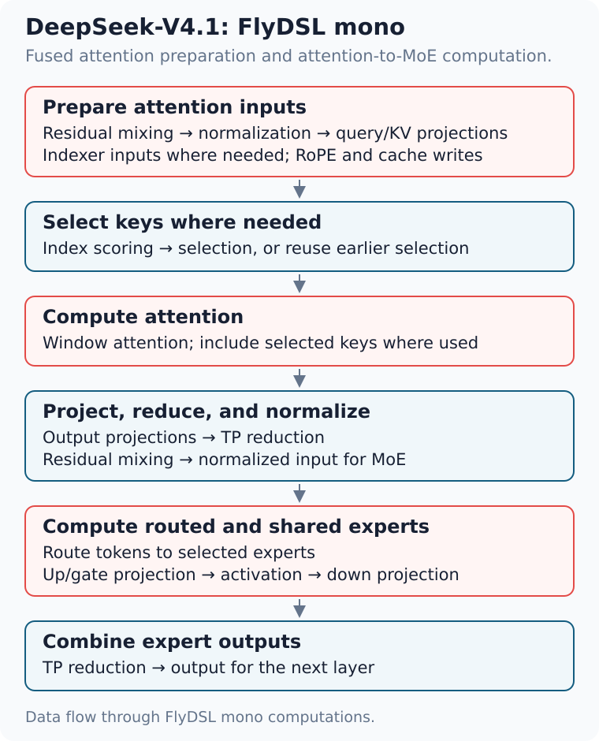
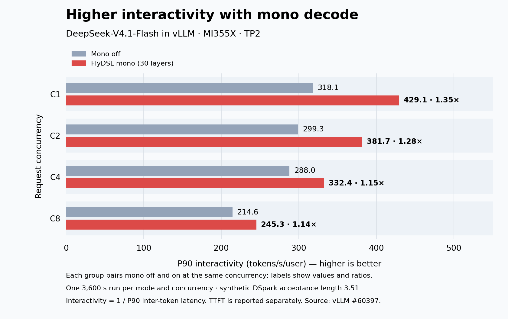
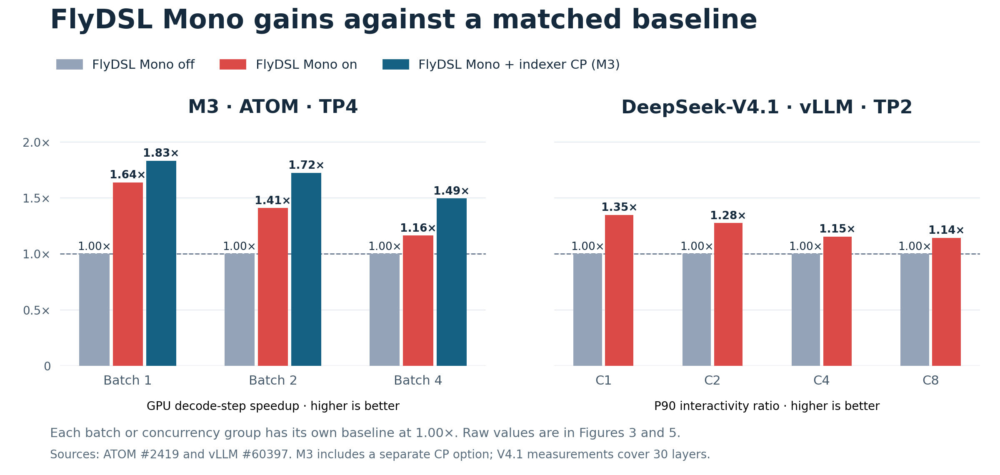

# FlyDSL Mono Kernels for High-Interactivity LLM Serving in ATOM

**Extremely high interactivity is critical for LLM applications with strict latency requirements.** Fast token generation helps a coding agent produce its next action sooner and move on to the next step. The goal is to improve interactivity by reducing decode latency.

[FlyDSL](https://github.com/ROCm/FlyDSL) gives developers the flexibility to write and tune GPU code at the **grid, block, wave, thread, and instruction levels** in Python. They can control how work is assigned, how data is laid out and moved, and where synchronization is needed. These controls let them optimize individual operations and connect the stages of a model layer into **mono kernels** that overlap independent work and reduce waits. [ATOM][4] uses these capabilities to build mono decode across several model families. The approach also extends to [vLLM](https://github.com/vllm-project/vllm) and [SGLang](https://github.com/sgl-project/sglang).

## Why mono kernels speed up decode

Small-batch decode runs many short kernels to process a few tokens at a time. Each launch adds overhead, and some kernels have too little parallel work to keep the GPU busy. When kernels depend on one another, each must finish before the next can begin.

Mono kernels combine related operations into fewer launches and let thread blocks work across stages. Developers can load weights alongside earlier computation and let the next stage process portions of the output as they become ready. They can also overlap computation with reductions across GPUs. Together, these choices reduce idle time and help the decode step finish sooner. [3], [11]

HIP Graph replay reduces CPU submission overhead, but the GPU still executes dependent kernels in sequence. Mono also changes how stages share data and overlap work within a launch.

## What FlyDSL provides

FlyDSL gives developers four kinds of control over a GPU program: [2]

- **Work assignment.** Assign tasks to thread blocks and threads, and tune the mapping for different numbers of tokens per step.
- **Layout and tiling.** Choose how data is arranged and divided into tiles for each stage.
- **Data movement and synchronization.** Decide when to load data and how to signal that an output is ready, within a GPU or across GPUs.
- **Low-level control.** Write and tune a wide range of operations at the grid, block, wave, and thread levels, with control down to individual GPU instructions. [2], [7]

These controls connect local kernel tuning with scheduling across a layer. Developers can coordinate blocks across a grid, tune work within a block, and control how threads cooperate within a wave. They can also decide how blocks hand data to later stages. This lets them optimize both the operations themselves and the way those operations work together. [2], [7]

Mono kernels use these controls to keep **thread blocks** active across stages, passing ready results to consumers and taking on new tasks as the layer advances. [3], [7]

*Figure 1. Mono loads weights early, passes ready portions of the output forward, and overlaps reductions with computation. The timeline is schematic.*

**Developers design the fusion.** They manage scheduling and synchronization, including keeping the required thread blocks resident so the kernel can make progress. ATOM handles runtime buffers, coordination across tensor-parallel (TP) ranks, graph replay, correctness checks, and fallback. [3], [8]

The design is inspired by **TileRT**. [5], [6]

## Bringing mono kernels to ATOM

ATOM supports FlyDSL mono decode for **GLM-5.2, Kimi-K3, DeepSeek-V4.1, and MiniMax-M3**. Its [shared mono components](https://github.com/ROCm/ATOM/tree/53e4fb52403707ab07b69ee909501ea3cc25ca5c/atom/mono) let developers adapt scheduling and data handoffs to each model. Kimi-K3 uses mono for its linear-attention (KDA) layers; its MLA layers keep the existing path. [1], [8], [13]

The shared components handle recurring needs such as buffers, synchronization, and reductions. Each model supplies the schedule that connects its own stages. ATOM then connects that schedule to serving: batching and speculative decoding can change the number of tokens in a step, so runtime dispatch must select a supported path and keep participating GPUs in agreement. [8], [13]

The following diagrams focus on the computations handled by mono kernels and how their data flows between stages.

### MiniMax-M3: connecting attention and experts

For MiniMax-M3's sparse layers, mono fuses the path from input normalization through attention and mixture-of-experts (MoE) computation to the reduced expert output. **The matrix multiplications are included:** Q/K/V and index projections, the attention output projection, routing, and the shared and routed experts' up/gate and down projections. Head normalization, positional encoding (RoPE), cache writes, and TP reductions are also part of the fused computation. [3]

Layers that reuse an earlier layer's selected blocks skip index scoring and selection. The first three dense layers also use fused input preparation and fused output-projection/MLP computation; their attention calculation uses the existing backend. [3]

*Figure 2. Computations fused in M3's sparse-layer mono path. Matrix multiplications appear in the input projections, attention, output projection, router, and experts. Arrows summarize data flow; independent tasks can overlap. [3]*

Three scheduling choices reduce waits:

- **Reuse thread blocks across stages.** A block can finish attention work and then take on routing or expert tasks. Its role changes as the layer progresses, allowing the schedule to use the same GPU resources for different operations. [3], [9]
- **Load weights early.** A later stage's weights can load while earlier work is still running. The later calculation still waits for its input, but its weight loads can already be under way. [3], [9]
- **Pass on ready data.** Tagged buffers identify outputs from the current decode step. Consumers and cross-GPU reductions can begin on ready portions, while other blocks are still producing the rest. Progress depends on the data each task needs. [3], [7]

**Decode latency.** These measurements use MI355X, TP4, MiniMax-M3-MXFP4, a 1M-token context, and EAGLE3 with three speculative tokens. **Separate** and **Mono** compare complete ATOM execution paths at the revision measured in [1], where the first three dense layers still used the original path. **Mono + CP** adds indexer context parallelism, a separate long-context optimization described in the [supporting measurements](#appendix-supporting-measurements). [1]

Times are median GPU decode-step latency in milliseconds; parentheses show speedup relative to Separate.

| Batch | Separate | Mono | Mono + CP |
| ---: | ---: | ---: | ---: |
| 1 | 11.47 | 7.00 (**1.64×**) | 6.26 (**1.83×**) |
| 2 | 13.40 | 9.50 (**1.41×**) | 7.77 (**1.72×**) |
| 4 | 18.47 | 15.88 (**1.16×**) | 12.36 (**1.49×**) |

*Figure 3. Each batch size has its own separate-kernel baseline. Labels show latency and speedup against that baseline. Indexer CP is an additional long-context optimization. [1]*

**Mono alone delivers 1.64× speedup at batch one; the 1.83× result includes CP.** Gains are smaller at larger batches. These GPU-step measurements do not directly measure per-user token rate or isolate the contribution of each scheduling choice.

A larger batch gives separate kernels more work to distribute across the GPU and more tokens over which to spread launch overhead. That can reduce the relative benefit of mono, although the balance depends on the model and schedule.

### DeepSeek-V4.1 in ATOM

DeepSeek-V4.1 uses FlyDSL mono kernels to fuse attention preparation and to connect attention with MoE. The fused computations include: [8], [23]

- **Prepare attention inputs.** Combine residual updates and normalization with query, KV, and indexer projections, RoPE, and window-cache writes. Indexer inputs are prepared only for layers that select keys.
- **Connect attention to MoE.** Score and select keys where needed, compute attention and output projections, then reduce the results across TP ranks and normalize the input to MoE. Routing, shared and routed expert projections, and the expert reduction are fused into this path.

The attention-to-MoE schedule passes each ready normalized row to the router and expert stages. It also starts loading output-projection weights before the attention results are ready. FlyDSL lets developers express these data handoffs and early loads directly. The DSpark draft runner reuses the same kernel implementations with window-only attention and its own expert configuration. [23]

*Figure 4. Data flow through DeepSeek-V4.1's mono computations. The diagram focuses on fused work; model-specific operations outside mono and runtime setup are omitted. Arrows show data dependencies, not a launch timeline. [23]*

For eligible steps, GPUs divide token rows among themselves for some stages, instead of every GPU repeating that work for all rows. Independent loads also start before the kernel waits for data from another stage. The schedule uses FlyDSL to adjust work assignment and communication together. [20]

### Interactivity results in ATOM

The [InferenceX AgentX](https://inferencex.semianalysis.com/agentx) benchmark replays multi-turn, long-context agent sessions. Its **P90 interactivity is 1 / P90 inter-token latency**, with latency in seconds. Higher values mean faster token generation at the slower end of the request distribution. [14], [15]

The published ATOM results below use **MI355X** with FlyDSL mono decode enabled. **They have no matched mono-off baseline:** the table describes complete serving configurations, not the gain from enabling mono. It shows concurrency one (C1). [16], [17]

- **MiniMax-M3-MXFP4, TP4:** EAGLE3 with three draft tokens and synthetic acceptance 2.78, FP8 KV and index caches. [18], [21]
- **DeepSeek-V4.1-Flash, TP2 and TP4:** DSpark with five draft tokens and synthetic acceptance 3.51, BF16 KV and an FP4 index cache. [19], [21]

Each point uses a **3,600-second profiling window**. These controlled replays do not establish natural acceptance. Both sets use GPU-resident KV caches. Exact recipes, images, acceptance settings, and source records are linked in the [ATOM serving data](data/atom-agentx.csv). [18], [19], [21]

The table reports P90 interactivity in tokens/s/user, **output throughput** in generated tokens/s/GPU, and P90 time to first token (TTFT) in seconds. Output throughput counts generated tokens over the profiling window; interactivity describes the pace between tokens once generation starts.

| Model / TP | Interactivity | Output | TTFT |
| --- | ---: | ---: | ---: |
| M3 / TP4 | **469.5** | 42.5 | 1.13 |
| V4.1 / TP2 | **505.1** | 86.5 | 1.20 |
| V4.1 / TP4 | **641.0** | 45.5 | 1.20 |

The distinction matters: M3's C1 input + output total is **6,580 tokens/s/GPU**, but only **42.5** is output. The total mainly counts input tokens, including cached input, and should not be read as generation speed. Mono targets decode; the M3 GPU-step comparison above measures its contribution directly. These serving results also include scheduling, caching, and speculative decoding. TTFT and tool waits remain part of user responsiveness.

## Extending to vLLM and SGLang

**vLLM** takes inspiration from ATOM's mono work and adapts the FlyDSL kernels to its KV-cache layout and runtime. For DeepSeek-V4.1-Flash on MI355X, its same-node **TP2, concurrency-one** comparison raises P90 interactivity from **318.1 to 429.1 tokens/s/user (1.35×)** by enabling mono on 30 standard layers. Each concurrency setting has **one 3,600-second run per mode**, using five-token DSpark with synthetic acceptance 3.51. [11], [12]

*Figure 5. Each group compares mono off and on at the same request concurrency. Longer bars mean faster token generation. Labels show the measured values and their ratio. [11]*

TTFT rises at C1/C8 and falls at C2/C4 in these runs; a repeatable TTFT change is not established. The [supporting measurements](#vllm-evaluation-details) include all four TTFT pairs. These performance replays use a fixed acceptance setting; they do not establish the full user experience with natural acceptance.

**SGLang's [mono kernel framework RFC][22]** describes how to extend mono decode through a shared framework and GPU-vendor plugins, including AMD's `sgl-amd-mono`. The plugins supply model kernels, while SGLang handles step selection and runtime integration.

## Scope and costs

A fused kernel keeps more work and state in one program. Register and shared-memory use must leave enough thread blocks able to run at once. That resource budget is part of schedule design and can limit how much work to combine. [3], [7]

- **Where gains shrink.** M3's GPU-step speedup falls from 1.64× at batch one to 1.16× at batch four; vLLM's interactivity gain falls from 1.35× at C1 to 1.14× at C8. A separate vLLM FFN-only layer test is already near parity at TP2/C8: **345 → 342 µs (1.01×)** at 48 token rows. The cited full-model comparisons do not locate a 1.0× crossover. [1], [11]
- **When mono takes over.** Dispatch checks the model, GPU, TP size, layouts, and step metadata. In the cited revisions, M3 supports up to **16 token rows** per step; ATOM and vLLM V4.1 support up to **48**. Rows include speculative tokens: one request with five drafts can use six rows. The vLLM path requires decode-only steps, supported cache metadata, and eager execution or full graph replay. Larger or unsupported steps use the standard path, with every TP rank making the same choice. These coverage limits are not measured break-even thresholds. [1], [3], [11], [20]
- **Development cost.** Developers tailor and validate schedules for each model and keep them in sync with model changes. Correctness checks and task evaluations are part of that work. [11]

## Build a mono path for your model

Start with the [FlyDSL mono components](https://github.com/ROCm/FlyDSL/tree/31f389b3838d83f82e5bd9ccf646076243e24e18/kernels/monokernel) and [ATOM's shared mono framework](https://github.com/ROCm/ATOM/tree/53e4fb52403707ab07b69ee909501ea3cc25ca5c/atom/mono):

1. **Find the waits.** Profile the separate path at your serving batch sizes. Identify where stages wait for data or communication.
2. **Write the schedule in FlyDSL.** Use reusable compute and communication components to connect stages and give thread blocks independent work to overlap.
3. **Integrate and evaluate.** Add runtime dispatch, fallback, and correctness checks. Evaluate task quality with actual rejection sampling, then compare interactivity, TTFT, and throughput at each concurrency level.

## Appendix: Supporting measurements

**Indexer context parallelism in M3.** ATOM splits index scoring across four TP ranks, then exchanges candidates to recover the final selection. This is the additional optimization behind the Mono + CP results. [1], [3]

At 1M context, TP4, 16 token rows, and four query rows per request, the [layer measurement](data/minimax-indexer-cp-layer.csv) records **222.2 → 156.7 µs (1.42×)** with CP. Both runs use mono and graph replay. [1]

*Figure 6. Each rank scores part of the cache, then exchanges its best candidates so the owning rank can make the final selection.*

**Direct mono comparisons.** Figure 7 summarizes the paired results from Figures 3 and 5. Each group includes its own non-mono baseline, normalized to 1.00×. M3 uses ATOM GPU-step latency; V4.1 uses vLLM interactivity. [1], [11]

*Figure 7. Baseline and mono are paired within each batch or concurrency group. The left panel divides separate-kernel latency by mono latency; the right divides mono interactivity by mono-off interactivity. The raw values appear in Figures 3 and 5. [1], [11]*

### vLLM evaluation details

**TTFT.** P90 TTFT, in seconds, changes as follows in the TP2 mono-off/on runs plotted in Figure 5. Each mode has one 3,600-second run per concurrency, so these observations do not establish a repeatable TTFT change. [11]

| Concurrency | Mono off | Mono on |
| ---: | ---: | ---: |
| 1 | 1.18 | 1.28 |
| 2 | 1.10 | 1.08 |
| 4 | 1.27 | 1.26 |
| 8 | 1.01 | 1.08 |

**Additional vLLM measurements.** The [comparison CSV](data/mono-benefits.csv) records the TP2 mono-off/on results at C1, C2, C4, and C8, including TTFT; the [Figure 5 script](data/plot-vllm-agentx.py) reads the interactivity values directly. The CSV retains input + output totals, which include cached input and are not output throughput. [11]

### Sources and reproduction

**Additional models.** The [comparison CSV](data/mono-benefits.csv) also includes historical GLM-5 and Kimi-K3 layer tests, separate from ATOM serving results. [5] The cited Kimi-K3 serving results have a [confirmed DSpark auxiliary-state capture issue](https://github.com/ROCm/ATOM/pull/2535#discussion_r4266162046), so they are excluded here. [13]

**Data and reproduction.** The [M3 decode-step CSV](data/minimax-decode-step.csv) and other linked CSVs preserve reported values and configurations. The [Figure 3 script](data/plot-minimax-decode-step.py) plots the M3 latency data. The [archived ATOM source records](data/atom-agentx-source.json) support the serving table. The [M3 launch example](data/run-minimax-m3-mono.sh) adapts the source recipe for four MI355X GPUs; it starts a server and does not run the measurements. [10] All measurements in this article come from the cited sources.

The [Figure 7 script](data/plot-mono-speedups.py) calculates each speedup from the matched baseline and mono values in the two comparison CSVs.

## References

1. [ATOM: MiniMax-M3 mono decode and measurements](https://github.com/ROCm/ATOM/pull/2419).
2. [FlyDSL language and compiler](https://github.com/ROCm/FlyDSL).
3. [ATOM's M3 mono implementation](https://github.com/ROCm/ATOM/tree/53e4fb52403707ab07b69ee909501ea3cc25ca5c/atom/models/minimax_m3/mono).
4. [ATOM inference engine](https://github.com/ROCm/ATOM).
5. [FlyDSL: GLM-5 and Kimi-K3 mono work](https://github.com/ROCm/FlyDSL/pull/1204).
6. [TileRT](https://github.com/tile-ai/TileRT).
7. [ATOM device synchronization and tagged mailboxes](https://github.com/ROCm/ATOM/blob/53e4fb52403707ab07b69ee909501ea3cc25ca5c/atom/mono/device/sync.py).
8. [ATOM: DeepSeek-V4.1 and shared mono components](https://github.com/ROCm/ATOM/pull/2479).
9. [M3 task scheduling](https://github.com/ROCm/ATOM/blob/53e4fb52403707ab07b69ee909501ea3cc25ca5c/atom/models/minimax_m3/mono/layout.py).
10. [MiniMax-M3 serving recipe](https://github.com/ROCm/ATOM/blob/2b9f3412e466fd4172a4a621fe9215a1041130c1/recipes/MiniMax-M3.md).
11. [vLLM: DeepSeek-V4.1-Flash mono decode and AgentX results](https://github.com/vllm-project/vllm/pull/60397).
12. [vLLM: all-layer mono coverage and evaluations](https://github.com/vllm-project/vllm/pull/61082).
13. [ATOM: GLM-5.2 and Kimi-K3 mono decode](https://github.com/ROCm/ATOM/pull/2535).
14. [InferenceX AgentX dashboard](https://inferencex.semianalysis.com/agentx).
15. [InferenceX AgentX metric definitions](https://github.com/SemiAnalysisAI/InferenceX/blob/8b25006fa0b23c7e157438996a3d2a90ff5e8cd2/inferencex-e2e/infx/results/agentic/request_metrics.py).
16. [InferenceX: ATOM MiniMax-M3 serving records](https://inferencex.semianalysis.com/api/v1/benchmarks?model=MiniMax-M3).
17. [InferenceX: ATOM DeepSeek-V4.1-Flash serving records](https://inferencex.semianalysis.com/api/v1/benchmarks?model=DeepSeek-V4.1-Flash).
18. [MiniMax-M3 AgentX recipe at the measured revision](https://github.com/SemiAnalysisAI/InferenceX/blob/4b94f096b74191b8af6b7c89e50e0b6bc69f7aba/inferencex-e2e/benchmarks/single_node/srt-slurm-recipes/minimaxm3/atom/mi355x-fp4-mtp/agentic.yaml).
19. [DeepSeek-V4.1-Flash AgentX recipe at the measured revision](https://github.com/SemiAnalysisAI/InferenceX/blob/2597d3d1ce010ee10b82e08bd5b448fea054b5ac/inferencex-e2e/benchmarks/single_node/srt-slurm-recipes/dsv41flash/atom/mi355x-fp4-mtp/agentic.yaml).
20. [ATOM: DeepSeek-V4.1 mono scheduling and replay updates](https://github.com/ROCm/ATOM/pull/2545).
21. [InferenceX synthetic acceptance for AgentX performance runs](https://github.com/SemiAnalysisAI/InferenceX/blob/4b94f096b74191b8af6b7c89e50e0b6bc69f7aba/inferencex-e2e/infx/srt_slurm/synthetic_acceptance.py).
22. [SGLang: mono kernel framework RFC](https://github.com/sgl-project/sglang/issues/43949).
23. [ATOM: DeepSeek-V4.1 mono implementation](https://github.com/ROCm/ATOM/tree/53e4fb52403707ab07b69ee909501ea3cc25ca5c/atom/models/deepseek_v41/mono).

[1]: https://github.com/ROCm/ATOM/pull/2419
[2]: https://github.com/ROCm/FlyDSL
[3]: https://github.com/ROCm/ATOM/tree/53e4fb52403707ab07b69ee909501ea3cc25ca5c/atom/models/minimax_m3/mono
[4]: https://github.com/ROCm/ATOM
[5]: https://github.com/ROCm/FlyDSL/pull/1204
[6]: https://github.com/tile-ai/TileRT
[7]: https://github.com/ROCm/ATOM/blob/53e4fb52403707ab07b69ee909501ea3cc25ca5c/atom/mono/device/sync.py
[8]: https://github.com/ROCm/ATOM/pull/2479
[9]: https://github.com/ROCm/ATOM/blob/53e4fb52403707ab07b69ee909501ea3cc25ca5c/atom/models/minimax_m3/mono/layout.py
[10]: https://github.com/ROCm/ATOM/blob/2b9f3412e466fd4172a4a621fe9215a1041130c1/recipes/MiniMax-M3.md
[11]: https://github.com/vllm-project/vllm/pull/60397
[12]: https://github.com/vllm-project/vllm/pull/61082
[13]: https://github.com/ROCm/ATOM/pull/2535
[14]: https://inferencex.semianalysis.com/agentx
[15]: https://github.com/SemiAnalysisAI/InferenceX/blob/8b25006fa0b23c7e157438996a3d2a90ff5e8cd2/inferencex-e2e/infx/results/agentic/request_metrics.py
[16]: https://inferencex.semianalysis.com/api/v1/benchmarks?model=MiniMax-M3
[17]: https://inferencex.semianalysis.com/api/v1/benchmarks?model=DeepSeek-V4.1-Flash
[18]: https://github.com/SemiAnalysisAI/InferenceX/blob/4b94f096b74191b8af6b7c89e50e0b6bc69f7aba/inferencex-e2e/benchmarks/single_node/srt-slurm-recipes/minimaxm3/atom/mi355x-fp4-mtp/agentic.yaml
[19]: https://github.com/SemiAnalysisAI/InferenceX/blob/2597d3d1ce010ee10b82e08bd5b448fea054b5ac/inferencex-e2e/benchmarks/single_node/srt-slurm-recipes/dsv41flash/atom/mi355x-fp4-mtp/agentic.yaml
[20]: https://github.com/ROCm/ATOM/pull/2545
[21]: https://github.com/SemiAnalysisAI/InferenceX/blob/4b94f096b74191b8af6b7c89e50e0b6bc69f7aba/inferencex-e2e/infx/srt_slurm/synthetic_acceptance.py
[22]: https://github.com/sgl-project/sglang/issues/43949
[23]: https://github.com/ROCm/ATOM/tree/53e4fb52403707ab07b69ee909501ea3cc25ca5c/atom/models/deepseek_v41/mono
