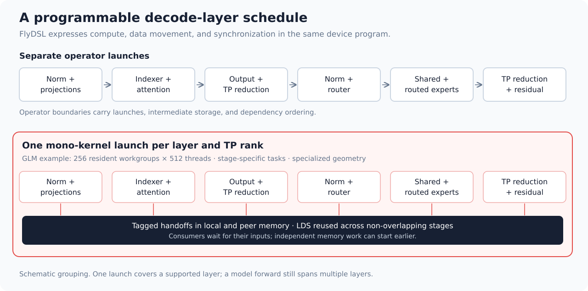
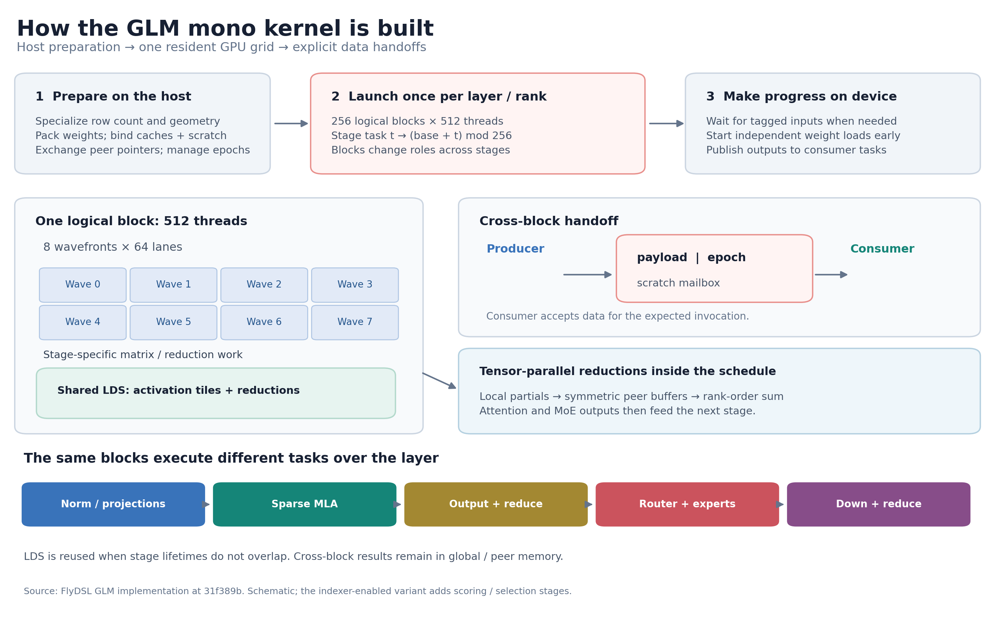
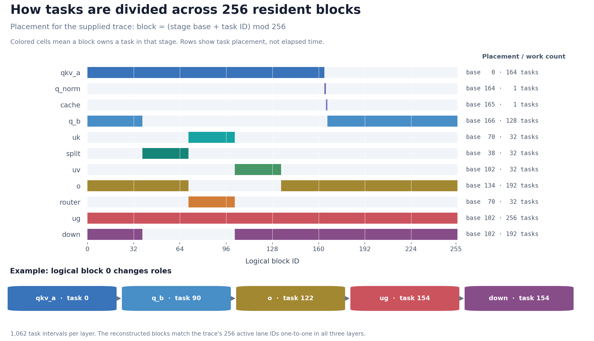
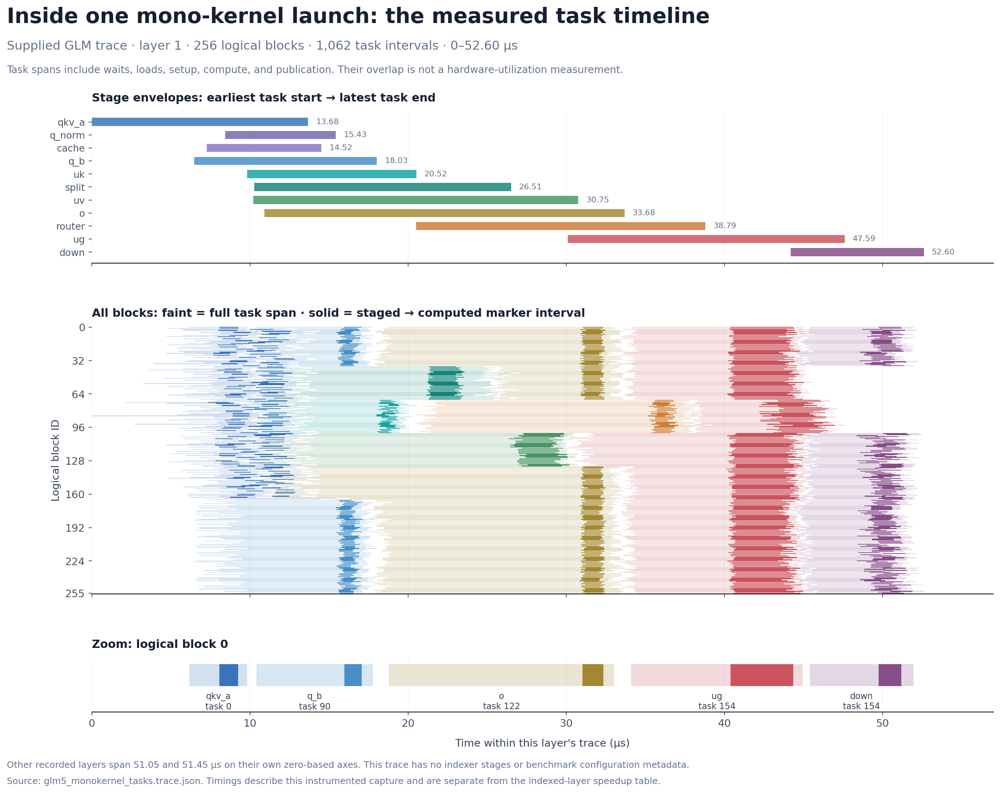
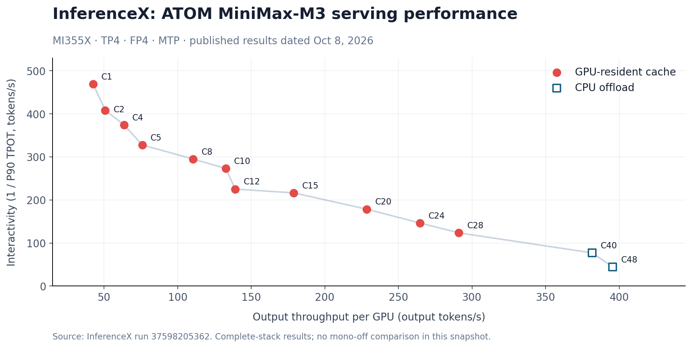

# Accelerating LLM Decode on AMD GPUs with FlyDSL and ATOM Mono Kernels

Interactive LLM inference depends on how quickly the GPU can finish the next decode step. A step passes through projections, normalization, attention, routing, expert computation, and communication. When each operation processes only a few tokens, the transitions between these operations can take a meaningful share of the total time.

FlyDSL gives developers the control to optimize that complete path. Its Python interface exposes layouts, tiling, data movement, matrix instructions, and synchronization through an MLIR compiler stack. Developers can use those capabilities to write an individual operator, fuse a sequence of operators, or build a **mono kernel** that executes a decoder layer within one GPU launch per tensor-parallel rank. [1]

ATOM brings these kernels into an inference engine, where they must work with real checkpoints, paged caches, speculative decoding, graph replay, and distributed execution. Together, FlyDSL and ATOM connect low-level AMD GPU optimization with the workloads that determine serving performance.

The measured results show the opportunity at several levels. A GLM-5 full-layer mono kernel runs approximately **2.62–2.73× faster at four decode rows** on eight AMD Instinct MI355X GPUs. In ATOM, MiniMax-M3 at a one-million-token context reduces a batch-one decode step from **11.47 ms to 7.00 ms** with mono decode, and to **6.26 ms** with indexer context parallelism added. Published SemiAnalysis InferenceX results provide a separate view of the complete serving stack. [2], [4]

## Why decode needs optimization across operators

Large prefill batches expose substantial parallel work. Small decode batches often leave individual operators with too little work to use the GPU efficiently. Optimizing a GEMM helps, but the next bottleneck may be a normalization launch, a routing reduction, an intermediate write, or a tensor-parallel collective.

A useful model of layer latency is:

```text
layer time = compute + memory movement + synchronization + exposed launch gaps
```

These terms interact. An intermediate tensor may need a different layout for its next consumer. A reduction may delay several otherwise independent tasks. Captured GPU graphs reduce host submission overhead, while the graph still contains separate kernels and their boundaries.

A mono kernel moves a larger part of this coordination into one device program. It can schedule a consumer when its inputs are ready, issue independent weight loads before a dependency wait, and coordinate reductions without returning to a separate launch at every operator boundary.

The fusion boundary is a design choice. Some models benefit from a whole-layer kernel; others run faster with several fused stages. FlyDSL supports both approaches.



*Figure 1. A mono kernel schedules multiple layer stages within a resident GPU grid. Cross-workgroup and cross-GPU handoffs still use memory and synchronization; fusion does not imply that every intermediate stays in registers or LDS.*

## What FlyDSL makes flexible

FlyDSL's flexibility comes from exposing the decisions that determine GPU execution. Its layout algebra describes how logical tensors map onto physical storage and participating threads. Its kernel interface also lets developers control instruction selection and execution order. [1]

| Developer-controlled choice | Why it matters for mono kernels |
|---|---|
| Tensor layouts and partitioning | Match weights and activations to wave-level loads and matrix instructions. |
| Tile sizes and work assignment | Balance projections, attention, and expert work across compute units. |
| LDS allocation and reuse | Share an on-chip storage arena between stages whose lifetimes do not overlap. |
| Memory operations and synchronization | Express producer-consumer handoffs within and across GPUs. |
| Compile-time specialization | Generate schedules for a specific row count, precision, model geometry, and parallel configuration. |
| Fusion boundaries | Compare whole-layer fusion with a staged implementation using the same development stack. |

For example, the GLM implementation exposes its geometry through a Python builder. This configuration excerpt selects an indexed, MXFP4-expert variant with four decode rows: [3]

```python
launcher = build_glm5_monokernel(
    S=4,
    heads=8,
    npes=8,
    topk=2048,
    with_indexer=True,
    index_max_seq=4096,
    expert_mxfp4=True,
)
```

The host wrapper supplies packed weights, cache pointers, scratch storage, and peer buffers. The builder specializes the device program around the selected configuration. Changing the schedule remains a Python development task, while the generated kernel retains explicit AMD GPU operations.

This matters as models evolve. Sparse attention, latent MoE, recurrent state, and speculative verification introduce different dependencies. A useful kernel language must let the developer express those dependencies and change the implementation when measurements call for a different schedule.

## Inside the GLM mono kernel

The GLM-5 implementation provides a concrete example of whole-layer fusion. With the indexer enabled, one persistent launch per tensor-parallel rank covers: [2], [3]

```text
Input normalization and Q/KV projection
    → Indexer projections, normalization, RoPE, and cache update
    → Index scoring and exact top-2048 selection
    → Sparse MLA and output projection
    → Attention peer reduction and residual update
    → Router, shared expert, and routed experts
    → MoE peer reduction and residual update
```

Here, MLA is multi-head latent attention, and MoE is mixture of experts. The indexer selects which cached tokens the sparse attention stage reads. Including selection in the fused path is significant: a comparison that precomputes sparse indices measures a smaller workload.



*Figure 2. The implementation has three levels: the host specializes and prepares the launch, a resident grid executes stage tasks, and each block uses wavefronts and LDS for its local work. Cross-block and cross-GPU results pass through tagged memory. The schematic shows the common layer path; the indexed variant adds its scoring and selection stages.*

### A resident grid with stage-specific tasks

The MI355X implementation launches 256 workgroups with 512 threads each, targeting one resident workgroup per compute unit. Each stage defines a set of tasks, distributed over the resident grid. The workgroups progress through the schedule and wait on the dependencies required by their next task. [3]

This design makes residency part of correctness as well as performance. The grid and resource use are chosen so producers can run while consumers wait. Extending the schedule requires preserving those progress conditions.

Weight loads that do not depend on an upstream result can start before the input arrives. For small decode operations, this creates useful overlap between memory access and dependency handling. Task placement also matters: a long attention or expert task should not unnecessarily delay a workgroup that must produce data for another stage.



*Figure 3. Task placement for the path recorded in the accompanying trace. A colored cell means that block owns a task in the stage; the horizontal axis is block ID, not time. A block can execute tasks from several stages. This trace has no indexer stages.*

The assignment follows `block = (stage_base + task_id) % 256`. For example, `q_b` starts at block 166 and has 128 tasks: its assignment wraps from block 255 back to block 0. Logical block 0 executes `qkv_a` task 0, `q_b` task 90, `o` task 122, `ug` task 154, and `down` task 154. The same block therefore changes roles as the layer advances.

The figure combines the source's placement rule with the trace's task counts. Across all three recorded layers, the reconstructed 256 logical blocks map one-to-one to the trace's active hardware-lane IDs. Logical block IDs describe work assignment; the GPU determines their physical placement. [3], [10]

### Tagged handoffs and graph replay

The GLM kernel exchanges intermediate results through tagged mailboxes. A mailbox carries a payload and an epoch identifying the current invocation. Consumers poll for the expected epoch before using the payload. Local handoffs and peer-GPU handoffs use the appropriate coherent memory operations. [3]

The epoch combines a device-side decode-step counter with a layer identifier:

```text
epoch = decode_step × layer_slots + layer_id + 1
```

That distinguishes current results from values left by an earlier graph replay. The wrapper manages epoch progression and scratch-buffer lifetime; graph capture alone cannot provide those guarantees.

The resident-grid schedule, tagged mailbox approach, and reuse of LDS across phases build on the TileRT/GLM MonoKernel design lineage, which the FlyDSL implementation explicitly credits. The model-specific schedules and semantics are implemented in FlyDSL. [2]

### Reuse LDS while preserving live data

LDS, or Local Data Share, is AMD's on-chip workgroup scratchpad. A fused layer does not need to reserve the sum of every stage's temporary storage. Once a stage finishes using a region, a later stage can reuse it.

The GLM implementation sizes a shared arena around the largest overlapping requirements. Storage that must remain live together—such as activation fragments and matrix-reduction data—occupies separate regions. This reduces the resource cost of fusion while keeping the schedule's dependencies explicit. [3]

### Make communication part of the layer

Tensor parallelism introduces reductions after attention and expert computation. The GLM mono kernel writes partial results to symmetric peer buffers and consumes the peer contributions within the layer schedule. Its fixed rank-order accumulation keeps participating ranks aligned on hidden states and subsequent routing. [3]

Communication still has a cost. The benefit is the ability to coordinate it with the work that produces and consumes each result.

### Reading the measured task timeline

The accompanying trace records **1,062 task intervals per layer across 256 logical blocks**. Figure 4 shows the first layer at three levels: the span of each stage, the task intervals on every block, and a close-up of block 0. [10]



*Figure 4. Actual timestamps from `glm5_monokernel_tasks.trace.json`. Faint bars cover complete task intervals; solid segments run from the recorded `staged` marker to the `computed` marker. A task interval includes preparation, waits, memory operations, compute, and publication. Overlapping intervals do not imply simultaneous arithmetic throughout those intervals.*

Block 0 makes the dependency behavior visible. Its `o` task starts at **18.78 µs**, reaches the `staged` marker at **31.02 µs**, reaches `computed` at **32.34 µs**, and ends at **33.02 µs**. The long interval before `staged` can include prefetch, input waits, and staging. Counting that whole interval as matrix-compute time would misread the trace.

The three recorded layers span **52.60, 51.05, and 51.45 µs**, each on its own zero-based time axis. These are instrumented capture spans. The trace does not record the model shape, precision, context length, TP configuration, or source revision, and contains no indexer tasks, so these values are separate from the indexed-layer speedup measurements below.

[Download the interactive timeline](mono-timeline.html) and open the saved HTML file in a browser to switch layers, zoom into a block range, filter stages, inspect individual timestamps, or save a view as a PNG. The viewer works offline. The [original Chrome Trace JSON](data/glm5_monokernel_tasks.trace.json) can also be opened in Perfetto.

## How ATOM integrates the kernels

ATOM—AiTer Optimized Model—is an inference engine built around AMD-oriented model and kernel optimization. Its mono framework provides shared runtime, planning, and device components: peer memory, step mailboxes, per-width builds, dispatch, handoff contracts, reductions, and debugging support. Model packages supply their own schedules. [4], [5]

That division supports several useful fusion boundaries:

| Implementation | Fusion scope |
|---|---|
| FlyDSL GLM-5 | Complete indexed decode layer in one launch per rank. |
| ATOM MiniMax-M3 | One fused launch per sparse layer and rank for supported TP4 decode steps of 1–16 token rows. |
| ATOM DeepSeek-V4.1 | Several fused per-layer kernels, plus integration with the DSpark drafter. |
| FlyDSL Kimi-K3 | Complete KDA-layer mono kernel and retained staged alternatives for performance comparison. |

Dispatch must account for the number of rows in the actual decode or verification step. With three speculative tokens, one request can contribute four target-model rows. Offered request concurrency, active requests, and kernel row count therefore describe different quantities.

ATOM also has to preserve cache addressing, state updates, routing, numerical boundaries, and graph behavior. Kimi-K3 illustrates the state requirement: speculative token `s` consumes one recurrent snapshot and produces the snapshot needed by token `s+1`. Treating those tokens as independent requests would change the model. The FlyDSL implementation explicitly represents that ordered snapshot chain. [2]

## Measured performance on MI355X

The following results measure different scopes: standalone layers, server decode steps, and full serving workloads. Each answers a different performance question.

### GLM-5: complete indexed layer

The reported GLM benchmark uses **8 × MI355X, TP8, position 3000, sparse top-2048 attention, BF16 KV cache, and MXFP4 expert weights**, including the complete indexer. The underlying layer comparison uses HIP graph replay with 16 layer invocations per graph. [2], [6]

| Decode rows, S | ATOM native full layer + indexer | FlyDSL mono kernel | Latency speedup |
|---:|---:|---:|---:|
| 4 | 205.8–213.7 µs | 78.4–78.6 µs | 2.62–2.73× |
| 8 | 223.4 µs | 118.2–118.3 µs | 1.89× |

*S counts input rows in the layer harness; it is not a measurement of server concurrency. Speedup is baseline latency divided by optimized latency.*

The gain becomes smaller at eight rows. As the shape grows, the balance between memory movement, matrix work, and synchronization changes. This is why the implementation specializes its tile geometry and storage requirements by row count.

### MiniMax-M3: server decode-step improvement

ATOM reports the following median GPU decode-step times for **MiniMax-M3-MXFP4 on MI355X, TP4, one-million-token context, and EAGLE3 with three speculative tokens**. [4]

| Request batch | Original path | Mono decode | Mono + indexer CP | Speedup, mono / mono + CP |
|---:|---:|---:|---:|---:|
| 1 | 11.47 ms | 7.00 ms | 6.26 ms | 1.64× / 1.83× |
| 2 | 13.40 ms | 9.50 ms | 7.77 ms | 1.41× / 1.72× |
| 4 | 18.47 ms | 15.88 ms | 12.36 ms | 1.16× / 1.49× |


*Figure 5. Median GPU decode-step latency reported in ATOM PR #2419. Lower is better. Indexer context parallelism is an additional optimization, shown separately from mono decode.*

At batch one, mono decode reduces step latency by **39.0%**; adding indexer CP brings the reduction to **45.4%**. CP distributes the indexer's scoring work across ranks and exchanges selection candidates. That matters at long context, where scanning the index cache becomes expensive.

The PR reports bit-identical selection for the CP transformation. Its reported GSM8K five-shot score is 0.9378 for mono + CP versus 0.9447 for the original path, a difference of −0.69 percentage points. That evaluation belongs alongside the performance results; it does not establish general accuracy equivalence. [4]

### Kimi-K3: measure the fusion boundary

The Kimi-K3 implementation retains a complete one-launch KDA mono kernel and a staged path. For true MTP at four rows, the reported staged layer takes **120.83 µs**, versus **153.11 µs** for the complete one-launch layer. At eight rows, the corresponding values are **155.75 µs** and **243.15 µs**. The staged implementations use seven and nine launches, respectively. [2]

This comparison is a practical demonstration of FlyDSL's flexibility. Developers can change the fusion boundary while preserving model semantics, then choose the schedule with the lower measured latency. Launch count is one contributor to that result.

## SemiAnalysis InferenceX: the serving view

SemiAnalysis's InferenceX AgentX workload exercises long-context, multi-turn serving. It adds effects that a layer benchmark cannot capture: prompt processing, cache reuse, scheduling, draft generation, request timing, and concurrent users.

The MiniMax-M3 recipe in **InferenceX PR #3750** enables mono decode at TP4 points using `rocm/atom-dev:nightly_202610070333`, with ROCm 7.2.4. The mono path supports up to 16 token rows per step, covering four requests at EAGLE3 K3; larger eligible serving configurations can still execute steps outside that mono domain. [7]

The public API snapshot retrieved on **October 12, 2026**, contains these results dated **October 8, 2026**, from the same published workflow run. They use **MiniMax-M3 FP4, MI355X, ATOM, TP4, and speculative decoding**. [8], [9]

| Offered concurrency | P90 time per output token | Output throughput per GPU | Median time to first token |
|---:|---:|---:|---:|
| 1 | 2.13 ms | 42.49 output tokens/s | 730 ms |
| 2 | 2.45 ms | 50.79 output tokens/s | 352 ms |
| 4 | 2.67 ms | 63.47 output tokens/s | 287 ms |
| 8 | 3.39 ms | 110.52 output tokens/s | 325 ms |
| 24 | 6.83 ms | 264.75 output tokens/s | 412 ms |
| 48, CPU offload | 22.60 ms | 395.63 output tokens/s | 576 ms |



*Figure 6. Published ATOM TP4 serving points. Interactivity is the API's reciprocal of P90 TPOT. Filled circles use GPU-resident caching; hollow squares use CPU offload. Labels indicate offered concurrency. These are complete-stack operating points.*

At concurrency one, the reported P90 TPOT corresponds to approximately **469.5 tokens/s of interactivity**. Increasing concurrency raises aggregate output throughput while per-user responsiveness declines. Deployment choices depend on which part of this curve meets the application's latency requirements.

The throughput column above uses **output tokens only**. The API also reports a much larger total-token throughput for these prompt-heavy workloads; the two metrics should not be interchanged.

These serving points show ATOM operating with the mono-enabled recipe. They do not isolate the contribution of mono kernels: the published snapshot has no matched mono-off arm, and the recipe includes other optimizations. The controlled decode-step comparison above supplies the direct evidence for that uplift. InferenceX throughput runs also use prescribed speculative acceptance, so quality evaluation must use real acceptance. [7], [8]

The [serving-point CSV](data/inferencex-minimax-tp4.csv), [selected API rows](data/inferencex-minimax-tp4.json), and [decode-step CSV](data/minimax-decode-step.csv) accompany the performance figures.

## Developing the next specialization

A productive optimization loop starts with an ATOM trace and a concrete decode shape. Identify the expensive sequence, choose a fusion boundary, and express its data dependencies in FlyDSL. Then tune work distribution, layouts, memory reuse, and instruction scheduling together.

Validation should follow the same scope as the optimization: intermediate and routing checks for the kernel, changed-input graph replay and state checks for the runtime, and model-quality evaluation for the serving path. Performance measurement should retain the strongest valid staged baseline and report the actual row counts, precision, parallel configuration, and launch scope.

FlyDSL makes that iteration practical by keeping the schedule programmable. ATOM supplies the engine context in which the specialization must work. On AMD GPUs, the measured GLM and MiniMax results demonstrate how that combination can shorten the decode path, while the InferenceX snapshot shows the serving behavior of the integrated stack.

## References

1. [FlyDSL: Python DSL, explicit layouts, and MLIR compiler stack](https://github.com/ROCm/FlyDSL).
2. [FlyDSL PR #1204: GLM-5 and Kimi-K3 MonoKernels, performance, and validation](https://github.com/ROCm/FlyDSL/pull/1204).
3. [GLM mono-kernel source at the #1204 merge commit](https://github.com/ROCm/FlyDSL/blob/31f389b3838d83f82e5bd9ccf646076243e24e18/kernels/monokernel/glm/kernel.py).
4. [ATOM PR #2419: MiniMax-M3 mono decode and indexer context parallelism](https://github.com/ROCm/ATOM/pull/2419).
5. [ATOM PR #2479: shared mono framework and DeepSeek-V4.1 integration](https://github.com/ROCm/ATOM/pull/2479).
6. [FlyDSL PR #1205: complete GLM indexer + MLA + MoE benchmark scope](https://github.com/ROCm/FlyDSL/pull/1205).
7. [InferenceX PR #3750: MiniMax-M3 TP4 mono-enabled recipe](https://github.com/SemiAnalysisAI/InferenceX/pull/3750).
8. [InferenceX public MiniMax-M3 benchmark API](https://inferencex.semianalysis.com/api/v1/benchmarks?model=MiniMax-M3), retrieved October 12, 2026. Selected row IDs: 444377, 444373, 444387, 444391, 444374, and 444382.
9. [Published InferenceX workflow run](https://github.com/SemiAnalysisAI/InferenceX/actions/runs/37598205362/attempts/1), completed successfully.
10. [Supplied GLM mono-kernel task trace](data/glm5_monokernel_tasks.trace.json), with [derived task intervals](data/mono-task-intervals.csv) and [capture summary](data/mono-trace-summary.json).

[1]: https://github.com/ROCm/FlyDSL
[2]: https://github.com/ROCm/FlyDSL/pull/1204
[3]: https://github.com/ROCm/FlyDSL/blob/31f389b3838d83f82e5bd9ccf646076243e24e18/kernels/monokernel/glm/kernel.py
[4]: https://github.com/ROCm/ATOM/pull/2419
[5]: https://github.com/ROCm/ATOM/pull/2479
[6]: https://github.com/ROCm/FlyDSL/pull/1205
[7]: https://github.com/SemiAnalysisAI/InferenceX/pull/3750
[8]: https://inferencex.semianalysis.com/api/v1/benchmarks?model=MiniMax-M3
[9]: https://github.com/SemiAnalysisAI/InferenceX/actions/runs/37598205362/attempts/1
[10]: data/glm5_monokernel_tasks.trace.json
