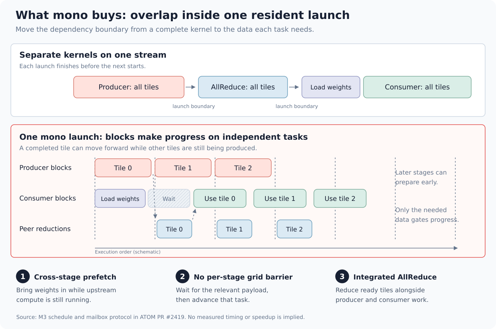
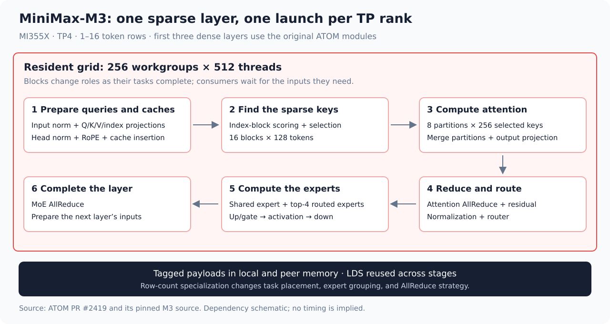
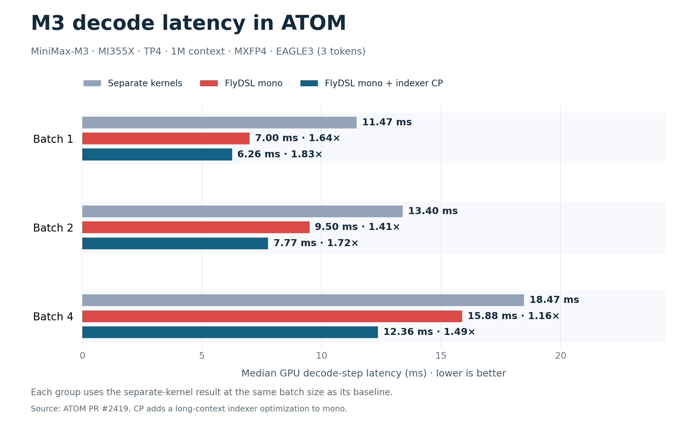
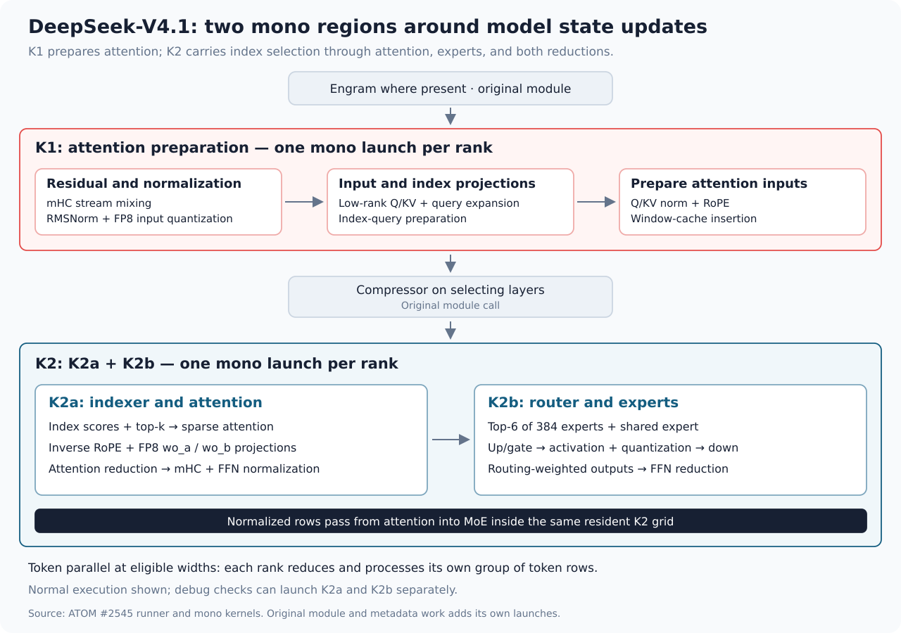
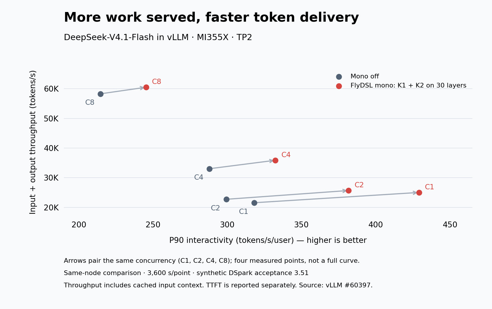
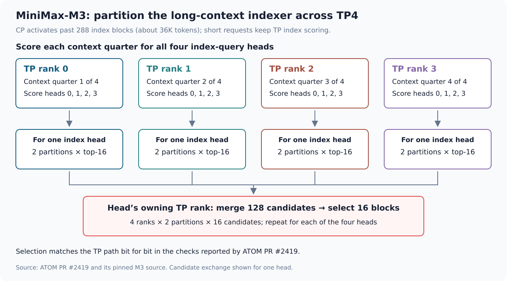

# FlyDSL Mono Kernels for High-Interactivity LLM Serving in ATOM

**Extremely high interactivity is critical for LLM applications with strict latency requirements.** Fast token generation helps a coding agent produce its next action sooner and move on to the next step. The goal is to increase throughput while maintaining that responsiveness.

[FlyDSL](https://github.com/ROCm/FlyDSL) gives developers the flexibility to write and tune GPU code at the **block, wavefront, thread, and instruction levels** in Python. They can control how work is assigned, how data is laid out and moved, and where synchronization is needed. These controls let them optimize individual operations and connect the stages of a model layer into **mono kernels** that overlap independent work and reduce waits. [ATOM][4] uses these capabilities to build mono decode for MiniMax-M3 and DeepSeek-V4.1; [vLLM](https://github.com/vllm-project/vllm) adapts ATOM's DeepSeek components. [2], [3], [8], [11]

## Why mono kernels speed up decode

Small-batch decode runs many short kernels. For example, a standard DeepSeek-V4.1-Flash layer in the cited vLLM implementation launches **about 40 separate kernels**, covering normalization, projections, attention, mixture-of-experts (MoE) computation, and reductions across GPUs. With only a few token rows, many operations do little arithmetic work, so **repeated kernel launches can account for a substantial share of decode time**. [11]

These small kernels can also **leave GPU resources idle**. Some do not have enough parallel work to keep all compute units busy; others wait for data. When they run sequentially on one stream, the next kernel cannot use that idle capacity until the current one finishes.

**Mono kernels bring these operations into a shared schedule with fewer launches.** Thread blocks can take on different tasks, load a later stage's weights during earlier computation, and start tensor-parallel (TP) reductions as soon as part of an output is ready. Those reductions combine partial results from GPUs working on the same layer. This reduces both launch overhead and waits inside the layer. On the standard vLLM layers above, **two mono launches replace about 40 separate kernels**. [3], [11]

HIP Graph replay helps with CPU submission overhead, but it preserves the boundaries between GPU kernels. Mono changes the GPU schedule itself, so independent loads, computation, and communication can overlap while respecting data dependencies.

The related ROCm posts on [low-latency matrix multiplications (GEMMs)](https://rocm.blogs.amd.com/software-tools-optimization/accelerating-llm-inference-on-amd-gpus-with-low-latency-gemms/README.html) and [ATOM's Two-Batch Overlap](https://rocm.blogs.amd.com/software-tools-optimization/atom-optimiztion/README.html) cover operator tuning and overlap across micro-batches. Mono targets work and waits **inside a model layer**.

## What FlyDSL provides, and who does what

In ATOM, a **mono kernel** combines several stages in one launch. It uses a grid of **thread blocks** designed to remain resident for that invocation: all thread blocks must be able to run on the GPU at the same time. A thread block can take on new tasks as the layer advances. Consumers wait for their required inputs while independent tasks continue elsewhere in the grid. [3], [7]

Thread blocks exchange intermediate results through global-memory buffers. Registers and Local Data Share (LDS), the software-managed on-chip memory local to each compute unit, hold local working data. The schedule uses thread block barriers where needed; it avoids requiring the entire grid to finish every stage together. [3], [7]

*Figure 1. Mono combines stages in one launch, starts independent loads early, passes ready tiles forward without per-stage grid-wide barriers, and overlaps reductions with computation. Bars show execution order, not measured durations.*

Calling separate library operators does not give a developer control over the work inside each call. FlyDSL is a Python domain-specific language for GPU kernels, compiled to GPU code through MLIR. It lets kernel developers: [2]

- **Build schedules with Python.** Ordinary Python can prepare task assignments and storage layouts, and FlyDSL expresses the device code that executes them. M3 builds variants for row counts from 1 to 16.
- **Control layout and tiling explicitly.** Tensor layouts, tile shapes, and matrix instructions are chosen per stage, so each GEMM stays specialized for its shape inside the fused program.
- **Control data movement and synchronization.** Developers decide when global-memory loads are issued, where intermediate data lives, and how producers signal consumers, both within a GPU and across peer GPUs.

These capabilities make a mono schedule practical to write, but **FlyDSL does not perform the fusion automatically.** It does not decide which stages to merge, and it does not guarantee residency or forward progress. The work divides into three parts:

| Contributor | Responsibility |
| --- | --- |
| **FlyDSL** | Language and compiler; reusable components in [`kernels/monokernel/`](https://github.com/ROCm/FlyDSL/tree/31f389b3838d83f82e5bd9ccf646076243e24e18/kernels/monokernel), including gfx950 GEMM, MXFP8 linear, and tagged symmetric AllReduce. [5] |
| **Kernel developer** | Design the schedule, assign tasks, place weight prefetches, and define handoffs. Check that the compiled resource use allows residency and that waiting consumers cannot prevent producers from running. |
| **Serving engine (ATOM, vLLM)** | Choosing the execution path for each step; runtime metadata, caches, and buffers; keeping all TP ranks on the same path; HIP Graph compatibility; correctness checks; and fallback to separate kernels. |

The design is inspired by the **TileRT MonoKernel work** in the [InferenceMAX/InferenceX snapshot `8ac9834`](https://github.com/SemiAnalysisAI/InferenceX/tree/8ac98344b038a3f2da20a565fe9b974772a67ef9), cited by FlyDSL #1204 and associated with [#3389](https://github.com/SemiAnalysisAI/InferenceX/pull/3389). [5], [6]

## Bringing mono kernels to ATOM

ATOM implements mono decode for MiniMax-M3 and DeepSeek-V4.1 and provides reusable [`atom/mono/`](https://github.com/ROCm/ATOM/tree/5e8d9131739aaa53836713c79e6d547c23980f03/atom/mono) components. [1], [8]

For MiniMax-M3, ATOM's [mono kernel](https://github.com/ROCm/ATOM/blob/2b9f3412e466fd4172a4a621fe9215a1041130c1/atom/models/minimax_m3/mono/kernels/post_attn.py) covers the complete sparse-layer path in **one launch per TP rank**. That path includes input projections, index scoring and selection, sparse attention, the attention AllReduce, routing, the shared and routed experts, and the MoE AllReduce. The first three dense layers keep ATOM's separate-kernel modules. [1], [3]

*Figure 2. M3's sparse-layer dependency chain inside one launch. Stage-by-stage details are in the [implementation notes](#appendix-m3-implementation-notes).*

Three mechanisms show how FlyDSL's controls address the waits described above. The results later compare complete implementations; they do not measure each mechanism's contribution separately.

### 1. Thread blocks handle tasks across stages

For M3, ATOM launches **256 thread blocks of 512 threads**, or eight **64-thread wavefronts (wave64)** per thread block, targeting one resident thread block per MI355X compute unit. ATOM's Python schedule assigns each thread block a sequence of tasks: a thread block that performs attention can take on routing or expert work later in the same launch. The stages share one launch, and local handoffs let tasks advance without a grid-wide barrier at every stage. Synchronization still has a cost, but it can follow the data each task needs. [3], [9]

The grid size alone does not guarantee progress. Register and LDS use must allow all thread blocks to be resident, and the task order must let producers finish the data that consumers are waiting for. The developer checks these conditions; the engine also checks deployment requirements. For example, the cited vLLM path rejects mono on a partitioned GPU with fewer than 256 compute units. [3], [11]

### 2. Weight loads overlap the preceding computation

A thread block can request the weights for a later stage before that stage receives its input. In M3's MoE path for 1–4 token rows, **after the first up/gate task round**, the thread block issues loads for the down-projection weights, which a later stage will use. These loads cover the first token's routed experts and the shared expert. They can remain in flight during subsequent computation and data exchange. [3], [9]

The timing is a tuned choice. Issuing the loads too early competes with upstream loads for bandwidth and keeps vector registers occupied for longer. Issuing them too late leaves the dependency-chain wait in place. Because FlyDSL exposes when loads are issued, the developer can place this point deliberately and move it when the schedule changes.

### 3. Tagged handoffs and in-kernel reductions let consumers start early

M3's [mailbox helper](https://github.com/ROCm/ATOM/blob/2b9f3412e466fd4172a4a621fe9215a1041130c1/atom/models/minimax_m3/mono/kernels/common.py) stores each value beside a tag in global-memory or peer-accessible buffers. **The consumer reads the tag and the value together**, so a successful readiness check also supplies the data for its next computation. The tag combines the decode-step counter and layer number to distinguish the current invocation from an earlier one. The memory-access protocol makes the data visible: it uses device scope within a GPU and system scope between peer GPUs. [3], [7]

The TP AllReduce applies the same idea across GPUs. Thread blocks exchange partial sums through peer memory inside the kernel and reduce completed **32-channel output tiles** while other thread blocks are still producing other tiles. Residual updates can consume reduced tiles immediately; RMSNorm, which needs the complete hidden row, waits for that row rather than for a separate AllReduce kernel to finish. [3]

### Results in ATOM

The server measurements use MI355X, TP4, MiniMax-M3-MXFP4, a 1M-token context, and EAGLE3 with three speculative tokens, so batches of 1, 2, and 4 produce 4, 8, and 16 target-model rows before graph padding.[^m3-support] **Separate** and **Mono** are two complete execution paths in ATOM, so the comparison does not isolate the three mechanisms from each other. **Mono + CP** adds indexer context parallelism, a separate long-context optimization described in the [implementation notes](#appendix-m3-implementation-notes). Latencies are median GPU decode-step times in milliseconds; the [decode-step CSV](data/minimax-decode-step.csv) retains the reported values. [1]

All times are in milliseconds; parentheses give speedup relative to Separate.

| Batch | Separate | Mono | Mono + CP |
| ---: | ---: | ---: | ---: |
| 1 | 11.47 | 7.00 (**1.64×**) | 6.26 (**1.83×**) |
| 2 | 13.40 | 9.50 (**1.41×**) | 7.77 (**1.72×**) |
| 4 | 18.47 | 15.88 (**1.16×**) | 12.36 (**1.49×**) |

*Figure 3. At batch one, FlyDSL mono shortens M3's GPU decode step in ATOM, and indexer CP adds a further gain at long context. [1]*

**Mono saves 4.47 ms at batch one and 2.59 ms at batch four** in these measurements. The smaller relative gain at batch four is consistent with fixed costs being spread over more work, but the measurements do not establish a breakdown of the bottlenecks. The two paths also differ in kernel code, data handling, and communication. Adding CP saves a further 0.74 ms at batch one and 3.52 ms at batch four. These GPU-step results help assess the implementation; they do not directly measure per-user token rate.

M3's source PR reports bit-identical index selection against the reference over 3K–1.04M contexts and bit-identical outputs through 16 chained layers with CP off versus on at 3K, 37K, and 200K contexts. It also reports serving a 1,040,186-token request. GSM8K chat five-shot scores are 0.9447 for the separate path, 0.9371 and 0.9424 for two mono runs, and 0.9378 for mono + CP. These scores provide task-level checks, but do not establish exact numerical equivalence or unchanged quality across tasks. [1]

## Extending ATOM's mono kernels to vLLM

vLLM adapts ATOM's DeepSeek stages and shared helpers to its own weights, numerical operations, buffers, and execution paths. The resulting DeepSeek-V4.1-Flash mono decode implementation runs on MI355X and was merged in two PRs. [8], [11], [12]

### The fusion boundary follows the model

The vLLM integration uses **two mono launches, K1 and K2, per eligible layer and TP rank**. K1 prepares attention inputs with residual mixing, normalization, Q/KV projections, rotary position encoding (RoPE), and window-cache insertion. K2 combines attention, output projections, the attention reduction, normalization, routing, expert GEMMs, and the feed-forward network (FFN) reduction. The normalized attention result becomes the MoE input inside K2. [11], [12]

Some operations remain outside those launches. Where present, Engram runs before K1. On layers that select their own cached tokens, vLLM's compressor and indexer, including scoring and top-k selection, run between K1 and K2. K2 builds the attention key table from those selected indices. **Two mono launches therefore do not mean two total kernels on every layer.** The all-layer version also gives up vLLM's side-stream overlap between compressor and indexer: those operations run serially between the resident launches. [12]

*Figure 4. The vLLM path after #61082. Engram and the compressor/indexer calls are conditional on the layer. Index scoring and top-k selection remain outside the mono launches; K2 consumes their result. [12]*

### What the engine provides

The serving engine connects the kernels to real requests. In vLLM, that work includes: [11], [12]

- **Path selection and fallback.** Decode steps that fit the kernels' row and metadata limits take the mono path. Prefill, mixed steps, PIECEWISE graph steps, and steps with more than 48 rows take the original path. If mono is requested on a deployment the kernels cannot run, vLLM raises an error instead of silently falling back.
- **Lockstep across ranks.** The kernels wait on each other's peer writes, so every TP rank must take the same path at every layer. The dispatch conditions read only metadata that all ranks hold alike.
- **Graph-compatible buffers.** Tagged handoffs avoid per-step mailbox clearing and a host-side step hook. Each decode width gets its own scratch space, preventing one width from reinterpreting another width's data as tags.
- **Correctness checks.** The source reports stage-by-stage checks against vLLM's operators at TP2 and TP4, five-layer model comparisons within numerical tolerances, and race stress tests with 100,000 graph replays. Repeatability within one implementation and agreement with the separate path are distinct checks.

On a standard layer at TP4 with six token rows and cold weights, the vLLM layer test reports **180 → 94 µs (1.91×)**. [11]

### Serving results, with their conditions

The [InferenceX AgentX](https://inferencex.semianalysis.com/agentx) benchmark replays multi-turn, long-context agent sessions and compares throughput with per-user interactivity. The serving goal is to handle more work while meeting a required interactivity level. Its **P90 interactivity is 1 / P90 inter-token latency**, with latency in seconds: higher is better. The P90 label refers to the latency percentile, so this metric describes the slower end of the request distribution. [15], [16]

The AgentX comparison in [vLLM #60397](https://github.com/vllm-project/vllm/pull/60397), merged October 10, 2026, uses MI355X, TP2, a same-node mono-off baseline, the InferenceX recipe, and **3,600 seconds per point**. The four concurrency settings ran concurrently on one eight-GPU node, using two GPUs per setting. The table below compares mono off with **K1 + K2 on the 30 standard layers only**; it predates the PR's additional FFN-only path on the other 10 layers. [11]

Both runs use DSpark with five draft tokens and a **synthetic acceptance setting of 3.51**. This sets an acceptance curve instead of using actual draft/target rejection sampling; 3.51 is an acceptance-length setting, not a percentage. The replay controls how much accepted output each step delivers, but it cannot show a change in natural acceptance or establish task accuracy. In the table, arrows mean mono off → mono on. Total throughput counts input plus output tokens, including cached input context. [11], [16]

**Table units:** C is request concurrency per server; interactivity is P90 tokens/s/user; throughput is input + output tokens/s; time to first token (TTFT) is reported at p90 in seconds.

| C | Interactivity | Throughput | TTFT |
| ---: | --- | --- | --- |
| 1 | 318.1 → **429.1 (1.35×)** | 21,573 → **25,039 (1.16×)** | 1.18 → 1.28 |
| 2 | 299.3 → **381.7 (1.28×)** | 22,735 → **25,695 (1.13×)** | 1.10 → 1.08 |
| 4 | 288.0 → **332.4 (1.15×)** | 33,043 → **35,885 (1.09×)** | 1.27 → 1.26 |
| 8 | 214.6 → **245.3 (1.14×)** | 58,294 → **60,501 (1.04×)** | 1.01 → 1.08 |

*Figure 5. Four measured throughput–interactivity points for DeepSeek-V4.1-Flash in vLLM on MI355X, TP2: mono off versus K1 + K2 on 30 standard layers. Each arrow connects runs at the same concurrency on the same node; these points do not establish the full curve. The vertical axis counts input plus output tokens. Both runs use synthetic DSpark acceptance 3.51, with 3,600 seconds per point. [11], [16]*

At all four measured concurrency settings, both interactivity and total throughput improve. Those paired points show that the throughput gain did not require a lower per-user token rate in this replay. They do not quantify the gain at an exactly matched interactivity target or establish the full capacity curve. **TTFT does not improve consistently:** it rises by 0.10 seconds at concurrency one and 0.07 seconds at concurrency eight. TTFT includes queuing, prompt processing, and other work outside the decode kernels, so it must be tracked alongside interactivity. [11]

The PR evaluates quality separately with actual rejection sampling. On GSM8K five-shot at TP2, the strict-match score is **0.9742 ± 0.0044** for the original path and **0.9750 ± 0.0043** for K1 + K2. These are scores on a specific task, not an accuracy result from the fixed-acceptance replay. [11]

[vLLM #61082](https://github.com/vllm-project/vllm/pull/61082), merged October 13, 2026, extends K1 + K2 to **all 40 backbone layers** for the supported configuration and introduces **`--monokernel`** in place of the earlier environment switch. Its TP4 concurrency-one AgentX comparison reports **541.6 → 562.6 tokens/s/user at P90 (+3.9%)**. The baseline already runs K1 + K2 on 30 layers and the FFN-only mono path on the other 10. This is an incremental comparison between two mono versions. It uses the Rust front end, one 3,600-second run per version, and synthetic DSpark acceptance 3.51; it is a different experiment from the TP2 mono-off table. [12]

For this all-layer version, #61082 evaluates quality with actual rejection sampling. Comparing mono on and off on the same branch at TP2, with four seeds per mode, thinking enabled, and DSpark block rejection, it reports these pass@1 scores: [12]

| Benchmark | Mono off (%) | Mono on (%) |
| --- | ---: | ---: |
| GPQA-Diamond | 85.0 ± 2.2 | 85.0 ± 2.2 |
| AIME25 | 98.3 ± 1.2 | 100.0 ± 0.0 |

The table retains the source's reported uncertainty values. Both modes also score 100% on all nine RULER needle-in-a-haystack (NIAH) settings (`single-1`, `multikey-2`, and `multikey-3` at 32K, 128K, and 256K context; 40 greedy samples per setting). These checks support the evaluated tasks and configurations; they do not establish unchanged accuracy for every workload. [12]

## Scope and costs

The results suggest where mono kernels are useful and what deploying them requires:

- **Where they help.** A chain of short, dependent operations at small row counts offers opportunities to remove waits. Both reported comparisons show smaller relative gains at higher concurrency or batch size. The result for another workload needs measurement, including whether it meets the desired responsiveness target.
- **What they constrain.** Each schedule supports specific GPUs, TP sizes, and decode widths. The cited M3 path requires TP4 and 1–16 rows; the vLLM path supports gfx950, TP2 or TP4, and at most 48 rows. Ineligible steps use the separate path. An unsupported vLLM deployment with mono explicitly requested raises an error. These are necessary conditions, not a complete compatibility list. [1], [11], [12]
- **What they cost.** Each model needs its own schedule, specialized per decode width and validated against the separate path in the engine. The separate path must be kept as a fallback, and changes to the model's layer must be reflected in the kernel; vLLM's layer tests are designed to fail when they are not. [11]
- **What is not yet shown.** The sources cited here demonstrate integration in ATOM and vLLM, not SGLang. ATOM's M3 path excludes its vLLM and SGLang plugin modes; the vLLM example in this article is a separate DeepSeek integration. A [proposed gfx942 port](https://github.com/vllm-project/vllm/pull/60731) targets MI300X and MI325X and remains open as of October 15, 2026. [1], [13]

## Build a mono path for your model

Start with the [FlyDSL mono components](https://github.com/ROCm/FlyDSL/tree/31f389b3838d83f82e5bd9ccf646076243e24e18/kernels/monokernel) and [ATOM's shared mono framework](https://github.com/ROCm/ATOM/tree/5e8d9131739aaa53836713c79e6d547c23980f03/atom/mono):

1. **Find the waits.** Profile the separate path at the decode widths you serve. Map which inputs each stage actually waits for and where communication sits on the critical path.
2. **Write the schedule in FlyDSL.** Reuse the GEMM, quantization, mailbox, and AllReduce components. Choose the fusion boundary from the model's dependencies, give thread blocks independent work so that they can prefetch, and specialize task placement per width.
3. **Integrate and evaluate.** Add dispatch conditions and a fallback, keep ranks in lockstep, and verify HIP Graph replay. Check outputs against the separate path with tools such as `ATOM_MONO_CHECK`, then run task evaluations with actual rejection sampling. Sweep concurrency and compare throughput at the required interactivity, while also recording TTFT.

Bring a model, a profile, or a measured schedule improvement to [FlyDSL](https://github.com/ROCm/FlyDSL), [ATOM](https://github.com/ROCm/ATOM), or [vLLM](https://github.com/vllm-project/vllm).

## Appendix: M3 implementation notes

These notes describe ATOM's M3 implementation in more detail.

**Stages inside the launch.** The [pre-attention stages](https://github.com/ROCm/ATOM/blob/2b9f3412e466fd4172a4a621fe9215a1041130c1/atom/models/minimax_m3/mono/kernels/pre_attn.py) normalize and quantize inputs to per-token FP8. They then use FP8 MFMA (matrix fused multiply-add) instructions for the Q/K/V and index projections, followed by head normalization, RoPE, and cache insertion. Index scoring and selection choose up to 16 blocks of 128 tokens; sparse attention uses eight partitions of up to 256 keys. In the [index scorer](https://github.com/ROCm/ATOM/blob/2b9f3412e466fd4172a4a621fe9215a1041130c1/atom/models/minimax_m3/mono/kernels/index_score.py), only a block that may contain newly inserted keys waits for that insertion. The router selects four routed experts alongside a shared expert. Both narrow and wider MoE paths use MXFP8 activation operands with MXFP4 weights in native scaled MFMA instructions. [3]

**Layout choices.** Two choices in the [M3 layout code](https://github.com/ROCm/ATOM/blob/2b9f3412e466fd4172a4a621fe9215a1041130c1/atom/models/minimax_m3/mono/layout.py) show why explicit layout control matters: [9]

- At 16 token rows, one operand layout produced 16-way LDS bank conflicts. The source comment records them as costing about **3 µs per up/gate task**. Adding 16 bytes to each row's pitch removes those conflicts.
- In the source-reported four-GPU configuration, **240 expert thread blocks** poll one 1 KB router-score payload. Writing eight copies spreads those reads; the source comment records K4 layer-kernel latency falling from **37.3 to 35.9 µs** for that configuration.

The M3 work also added or adopted FlyDSL primitives such as `fx.rocdl.readlane`, `ballot`, and `fx.ctpop`. [1]

**Row-count specialization.** M3 changes both expert computation and communication as the row count grows. Actual token positions and selected experts are supplied at runtime. [3], [9]

| Token rows | Expert computation | Attention and MoE AllReduce |
| --- | --- | --- |
| 1–4 | Tasks organized by token and expert slot | Push partial output tiles to peers; each rank accumulates them. |
| 5–11 | Tokens grouped by distinct expert to reuse weights | Same direct peer exchange. |
| 12–16 | Tokens grouped by distinct expert | Reduce-scatter to each tile's owner (`owner = tile_id % TP`), then all-gather the sums. |

**Indexer context parallelism.** At a one-million-token context, the indexer must still score the long cache even when it is fused with other stages. With CP, each of four ranks scores **roughly one quarter of the key blocks, interleaved across the context, for all four index heads**. A wavefront loads each assigned key block once and reuses it across heads and query rows. Four heads and four query rows fill all 16 MFMA columns in one pass. This reduces repeated key loads and uses the matrix instructions more fully; it preserves the required head/query/key score evaluations. Each head's owning rank merges 128 candidates into the final 16 blocks. [1], [3]

Exchanging and merging candidates also costs time, so CP applies to requests past a measured threshold of **288 index blocks** (about 36K tokens); short requests keep the non-CP scorer. At a 1M-token context, TP4, 16 token rows, and four query rows per request, the [CP layer-harness CSV](data/minimax-indexer-cp-layer.csv) records **222.2 → 156.7 µs (1.42×)** with graph replay. This compares mono with CP off versus on. The source reports short-context changes within ±0.9 µs. [1], [3]

*Figure 6. For each head, four ranks contribute two partitions each. Each partition returns its top 16 candidates; the owning rank merges 128 candidates into the final selection of 16 blocks.*

**Other models and pending work.** FlyDSL #1204 (merged) reports layer-harness results on MI355X TP8 at position 3000, against ATOM's separate-kernel layers. A [GLM-5 full-indexer mono layer](https://github.com/ROCm/FlyDSL/blob/31f389b3838d83f82e5bd9ccf646076243e24e18/kernels/monokernel/glm/kernel.py) runs in one launch per rank: **205.8–213.7 → 78.4–78.6 µs (2.62–2.73×)** at four token rows and **223.4 → 118.2–118.3 µs (1.89×)** at eight. Kimi-K3 staged FlyDSL schedules use seven or nine launches per layer and report **1.55–1.99×** across MLA and KDA layers. These are layer measurements, not serving results. The [comparison CSV](data/mono-benefits.csv) retains the configurations and derived ratios. [5]

The separate Kimi-K3 KDA + MoE serving integration in ATOM #2535 remains under review as of October 15, 2026. Its review confirms an unresolved DSpark auxiliary-buffer issue: on mono steps, the drafter can read stale features because the required capture hooks are bypassed. Fixed-acceptance replay cannot reveal the effect on natural acceptance, and the PR reports no task-level accuracy evaluation for this path. It is therefore excluded from this article's serving evidence. [14]

**Data and reproduction.** The three linked CSVs retain the reported values and derived ratios. The [Figure 5 plotting script](data/plot-vllm-agentx.py) reads the comparison CSV and requires Matplotlib. All measurements and quality checks above are source-reported; this article adds no new GPU benchmark or task evaluation.

[^m3-support]: At ATOM #2419, M3 mono requires TP4, DP=PP=1, FP8 KV/index caches with 128-token blocks, `max_model_len` ≤ 1,048,576, eager or non-piecewise graphs, no TBO, and no ATOM vLLM/SGLang plugin mode. The stock recipe enables the shared index cache, which disables mono, so using mono requires `use_index_cache: false`. Eligible decode steps have 1–16 rows including graph padding and matching cache metadata. The [example launch script](data/run-minimax-m3-mono.sh) adapts the pinned recipe for four MI355X GPUs. `ATOM_MONO_CHECK` provides per-layer comparisons; `ATOM_MONO_TRACE` and `ATOM_MONO_TIMELINE` expose step data and timing during development. [1], [3], [10]

## References

1. [ATOM PR #2419: MiniMax-M3 mono decode, indexer CP, performance, and validation](https://github.com/ROCm/ATOM/pull/2419).
2. [FlyDSL: Python DSL, explicit layouts, and MLIR compiler stack](https://github.com/ROCm/FlyDSL).
3. [M3 mono implementation at the ATOM #2419 merge commit](https://github.com/ROCm/ATOM/tree/2b9f3412e466fd4172a4a621fe9215a1041130c1/atom/models/minimax_m3/mono): configuration, layout, dispatch, runner, and kernels.
4. [ATOM: inference engine overview and supported features](https://github.com/ROCm/ATOM).
5. [FlyDSL PR #1204: GLM-5 and Kimi-K3 launch counts, performance, and TileRT design lineage](https://github.com/ROCm/FlyDSL/pull/1204).
6. [TileRT InferenceMAX/InferenceX submission snapshot cited by FlyDSL PR #1204](https://github.com/SemiAnalysisAI/InferenceX/tree/8ac98344b038a3f2da20a565fe9b974772a67ef9), associated with [submission update #3389](https://github.com/SemiAnalysisAI/InferenceX/pull/3389).
7. [M3 device primitives and tagged mailboxes at the ATOM #2419 merge commit](https://github.com/ROCm/ATOM/blob/2b9f3412e466fd4172a4a621fe9215a1041130c1/atom/models/minimax_m3/mono/kernels/common.py).
8. [ATOM PR #2479: DeepSeek-V4.1 fused sublayers and shared mono framework](https://github.com/ROCm/ATOM/pull/2479).
9. [M3 task placement, LDS pitches, and row-count specialization at #2419](https://github.com/ROCm/ATOM/blob/2b9f3412e466fd4172a4a621fe9215a1041130c1/atom/models/minimax_m3/mono/layout.py).
10. [MiniMax-M3 recipe and EAGLE3 server configuration at #2419](https://github.com/ROCm/ATOM/blob/2b9f3412e466fd4172a4a621fe9215a1041130c1/recipes/MiniMax-M3.md).
11. [vLLM PR #60397: merged DeepSeek-V4.1-Flash mono decode, launch counts, engine integration, GSM8K, and AgentX comparisons](https://github.com/vllm-project/vllm/pull/60397).
12. [vLLM PR #61082: merged whole-layer coverage, GPQA-Diamond, AIME25, and RULER NIAH results](https://github.com/vllm-project/vllm/pull/61082).
13. [vLLM PR #60731: proposed gfx942 port for MI300X and MI325X, with MI325X measurements](https://github.com/vllm-project/vllm/pull/60731).
14. [ATOM PR #2535: Kimi-K3 KDA + MoE controlled benchmarks and open review items](https://github.com/ROCm/ATOM/pull/2535), including the [confirmed DSpark auxiliary-buffer issue](https://github.com/ROCm/ATOM/pull/2535#discussion_r4266162046).
15. [InferenceX AgentX dashboard: throughput versus interactivity for multi-turn agentic workloads](https://inferencex.semianalysis.com/agentx).
16. [InferenceX AgentX request metrics: reciprocal latency for interactivity, and input plus output tokens for total throughput](https://github.com/SemiAnalysisAI/InferenceX/blob/8b25006fa0b23c7e157438996a3d2a90ff5e8cd2/inferencex-e2e/infx/results/agentic/request_metrics.py).

[1]: https://github.com/ROCm/ATOM/pull/2419
[2]: https://github.com/ROCm/FlyDSL
[3]: https://github.com/ROCm/ATOM/tree/2b9f3412e466fd4172a4a621fe9215a1041130c1/atom/models/minimax_m3/mono
[4]: https://github.com/ROCm/ATOM
[5]: https://github.com/ROCm/FlyDSL/pull/1204
[6]: https://github.com/SemiAnalysisAI/InferenceX/tree/8ac98344b038a3f2da20a565fe9b974772a67ef9
[7]: https://github.com/ROCm/ATOM/blob/2b9f3412e466fd4172a4a621fe9215a1041130c1/atom/models/minimax_m3/mono/kernels/common.py
[8]: https://github.com/ROCm/ATOM/pull/2479
[9]: https://github.com/ROCm/ATOM/blob/2b9f3412e466fd4172a4a621fe9215a1041130c1/atom/models/minimax_m3/mono/layout.py
[10]: https://github.com/ROCm/ATOM/blob/2b9f3412e466fd4172a4a621fe9215a1041130c1/recipes/MiniMax-M3.md
[11]: https://github.com/vllm-project/vllm/pull/60397
[12]: https://github.com/vllm-project/vllm/pull/61082
[13]: https://github.com/vllm-project/vllm/pull/60731
[14]: https://github.com/ROCm/ATOM/pull/2535
[15]: https://inferencex.semianalysis.com/agentx
[16]: https://github.com/SemiAnalysisAI/InferenceX/blob/8b25006fa0b23c7e157438996a3d2a90ff5e8cd2/inferencex-e2e/infx/results/agentic/request_metrics.py
