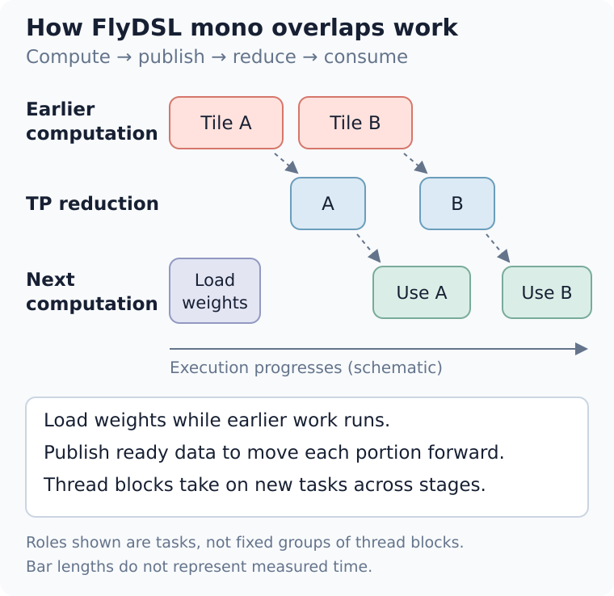
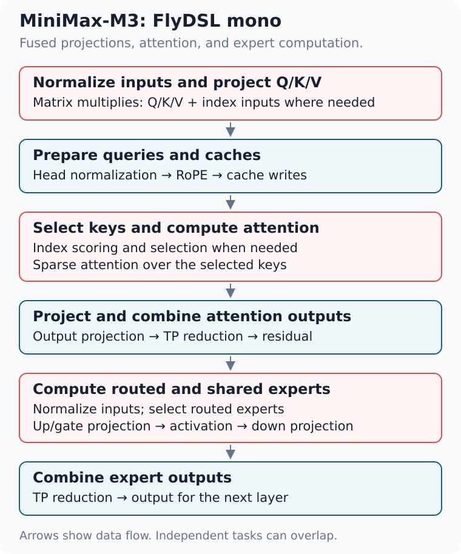
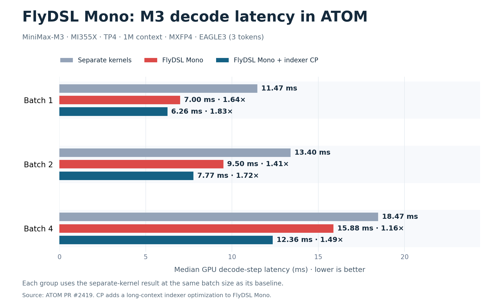
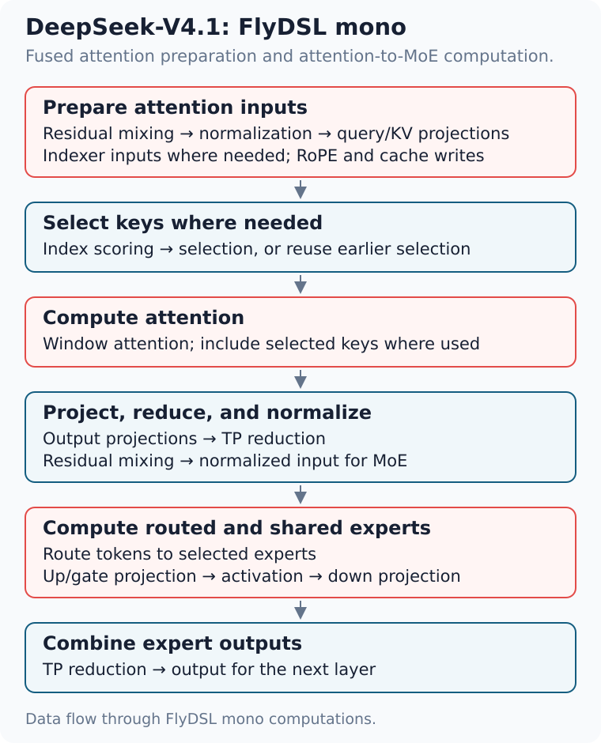
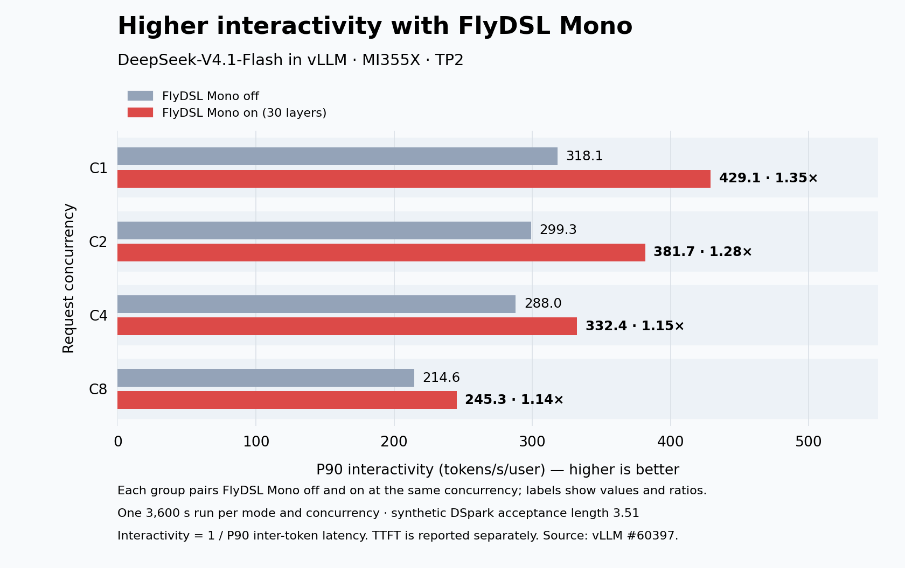
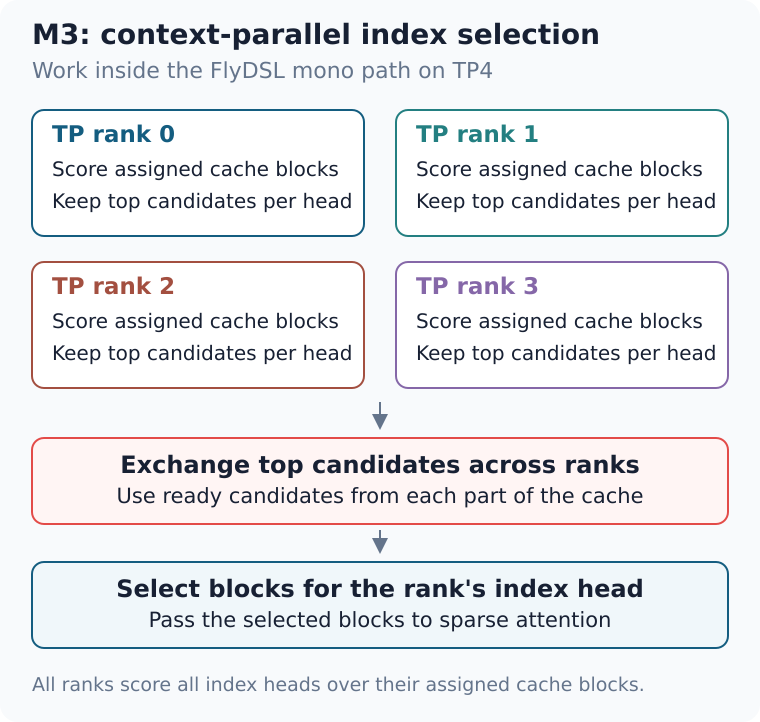
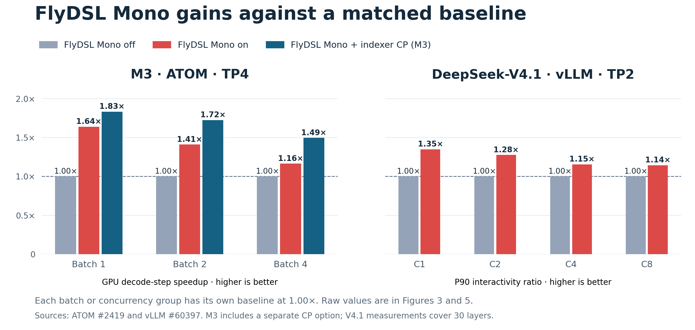

<!---
Copyright (c) 2026 Advanced Micro Devices, Inc. (AMD)

Permission is hereby granted, free of charge, to any person obtaining a copy
of this software and associated documentation files (the "Software"), to deal
in the Software without restriction, including without limitation the rights
to use, copy, modify, merge, publish, distribute, sublicense, and/or sell
copies of the Software, and to permit persons to whom the Software is
furnished to do so, subject to the following conditions:

The above copyright notice and this permission notice shall be included in all
copies or substantial portions of the Software.

THE SOFTWARE IS PROVIDED "AS IS", WITHOUT WARRANTY OF ANY KIND, EXPRESS OR
IMPLIED, INCLUDING BUT NOT LIMITED TO THE WARRANTIES OF MERCHANTABILITY,
FITNESS FOR A PARTICULAR PURPOSE AND NONINFRINGEMENT. IN NO EVENT SHALL THE
AUTHORS OR COPYRIGHT HOLDERS BE LIABLE FOR ANY CLAIM, DAMAGES OR OTHER
LIABILITY, WHETHER IN AN ACTION OF CONTRACT, TORT OR OTHERWISE, ARISING FROM,
OUT OF OR IN CONNECTION WITH THE SOFTWARE OR THE USE OR OTHER DEALINGS IN THE
SOFTWARE.
--->

# FlyDSL Mono Kernels for High-Interactivity LLM Serving in ATOM

LLM applications with strict latency requirements need high interactivity. A coding agent needs to generate its next action quickly so it can call a tool and continue the task. By reducing decode latency, you can keep this loop moving.

[FlyDSL][1] gives developers the flexibility to write GPU programs in Python and tune them at the grid, block, wave, thread, and instruction levels. Its just-in-time (JIT) compilation builds specialized kernels on demand, without compiling every variant in advance. Developers control work assignment, data layout, movement, and synchronization to combine stages of a model layer into FlyDSL mono kernels that overlap independent work and reduce waits. [ATOM](https://github.com/ROCm/ATOM) brings these kernels into serving across several model families. The approach also extends to [vLLM](https://github.com/vllm-project/vllm) and [SGLang](https://github.com/sgl-project/sglang).

In this blog, you will explore how FlyDSL mono schedules overlap work across model stages, how serving runtimes integrate them with dispatch and fallback, and how to interpret decode-latency and interactivity measurements. The ATOM examples and vLLM and SGLang integrations show where this approach helps and where its benefits can shrink.

## Why FlyDSL Mono Kernels Speed Up Decode

Small-batch decode runs many short kernels to process a few tokens at a time. Each launch adds overhead, and some kernels have too little parallel work to keep the GPU busy. A GPU stream executes these kernels in order, so the next stage waits for the whole kernel to finish even if part of its input is already available.

FlyDSL mono kernels combine related operations into fewer launches and let thread blocks work across stages. Developers can load weights alongside earlier computation and let the next stage process portions of the output as they become ready. They can also overlap computation with reductions across GPUs. Together, these choices reduce idle time and help the decode step finish sooner. [2], [3]

HIP Graph replay reduces CPU submission overhead, but the GPU still executes dependent kernels in sequence. FlyDSL mono also changes how stages share data and overlap work within a launch.

## What FlyDSL Provides

FlyDSL provides the controls and compilation support needed to build a FlyDSL mono schedule: [1]

- **JIT specialization.** Compile specialized kernels on demand and reuse cached versions. Developers can adjust shapes and schedules without rebuilding a large library of precompiled kernels, making the kernels easier to tune and extend to new models.
- **Work assignment.** Assign tasks to thread blocks and threads, and tune the mapping for different numbers of tokens per step.
- **Layout and tiling.** Choose how data is arranged and divided into tiles for each stage.
- **Data movement and synchronization.** Decide when to load data and how to signal that an output is ready, within a GPU or across GPUs.
- **Low-level control.** Write and tune a wide range of operations at the grid, block, wave, and thread levels, with control down to individual GPU instructions. [1], [2]

Together, these controls let developers tune both the work inside each stage and the handoffs between stages. In a FlyDSL mono kernel, **thread blocks** can stay active as the layer advances: a block passes on a ready result, then takes on another task. The schematic in Figure 1 shows these handoffs alongside early weight loading and overlapping reductions. [1], [2]

*Figure 1. FlyDSL mono loads weights early, passes ready portions of the output forward, and overlaps reductions with computation. The timeline is schematic.*

**Developers design the fusion.** They choose the schedule and synchronization scheme, and must keep enough cooperating thread blocks resident on the GPU for the kernel to make progress. ATOM provides the serving integration: runtime buffers, coordination across tensor-parallel (TP) ranks, graph replay, correctness checks, and fallback. [2], [4]

The design is inspired by **TileRT**. [5]

## Bringing FlyDSL Mono Kernels to ATOM

ATOM supports FlyDSL mono decode for **GLM-5.2, Kimi-K3, DeepSeek-V4.1, and MiniMax-M3**. Its [shared FlyDSL mono components](https://github.com/ROCm/ATOM/tree/53e4fb52403707ab07b69ee909501ea3cc25ca5c/atom/mono) provide buffers, synchronization, and reductions that model-specific schedules can reuse. [2], [4], [6]

Each model supplies the schedule that connects its own stages. ATOM connects that schedule to serving, where batching and speculative decoding can change the number of tokens in a step. The runtime must select a supported path and make the same choice on every TP rank. [4], [6]

M3 and V4.1 show how these shared controls support different model designs.

### MiniMax-M3: Connecting Attention and Experts

In MiniMax-M3's sparse layers, the FlyDSL mono kernel connects input normalization, attention, and mixture-of-experts (MoE) computation through to the final TP reduction, as Figure 2 shows. The fused path includes the main matrix multiplications: Q/K/V and indexer projections, the attention output projection, routing, and the shared and routed experts' up/gate and down projections. It also handles head normalization, rotary position embeddings (RoPE), and cache writes. [2]

*Figure 2. Computations fused in M3's sparse-layer FlyDSL mono path. Arrows summarize data flow; independent tasks can overlap. [2]*

Three scheduling choices reduce waits: [2]

- **Reuse thread blocks across stages.** A block that finishes attention work can take on routing or expert tasks, letting the schedule reuse GPU resources as the layer progresses.
- **Load weights early.** Blocks can load a later stage's weights while earlier stages compute. The calculation waits for its input, but the weight loads can already be in progress.
- **Pass on ready data.** Tagged buffers signal when an output is ready. Later stages and cross-GPU reductions can start on the portions they need while other blocks produce the rest.

**Decode latency.** The [M3 measurements](data/minimax-decode-step.csv) use MI355X, TP4, MiniMax-M3-MXFP4, a 1M-token context, and EAGLE3 with three draft tokens. **Separate** and **FlyDSL Mono** compare complete ATOM execution paths at the measured revision. **FlyDSL Mono + CP** adds indexer context parallelism, a separate long-context optimization described in the [supporting measurements](#appendix-supporting-measurements). [7]

Figure 3 plots the decode-step comparisons across batch sizes. Times are median GPU decode-step latency in milliseconds; parentheses in the table show speedup relative to Separate.

| Batch | Separate | FlyDSL Mono | FlyDSL Mono + CP |
| ---: | ---: | ---: | ---: |
| 1 | 11.47 | 7.00 (**1.64×**) | 6.26 (**1.83×**) |
| 2 | 13.40 | 9.50 (**1.41×**) | 7.77 (**1.72×**) |
| 4 | 18.47 | 15.88 (**1.16×**) | 12.36 (**1.49×**) |

*Figure 3. Each batch size has its own separate-kernel baseline. Labels show latency and speedup against that baseline. Indexer CP is an additional long-context optimization. [7]*

**FlyDSL Mono alone delivers a 1.64× speedup at batch one; adding CP brings the speedup to 1.83×.** Gains shrink as batch size grows. A larger batch gives separate kernels more parallel work and spreads launch overhead across more tokens, which can reduce the relative advantage of FlyDSL Mono.

These measurements cover GPU decode steps; they do not measure per-user token rate or isolate the contribution of each scheduling choice. A [launch example](data/run-minimax-m3-mono.sh) starts an ATOM server using the measured revision's recipe.

### DeepSeek-V4.1 in ATOM

DeepSeek-V4.1 applies FlyDSL mono kernels to attention preparation and the path from attention to MoE, as shown in Figure 4: [4]

- **Prepare attention inputs.** Combine residual updates and normalization with query and KV projections, RoPE, and window-cache writes, adding indexer projections where needed.
- **Connect attention to MoE.** Score and select keys where needed, compute attention and output projections, then reduce the results across TP ranks and normalize the input to MoE. Routing, shared and routed expert projections, and the expert reduction are fused into this path.

The schedule makes each normalized row available to the router and expert stages as it becomes ready. Output-projection weight loads start before the kernel waits for attention output, allowing memory access to overlap earlier computation. For eligible steps, GPUs also divide token rows among themselves for some stages, reducing work repeated on every GPU. FlyDSL gives developers control over these choices: when to load, when to wait, and how to assign work. [4]

*Figure 4. Data flow through DeepSeek-V4.1's FlyDSL mono computations. Arrows show dependencies between the fused computations. [4]*

The DSpark draft runner also reuses these FlyDSL kernels, adapting their attention and expert settings for draft computation. [4]

### Interactivity Results in ATOM

The [InferenceX AgentX](https://inferencex.semianalysis.com/agentx) benchmark replays multi-turn, long-context agent sessions. It collects inter-token latency for each request and reports **P90 interactivity as 1 / P90 inter-token latency**, with latency in seconds. Higher values mean shorter delays between tokens at the slower end of the request distribution. [8]

The [published ATOM results](data/atom-agentx-source.json) below use **MI355X** with FlyDSL mono decode enabled at concurrency one (C1). **The source provides no matched baseline with FlyDSL Mono off**, so these figures describe complete serving configurations rather than the gain from enabling FlyDSL Mono.

- **MiniMax-M3-MXFP4, TP4:** EAGLE3 with three draft tokens and synthetic acceptance length 2.78, FP8 KV and index caches.
- **DeepSeek-V4.1-Flash, TP2 and TP4:** DSpark with five draft tokens and synthetic acceptance length 3.51, BF16 KV and an FP4 index cache.

Acceptance length is the average number of output tokens per verification step, including the target token. These runs set acceptance synthetically, so acceptance during normal serving may differ. Both model setups use GPU-resident KV caches and a configured **3,600-second profiling window**. The [ATOM serving data](data/atom-agentx.csv) links to the exact recipes, container images, acceptance settings, and source records.

The table reports P90 interactivity in tokens/s/user, **output throughput** in generated tokens/s/GPU, and P90 time to first token (TTFT) in seconds. Output throughput is averaged over the full profiling window; interactivity describes the pace between tokens once a request starts generating.

| Model / TP | Interactivity | Output rate | TTFT |
| --- | ---: | ---: | ---: |
| M3 / TP4 | **469.5** | 42.5 | 1.13 |
| V4.1 / TP2 | **505.1** | 86.5 | 1.20 |
| V4.1 / TP4 | **641.0** | 45.5 | 1.20 |

For M3 at C1, input + output throughput is **6,580 tokens/s/GPU**, but generated output contributes only **42.5 tokens/s/GPU**. The larger total is dominated by input tokens, including cached input, so it does not represent generation speed. The M3 GPU-step comparison above measures the effect of enabling FlyDSL Mono; serving results also reflect scheduling, caching, and speculative decoding. TTFT and tool waits also affect user responsiveness.

## Extending to vLLM and SGLang

**vLLM** integrates FlyDSL mono kernels into its decode path, adapting them to its KV-cache layout and runtime. For DeepSeek-V4.1-Flash on MI355X, a published same-node **FlyDSL Mono off/on** comparison uses **TP2**, with fusion enabled on 30 standard layers in the on run. At **concurrency one**, P90 interactivity rises from **318.1 to 429.1 tokens/s/user (1.35×)**. Each concurrency setting has **one 3,600-second run per mode**, using DSpark with five draft tokens and synthetic acceptance length 3.51. The four concurrency settings ran at the same time on one eight-GPU node. Figure 5 compares P90 interactivity with FlyDSL Mono off and on at each concurrency. [3]

*Figure 5. Each group compares FlyDSL Mono off and on at the same request concurrency. Longer bars mean faster token generation. Labels show the measured values and their ratio. [3]*

TTFT is higher at C1/C8 and lower at C2/C4 in these runs. More runs would be needed to establish a repeatable change; the [supporting measurements](#vllm-evaluation-details) include all four pairs. As with the ATOM benchmarks, acceptance is set synthetically, so these runs do not measure the full user experience under natural acceptance.

**SGLang's [framework RFC][9]** [\[9\]](https://github.com/sgl-project/sglang/issues/43949), implemented in [SGLang #44353](https://github.com/sgl-project/sglang/pull/44353), provides an extension point for FlyDSL mono kernels through GPU-vendor plugins, including the [AMD plugin](https://github.com/sgl-project/sgl-amd-mono). The plugins supply model kernels, while SGLang handles step selection and runtime integration.

## Scope and Costs

Fusion can increase register and shared-memory use, leaving room for fewer thread blocks to run at once. Developers must account for that limit when choosing which operations to combine. [2]

**Where gains shrink.** M3's GPU-step speedup falls from 1.64× at batch one to 1.16× at batch four; vLLM's interactivity gain falls from 1.35× at C1 to 1.14× at C8. A separate vLLM FFN-only layer test is already near parity at TP2/C8: **345 → 342 µs (1.01×)** at 48 token rows. The available full-model measurements do not show where FlyDSL Mono and the separate path reach parity. [3], [7]

**When FlyDSL Mono takes over.** The runtime selects FlyDSL Mono based on the model, GPU, TP size, layouts, and step metadata. In the cited revisions, M3 supports up to **16 token rows** per step; ATOM and vLLM V4.1 support up to **48**. Speculative tokens and graph padding count toward these limits: one request with five drafts can use six rows before padding. In a supported deployment, larger or unsupported steps use the standard path, with every TP rank making the same choice. These row limits define supported shapes; they do not identify where FlyDSL Mono stops improving performance. [2], [3], [4]

**Development cost.** Each model needs a schedule that developers must validate and maintain as the model changes. Correctness checks and task evaluations are part of that work. [3]

## Build a FlyDSL Mono Path for Your Model

Start with the [FlyDSL mono components](https://github.com/ROCm/FlyDSL/tree/31f389b3838d83f82e5bd9ccf646076243e24e18/kernels/monokernel) and [ATOM's shared FlyDSL mono framework](https://github.com/ROCm/ATOM/tree/53e4fb52403707ab07b69ee909501ea3cc25ca5c/atom/mono):

1. **Find the waits.** Profile the separate path at your serving batch sizes. Identify where stages wait for data or communication.
2. **Write the schedule in FlyDSL.** Use reusable compute and communication components to connect stages. Assign independent tasks to thread blocks so their work can overlap.
3. **Integrate and evaluate.** Add runtime dispatch, fallback, and correctness checks. Evaluate task quality with actual rejection sampling, then compare interactivity, TTFT, and throughput at the same concurrency levels.

## Appendix: Supporting Measurements

**Indexer context parallelism in M3.** As Figure 6 shows, ATOM splits index scoring across four TP ranks, then exchanges candidates to make the final selection. This is the additional optimization behind the FlyDSL Mono + CP results. [2], [7]

At 1M context, TP4, 16 token rows, and four query rows per request, the [layer measurement](data/minimax-indexer-cp-layer.csv) records **222.2 → 156.7 µs (1.42×)** with CP. Both runs use FlyDSL Mono and graph replay. [7]

*Figure 6. Each rank scores part of the cache, then exchanges its best candidates so the owning rank can make the final selection.*

**Direct FlyDSL Mono comparisons.** Figure 7 summarizes the paired results from Figures 3 and 5. Each group includes its own FlyDSL Mono off baseline, normalized to 1.00×. M3 uses ATOM GPU-step latency; V4.1 uses vLLM interactivity. [3], [7]

*Figure 7. Each group pairs FlyDSL Mono off and on. Ratios are latency (off/on) for M3 and interactivity (on/off) for V4.1. The raw values appear in Figures 3 and 5. [3], [7]*

### vLLM Evaluation Details

**TTFT.** The table below gives P90 TTFT in seconds for the TP2 FlyDSL Mono off/on runs in Figure 5. Each mode has one 3,600-second run per concurrency; repeated measurements would be needed to establish a consistent effect. [3]

| Concurrency | FlyDSL Mono off | FlyDSL Mono on |
| ---: | ---: | ---: |
| 1 | 1.18 | 1.28 |
| 2 | 1.10 | 1.08 |
| 4 | 1.27 | 1.26 |
| 8 | 1.01 | 1.08 |

**Additional vLLM measurements.** The [comparison CSV](data/mono-benefits.csv) records the TP2 FlyDSL Mono off/on results at C1, C2, C4, and C8, including TTFT. The CSV retains input + output totals, which include cached input and are not output throughput. [3]

## Summary

In this blog you learned how FlyDSL mono kernels shorten small-batch decode. Short kernels leave the GPU waiting on launches, and the next stage waits until a whole kernel finishes even when part of its input is already available. A FlyDSL mono kernel keeps thread blocks working across stages: it loads later weights early, passes ready output forward, and overlaps computation with reductions.

ATOM uses this approach for GLM-5.2, Kimi-K3, DeepSeek-V4.1, and MiniMax-M3. On MI355X, MiniMax-M3 at batch one moves from 11.47 ms with separate kernels to 7.00 ms with FlyDSL Mono (1.64×), and to 6.26 ms with indexer context parallelism (1.83×). The relative gain shrinks as the batch grows. DeepSeek-V4.1-Flash in vLLM shows the same pattern. At concurrency one, P90 interactivity rises from 318.1 to 429.1 tokens/s/user (1.35×), and the gain is smaller at higher concurrency. The ATOM AgentX table reports complete serving configurations with FlyDSL Mono enabled. Those runs have no matched baseline with it off.

vLLM adapts the same kernels to its KV-cache layout. SGLang reaches them through its GPU-vendor plugin. If you build a path for another model, profile the waits in the separate schedule, write the overlap in FlyDSL, and keep a fallback for shapes the fused kernel does not cover.

## References

1. [FlyDSL language and compiler](https://github.com/ROCm/FlyDSL).
2. [ATOM's M3 FlyDSL mono implementation](https://github.com/ROCm/ATOM/tree/53e4fb52403707ab07b69ee909501ea3cc25ca5c/atom/models/minimax_m3/mono).
3. [vLLM: DeepSeek-V4.1-Flash FlyDSL mono decode and AgentX results](https://github.com/vllm-project/vllm/pull/60397).
4. [ATOM's DeepSeek-V4.1 FlyDSL mono implementation](https://github.com/ROCm/ATOM/tree/53e4fb52403707ab07b69ee909501ea3cc25ca5c/atom/models/deepseek_v41/mono).
5. [TileRT](https://github.com/tile-ai/TileRT).
6. [ATOM: GLM-5.2 and Kimi-K3 FlyDSL mono decode](https://github.com/ROCm/ATOM/pull/2535).
7. [ATOM: MiniMax-M3 FlyDSL mono decode and measurements](https://github.com/ROCm/ATOM/pull/2419).
8. [InferenceX AgentX metric definitions](https://github.com/SemiAnalysisAI/InferenceX/blob/8b25006fa0b23c7e157438996a3d2a90ff5e8cd2/inferencex-e2e/infx/results/agentic/request_metrics.py).
9. [SGLang: GPU kernel framework RFC](https://github.com/sgl-project/sglang/issues/43949).

[1]: https://github.com/ROCm/FlyDSL
[2]: https://github.com/ROCm/ATOM/tree/53e4fb52403707ab07b69ee909501ea3cc25ca5c/atom/models/minimax_m3/mono
[3]: https://github.com/vllm-project/vllm/pull/60397
[4]: https://github.com/ROCm/ATOM/tree/53e4fb52403707ab07b69ee909501ea3cc25ca5c/atom/models/deepseek_v41/mono
[5]: https://github.com/tile-ai/TileRT
[6]: https://github.com/ROCm/ATOM/pull/2535
[7]: https://github.com/ROCm/ATOM/pull/2419
[8]: https://github.com/SemiAnalysisAI/InferenceX/blob/8b25006fa0b23c7e157438996a3d2a90ff5e8cd2/inferencex-e2e/infx/results/agentic/request_metrics.py
[9]: https://github.com/sgl-project/sglang/issues/43949

## Disclaimers

Testing conducted by AMD as of 2026-10-15. Hardware configuration: Supermicro
AS-4126GS-NMR-LCC with 8× AMD Instinct™ MI355X (gfx950, 288 GB HBM3E each),
2× AMD EPYC™ 9575F 64-core processors, 3 TiB system memory, Ubuntu 22.04.5 LTS
(Linux kernel 6.8.0-65), amdgpu driver 6.14.14. MiniMax-M3 measurements use
MiniMax-M3-MXFP4 with TP4, a 1M-token context, and EAGLE3 with three draft tokens;
decode-step latencies are medians. DeepSeek-V4.1-Flash measurements in vLLM use TP2,
with one 3,600-second run per mode and concurrency. Software revisions are the ones
linked in the References.
The ATOM AgentX table reports published InferenceX results (result date 2026-10-08,
see [the source file](data/atom-agentx-source.json)), not measurements on the
configuration above.

Third-party content is licensed to you directly by the third party that owns the
content and is not licensed to you by AMD. ALL LINKED THIRD-PARTY CONTENT IS
PROVIDED "AS IS" WITHOUT A WARRANTY OF ANY KIND. USE OF SUCH THIRD-PARTY CONTENT
IS DONE AT YOUR SOLE DISCRETION AND UNDER NO CIRCUMSTANCES WILL AMD BE LIABLE TO
YOU FOR ANY THIRD-PARTY CONTENT. YOU ASSUME ALL RISK AND ARE SOLELY RESPONSIBLE
FOR ANY DAMAGES THAT MAY ARISE FROM YOUR USE OF THIRD-PARTY CONTENT.

Results shown are from specific test configurations and may vary based on workload,
model, and system configuration.

The information presented in this document is for informational purposes only and may contain technical inaccuracies, omissions, and typographical errors. The information contained herein is subject to change and may be rendered inaccurate for many reasons, including but not limited to product and roadmap changes, component and motherboard version changes, new model and/or product releases, product differences between differing manufacturers, software changes, BIOS flashes, firmware upgrades, or the like. Any computer system has risks of security vulnerabilities that cannot be completely prevented or mitigated. AMD assumes no obligation to update or otherwise correct or revise this information.
However, AMD reserves the right to revise this information and to make changes from time to time to the content hereof without obligation of AMD to notify any person of such revisions or changes.
THIS INFORMATION IS PROVIDED "AS IS." AMD MAKES NO REPRESENTATIONS OR WARRANTIES WITH RESPECT TO THE CONTENTS HEREOF AND ASSUMES NO RESPONSIBILITY FOR ANY INACCURACIES, ERRORS, OR OMISSIONS THAT MAY APPEAR IN THIS INFORMATION. AMD SPECIFICALLY DISCLAIMS ANY IMPLIED WARRANTIES OF NON-INFRINGEMENT, MERCHANTABILITY, OR FITNESS FOR ANY PARTICULAR PURPOSE. IN NO EVENT WILL AMD BE LIABLE TO ANY PERSON FOR ANY RELIANCE, DIRECT, INDIRECT, SPECIAL, OR OTHER CONSEQUENTIAL DAMAGES ARISING FROM THE USE OF ANY INFORMATION CONTAINED HEREIN, EVEN IF AMD IS EXPRESSLY ADVISED OF THE POSSIBILITY OF SUCH DAMAGES.
AMD, the AMD Arrow logo, AMD Instinct, AMD EPYC, AMD ROCm, and combinations thereof are trademarks of Advanced Micro Devices, Inc. Other product names used in this publication are for identification purposes only and may be trademarks of their respective companies. Linux is the registered trademark of Linus Torvalds in the U.S. and other countries. PyTorch, the PyTorch logo, vLLM, and any related marks are trademarks of The Linux Foundation. Ubuntu is a registered trademark of Canonical Ltd. All other trademarks and product names referenced in this publication, including MiniMax, DeepSeek, SGLang, InferenceX, and Hugging Face, are the property of their respective owners.
© 2026 Advanced Micro Devices, Inc. All rights reserved.
