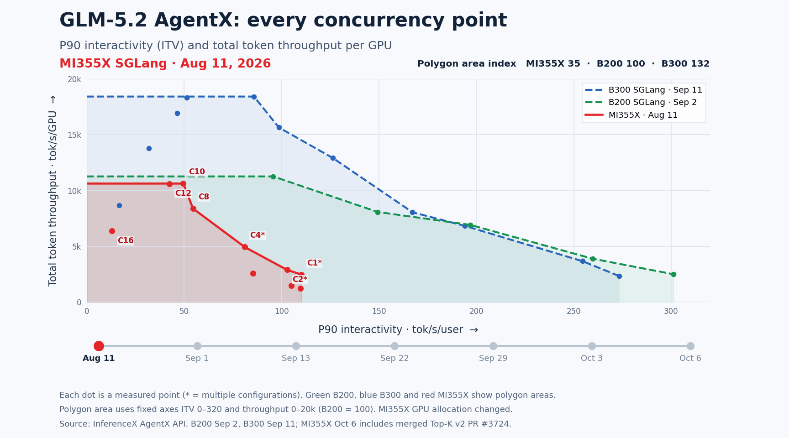
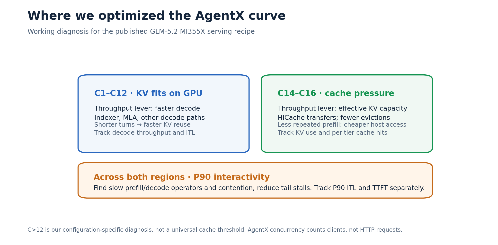
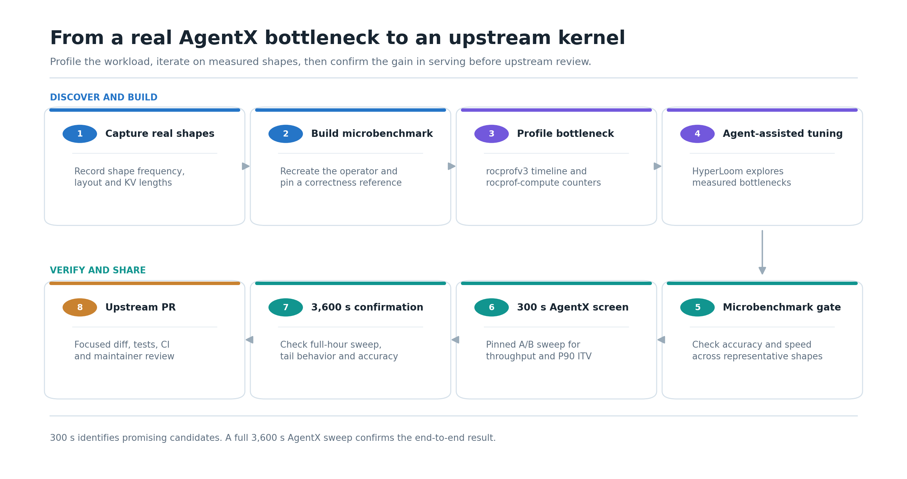
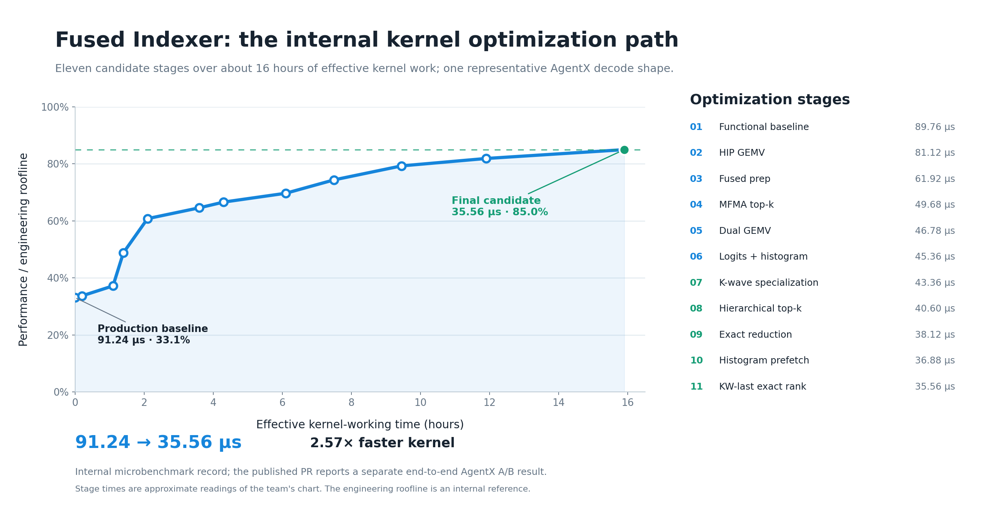

<!---
Copyright (c) 2026 Advanced Micro Devices, Inc. (AMD)

Permission is hereby granted, free of charge, to any person obtaining a copy
of this software and associated documentation files (the "Software"), to deal
in the Software without restriction, including without limitation the rights
to use, copy, modify, merge, publish, distribute, sublicense, and/or sell
copies of the Software, and to permit persons to whom the Software is
furnished to do so, subject to the following conditions:

The above copyright notice and this permission notice shall be included in all
copies or substantial portions of the Software.

THE SOFTWARE IS PROVIDED "AS IS", WITHOUT WARRANTY OF ANY KIND, EXPRESS OR
IMPLIED, INCLUDING BUT NOT LIMITED TO THE WARRANTIES OF MERCHANTABILITY,
FITNESS FOR A PARTICULAR PURPOSE AND NONINFRINGEMENT. IN NO EVENT SHALL THE
AUTHORS OR COPYRIGHT HOLDERS BE LIABLE FOR ANY CLAIM, DAMAGES OR OTHER
LIABILITY, WHETHER IN AN ACTION OF CONTRACT, TORT OR OTHERWISE, ARISING FROM,
OUT OF OR IN CONNECTION WITH THE SOFTWARE OR THE USE OR OTHER DEALINGS IN THE
SOFTWARE.
--->

# GLM-5.2 AgentX on AMD Instinct MI355X: Boosting Throughput and Interactivity

Coding agents send long, growing prompts, reuse earlier context, and run parallel tasks, which puts heavy pressure on an inference server. In this blog you will learn how we used the [InferenceX AgentX benchmark](https://inferencex.semianalysis.com/agentx) to improve GLM-5.2-MXFP4 serving on AMD Instinct MI355X GPUs. In this model, MXFP4 is a microscaling 4-bit floating-point weight format; SGLang is an open-source LLM serving framework. Cache efficiency, faster decode kernels, careful AgentX validation, and upstream collaboration raised peak throughput 1.72× and peak P90 interactivity 2.46×.

## Results at a Glance

From the [August 11 baseline sweep](https://github.com/SemiAnalysisAI/InferenceX/actions/runs/31501371582) to the [October 6 final sweep](https://github.com/SemiAnalysisAI/InferenceX/actions/runs/37326853365), peak per-GPU throughput rose **1.72×**, from 10,625 total tokens/s/GPU at concurrency 10 to 18,327 at concurrency 16. We compare each sweep's highest-throughput point; the baseline's concurrency-16 point was below its concurrency-10 peak. The [published GLM-5.2 results](https://inferencex.semianalysis.com/inference/glm-5-2) provide a lasting reference for the final configuration; the runs used InferenceX commits [d204ac0](https://github.com/SemiAnalysisAI/InferenceX/commit/d204ac0de29d506d5de9ad534495b6fe0ae21370) and [b3c3b96](https://github.com/SemiAnalysisAI/InferenceX/commit/b3c3b964a41f093e548dbda2ac5fe0919d515080), respectively.

At the low-concurrency end, the highest P90 (90th-percentile) interactivity (ITV) in each sweep occurred at concurrency 1. Peak P90 ITV rose **2.46×**, from 110.25 to 271.00 tokens/s/user. These are measured results from two deployed configurations, not a controlled A/B test or an official InferenceX aggregate score; GPU allocation changed from 16 to four.

Figure 1 shows how the nine measured concurrency points changed across the published sweeps.

*Figure 1. Every plotted marker is a measured concurrency point. Green is the selected B200 reference, blue is B300, and red tracks MI355X over time. Lines between markers are visual interpolation, not additional measurements.*

In Figure 1, the area enclosed by each curve summarizes the nine-point sweep on fixed axes. Setting the September 2 B200 reference to 100, MI355X rose from 35 to 123, while the selected B300 reference is 132. MI355X passed the B200 area in the September 22 snapshot and moved closer to B300 by October 6.

This polygon-area index is our visualization, **not an official InferenceX metric or percentage speedup**. It uses P90 ITV from 0 to 320 tokens/s/user and throughput from 0 to 20,000 tokens/s/GPU. The reference runs and MI355X snapshots were taken on different dates.

## Why AgentX Stresses the Serving Stack

AgentX reconstructs Claude Code sessions that users opted in to share, without the original prompts, code, or tool payloads. Its [v1.0 corpus](https://inferencex.semianalysis.com/agentx) has **393 sessions**; the median request has roughly **142,000 input tokens** and **444 output tokens**, and **44% of sessions include subagents**. Shared prefixes and long contexts put pressure on key-value (KV) cache capacity and reuse.

AgentX replays complete conversations in a closed loop: each client sends its next request only after the previous response completes. Concurrency counts active agent clients, and the [published profiling window](https://inferencex.semianalysis.com/agentx/methodology) is **3,600 seconds** (one hour), starting after cache warmup. A faster server can progress further through those conversations within that hour. The replay uses synthetic payloads and measures serving, not answer quality.

## Finding the Bottleneck

Our GLM-5.2 MI355X sweep had two main throughput regimes. **Above concurrency 12**, the active KV working set approached GPU cache capacity. HiCache, SGLang's hierarchical KV cache, offloads KV data to host DRAM when it cannot all remain on the GPU. Its ROCm copy path made host-memory transfers available for the FP8 MLA cache rows used here, increasing effective cache capacity and reducing repeated prefill. Where the working set fits in GPU cache, **faster decode** completes turns sooner and releases KV pages for the next requests. This boundary is specific to the model and serving configuration, not a universal MI355X threshold. The [telemetry guide](https://inferencex.semianalysis.com/agentx/telemetry) and [published recipe](https://github.com/SemiAnalysisAI/InferenceX/pull/3616) give the measurement and configuration details.

For **P90 ITV**, we looked for slow prefill operators, slow decode operators, and scheduling stalls. We separated input-token from output-token throughput, then checked KV use, cache-hit rates, prompt-token source, queue depth, time to first token, and P90 inter-token latency (ITL). ITV is tokens/s/user, so higher is better; ITL is time between tokens, so lower is better.

*Figure 2. Working diagnosis for this GLM-5.2 MI355X recipe. HiCache can also be enabled below concurrency 12; the boundary marks where cache pressure became the dominant throughput constraint in our measurements.*

We tested a suspected mechanism on a fixed shape, screened it in a controlled AgentX A/B run, and used a complete one-hour sweep to confirm a serving result. Baseline image, model, concurrency, cache mode, and speculative acceptance settings stayed explicit in each comparison.

## Serving and Cache Improvements

The [published InferenceX recipe](https://github.com/SemiAnalysisAI/InferenceX/pull/3616) uses **TP8/EP1 with GPU-resident KV** at three lower-load points and **TP4/EP4 with HiCache DRAM offload** at six higher-load points. It uses FP8 KV cache and five-step EAGLE MTP with six draft tokens; the shipped GLM-5.2 NextN draft head remains BF16. The separate [SGLang GLM-5.2 cookbook](https://github.com/sgl-project/sglang/pull/42278) documents the serving image.

ROCm HiCache work corrected [registered host-pointer handling](https://github.com/sgl-project/sglang/pull/35233), enabled the just-in-time (JIT) copy path for **576-byte FP8 multi-head latent attention (MLA) rows** and the K-only host pool in the [copy-path PR](https://github.com/sgl-project/sglang/pull/37152), and raised the HIP JIT block quota for mapped-host transfers in the [block-quota PR](https://github.com/sgl-project/sglang/pull/39036). These changes enabled and improved cache movement, but the individual PRs do not isolate AgentX percentage gains.

For HIP graph capture, which records GPU work for replay, [#37118](https://github.com/sgl-project/sglang/pull/37118) enabled the DeepSeek Sparse Attention (DSA) head-gate helpers used during prefill. [#37124](https://github.com/sgl-project/sglang/pull/37124) enabled fused DSA metadata kernels and removed repeated query concatenation and weight operations from the DSA decode path.

The merged fused indexer reduced P90 ITL from **3.81 ms to 3.56 ms (−6.7%)** in the controlled AgentX A/B test reported in [SGLang PR #38583](https://github.com/sgl-project/sglang/pull/38583). Coding agents shortened the path from a profiler finding to a testable candidate. We used HyperLoom on indexer and MLA work; engineers selected changes, checked numerical behavior, and validated them in SGLang and AgentX. The [AMD HyperLoom blog](https://rocm.blogs.amd.com/software-tools-optimization/hyperloom-optimization/README.html) describes the broader agent workflow.

## HyperLoom-Assisted Kernel Optimization

Figure 3 shows the loop we used to move from a measured AgentX bottleneck to an upstream change.

*Figure 3. The 300-second sweep screens integrated candidates; the 3,600-second sweep confirms the end-to-end result.*

1. **Capture real shapes:** Record prefill and decode shapes, layout, KV lengths, and frequency.
2. **Build a microbenchmark:** Recreate representative shapes with a fixed baseline and correctness reference.
3. **Profile:** Use [rocprofv3](https://rocm.docs.amd.com/projects/rocprofiler-sdk/en/latest/how-to/using-rocprofv3.html) for timing and [rocprof-compute](https://rocm.docs.amd.com/projects/rocprofiler-compute/en/latest/how-to/analyze/cli.html) for compute and memory behavior.
4. **Iterate with agents:** HyperLoom explores candidates against the measured bottleneck.
5. **Recheck the microbenchmark:** Repeat correctness and speed tests across representative shapes.
6. **Screen in AgentX:** Compare throughput and P90 ITV in a 300-second A/B sweep with a fixed configuration.
7. **Confirm for one hour:** Run the 3,600-second sweep and check tail behavior and accuracy.
8. **Upstream the change:** Submit a focused PR with tests, speed evidence, ablation results, and CI review.

The fused indexer shows the operator-level search behind that process. Our internal HyperLoom record tracks eleven candidate stages over about 16 hours of effective kernel-working time for one representative AgentX decode shape, as shown in Figure 4. Effective time counts kernel optimization work and excludes unrelated work. Kernel latency fell from **91.24 µs to 35.56 µs (2.57× faster)**, moving from 33.1% to 85.0% of an internal engineering roofline, a reference estimate of the performance available to this kernel. These stage measurements are separate from the serving A/B results in [PR #38583](https://github.com/sgl-project/sglang/pull/38583).

*Figure 4. Internal microbenchmark record. Stage positions approximate the elapsed kernel-working times in the team's optimization record. The roofline is an engineering reference, not an AgentX benchmark metric.*

The [merged PR #38583](https://github.com/sgl-project/sglang/pull/38583) replaces a twelve-launch DSA indexer decode chain with four HIP kernels when the gfx950, AITER preshuffle, and GLM-5.2 indexer-shape conditions are met; other paths retain the existing implementation. GLM-5.2 invokes the indexer across 78 layers plus the MTP draft layer on each decode step. The PR's 1,200-second-per-arm, concurrency-1 AgentX A/B reports P90 ITL **−6.7%**; its P50 and P99 ITL changes are −4.7% and −6.6%. Separate upstream work [fused MLA query absorption with RoPE and KV writing](https://github.com/sgl-project/sglang/pull/38340) and [tuned sparse MLA on gfx950](https://github.com/sgl-project/sglang/pull/39059). The gains reported for these changes use different baselines and should not be added together.

## From Local Results to Upstream Releases

Our internal integration work let us try combinations quickly, with coding agents accelerating kernel exploration. For changes reflected in the public AgentX result, the path ran through SGLang code review and InferenceX review of a versioned serving image. We learned to:

1. **Define the bottleneck and keep the patch focused.** State which operation and workload shapes benefit. Limit changes to shared paths, and add a hardware guard when the optimization is hardware-specific.
2. **Choose changes that merit review.** Submit changes with measured performance gains, along with the correctness or cache features needed to make the configuration work; leave exploratory variants out of the final patch.
3. **Match the evidence to the claim.** Use relevant correctness or model-quality tests, kernel microbenchmarks, and controlled AgentX comparisons. When changes interact, isolate their effects with an ablation rather than attributing the combined gain to one patch.
4. **Triage CI against a baseline.** Follow each project's review rules. Reproduce a failure on both the PR and upstream `main`, check whether the changed path is exercised, and fix failures introduced by the patch.
5. **Coordinate across SGLang and InferenceX.** The SGLang AMD team and maintainers reviewed the framework and kernel changes. The InferenceX Team required every sweep to use a publicly released image, such as a daily build, and all serving parameters and environment variables used in the run to be documented in the published InferenceX recipe.

### Merged PRs by Optimization Area

These merged PRs include performance, correctness, and enablement work; individual effects cannot be summed. The October 6 curve uses the September 30 serving image, so later merged code, such as [#41725](https://github.com/sgl-project/sglang/pull/41725), is not part of that curve.

- **Operators:** [#37591](https://github.com/sgl-project/sglang/pull/37591) (DSA top-k), [#38328](https://github.com/sgl-project/sglang/pull/38328) (MoE router), [#38340](https://github.com/sgl-project/sglang/pull/38340) (MLA fusion), [#38583](https://github.com/sgl-project/sglang/pull/38583) (fused indexer), [#39059](https://github.com/sgl-project/sglang/pull/39059) (sparse MLA), [#39155](https://github.com/sgl-project/sglang/pull/39155) (draft MoE), [#39775](https://github.com/sgl-project/sglang/pull/39775) (grouped top-k), [#40710](https://github.com/sgl-project/sglang/pull/40710) (FP8 indexer writer), [#41725](https://github.com/sgl-project/sglang/pull/41725) (decode tiles and routing).
- **Graphs:** [#37118](https://github.com/sgl-project/sglang/pull/37118) (HIP DSA graph helpers), [#37124](https://github.com/sgl-project/sglang/pull/37124) (DSA metadata and absorb path).
- **HiCache:** [#35233](https://github.com/sgl-project/sglang/pull/35233) (host pointers), [#37152](https://github.com/sgl-project/sglang/pull/37152) (JIT copy and K-only pool), [#39036](https://github.com/sgl-project/sglang/pull/39036) (HIP block quota).
- **Other:** [#37133](https://github.com/sgl-project/sglang/pull/37133) (routing bias), [#37134](https://github.com/sgl-project/sglang/pull/37134) (EAGLE sampling), [#37720](https://github.com/sgl-project/sglang/pull/37720) (model loading), [#39790](https://github.com/sgl-project/sglang/pull/39790) (cross-GPU AllReduce fusion).

The InferenceX recipe also merged [#3616](https://github.com/SemiAnalysisAI/InferenceX/pull/3616) to update the versioned serving image and [#3724](https://github.com/SemiAnalysisAI/InferenceX/pull/3724) to enable the top-k v2 kernel.

## Summary

You have seen how we identified cache pressure and slow decode steps, validated changes in AgentX, and worked with the SGLang and InferenceX communities to release them. Together, these changes raised peak per-GPU throughput **1.72×** and peak P90 ITV **2.46×** across the published August 11 and October 6 configurations. These are combined deployment results; the controlled indexer A/B test isolates one kernel change. The [AMD HyperLoom blog](https://rocm.blogs.amd.com/software-tools-optimization/hyperloom-optimization/README.html) describes the agent-assisted kernel workflow in more detail.

Next, we will reduce HiCache transfer cost at high concurrency and tune the slowest prefill and decode kernels. We will share their measured AgentX impact in a future update; for related serving work, see our [GLM-5.2 prefill optimization blog](https://rocm.blogs.amd.com/artificial-intelligence/glm52-mxfp4-mi355/README.html).

## Acknowledgment

Thanks to **the SGLang community and the SGLang AMD team maintainers** for their reviews and collaboration on the upstream work; the **InferenceX Team at SemiAnalysis** for building and maintaining AgentX and reviewing benchmark PRs; and the **AMD support team** for providing and supporting the test nodes.

## Disclaimers

The information presented in this document is for informational purposes only and may contain technical inaccuracies, omissions, and typographical errors. The information contained herein is subject to change and may be rendered inaccurate for many reasons, including but not limited to product and roadmap changes, component and motherboard version changes, new model and/or product releases, product differences between differing manufacturers, software changes, BIOS flashes, firmware upgrades, or the like. Any computer system has risks of security vulnerabilities that cannot be completely prevented or mitigated. AMD assumes no obligation to update or otherwise correct or revise this information. However, AMD reserves the right to revise this information and to make changes from time to time to the content hereof without obligation of AMD to notify any person of such revisions or changes. THIS INFORMATION IS PROVIDED ‘AS IS.” AMD MAKES NO REPRESENTATIONS OR WARRANTIES WITH RESPECT TO THE CONTENTS HEREOF AND ASSUMES NO RESPONSIBILITY FOR ANY INACCURACIES, ERRORS, OR OMISSIONS THAT MAY APPEAR IN THIS INFORMATION. AMD SPECIFICALLY DISCLAIMS ANY IMPLIED WARRANTIES OF NON-INFRINGEMENT, MERCHANTABILITY, OR FITNESS FOR ANY PARTICULAR PURPOSE. IN NO EVENT WILL AMD BE LIABLE TO ANY PERSON FOR ANY RELIANCE, DIRECT, INDIRECT, SPECIAL, OR OTHER CONSEQUENTIAL DAMAGES ARISING FROM THE USE OF ANY INFORMATION CONTAINED HEREIN, EVEN IF AMD IS EXPRESSLY ADVISED OF THE POSSIBILITY OF SUCH DAMAGES. AMD, the AMD Arrow logo, and combinations thereof are trademarks of Advanced Micro Devices, Inc. Other product names used in this publication are for identification purposes only and may be trademarks of their respective companies. © 2026 Advanced Micro Devices, Inc. All rights reserved
