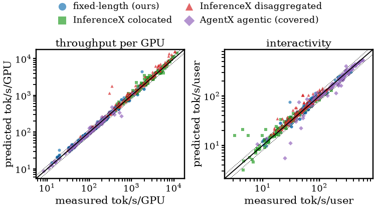

# ROCm InferaSim: Cut LLM Serving Trial Costs and Deploy the Best Configuration

Serving an LLM well means making a lot of choices before you know the answer.
You pick an engine, a parallel layout, precisions and scheduler settings, and
for disaggregated serving a split between prefill and decode. That leaves
thousands of candidates, and each trial ties up one or more multi-GPU nodes for
minutes. Measuring every candidate in our searches would take about 25,000
GPU-hours, so most teams try a few guesses and keep the best. A guess that
misses costs you extra GPUs or a missed latency target.

**ROCm InferaSim** replaces most of those measurements with fast projection.
It measures once per set of kernels, calculates every configuration that runs
them, and an agent searches the projections instead of the hardware. Each
projection takes under half a second on one CPU core. On our own AMD Instinct™
MI355X runs, 11 anchors cost 9.1 GPU-hours and cover 226 configurations that
took 204 GPU-hours to measure. GPU hours go to confirming a short list. The
full method and evaluation are in the InferaSim paper [1].

Before any deployment exists, InferaSim tells you:

- whether a recipe fits in HBM, and at what concurrency
- the latency distribution under a given arrival process
- how many replicas an SLO needs, and how to split prefill and decode
- the best configuration for each model and latency tier
- the throughput-versus-interactivity Pareto frontier for a model, with and
  without speculative decoding and KV offload to host DRAM

The frontier is where the cost shows. Every configuration below it pays for
GPUs it doesn't need: in the GLM-5.2 chart in the figure below, some measured
configurations deliver a third or less of the frontier's throughput per GPU at
the same interactivity. As the figure shows, InferaSim finds the frontier
without measuring every configuration:


*Each panel plots throughput per GPU (tokens/s per GPU, log scale) against
interactivity (tokens/s per user). Blue filled dots are measured runs on
AMD Instinct™ MI355X GPUs from the public InferenceX benchmark [3]; red open
circles are InferaSim's anchored-mode predictions for the same
configurations, and the lines join each frontier. Left: GLM-5.2 on the AgentX
agentic coding trace. Right: MiniMax-M3 with 8k-token prompts and 1k-token
outputs, including disaggregated layouts. The predicted frontier keeps all 10
measured-frontier configurations for GLM-5.2 and 11 of 12 for MiniMax-M3.*

Terms used in this post:

- **TTFT** (time to first token) is how long a request waits for its first
  output token.
- **TPOT** (time per output token) and **ITL** (inter-token latency) both
  measure the gap between output tokens. TPOT is a per-request average; ITL is
  per gap, so its percentiles show stalls. For agentic traffic we report ITL
  where fixed-length results report TPOT.
- **Interactivity** is tokens per second per user, 1000 / TPOT in ms.
- **TP, EP, DP and PP** are tensor, expert, data and pipeline parallelism.
  Attention DP gives each GPU its own requests for the attention layers only.
  TP8 means TP across eight GPUs.
- **MTP** (multi-token prediction) is a model's built-in drafter for
  speculative decoding. **MXFP4** is the OCP microscaling 4-bit
  floating-point format.
- The **DES** is InferaSim's discrete-event simulator. An **anchor** is one
  short measured run, described in the next section.

To try it, jump to the [Quick start](#quick-start).

## The Idea: Measure Sparsely, Transfer Analytically

Changing batch size, context length, tensor-parallel width or replica count
does not change which kernels run. Changing dtype, attention backend, graph
mode or speculation does. While the kernels stay the same, their cost scales
in ways you can calculate. So InferaSim measures once per set of kernels and
calculates every configuration that uses them:

| Kind                | Parameters                                                                   | Behavior                                                         |
| ------------------- | ---------------------------------------------------------------------------- | ---------------------------------------------------------------- |
| **Anchor-defining** | model, dtype, attention/collective backend, graph mode, speculative decoding | Change which kernels run. Each combination needs its own anchor. |
| **Transferable**    | batch, concurrency, context length, TP/EP/PP, replica count, arrival rate    | Move analytically from an existing measurement.                  |

Each measurement is saved as an **anchor**: a JSON file holding a batch sweep
of measured prefill and decode step latencies, plus a signature of exactly
what was running. A search then needs one measurement per kernel set and a few
confirmation runs on the shortlist, instead of one run per candidate.

```{note}
The default is **anchored mode** (`--profiling-mode benchmark`), where a
matching anchor calibrates the step model. **Simulate mode**
(`--profiling-mode simulate`) is fully analytical and needs no anchor. It
prices kernels only, so use it to rank candidates within one engine, not to
predict absolute numbers.
```

The figure below shows how the whole system fits together. Only the anchor and
the final confirmation use GPUs; everything between them runs on CPU.


## Quick Start

Get the code from [github.com/AMD-AGI/Infera](https://github.com/AMD-AGI/Infera)
and install InferaSim on a ROCm host:

```bash
git clone https://github.com/AMD-AGI/Infera.git
cd Infera
pip install ".[projection]"          # inferasim
pip install ".[projection-tuning]"   # adds inferasim-tune
# kernel models used for projection; builds against ROCm/HIP
pip install 'git+https://github.com/ROCm/rocm-libraries.git#subdirectory=shared/origami/python'
```

Projection needs no serving engine. Its kernel models
([Origami](https://github.com/ROCm/rocm-libraries/tree/develop/shared/origami))
build against ROCm, so install it on a machine with ROCm software.

Project DeepSeek-R1 in FP8 on eight MI355X GPUs, 1k-token prompts and outputs,
32 requests in flight, in simulate mode. The config is the serving example that
ships with the repo:

```bash
COMMON=(--config infera/projection/examples/workloads/deepseek_r1-FP8-serving.yaml
        --inference-mode performance --serving-model continuous
        --input-len 1024 --output-len 1024 --max-concurrency 32
        --gpu-arch mi355x --hbm-capacity-gb 288)

inferasim inference "${COMMON[@]}" --profiling-mode simulate
```

The report gives TTFT, TPOT, interactivity, throughput per GPU, the largest
concurrency HBM can hold, and how much prefill slows decode. Add
`--gpu-cost-per-hour 2.50` (your price) for cost per million tokens.

Harvest an anchor once on one node, then project from it in anchored mode with
no further GPU time:

```bash
inferasim anchor --model deepseek-ai/DeepSeek-R1-0528 --serving-backend sglang \
  --tp 8 --benchmark-gpus 8 --save anchor_dsr1.json

inferasim inference "${COMMON[@]}" --load-benchmark anchor_dsr1.json
```

Point `--anchor-store` at a directory of anchors and the lookup is automatic.
An anchor whose anchor-defining choices differ is refused.

Simulate Poisson arrivals at 1.5 requests/s to get latency percentiles and
queue wait instead of averages:

```bash
inferasim inference "${COMMON[@]}" --profiling-mode simulate \
  --request-rate 1.5 --arrival-model poisson --des-num-requests 120
```

Draw a Pareto frontier and open `pareto_out/pareto.html` in a browser:

```bash
inferasim pareto --model deepseek_v3 --engine sglang --precision fp8 \
  --parallelism tp8 tp8ep8 tp8ep8dp8 --mode simulate \
  --spec none mtp:golden --concurrency 1 4 16 64 256 \
  --scenario 1k/1k 8k/1k --out-dir pareto_out
```

`tp8ep8dp8` is TP8 with EP8 and attention DP8. `mtp:golden` adds a line with
MTP speculation at every draft depth, using the acceptance rates InferenceX
measured. Add `--mode benchmark --anchors "anchors/*.json"` to calibrate from
anchors, `--scenario trace:PATH` for an agentic trace, and `--disagg tp8+tp8x2`
for a disaggregated layout (one prefill and two decode replicas).

Pick one configuration per latency tier (realtime, interactive, responsive and
bulk) from that sweep with the mix planner, plus the four next-best candidates
to confirm on GPUs:

```bash
inferasim mix pareto_out --top 5
```

Search for the best recipe under an SLO with the tuning agent:

```bash
inferasim-tune --inference \
  --workload infera/projection/examples/workloads/deepseek_r1-FP8-serving.yaml \
  --target-cluster infera/projection/examples/tuning/target_cluster_mi355x_inference.yaml \
  --out-dir runs/tune-1
```

Add `--seed-only` to run only the deterministic first stage, without an LLM.

## Architecture

| Model                      | What it prices                                                                 |
| -------------------------- | ------------------------------------------------------------------------------ |
| Step model                 | Prefill and decode step latency, from an anchor or from kernel models          |
| Transfer laws              | Carrying a measured step to an unmeasured batch, context or width              |
| Collective model           | TP all-reduce, EP all-to-all and point-to-point traffic                        |
| Pipeline model             | Stage boundaries, micro-batches in flight and per-stage host cost              |
| Memory model               | Weights, KV cache and activations per GPU, and the concurrency HBM can hold    |
| Scheduler and cache models | Admission, batch packing, chunked prefill, prefix reuse and KV tiers below HBM |
| Fleet and cost models      | Replica routing, prefill/decode disaggregation and cost per million tokens     |

These combine into the cost of one engine step at any shape, which feeds two
solvers. The **analytical projector** gives steady-state means (TTFT, TPOT,
throughput per GPU, memory, cost) for sweeps. The **DES** puts an arrival
process in front of the same engine and reports percentiles, queue wait and
the prefix-cache hit rate routing achieves.

You need the DES for tails. In a measured DeepSeek-V4-Pro TP8 run on MI355X
GPUs with 64 concurrent requests, the median inter-token latency was 21.7 ms
but the p99.9 was **1392 ms**: decode pauses whenever the engine admits a new
prompt and runs its prefill. A steady-state mean hides those pauses. The DES
schedules them, so they show up in its percentiles.

## How One Measurement Is Carried

Decode across tensor-parallel width: weight reads and GEMMs shard across GPUs;
launches, synchronization and scheduling do not. InferaSim keeps that fixed
floor, read from the anchor's batch sweep, and divides only the rest by TP.
When carrying a DeepSeek-V4-Pro TP4 anchor to TP8, InferaSim achieves a median
prediction error of 0.9%; dividing the whole step results in a 44.1% error.

Prefill is fitted as a curve, `F + a·n + b·n²`. The fixed cost `F` is held
across parallelism and the per-token terms are sharded; measured at two
widths, the estimates of `F` agree within 1% for 4k- and 8k-token prompts.
Under trace replay, each prefill
step is charged `F + rate × tokens` for its uncached tokens.

Under graph capture, decode is a staircase. A captured graph runs at fixed
batch sizes, so the engine pads a batch of 33 up to 40 and pays for 40.
Projection looks up the measured rung instead of interpolating a smooth curve
that would make in-between batches look better than they are.

## Reduce, Measure, Restore: Beyond One Node

Inference deployments are growing past a node: wide expert parallelism,
pipelines across nodes, separate prefill and decode pools, KV tiers in host
memory. InferaSim **reduces** the target to at most one node, **measures**
that, and **restores** what was removed analytically. The workflow comes from
Primus Projection, which does the same for distributed training
([blog](https://rocm.blogs.amd.com/software-tools-optimization/primus-projection/README.html),
paper [2]). InferaSim adapts it to serving and
adds what training doesn't have: disaggregated prefill and decode pools, KV
tiers in host memory, and request queueing.

| What the target has      | Reduced to                   | Restored by                                                |
| ------------------------ | ---------------------------- | ---------------------------------------------------------- |
| Wider TP than the anchor | The anchor's TP width        | Keep the unsharded floor, shard the rest                   |
| Wider EP                 | The anchor's EP              | Busiest-rank expert load from the checkpoint's own routing |
| PP across nodes          | One stage on one node        | One hop per stage, plus the host time PP stops overlapping |
| Cross-node collectives   | Intra-node collectives       | Collective model with measured link constants              |
| Disaggregated pools      | A colocated anchor per phase | Two DES pools and an analytical KV transfer                |
| A host-DRAM KV tier      | An anchor without offload    | A second cache level in the DES                            |
| Load and replicas        | The anchor's batch sweep     | DES arrivals, admission and routing                        |

The measurement remains confined to one node, regardless of deployment size,
so the savings grow with the number of nodes and forms of parallelism.

## Worked Example: Sizing a Disaggregated Cluster for an Agentic Workload

Take an agentic trace with **130,000 prompt tokens, 900 generated, and 92% of
the prompt already computed** by an earlier turn. The raw ratio of prompt to
output tokens is 144:1, which would give prefill nearly every GPU. That is
wrong by an order of magnitude, for two reasons that pull in opposite
directions:

- Prefix reuse shrinks prefill. The engine computes only 10,400 prompt tokens
  per request, an effective ratio of 11.6:1 instead of 144:1.
- Decode holds the whole context for the whole generation. Each request keeps
  its 131k-token KV cache on the decode GPUs for all 900 steps, so memory, not
  decode work, sizes the decode pool.

So project both pools instead of reading a split off the workload. First check
the colocated recipe's TPOT pollution, the share of TPOT that prefill adds: if
prefill barely disturbs decode, a KV transfer won't pay. Then replay the trace
to get the prefix-cache hit rate you will actually see.
`--des-mooncake-trace` replays a trace in the Mooncake format, where each
request lists hashes of its prompt blocks, so prefix reuse is replayed rather
than assumed; `--des-routing kv` routes like a KV-aware serving router. Project
the two pools with that hit rate:

```bash
INFERASIM_MODEL=deepseek_v4_pro inferasim inference \
  --config infera/projection/examples/workloads/deepseek_r1-FP8-serving.yaml \
  --inference-mode performance --serving-model continuous \
  --gpu-arch mi355x --hbm-capacity-gb 288 --profiling-mode simulate \
  --disaggregate --input-len 130000 --output-len 900 \
  --prefix-cache-hit-rate 0.92 \
  --prefill-tp 8 --prefill-ep 8 --prefill-replicas 1 \
  --decode-tp 8  --decode-ep 8  --decode-attention-dp 8 --decode-replicas 3
```

Sweep the replica ratio until neither pool is the clear bottleneck. Each pool
is priced from the colocated anchor for its phase, so no disaggregated cluster
is needed. On the agentic trace, the mix planner picks a DeepSeek-V4-Pro split
that is the measured best or within 1.5% of it, where colocated-only picks
lose over 40%.

## KV Offload on Agentic Traffic

Offload engines (SGLang HiCache, LMCache, vLLM's CPU offload connector) add a
host-DRAM tier below HBM. The tier changes which prompt tokens are recomputed,
not the kernels, so InferaSim reuses an anchor without offload and models the
tier as a second cache level in the DES. For the covered offloaded runs,
InferaSim's throughput predictions differ from the measured values by 4–16%.

## Tuning with InferaSim

The tuning agent (`inferasim-tune --inference`) searches 36 serving levers
against any of 24 projected objectives. A seed planner changes one lever at a
time; an LLM loop then proposes combinations from the ledger of scored
candidates. The LLM only proposes; every number comes from the projector, and
illegal, out-of-memory or SLO-violating candidates are dropped. Kernel fusions
are levers too, priced by what they remove from the step.

The mix planner picks one configuration per model and latency tier. We gave it
six models on the agentic trace and every configuration an anchor covers, and
checked its picks against measured runs. Picking from predictions alone, with
no GPU time, its five best candidates (`--top 5`) include one within 12% of the
measured best for 22 of the 23 combinations of model and latency tier that some
configuration can meet. So treat its output as a short list and confirm the top
few with one run each.

## A Pareto Frontier for Every Model

`inferasim pareto` sweeps engines, precisions, layouts and concurrency on
fixed-length and agentic workloads, with lines for speculative decoding and
disaggregation, all on CPU. On 529 measured configurations in 25 charts, the
median error is 7.0% on throughput per GPU, and 170 of the 206 measured
frontier points are also on the predicted frontier.

## Validation

Two sets of measurements are used, all on nodes of eight AMD Instinct™ MI355X
GPUs. Our own runs are the 172 fixed-length configurations and the pipeline
runs, with recent vLLM, SGLang and ATOM builds on ROCm™ 7. The other runs come
from the public InferenceX benchmark [3]: 262 fixed-length runs, 159 of them
disaggregated, and the agentic runs on its AgentX trace. Accuracy is scored in
anchored mode, only on runs that are not anchors and only where an anchor
covers the configuration (same engine build and layout, within 4× of the
target concurrency). The figure below plots predicted against measured values
for every scored run, and the list after it summarizes the errors.



- Fixed-length traffic, our runs: 8.1% median error on TPOT, 8.8% on
  throughput and 13.6% on TTFT over 172 configurations of eight models, from
  11 anchors.
- Agentic multi-turn traffic, InferenceX AgentX runs: within about 8% on
  throughput, 14% on ITL and 23% on TTFT over 95 held-out configurations of six
  models, from 28 anchors.
- Disaggregated serving, InferenceX runs: 5.5% on throughput per GPU and 5.3%
  on interactivity over 159 deployments of 8–24 GPUs, with no disaggregated
  anchor. For four models (DeepSeek-V4-Pro, GLM-5, MiniMax-M3 and
  Qwen3.5-397B), InferaSim picks the right winner between disaggregation and
  colocation in 19 of 21 latency-tier decisions at 1k/1k and 23 of 27 at
  8k/1k.
- Speculative decoding: on 43 measured MTP runs, within 12.2% on interactivity
  and 8.9% on throughput per GPU.
- Pipelines, our runs: SGLang at PP 1–8 is within 2.3–9.2% on TPOT, and
  two-node pipelines within 11.6%.
- Ranking: anchored mode orders 93.4% of decisive throughput pairs correctly,
  and simulate mode, with no measurement, 89.0%.

The InferaSim paper [1] gives the full evaluation, with per-model results and
the error breakdown behind each of these numbers.

## Summary

In this blog, you explored how ROCm InferaSim predicts LLM serving performance
without measuring every candidate configuration. You saw how one short anchor
run per set of kernels, carried by analytical transfer laws, covers every
configuration that runs the same kernels, and how reduce, measure, restore
extends that to multi-node, disaggregated and host-offloaded deployments. You
also saw how the tuning agent, the mix planner and Pareto sweeps turn those
predictions into a short list that you confirm with a few GPU runs. On AMD
Instinct™ MI355X GPUs, 11 anchors that cost 9.1 GPU-hours covered
configurations that took 204 GPU-hours to measure, with a median TPOT error of
8.1%.

Upcoming blogs will walk through detailed case studies in which InferaSim
sizes a cluster and tunes its serving configuration for a real deployment, from
the first projection to the configurations confirmed on GPUs. To try InferaSim on your own
models, start with the [Quick Start](#quick-start), and share questions and
feedback through [GitHub issues](https://github.com/AMD-AGI/Infera/issues).

## References

1. A. Raina, Y. Fu, J. Zhang, P. Razaghi, S. Patel, R. Gupta, D. Shah,
   A. Jassani, S. Dutta Chowdhury, L. Rao, K. Gogineni, Z. Gu, O. Gunawardana
   and E. Barsoum. *[ROCm InferaSim: Cut LLM Serving Trial Costs and Deploy the
   Best Configuration](https://arxiv.org/abs/2611.04032)*. arXiv:2611.04032,
   2026.
2. A. Raina, P. Razaghi, Y. Chen, C. Yao, Y. Fu, V. Goyal, D. Patel, W. Xie,
   Z. Gu and E. Barsoum. *[Beyond the Trial-and-Error Loop: Hybrid Projection
   and Automated Tuning for Distributed Training](https://arxiv.org/abs/2610.19423)*.
   arXiv:2610.19423, 2026.
3. [InferenceX](https://inferencex.semianalysis.com/), a public collection of
   measured LLM serving runs, including AMD Instinct™ MI355X.

## Disclaimers

The estimates and projections in this blog — including latency, throughput,
memory and cost numbers generated by InferaSim — are intended for capacity
planning and engineering guidance only. Results depend on hardware
configuration, software versions, model settings, and workload characteristics,
and may change as these evolve. These numbers are **directional**. They are not
official AMD performance claims; reproduce them with measurements on your
target system before you rely on or cite them.

The information presented in this document is for informational purposes only
and may contain technical inaccuracies, omissions, and typographical errors.
The information contained herein is subject to change and may be rendered
inaccurate for many reasons, including but not limited to product and roadmap
changes, component and motherboard version changes, new model and/or product
releases, product differences between differing manufacturers, software
changes, BIOS flashes, firmware upgrades, or the like. Any computer system has
risks of security vulnerabilities that cannot be completely prevented or
mitigated. AMD assumes no obligation to update or otherwise correct or revise
this information. However, AMD reserves the right to revise this information
and to make changes from time to time to the content hereof without obligation
of AMD to notify any person of such revisions or changes. THIS INFORMATION IS
PROVIDED "AS IS." AMD MAKES NO REPRESENTATIONS OR WARRANTIES WITH RESPECT TO
THE CONTENTS HEREOF AND ASSUMES NO RESPONSIBILITY FOR ANY INACCURACIES, ERRORS,
OR OMISSIONS THAT MAY APPEAR IN THIS INFORMATION. AMD SPECIFICALLY DISCLAIMS
ANY IMPLIED WARRANTIES OF NON-INFRINGEMENT, MERCHANTABILITY, OR FITNESS FOR
ANY PARTICULAR PURPOSE. IN NO EVENT WILL AMD BE LIABLE TO ANY PERSON FOR ANY
RELIANCE, DIRECT, INDIRECT, SPECIAL, OR OTHER CONSEQUENTIAL DAMAGES ARISING
FROM THE USE OF ANY INFORMATION CONTAINED HEREIN, EVEN IF AMD IS EXPRESSLY
ADVISED OF THE POSSIBILITY OF SUCH DAMAGES.

Third-party content is licensed to you directly by the third party that owns
the content and is not licensed to you by AMD. ALL LINKED THIRD-PARTY CONTENT
IS PROVIDED "AS IS" WITHOUT A WARRANTY OF ANY KIND. USE OF SUCH THIRD-PARTY
CONTENT IS DONE AT YOUR SOLE DISCRETION AND UNDER NO CIRCUMSTANCES WILL AMD BE
LIABLE TO YOU FOR ANY THIRD-PARTY CONTENT. YOU ASSUME ALL RISK AND ARE SOLELY
RESPONSIBLE FOR ANY DAMAGES THAT MAY ARISE FROM YOUR USE OF SUCH THIRD-PARTY
CONTENT.

AMD, the AMD Arrow logo, AMD Instinct, ROCm, and combinations thereof are
trademarks of Advanced Micro Devices, Inc. Other product names used in this
publication are for identification purposes only and may be trademarks of
their respective companies. © 2026 Advanced Micro Devices, Inc. All rights
reserved.
