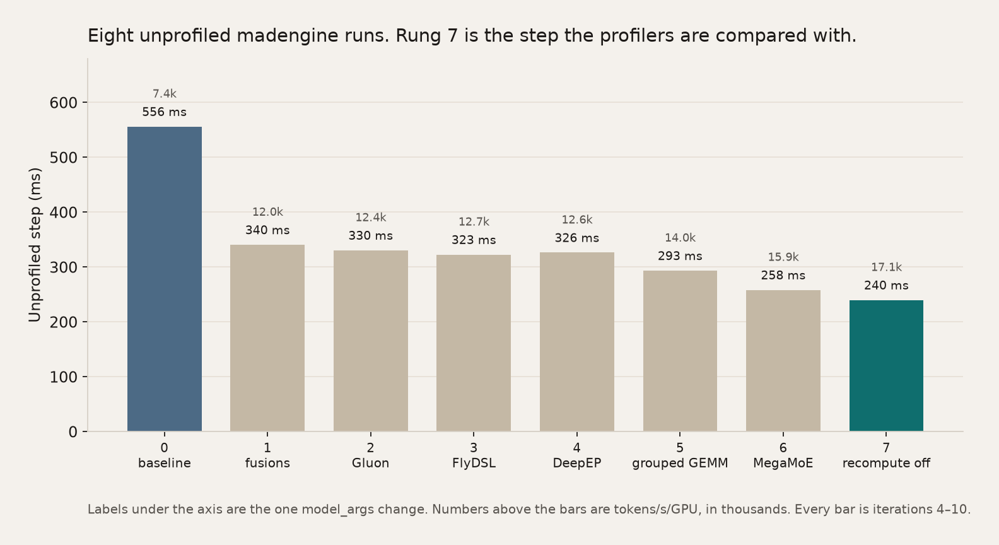
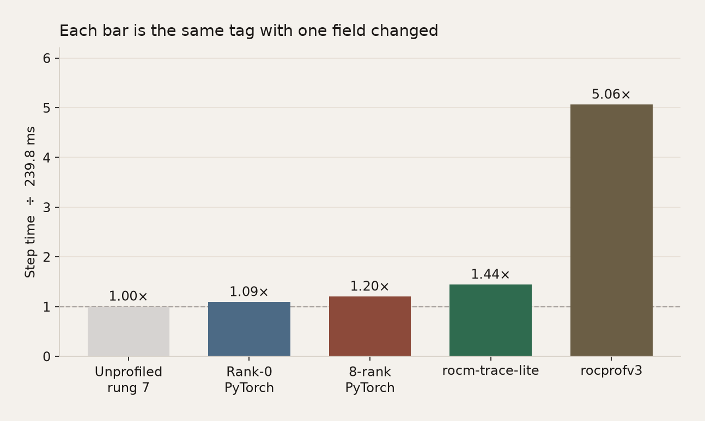
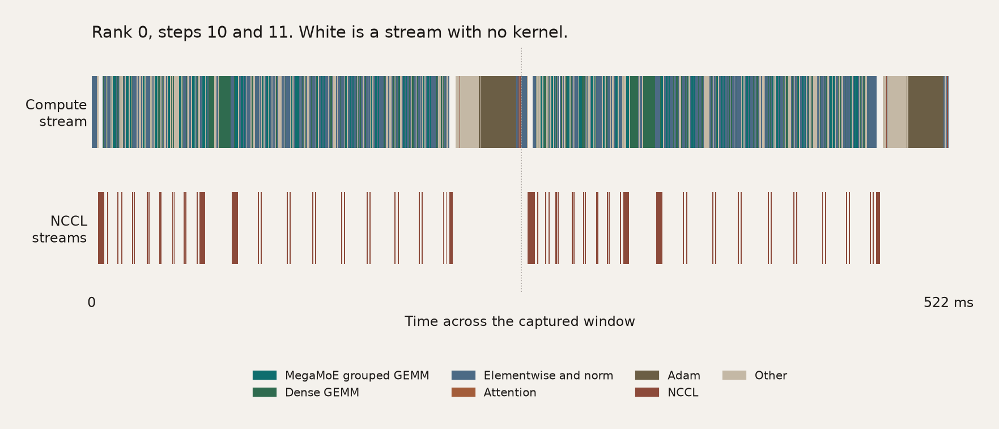
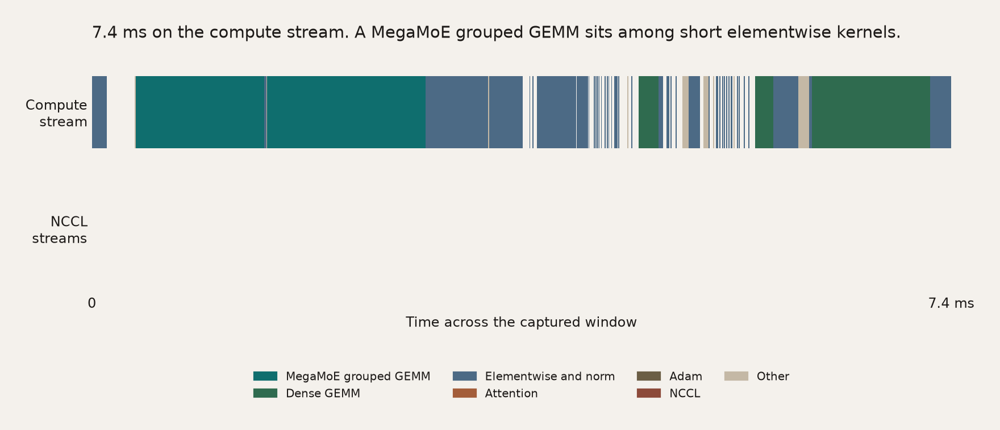
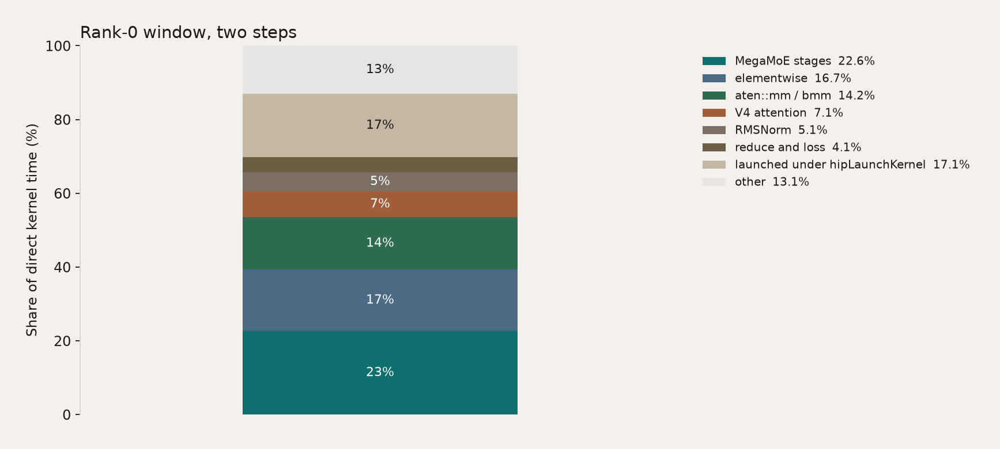
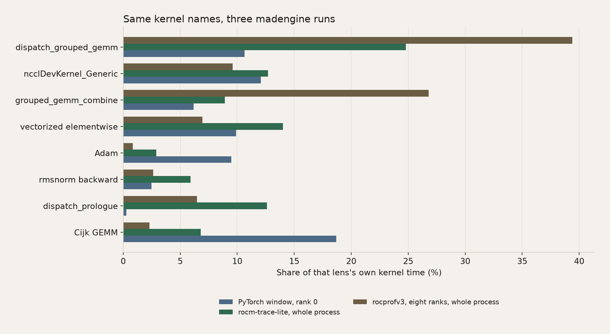
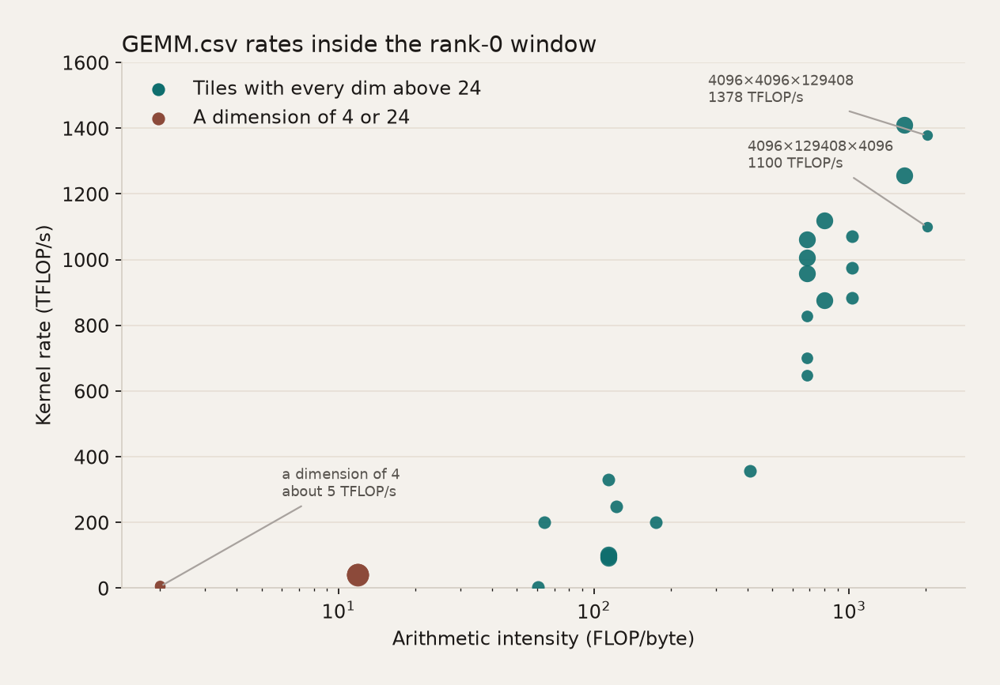
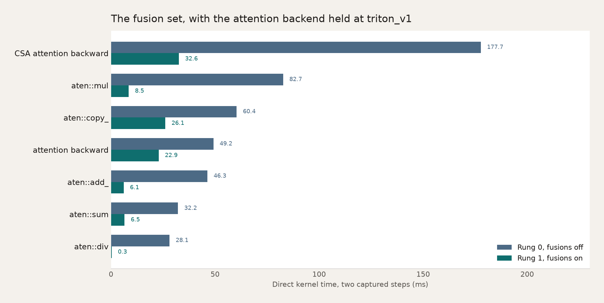
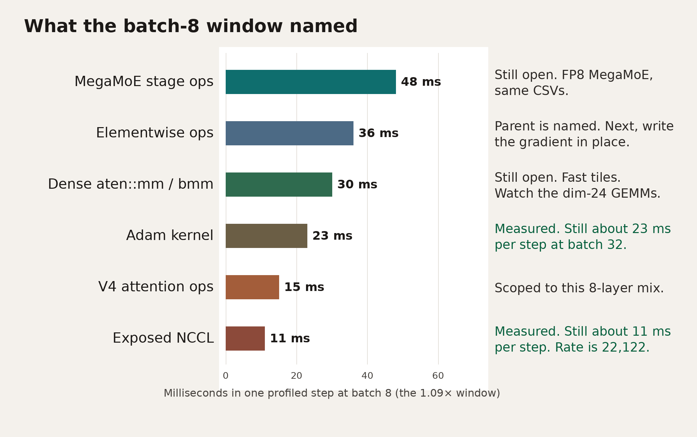

<!---
Copyright (c) 2026 Advanced Micro Devices, Inc. (AMD)
Retrigger the Read the Docs staged preview.

Permission is hereby granted, free of charge, to any person obtaining a copy
of this software and associated documentation files (the "Software"), to deal
in the Software without restriction, including without limitation the rights
to use, copy, modify, merge, publish, distribute, sublicense, and/or sell
copies of the Software, and to permit persons to whom the Software is
furnished to do so, subject to the following conditions:

The above copyright notice and this permission notice shall be included in all
copies or substantial portions of the Software.

THE SOFTWARE IS PROVIDED "AS IS", WITHOUT WARRANTY OF ANY KIND, EXPRESS OR
IMPLIED, INCLUDING BUT NOT LIMITED TO THE WARRANTIES OF MERCHANTABILITY,
FITNESS FOR A PARTICULAR PURPOSE AND NONINFRINGEMENT. IN NO EVENT SHALL THE
AUTHORS OR COPYRIGHT HOLDERS BE LIABLE FOR ANY CLAIM, DAMAGES OR OTHER
LIABILITY, WHETHER IN AN ACTION OF CONTRACT, TORT OR OTHERWISE, ARISING FROM,
OUT OF OR IN CONNECTION WITH THE SOFTWARE OR THE USE OR OTHER DEALINGS IN THE
SOFTWARE.
--->

# From Operator to Kernel: Profile DeepSeek-V4-Flash in Primus with madengine

A slow Primus training step can originate in framework operators, the GPU kernels those operators launch, communication, or the gaps between them. This post follows an eight-layer training proxy derived from the DeepSeek-V4-Flash Primus configuration across a controlled series of `madengine run`s to distinguish among those sources and identify the next measurable optimization.

You will leave this post with three things: an unprofiled training-step measurement, a rank-0 window expressed in milliseconds, and a specific next `madengine run`.

madengine makes that comparison a one-field edit. Keep one model tag. Change one field in `--additional-context`. That field selects the lens, and each lens is its own `madengine run`, so the collectors stay unmixed and the files stay comparable. `madengine report tracelens` then writes one set of CSV names. The sections below say which file to open, which number is the training step, and which gap that file names for the next run.

This post examines one workload across multiple runs. The workload is an eight-layer BF16 (16-bit Brain Floating Point) training proxy derived from the DeepSeek-V4-Flash Primus configuration. It preserves representative V4 attention and mixture-of-experts operations for profiling, but it is not the full model or an end-to-end pretraining workload. The workload uses the tag `primus_train/megatron_MI355X_deepseek_v4_flash-BF16-pretrain` and the image `rocm/primus:v26.7`, running on a single node with eight AMD Instinct™ MI350X GPUs.

The parallel configuration stays fixed unless a section says otherwise. The tensor-parallel size is 1, the pipeline-parallel size is 1, and the expert-parallel size is 8. The microbatch size is 1, the global batch size is 8, and the sequence length is 4096. Each GPU sees 4096 tokens per step. Figure 1 shows this configuration.

The unprofiled ladder and Table 8 change one optimization family per run. Figure 11 changes only the global batch. The rung-7 profiler sections change one collector field per `madengine run`.


*Figure 1. The workload contains three sliding-window layers (compression ratio 0), three compressed-sparse layers (ratio 4), and two heavily compressed layers (ratio 128). Every layer carries the same 256-expert mixture-of-experts block with top-6 routing, so an expert-parallel size of 8 places 32 experts on each GPU. The repeated block is mHC collapse, attention, MoE, and mHC expand. The line beneath the block identifies the image, BF16 precision, and parallel configuration.*

## What You Need

Run this on one node with eight AMD Instinct MI350X GPUs and the public image `rocm/primus:v26.7`. Check out the [MAD repository](https://github.com/ROCm/MAD). Put madengine v2.3.0 or later on your `PATH`. Ensure that the host has sufficient free disk space for the copied traces. A rocprofv3 run writes approximately 150 MB of JSON on each rank.

This post does not teach Primus or DeepSeek-V4 from scratch. For that background, read [Enabling DeepSeek-V4-Flash training with Primus](https://rocm.blogs.amd.com/software-tools-optimization/primus-deepseek-v4/README.html) and [TraceLens](https://rocm.blogs.amd.com/software-tools-optimization/tracelens/README.html). GEMM, used throughout, means a general matrix multiply.

## The Profilers

Four tools cover the path from the operator to the kernel. The first three collect a trace during `madengine run`. Use one collector per run. [TraceLens](https://rocm.blogs.amd.com/software-tools-optimization/tracelens/README.html) runs on the host after the job and reads traces previously generated by a collector.

**PyTorch profiler** is the operator lens. Primus calls [`torch.profiler`](https://pytorch.org/docs/stable/profiler.html) for a few training steps and writes a Chrome trace. That file names the operators, the input shapes, and the collectives.

**[rocm-trace-lite](https://sunway513.github.io/rocm-trace-lite/index.html)** is the kernel-dispatch lens. It intercepts the HSA runtime, timestamps each GPU kernel launch, and writes a SQLite database at `rocm_trace_lite_output/trace.db`.

**[rocprofv3](https://rocm.docs.amd.com/projects/rocprofiler-sdk/en/latest/how-to/using-rocprofv3.html)** is the profiler included in ROCprofiler-SDK, part of AMD ROCm™ software. This post records kernels and memory copies as JSON under `rocprof_output/`. The trace covers the whole process. madengine also ships other `rocprofv3_*` presets. Each preset is its own run.

**TraceLens** reads the finished trace and writes the GPU timeline, the operator mix, the GEMM rates, and the collective sizes. The command is `madengine report tracelens`. The same command reads the PyTorch trace, the eight-rank traces, and the rocprofv3 JSON, so the column names match across lenses.


*Figure 2. One field in `ctx.json`, then one `madengine run`. Copy `run_directory` aside before the next run. The host report writes the same CSV names from every framework trace, which is how the later figures compare lenses. The black bar is the reason for collecting them: the gap they agree on becomes the next one-field run.*

| Lens | Question it answers | How you select it | Where the files land |
| --- | --- | --- | --- |
| Baseline | What is the step time with no profiler? | `model_args` only | Training log under `run_directory/output` |
| Framework | Which operators, shapes, and collectives? | Append profiler flags to `model_args` | `*.pt.trace.json.gz` under `run_directory/output` |
| Kernel dispatch | Which kernel names did every GPU launch? | `"tools": [{"name": "rocm_trace_lite"}]` | `rocm_trace_lite_output/` |
| Runtime kernels | Which kernel names did rocprofv3 record? | `"tools": [{"name": "rocprofv3_lightweight", ...}]` | `rocprof_output/` |
| Analysis | How do the traces compare? | `madengine report tracelens` on the host | `gpu_timeline.csv`, `ops_summary*.csv`, `GEMM.csv`, `nccl_summary_long.csv` |

The tag, image, and mounts stay fixed. You change either the profiling lens or, on the unprofiled ladder, one optimization family. Figure 3 shows eight of those unprofiled runs and identifies the configuration worth profiling. Figure 4 shows how much each profiler affected that configuration.

### How to Read the Measurements

The measurements in this post have different scopes. Use the unprofiled training step for performance comparisons and the profiled windows for attribution.

| Term | Meaning |
| --- | --- |
| Training step | An unprofiled, steady-state measurement used for latency and throughput comparisons |
| Rank-0 window | Two profiled steps from the rank-0 PyTorch trace |
| Eight-rank window | Two profiled steps captured across all eight ranks |
| Whole-process trace | A trace that includes initialization and compilation |
| Trace flush | The final step used to write profiler output; excluded from performance comparisons |

The optimization ladder contains one run per configuration and therefore does not provide a noise estimate or confidence interval. These results apply only to the specified single-node, eight-layer training proxy. They should not be interpreted as full-model DeepSeek-V4-Flash performance and are not official AMD benchmark results.

## Setup

Run from the [MAD repository](https://github.com/ROCm/MAD) root, with `madengine` on `PATH`. `madengine report tracelens` ships in madengine v2.3.0 and later. Install it with the report extra on the host:

```bash
pip install 'madengine[tracelens] @ git+https://github.com/ROCm/madengine.git@v2.3.0'
```

Pass `--python` to `madengine report tracelens` when TraceLens is installed in another interpreter. Create and mount a writable cache directory. `PRIMUS_WORKSPACE` puts logs and PyTorch traces under `run_directory`, which `--keep-model-dir` leaves on the host. `GPUS_PER_NODE=8` is required. The launcher defaults `--nproc_per_node` to 8, and the global batch must be divisible by the data-parallel size created by that process count.

The next `madengine run` deletes `run_directory`. Copy it aside before the next command:

```bash
mkdir -p /path/to/cache/hf /path/to/cache/primus_data
mkdir -p "$HOME/traces"
cp -a run_directory "$HOME/traces/v4-r7"
```

Save the context below as `ctx.json`. It is rung 7: MegaMoE on, recompute off, FlyDSL attention, fusions on, global batch 8. The timeline, kernel, and collective commands are this file plus one edit. Table 8 uses the rung-0 and rung-1 flags instead, with the same rank-0 window. Figure 11 keeps these flags and changes `--global_batch_size` to 16, then 32. The unprofiled ladder uses the same parallel shape and changes one optimization family per rung.

```json
{
  "gpu_vendor": "AMD",
  "guest_os": "UBUNTU",
  "n_gpus": "8",
  "docker_gpus": "0,1,2,3,4,5,6,7",
  "docker_env_vars": {
    "PRIMUS_WORKSPACE": "/myworkspace/run_directory/output",
    "DATA_PATH": "/myworkspace/.blog_cache/primus_data",
    "HF_HOME": "/myworkspace/.blog_cache/hf",
    "PRIMUS_GPU_MODEL": "MI350X",
    "GPUS_PER_NODE": "8",
    "TRITON_CACHE_DIR": "/myworkspace/.blog_cache/triton",
    "PRIMUS_V4_INDEXER_DISTILL_LOSS_COEFF": "0",
    "PRIMUS_INDEXER_TRITON_FULL": "0",
    "PRIMUS_ENABLE_TURBO": "true",
    "PRIMUS_USE_TURBO_DEEPEP": "false",
    "PRIMUS_USE_V4_ATTENTION_BACKEND": "turbo",
    "PRIMUS_USE_V4_CSA_ATTENTION_BACKEND": "turbo"
  },
  "docker_mounts": {"/myworkspace/.blog_cache": "/path/to/cache"},
  "model_args": "--config_path examples/megatron/configs/MI355X/deepseek_v4_flash-BF16-pretrain.yaml --log_interval 1 --num_layers 8 --mtp_num_layers 0 --compress_ratios [0,0,4,128,4,128,4,0] --num_experts 256 --moe_router_topk 6 --moe_ffn_hidden_size 2048 --index_topk 512 --tensor_model_parallel_size 1 --pipeline_model_parallel_size 1 --expert_model_parallel_size 8 --micro_batch_size 1 --global_batch_size 8 --seq_length 4096 --max_position_embeddings 4096 --rope_type rope --moe_router_enable_expert_bias False --v4_grouped_experts_support_clamped_swiglu True --mock_data True --lr_warmup_iters 0 --moe_router_force_load_balancing True --moe_router_force_load_balancing_type uniform --use_turbo_attention False --turbo_sync_free_moe_stage 0 --moe_use_fused_router_with_aux_score False --recompute_granularity full --recompute_method block --train_iters 10 --recompute_num_layers 0 --use_v4_attention_backend turbo --use_v4_csa_attention_backend turbo --moe_permute_fusion True --cross_entropy_loss_fusion True --gradient_accumulation_fusion True --use_turbo_rms_norm True --use_v4_compiled_sinkhorn True --enable_primus_turbo True --use_turbo_deepep False --use_turbo_grouped_gemm False --use_turbo_mega_moe True"
}
```

`--rope_type rope` is required on this tree. The YAML default, `yarn`, causes an attention assertion to fail. `--mock_data True` means the step measures the model rather than the data pipeline. Force router load balancing to uniform so the expert GEMM shapes remain consistent from rung to rung. The optimizer in this configuration is precision-aware AdamW in BF16, not the Muon optimizer DeepSeek used for V4 pretraining. Indexer distillation stays at 0, so the loss is disabled and the indexer parameters remain frozen. This is the appropriate setting for measuring kernel cost, but not for pretraining from scratch.

Sync-free MoE stays at 0, and `--moe_use_fused_router_with_aux_score False` overrides the YAML default of true. `--use_v4_compiled_sinkhorn True` overrides the YAML default of false. madengine does not call `run_deepseek_v4_flash.sh`, so that script's exports are not what turns the fusions on. In this tree the Triton gates (`PRIMUS_RMSNORM_TRITON`, `PRIMUS_ROPE_TRITON`, `PRIMUS_SINKHORN_TRITON`, the hyper-connection flags, `PRIMUS_INDEXER_TRITON`, `PRIMUS_V4_ROUTER_TRITON`, and `PRIMUS_V4_INDEXER_COMPILE`) default on unless set to `0`. They are omitted from the JSON above because that default is the rung-7 setting. Rung 0 is the run that sets them to `0`. `PRIMUS_INDEXER_TRITON_FULL` stays `0`. Leave that wider indexer fusion off. It is not the elementwise follow-up below.

`model_args` replaces the model's config path, so `--config_path` stays in the list. CLI overrides win. MegaMoE replaces DeepEP and the grouped GEMM. Those three stay unstacked, which is why the ladder below is a sequence of `madengine run`s rather than one process with every knob on.

## Run the Baseline

Choose the denominator before comparing profilers. Eight unprofiled `madengine run`s with the same tag and shape establish that denominator. Each rung changes one optimization family from the preceding rung. The fusion family changes several flags at once, using the same switch that the launcher calls `PRIMUS_OPT_FUSION`: the Triton gates change from `0` to `1`, and the Megatron fusion flags in `model_args` change from false to true. The gates default to on in this tree, so rung 0 must set them to `0`. They are omitted from the JSON above for that reason. Each row represents a single run. There is no second repeat, so the table does not estimate a noise floor. Report iterations 4–10 of each 10-iteration run. Iterations 1 and 2 include compilation, which takes approximately 159 s and 80 s once MegaMoE is enabled.

```bash
madengine run \
  --tags primus_train/megatron_MI355X_deepseek_v4_flash-BF16-pretrain \
  --keep-model-dir \
  --timeout 7200 \
  --additional-context-file ctx.json
```



*Figure 3. Eight unprofiled runs of one tag. The number above each bar is tokens/s/GPU, in thousands. Rung 7 is the step the later profiler sections use as the training step.*

| Rung | The one change in `model_args` | Step (ms) | tok/s/GPU | vs previous | Peak (GB) |
| --- | --- | ---: | ---: | ---: | ---: |
| 0 | `triton_v1`, fusions off, recompute 3 | 556.0 | 7367 | — | 115.0 |
| 1 | Triton fusions on | 340.5 | 12028 | +63.3% | 110.9 |
| 2 | Attention `gluon_v3` | 330.5 | 12395 | +3.0% | 110.5 |
| 3 | Attention `turbo` (FlyDSL) | 322.6 | 12698 | +2.4% | 112.0 |
| 4 | DeepEP on | 326.3 | 12555 | −1.1% | 109.8 |
| 5 | Grouped GEMM, DeepEP still on | 293.4 | 13960 | +11.2% | 110.7 |
| 6 | MegaMoE, DeepEP and grouped GEMM off | 258.2 | 15866 | +13.7% | 117.3 |
| 7 | Recompute off | 239.8 | 17079 | +7.6% | 128.1 |

Table 1. Unprofiled step time, iterations 4–10. Peak is the `rocm max mem` line on those iterations. Each GPU has 288 GB of HBM.

Rung 7 is the training step: **239.8 ms**, **17,079 tokens/s/GPU**. The training log's `compute per GPU` field on those iterations averages **1117 TFLOP/s/GPU**. That number is model FLOPs divided by the whole step. It is not a kernel rate, and the GEMM table later is not a component of it. Steady steps were 239.2, 238.1, 239.5, 239.9, 239.7, 241.1, and 241.3 ms. From rung 0 to rung 7, the token rate increases by 132%.

Fusions remove 215.5 ms. Those fusions target the small elementwise chains V4 adds — RMSNorm, RoPE, Sinkhorn, the hyper-connection glue, compressor pooling, the indexer tail, and the router tail — each of which requires a handful of launches. Together, these fusions produce the largest improvement in Table 1. On this proxy, that fusion set increases throughput by 63.3%, from 7367 to 12028 tokens/s, while the peak decreases from 115.0 GB to 110.9 GB. Table 8, from a rank-0 trace of rung 0 and a rank-0 trace of rung 1, names the leaves behind this one step.

With an expert-parallel size of 8, each rank holds 32 of the 256 experts. The grouped GEMM issues those 32 local GEMMs as one ragged kernel and removes 32.9 ms. MegaMoE then replaces both DeepEP and that grouped GEMM: `dispatch_grouped_gemm` fuses the token dispatch into the first grouped GEMM, and `grouped_gemm_combine` fuses the second grouped GEMM into the combine. That rung removes another 35.2 ms. Disabling recomputation removes 18.4 ms and moves the peak from 117.3 GB to 128.1 GB. Recomputation only reduces activation-memory usage; on this 8-layer proxy, disabling it consumes an additional 11 GB.

After fusions, Gluon and FlyDSL together add about 5.6% to the rung-1 token rate, from 12028 to 12698. This proxy's eight layers are three sliding-window, three CSA, and two HCA, so that 5.6% is the move on this mix. DeepEP alone is 3.7 ms slower than FlyDSL on this one-microbatch shape. The timeline, the kernel mix, the GEMM table, and the collective report are collected on rung 7. They were not collected on rung 4.

Combining a pipeline-parallel size of 4 with an expert-parallel size of 8 requires 32 GPUs, while this post uses a pipeline-parallel size of 1. Rung 7 changes only recomputation.

## Run the Framework Lens

Edit `model_args`. Keep the config path and the rung-7 flags. Append the profiler flags, and set `--train_iters 12`. `--profile_step_end 12` records steps 10 and 11. Step 12 is the trace flush.

Profile rank 0 with shape recording enabled in one run. This trace feeds the timeline, operator mix, and GEMM table.

```text
--profile True --use_pytorch_profiler True --profile_step_start 10 --profile_step_end 12 --torch_profiler_with_stack False --torch_profiler_record_shapes True --profile_ranks [0]
```

Copy `run_directory` aside, then on the host:

```bash
madengine report tracelens \
  --python /path/to/python \
  --root traces/v4-r7-pytorch \
  --output-dir tracelens/pytorch \
  --mode pytorch
```

This TraceLens install can label a roofline for MI300X and MI325X. MI350X is not in that list, so the command omits `--gpu-arch`. `GEMM.csv` still has the tile, the FLOP/byte ratio, and TFLOP/s.

Profile all eight ranks with shape recording disabled in a second `madengine run`. Replace the flags with the following:

```text
--profile True --use_pytorch_profiler True --profile_step_start 10 --profile_step_end 12 --torch_profiler_with_stack False --torch_profiler_record_shapes False --profile_ranks [0,1,2,3,4,5,6,7]
```

```bash
madengine report tracelens \
  --python /path/to/python \
  --root traces/v4-r7-ranks \
  --output-dir tracelens/collective \
  --mode collective \
  --world-size 8
```

The CSV names stay the same when the lens changes, which is what makes Table 2 and the later figures one comparison. Open these files in order:

| File | What you learn | What it suggests next |
| --- | --- | --- |
| `gpu_timeline.csv` | Computation, exposed communication, memcpy, idle | Whether another microbatch has anything to hide |
| `ops_summary_by_category.csv` | Which family holds the direct kernel time | Which family is large enough to fuse or retile |
| `ops_summary.csv` | The leaf CPU op that launched that time | The before-column for a fusion rerun |
| `GEMM.csv` | M, N, K, FLOP/byte, TFLOP/s | Which tiles are already fast, and which are tiny |
| `nccl_summary_long.csv` | Collective name, dtype, and message size | Whether the expert exchange is still a separate collective |

## Run rocm-trace-lite

Remove the profiler flags so this run matches the baseline length. Replace any `tools` entry with one collector. Use the same tag and rung-7 `model_args`.

```json
"tools": [{"name": "rocm_trace_lite"}]
```

```bash
madengine run \
  --tags primus_train/megatron_MI355X_deepseek_v4_flash-BF16-pretrain \
  --keep-model-dir \
  --timeout 7200 \
  --additional-context-file ctx.json
```

Open `rocm_trace_lite_output/trace_summary.txt` and `trace.db`. This run recorded 725,970 kernel executions across the process, including compilation. A useful trace has `KernelExecution` rows on GPU IDs 0 through 7. `UserMarker` rows are host markers. The summary percentages rank kernel names. They include the compilation iterations, so use them to validate names. Figure 8 compares those names with the framework window.

Iterations 4–10 of this run averaged 345.6 ms, **1.44×** the Table 1 step. The stretch is the collector. Table 1 remains the training step.

## Run rocprofv3

Use a separate run with the same tag and rung-7 context but a different `tools` entry. This allows the kernel names to be checked against both the framework lens and rocm-trace-lite. The command records kernel and memory-copy traces in JSON format. The stock `rocprofv3_lightweight` preset also passes `--hip-trace`; the override below leaves that flag off. The trailing `--` is required. The wrapper is `scripts/common/tools/rocprof_wrapper.sh`, copied onto the cache mount so the path still resolves after Primus changes directory.

```json
"tools": [{
  "name": "rocprofv3_lightweight",
  "cmd": "bash /myworkspace/.blog_cache/rocprof_wrapper.sh --kernel-trace --memory-copy-trace --output-format json -d ./rocprof_output --"
}]
```

Set `--train_iters 6`. Eight ranks wrote about 150 MB of JSON each. On the host:

```bash
madengine report tracelens \
  --python /path/to/python \
  --root traces/v4-r7-rocprof/rocprof_output \
  --output-dir tracelens/rocprof \
  --mode rocprof
```

All eight reports succeeded. Iterations 4–6 averaged 1214.5 ms, **5.06×** the Table 1 step. Use this output to confirm kernel names. Keep durations from Table 1 and from the rank-0 PyTorch window.

## How to Interpret the Measurements

Read this before treating a CSV cell as the training step.

| Quantity | Use it as |
| --- | --- |
| Table 1, rung 7, iterations 4–10 | The training step: 239.8 ms, 17,079 tok/s/GPU, 1117 TFLOP/s/GPU |
| Rank-0 steps 10–11 | The operator window on rung 7. Mean 261.2 ms, 1.09× the training step. Step 12 is the flush (1165.5 ms) |
| Rung 0 and rung 1 rank-0 windows | Which leaves the fusion set moved, in Table 8. The 215.5 ms reduction remains the unprofiled result reported in Table 1. The rung-0 window is 1.27× its unprofiled step, and the rung-1 window is 1.08× |
| Global batch 16, iterations 4–10 | The second-microbatch step: 405.5 ms, 20,204 tok/s/GPU. The rank-0 window on that run is 1.05× this step |
| Global batch 32, iterations 4–10 | The four-microbatch step: 740.6 ms, 22,122 tok/s/GPU. The rank-0 window on that run is 1.06× this step |
| 8-rank steps 10–11 | The collective window. Mean 287.7 ms, 1.20×. Step 12 is the flush (917.6 ms) |
| rocm-trace-lite iterations 4–10 | Kernel names, on a step that moved to 345.6 ms (1.44×). Call counts include compilation. |
| rocprofv3 iterations 4–6 | Kernel names. The step moved to 1214.5 ms (5.06×) |
| Timeline, category, and GEMM cells | Shares and kernel rates inside the 522 ms rung-7 rank-0 window. Table 8 is a different pair of windows |
| Collective message size | The payload. `dur_mean` mixes the 1.20× window with inter-rank skew, so a GB/s derived from it is not the link rate |
| rocprofv3 category mix and its idle percent | Whole-process evidence, compile included. The rank-0 category bar is the mix |



*Figure 4. How far each lens moved the step, relative to Table 1. Every bar is the rung-7 `madengine run` with one field changed. The rank-0 window stays close to the training step, which is why the operator mix below can be read in milliseconds. rocprofv3 is the whole 6-iteration process.*

| Lens | Step used | Multiple of 239.8 ms |
| --- | ---: | ---: |
| Unprofiled rung 7 | 239.8 ms, iterations 4–10 | 1.00× |
| PyTorch, rank 0 | 261.2 ms, iterations 10–11 | 1.09× |
| PyTorch, 8 ranks | 287.7 ms, iterations 10–11 | 1.20× |
| rocm-trace-lite | 345.6 ms, iterations 4–10 | 1.44× |
| rocprofv3 | 1214.5 ms, iterations 4–6 | 5.06× |

Table 2. Collector cost on one tag. The rank-0 window is 1.09×, so a share of that window is close to a share of the training step. The whole-process collectors are for names.

TraceLens wants the framework trace read from the top down, and the later sections follow that order. `gpu_timeline.csv` says whether the GPU was busy, waiting on communication, or idle. `ops_summary_by_category.csv` says which family holds that busy time. `ops_summary.csv` names the leaf CPU op, and its kernel time excludes child ops, so a parent and a child are not added together. `GEMM.csv` is that leaf broken out by shape: FLOPs are `2·M·N·K`, bytes are the three matrices, and TFLOP/s is that work divided by the kernel duration in the trace. Those rates are the intended math. A counter-based profiler would also see padding, cache traffic, and extra bytes. This rocprofv3 run recorded kernel names and memory copies, not hardware counters, so it does not supply that second view.

## Read the Timeline

`gpu_timeline.csv` splits the captured window. `computation_time` is the union of non-collective GPU work. `exposed_comm_time` is communication outside that compute. These percentages represent shares of the captured window. The window is 522.0 ms over steps 10 and 11 (261.7 ms and 260.6 ms).

| Bucket | Time (ms) | Share of the window |
| --- | ---: | ---: |
| Computation | 424.1 | 81.3% |
| Exposed communication | 22.3 | 4.3% |
| Exposed memcpy | 1.1 | 0.2% |
| Busy | 447.5 | 85.7% |
| Idle | 74.4 | 14.3% |
| Total communication | 58.3 | 11.2% |

Table 3. Rank-0 window from `gpu_timeline.csv`. Total communication is 58.3 ms and exposed communication is 22.3 ms, so 36 ms of NCCL overlaps compute. The Adam kernels sit inside `computation_time`, on the compute stream, at the tail of each step. They are not a second bucket on top of the 424.1 ms.

The rank-0 file is a Chrome trace, `*.pt.trace.json.gz`, under the copied `run_directory/output`. Open [ui.perfetto.dev](https://ui.perfetto.dev) and load it. The pictures below are the kernel slices from that file: compute on one stream, NCCL on the others.



*Figure 5. Full captured window, rank 0, steps 10 and 11. White is a stream with no kernel. Each half ends in an Adam block on the compute stream, about 23 ms. NCCL slices sit on the other track and overlap the compute, which is why Table 3's exposed communication is 22.3 ms across both steps while total communication is 58.3 ms. This shape runs one microbatch per rank, so nothing follows that Adam block.*



*Figure 6. 7.4 ms on the compute stream, 89 kernels. The wide teal slice is `dispatch_grouped_gemm_kernel`, 1.36 ms. Another teal slice in the same zoom is `grouped_gemm_combine_kernel`, 1.10 ms. Those are the two kernels the MegaMoE write-up names. The blue slices between them are elementwise, the longest 0.54 ms. A dense GEMM in the same zoom is 0.29 ms. Table 4 is the whole window, not this zoom.*

The window holds 6,380 kernels, approximately 3,190 in each profiled step. Inside the 522 ms window, that is approximately 12,000 launches per second. That count belongs to the profiled window, not the 239.8 ms unprofiled step. Figure 6 shows why the short blue slices remain after the fusions in Table 1: the fused chains removed many launches, while the remaining launches occur between the wide MegaMoE kernels.

Two gaps fall out of this file.

* The Adam block is about 23 ms at the end of each profiled step, and exposed NCCL is 11.1 ms per step. Figure 11 is the check: global batch 16, then 32. The token rate is the comparison.
* The blue slices need a parent before they need a flag. `ops_summary.csv` names `aten::add_`, `aten::copy_`, and `aten::linalg_vector_norm`. Table 5a reads the parents of the first two from this same trace. `PRIMUS_INDEXER_TRITON_FULL` is not that flag.

## Read the Kernel Mix

`ops_summary_by_category.csv` rolls leaf CPU ops into families. The time is kernels launched directly by that op, so a parent and a child are not both counted. On this model the fused MegaMoE stages land in `other`, next to a large `hipLaunchKernel` bucket. Figure 7 splits those names back out. The slices sum to the direct kernel time of the window, 425.3 ms.



*Figure 7. Share of direct kernel time in the rank-0 window. The `hipLaunchKernel` slice is kernels whose CPU parent is the launch itself. It is already inside the 100 percent, so it is not added on top of the MegaMoE slice.*

| Family | Kernel time (ms) | Share |
| --- | ---: | ---: |
| MegaMoE stages | 96.3 | 22.6% |
| Elementwise | 71.0 | 16.7% |
| `aten::mm` / `aten::bmm` | 60.2 | 14.2% |
| V4 attention | 30.1 | 7.1% |
| RMSNorm | 21.8 | 5.1% |
| Reduce and loss | 17.5 | 4.1% |
| Launched under `hipLaunchKernel` | 72.9 | 17.1% |
| Other | 55.5 | 13.1% |

Table 4. The slices in Figure 7, two captured steps, rank 0.

The leaf ops behind the named slices, from `ops_summary.csv`:

| Operation | Count | Kernel time | Share |
| --- | ---: | ---: | ---: |
| `FusedMegaMoEStage1FunctionBackward` | 16 | 38.2 ms | 9.0% |
| `FusedMegaMoEStage2FunctionBackward` | 16 | 23.3 ms | 5.5% |
| `FusedMegaMoEStage1Function` | 16 | 20.9 ms | 4.9% |
| `FusedMegaMoEStage2Function` | 16 | 13.9 ms | 3.3% |
| `aten::mm` | 278 | 45.9 ms | 10.8% |
| `aten::copy_` | 1098 | 24.0 ms | 5.6% |
| `aten::add_` | 366 | 18.4 ms | 4.3% |
| `_V4SparseMLACSAFnBackward` | 6 | 16.0 ms | 3.8% |
| `FusedRMSNormFnBackward` | 60 | 10.0 ms | 2.3% |
| `aten::linalg_vector_norm` | 68 | 9.9 ms | 2.3% |

Table 5. Largest named leaf operations in the same window. The four MegaMoE stage ops are 96.3 ms together. `aten::copy_`, `aten::add_`, and `aten::linalg_vector_norm` are elementwise leaves still present after the fusion set. `FusedRMSNormFnBackward` is the fused norm's own backward, 10.0 ms, not an unfused RMSNorm chain. rocm-trace-lite lists `rmsnorm_bwd_kernel_grid_stride` at 5.9% of its whole-process kernel time. That is the kernel name to look for under the fused norm, once the parent link is checked. The `hipLaunchKernel` slice in Table 4 is the Trace2Tree pattern: casts and leftover elementwise whose nearest CPU node is the launch, rather than a Python op with a stable name.

`ops_summary.csv` names the leaf, not the caller. The rank-0 trace already holds the caller. This run kept `--torch_profiler_with_stack False`, so there are no Python frames, but TraceLens's Trace2Tree still nests every CPU op under the op that enclosed it on the same thread. Walking up from each `aten::add_` and `aten::copy_` launcher to the first ancestor that is not another `aten::` op names the parent. This step reads the trace from the framework run. It does not need another `madengine run`.

```python
from TraceLens import TreePerfAnalyzer

a = TreePerfAnalyzer.from_file("traces/v4-r7-pytorch/.../rank[0]....pt.trace.json.gz")
for ev in a.get_kernel_launchers():
    if ev["name"] in ("aten::add_", "aten::copy_"):
        p = a.tree.get_parent_event(ev)
        while p is not None and p["name"].startswith("aten::"):
            p = a.tree.get_parent_event(p)
        print(ev["name"], ev["args"]["Input Dims"][0], p and p["name"], ev["total_direct_kernel_time"])
```

| Leaf | Nearest named parent | Leading shape | Calls | Kernel time |
| --- | --- | --- | ---: | ---: |
| `aten::add_` | `AccumulateGrad`, expert weights | `(32, 4096, 4096)`, `(32, 4096, 2048)` BF16 | 32 | 12.98 ms |
| `aten::add_` | `AccumulateGrad`, every other parameter | | 248 | 2.60 ms |
| `aten::add_` | `ViewBackward0` | `(1, 4096, 4, 4096)` | 50 | 2.52 ms |
| `aten::copy_` | `ViewBackward0`, via `clone` under `reshape` | `(1, 4096, 8, 4096)`, `(8, 1024, 4096)` | 32 | 6.52 ms |
| `aten::copy_` | `RoPEFromPositionsFnBackward`, via `contiguous` | `(1, 4096, 64, 512)` | 16 | 4.07 ms |
| `aten::copy_` | `_V4SparseMLAAttnFn` and `_V4SparseMLACSAFn`, forward and backward | `(1, 4096, 64, 512)` | 152 | 6.62 ms |
| `aten::copy_` | Forward casts, no named parent | small | 244 | 3.31 ms |

Table 5a. Parents of the two elementwise leaves in the same rank-0 window, two steps. `aten::add_` totals 18.4 ms and `aten::copy_` totals 24.0 ms, as in Table 5. Rows under 0.9 ms are left out.

The largest single opportunity is the expert gradient. Of the `aten::add_` time, 71% comes from autograd's `AccumulateGrad` on the two grouped expert weights, where the leading dimension of 32 represents the local experts on each rank at an expert-parallel size of 8. There are 16 calls for each shape, one per layer per profiled step. MegaMoE's backward pass returns the expert-weight gradient as a new tensor, and `AccumulateGrad` then adds it to the existing BF16 gradient. The dense linear layers avoid this operation because `--gradient_accumulation_fusion True` writes their weight gradients in place. This corresponds to the 15.8 ms `LinearWithGradAccumulationAndAsyncCommunicationBackward` entry in Table 8. Each expert addition reads two tensors and writes one. The `(32, 4096, 4096)` call moves approximately 3.2 GB in 0.55 ms, and the `(32, 4096, 2048)` call moves 1.6 GB in 0.26 ms, or approximately 6 TB/s. A faster addition kernel is therefore not the solution; these kernels already operate near memory speed. The proposed optimization is to eliminate that pass by having the MegaMoE weight-gradient GEMM write directly to the gradient buffer, as the dense path does.

`aten::copy_` has no single parent. Its time splits across three places that each make a tensor contiguous: a `reshape` in a view's backward (6.5 ms), the RoPE backward (4.1 ms), and the V4 attention functions, forward and backward (6.6 ms). Each one needs its own change to the layout, and none of them is the MegaMoE path.

The three collectors can be compared because each was a `madengine run` using the same tag. However, they do not share the same capture scope. Figure 8 reports kernel time on each lens's own clock.



*Figure 8. Same kernel names, three runs. The PyTorch bars are shares of kernel time in the 1.09× window. The rocm-trace-lite and rocprofv3 bars show shares of kernel time over the whole process, including compilation. `dispatch_prologue` is 12.6% of the rocm-trace-lite kernel time and 0.3% of the window's kernel time. Cijk GEMMs are 18.7% of the window's kernel time and 2.3% of the rocprofv3 kernel time. The whole-process files confirm the names. The window decides which of those names are in the training step.*

That comparison is the reason to keep the collectors in separate runs. Stacked into one process, the 5.06× rocprofv3 stretch and the compile iterations would pick `dispatch_grouped_gemm` as the story. Held apart, the window says the dense Cijk GEMMs, NCCL, Adam, and the elementwise kernels share the steady step with MegaMoE. The next runs follow the window. The other two files are how you check that a new kernel name really landed.

## Read the GEMM Rates

`GEMM.csv` computes FLOPs and bytes from the operator arguments (`2·M·N·K`, and the three matrices) and divides by the kernel duration in the trace. This report has no MI350X peak and no ridge line. The training log's 1117 TFLOP/s/GPU is the whole step. The points below are kernel rates inside the 1.09× window.



*Figure 9. GEMMs TraceLens could model from the rank-0 window. Teal points have every dimension above 24. Brown points have a dimension of 4 or 24. The two tiles at 2016 FLOP/byte run at 1100 and 1378 TFLOP/s. The tiles with a dimension of 4 run at 4.7, 5.1, and 9.3 TFLOP/s. There is no MI350X ridge on this plot: TraceLens has no MI350X peak in this install, so this post does not draw one.*

| Op | M | N | K | FLOP/byte | TFLOP/s | Calls |
| --- | ---: | ---: | ---: | ---: | ---: | ---: |
| `aten::mm` | 4096 | 129408 | 4096 | 2016 | 1100 | 2 |
| `aten::mm` | 4096 | 4096 | 129408 | 2016 | 1378 | 2 |
| `aten::mm` | 4096 | 8192 | 4096 | 1638 | 1256 | 16 |
| `aten::mm` | 4096 | 4096 | 8192 | 1638 | 1411 | 16 |
| `aten::mm` | 4096 | 1024 | 32768 | 799 | 1119 | 16 |
| `aten::mm` | 4096 | 16384 | 24 | 11.9 | 39.7 | 32 |
| `aten::mm` | 24 | 16384 | 4096 | 11.9 | 42.5 | 32 |
| `aten::mm` | 4096 | 24 | 16384 | 11.9 | 42.7 | 32 |
| `aten::mm` | 4096 | 16384 | 4 | 2.0 | 4.7 | 2 |
| `aten::mm` | 4 | 16384 | 4096 | 2.0 | 5.1 | 2 |
| `aten::mm` | 4096 | 4 | 16384 | 2.0 | 9.3 | 2 |

Table 6. Kernel rates in the rank-0 window, from operator arguments and kernel duration. The log's 1117 TFLOP/s/GPU is a different quantity: model FLOPs over the whole unprofiled step. A large tile at 1378 TFLOP/s can sit next to a step rate of 1117 without either number being wrong. The first five rows are BF16. The last six are the other cluster, and all six are FP32. The rows with a dimension of 24 are 7.6 ms of kernel time at about 40 TFLOP/s, 32 calls each. The rows with a dimension of 4 are 0.58 ms together, two calls each. Three more FP32 shapes with a dimension of 256 add 4.3 ms at 92–103 TFLOP/s. The FP32 small-dimension GEMMs are about 12.4 ms of the 60.2 ms GEMM total. The rates are means over calls. MegaMoE's grouped GEMMs are the stage ops in Table 5. This report has no `GroupedGEMM_fwd.csv` for them, so their rate is not in this table.

The two clusters suggest different follow-ups. The large tiles and the MegaMoE stages are the BF16 denominator for an FP8 MegaMoE run. The FP32 tiles with a dimension of 24 or 4 are a shape problem, and the dimension-24 rows hold most of that time. Event Replay can cut one of them out of the trace into a standalone reproducer. Sequence length is a separate measurement, taken up in the close. The 128.1 GB peak does not answer it.

## Read the Collectives

In `nccl_summary_long.csv`, use the collective name, data type, group size, and `In msg size (MB)`. TraceLens can also report algorithmic bandwidth and bus bandwidth after separating inter-rank skew from the transfer. This window is 1.20× the training step, so those bandwidth columns are not interpreted here. The report covers ranks 0–7. It found reduce-scatter, allgather, allreduce, broadcast, and barrier operations, but no `all_to_allv`. On this MegaMoE rung, the expert exchange occurs inside `dispatch_grouped_gemm` and `grouped_gemm_combine`, so it does not appear as a separate collective. The remaining large payloads are intra-node, data-parallel BF16 transfers with a group size of 8.

| Collective | In (MB) | Out (MB) | Calls |
| --- | ---: | ---: | ---: |
| `reduce_scatter_tensor_coalesced` | 132.00 | 16.50 | 16 |
| `allgather_into_tensor_coalesced` | 16.50 | 132.00 | 16 |
| `reduce_scatter_tensor_coalesced` | 1011.00 | 126.38 | 2 |
| `allgather_into_tensor_coalesced` | 126.38 | 1011.00 | 2 |
| `reduce_scatter_tensor_coalesced` | 1019.01 | 127.38 | 2 |
| `allgather_into_tensor_coalesced` | 127.38 | 1019.01 | 2 |

Table 7. Rank 0 payloads. `Out` equals `In` divided by 8, the data-parallel width. Use the payload sizes for comparison. The durations occur within the 1.20× eight-rank window.

This file describes rung 7. It does not describe rung 4. DeepEP, turned on alone, was 1.1% slower than FlyDSL in the unprofiled ladder, and that rung was not traced. What Table 7 does say is that a DeepEP rerun on top of MegaMoE has no `all_to_allv` left to remove: MegaMoE already replaced that exchange. The ladder and the collective CSV answer two different questions. The ladder says DeepEP, before MegaMoE, did not pay for itself here. The collective CSV says the profiled rung no longer has a separate expert all-to-all.

## What the Fusion Rung Changed

Table 1 says the fusion set removes 215.5 ms. Two more rank-0 framework runs name the leaves. Both use the same window as the rung-7 trace: steps 10 and 11, shapes on, one rank. Rung 0 has the fusion gates at `0`. Rung 1 turns that set on and changes nothing else. Attention stays `triton_v1`, recompute stays 3, and MegaMoE stays off.

Iterations 4–8 of the rung-0 profile run average 564.7 ms, compared with the unprofiled result of 556.0 ms, and the peak is 115.0 GB. Iteration 9 on that run is already 663.8 ms, so the steady-state check stops before the profiler window. Iterations 4–9 of the rung-1 profile run average 344.8 ms, compared with the unprofiled result of 340.5 ms, and the peak is 111.1 GB. Steps 10 and 11 are the windows: 706.6 ms and 710.2 ms on rung 0, which is 1.27× the unprofiled step, and 368.5 ms and 368.1 ms on rung 1, which is 1.08×. Step 12 is the trace flush for both runs, at 4767.6 ms and 2194.8 ms. The two windows are different multiples of the training step, so the difference between them is not 215.5 ms. Table 1 retains the unprofiled measurement; these trace files identify which operators changed.

`ops_summary_by_category.csv` reports 22,014 elementwise launches and 310.9 ms on rung 0, compared with 4,396 launches and 83.0 ms on rung 1. Both totals cover the two captured steps.

| Leaf | Rung 0 | Rung 1 |
| --- | ---: | ---: |
| `aten::mul` | 3494 calls, 82.7 ms | 356 calls, 8.5 ms |
| `aten::add_` | 3216 calls, 46.3 ms | 346 calls, 6.1 ms |
| `aten::div` | 5680 calls, 28.1 ms | 74 calls, 0.3 ms |
| `aten::sum` | 3676 calls, 32.2 ms | 466 calls, 6.5 ms |
| `aten::copy_` | 2286 calls, 60.4 ms | 1340 calls, 26.1 ms |
| `V4CSAPoolAttentionFnBackward` | 6 calls, 177.7 ms | 6 calls, 32.6 ms |
| `V4AttentionFnBackward` | 10 calls, 49.2 ms | 10 calls, 22.9 ms |

Table 8. Direct kernel time in the rank-0 window, two steps, from `ops_summary.csv`. The attention ops keep the same name and the same call count. The backend is still `triton_v1` on both rungs, so that drop belongs to the fusion set, including the compressor and the attention-backward flags. It is not the later FlyDSL rung.



*Figure 10. Table 8 as bars. Slate represents rung 0, and teal represents rung 1. Both totals cover two captured steps. The rung-0 window is 1.27× its unprofiled step and the rung-1 window is 1.08×, so a pair of bars does not add up to the 215.5 ms reduction. The attention call counts do not change. `_GroupedLinear` is omitted from this chart because its combined forward and backward time remains near 97 ms.*

The small aten operations shrink, and the fused operations that were absent on rung 0 appear in their place. On rung 1, `FusedRMSNormFn` and `FusedRMSNormFnBackward` take 10.1 ms each. `RoPEFromPositionsFn` takes 4.6 ms, and its backward pass takes 3.3 ms. `SinkhornNormalizeFn`, `HCExpandFn`, and `CrossEntropyFunction` are also present. The attention rows in Table 8 represent the same operations running faster, rather than new fused names. `LinearWithGradAccumulationAndAsyncCommunicationBackward` takes 15.8 ms and represents the gradient-accumulation fusion. `_GroupedLinear` decreases from 33.2 ms to 31.2 ms, while its backward pass increases from 63.4 ms to 66.4 ms. The expert GEMM is introduced on a later rung.

## Close the Loop

The profilers are finished when they name the next `madengine run`. Figure 11 is the global-batch check. Figure 12 is the before-column from the batch-8 window: milliseconds in one profiled step. Those bars overlap, so they are not slices of the 239.8 ms training step. Global batch 16 and global batch 32 were run. The parent lookup in Table 5a reads the existing trace. The elementwise fix, FP8 MegaMoE, and sequence 8192 were not run.

The rank-0 window contains one microbatch. Each profiled step ends with approximately 23 ms of Adam optimizer work and approximately 11 ms of exposed NCCL communication. Additional microbatches distribute that fixed overhead across more tokens but do not remove it. With a microbatch size of 1 on eight GPUs, every multiple of 8 is a valid global batch size. This post evaluates the next two doublings, 16 and 32. As Figure 11 shows, the per-step overhead remains approximately 23 ms for Adam and 11 ms for exposed NCCL. Across the two captured steps, those totals remain near 46 ms and 22 ms, while throughput increases from 17,079 to 20,204 and then 22,122 tokens/s/GPU. The improvement from batch 16 to batch 32 is smaller than the improvement from batch 8 to batch 16, so global batch 64 is not the next experiment.


*Figure 11. More tokens, same tail. The left panel is the unprofiled step: iterations 4–10, tokens/s/GPU, with the step time printed on the bar. The middle and right panels are the rank-0 window, two captured steps, not the unprofiled step. Compute grows with the microbatches. The Adam kernel stays 46 ms and exposed NCCL stays about 22 ms. The peak on all three unprofiled runs is 128.1 GB.*



*Figure 12. The batch-8 window, one profiled step. MegaMoE, elementwise, and dense GEMM are direct kernel time. Adam is the tail in Figure 5, about 23 ms of that step. Exposed NCCL is about 11 ms of that step, half of the Table 3 bucket because Table 3 covers two steps. The green notes use the same per-step reading of Figure 11. The grey notes are still open.*

1. **More microbatches, measured.** Figure 11 shows this comparison. Use the rung-7 command with a microbatch size of 1, first setting `--global_batch_size` to 16 and then to 32. The global batch remains divisible by 8, so batch 16 contains two microbatches and batch 32 contains four.

   At batch 16, iterations 4–10 average **405.5 ms** and **20,204 tokens/s/GPU**. Steady steps were 404.4, 406.4, 403.9, 406.9, 406.0, 406.0, and 404.6 ms. The peak is 128.1 GB. The number of tokens doubles while the step time increases by 1.69×, resulting in an 18.3% higher token rate than the batch-8 result of 17,079 tokens/s/GPU. The rank-0 windows for steps 10 and 11 are 425.3 ms and 423.2 ms, or approximately 1.05× the unprofiled step. Iterations 4–8 of the profile run average 408.1 ms. Over the two captured steps, compute time is 742.6 ms, the Adam kernel takes 46.1 ms, exposed communication takes 21.1 ms, and total communication takes 60.0 ms.

   At batch 32, iterations 4–10 average **740.6 ms** and **22,122 tokens/s/GPU**. Steady steps were 738.7, 741.9, 739.0, 740.0, 745.0, 739.2, and 740.5 ms. The peak is again 128.1 GB. The batch contains four times as many tokens as the batch-8 run, while the step time increases by 3.09×. This produces a 29.5% higher token rate than batch 8 and a 9.5% higher rate than batch 16. The rank-0 windows are 783.6 ms and 783.0 ms, or approximately 1.06× the 740.6 ms step. Iteration 9 of that profile run is already 764.2 ms, so the steady-state check uses iterations 4–8, which average 740.2 ms. Step 12 is the 4025.4 ms trace flush. Over the two captured steps, compute time is 1379.9 ms, the Adam kernel takes 46.4 ms, exposed communication takes 22.4 ms, and total communication takes 60.7 ms.

   Against the batch-8 window, the Adam kernel stays near 46 ms and exposed communication stays near 22 ms, while compute grows from 424.1 ms to 742.6 ms to 1379.9 ms. The extra microbatches amortize that tail over more tokens. They do not remove it.

2. **The elementwise operations that remain after Figure 10.** On rung 7, Table 5 still reports `aten::add_` at 18.4 ms, `aten::copy_` at 24.0 ms, `aten::linalg_vector_norm` at 9.9 ms, and `FusedRMSNormFnBackward` at 10.0 ms over two steps. The fusion set is already enabled, which is why RMSNorm appears as a fused backward operation. Table 5a identifies the parent operations from this trace. Of the `aten::add_` time, 13.0 ms comes from `AccumulateGrad` adding MegaMoE's expert-weight gradient to an existing BF16 gradient. This operation already runs near memory speed. The next experiment should write that gradient in place, as `--gradient_accumulation_fusion` already does for the dense linear layers. Compare the resulting `ops_summary.csv` against Table 1's baseline of 239.8 ms and 17,079 tokens/s/GPU. The `aten::copy_` time comes from three smaller layout operations: a view backward pass, the RoPE backward pass, and the V4 attention functions. `PRIMUS_INDEXER_TRITON_FULL` provides an A/B test of the indexer, not a fix for `aten::add_`.

3. **FP8 MegaMoE, compared with this BF16 rung.** Table 5's four stage operations account for 96.3 ms of the window. Figure 9's large tiles run at 1100–1411 TFLOP/s within that window. Use Table 1's 239.8 ms and 17,079 tokens/s/GPU as the baseline. After the run, the same `madengine report tracelens` command writes comparable `GEMM.csv` and `ops_summary.csv` files.

4. **Sequence 8192, measured, not inferred.** The 128.1 GB peak applies to this 8-layer proxy on a GPU with 288 GB of HBM. It does not establish that the proxy will fit when the sequence length doubles, because activation memory scales with sequence length while optimizer state does not. Use the unprofiled rung-7 command, change `--seq_length` and `--max_position_embeddings`, report iterations 4–10, and remeasure the peak. Also recount the launches shown in Figure 6 within the window recorded by the new run.

5. **Keep the attention and DeepEP results on this shape.** The 5.6% attention move and the DeepEP slowdown belong to this 8-layer mix. Table 7 says the MegaMoE rung has no `all_to_allv` left to remove. Pipeline rebalance still needs pipeline parallel 4 beside expert parallel 8, which is 32 GPUs. Table 8 does not explain FlyDSL or MegaMoE: the attention op keeps its name, and `_GroupedLinear` does not move.

Each follow-up that is still open is Figure 2 again. One tag, one field, copy `run_directory` aside, same report, same column names.

## Summary

**The training step is the unprofiled rung.** Eight `madengine run`s using one tag showed MegaMoE with recomputation disabled at 239.8 ms and 17,079 tokens/s/GPU. Fusions produced the largest unprofiled improvement, while DeepEP alone did not improve performance.

**The rank-0 window is close enough to read.** It is 1.09× that step. Compute is 81.3% of the window, exposed communication is 4.3%, and each step ends in an Adam block of about 23 ms. MegaMoE stages are 22.6% of direct kernel time. Elementwise is 16.7%. The large GEMMs run at 1100–1411 TFLOP/s. The FP32 tiles with a dimension of 24 run at about 40 TFLOP/s for 7.6 ms. The tiles with a dimension of 4 run at about 5 TFLOP/s for 0.6 ms. 71% of the leftover `aten::add_` is `AccumulateGrad` on the MegaMoE expert weights.

**The other lenses identify the same kernels under different capture scopes.** rocm-trace-lite increased the step time by 1.44× and rocprofv3 by 5.06×. Both include compilation, which is why `dispatch_prologue` accounts for 12.6% of the rocm-trace-lite kernel time but only 0.3% of the framework window's kernel time. As separate runs, these traces confirm kernel names, while the framework window guides the next optimization.

**The collective report describes rung 7.** There is no `all_to_allv` on the MegaMoE rung. The remaining large payloads include a 132 MB reduce-scatter called 16 times and approximately 1 GB transfers called twice. Use the payload sizes for comparison. The unprofiled DeepEP rung is a separate result and was not traced.

**The fusion set has an operator-level comparison.** Figure 10 and Table 8 compare rung 0 with rung 1 under the same rank-0 capture method. Elementwise launches fall from 22,014 to 4,396. `aten::div`, `aten::mul`, and `aten::add_` shrink, while the CSA attention backward pass drops from 177.7 ms to 32.6 ms with the same six calls. The 215.5 ms reduction remains based on the unprofiled step measurements because the rung-0 window is 1.27× its unprofiled step and the rung-1 window is 1.08× its unprofiled step.

**A larger global batch raises the token rate while the fixed overhead remains stable.** Figure 11 shows the comparison. Batch 16 reaches 20,204 tokens/s/GPU at 405.5 ms, an 18.3% improvement over 17,079 tokens/s/GPU. Batch 32 reaches 22,122 tokens/s/GPU at 740.6 ms, a 29.5% improvement over batch 8 and a 9.5% improvement over batch 16. Both retain the 128.1 GB peak. Across the rank-0 windows, the Adam kernel takes 45.9 ms, 46.1 ms, and 46.4 ms, while exposed communication takes 22.3 ms, 21.1 ms, and 22.4 ms. Compute time in those windows increases from 424.1 ms to 742.6 ms and then 1379.9 ms. This post evaluates the next two doublings, 16 and 32.

**The next runs should test an in-place expert-weight gradient for MegaMoE, FP8 MegaMoE, and a sequence length of 8192.** Each experiment changes one field and uses the same CSV reports for comparison.

## Additional Resources

* [madengine on GitHub](https://github.com/ROCm/madengine)
* [MAD on GitHub](https://github.com/ROCm/MAD)
* [Enabling DeepSeek-V4-Flash Training on AMD Instinct MI355X GPUs with Primus](https://rocm.blogs.amd.com/software-tools-optimization/primus-deepseek-v4/README.html)
* [TraceLens: Democratizing AI Performance Analysis](https://rocm.blogs.amd.com/software-tools-optimization/tracelens/README.html)
* [TraceLens on GitHub](https://github.com/AMD-AGI/TraceLens)
* [rocm-trace-lite](https://sunway513.github.io/rocm-trace-lite/index.html)
* [Using rocprofv3](https://rocm.docs.amd.com/projects/rocprofiler-sdk/en/latest/how-to/using-rocprofv3.html)
* [PyTorch profiler](https://pytorch.org/docs/stable/profiler.html)

(system-configuration)=

## System Configuration

The test system contained eight AMD Instinct MI350X GPUs (gfx950, 256 compute units, 2200 MHz, and 288 GB of HBM each) on one node with dual AMD EPYC™ 9575F processors. The host used ROCm 7.2.1, Ubuntu 24.04, and kernel 6.8.0-38-generic. The container image was `rocm/primus:v26.7`, with Primus checkout `5fb96f8d` (`v26.7.0-32-g5fb96f8d`) and madengine 2.3.0. Framework traces came from the Primus PyTorch profiler at steps 10 and 11: rung 7 for the timeline, kernel mix, and GEMM table; rung 0 compared with rung 1 for Table 8; and rung 7 at global batch sizes 16 and 32 for the microbatch windows. The training-step measurements came from unprofiled 10-iteration runs. Reports used `madengine report tracelens` without `--gpu-arch`. rocprofv3 recorded only kernel and memory-copy traces.

## Acknowledgments

We thank the Primus training team for reviewing this post: Yao Fu, Anshu Raina, Claire Lee, and Fuyuan Jing.

## Disclaimers

The performance numbers in this post are measurements from the runs described above. They come from a single-node, eight-layer training proxy derived from the DeepSeek-V4-Flash Primus configuration. They do not represent full-model DeepSeek-V4-Flash performance and are not official AMD benchmarks. Testing was conducted by AMD on the system described in {ref}`System Configuration <system-configuration>`. Results may vary based on configuration, usage, software version, and optimizations.

The information presented in this document is for informational purposes only and may contain technical inaccuracies, omissions, and typographical errors. The information contained herein is subject to change and may be rendered inaccurate for many reasons, including but not limited to product and roadmap changes, component and motherboard version changes, new model and/or product releases, product differences between differing manufacturers, software changes, BIOS flashes, firmware upgrades, or the like. Any computer system has risks of security vulnerabilities that cannot be completely prevented or mitigated. AMD assumes no obligation to update or otherwise correct or revise this information.
However, AMD reserves the right to revise this information and to make changes from time to time to the content hereof without obligation of AMD to notify any person of such revisions or changes.
THIS INFORMATION IS PROVIDED “AS IS.” AMD MAKES NO REPRESENTATIONS OR WARRANTIES WITH RESPECT TO THE CONTENTS HEREOF AND ASSUMES NO RESPONSIBILITY FOR ANY INACCURACIES, ERRORS, OR OMISSIONS THAT MAY APPEAR IN THIS INFORMATION. AMD SPECIFICALLY DISCLAIMS ANY IMPLIED WARRANTIES OF NON-INFRINGEMENT, MERCHANTABILITY, OR FITNESS FOR ANY PARTICULAR PURPOSE. IN NO EVENT WILL AMD BE LIABLE TO ANY PERSON FOR ANY RELIANCE, DIRECT, INDIRECT, SPECIAL, OR OTHER CONSEQUENTIAL DAMAGES ARISING FROM THE USE OF ANY INFORMATION CONTAINED HEREIN, EVEN IF AMD IS EXPRESSLY ADVISED OF THE POSSIBILITY OF SUCH DAMAGES.
Third-party content is licensed to you directly by the third party that owns the content and is not licensed to you by AMD. ALL LINKED THIRD-PARTY CONTENT IS PROVIDED "AS IS" WITHOUT A WARRANTY OF ANY KIND. USE OF SUCH THIRD-PARTY CONTENT IS DONE AT YOUR SOLE DISCRETION AND UNDER NO CIRCUMSTANCES WILL AMD BE LIABLE TO YOU FOR ANY THIRD-PARTY CONTENT. YOU ASSUME ALL RISK AND ARE SOLELY RESPONSIBLE FOR ANY DAMAGES THAT MAY ARISE FROM YOUR USE OF THIRD-PARTY CONTENT.
AMD, the AMD Arrow logo, AMD Instinct, AMD EPYC, AMD ROCm, and combinations thereof are trademarks of Advanced Micro Devices, Inc. PyTorch is a registered trademark of The Linux Foundation. Linux® is the registered trademark of Linus Torvalds in the U.S. and other countries. Ubuntu is a trademark of Canonical Ltd. Google and Chrome are trademarks of Google LLC. Anthropic and Claude are trademarks of Anthropic, PBC. Other product names used in this publication are for identification purposes only and may be trademarks of their respective companies.
© 2026 Advanced Micro Devices, Inc. All rights reserved
