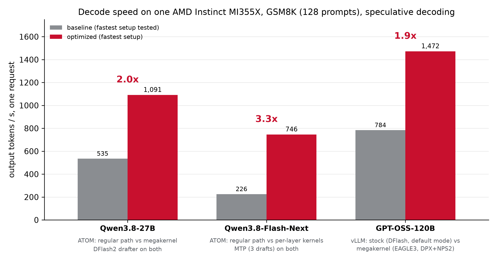
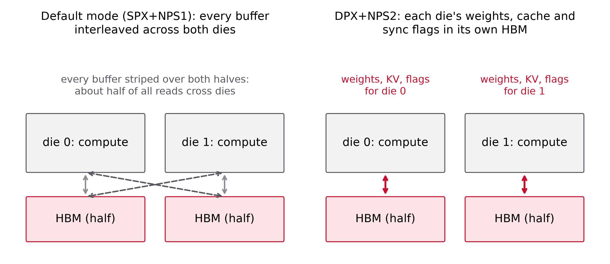
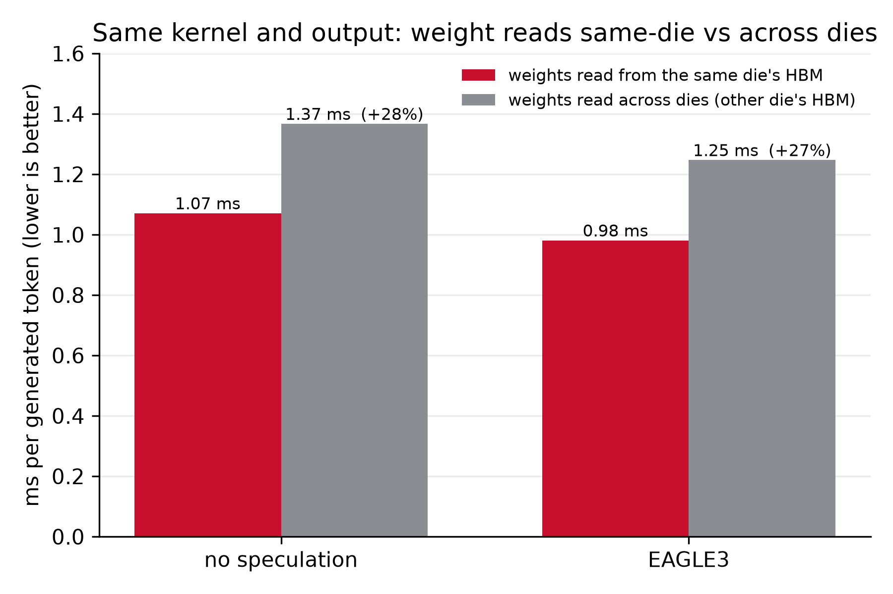
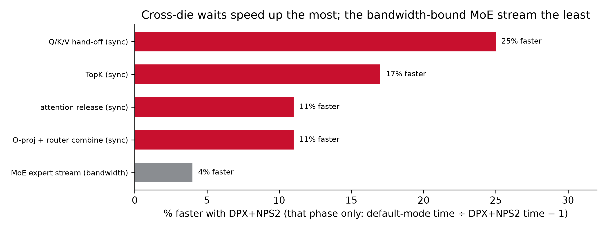
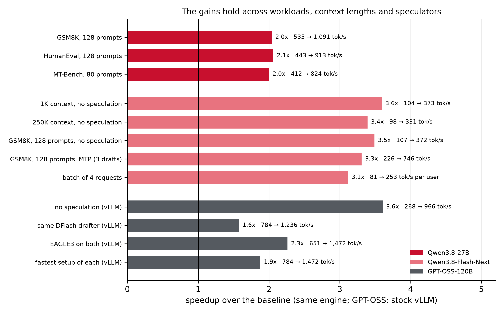

<!---
Copyright (c) 2026 Advanced Micro Devices, Inc. (AMD)

Permission is hereby granted, free of charge, to any person obtaining a copy
of this software and associated documentation files (the "Software"), to deal
in the Software without restriction, including without limitation the rights
to use, copy, modify, merge, publish, distribute, sublicense, and/or sell
copies of the Software, and to permit persons to whom the Software is
furnished to do so, subject to the following conditions:

The above copyright notice and this permission notice shall be included in all
copies or substantial portions of the Software.

THE SOFTWARE IS PROVIDED "AS IS", WITHOUT WARRANTY OF ANY KIND, EXPRESS OR
IMPLIED, INCLUDING BUT NOT LIMITED TO THE WARRANTIES OF MERCHANTABILITY,
FITNESS FOR A PARTICULAR PURPOSE AND NONINFRINGEMENT. IN NO EVENT SHALL THE
AUTHORS OR COPYRIGHT HOLDERS BE LIABLE FOR ANY CLAIM, DAMAGES OR OTHER
LIABILITY, WHETHER IN AN ACTION OF CONTRACT, TORT OR OTHERWISE, ARISING FROM,
OUT OF OR IN CONNECTION WITH THE SOFTWARE OR THE USE OR OTHER DEALINGS IN THE
SOFTWARE.
--->

# Bringing Ultra-Fast, Interactive LLM Inference to AMD Instinct™ MI355X GPUs

AI inference is no longer just a throughput problem. As reasoning models, AI agents and interactive applications become mainstream, responsiveness has become a first-class metric. Users notice seconds, not tokens per second. Lowering time per output token (TPOT) is now critical for AI systems that feel conversational, responsive and useful.

To meet this challenge, AMD is open-sourcing optimized inference paths for Qwen3.8-27B, Qwen3.8-Flash-Next and GPT-OSS-120B on AMD Instinct™ MI355X GPUs. Each model has an optimized path available through a custom integration with ATOM, SGLang or vLLM, with GPT-OSS-120B offered as a preview. Support for the remaining model and engine combinations is planned. The [Get Started](#get-started) section lists current availability and reproduction steps.

Developed through hundreds of optimization experiments by AMD engineers and AI coding agents, these paths reduce decode latency by combining megakernels, speculative decoding, low-precision data types and hardware-aware data placement. Together, these optimizations deliver 1.9x to 3.3x faster decode in the single-request GSM8K tests highlighted below. These comparisons reflect each model's complete optimized setup, including the precision, drafter and GPU partitioning differences detailed in the test configuration section. In this blog, we show the four techniques behind these gains, the results across three models and engines, and how to reproduce every number.

## Key Takeaways

Measured at batch 1 on one physical MI355X, with speculative decoding, single-request decode on GSM8K is 1.9x to 3.3x faster, comparing each side's fastest setup (Figure 1):

- **Qwen3.8-27B:** ~1,100 tokens/s, 2.0x ATOM's regular path with the same model weights and drafter model. Available through ATOM, SGLang and vLLM.
- **Qwen3.8-Flash-Next:** ~750 tokens/s, 3.3x ATOM's regular path with the same model weights and MTP drafter (3 drafts). Available through ATOM.
- **GPT-OSS-120B:** ~1,470 tokens/s, 1.9x the fastest stock vLLM configuration we tested, which differs in partition mode, precision and drafter; with the same drafter on both sides, 1.6x. Available as a preview in vLLM.

One more lever comes from MI355X's two-die design: when run as two logical devices, one per die (DPX+NPS2), the GPU can keep each die's data in its local memory. GPT-OSS-120B is the first model here to use this mode, and its results above use it. It decodes 7.5-8% faster from data placement alone, and 16-20% faster when data placement is combined with speculative decoding.

*Figure 1: Decode speed on one MI355X: GSM8K (128 prompts), one request at a time, each side's fastest setup with speculative decoding. The Qwen models are compared with ATOM's regular path using the same drafter; GPT-OSS-120B compares stock vLLM (DFlash, default mode) with the megakernel (EAGLE3, DPX+NPS2). Figure 5 shows more conditions, and the test configuration section lists each model's setup.*

## What Drives the Speedup

### 1. Megakernels: Fewer Launches, Synchronize Only Where Needed

Normally each operator of each layer is its own GPU kernel, and one token passes through hundreds of them, each with launch and synchronization overhead that a lone request cannot hide. A megakernel is a persistent kernel: one workgroup stays resident on each compute unit, and the workgroups hand data to one another through memory. Qwen3.8-27B and GPT-OSS-120B run the whole forward pass as one kernel; Qwen3.8-Flash-Next runs one per decoder layer, and the ~1.7 µs boundary between layers is its only grid-wide synchronization.

Inside, most stage boundaries are producer-to-consumer hand-offs: a value and its sequence tag arrive in one 64-bit store, so a consumer polls exactly the data it needs. Per-chiplet release words keep most polling in the local cache, and idle compute units preload upcoming weights before the next stage's input arrives. Each model adds its own tricks on top: fused operators, weight prefetch, fine-grained overlap of compute and data movement, and synchronization only where data is actually shared.

Qwen3.8-Flash-Next's sparse attention scores every block of the context and selects the top 512; splitting that selection into parallel chunks and merging their winners cut a sparse-attention layer at 250K tokens from 262 to 126 µs; with further tuning, a token at 250K now takes 3.0 ms, against 10.2 ms on ATOM's regular path.

The Qwen kernels are written in FlyDSL, a Python DSL that compiles to AMD GPU code while keeping control of matrix instructions, memory transfers and ordering; they began as HIP C++, as the GPT-OSS kernel still is.

### 2. Speculative Decoding: More Tokens per Pass

Decoding one token at a time leaves most of the GPU idle: every step reads all of the model's weights to produce a single token. Speculative decoding puts that idle compute to work. A small drafter guesses the next few tokens, and the target model checks all of them in one pass, keeping the guesses it agrees with plus one token of its own. The target model still decides every token; it just needs fewer passes. In our Qwen3.8-27B implementation, the DFlash2 drafter guesses seven tokens per round, and the target accepts about 5.6 on average on GSM8K.

Fewer passes help only if each round stays fast, so for Qwen3.8-27B in ATOM and SGLang, drafting, checking, accepting and updating the model's state run as one captured GPU graph, with no trips back to the CPU, and the drafter runs as persistent kernels. Linear-attention layers carry a running state instead of a KV cache. They undo rejected guesses by replaying compact per-token records, instead of saving a copy of the state for every position.

When choosing a drafter, measure tokens per millisecond, not acceptance alone. Every extra position checked costs time, and in mixture-of-experts models it can also pull in more experts. On GPT-OSS-120B, DFlash's eight-position block accepts more tokens per pass than EAGLE3. But a confidence-gated EAGLE3, which stops guessing once it is unsure, has a pass about 30% shorter than DFlash's and is therefore faster overall. The best draft length also depends on the workload: predictable text such as step-by-step math rewards longer drafts, while dense conversational text accepts so few extra guesses that one draft is best.

### 3. Low-Precision Data Types

MXFP4 weights (4-bit values with a shared scale per 32) feed MI355X's native low-precision matrix instructions with MXFP8 activations and need about 3.8x fewer weight bytes than BF16; in MXFP4, Qwen3.8-Flash-Next and its full 262K-token cache fit on one GPU. Low-precision weights set the speed limit: decode reads every weight on every pass, so the time to read them is a floor on each pass, and fewer bytes per weight lower it. Low precision alone does not reach that floor: the Qwen baselines run the same MXFP4 weights and stay well above it. The megakernels bring each pass closer to it, and speculative decoding spreads each pass over several tokens. In a few places our paths quantize further than their baselines (Qwen3.8-27B's LM head and drafter, GPT-OSS-120B's attention projections and LM head). That accounts for only a small part of the speedup, and the chat-format accuracy checks below show no significant change; the test configuration section lists each difference.

### 4. Data Locality: Place Data Near Its Consumer

The MI355X has two base dies, each with half of the HBM. In the default mode every buffer is spread across both, so about half of every read crosses between dies. DPX+NPS2 exposes one physical GPU as two logical devices, one per die, and the GPT-OSS-120B megakernel keeps each die's weights, KV cache and synchronization flags in its own memory, as Figure 2 shows.

*Figure 2: Where data lives: the default mode against DPX+NPS2.*

A controlled test isolates the effect: with the same binary and output, storing each half of the GPU's weights in the other half's HBM, so every weight read crosses the die-to-die link, makes each decoded token take about 28% longer (Figure 3).

*Figure 3: GPT-OSS-120B: weight reads from the same die vs across dies.*

Profiling shows where the locality gain comes from (Figure 4). Along the critical path, each layer takes 1.4 µs longer in the default mode; 86% of that extra time goes to moving data and 14% to waiting between stages. Measured step by step, the biggest speedups are in the steps that wait on the other die: the Q/K/V hand-off runs 25% faster, top-k expert routing 17% faster, and the output-projection combine and the attention release 11% faster. Much of their waiting is for data from the other die, so it shrinks when that data arrives sooner. The expert-weight stream, already limited by HBM bandwidth, runs only 4% faster.

*Figure 4: Per-phase speedup, DPX+NPS2 against the default mode.*

Locality and speculation compound: a wider verification pass reads the union of the experts its tokens route to (about 11.7 per layer for 4 tokens against 7 for 2), so it leans harder on memory bandwidth, which is where local memory helps most. On GSM8K, placement (1.08x) and speculation (1.27x) together deliver about 1.36x the decode rate of the default single-stream path.

## Results Across Models and Conditions

The gains hold across workloads, context lengths and speculative methods, for one request at a time and, for Qwen3.8-Flash-Next, also with four requests batched together (Figure 5):

*Figure 5: Speedup across workloads, context lengths and speculators.*

**Qwen3.8-27B.** 2.0-2.1x faster on reasoning, code and chat prompts, with both paths tuned for ROCm 10. The optimized path's round time grows only from 5.1 to 5.7 ms between 1K and 32K tokens of context. ATOM and SGLang serve the optimized path at the same speed.

**Qwen3.8-Flash-Next.** 3.4-3.5x faster on the same GSM8K, HumanEval and MT-Bench prompts as Qwen3.8-27B without speculation and 3.1-3.3x with MTP, 3.4-3.6x from 1K to 250K tokens of context, and 3.1x per user with four requests batched together.

**GPT-OSS-120B.** 3.6x stock vLLM 0.31.0 without speculation, 2.3x with EAGLE3 and 1.6x with the same DFlash drafter. Each side's fastest setup reaches 1,472 against 784 tokens/s (1.9x). The lead holds at closer precision: with the checkpoint's BF16 LM head, as vLLM runs it, the megakernel is 1.55-3.3x faster, and against vLLM running AMD's MXFP4 x FP8 checkpoint, it is 1.85-3.5x faster.

## Quality

Every drafted token is verified by the target model, and we check each optimized path against a reference. Qwen3.8-27B in MXFP4 stays within about a point of BF16 on GSM8K, HumanEval and MMLU-Pro and is 3-5 points lower on GPQA-Diamond, in all three engines. Qwen3.8-Flash-Next matches ATOM's regular path on all four, on the same MXFP4 weights.

GPT-OSS-120B, checked on GSM8K and MMLU-Pro so far, also runs its attention projections in MXFP4, as AMD's MXFP4 x FP8 checkpoint does. In the chat format it matches stock vLLM on GSM8K (94.8-95.4%, with or without speculation) and on MMLU-Pro (74.4% against 73.2%).

## Test Configuration

### All Models

- **Hardware:** one AMD Instinct MI355X (gfx950).
- **Scope:** decode speed, one request at a time (Qwen3.8-Flash-Next also at a batch of four); each model is compared with its own baseline on its own workloads. Decode rates are not whole-task speedups: prompt processing and tool calls add to an agent's task time.
- **MXFP4 baselines:** for a like-for-like comparison, the baselines run the same MXFP4 weights. Qwen3.8-27B's regular path quantizes them to MXFP4 at load; for Qwen3.8-Flash-Next we enabled MXFP4 kernels in ATOM's regular path.
- **Versions:** the software versions used to produce the published results are listed for each model below; each README lists everything needed to reproduce them.
- **Per round:** speed ≈ tokens accepted per round x 1,000 / ms per round; each model's figures below let you rescale to other acceptance rates.

### Qwen3.8-27B

- **Setup:** MXFP4 weights; MXFP8 DFlash2 drafter with seven drafts per round; greedy decoding, one request at a time.
- **Prompts:** the DFlash benchmark's selection (GSM8K and HumanEval, 128 each; MT-Bench, 80 first turns), reasoning effort xhigh, up to 2,048 output tokens.
- **Metric:** each request's decode rate (tokens after the first over the time after the first), averaged over requests.
- **Per round (GSM8K):** 5.6 tokens accepted, 5.11 ms per round.
- **Baseline:** ATOM's regular path with the same MXFP4 weights, except that it keeps the LM head and the DFlash2 drafter in BF16 (reading the LM head in BF16 would add about 0.3 ms to the 5.1 ms megakernel round, and the drafter takes under 1 ms of it), in the same container and with the same `GPU_MAX_HW_QUEUES`. SGLang's own path runs this model in BF16, so SGLang has no matched speedup.
- **Software (MI355X results):** ATOM's speedups: the release branch in `rocm/pytorch:rocm10.0_ubuntu24.04_py3.12_pytorch_release_2.13.0` (ROCm™ 10.0) with `GPU_MAX_HW_QUEUES=1`, both paths: 1,091 / 913 / 824 against 535 / 443 / 412 tokens/s (GSM8K / HumanEval / MT-Bench). On ROCm 7.2.4 (ATOM main `2479251d3` with the release branch, `rocm/pytorch:rocm7.2.4_ubuntu24.04_py3.12_pytorch_release_2.10.0`) at HIP's defaults, the megakernel runs 1,105 / 924 / 846 and the regular path 481 / 406 / 368 (2.3x); the hardware-queue setting that ROCm 10 needs also speeds up the regular path, so we quote the tuned pair. SGLang main `f825d72936` in `rocm/sgl-dev:v0.5.16-rocm720-mi35x-20260807` (ROCm 7.2.0); FlyDSL 19418894.
- **Recommended setup (ROCm 10.0):** ATOM's release branch in `rocm/pytorch:rocm10.0_ubuntu24.04_py3.12_pytorch_release_2.13.0`, served with `GPU_MAX_HW_QUEUES=1` (the reproduction script sets it; with HIP's default of four, the optimized path runs 10-25% slower, and one queue also speeds up ATOM's regular path); SGLang 0.5.22 (`34c4ba14c8`) in `lmsysorg/sglang-rocm:v0.5.22-rocm10-mi35x-20261016`; vLLM `49cb2bbf7` in `vllm/vllm-openai-rocm:nightly-rocm100-49cb2bbf71cfd36ee5aa33d1e184b1cddff55294`. Checked on one MI350X at the same speed as on ROCm 7.2 and with lossless output; the vLLM plugin runs at about 3x vLLM's own DFlash2 path (BF16) and within 1-3% of the SGLang plugin.
- **Also supported:** SGLang main from `f825d72936` and vLLM main from `3f1bcfd82`, on ROCm 7.2.
- **Quality evals:** GSM8K (1,319 questions, 5-shot), HumanEval (164, pass@1), GPQA-Diamond (198), MMLU-Pro (20 per category); also run with the SGLang and vLLM plugins on ROCm 7.2 and 10.0 (one MI350X), with the same results.

### Qwen3.8-Flash-Next

- **Setup:** MXFP4 weights converted from Qwen/Qwen3.8-Flash-Next with the script in its README, the same on both paths; MTP with three drafts per round where noted; greedy decoding, one request at a time.
- **Prompts:** single-request speed uses the same client and prompts as Qwen3.8-27B (GSM8K and HumanEval, 128 each; MT-Bench, 80 first turns; reasoning effort xhigh; up to 2,048 output tokens). Context-length and four-request tests use random prompts of 1K, 8K, 128K and 250K tokens with 1,024 output tokens, end-of-sequence ignored, without speculation: 10 prompts averaged over 2-4 runs at 1K and 8K, 3 prompts at 128K and 250K, and 20 prompts x 3 runs at four requests.
- **Metric:** single-request speed as for Qwen3.8-27B. Context-length and four-request tests report time per output token (time after the first token over tokens after the first), averaged over requests; at four requests this is each user's own rate.
- **Per round (GSM8K, MTP with 3 drafts):** 3.04 tokens accepted, 4.27 ms per round (regular path: 14.10 ms).
- **Baseline:** ATOM's regular path on the same release branch and MXFP4 weights, with the MXFP4 support we added (8-bit activations, as in the monokernel; ATOM had no MXFP4 path for this model); same server, container and MTP drafts where noted.
- **Quality evals:** GSM8K with `lm_eval` (1,319 questions, 5-shot, chat template); HumanEval, GPQA-Diamond and MMLU-Pro with Qwen3.8-27B's prompts, caps and scoring.
- **Software:** the release branch linked below (ATOM `qwen38-megakernels`), aiter `c53e9b3f`, in `rocm/pytorch:rocm10.0_ubuntu24.04_py3.12_pytorch_release_2.13.0` (ROCm 10.0). On one MI350X the same branch gives 689 against 227 tokens/s (GSM8K, MTP with three drafts).

### GPT-OSS-120B

- **Setup:** stock vLLM 0.31.0 (the SemiAnalysis MI355X settings, default SPX+NPS1 mode) against the megakernel plugin, also on vLLM 0.31.0 (0.27.1 also works), in DPX+NPS2 on another MI355X; the released 32K-token builds.
- **Prompts and metric:** 128 GSM8K prompts one at a time, greedy, 256 output tokens with end-of-sequence ignored (`gpt_oss_build_and_repro.sh`); output tokens per second over all prompts, counting every token after the first. The megakernel is timed by the client through `vllm serve`; stock vLLM by its measured decode steps, offline, without serving overhead, which favors stock vLLM.
- **Per round (GSM8K):** with the same DFlash drafter, 4.25 tokens accepted, 3.52 ms per round (stock vLLM: 4.43 tokens, 5.65 ms); with EAGLE3, 3.53 tokens, 2.46 ms.
- **Drafters:** DFlash uses the same drafter on both sides with seven drafts, run at lower precision in the plugin. For EAGLE3, the plugin uses the LMSYS head with up to five drafts; stock vLLM cannot load it and uses NVIDIA's head (`nvidia/gpt-oss-120b-Eagle3-v3`) at five drafts, its best setting.
- **Baseline:** partition mode, model precision and drafter precision differ, so these compare complete decode setups rather than the kernel alone. The megakernel runs the attention projections and the LM head in MXFP4 with 8-bit activations, where stock vLLM keeps the checkpoint's BF16. Two checks at closer precision, on vLLM 0.31.0: the megakernel with the checkpoint's BF16 LM head runs 879 / 1,410 / 1,215 tokens/s (no speculation / EAGLE3 / DFlash), 3.3x / 2.2x / 1.55x stock vLLM; vLLM with AMD's MXFP4 x FP8 checkpoint (`amd/gpt-oss-120b-w-mxfp4-a-fp8-kv-fp8-fp8attn-no_lmhead_router`, BF16 KV cache) runs 248 / 527 / 657 tokens/s, and that build is 3.5x / 2.7x / 1.85x faster. Only decode is compared: the plugin does not yet batch prompt processing.
- **Preview limits:** one greedy request at a time, up to 32K tokens (prompt plus output), on vLLM 0.31.0 or 0.27.1 with DPX+NPS2; accuracy checked on GSM8K and MMLU-Pro only.
- **Software:** ROCm 7.2.3 serving container (`vllm/vllm-openai-rocm:v0.31.0`); provider builds compiled with ROCm 7.0.
- **Quality evals:** GSM8K, all 1,319 questions, greedy, one request at a time: the chat format (0-shot, reasoning effort low, up to 4,096 tokens) and vLLM's GSM8K script (5-shot raw text, up to 256 tokens); MMLU-Pro, 1,400 questions (100 per category) in the chat format. On the 5-shot raw-text test the megakernel scores 42.8% without speculation and 35.5-39.3% with it (speculation itself is exact: the score follows how the attention kernel splits the context, which we are investigating); vLLM with AMD's MXFP4 x FP8 checkpoint scores 43.8%, and BF16 attention weights 49-56%.
- **Locality tests:** the kernel outside vLLM, with a 982-token prompt and 1K-32K generated tokens.

## Get Started

Each reproduction runs on one MI355X, one request at a time, and prints its results next to ours. The linked README for each configuration provides the required steps, options and supported engine versions:

|                    | ATOM      | SGLang    | vLLM      |
| ------------------ | --------- | --------- | --------- |
| Qwen3.8-27B        | Available | Available | Available |
| Qwen3.8-Flash-Next | Available | Planned   | Planned   |
| GPT-OSS-120B       | Planned   | Planned   | Preview   |

- **Qwen3.8-27B in ATOM:** `bash blog_benchmark/build_and_repro.sh` · [README](https://github.com/proaditya/ATOM/blob/qwen38-megakernels/blog_benchmark/README.md)
- **Qwen3.8-27B in SGLang:** `bash aitermk/engine_adapters/sglang/scripts/build_and_repro.sh` · [README](https://github.com/proaditya/aiter/blob/aitermk-qwen38/aitermk/engine_adapters/sglang/README.md)
- **Qwen3.8-27B in vLLM:** `bash aitermk/engine_adapters/vllm/scripts/build_and_repro.sh` · [README](https://github.com/proaditya/aiter/blob/aitermk-qwen38/aitermk/engine_adapters/vllm/README.md)
- **GPT-OSS-120B in vLLM (preview):** on an MI355X in DPX+NPS2, `bash aitermk/engine_adapters/vllm/scripts/gpt_oss_build_and_repro.sh` · [README](https://github.com/proaditya/aiter/blob/aitermk-gpt-oss/aitermk/megakernels/fleet/src/gpt_oss_gfx950_mpk/README.md)
- **Qwen3.8-Flash-Next in ATOM:** `bash scripts/qwen38_flash_mono/build_and_repro.sh` · [README](https://github.com/proaditya/ATOM/blob/qwen38-megakernels/scripts/qwen38_flash_mono/README.md)

To measure your own setup, the benchmark client behind these numbers, `atom/benchmarks/single_request_bench.py`, works against any OpenAI-compatible server (ATOM, SGLang or vLLM).

## What's Next

- **Every model in every engine:** Qwen3.8-Flash-Next and GPT-OSS-120B in the engines they don't run in yet.
- **More models,** starting from the techniques that carried over here.
- **Tensor parallelism,** to split one request across GPUs for larger models and lower latency.
- **Larger batches,** extending the optimized paths beyond one request (four for Qwen3.8-Flash-Next).
- **Spatial partitioning (DPX+NPS2)** for other models, as for GPT-OSS-120B.
- **AMD Instinct MI455X.**

These are early results. We expect both the engines' regular paths and our kernels to improve over the coming weeks, and the READMEs will track the latest numbers.

Try these paths on your workloads, tell us what you measure, and contribute drafters, models and engine support. We welcome collaboration with developers, partners and researchers.

## Summary

In this blog, you explored how persistent megakernels, speculative decoding, low-precision data types and hardware-aware data placement speed up single-request decode on AMD Instinct MI355X GPUs, the results across three models and three serving engines, and how to reproduce them.

Single-request speed is becoming a product feature, and MI355X GPUs deliver it with the right software. These techniques make Qwen3.8-27B decode 2.0x faster at about 1,100 tokens/s, Qwen3.8-Flash-Next 3.3x faster with MTP at about 750 tokens/s, and GPT-OSS-120B up to 1,472 tokens/s in vLLM. The gains hold across workloads and context lengths, and they already run in serving engines developers use today; support for every model across ATOM, SGLang and vLLM is planned. All of it is open source, with the scripts to reproduce every number above. We are releasing it early to put it in developers' hands sooner and invite collaboration: some of the code lives in interim repositories today and will move to its long-term home over the coming weeks, and the links will follow it.

## Additional Resources

- **ATOM:** the Qwen3.8-27B and Qwen3.8-Flash-Next paths and the benchmark client ([`github.com/proaditya/ATOM`](https://github.com/proaditya/ATOM/tree/qwen38-megakernels)).
- **AITER:** the Qwen3.8-27B kernels and the SGLang and vLLM plugins ([`github.com/proaditya/aiter`](https://github.com/proaditya/aiter/tree/aitermk-qwen38/aitermk)).
- **GPT-OSS-120B:** the vLLM plugin and build ([`github.com/proaditya/aiter`](https://github.com/proaditya/aiter/tree/aitermk-gpt-oss/aitermk)) and the megakernel source and exporter ([`github.com/sangeeta0201/fleet-chiplet-megakernel`](https://github.com/sangeeta0201/fleet-chiplet-megakernel/tree/gpt-oss-120b-mi355x)).
- **FlyDSL:** [`github.com/ROCm/FlyDSL`](https://github.com/ROCm/FlyDSL).

## Disclaimers

The information presented in this document is for informational purposes only and may contain technical inaccuracies, omissions, and typographical errors. The information contained herein is subject to change and may be rendered inaccurate for many reasons, including but not limited to product and roadmap changes, component and motherboard version changes, new model and/or product releases, product differences between differing manufacturers, software changes, BIOS flashes, firmware upgrades, or the like. Any computer system has risks of security vulnerabilities that cannot be completely prevented or mitigated. AMD assumes no obligation to update or otherwise correct or revise this information. However, AMD reserves the right to revise this information and to make changes from time to time to the content hereof without obligation of AMD to notify any person of such revisions or changes.

THIS INFORMATION IS PROVIDED "AS IS." AMD MAKES NO REPRESENTATIONS OR WARRANTIES WITH RESPECT TO THE CONTENTS HEREOF AND ASSUMES NO RESPONSIBILITY FOR ANY INACCURACIES, ERRORS, OR OMISSIONS THAT MAY APPEAR IN THIS INFORMATION. AMD SPECIFICALLY DISCLAIMS ANY IMPLIED WARRANTIES OF NON-INFRINGEMENT, MERCHANTABILITY, OR FITNESS FOR ANY PARTICULAR PURPOSE. IN NO EVENT WILL AMD BE LIABLE TO ANY PERSON FOR ANY RELIANCE, DIRECT, INDIRECT, SPECIAL, OR OTHER CONSEQUENTIAL DAMAGES ARISING FROM THE USE OF ANY INFORMATION CONTAINED HEREIN, EVEN IF AMD IS EXPRESSLY ADVISED OF THE POSSIBILITY OF SUCH DAMAGES.

AMD, the AMD Arrow logo, and combinations thereof are trademarks of Advanced Micro Devices, Inc. Other product names used in this publication are for identification purposes only and may be trademarks of their respective companies.

© 2026 Advanced Micro Devices, Inc. All rights reserved
