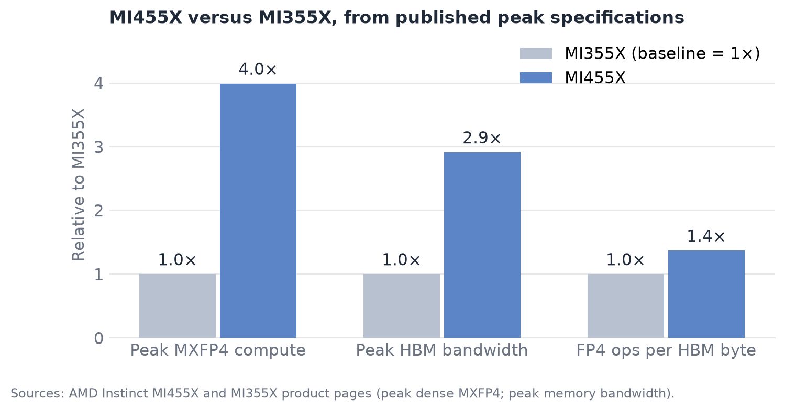
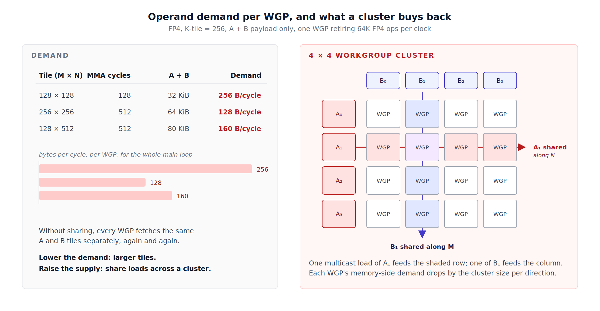
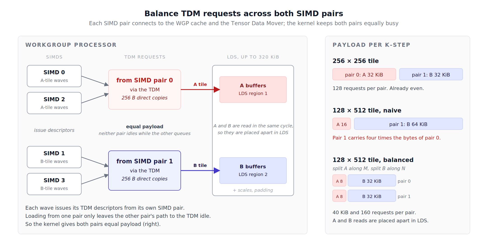
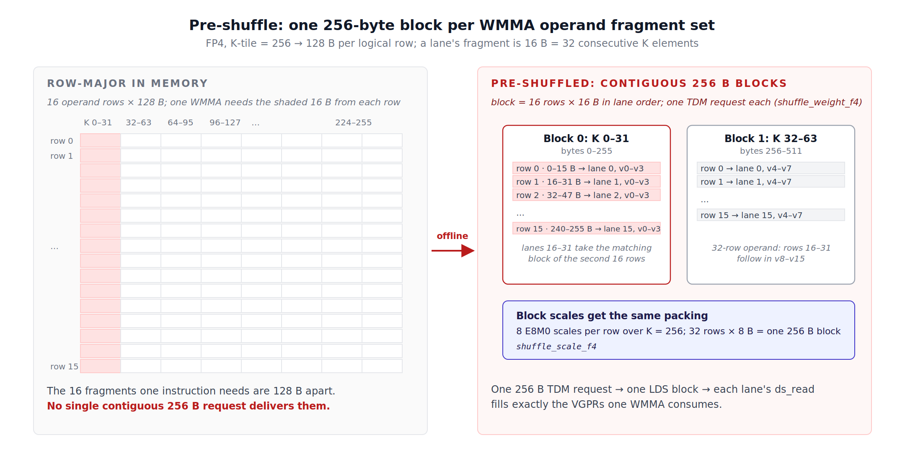
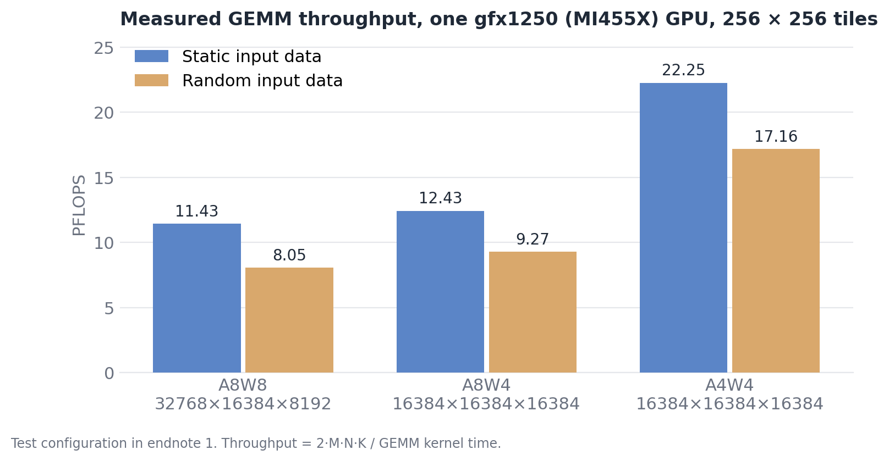

<!---
Copyright (c) 2026 Advanced Micro Devices, Inc. (AMD)

Permission is hereby granted, free of charge, to any person obtaining a copy
of this software and associated documentation files (the "Software"), to deal
in the Software without restriction, including without limitation the rights
to use, copy, modify, merge, publish, distribute, sublicense, and/or sell
copies of the Software, and to permit persons to whom the Software is
furnished to do so, subject to the following conditions:

The above copyright notice and this permission notice shall be included in all
copies or substantial portions of the Software.

THE SOFTWARE IS PROVIDED "AS IS", WITHOUT WARRANTY OF ANY KIND, EXPRESS OR
IMPLIED, INCLUDING BUT NOT LIMITED TO THE WARRANTIES OF MERCHANTABILITY,
FITNESS FOR A PARTICULAR PURPOSE AND NONINFRINGEMENT. IN NO EVENT SHALL THE
AUTHORS OR COPYRIGHT HOLDERS BE LIABLE FOR ANY CLAIM, DAMAGES OR OTHER
LIABILITY, WHETHER IN AN ACTION OF CONTRACT, TORT OR OTHERWISE, ARISING FROM,
OUT OF OR IN CONNECTION WITH THE SOFTWARE OR THE USE OR OTHER DEALINGS IN THE
SOFTWARE.
--->

# Feeding the Matrix Cores: Assembly FP4 GEMM Kernel Design on AMD Instinct™ MI455X GPUs

The AMD Instinct™ MI455X GPU raises peak 4-bit matrix throughput four
times over the MI355X, while HBM bandwidth rises about three times
([specifications][mi455x-page], [MI355X][mi355x-page]). A GEMM kernel
that was balanced on the previous generation is therefore supply-limited
on this one: each byte loaded has to feed more math than before. This
post walks through how the FP4 GEMM kernels in [AITER][aiter] close that
gap on MI455X: how large the tiles have to be, how the Tensor Data Mover
(TDM) replaces register-staged loads, how operands are laid out so that
every request is a full-width transfer, and how the main loop is
pipelined. It follows the earlier posts on [Gluon GEMM
kernels][blog-gluon-gemm] and on [decode attention on MI450 series
GPUs][blog-gluon-decode], and goes one level lower: the kernels here are
hand-written assembly shipped in AITER under
[`hsa/gfx1250/f4gemm`][aiter-f4gemm]. One theme runs through it. MI455X
moves work that kernels used to do by hand into the hardware. This
includes address generation, staging loads through registers, and
sharing operands between workgroups. What is left for the kernel author
is a smaller set of decisions that matter more: the tile, the layout and
the pipeline.

Figure 1 shows the imbalance that drives the rest of this post: peak FP4
compute grew faster than memory bandwidth from MI355X to MI455X.

## The Problem: Supply, Not Compute

Three numbers from the public specifications set the frame. The MI455X
has 256 workgroup processors (WGPs), each with four SIMD32 units
([whitepaper][cdna5-whitepaper]); its peak dense MXFP4 rate is 40.3
PFLOPS at a 2.4 GHz peak engine clock
([specifications][mi455x-page]). Dividing through, one WGP retires on
the order of 64K FP4 operations (32K multiply-accumulates) per clock.
The MI355X figure, computed the same way from its 10.1 PFLOPS dense
MXFP4 peak ([MI355X][mi355x-page]), is about 16K.

Now look at what a tile demands. For an FP4 GEMM with a K-tile of 256,
each K-step of an M×N output tile needs 128·M bytes of A and 128·N
bytes of B. The MMA work for that step is 2·M·N·256 operations, which at
64K operations per clock takes 2·M·N/128 cycles:

| Tile (M × N) | MMA cycles per K-step | A + B bytes per K-step | Demand |
| --- | ---: | ---: | ---: |
| 128 × 128 | 128 | 32 KiB | 256 B/cycle |
| 256 × 256 | 512 | 64 KiB | 128 B/cycle |
| 128 × 512 | 512 | 80 KiB | 160 B/cycle |

Scale factors, output traffic and any padding come on top. Even the most
favourable of these, 256 × 256, asks for 128 bytes every cycle, per WGP,
for the whole main loop. A 128 × 128 tile asks for twice that.
Rectangular tiles take the same MMA cycles as the square tile of equal
area and move more bytes, so they sit higher still.

Now follow one load. It leaves the WGP, misses in the per-WGP cache, and
continues through the memory hierarchy to the L2 and HBM
([whitepaper][cdna5-whitepaper]). In a large GEMM every WGP runs the
same kernel, and the WGPs that share a row or a column of the output
request the same operand tiles ([ISA guide][cdna5-isa], §10.7). If each
of those requests travels the hierarchy on its own, the same bytes move
many times over. Combining them into one request is what multicast loads
are for (§10.7), and it has to be asked for explicitly, which is what
the workgroup clusters below do. The kernel design that follows
is, at bottom, a list of ways to raise the supply and lower the demand
until they meet.

## Three Guidelines

Three guidelines apply to any compute-bound GEMM kernel on MI455X,
whatever language it is written in:

1. **Choose the tile and the cluster together.** For FP8 and FP4, start
   at 128 × 128 or larger, and use workgroup clusters so that
   neighbouring WGPs share operand loads instead of repeating them.
2. **Load with the TDM, in full-width requests, from both SIMD pairs.**
3. **Keep LDS accesses conflict-free.**

This section covers each briefly. The rest of the post shows how the
AITER FP4 kernels put them into practice.

## Guideline 1: Tile Size and Cluster Sharing

Without sharing, every WGP fetches its own copy of the operand tiles in
the demand table above. A workgroup cluster lets several WGPs share one
load through L2 multicast ([whitepaper][cdna5-whitepaper]). In a 4 × 4
(or 2 × 4) cluster of output tiles, the WGPs in one cluster row share
the same A rows and the WGPs in one cluster column share the same B
columns, so A is multicast along N, B along M, and each WGP fetches
only a fraction of its operands, as Figure 2 shows. A cluster holds at
most 16 workgroups, one per WGP ([ISA guide][cdna5-isa], §2.3), so
4 × 4 is the largest square shape. That is a capacity limit, not a
claim that 4 × 4 is the best shape for every problem size.

The shipped kernels use a 256 × 256 tile with a 4 × 4 cluster for large
shapes, and their names in [`f4gemm.csv`][aiter-f4gemm-csv] carry both
(`256x256_4x4`). The cluster is on by default for compute-bound GEMMs;
for small, bandwidth-bound GEMMs such as decode-time projections it
makes little difference, because HBM is the limit. For compute-bound
GEMMs the kernel also leaves early timeout off. Once the data is ready,
a multicast load then waits for all workgroups in its multicast mask to
submit their requests, or returns when the normal timeout expires ([ISA
guide][cdna5-isa], §10.7, and the `early_timeout` field in §10.11.4).
Waiting costs a little latency per request and raises the share of
returns that are combined.

## Guideline 2: Load with the Tensor Data Mover

The TDM is an asynchronous engine, local to the WGP, that moves tensor
tiles between global memory and LDS from a descriptor, without staging
through vector registers ([whitepaper][cdna5-whitepaper],
[ISA guide][cdna5-isa]). Three things follow for a GEMM main loop:

- **Fewer instructions and registers.** A 32 KiB operand tile is one TDM
  request, against 64 `buffer_load_b128` instructions per wave plus
  their address arithmetic and in-flight VGPRs.
- **Full-width direct copies.** The direct path between DRAM and LDS
  needs the innermost tile dimension to be a multiple of 128 bytes, and
  256-byte transfers carry twice the data per request ([decode attention
  post][blog-gluon-decode]). The kernels make every A and B request 256
  bytes (see "Pre-Shuffle Weights and Scales").
- **Both SIMD pairs.** Each pair of SIMDs connects to the TDM ([ISA
  guide][cdna5-isa], §1.2.2.1), and each wave issues its descriptors
  from its own pair. Loading from one pair only leaves the other pair's
  path idle, so the kernel spreads requests until both pairs carry the
  same payload. Figure 3 shows the split for square and wide tiles.

## Guideline 3: Efficient LDS Access

Up to 320 KiB of each WGP's 384 KiB of SRAM is LDS
([whitepaper][cdna5-whitepaper]). Two kinds of conflict serialize LDS
accesses:

- **Bank conflicts.** The LDS has 64 banks, each 4 bytes wide, and one
  request that touches two different rows of the same bank is
  serialized ([ISA guide][cdna5-isa], §11.1 and §11.2). Pad rows so that
  a wave's operand fragments do not collide, which the TDM can do as it
  writes the tile (§10.11).
- **Partition conflicts.** The LDS is built from five 64 KiB partitions.
  When waves from different SIMD pairs access the same partition in the
  same cycle, the accesses are serialized even without a bank conflict
  ([LDS deep dive][blog-lds-deep-dive]). Place A and B buffers that are
  read in the same cycle in different partitions, as "Balance Across
  SIMD Pairs" below shows.

## From Guidelines to the FP4 GEMM Kernel

The production kernel is three decisions stacked on the three
guidelines: which MMA instruction and wave layout, how operands are
laid out and loaded, and how the main loop is pipelined.

### Choose the MMA Instruction

MI455X exposes scaled WMMA instructions that take FP8, FP6 and FP4
operands with block scales ([ISA guide][cdna5-isa]). Two shapes cover
FP4 GEMM:

| WMMA shape | Operands | Issue cycles | Notes |
| --- | --- | ---: | --- |
| 16 × 16 × 128 | F8F6F4, not both FP4 | 8 | FP8 peak rate |
| 16 × 16 × 128 | F8F6F4, both FP4 | 4 | FP4 peak rate; short window |
| 32 × 16 × 128 | FP4 | 8 | FP4 peak rate; longer window |

The issue counts follow from the published peaks: 16 × 16 × 128
multiply-accumulates every 4 cycles on each of four SIMDs is 32K
multiply-accumulates per WGP per clock, the FP4 figure above, and the
mixed-format shape at 8 cycles is half that, the FP8 figure. Both FP4
shapes reach the same peak. The difference is how much room each leaves
for other work. While a WMMA is in flight, the SIMD can co-issue
independent instructions ([ISA guide][cdna5-isa], §5.7.2 and §5.8). One
32 × 16 × 128 instruction does the same arithmetic work as two
16 × 16 × 128 instructions, so the kernel needs fewer WMMA instructions
for the same work and leaves more of the window to the LDS reads, TDM
triggers and scale handling of the next step. The kernel therefore favours
the 32 × 16 × 128 shape where the tile allows it.

Waves are arranged as a 2 × 2 grid over the tile (M × N), each wave
owning an independent sub-tile. With the 16 × 16 instruction the tile
is a multiple of 32 × 32; with 32 × 16 it is a multiple of 64 × 32. That
is the price of the longer window: the step along M doubles, fewer tile
shapes fit a given problem, and the choice has to be checked against
the occupancy that real model shapes produce. The MMA shape, the tile
and the cluster are one decision, made together.

### Pre-Shuffle Weights and Scales

A WMMA operand fragment is 16 bytes per lane: for FP4, 32 consecutive K
elements of one row. In row-major memory, the 16 rows of a 16-row
operand are 128 bytes apart (K-tile 256 at 4 bits), so the fragments a
wave needs for one instruction are scattered across 16 rows, and no
single contiguous 256-byte request delivers them.

Pre-shuffling fixes the layout offline. The weight matrix is repacked so
that the 16 fragments one WMMA needs, one 16-byte piece from each of 16
rows, sit in one contiguous 256-byte block, in lane order. A single
256-byte TDM request then lands the block in LDS, and each lane's
`ds_read` pulls its own 16 bytes straight into `v0–v3`. The next
256-byte block holds the next K-chunk (`v4–v7`); for the 32-row operand,
rows 16–31 follow in `v8–v15`. Block scales get the same treatment:
eight E8M0 scales per row over K = 256, 32 rows × 8 bytes = one 256-byte
block. Figure 4 compares the row-major layout with the pre-shuffled one.

The repacking lives in AITER as `shuffle_weight_f4` and
`shuffle_scale_f4` in [`aiter/ops/shuffle.py`][aiter-shuffle], and the
kernel binaries carry the layout in their names (`BpreShuffle`,
`ABpreShuffle`).

### Activations: Two Layouts, One Online Cost

Weights are shuffled once and reused for every call. Activations are
produced on the fly, so their layout is a trade-off, and the kernel
supports both:

- **Plain row-major with LDS padding.** Each 128-byte logical row is
  stored with 16 bytes of padding in LDS. Requests are 128 bytes, which
  still qualifies for the direct path but at half the bytes per
  request.
- **Pre-shuffled activations.** The same 256-byte packing as the
  weights. In GEMM-only unit tests at M = N = K = 16384, pre-shuffled
  activations raised A4W4 throughput by 16.1% with static inputs
  (395.33 µs against 459 µs) and by 6.1% with random inputs
  (512.54 µs against 544 µs) over the padded layout[[1]](#endnote-1). The
  `ABpreShuffle` kernels exist for this layout.

Those gains are GEMM-only: they exclude the cost of packing the
activations. Packing activations is an extra pass
over the input unless it is fused into the quantization kernel that
produces them, and the framework glue to route the shuffled tensor has
its own cost. Both layouts ship, and the decision sits above the kernel:
the framework picks per GEMM from measured performance on the real
model. Use the `apreshuffle` option of [`gemm_a4w4`][aiter-gemm-a4w4]
when the producing kernel can emit the shuffled layout; otherwise the
padded path is the default.

### Balance Across SIMD Pairs

With the operand layout fixed, balance the TDM payload across the two
SIMD pairs:

| Tile | SIMD pair 0 | SIMD pair 1 | Requests per pair |
| --- | --- | --- | ---: |
| 256 × 256 | A (32 KiB) | B (32 KiB) | 128 |
| 128 × 512 | A 8 KiB + B 32 KiB | A 8 KiB + B 32 KiB | 160 |

For the square tile, A from one pair and B from the other is already
even. For the wide tile, B is four times A, so the kernel splits A along
M and B along N and gives each pair half of each. The A and B buffers
that the main loop reads in the same cycle are placed in different LDS
partitions, so concurrent A and B reads from the two SIMD pairs do not
conflict (Guideline 3).

### Multi-Stage Pipeline

For a 256 × 256 FP4 tile with K-tile 256, the MMA work per K-block is
512 cycles (from the demand table). The global-to-LDS latency of a TDM
load on our system is roughly twice that, so the pipeline needs at least
three buffers (latency divided by 512, rounded up, plus one) to keep the
matrix cores busy. The kernel uses four, which gives a lead of three
K-blocks, about 1,500 cycles of cover over a latency measured at roughly
1,000. The margin absorbs the jitter that multicast and a busy memory
system add, and the larger LDS of MI455X is what makes the fourth buffer
affordable:

| | Per buffer | Four buffers |
| --- | ---: | ---: |
| A + B payload | 64 KiB | 256 KiB |
| plus scales and padding | | fits in 320 KiB LDS |

Figure 5 follows the four buffers through the main loop, from TDM load to
WMMA consumption.

Two synchronization points matter: a buffer is consumable when its data
and its scales have both landed (one `s_wait_tensorcnt`), and it is
reusable only after the last `ds_read` of that stage has issued. The
latter is what bounds the lead: with four buffers the TDM runs at most
three K-blocks ahead. The lead time is an upper bound on coverage;
actual overlap depends on how the hand-written assembly schedules
`ds_read`, TDM triggers and WMMA inside each co-execution window.

### Prologue, Epilogue and the Store Path

Kernel time is prologue plus main loop plus epilogue, and the main loop
is the only part that keeps the matrix cores busy. Two measures shrink
the rest.

**Persistent tiles.** Prologue and epilogue do not shrink when the
matrix cores get faster, so their share of kernel time grows as the main
loop speeds up. On these kernels a tile's prologue, the first TDM
prefetches and LDS fills, costs about 3,000 to 4,000 cycles and its
epilogue about 2,000, against a main loop of some 30,000 cycles for the
K = 16384 shapes in the table below. The kernel is therefore persistent:
it launches one workgroup per WGP, each workgroup walks a sequence of
output tiles, and the prologue of the next tile is issued inside the
main loop of the current one, in the co-execution slots the WMMA leaves
open. That recovers roughly 3,000 cycles per tile; only the first
prologue is paid in full. The cost is that the next tile's descriptors
extend SGPR live ranges across the main loop.

**Pick the store path by what is free.** MI455X has separate completion
counters for the three ways to write the output ([ISA guide][cdna5-isa],
§3.1):

| Path | Staging | Wait on | Use when |
| --- | --- | --- | --- |
| TDM store | LDS | `TENSORcnt` | LDS has room; same-wave load/store ordering suffices |
| Async store | VGPR addresses | `ASYNCcnt` | Output stays in VGPRs; separate from TDM traffic |
| Buffer store | none | `STOREcnt` | Keeps all LDS for input stages |

The FP4 kernels keep the output in VGPRs and use buffer stores, which
leaves the full LDS budget to the four input buffers above.

## Measured Performance

The table reports throughput for three large shapes on a single MI455X
GPU with the 256 × 256 kernels[[1]](#endnote-1). Two columns are given for each: one
with statically initialized inputs and one with random inputs.

| Input types | M | N | K | Tile | PFLOPS, static init | PFLOPS, random init |
| --- | ---: | ---: | ---: | --- | ---: | ---: |
| A8W8 (MXFP8 × MXFP8) | 32768 | 16384 | 8192 | 256 × 256 | 11.43 | 8.05 |
| A8W4 (MXFP8 × MXFP4) | 16384 | 16384 | 16384 | 256 × 256 | 12.43 | 9.27 |
| A4W4 (MXFP4 × MXFP4) | 16384 | 16384 | 16384 | 256 × 256 | 22.25 | 17.16 |

Figure 6 plots the same results side by side.

Two readings. First, the data type does what the instruction table
predicts: A4W4 runs on the dedicated FP4 shapes and lands close to
twice the FP8 cases, and A8W4 is bounded by the mixed-format
instruction rate, so it sits with A8W8 rather than with A4W4. Second,
input data matters. With random inputs the matrix cores toggle more
bits per cycle than with static inputs, the GPU draws more power for the
same instruction stream, and sustained clocks settle lower under the
power limit. Across the three shapes the random-input throughput is 23
to 30% below the static-input figure. Static-input numbers are the
kernel's ceiling; random-input numbers are the ones to plan around, and
all of them were taken on pre-release hardware and software[[1]](#endnote-1).

Two practical consequences follow. When you test a kernel change,
measure with static inputs first, so that a clock shift neither masks
nor imitates the effect of the change, and check the engine clock
whenever a result drops unexpectedly. And the effect scales with how
hard the matrix cores work: on bandwidth-bound GEMMs the input data has
a much smaller effect.

## Takeaways

Four-bit GEMM on MI455X is a data-supply problem before it is a
compute problem.

- **Size tiles and clusters together.** Start at 128 × 128 or larger
  and let a 4 × 4 or 2 × 4 cluster multicast A along N and B along M.
- **Let the TDM do the loading.** One descriptor instead of dozens of
  load instructions, 256-byte direct copies, and equal payload from both
  SIMD pairs.
- **Lay operands out for the instruction, not the matrix.** Pre-shuffle
  weights and scales offline into 256-byte blocks; decide per workload
  whether activations are worth shuffling online.
- **Keep LDS working for you.** Pad against bank conflicts, keep concurrently read operands in different LDS partitions, and spend the LDS
  budget on pipeline depth.
- **Pipeline four deep and stay persistent.** Three K-blocks of lead,
  prologue of the next tile inside the main loop of this one, output
  stored from VGPRs.
- **Measure with static inputs first.** Separate the kernel change you
  are testing from the clock change the data causes.

## Summary

This post started from one arithmetic fact about the AMD Instinct
MI455X GPU: its matrix cores consume FP4 operands faster than a
workgroup can fetch them on its own. Peak four-bit throughput grew
about four times over the MI355X while memory bandwidth grew about
three times, and a 256 × 256 tile still asks the load path for 128
bytes every cycle. Everything else followed from closing that gap.

Three guidelines close it. Tile size and cluster shape are chosen
together, so that a 4 × 4 cluster shares A along N and B along M by multicast
and each WGP fetches a fraction of its operands. The Tensor Data Mover
does the loading, one descriptor per tile instead of dozens of load
instructions, in 256-byte direct copies spread evenly over both SIMD pairs. And the LDS is kept conflict-free, with padded rows and with
concurrently read operands in different partitions, so that it amplifies
bandwidth rather than serializing it.

The production kernel is those guidelines composed: the 32 × 16 × 128
scaled WMMA shape for its longer co-execution window, weights and
scales pre-shuffled offline into 256-byte blocks, activations in a
padded or a pre-shuffled layout chosen per workload, a four-buffer
pipeline that keeps the TDM three K-blocks ahead of the matrix cores,
and a persistent schedule that hides the next tile's prologue inside
the current main loop. On pre-release hardware the A4W4 kernels reach
22.25 PFLOPS with static inputs and 17.16 PFLOPS with random inputs on
one GPU, and the gap between those two numbers is itself a lesson about
how to measure[[1]](#endnote-1).

Each piece is the hardware doing what it was built to do, with the
kernel arranged so that it can. With the data movement in hardware, the
work that remains for the kernel author is choosing the tile, the layout
and the pipeline well. The kernels are in AITER today: the binaries
under [`hsa/gfx1250/f4gemm`][aiter-f4gemm] and
[`hsa/gfx1250/mxfp8fp4gemm`][aiter-mxfp8fp4gemm], dispatched from
[`gemm_a4w4`][aiter-gemm-a4w4] (MXFP4 × MXFP4, with `bpreshuffle` on by
default and `apreshuffle` opt-in), [`gemm_a8w4_mxfp8`][aiter-gemm-a8w4]
(MXFP8 × MXFP4) and [`gemm_a8w8_mxfp8`][aiter-gemm-a8w8] (MXFP8 × MXFP8).
The pre-shuffle defaults differ between these APIs, so check each one's
signature.

## Endnotes

[1] Test Configuration

Measured by AMD on June 30, 2026, on a single AMD Instinct™ MI455X GPU
in a pre-release gfx1250 system, with pre-release hardware and software. The
kernels are those integrated into AITER in pull requests
[#3996][aiter-pr-3996] (A4W4) and [#3998][aiter-pr-3998] (A8W8 and
A8W4), and the results were produced with the AITER unit tests added in
those pull requests, `op_tests/test_gemm_a4w4_mi400.py` and
`op_tests/test_mxfp8fp4gemm_mi400.py`. The kernel binaries on the
current AITER main branch may differ from the ones measured. GEMM
shapes, tile sizes and input types are as listed in the table. "Static
init" uses fixed input data and scales. "Random init" uses
benchmark-generated random inputs: normally distributed data for the
FP8 tests, and normally distributed data quantized to MXFP4 for the
A4W4 tests. Throughput is 2·M·N·K divided by GEMM kernel time; input
preparation and pre-shuffling are excluded from the timing. The
activation pre-shuffle comparison used A4W4 at M = N = K = 16384 on the
same system. Results may vary based on configuration, software
versions, and operating conditions.

## Additional Resources

### Specifications and Documentation

- [AMD Instinct™ MI455X GPU specifications][mi455x-page]
- [AMD Instinct™ MI455X GPU datasheet][mi455x-datasheet]
- [AMD Instinct™ MI355X GPU specifications][mi355x-page]
- [Introducing the AMD CDNA™ 5 Architecture (whitepaper)][cdna5-whitepaper]
- [AMD Instinct CDNA5 Instruction Set Architecture Reference Guide][cdna5-isa]
- [OCP Microscaling Formats (MX) Specification v1.0][ocp-mx]

### Source Code

- [AITER: AMD AI Tensor Engine for ROCm][aiter]
- [FP4 GEMM kernels for gfx1250: `hsa/gfx1250/f4gemm`][aiter-f4gemm]
- [MXFP8 × FP4 GEMM kernels for gfx1250: `hsa/gfx1250/mxfp8fp4gemm`][aiter-mxfp8fp4gemm]
- [`gemm_a4w4` dispatch: `aiter/ops/gemm_op_a4w4.py`][aiter-gemm-a4w4]
- [Pre-shuffle helpers: `aiter/ops/shuffle.py`][aiter-shuffle]

### Earlier ROCm Blog Posts

- [From Naive to Near-Peak: Building High-Performance GEMM Kernels with Gluon][blog-gluon-gemm]
- [Attention Decode on AMD MI450 GPUs: A Gluon Kernel Optimization Guide][blog-gluon-decode]
- [A Deep Dive into LDS Optimizations on AMD Instinct MI450 GPUs][blog-lds-deep-dive]
- [AMD Instinct MI455X vs MI355X: A Technical Look at the Advancing AI 2026 Inference Numbers][blog-mi455x-vs-mi355x]
- [Introducing AMD CDNA™ 5 and the AMD Helios™ Rackscale Solution][blog-cdna5-helios]

[mi455x-page]: https://www.amd.com/en/products/accelerators/instinct/mi400/mi455x.html
[mi455x-datasheet]: https://www.amd.com/content/dam/amd/en/documents/products/accelerators/instinct/amd-instinct-mi455x_brochure.pdf
[mi355x-page]: https://www.amd.com/en/products/accelerators/instinct/mi350/mi355x.html
[cdna5-whitepaper]: https://www.amd.com/content/dam/amd/en/documents/products/technologies/cdna/amd-cdna5-whitepaper.pdf
[cdna5-isa]: https://www.amd.com/content/dam/amd/en/documents/instinct-tech-docs/instruction-set-architectures/amd-instinct-cdna5-instruction-set-architecture.pdf
[ocp-mx]: https://www.opencompute.org/documents/ocp-microscaling-formats-mx-v1-0-spec-final-pdf
[aiter]: https://github.com/ROCm/aiter
[aiter-f4gemm]: https://github.com/ROCm/aiter/tree/main/hsa/gfx1250/f4gemm
[aiter-f4gemm-csv]: https://github.com/ROCm/aiter/blob/main/hsa/gfx1250/f4gemm/f4gemm.csv
[aiter-mxfp8fp4gemm]: https://github.com/ROCm/aiter/tree/main/hsa/gfx1250/mxfp8fp4gemm
[aiter-gemm-a4w4]: https://github.com/ROCm/aiter/blob/main/aiter/ops/gemm_op_a4w4.py
[aiter-shuffle]: https://github.com/ROCm/aiter/blob/main/aiter/ops/shuffle.py
[aiter-gemm-a8w4]: https://github.com/ROCm/aiter/blob/main/aiter/ops/gemm_op_a8w4.py
[aiter-gemm-a8w8]: https://github.com/ROCm/aiter/blob/main/aiter/ops/gemm_op_a8w8.py
[aiter-pr-3996]: https://github.com/ROCm/aiter/pull/3996
[aiter-pr-3998]: https://github.com/ROCm/aiter/pull/3998
[blog-gluon-gemm]: https://rocm.blogs.amd.com/software-tools-optimization/gluon-gemm-tutorial/README.html
[blog-gluon-decode]: https://rocm.blogs.amd.com/software-tools-optimization/gluon-attention-decode-mi450/README.html
[blog-lds-deep-dive]: https://rocm.blogs.amd.com/software-tools-optimization/mi450-lds-optimization/README.html
[blog-mi455x-vs-mi355x]: https://rocm.blogs.amd.com/software-tools-optimization/mi455x-vs-mi355x/README.html
[blog-cdna5-helios]: https://rocm.blogs.amd.com/ecosystems-and-partners/cdna5-helios/README.html

## Disclaimers

The information presented in this document is for informational purposes only
and may contain technical inaccuracies, omissions, and typographical errors.
The information contained herein is subject to change and may be rendered
inaccurate for many reasons, including but not limited to product and roadmap
changes, component and motherboard version changes, new model and/or product
releases, product differences between differing manufacturers, software
changes, BIOS flashes, firmware upgrades, or the like. Any computer system has
risks of security vulnerabilities that cannot be completely prevented or
mitigated. AMD assumes no obligation to update or otherwise correct or revise
this information. However, AMD reserves the right to revise this information
and to make changes from time to time to the content hereof without obligation
of AMD to notify any person of such revisions or changes. THIS INFORMATION IS
PROVIDED "AS IS." AMD MAKES NO REPRESENTATIONS OR WARRANTIES WITH RESPECT TO
THE CONTENTS HEREOF AND ASSUMES NO RESPONSIBILITY FOR ANY INACCURACIES, ERRORS,
OR OMISSIONS THAT MAY APPEAR IN THIS INFORMATION. AMD SPECIFICALLY DISCLAIMS
ANY IMPLIED WARRANTIES OF NON-INFRINGEMENT, MERCHANTABILITY, OR FITNESS FOR
ANY PARTICULAR PURPOSE. IN NO EVENT WILL AMD BE LIABLE TO ANY PERSON FOR ANY
RELIANCE, DIRECT, INDIRECT, SPECIAL, OR OTHER CONSEQUENTIAL DAMAGES ARISING
FROM THE USE OF ANY INFORMATION CONTAINED HEREIN, EVEN IF AMD IS EXPRESSLY
ADVISED OF THE POSSIBILITY OF SUCH DAMAGES.

Third-party content is licensed to you directly by the third party that owns
the content and is not licensed to you by AMD. ALL LINKED THIRD-PARTY CONTENT
IS PROVIDED "AS IS" WITHOUT A WARRANTY OF ANY KIND. USE OF SUCH THIRD-PARTY
CONTENT IS DONE AT YOUR SOLE DISCRETION AND UNDER NO CIRCUMSTANCES WILL AMD BE
LIABLE TO YOU FOR ANY THIRD-PARTY CONTENT. YOU ASSUME ALL RISK AND ARE SOLELY
RESPONSIBLE FOR ANY DAMAGES THAT MAY ARISE FROM YOUR USE OF SUCH THIRD-PARTY
CONTENT.

AMD, the AMD Arrow logo, AMD Instinct, AMD CDNA, ROCm, and combinations thereof
are trademarks of Advanced Micro Devices, Inc. Other product names used in this
publication are for identification purposes only and may be trademarks of
their respective companies. © 2026 Advanced Micro Devices, Inc. All rights
reserved.
