<!---
Copyright (c) 2026 Advanced Micro Devices, Inc. (AMD)

Permission is hereby granted, free of charge, to any person obtaining a copy
of this software and associated documentation files (the "Software"), to deal
in the Software without restriction, including without limitation the rights
to use, copy, modify, merge, publish, distribute, sublicense, and/or sell
copies of the Software, and to permit persons to whom the Software is
furnished to do so, subject to the following conditions:

The above copyright notice and this permission notice shall be included in all
copies or substantial portions of the Software.

THE SOFTWARE IS PROVIDED "AS IS", WITHOUT WARRANTY OF ANY KIND, EXPRESS OR
IMPLIED, INCLUDING BUT NOT LIMITED TO THE WARRANTIES OF MERCHANTABILITY,
FITNESS FOR A PARTICULAR PURPOSE AND NONINFRINGEMENT. IN NO EVENT SHALL THE
AUTHORS OR COPYRIGHT HOLDERS BE LIABLE FOR ANY CLAIM, DAMAGES OR OTHER
LIABILITY, WHETHER IN AN ACTION OF CONTRACT, TORT OR OTHERWISE, ARISING FROM,
OUT OF OR IN CONNECTION WITH THE SOFTWARE OR THE USE OR OTHER DEALINGS IN THE
SOFTWARE.
--->

# MoE Training Optimization with Primus

Mixture-of-Experts (MoE) has become a dominant architecture for frontier-scale language models, and our users increasingly train large MoE models on AMD Instinct™ MI355X<sup>[[a]](#primus-moe-opt-ref-a)</sup> GPUs. Driven by those workload requirements, we have built a broad set of MoE training optimizations in Primus. This blog follows our earlier post [MoE Training Best Practices on AMD GPUs](https://rocm.blogs.amd.com/software-tools-optimization/primus-moe-package/README.html). The earlier post established the foundational optimizations; this one describes what we built on top of them.

In this blog you will learn about:

- General **Primus and Primus-Turbo** training optimizations for the current generation of MoE models
- **Low-precision expert GEMMs** in FP8 and MXFP8, at both the kernel and end-to-end level
- A fused MoE **megakernel** (MegaMoE) that puts each all-to-all inside the grouped GEMM that produces or consumes its data
- **Training at scale** for DeepSeek-V3 on 256 to 1024 GPUs, including a 1700-step uninterrupted run
- **Primus Projection** for Megatron-LM planning
- The **JAX (MaxText)** MoE training path

All feature demonstrations and benchmarking results in this blog are built on Primus. [Primus/Primus-LM](https://github.com/AMD-AGI/Primus) is a flexible, high-performance framework for large-scale foundation model training and inference on AMD GPUs. As the training-framework layer of the Primus ecosystem, Primus-LM works alongside [Primus-Turbo](https://github.com/AMD-AGI/Primus-Turbo) (high-performance operators) and [Primus-SaFE](https://github.com/AMD-AGI/Primus-SaFE) (stability and platform infrastructure) to deliver a scalable, production-ready solution for state-of-the-art large-model development.

Both the Megatron-LM<sup>[[b]](#primus-moe-opt-ref-b)</sup> and JAX backends of Primus are covered. For configuration examples and further details, see the official [Primus documentation](https://rocm.docs.amd.com/projects/primus/en/latest/02-user-guide/megatron-lm-training.html) and [GitHub repository](https://github.com/AMD-AGI/Primus).

---

## How MoE Models Are Changing

The open-source MoE landscape has both broadened and deepened: models are larger and sparser, and expert granularity is finer. Modern MoE models share a set of clear architectural trends:

- **Scaling total parameters while keeping activation sparse**: total parameter counts continue to climb toward the trillion-parameter regime, while only a small fraction of parameters are activated per token. This decouples model capacity from per-token compute, but shifts the training bottleneck toward memory, routing, and communication.

- **Fine-grained experts**: newer models use many small experts rather than a few large ones, which increases both the expert count and the number of fine-grained operators per MoE layer. DeepSeek-V3<sup>[[c]](#primus-moe-opt-ref-c)</sup>, for example, uses 256 routed experts with top-8 routing.

- **Shared plus routed experts**: a shared "always-on" expert combined with sparsely routed experts has become common, adding structure to the MoE layer that optimizations must respect.

- **Higher top-k and larger EP**: more experts activated per token and larger expert-parallel (EP) groups increase all-to-all traffic, making dispatch and combine communication a first-order cost.

Representative models in this generation include DeepSeek-V3, Qwen3-235B-A22B and Qwen3-30B-A3B, GLM, MiniMax, GPT-OSS, and Mixtral — all of which Primus supports today.

---

## Where the Time Goes

Those trends mean MoE training efficiency is no longer about fast GEMMs alone. A modern MoE step is limited by four different things at once, and an optimization that attacks only one of them tends to expose the next. Table 1 below maps each bottleneck to the work described in this post, so you can jump straight to what is limiting your own runs:

Table 1: MoE training bottlenecks and the corresponding optimizations in this blog

| Bottleneck | What we did about it | Section |
| --- | --- | --- |
| **Expert GEMM throughput** — expert FFNs dominate FLOPs | FP8/MXFP8 grouped GEMM, FlyDSL kernels, quantized-weight caching | [Low-Precision Expert GEMMs](#low-precision-expert-gemms) |
| **All-to-all dispatch and combine** — grows with top-k and EP width | DeepEP<sup>[[d]](#primus-moe-opt-ref-d)</sup> dispatch, 1F1B all-to-all overlap, tile-granularity fusion inside a single kernel | [The Foundation](#the-foundation-primus--primus-turbo), [The MoE Megakernel](#the-moe-megakernel) |
| **Memory ceiling** — sets micro-batch size and recompute cost | Precision-aware optimizer, pipeline layout, fine-grained recompute, ahead-of-time projection | [Training at Scale](#training-at-scale-deepseek-v3-on-256-to-1024-gpus), [Primus Projection](#planning-before-you-train-primus-projection) |
| **Host and launch overhead** — dominates when layers are small | Sync-free MoE, NUMA binding and launch tuning, pipeline warm-up | [The Foundation](#the-foundation-primus--primus-turbo) |

The [Primus Projection](#planning-before-you-train-primus-projection) section documents the Megatron planning tool referenced in the memory row above. One section sits outside that grid: the [JAX (MaxText) path](#beyond-megatron-lm-the-jax-maxtext-path), which brings the same grouped-GEMM and DeepEP primitives to a second backend.

---

## The Foundation: Primus + Primus-Turbo

All subsequent results build on a common optimization foundation, which we describe first. Even before any model-specific tuning, most MoE workloads benefit from a set of general-purpose optimizations delivered through Primus and Primus-Turbo: Turbo grouped GEMM, DeepEP-accelerated dispatch, sync-free MoE, 1F1B all-to-all overlap, arbitrary pipeline partitioning, selective-layer recompute, loss fusion, NUMA binding and kernel-launch tuning, and manual garbage collection (GC). These are covered in detail in our earlier [MoE Training Best Practices](https://rocm.blogs.amd.com/software-tools-optimization/primus-moe-package/README.html) blog. Recipes in this post start from that stack; they do not enable every foundation flag at the same setting, as Table 2 shows.

On top of that foundation, we hardened and extended the following for the current model generation.

### Performance Features

- **Quantized-weight caching**: caching quantized weights across multiple micro-batches reduces quantization overhead in FP4 and FP8 training.

- **FlyDSL GEMM and grouped GEMM kernels**: support for [FlyDSL](https://github.com/ROCm/FlyDSL) FP8 GEMM and grouped GEMM kernels improves performance over Triton implementations.

- **Single-parameter grouped linear**: merging multiple experts' weights into a single contiguous tensor and applying a grouped quantization kernel reduces quantization overhead.

- **Precision-aware optimizer with BF16 states**: storing the main gradients and the Adam moment estimates in BF16 (`main_grads_dtype`, `exp_avg_dtype`, `exp_avg_sq_dtype`) meaningfully reduces optimizer memory and gradient-reduction cost, freeing memory headroom for larger micro-batches.

- **Fused cross-entropy and RoPE**: Transformer Engine cross-entropy loss fusion (`cross_entropy_fusion_impl: te`) and fused RoPE (`apply_rope_fusion`) cut memory and kernel overhead in the loss and attention paths.

### Usability Features

- **Pipeline warm-up** (`pp_warmup`): a parallel forward and backward warm-up on every pipeline rank exercises all lazy-init paths (HIP, Transformer Engine, FP8, RCCL) concurrently, removing first-iteration stalls without changing numerics.

- **Faster process teardown**: an opt-in fast-exit path shaves wall-clock time from the tail of large runs.

As shown in Figure 1, turning on the extra flags in Table 2 delivers a measurable uplift over each model's listed reference. The improvements come from different configuration changes for each model. Qwen3-235B-A22B gains **16.2%** from grouped GEMM plus FlyDSL and raising `turbo_sync_free_moe_stage` from 1 to 2; GPT-OSS 20B gains **9.7%** from switching an already-Turbo grouped GEMM to the FlyDSL backend; Qwen3-30B-A3B gains **5.8%** from Turbo GEMM, grouped GEMM with FlyDSL, and the same increase in the sync-free stage bump<sup>[[1]](#primus-moe-opt-endnote-1)</sup>:

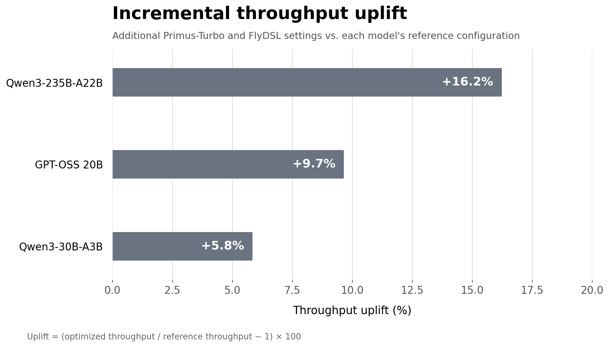

Figure 1: Incremental throughput uplift from additional Primus-Turbo optimizations on Qwen3-235B-A22B, GPT-OSS 20B, and Qwen3-30B-A3B

The specific model configurations and measured throughput behind Figure 1 are listed in Table 2 below:

Table 2: Model configurations and measured throughput for the reference and Turbo-accelerated runs. Parallelism is listed as TP/PP/CP/EP/DP — tensor, pipeline, context, expert, and data parallelism. MBS and GBS are micro-batch size and global batch size.

| Model | GPUs | Precision | Parallelism (TP/PP/CP/EP/DP) | MBS | GBS | Seq Len | Key Config / Flags | Throughput (tokens/s) |
| --- | --- | --- | --- | --- | --- | --- | --- | --- |
| Qwen3-235B-A22B (best measured configuration) | 32 | FP8-CS | 1/1/4/8/1 | 2 | 1024 | 4096 | `turbo_sync_free_moe_stage: 1` | 4137.5 |
| Qwen3-235B-A22B (Turbo-accelerated) | 32 | FP8-CS | 1/1/4/8/1 | 2 | 1024 | 4096 | `use_turbo_grouped_gemm: true`<br>`turbo_sync_free_moe_stage: 2`<br>`PRIMUS_TURBO_GROUPED_GEMM_BACKEND=flydsl` | 4809.1 |
| GPT-OSS 20B (MLPerf configuration) | 8 | FP8-CS | 1/1/1/1/8 | 2 | 16 | 4096 | `use_turbo_grouped_gemm: true`<br>`use_turbo_fused_act_with_probs: true`<br>`use_turbo_rms_norm: true` | 25660.1 |
| GPT-OSS 20B (Turbo-accelerated) | 8 | FP8-CS | 1/1/1/1/8 | 2 | 16 | 4096 | `use_turbo_grouped_gemm: true`<br>`use_turbo_fused_act_with_probs: true`<br>`use_turbo_rms_norm: true`<br>`PRIMUS_TURBO_GROUPED_GEMM_BACKEND=flydsl` | 28136.7 |
| Qwen3-30B-A3B (best measured configuration) | 8 | FP8-CS | 1/1/1/8/1 | 8 | 512 | 4096 | `turbo_sync_free_moe_stage: 1` | 26058.7 |
| Qwen3-30B-A3B (Turbo-accelerated) | 8 | FP8-CS | 1/1/1/8/1 | 8 | 512 | 4096 | `turbo_sync_free_moe_stage: 2`<br>`use_turbo_gemm: true`<br>`use_turbo_grouped_gemm: true`<br>`PRIMUS_TURBO_GROUPED_GEMM_BACKEND=flydsl` | 27581.3 |

---

## Low-Precision Expert GEMMs

With the framework baseline in place, the next lever is the expert GEMM itself: first we make each GEMM cheaper with low precision, then we remove the kernel boundaries around it with the megakernel.

Low precision is the most direct lever on MoE training throughput, because expert GEMMs dominate compute. Primus supports FP8 training through Transformer Engine recipes with a Primus-Turbo operator overlay, covering **delayed**, **tensorwise (current) scaling**, **blockwise scaling**, and **MXFP8** recipes. For MoE specifically, the routed-expert path uses an FP8 **grouped GEMM** (`grouped_gemm_fp8`) with per-first-micro-batch weight quantization and caching, and pads permuted tokens to the quantization block boundary so that dispatch, permutation, and expert GEMM all agree on the FP8 layout. These paths run on Primus-Turbo kernels supporting both FP8 tensorwise scaling and MXFP8 block scaling (`E4M3`, block size 32, `E8M0` scale). The FP8 GEMM and grouped-GEMM kernels behind the results in this section are authored in FlyDSL.

### Four Things That Matter in Practice

- **Accuracy is preserved**: both the FP8 and MXFP8 expert GEMMs are numerically validated, including uneven-`M` grouped cases. At the training level the default tensorwise (current-scaling) recipe tracks BF16 convergence, while MXFP8's per-block scaling further contains quantization error on the expert GEMMs.

- **Recipe choice matters**: tensorwise (current) scaling and block/MX scaling behave differently in both accuracy and speed on MI355X. Primus exposes the recipe as a single knob (`fp8_recipe`) so you can select the right trade-off.

- **Format selection**: on MI355X (gfx950), using the OCP `E4M3` format for expert GEMMs avoids costly up-conversions.

- **System-level break-even**: at the kernel level, FP8 expert GEMMs are substantially faster than BF16. End-to-end, the win depends on amortizing the surrounding quantization work — amax reduction, casting, and token-count synchronization. Primus reduces this overhead through weight-quantization caching, quantization-aware padding, and keeping token counts on-GPU, so the kernel speedup translates into end-to-end gains.

### Kernel-Level FP8 Versus BF16

Figure 2 below isolates the kernel-level payoff on MI355X alone, sweeping tokens-per-expert `M` over training-relevant sizes and reporting the FP8 (tensorwise) grouped-GEMM speedup over BF16, with quantization included in the FP8 timing:

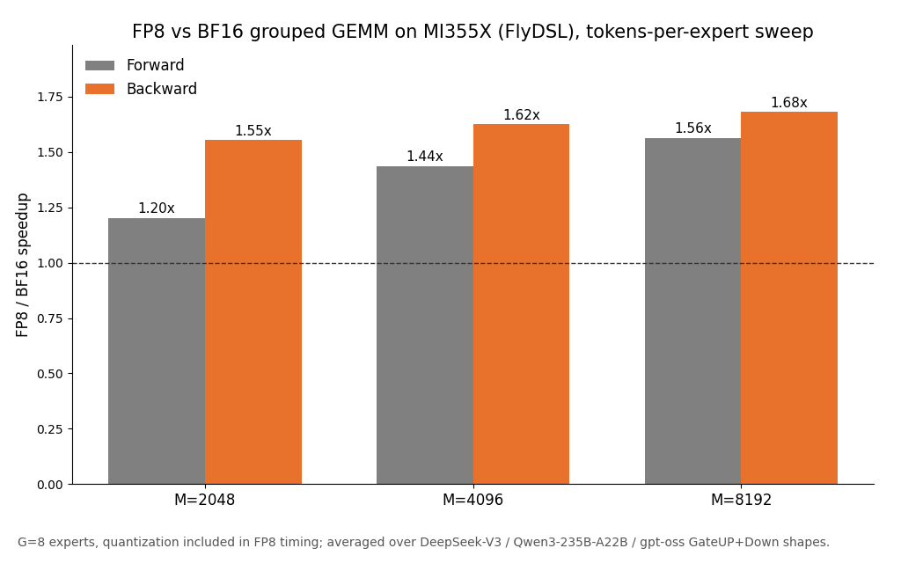

Figure 2: Kernel-level FP8-versus-BF16 grouped-GEMM speedup on AMD Instinct MI355X, swept over tokens-per-expert `M` and averaged over the DeepSeek-V3, Qwen3-235B-A22B, and GPT-OSS expert shapes

The forward speedup grows with `M` — from about 1.2× at `M` = 2048 to about 1.6× at `M` = 8192, as the GEMM gets large enough to hide the cast and amax cost that Primus already minimizes — while the backward is consistently 1.5–1.7×. At training-relevant token counts, the FP8 grouped-GEMM speedup is substantial.

### A New FlyDSL Backend for the Quantized GEMMs

Primus-Turbo dispatches each quantized GEMM to a backend, and **FlyDSL is a new backend added alongside the existing hipBLASLt and Triton paths**. The kernels are written in FlyDSL, a DSL that lowers to CDNA4 MFMA directly, which lets them place the quantization, the scale plumbing, and the epilogue where they are most effective for each shape rather than where a library boundary allows.

To quantify the benefit of the new backend, we benchmark end-to-end quantized dense and grouped GEMMs on MI355X against the backend Primus-Turbo would otherwise pick for the same call: hipBLASLt for the dense shapes and Triton for the grouped ones. Backends are pinned, the two are measured in one process on identical tensors with repetitions interleaved, and both must clear an output/gradient SNR check before they are timed. Quantization is inside the timed region. The dense set is representative Llama-style shapes at M=4096/8192/16384. The grouped set for Figures 3–6 is DeepSeek-V3, Qwen3-235B-A22B, and Kimi-K2 expert shapes — a different mix from Figure 2, which averages DeepSeek-V3, Qwen3-235B-A22B, and GPT-OSS.

The pattern across the four panels is consistent: the newer the format and the more the shape looks like MoE, the more the new backend adds. Dense tensorwise FP8 is the one place a long-tuned library is already close, and FlyDSL is 1.02× there. MXFP8 dense is 1.37× forward and 1.38× backward, grouped tensorwise FP8 is 1.19× and 1.24×, and MXFP8 grouped is 1.38× and 1.53× — and outside dense tensorwise, FlyDSL wins on every tested individual shape, not just the average. Figures 3 through 6 show the tensorwise FP8 and MXFP8 results for dense and grouped GEMMs<sup>[[2]](#primus-moe-opt-endnote-2)</sup>:

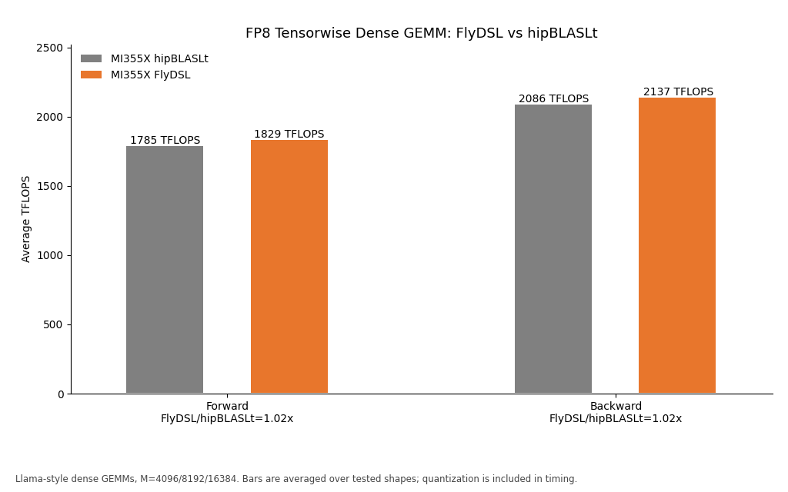

Figure 3: FP8 tensorwise dense GEMM throughput on AMD Instinct MI355X, the FlyDSL backend versus hipBLASLt, forward and backward, averaged over the tested shapes

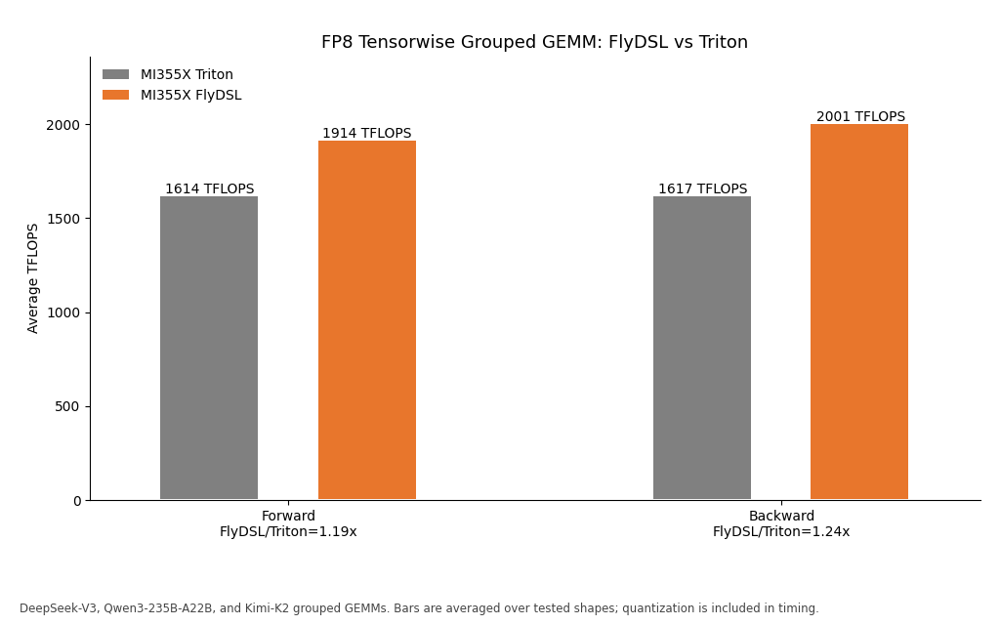

Figure 4: FP8 tensorwise grouped GEMM throughput on AMD Instinct MI355X, the FlyDSL backend versus Triton, forward and backward, averaged over the tested shapes

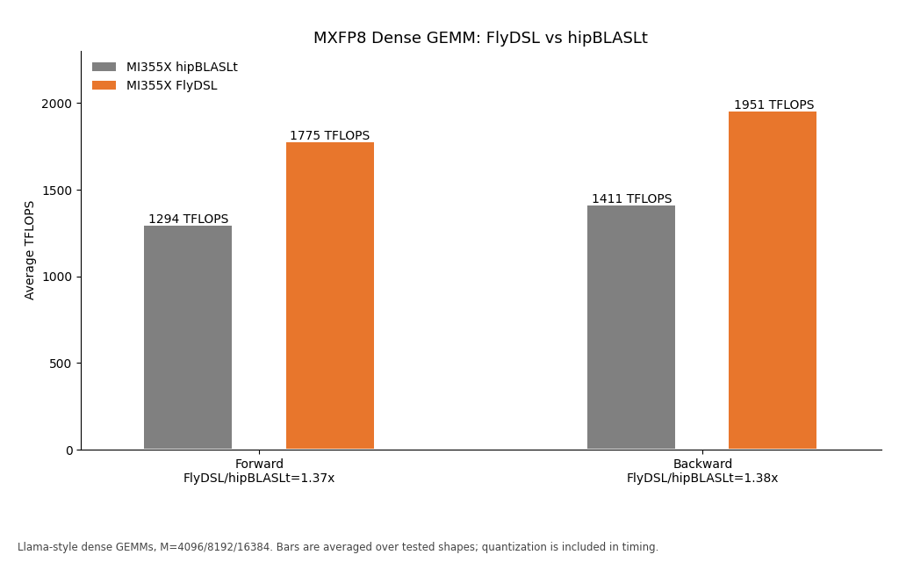

Figure 5: MXFP8 dense GEMM throughput on AMD Instinct MI355X, the FlyDSL backend versus hipBLASLt, forward and backward, averaged over the tested shapes

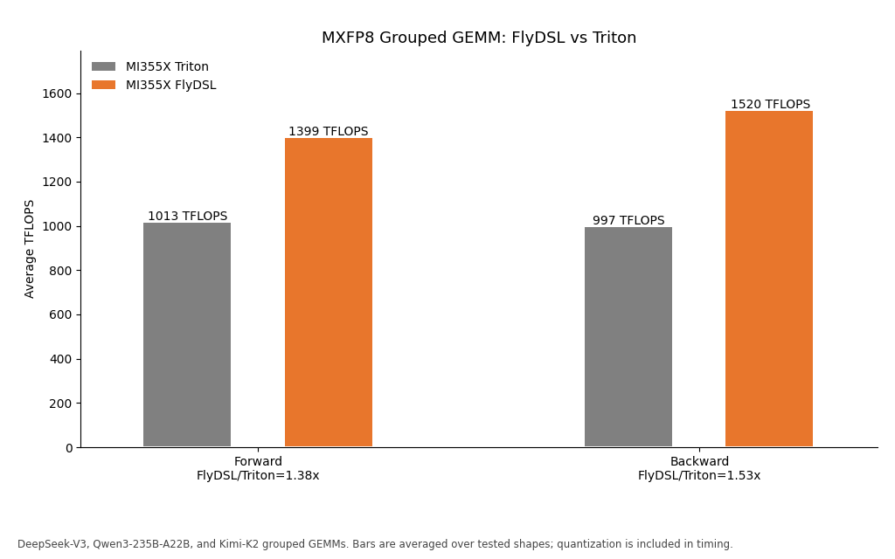

Figure 6: MXFP8 grouped GEMM throughput on AMD Instinct MI355X, the FlyDSL backend versus Triton, forward and backward, averaged over the tested shapes

The lesson is that low precision is not just a datatype switch: for MoE, layout and grouped scheduling matter as much as the quantization recipe. Some FP8 grouped paths otherwise insert a forward transpose so the weight layout matches the library kernel; removing that extra copy, and autotuning each grouped shape, is what turns the grouped panels from parity into a clear lead. MXFP8 then layers finer-grained scaling on top of the same execution path — which is where a backend free to place its own scale plumbing gains the most.

---

## The MoE Megakernel

Expert dispatch and combine are the two costs that make an MoE layer different from a dense one, and both are communication operations. This section is about removing the boundary between that communication and the expert compute it feeds.

### How an MoE Layer Executes Today

A single MoE layer is a chain of eight operators, grouped here into six steps:

1. The **router** scores each token and picks its top-k experts.
2. A **permutation** gathers tokens into expert order.
3. An all-to-all **dispatch** sends each token to the rank that owns its expert.
4. Two grouped GEMMs — **FC1** (gate/up) and **FC2** (down) — with a **SwiGLU** between them do the expert compute.
5. An all-to-all **combine** returns the results.
6. A final **unpermute-and-scale** reduces the top-k contributions back onto each token.

Each of those stages is its own kernel, and Figure 7 below shows the consequence:

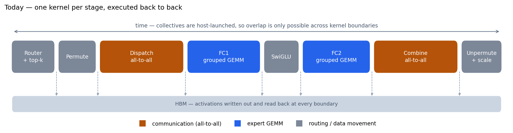

Figure 7: MoE layer dataflow today — one kernel per stage, with intermediate tensors materialized in global memory at each boundary. This is a schematic; stage widths are illustrative, not measured per-stage timings

### The Problem: Communication and Compute Overlap Only at Coarse Granularity

Two costs follow from that structure, and neither is addressable by making any individual kernel faster.

**Overlap stops at kernel and micro-batch boundaries.** In the conventional path, dispatch and expert compute are separate kernels and are ordered at kernel granularity. Frameworks can overlap communication from one micro-batch with compute from another, but they cannot start FC1 on a token tile as soon as that tile arrives. Profiling shows the MoE forward pass split roughly evenly between all-to-all communication and expert compute, so a tile's own dispatch still leaves the matrix cores idle until the dispatch kernel finishes.

**Kernel boundaries force intermediate materialization.** In the conventional implementation, intermediate tensors are written to global memory and consumed again by subsequent kernels: permutation materializes reordered tokens, FC1 materializes activations for SwiGLU, and FC2 materializes outputs before combine. At DeepSeek-V3's expert granularity — 256 experts with top-8 routing — the layer is a long chain of comparatively small operators, and the traffic *between* them is on the same order as the traffic the GEMMs need to do their work.

The prize, then, is not a faster dispatch or a faster GEMM. MegaMoE moves the overlap boundary from the micro-batch or kernel level to the tile level. Putting communication and compute in the same kernel lets one hide inside the other. It also means the permute/unpermute and all-to-all staging buffers are no longer written out through separate kernel boundaries.

### Our Approach: Fuse Each All-to-All into the GEMM That Produces or Consumes It

The critical move is not collapsing the layer into one kernel — it is putting each all-to-all *inside* the grouped GEMM that produces or consumes its data, so the communication has something to hide behind. MegaMoE is therefore not primarily a kernel-fusion optimization; it changes the scheduling granularity from kernel- or micro-batch-level overlap to tile-level producer–consumer overlap.

**MegaMoE** is a three-kernel design with two communication–compute fused kernels, shown in Figure 8 and described individually below:

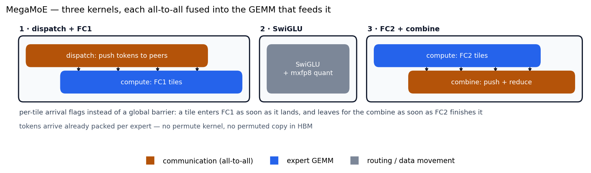

Figure 8: MegaMoE — a three-kernel implementation with two communication–compute fused kernels (dispatch+FC1 and FC2+combine) plus a standalone SwiGLU kernel. Each all-to-all is fused into the grouped GEMM that consumes or produces its data, enabling tile-granularity overlap. Compared with Figure 7, the standalone permute and unpermute stages are eliminated, and communication-related intermediates are no longer materialized through separate kernel boundaries.

1. **dispatch + FC1**: the incoming all-to-all and the FC1 grouped GEMM share one kernel. The CU grid is split between dispatch and compute roles, so tokens keep streaming in from peer ranks while the matrix cores work on tiles that have already landed. There is no global barrier between the two roles: per-tile arrival flags let compute start on a tile the moment it lands, which is what turns communication latency into something the GEMM hides rather than waits on.

2. **SwiGLU**: a small middle kernel that also quantizes its own output, so the MXFP8 cast never becomes a separate pass over the activations.

3. **FC2 + combine**: the FC2 grouped GEMM and the outgoing all-to-all share one kernel. The GEMM epilogue pushes each finished tile to its owning rank and the reduction happens there, so results leave as they are produced instead of after the whole GEMM completes.

The backward pass mirrors this through dispatch/combine duality — `dispatch(dy)` fuses with the FC2 data-gradient GEMM, and the FC1 data-gradient fuses with the combine and reduction — plus two variable-`K` weight-gradient kernels.

### What Fusion Buys, and What Precision Buys

Fusing the layer and quantizing it are independent changes, and their payoffs are easiest to read off a single grid. Everything below is measured on the MoE layer alone, forward plus backward, on DeepSeek-V3 expert shapes (H = 7168, I = 2048, 256 experts, top-8, EP8, 8192 tokens per rank) on one 8×MI355X node, with quantization included in the MXFP8 timings:

Table 3: MoE layer time, fused against unfused at both precisions. Read across for what precision buys, down for what fusion buys<sup>[[3]](#primus-moe-opt-endnote-3)</sup>

| MoE layer | BF16 | MXFP8 | Precision speedup |
| --- | --- | --- | --- |
| DeepEP dispatcher + grouped GEMM | 28.62 ms | 24.90 ms | 1.15× |
| **MegaMoE** | **20.46 ms** | **13.74 ms** | **1.49×** |
| **Fusion speedup** | **1.40×** | **1.81×** | |

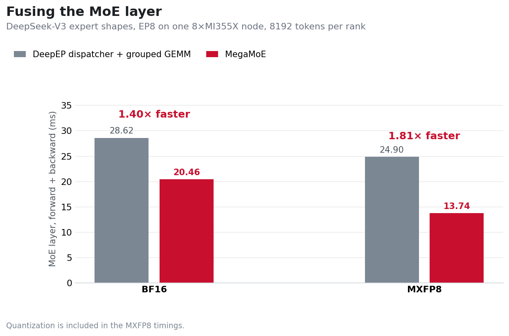

Figure 9: MoE layer time, fused against unfused, at both precisions — the same measurements as Table 3

Table 3 and Figure 9 highlight three findings.

**Fusion is worth 1.40× on its own**, at BF16, where no quantization is involved at all — this is the megakernel's own contribution, separate from any precision change.

**MXFP8's kernel-level gains are strongly diluted in the unfused layer: 1.15× end to end.** The expert GEMMs get faster, but all-to-all communication and materialized intermediates between stages limit the layer-level gain — and halving the width of the data does not remove a kernel boundary. This is the clearest statement of the problem the previous section described.

**The two compound**: because fusion removes the boundaries that were hiding the GEMM speedup, MXFP8 then buys 1.49× inside the fused layer, and fusion is worth 1.81× at MXFP8 against 1.40× at BF16. Fusion is what lets low precision pay off.

The backward pass benefits most from precision, which matters because it is also the larger half of the layer: at MXFP8 the fused backward is 8.8 ms against 13.8 ms in BF16.

The speedup does not depend on experts receiving equal token counts. Repeating the measurement under a deliberately imbalanced round-robin routing — which skews per-expert token counts and therefore the padding overhead incurred by the weight-gradient computation — moves the MegaMoE ratio by under 1%.

The fusion benefit also carries over to DeepSeek-V4-Flash. In separate BF16 MoE-module measurements reported in [Enabling DeepSeek-V4-Flash Training on AMD Instinct MI355X GPUs with Primus](https://rocm.blogs.amd.com/software-tools-optimization/primus-deepseek-v4/README.html), MegaMoE improves the forward pass by 1.63×, the backward pass by 1.33×, and the two combined by 1.43×. In the same study's tested four-node configuration, replacing the separate DeepEP and Turbo grouped-GEMM stages with MegaMoE adds a further 12.0% to end-to-end training throughput.

The unfused MXFP8 result warrants additional explanation. Feeding the expert GEMM a pre-quantized weight, so that weight quantization is cached rather than repeated per call, does not make that path faster — it measures 27.5 ms rather than 24.9 ms, because the pre-quantized weight takes a different and slightly slower path through the grouped GEMM. The 24.90 ms above is therefore the better of the two, i.e., the baseline at its best.

### Does the Layer Win Survive a Training Step?

A layer-level win is only interesting if a step keeps it, and the MoE layer is only part of a step. We train DeepSeek-V3 (4 layers plus MTP, EP8 on one 8×MI355X node, global batch size 512, 50 iterations) and swap only the MoE implementation — the two runs differ by exactly one Megatron argument, with precision, attention, optimizer, data, and seed held fixed. Note that this is a reduced-depth proxy of DeepSeek-V3, not a full 61-layer run.

Table 4: End-to-end step time, fused against unfused at both precisions, DeepSeek-V3 (4 layers plus MTP), 8×MI355X, EP8, global batch size 512<sup>[[3]](#primus-moe-opt-endnote-3)</sup>

| MoE layer | BF16 | MXFP8 | Precision speedup |
| --- | --- | --- | --- |
| DeepEP dispatcher + grouped GEMM | 9722 ms | 8758 ms | 1.11× |
| **MegaMoE** | **8991 ms** | **7700 ms** | **1.17×** |
| **Fusion speedup** | **1.081×** | **1.138×** | |

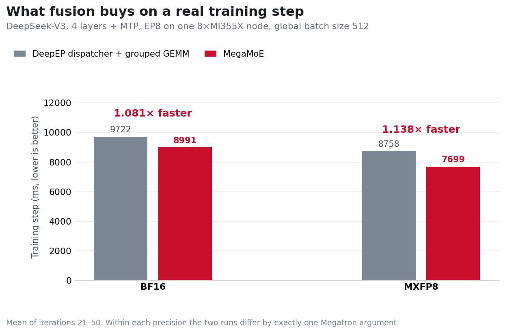

Figure 10: Training step time, fused against unfused, at both precisions

The layer-level gains translate to 1.081× at BF16 and 1.138× at MXFP8 on the training step. As expected, non-MoE work dilutes the layer-level speedup, while the larger MXFP8 fusion benefit remains visible end to end.

Per-GPU throughput moves inversely with step time by construction, since all four configurations run the same model and batch: 825, 892, 916, and 1042 TFLOP/s, reading each precision column above from top to bottom. Fusion buys that speed at no cost in memory: peak allocated memory is unchanged at BF16 (135.5 GiB either way) and 3% lower at MXFP8 (195.2 against 201.8 GiB), since the permuted token buffers are never materialized.

The precision column is not comparable to Table 3's. At the step level, MXFP8 quantizes the attention and dense layers too, not just the experts, so 1.11× and 1.17× describe the whole network's precision change rather than the MoE's.

---

## Training at Scale: DeepSeek-V3 on 256 to 1024 GPUs

Kernels and framework features are means to an end. This section is the flagship case study — DeepSeek-V3 on the Megatron-LM backend at 256 to 1024 GPUs — where the binding constraint is not GEMM throughput but **memory**, and where the job is to spend that memory in the right places: pipeline layout, selective recompute, scale-aware retuning, and a sustained 1024-GPU run. We report steady-state iteration time and weak-scaling throughput, not time to a target loss.

The reference recipe is [`examples/moe_package/run_deepseek_v3_pretrain_mi355x.sh`](https://github.com/AMD-AGI/Primus/blob/main/examples/moe_package/run_deepseek_v3_pretrain_mi355x.sh), summarized in Table 5 below:

Table 5: DeepSeek-V3 reference recipe used throughout this section. Parallelism is TP/PP/VPP/EP — tensor, pipeline, virtual pipeline, and expert parallelism. MLA is Multi-head Latent Attention.

| Setting | Value |
| --- | --- |
| Model | 61 layers (3 dense + 58 MoE), 256 routed experts, top-8, MLA |
| Parallelism | TP1 / PP16 / VPP2 / EP8 |
| Batch | MBS 2, sequence length 4096, global batch size 128 × nodes |
| Precision | FP8 |
| Measured scales | 32 to 128 nodes (256 to 1024 MI355X GPUs) |

The recipe also enables DeepEP dispatch (`turbo_deepep_num_cu: 80`), the distributed optimizer with overlapped gradient reduce and parameter gather, and the precision-aware optimizer, fused cross-entropy and RoPE, `pp_warmup`, manual GC, and NUMA binding described earlier.

Two conventions apply to every number below:

- The global batch size scales with node count, so the micro-batch count per iteration stays at 128 at every scale and only the data-parallel width grows.
- Iteration times are comparable only within a scale. All throughput ratios are against the baseline at the *same* scale, measured over the first few dozen iterations.

### Step 1: Put the Short Pipeline Stage Where Memory Peaks

PP16 with VPP2 (virtual pipeline parallelism of degree 2) gives 32 virtual stages for 61 decoder layers, so three stages hold one layer instead of two. Two placements are forced — PP0's first stage also carries the embedding, PP15's last stage carries the loss — leaving exactly one free choice.

Megatron's default layout spends that free choice on PP15, which is the wrong rank:

- Under 1F1B, the earliest ranks hold the most in-flight activations and the last rank the fewest.
- The memory peak is therefore PP1, the first *fully loaded* rank.
- Measured on 32 nodes, PP1 runs at 88% of HBM while PP15 idles at 23% — a 65-point spread across ranks doing nominally equal work.

Primus exposes the layout as a string, so moving the free short stage from PP15 to PP1 is a one-line change:

```text
default:  Et|(tt|)*14,t|(tt|)*15,tL
tuned:    Et|t|(tt|)*29,tL
```

Both place all 61 decoder layers, and they differ on only two ranks, as shown in Table 6 below:

Table 6: Per-rank layer assignment under the default and tuned pipeline layouts

| PP rank | Default (VPP0 / VPP1) | Tuned (VPP0 / VPP1) |
| --- | --- | --- |
| 0 | `E` + 1 layer / 2 layers | `E` + 1 layer / 2 layers |
| 1 | 2 layers / 2 layers | **1 layer** / 2 layers |
| 2–14 | 2 layers / 2 layers | 2 layers / 2 layers |
| 15 | **1 layer** / 1 layer + `L` | 2 layers / 1 layer + `L` |

A flat memory profile is not the goal in itself. The headroom it frees on the peak ranks is what pays for the next step: less recompute.

### Step 2: Recompute Only Where the Pressure Is

The default strategy (`--recompute_num_layers 1 --recompute_method block`) recomputes one layer in every virtual stage — 32 of the 61 layers — whether or not a given rank needs the memory. Primus instead accepts an explicit list of global layer IDs, so recompute lands exactly where it is needed:

```bash
--recompute_layer_ids "0,1,2,4,6,8,10,12,14" --recompute_granularity full
```

The list is chosen against the measured memory profile, following one loop:

1. Dump per-rank memory and pipeline timings (`--dump_pp_data`, visualized with [`tools/visualization/pp_vis`](https://github.com/AMD-AGI/Primus/tree/main/tools/visualization/pp_vis)).
2. Find the ranks with unused headroom.
3. Drop their layers from the recompute list.
4. Repeat until the peak rank approaches the HBM ceiling.

In practice, this loop is partially automated. The [Primus Tuning Agent](https://rocm.blogs.amd.com/software-tools-optimization/primus-tuning-agent/README.html) searches the configuration space — legal parallelism combinations, pipeline layouts, and recompute sets — scoring each candidate with the Primus projection tool (covered below) as its oracle, so most of the search costs no cluster time. At the time these runs were tuned the agent did not yet cover explicit recompute-ID lists, so both the layout string above and the layer-ID lists below are **semi-automated**: the agent narrows the space, and engineers select the final configuration from the narrowed candidate set.

Figures 11 and 12 below show the endpoints of that loop at two scales. Flattening the profile converts idle HBM into a smaller recompute budget: the 32-node spread narrows from 65 points to 28, and the 128-node spread from 50 points to 36:

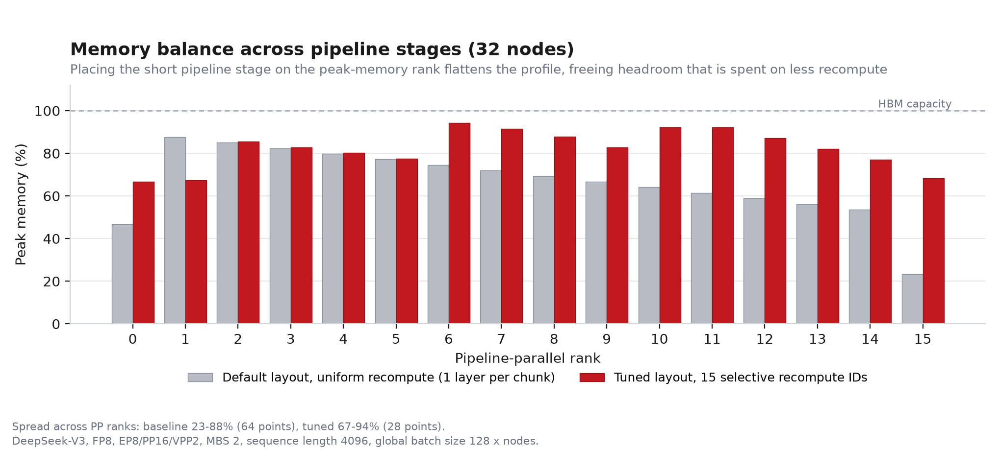

Figure 11: Per-pipeline-rank peak memory on 32 nodes, default configuration versus tuned layout plus selective recompute

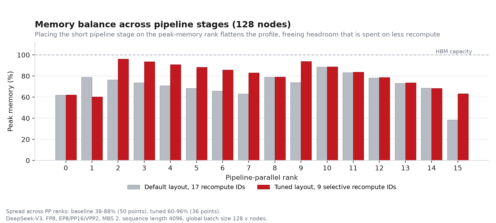

Figure 12: Per-pipeline-rank peak memory on 128 nodes, default configuration versus tuned layout plus selective recompute

### Step 3: Re-Tune per Scale, Because the Right Answer Moves

**The right number of recomputed layers is a property of the scale, not the model.** The global batch size grows with node count while the micro-batch count per iteration stays fixed, so a larger run has a wider data-parallel group. The distributed optimizer shards optimizer state and gradient buffers across that wider group more finely, handing static memory back to every GPU — and that returned memory buys fewer recomputed layers, as Table 7 below shows:

Table 7: Recompute layer IDs selected per scale, and the resulting number of recomputed layers

| Nodes | Data-parallel size | Recompute layer IDs | Layers recomputed |
| --- | --- | --- | --- |
| 32 | 16 | `0,1,2,4,6,8,10,12,14,16,34,36,38,40,50` | 15 of 61 |
| 64 | 32 | `0,1,2,4,6,8,10,12,14,16,34,36` | 12 of 61 |
| 128 | 64 | `0,1,2,4,6,8,10,12,14` | 9 of 61 |

The boundary is sharp rather than gradual. Trimming the 128-node list by a single ID, to `0,1,2,4,6,8,10,12`, still runs fine at 128 nodes but goes out of memory at both 32 and 64 nodes — the same eight-layer recompute configuration that leaves headroom with a wide data-parallel group causes an out-of-memory error with a narrow one. An explicit ID list makes this per-scale re-tuning cheap; a uniform layer count cannot express it at all.

### What It Buys

Layout and recompute together shorten the step at both scales, and the win grows with scale because the recompute budget shrinks faster than the pipeline bubble grows:

Table 8: Iteration time and relative throughput for the default and tuned configurations at 32 and 128 nodes<sup>[[4]](#primus-moe-opt-endnote-4)</sup>

| Nodes | Configuration | Iteration time (s) | Throughput vs baseline |
| --- | --- | --- | --- |
| 32 | Default layout, 1 recompute layer per virtual stage | 23.21 | 1.00× |
| 32 | Tuned layout + 15 recompute IDs | 22.59 | **1.028×** |
| 128 | Default layout, 1 recompute layer per virtual stage | 23.75 | 1.00× |
| 128 | Tuned layout + 9 recompute IDs | 21.68 | **1.095×** |

Figure 13 below shows why the tuned configuration is faster, using the pipeline visualizer on 128 nodes. Forward chunks are blue, backward chunks green, and bubbles grey; per-rank bubble percentage is annotated on the right:

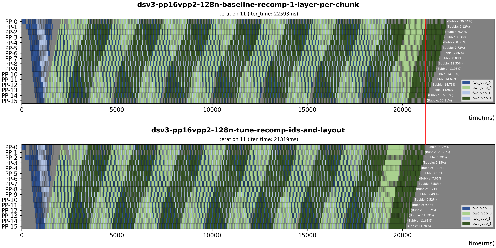

Figure 13: Pipeline schedule for one iteration on 128 nodes — default configuration (top) versus tuned layout and recompute IDs (bottom)

Two observations are important:

- The bubble on the two boundary ranks drops from 30.6% and 35.1% to 22.0% and 11.7%. The visualizer's sampled iteration (22.6 s → 21.3 s) is one schedule snapshot; Table 8 reports the mean iteration time (23.75 s → 21.68 s).
- Several *interior* ranks report a higher bubble percentage after tuning. With nine layers recomputed instead of 32, the non-bubble work itself shrinks, so the same absolute bubble becomes a larger fraction of a shorter step. Iteration time, not bubble ratio, is the metric that matters.

Scaling from 32 to 128 nodes behaves as follows, and is plotted in Figure 14 below:

- **Fixed configuration**: 128 nodes retain **97.7%** of the 32-node per-GPU throughput (`23.21 / 23.75` from Table 8) — a 2.3% loss over a 4× growth in GPU count.
- **Re-tuned per scale**: 128 nodes reach **104.2%** of the tuned 32-node result (`22.59 / 21.68`). Not because communication got cheaper, but because the wider data-parallel group frees enough memory to cut recompute from 15 layers to 9, and the compute saved outweighs the extra collective cost.

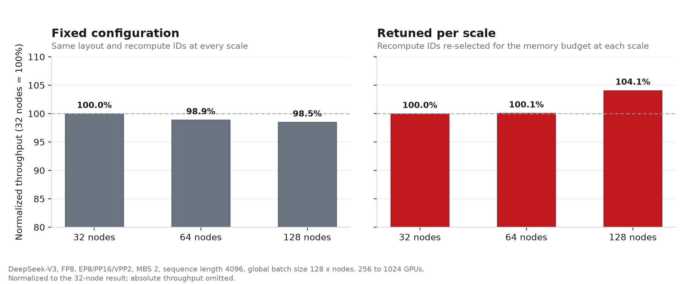

Figure 14: DeepSeek-V3 normalized per-GPU throughput from 32 to 128 nodes on AMD Instinct MI355X — a single fixed configuration (left) versus recompute IDs re-selected per scale (right), both normalized to the 32-node result

### What Did Not Work

Two rejected configurations are worth recording, because they show the tuning is not simply "more freedom is better":

- **VPP1** costs 14–21% in step time even with its own layout and recompute tuning, and on this stack it required disabling gradient-reduce and all-gather overlap to run at all.
- **An aggressively non-uniform layout** (1–3 layers per virtual stage, chosen to equalize memory) is 21% slower than the VPP2 baseline. It does flatten memory, but it unbalances compute, and the pipeline then runs at the speed of its slowest stage.

Balanced compute per stage dominates. Memory balance is only worth chasing once compute is already even.

### 1700 Steps Without Interruption

A short benchmark cannot show whether a 1024-GPU job holds together, so we ran the tuned 128-node configuration on real C4 data for 1700 consecutive steps — 10 hours and 37 minutes:

- **No interruption**: 1700 steps back to back on 1024 GPUs, with no restart, no failed rank, no operator intervention, and no skipped step.
- **Step time holds**: median 22.08 s, with 93.2% of steps within ±2% of it.
- **No degradation over time**: comparing the first tenth of the run against the last shows 1.8% drift across 10.6 hours.
- **Rare outliers, not a trend**: about 2% of steps run slower — the slowest is 89 s — consistent with periodic host-side and network interference.
- **Startup is bounded**: steps 1 and 2 cost 307 s and 165 s for lazy initialization and kernel autotuning; step 3 onward is already at steady state.

The long-run median (22.08 s) sits about 2% above the short-benchmark step time quoted earlier (21.68 s). That gap is the drift above, which is why benchmark and long-run numbers are reported separately rather than mixed.

---

## Planning Before You Train: Primus Projection

The DeepSeek-V3 study above is, in effect, a search over configurations — and running that search on a cluster is expensive. At MoE scale, a misconfigured run can go out of memory after hours of queueing, or leave much of the cluster underutilized. Primus ships a **projection** tool that answers "will it fit?" and "how fast will it be?" before any GPU time is committed. It currently supports the Megatron-LM backend used throughout the scale study above.

- **Memory**: analytical per-GPU estimation of parameters, optimizer state, and activations, including the `topk`-scaled MoE activation footprint that dominates at high expert counts.
- **Performance**: benchmarks representative layers on as few as one GPU, then projects to multi-node clusters using communication and pipeline-schedule models. A pure-CPU simulation mode requires no GPU at all.

In the validation cases reported in the Primus Projection study, projected throughput is within 10% of measurement; the MoE case — 8-node Mixtral 8x22B at EP8 / PP4 / VPP2 — is within 1.4%. The projection tool is also the scoring oracle behind the Primus Tuning Agent mentioned earlier. For the full treatment of both tools, see [Primus Projection: Estimate Memory and Performance Before You Train](https://rocm.blogs.amd.com/software-tools-optimization/primus-projection/README.html) and [Primus Tuning Agent: Closing the Configuration-Search Loop](https://rocm.blogs.amd.com/software-tools-optimization/primus-tuning-agent/README.html).

---

## Beyond Megatron-LM: The JAX (MaxText) Path

Primus also supports MoE training on the JAX backend via [MaxText](https://github.com/ROCm/maxtext) (the ROCm fork), integrated through a thin backend adapter that drives MaxText's native training loop. On this path, MoE efficiency starts from MaxText's native controls — block-sparse and grouped expert matmul (`megablox` / `sparse_matmul`), expert capacity (`capacity_factor`), and expert parallelism across intra-node and inter-node mesh axes — combined with ROCm-tuned XLA and Transformer Engine settings such as the latency-hiding scheduler, collective-combine thresholds, and hipBLASLt/CK attention. Primus provides ready-to-run MoE configs for models including DeepSeek-V2, Mixtral, Qwen3-30B-A3B, and Grok on both MI300X and MI355X.

### The Dropless Dilemma

On the JAX/MaxText stack, MoE training has historically forced an unhappy choice. The default `dense_matmul` path makes expert shapes static by fixing a per-expert *capacity* (`capacity_factor`) and **dropping** the tokens that overflow — fast, but lossy. The faithful `sparse_matmul` path is **dropless**, because every routed token reaches its expert via a ragged, sorted-by-expert grouped matmul, but in pure JAX it hits two memory walls:

- The built-in `jax.lax.ragged_dot` expert matmul runs out of memory at about 444 GiB even at a per-device batch size of 1.
- Because `jax.jit` traces static shapes, the `ragged_all_to_all` routing shuffle must allocate the worst case, running out of memory at about 242 GiB on DeepSeek-V3 671B.

Dropless was therefore infeasible at production scale.

### Two Primus-Turbo Primitives Brought to JAX

Primus-Turbo closes that gap by exposing two Composable Kernel (CK)-backed primitives as first-class JAX operators through the [XLA FFI](https://docs.jax.dev/en/latest/ffi.html), with `custom_vjp` autodiff and `shard_map` sharding rules so they compose cleanly with FSDP:

- **Grouped GEMM (GMM)**: a single-launch kernel over the ragged, variable-`M` per-expert groups that the dropless expert FFN needs, plus its two backward grouped GEMMs including the variable-`K` weight-gradient case. This removes the `ragged_dot` matmul wall and is what makes dropless trainable at all.

- **DeepEP dispatch and combine**: a token-aware expert-parallel all-to-all, where dispatch sends each token to the rank owning its selected expert and combine reverses and reduces the results, over xGMI intranode and RDMA internode. Because its worst-case receive buffer is a static shape, the entire MoE forward traces **sync-free by default** under `jax.jit`, while leaner buffer management trims the transient footprint enough to recover one step of batch size.

These are wired into MaxText behind two config flags — `use_turbo_grouped_gemm` and `use_turbo_deepep_dispatch` — with careful custom-VJP fan-out/fan-in, out-of-group masking, and a once-per-process `setup()` bootstrap. When the flags are disabled, the default graph is byte-for-byte unchanged.

### Results

On DeepSeek-V3 671B across 8 nodes × 8 AMD Instinct MI355X (64 GPUs, sequence length 4096, FSDP=8, BF16), the grouped-GEMM and DeepEP dropless path produces the following results:

- **Feasible where pure JAX was not**: the grouped GEMM removes the roughly 444 GiB expert-matmul wall, and DeepEP's leaner all-to-all (about 15% lower transient footprint) recovers one step of batch size. The DeepEP path supports per-device batch sizes of 8 and 9; the `ragged_all_to_all` dropless path already runs out of memory at batch size 8.
- **The fastest dropless option among the tested configurations**: about 1180 tokens/s/device at per-device batch size 8, beating the `ragged_all_to_all` dropless path at every tested feasible batch size and reaching about 2× the throughput of the tested high-capacity (`capacity_factor=4`) dense config.
- **Numerically faithful and Pareto-superior to the tested token-dropping configurations**: over a 2000-step C4 run its loss tracks the `ragged_all_to_all` dropless path to within 0.004 and converges below every tested capacity-factor dense config. Final loss is 5.003 versus 5.163 for the `capacity_factor=1.25` default, a 0.16-nat improvement. It reaches lower loss at equal wall-clock even after paying the routing-imbalance throughput tax on real data.

For the full treatment — the FFI and `custom_vjp` integration, the fan-out/fan-in and out-of-group-masking correctness details, and the per-configuration throughput and convergence charts and tables behind the numbers above — see the dedicated [Dropless MoE Training in JAX with Primus-Turbo](https://rocm.blogs.amd.com/software-tools-optimization/maxtext-dropless-moe/README.html) blog.

---

## Summary

In this blog you explored the MoE training optimizations we built in Primus on top of the foundational work in our first [MoE Training Best Practices on AMD GPUs](https://rocm.blogs.amd.com/software-tools-optimization/primus-moe-package/README.html) post.

At the kernel level, FP8 and MXFP8 expert GEMMs give you a 1.2–1.7× grouped-GEMM speedup at training-relevant token counts. MegaMoE fuses each all-to-all into the grouped GEMM that produces or consumes its data, so fusion is worth 1.40× on the MoE layer in BF16 and 1.81× in MXFP8, while the unfused layer retains a more limited 1.15× gain from low precision. On a reduced-depth training step those layer wins arrive as 1.081× (BF16) and 1.138× (MXFP8).

At the framework level, the extra flags in Table 2 add 5.8–16.2% throughput across three current MoE models, from different combinations of FlyDSL, Turbo GEMM, and sync-free stage. At scale, tuned pipeline layout plus explicit per-scale recompute IDs bring DeepSeek-V3 to 1.095× baseline throughput on 1024 MI355X GPUs, holding a stable step time across 1700 consecutive steps. On the Megatron path, [Primus Projection](https://rocm.blogs.amd.com/software-tools-optimization/primus-projection/README.html) lets you answer the memory and throughput questions before committing cluster time. The same grouped-GEMM and DeepEP primitives also make dropless MoE training feasible on the JAX (MaxText) path, as described in [Dropless MoE Training in JAX with Primus-Turbo](https://rocm.blogs.amd.com/software-tools-optimization/maxtext-dropless-moe/README.html).

Looking ahead, we are pursuing several directions:

- **Scaling the MoE megakernel beyond a single node**, and extending it to the MoE layer variants it does not yet cover: tensor parallelism, shared experts, and non-SwiGLU activations.
- **Closing the FP8 end-to-end gap** by further reducing quantization and amax-reduction overhead, so kernel-level FP8 speedups translate fully to end-to-end throughput.
- **Deeper communication and compute overlap** across dispatch, grouped GEMM, and pipeline schedules for the largest MoE models.
- **Broader backend parity**, bringing DeepEP and grouped-GEMM-class optimizations and more MoE models to the JAX (MaxText) path.
- **Wider model coverage** across the growing open-source MoE family.

To try these optimizations on your own workloads, start from the [Primus](https://github.com/AMD-AGI/Primus) repository and the MoE recipes under `examples/moe_package`.

---

## Acknowledgments

We would like to express our sincere gratitude to the collaborating teams and individuals across the ROCm and Primus ecosystem whose contributions made this work possible: the Composable Kernel (CK) Team, including Thomas Ning, Sami Remes, Shyh-Chyi Lin, and Aviral Goel; the AITER Team, including Carlus Huang, Shengnan Xu, Jim Guo, and Dan Yao; the AIG-Models Team, including Arthur Huang, Dong Li, and Wei Fu; the ROCm/DeepEP Team, including Amir Akbarzadeh and Li Li; the rocSHMEM Team, including Aurelien Bouteiller and Edgar Gabriel; the mori Team, including Di Tian and Yutong Wu; and the FlyDSL Team, including Felix Li. We also thank the MaxText team and the AMD AI Brain – Training at Scale (TAS) team.

---

## References

(primus-moe-opt-ref-a)=
a. [AMD Instinct™ MI355X GPUs](https://www.amd.com/en/products/accelerators/instinct/mi350/mi355x.html): official product page for the AMD Instinct MI355X accelerator used in the experiments in this blog.

(primus-moe-opt-ref-b)=
b. [Megatron-LM](https://github.com/NVIDIA/Megatron-LM): widely used framework for large-scale Transformer model training and MoE implementation, and the default Primus training backend.

(primus-moe-opt-ref-c)=
c. [DeepSeek Hugging Face model definitions](https://huggingface.co/deepseek-ai): pretrained DeepSeek models and associated configuration files.

(primus-moe-opt-ref-d)=
d. [DeepEP open source repository](https://github.com/deepseek-ai/DeepEP): high-performance open source expert-parallel communication library for MoE.

---

## Endnotes

(primus-moe-opt-endnote-1)=
[1] Test environment

Qwen3-235B-A22B, GPT-OSS 20B, and Qwen3-30B-A3B pretraining throughput (tokens/second) was measured with FP8 current-scaling precision on AMD Instinct MI355X nodes at a maximum sequence length of 4096 tokens, using the parallelism and flag settings listed in Table 2. Server manufacturers may vary configurations, which can yield different results. Performance may also vary based on the use of the latest drivers and optimizations.

AMD system configuration:

- Dual AMD EPYC 9575F 64-core processor
- 8× AMD Instinct MI355X GPUs per node
- 2 NUMA nodes per socket
- Host OS: Ubuntu 22.04.5 LTS with Linux kernel 6.8.0-87-generic
- Host GPU driver: ROCm 7.1 + amdgpu 6.16.6
- PyTorch 2.9.0
- AMD ROCm 7.1.0 software

(primus-moe-opt-endnote-2)=
[2] Test environment

Dense and grouped GEMM throughput in Figures 3–6 was measured on a single AMD Instinct MI355X GPU with quantization included in the timing, over representative Llama-style dense shapes at M=4096/8192/16384 and DeepSeek-V3, Qwen3-235B-A22B, and Kimi-K2 expert shapes. Figure 2 uses a different grouped mix (DeepSeek-V3, Qwen3-235B-A22B, and GPT-OSS) and reports FP8-versus-BF16 speedup rather than backend-versus-backend throughput. Every shape in Figures 3–6 is compared against the backend Primus-Turbo would otherwise dispatch to — hipBLASLt for dense, Triton for grouped — with both backends pinned and measured in the same process on identical tensors, reps interleaved so clock drift cannot favor either. Correctness was validated by output and gradient SNR against an FP32 reference, and a shape is excluded from the averages unless both backends pass.

(primus-moe-opt-endnote-3)=
[3] Test environment

MegaMoE layer-level results (Table 3) were measured on one node of 8× AMD Instinct MI355X GPUs with EP8, on DeepSeek-V3 expert shapes (hidden 7168, intermediate 2048, 256 routed experts, top-8) at 8192 tokens per rank, timing forward and backward of the MoE layer alone with HIP events and a cross-rank barrier before each iteration, reporting the maximum over ranks and the mean of two runs. Quantization is included in the MXFP8 timings. The unfused baseline is the DeepEP dispatcher plus grouped GEMM path that the MegaMoE accuracy tests are validated against, not an assembly built for the benchmark; its MXFP8 variant was measured both with weights quantized per call and with a pre-quantized weight, and the faster of the two is reported.

MegaMoE end-to-end results (Table 4) were measured on a DeepSeek-V3 configuration reduced to 4 decoder layers plus MTP, on a single node of 8× AMD Instinct MI355X GPUs with EP8, TP1, micro-batch size 2, global batch size 512, sequence length 4096 — so 32 micro-batches per step across a data-parallel width of 8 — over 50 iterations, reporting the mean of iterations 21–50; the earlier iterations carry FlyDSL JIT compilation and allocator warm-up. The within-run spread is ±0.3% or better on all four configurations. This is a reduced-depth proxy and not a full 61-layer DeepSeek-V3 run. Within each precision, the baseline and MegaMoE runs differ by exactly one Megatron argument, with attention, optimizer, data, and seed held fixed.

(primus-moe-opt-endnote-4)=
[4] Test environment

DeepSeek-V3 (61 layers, 256 routed experts, top-8, MLA) pretraining iteration time was measured with FP8 precision at TP1 / PP16 / VPP2 / EP8, micro-batch size 2, sequence length 4096, and global batch size 128 × nodes, on 32 to 128 nodes of 8× AMD Instinct MI355X GPUs (256 to 1024 GPUs). Throughput ratios are computed against the baseline configuration at the same scale. The 1700-step stability run used real C4 data at the tuned 128-node configuration.

---

## Disclaimers

The information presented in this document is for informational purposes only and may contain technical inaccuracies, omissions, and typographical errors. The information contained herein is subject to change and may be rendered inaccurate for many reasons, including but not limited to product and roadmap changes, component and motherboard version changes, new model and/or product releases, product differences between differing manufacturers, software changes, BIOS flashes, firmware upgrades, or the like. Any computer system has risks of security vulnerabilities that cannot be completely prevented or mitigated. AMD assumes no obligation to update or otherwise correct or revise this information. However, AMD reserves the right to revise this information and to make changes from time to time to the content hereof without obligation of AMD to notify any person of such revisions or changes. THIS INFORMATION IS PROVIDED ‘AS IS.” AMD MAKES NO REPRESENTATIONS OR WARRANTIES WITH RESPECT TO THE CONTENTS HEREOF AND ASSUMES NO RESPONSIBILITY FOR ANY INACCURACIES, ERRORS, OR OMISSIONS THAT MAY APPEAR IN THIS INFORMATION. AMD SPECIFICALLY DISCLAIMS ANY IMPLIED WARRANTIES OF NON-INFRINGEMENT, MERCHANTABILITY, OR FITNESS FOR ANY PARTICULAR PURPOSE. IN NO EVENT WILL AMD BE LIABLE TO ANY PERSON FOR ANY RELIANCE, DIRECT, INDIRECT, SPECIAL, OR OTHER CONSEQUENTIAL DAMAGES ARISING FROM THE USE OF ANY INFORMATION CONTAINED HEREIN, EVEN IF AMD IS EXPRESSLY ADVISED OF THE POSSIBILITY OF SUCH DAMAGES. AMD, the AMD Arrow logo, and combinations thereof are trademarks of Advanced Micro Devices, Inc. Other product names used in this publication are for identification purposes only and may be trademarks of their respective companies. © 2026 Advanced Micro Devices, Inc. All rights reserved
