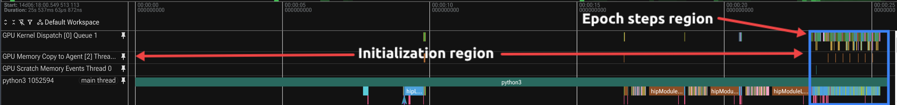
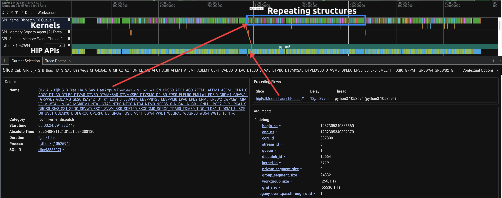
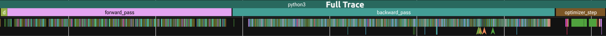
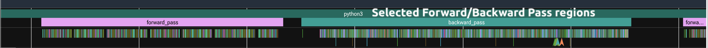
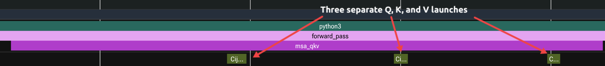
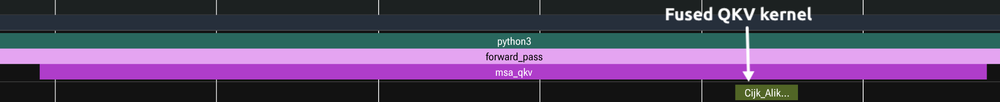
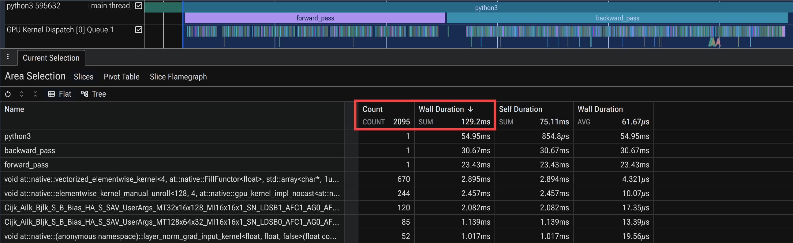
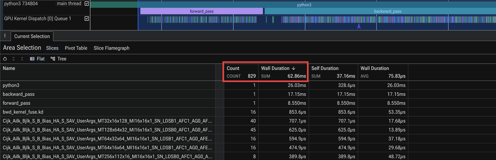
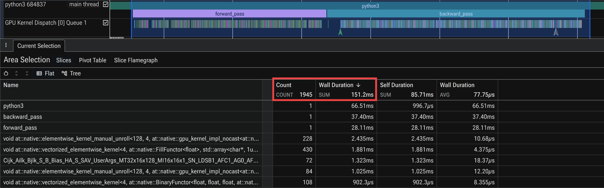

<!---
Copyright (c) 2026 Advanced Micro Devices, Inc. (AMD)
Permission is hereby granted, free of charge, to any person obtaining a copy
of this software and associated documentation files (the "Software"), to deal
in the Software without restriction, including without limitation the rights
to use, copy, modify, merge, publish, distribute, sublicense, and/or sell
copies of the Software, and to permit persons to whom the Software is
furnished to do so, subject to the following conditions:
The above copyright notice and this permission notice shall be included in all
copies or substantial portions of the Software.
THE SOFTWARE IS PROVIDED "AS IS", WITHOUT WARRANTY OF ANY KIND, EXPRESS OR
IMPLIED, INCLUDING BUT NOT LIMITED TO THE WARRANTIES OF MERCHANTABILITY,
FITNESS FOR A PARTICULAR PURPOSE AND NONINFRINGEMENT. IN NO EVENT SHALL THE
AUTHORS OR COPYRIGHT HOLDERS BE LIABLE FOR ANY CLAIM, DAMAGES OR OTHER
LIABILITY, WHETHER IN AN ACTION OF CONTRACT, TORT OR OTHERWISE, ARISING FROM,
OUT OF OR IN CONNECTION WITH THE SOFTWARE OR THE USE OR OTHER DEALINGS IN THE
SOFTWARE.
--->

# Performance Profiling on AMD GPUs - Part 7: AI/PyTorch&reg; Edition

This blog, like the previous articles in the profiling guide series
([Part 1](https://rocm.blogs.amd.com/software-tools-optimization/profiling-guide/intro/README.html),
[Part 2](https://rocm.blogs.amd.com/software-tools-optimization/profiling-guide/novice/README.html),
[Part 3](https://rocm.blogs.amd.com/software-tools-optimization/profiling-guide/advanced/README.html),
[Part 4](https://rocm.blogs.amd.com/software-tools-optimization/profiling-guide/fortran_openmp/README.html),
[Part 5](https://rocm.blogs.amd.com/software-tools-optimization/profiling-guide/ai-assist-optimization/README.html),
and [Part 6](https://rocm.blogs.amd.com/software-tools-optimization/profiling-guide/att/README.html)),
applies a systematic profiling workflow to
a GPU-accelerated application. Those posts establish the core loop on
HIP and Fortran applications: baseline timing, kernel hotspots with `rocprofv3`, rooflines and
hardware counters with `rocprof-compute`, and whole-system timelines with `rocprof-sys`. Here we apply
that loop to a PyTorch training workload, where one logical operator can lower to many
GPU kernels and optimization often means changing how the framework dispatches work rather
than rewriting a kernel.

**AI vs HPC note:** The profiling loop is unchanged, but one distinction from HPC drives everything
that follows. An HPC application is compiled ahead of execution, a PyTorch workload compiles during
it. With `torch.compile`, kernels are traced and generated on the first iteration, and Triton kernels
are just-in-time (JIT) compiled and auto-tuned the first time each tensor shape is seen; even in eager
mode the first step pays one-time warm-up costs (HIP context, rocBLAS/MIOpen init, Triton JIT).
Separate warm-up from measurement and read timing and counters from steady-state steps only;
otherwise the profile reflects the compiler, not the model.

1. **What you already know**:
   - You run GPU-accelerated PyTorch code (training or stepping a model forward) and can match CLI
     knobs such as batch size, sequence length, and step count across runs.
   - You understand that one logical operator (for example, attention or a layer norm) can map to
     many GPU kernels, and that fusion or custom kernels change kernel counts and kernel names.
   - You recognize that a training step has both a *forward* and a *backward* pass, and that the
     backward pass is often the larger of the two.
   - Optional: you have compared runtime across hardware vendors and want AMD-specific traces and
     counters to explain the gap.

2. **What this guide will teach you**:
   - **Annotate from Python** with ROCTx markers via `torch.cuda.nvtx` (the namespace is CUDA-named,
     but `torch.cuda` is PyTorch's device API on a ROCm&trade; build as well, and ROCTx mirrors the NVTX
     range calls, so the same annotations serve either runtime), then trim the timeline with
     `--selected-regions` so it maps onto the model and stays readable.
   - **Analyze hardware counters** with `rocprof-compute`, using iteration multiplexing to collect the
     full counter set in a single pass.
   - **Evaluate three optimizations** (PyTorch-level fusion, `torch.compile`, and custom Triton
     kernels) and learn to tell a real win (fusion) from a change that only pays off under the
     compiler (Triton) by comparing kernel counts, timelines, and throughput.

## Profiling Basics

The workflow set out below is the one we apply to optimize ROCm-based PyTorch workloads. We
establish a baseline, capture a whole-run system trace with `rocprof-sys-run`, annotate it with
ROCTx and narrow it with `rocprof-sys --selected-regions`, summarize kernels with `rocprofv3`, and
analyze bottlenecks with `rocprof-compute` using its iteration-multiplexing option. Each
optimization is then measured against that baseline using the same set of tools. The rest of the
post walks through this loop on the TinyOpenFold example.

### The TinyOpenFold Example

[OpenFold](https://github.com/aqlaboratory/openfold) is a trainable reproduction of AlphaFold 2. Its
performance-critical core is the **Evoformer**, a stack of blocks that each refine two tensors: a multiple
sequence alignment (MSA) representation (B × N_seq × N_res × d_msa) and a pair representation
(B × N_res × N_res × d_pair). Each block mixes the two, then refines the pair tensor with the
*triangle* operations that give the pattern its name, a triangular multiplicative update and a
triangular self-attention, both of which update every residue pair (i, j) by routing information
through a third residue k. **TinyOpenFold** shrinks this stack (fewer blocks, smaller channel
widths, synthetic batches) while keeping that pair/triangle pattern intact, so training runs are
short. The defaults are d_msa = 64, d_pair = 128, and n_blocks = 4, which together give
approximately 2.64M parameters. For the full block-by-block breakdown, see the
upstream [ARCHITECTURE.md](https://github.com/amd/HPCTrainingExamples/blob/main/MLExamples/TinyOpenFold/ARCHITECTURE.md).

For profiling, two properties of the pair tensor matter most: it is quadratic in sequence length,
so it drives O(N_res²) activation memory, and the triangle stages that update it (multiplication and self-attention)
drive O(N_res³) compute, N_res² pairs each reduced over all N_res choices of k. Those triangle stages are the
dominant compute at moderate N_res and the first place to look in any trace. In addition to that
intrinsic cost, the readable baseline pays for many small kernel launches and tail elementwise
kernels, the launch-bound fragmentation that fusion (version 2) removes. The profiler separates the
math-bound triangles from that launch-bound overhead.

TinyOpenFold ships three implementations of the same model. When comparing performance between
implementations, use the same training knob values.

| Stage | Directory | Entry point | Role |
| ----- | --------- | ----------- | ---- |
| **Version 1** | `version1_pytorch_baseline/` | `tiny_openfold_v1.py` | **Baseline**: clean, readable PyTorch. Many kernels per step, the reference for hotspots and operator-to-kernel mapping. |
| **Version 2** | `version2_pytorch_fused/` | `tiny_openfold_v2.py` | **PyTorch fusion**: query, key, and value (QKV) and triangle projections fused; fewer dispatches, lower peak memory. |
| **Version 3** | `version3_triton/` | `tiny_openfold_v3.py` | **Triton kernels**: custom fused LayerNorm plus fused scaled dot-product attention (SDPA) and QKV fusion, wrapped in autograd functions. |

### Getting the Code

Clone the canonical repository and enter the example directory:

```bash
git clone https://github.com/amd/HPCTrainingExamples.git
cd HPCTrainingExamples/MLExamples/TinyOpenFold
```

The [project README](https://github.com/amd/HPCTrainingExamples/blob/main/MLExamples/TinyOpenFold/README.md)
documents the quick start and scaling helpers, and
[ARCHITECTURE.md](https://github.com/amd/HPCTrainingExamples/blob/main/MLExamples/TinyOpenFold/ARCHITECTURE.md)
walks through the parameter math block by block.

### Environment Setup (ROCm + PyTorch)

We validated this post on ROCm 7.13 with PyTorch 2.11 and Triton 3.6 on an AMD
Instinct&trade; MI300X. There are two ways to obtain this stack, depending on whether the ROCm
runtime comes from the Python wheels or from a module the cluster already provides. Either path
supports every command in the rest of the post.

- **Pip channel (used in this post).** Install PyTorch and Triton pre-packaged for ROCm 7.13 from
  AMD's [TheRock](https://github.com/ROCm/TheRock) multi-arch pip channel. The wheels bundle a
  self-contained ROCm runtime as a dependency of `torch`, so no `/opt/rocm` and no ROCm module are
  needed for training.
- **System module.** Load a `rocm/7.13` module, if available, from the cluster and install the matching PyTorch,
  Triton, and other Python dependencies into a virtual environment against it.

We use the pip channel throughout for reproducibility on any gfx942 (MI300X) / gfx950
(MI355X) node:

```bash
# We used Python 3.12 for the blog. The `rocpd` trace tools (rocpd, rocpd2pftrace,
# rocpd2otf2) support Python 3.10-3.13.
module load python/3.12

cd HPCTrainingExamples/MLExamples/TinyOpenFold
python3 -m venv venv713
source venv713/bin/activate
pip3 install --upgrade pip

INDEX_URL=https://rocm.nightlies.amd.com/whl-multi-arch/

# PyTorch 2.11 + Triton 3.6 for ROCm 7.13 (torch pulls the ROCm libraries in automatically).
pip3 install --index-url $INDEX_URL torch torchvision torchaudio triton

# ROCm SDK including the hardware profilers (rocprofv3, rocprof-compute, rocprof-sys).
# The `profiler` extra adds them; pick the device arch(s) you run on (gfx942 = MI300X, gfx950 = MI355X).
pip3 install --index-url $INDEX_URL "rocm[libraries,devel,profiler,device-gfx942]==7.13.*"

# otf2: Python dep for the rocpd OTF2 exporters (rocpd, rocpd2otf2); Requires Python <=3.13.
pip3 install otf2

# Put the pip-installed ROCm binaries on PATH for this shell.
export ROCM_PATH=$(rocm-sdk path --root)
export PATH=$ROCM_PATH/bin:$PATH
export LD_LIBRARY_PATH=$ROCM_PATH/lib:$LD_LIBRARY_PATH
```

Confirm PyTorch sees the GPU:

```bash
python3 -c "import torch; print(torch.__version__, torch.cuda.is_available(), torch.cuda.get_device_name(0))"
```

Then validate the example itself from the baseline directory:

```bash
cd version1_pytorch_baseline
python3 tiny_openfold_v1.py --validate-setup
```

Because this post focuses exclusively on single-GPU profiling, we pin a device with
`ROCR_VISIBLE_DEVICES=0` (or `--device 0`) so that timing and counter collection remain
deterministic.

## Step 1 — Establish a Baseline (Version 1)

All of the commands in this section are run from inside the `version1_pytorch_baseline/` directory.
Throughout the post we use
the **small** problem (64 residues, 16 MSA sequences, batch size 4) because it turns the loop over in a
few seconds. A **large** problem (128 residues, 32 MSA sequences, batch size 4) is used later for
comparison.

### Application Timing

We begin by measuring throughput with no profiler attached, which establishes the number against
which every later change is compared.

```bash
python3 tiny_openfold_v1.py --batch-size 4 --seq-len 64 --num-seqs 16 --num-blocks 4 --num-steps 30 --device 0
```

For the small problem, the baseline reports roughly 99 samples/sec, or about 40 ms per
batch[^1]. Record the corresponding number for the target hardware and compare against
runs at the same configuration.

### An Orthogonal Axis: `torch.compile`

The cheapest optimization available, before restructuring the model, is to ask PyTorch to compile it.
All three versions accept `--enable-torch-compile`, which wraps the model in
[`torch.compile`](https://docs.pytorch.org/docs/stable/generated/torch.compile.html); its inductor
backend traces the model and generates fused Triton kernels automatically. Note that
`torch.compile` is not one of the three numbered steps in this post. Because it requires no code
change and applies to every version, it constitutes an orthogonal axis that stacks on the baseline
(Step 1), the manual fusion (Step 2), and the custom kernels (Step 3) alike.
We introduce it here and report its effect alongside every version in the final comparison.

```bash
python3 tiny_openfold_v1.py --batch-size 4 --seq-len 64 --num-seqs 16 --num-blocks 4 --num-steps 30 --device 0 \
  --enable-torch-compile
```

This is the point at which the AI-vs-HPC difference described above becomes concrete. The first
step is far slower than the rest, because that is when compilation and autotuning happen; the
per-step time then drops and holds at a new steady state. In the printed per-step timing, step 0
pays the compile cost, and the later steps settle to roughly 174 samples/sec (~23 ms per batch),
about a 1.75× speedup over eager for a one-line change. This behavior is the reason warm-up must be
separated from measurement, since averaging the compile step into the timing would understate the
gain.

A more aggressive setting, `torch.compile(mode="max-autotune")`, benchmarks several kernel
implementations and can enable CUDA graphs to cut launch overhead further; we leave that as an exercise
for the reader (see the
[ROCm torch.compile blog](https://rocm.blogs.amd.com/artificial-intelligence/torch_compile/README.html#how-torch-compile-works)).

Because `torch.compile` does not reveal where time is spent, the remaining analysis runs in eager
mode with the profilers.

### Capture a Baseline System Trace (`rocprof-sys`)

The first look at a new workload should be a whole-run system trace which is a single timeline that shows
Python and host threads, the HIP runtime, and GPU activity together. Capture it with `rocprof-sys-run`
using the `workload-trace` preset, the AI/ML preset for training and long-running GPU workloads. It
enables the ROCm domains (HIP, kernel, marker, and memory), sizes the Perfetto buffer for a long run,
and routes through rocPD to capture child-thread activity. It emits a Perfetto `.proto` timeline
alongside a rocPD `.db`:

```bash
ROCR_VISIBLE_DEVICES=0 rocprof-sys-run --preset=workload-trace -o rsys_v1_workload -- \
  python3 tiny_openfold_v1.py --batch-size 4 --seq-len 64 --num-seqs 16 --num-blocks 4 --num-steps 10 --device 0
```

The resulting `rsys_v1_workload/<timestamp>/perfetto-trace-*.proto` can then be opened at
[https://ui.perfetto.dev/](https://ui.perfetto.dev/). (ROCm
[Optiq](https://rocm.docs.amd.com/projects/roc-optiq/en/latest/what-is-optiq.html) can now
visualize the accompanying rocPD `.db` directly.) The trace shows separate tracks for HIP APIs,
kernel, and memory, with per-launch kernel detail. Figure 1a below gives the whole-run view, and
Figure 1b zooms into a single training step. Together they show why a full-run trace of a training
loop is dense and hard to navigate, with dozens of steps, each with many short kernels separated by
launch gaps, and no labels tying a region of the timeline back to the model. The next two steps fix
that, first by annotating phases, then by trimming the capture.

<div style="text-align: center;">



</div>

<p style="text-align:center">

Figure 1a: Whole-run version 1 system trace using <code>rocprof-sys-run</code>.
</p>

<div style="text-align: center;">



</div>

<p style="text-align:center">

Figure 1b: Zoomed single step of the same trace shows many short kernels with launch gaps between them without phase labels.
</p>

### Annotate Workload Phases (ROCTx)

To make the trace readable, mark the phases of a training step with ROCTx ranges. From Python,
ROCm records `torch.cuda.nvtx` ranges as ROCTx regions. Wrap the forward and backward passes
(and any stage of interest, such as the attention or triangle blocks) with start and stop markers:

```python
import torch

for step in range(num_steps):
    fwd = torch.cuda.nvtx.range_start("forward_pass")
    loss = model(batch)
    torch.cuda.nvtx.range_end(fwd)

    bwd = torch.cuda.nvtx.range_start("backward_pass")
    loss.backward()
    torch.cuda.nvtx.range_end(bwd)
    optimizer.step(); optimizer.zero_grad()
```

Re-run the same `rocprof-sys-run` capture on the annotated `tiny_openfold_v1_roctx.py`:

```bash
rocprof-sys-run --rocm=kernel,marker -T -o rsys_v1_annot -- \
  python3 tiny_openfold_v1_roctx.py --batch-size 4 --seq-len 64 --num-seqs 16 --num-blocks 4 --num-steps 10 --device 0
```

In the resulting Perfetto trace (`rsys_v1_annot/<timestamp>/perfetto-trace-*.proto`), the named
ranges appear in the timeline with the GPU kernels of each phase underneath, which turns the dense
baseline trace into a per-phase breakdown.

The key takeaway from the annotated ranges, visible as the two labeled bands in Figure 2 below, is
the split between the forward and backward passes. For TinyOpenFold the backward pass is roughly
55–60% of the step, so any optimization that touches both passes (like the fusion in version 2)
compounds. The trace also localizes where that cost is incurred, since the triangle and transition
general matrix multiplications (GEMMs) dominate, which bounds what later optimizations can achieve
(see version 3).

<div style="text-align: center;">



</div>

<p style="text-align:center">

Figure 2: ROCTx-annotated version 1 trace (<code>rocprof-sys-run</code>) with <code>forward_pass</code>
and <code>backward_pass</code> bands.
</p>

### Narrow the Capture (`--selected-regions`)

With phases labeled, the trace can be restricted to the region of interest instead of recording every
step. `rocprof-sys-run` keeps only the ROCTx ranges named through the `--selected-regions` flag,
turning the dense whole-run timeline into a focused view of, say, the forward and backward passes:

```bash
rocprof-sys-run --rocm=kernel,marker --selected-regions=forward_pass,backward_pass -T -o rsys_v1_sel -- \
  python3 tiny_openfold_v1_roctx.py --batch-size 4 --seq-len 64 --num-seqs 16 --num-blocks 4 --num-steps 10 --device 0
```

The resulting trace contains only the `forward_pass` and `backward_pass` regions, and the region names must
match the start and stop ROCTx markers added above. The same regions can instead be set through the
`ROCPROFSYS_SELECTED_REGIONS=forward_pass,backward_pass` environment variable. Figure 3 below shows
the result, the same capture as Figure 2 with the data-loading and optimizer steps dropped, so the
two phases of interest fill the timeline.

<div style="text-align: center;">



</div>

<p style="text-align:center">

Figure 3: The same trace narrowed to <code>forward_pass</code> and <code>backward_pass</code> via
`--selected-regions`.
</p>

### Device Summary (`rocprofv3`)

The same region narrowing is available in `rocprofv3` for the kernel summary, so the hotspot
percentages reflect the phases of interest rather than the whole run. We start with the full-run
summary and then narrow it.

```bash
ROCR_VISIBLE_DEVICES=0 rocprofv3 --kernel-trace --stats -S -T -d out_v1 -o tinyfold -- \
  python3 tiny_openfold_v1.py --batch-size 4 --seq-len 64 --num-seqs 16 --num-blocks 4 --num-steps 10
```

On ROCm 7.13 the `--stats` data lands in the `rocpd` database
(`out_v1/tinyfold_results.db`) rather than a standalone CSV. Export the aggregated table from that
database with `rocpd2summary`:

```bash
rocpd2summary -i out_v1/tinyfold_results.db -f csv -d out_v1/csv -o tinyfold_summary
```

This writes `out_v1/csv/tinyfold_summary_kernels_summary.csv` with one row per kernel
(name, calls, total/avg duration, and percent of GPU time), the same numbers `-S` prints. Sorting by
GPU time gives the baseline hot spots for the small problem:

| Kernel | Calls | Total (ms) | % of GPU time |
| ------ | ----: | ---------: | ------------: |
| `vectorized_elementwise_kernel` | 19,468 | 84.4 | 26.5% |
| `elementwise_kernel_manual_unroll` | 4,575 | 53.8 | 16.9% |
| rocBLAS GEMM (`Cijk_…` MT32x16x128) | 1,800 | 31.1 | 9.7% |
| rocBLAS GEMM (`Cijk_…` MT128x64x32) | 1,275 | 17.3 | 5.4% |
| `layer_norm_grad_input_kernel` | 780 | 14.6 | 4.6% |

The summary exhibits a characteristic shape. The top slots are occupied by the elementwise and tail
kernels, which represent the launch-bound fragmentation that results from nothing being fused (note
the 19,468 and 4,575 call counts over the 15 executed steps, 10 measured plus 5 warmup). Beneath
them sit the rocBLAS `Cijk_…` GEMMs, the compute-bound triangle and transition matmuls. It is
precisely that fragmentation which version 2 targets.

`rocprofv3 --selected-regions` narrows the summary to the forward and backward passes, but it keys on
`roctxProfilerResume()` and `roctxProfilerPause()` calls rather than region names. Collection
therefore stays off until the first resume call is reached. The annotated variant
`tiny_openfold_v1_roctx_selected.py` wraps the same two
spans with those calls (the `roctx` module ships with the SDK that should be prepended to `PYTHONPATH`):

```python
import roctx
tid = roctx.getThreadId()

for step in range(num_steps):
    fwd = torch.cuda.nvtx.range_start("forward_pass")
    roctx.profilerResume(tid)      # collection ON
    loss = model(batch)
    roctx.profilerPause(tid)       # collection OFF
    torch.cuda.nvtx.range_end(fwd)

    bwd = torch.cuda.nvtx.range_start("backward_pass")
    roctx.profilerResume(tid)
    loss.backward()
    roctx.profilerPause(tid)
    torch.cuda.nvtx.range_end(bwd)
    optimizer.step(); optimizer.zero_grad()
```

Because only those two phases are collected, a few steps suffice:

```bash
rocprofv3 --selected-regions --kernel-trace --stats -S -T -d out_v1_sel -o selreg -- \
  python3 tiny_openfold_v1_roctx_selected.py --batch-size 4 --seq-len 64 --num-seqs 16 --num-blocks 4 --num-steps 3 --device 0
```

Narrowing drops the data-loading, optimizer, and warm-up kernels (about 48% of dispatches), so the
`--stats` percentages now describe the **forward/backward mix alone**, not the whole GPU run.
However, the whole-run table above remains the reference for the overall hotspot distribution.
Sorting the narrowed summary by GPU time within those phases (`Cijk_*` GEMM tiles grouped into one
bucket) reorders the picture:

| Kernel | Calls | Total (µs) | % of GPU time (fwd+bwd) |
| ------ | ----: | ---------: | ----------------------: |
| rocBLAS GEMM (`Cijk_*`, all tiles) | 1,683 | 24,275 | 40.1% |
| `vectorized_elementwise_kernel` | 2,895 | 15,262 | 25.2% |
| `elementwise_kernel_manual_unroll` | 915 | 10,876 | 18.0% |
| `layer_norm_grad_input_kernel` | 156 | 2,961 | 4.9% |
| `vectorized_layer_norm_kernel` | 156 | 2,440 | 4.0% |

With the loader and optimizer kernels excluded, the triangle/transition GEMMs rise to the top at
40.1% of forward and backward time instead of the elementwise tail. This confirms that the GEMMs are the dominant
compute inside the phases that matter, while the elementwise kernels remain the launch-bound overhead
that fusion targets.

### Identify the Bottleneck

Two distinct signals in the profile point toward the next optimization to apply. The gaps between
the many short kernels expose host-side launch overhead, and the HBM traffic from hardware counters
quantifies memory movement, both of which fusion (version 2) reduces. We therefore begin by
examining the hardware counters for the hottest kernel.

## Analyze Hardware Usage (`rocprof-compute`)

Sorting kernels by time shows where the time goes, whereas the hardware counters show how a kernel
uses the GPU. The next step is to collect the full counter set for a top kernel identified in the
`rocprofv3` summary. When done naively, this re-runs the application once per counter group
(dozens of passes); `--iteration-multiplexing` avoids that by cycling the counters over
the kernel's many calls within a single run. We collect the full counters for the top elementwise
kernel and then analyze specific metric blocks.

```bash
rocprof-compute profile -n tinyfold_v1_vecelem_mux --device 0 \
  --iteration-multiplexing kernel_launch_params -k vectorized_elementwise_kernel -- \
  python3 tiny_openfold_v1.py --batch-size 4 --seq-len 64 --num-seqs 16 --num-blocks 4 --num-steps 3 --device 0
rocprof-compute analyze -p workloads/tinyfold_v1_vecelem_mux/MI300X_A1 -b 2.1.14 2.1.16 7.1 11.2 17.3 --view table
```

The `-n` argument names the workload and `-k` restricts collection to the matching kernel; results land
under `workloads/tinyfold_v1_vecelem_mux/<device-arch>/` (for example `MI300X_A1`). The `-b`
blocks select the metrics of interest: wavefront occupancy (2.1.16) and VALU active threads (2.1.14);
wavefront launch stats such as total wavefronts, VGPR, SGPR, and LDS per workgroup (7.1);
compute-throughput utilization including VALU utilization and IPC (11.2); and L2 cache bandwidth and
hit rate (17.3). We revisit these numbers for version 2 to see what fusion
does to this kernel. The complete set of block IDs can be printed with
`rocprof-compute profile --list-available-metrics`, as described in the
[block filtering documentation](https://rocm.docs.amd.com/projects/rocprofiler-compute/en/latest/how-to/profile/mode.html#analysis-report-block-filtering).

## Step 2 — Optimize with PyTorch Kernel Fusion (Version 2)

The baseline established two facts, namely that many small kernels fragment the step and that the
backward pass dominates. Version 2 addresses the fragmentation without leaving PyTorch. All of the
commands in this section are run from inside the `version2_pytorch_fused/` directory.

### What Version 2 Changed and Why

Version 2 keeps the Evoformer math identical but restructures three hot spots so that the framework
dispatches fewer, larger kernels:

- **MSA QKV fusion** — the separate query, key, and value projections become a single combined
  projection (3 kernels → 1). One larger GEMM does the work of three small ones, cutting launch
  overhead and giving the GPU a more efficient matrix shape.
- **Flash-Attention-style attention** — this path avoids materializing the full attention matrix in
  HBM, which removes a round trip through memory for the largest intermediate tensors.
- **Triangle gate/projection fusion** — this merge combines the gate and projection of each triangle
  stage (4 kernels → 2), again replacing several small launches with fewer, larger ones.

This restructuring also lowers the activation footprint of the step. Because the fused attention never
materializes the full N×N attention matrix in HBM, version 2's peak memory drops about 14% below
version 1, on top of the throughput gain shown later in this section.

### Verify with `rocprofv3` and `rocprof-sys`

We first run the same baseline timing as before.

```bash
ROCR_VISIBLE_DEVICES=0 python3 tiny_openfold_v2.py --batch-size 4 --seq-len 64 --num-seqs 16 --num-blocks 4 --num-steps 30
```

For the small problem, version 2 reports about 229 samples/sec (17.4 ms per batch), a
+131% improvement over version 1 (roughly 2.3×), and at lower peak memory. This is the
peak of these versions, and it comes entirely from dispatching fewer, larger kernels. Because
version 2 is already hand-fused, adding `--enable-torch-compile` moves it only to about 239
samples/sec and the compiler has little launch overhead left to remove:

| Small problem | eager | + `torch.compile` |
| ------------- | ----- | ----------------- |
| Version 1 baseline | 99 | 174 |
| **Version 2 fused** | **229** (+131%) | **239** |

Now re-run `rocprofv3` with the same discipline as version 1 and compare:

```bash
ROCR_VISIBLE_DEVICES=0 rocprofv3 --kernel-trace --stats -S -T -d out_v2 -o tinyfold -- \
  python3 tiny_openfold_v2.py --batch-size 4 --seq-len 64 --num-seqs 16 --num-blocks 4 --num-steps 10
```

To see the QKV fusion rather than infer it from counts, capture a `rocprof-sys-run` trace of each
version with the `msa_qkv` ROCTx region labeled, then zoom to that band in Perfetto. Both regions are
already annotated in the `*_roctx.py` variants:

```bash
ROCR_VISIBLE_DEVICES=0 rocprof-sys-run --rocm=kernel,marker -T -o rsys_v1_qkv -- \
  python3 ../version1_pytorch_baseline/tiny_openfold_v1_roctx.py --batch-size 4 --seq-len 64 --num-seqs 16 --num-blocks 4 --num-steps 5 --device 0

ROCR_VISIBLE_DEVICES=0 rocprof-sys-run --rocm=kernel,marker -T -o rsys_v2_qkv -- \
  python3 tiny_openfold_v2_roctx.py --batch-size 4 --seq-len 64 --num-seqs 16 --num-blocks 4 --num-steps 5 --enable-all-fusion
```

Open the resulting `rsys_v{1,2}_qkv/<timestamp>/perfetto-trace-*.proto` files and navigate to the
`msa_qkv` region in each. The contrast is the fusion itself, as Figure 4a below shows the three
separate query, key, and value GEMM launches in version 1, and Figure 4b shows the same region in
version 2 after they collapse into a single wider GEMM.

<div style="text-align: center;">



</div>

<p style="text-align:center">

Figure 4a: Version 1 <code>msa_qkv</code> region—three separate Q/K/V GEMM launches.
</p>

<div style="text-align: center;">



</div>

<p style="text-align:center">

Figure 4b: Version 2 <code>msa_qkv</code> region—the three projections fused into one GEMM.
</p>

The trace confirms the kernel count dropped and time moved into a smaller set of larger kernels. On
MI300X the total launches per step fall from roughly 3,700 to about 1,700, a ~54% reduction at
matched accuracy (see the table below). Most of the reduction comes from the fused attention and
triangle projections, which collapse many small launches into a few larger ones; the untouched GEMMs
and elementwise tail account for the rest.

The per-step totals below are counted from the `rocpd` database (`rocpd summary` over each version's
`_results.db`, divided by the step count). Version 2's fusion nearly halves the launch count,
corroborating its throughput win:

| Version | Kernel launches / step | vs V1 |
| ------- | ---------------------: | ----- |
| Version 1 | 3,702 | — |
| Version 2 | 1,697 | −54% |

Sorting the version 2 summary by GPU time shows the shift directly:

| Kernel | Calls | Total (ms) | % of GPU time |
| ------ | ----: | ---------: | ------------: |
| `vectorized_elementwise_kernel` | 5,820 | 12.9 | 7.1% |
| `bwd_kernel_fuse` (fused Flash-Attention backward) | 240 | 12.8 | 7.0% |
| rocBLAS GEMM (`Cijk_…` MT32x16x128) | 600 | 10.8 | 5.9% |
| rocBLAS GEMM (`Cijk_…` MT128x64x32) | 675 | 9.2 | 5.1% |
| rocBLAS GEMM (`Cijk_…` MT64x32x64) | 240 | 8.9 | 4.9% |

Compared with version 1, the elementwise tail has collapsed. The `vectorized_elementwise_kernel`
entry drops from 19,468 calls/84.4 ms (26.5%) to 5,820 calls/12.9 ms (7.1%), so time is now spread
more evenly and the profile is GEMM-dominated (three `Cijk_…` matmuls in the top five). The
`bwd_kernel_fuse` entry represents the fused Flash-Attention backward kernel, which has relatively
few launches (240) but a high computational cost per call.

What fusion does not touch are the triangle and transition GEMMs, which are already efficient
rocBLAS calls. After version 2 those GEMMs are what remain, and that sets up the more nuanced
lesson of version 3.

### Confirm Kernel Fusion Saves Memory

Kernel fusion also lowers the activation footprint of each step. The metric that shows it is peak device
allocation (`torch.cuda.max_memory_allocated`), which captures the intra-step activation high-water
mark that fusion changes. The `--enable-memory-profiling` flag reports this value in the training
summary. We run version 1 and version 2 at matched configuration.

```bash
ROCR_VISIBLE_DEVICES=0 python3 tiny_openfold_v1.py --batch-size 4 --seq-len 64 --num-seqs 16 --num-blocks 4 --num-steps 30 --device 0 --enable-memory-profiling
ROCR_VISIBLE_DEVICES=0 python3 tiny_openfold_v2.py --batch-size 4 --seq-len 64 --num-seqs 16 --num-blocks 4 --num-steps 30 --enable-all-fusion --enable-memory-profiling
```

| Run | Speed (samples/sec) | Peak memory (`max_memory_allocated`) | vs V1 |
| --- | ------------------: | -----------------------------------: | ----: |
| Version 1 baseline | 97 | 2,266.9 MB | — |
| Version 2 (all fusion) | 236 | 1,941.2 MB | −14.4% |
| Version 2 (`--disable-all-fusion`, control) | 102 | 2,266.9 MB | 0.0% |

These speeds are a separate run from the timing numbers above.

Kernel fusion cuts peak memory 14.4% (−326 MB), because the Flash-Attention-style attention never
materializes the full N×N attention matrix and so lowers the activation high-water mark. The
`--disable-all-fusion` control lands byte-for-byte on version 1's peak, which proves the saving comes
from the fusion itself and not from version 2 being a different script.

### Confirm the Effect at the Counter Level

The kernel-count table showed fusion cut launches; the hardware counters show what it did to the one
elementwise kernel that survives in both versions. Re-run the same full-counter capture from Step 1 on
version 2 and compare the two:

```bash
rocprof-compute profile -n tinyfold_v2_vecelem_mux --device 0 \
  --iteration-multiplexing kernel_launch_params -k vectorized_elementwise_kernel -- \
  python3 tiny_openfold_v2.py --batch-size 4 --seq-len 64 --num-seqs 16 --num-blocks 4 --num-steps 3 --enable-all-fusion
rocprof-compute analyze -p workloads/tinyfold_v2_vecelem_mux/MI300X_A1 -b 2.1.14 2.1.16 7.1 11.2 17.3 --view table
```

| Metric (`vectorized_elementwise_kernel`) | Version 1 | Version 2 | Change |
| ---------------------------------------- | --------: | --------: | ------ |
| Total wavefronts (max) | 16,384 | 8,192 | ½ the waves |
| L2 cache bandwidth achieved (avg, Gb/s) | 1,496 | 3,152 | ~2.1× higher |
| L2 cache hit rate (%) | 44.4 | 51.5 | +7 points |
| VALU utilization (%) | 0.43 | 0.18 | lower per call |
| Wavefront occupancy (avg) | 203.6 | 108.9 | lower |
| IPC issued | 1.02 | 1.00 | ~same |

Kernel fusion halves the wavefronts launched for the elementwise tail and drives about 2.1× higher L2
bandwidth utilization with a +7-point cache hit rate on the kernel that remains, the same work done in
fewer, better-fed dispatches that hit cache more often. Taken together, these counters constitute
the evidence behind version 2's throughput gain. (Iteration-multiplexing metrics come from
partially available counter data and are best read as relative comparisons, not absolute values.)

It should be noted that this is not a strict one-to-one kernel comparison. Kernel fusion absorbs the FP32 elementwise work
(bias-add, gating, activations) into the fused attention/GEMM kernels, so version 2's standalone
elementwise tail is a different, smaller set of kernels than version 1's, and the counters compare the tail
as a whole, not an identical kernel.

## Step 3 — Optimize with Triton Kernels (Version 3)

Version 2 removed the launch overhead and reached the throughput peak. Version 3 adds custom Triton
kernels, and in doing so demonstrates a central principle, namely that a hand-written kernel helps
only when it targets where the time is actually spent. All of the commands in this section are run
from inside the `version3_triton/` directory.

### What Version 3 Changed and Why

- **Fused LayerNorm** — a single Triton kernel computes mean, variance, normalization, and the
  affine scale in one pass over the data, instead of several PyTorch ops each reading and writing HBM.
- **Fused attention (SDPA) + QKV fusion** — attention uses PyTorch's fused scaled-dot-product
  attention (a real flash-attention kernel) with the query/key/value projections combined, each
  wrapped in a `torch.autograd.Function` so gradients flow correctly.

Both of these are memory-bound operations, and that fact is the crux of the matter.
The model spends most of its time in the
triangle and transition GEMMs, identical rocBLAS calls in all three versions that version 3 does not
touch. Customizing the memory-bound LayerNorm and attention optimizes a small slice of the total
runtime.

### Warm Up Before Measuring

Triton compiles and autotunes its kernels on first use. A cold first step is far slower than steady
state and would unfairly penalize version 3. We therefore run the project's correctness check
(`python3 test_correctness.py`) and then take enough warmup steps to populate the Triton cache
before recording any timing or counters.

```bash
ROCR_VISIBLE_DEVICES=0 python3 tiny_openfold_v3.py --batch-size 4 --seq-len 64 --num-seqs 16 --num-blocks 4 --num-steps 30
```

The measured result constitutes the central lesson of this section. For the small problem, eager
version 3 reports about 91 samples/sec (44.1 ms per batch), roughly 0.9× version 1, that is,
slightly slower than the readable baseline, and well below version 2's 229 samples/sec. Two effects
offset one another here. The QKV fusion and fused SDPA reduce launch overhead, but wrapping each custom Triton kernel
in a `torch.autograd.Function` adds approximately 0.1 ms per call, and across the ~36 LayerNorm
calls per step this Python overhead roughly cancels the savings. Optimizing a memory-bound slice of a
GEMM-bound model cannot, on its own, move end-to-end time appreciably.

The custom kernels do pay off once the compiler removes that per-call overhead.
When `--enable-torch-compile` is added, inductor fuses the graph around the custom kernels, though
it still calls the Triton LayerNorm rather than replacing it.

```bash
ROCR_VISIBLE_DEVICES=0 python3 tiny_openfold_v3.py --batch-size 4 --seq-len 64 --num-seqs 16 --num-blocks 4 --num-steps 30 \
  --enable-torch-compile
```

Compiled version 3 reaches about 196 samples/sec (~2.2× over eager V3), which finally edges
past compiled version 1 (~174 samples/sec) at the small problem, but still sits below version 2, and
the edge does not hold at the large problem (see the final comparison table). The lesson is to always
measure against the compiled baseline, not just eager, and not to assume a hand-written kernel wins
until measurement says so.

### Verify with `rocprofv3` and `rocprof-compute`

```bash
ROCR_VISIBLE_DEVICES=0 rocprofv3 --kernel-trace --stats -S -T -d out_v3 -o tinyfold -- \
  python3 tiny_openfold_v3.py --batch-size 4 --seq-len 64 --num-seqs 16 --num-blocks 4 --num-steps 10
```

Expect new kernel-name patterns, since the Triton and SDPA kernels will not match the `aten::`-derived
names from versions 1 and 2. The summary can be filtered with `-T` and substring matching. Sorting
the version 3 summary by GPU time gives:

| Kernel | Calls | Total (ms) | % of GPU time |
| ------ | ----: | ---------: | ------------: |
| `vectorized_elementwise_kernel` | 14,885 | 72.5 | 24.2% |
| `elementwise_kernel_manual_unroll` | 6,435 | 67.6 | 22.5% |
| rocBLAS GEMM (`Cijk_…` MT32x16x128) | 1,080 | 19.8 | 6.6% |
| `reduce_kernel` | 1,095 | 16.1 | 5.4% |
| rocBLAS GEMM (`Cijk_…` MT128x64x32) | 915 | 12.4 | 4.1% |
| … | | | |
| `layernorm_dx_kernel` (Triton bwd, rank 10) | 780 | 9.5 | 3.2% |
| `layernorm_kernel` (Triton fwd, rank 11) | 780 | 9.0 | 3.0% |

The two custom Triton LayerNorm kernels are version-3-specific contributions that rank below the
top five kernels. Together, they account for only approximately 6% of GPU time. This is the point
at which the profiler explains the throughput
result. Unlike version 2, whose fusion collapsed the elementwise tail
(`vectorized_elementwise_kernel` fell from 19,468 calls/84.4 ms to 5,820 calls/12.9 ms), eager
version 3 still looks like version 1, in that the same elementwise kernels top the list, because
version 3 only touches the memory-bound LayerNorm and attention, not the elementwise and GEMM bulk.
The custom Triton kernels appear *lower* at roughly 9 ms each, and the triangle and transition
GEMMs still dominate, unchanged from versions 1 and 2. That is why
customizing those kernels barely moves the total, and it shows in the launch count. Eager version 3
leaves the elementwise and GEMM bulk untouched, so its per-step total stays near version 1:

| Version | Kernel launches / step | vs V1 |
| ------- | ---------------------: | ----- |
| Version 1 | 3,702 | — |
| Version 2 | 1,697 | −54% |
| Version 3 | 3,285 | −11% |

To judge the custom kernel on its own terms, compare it head-to-head with the native kernel it
replaced using the same full-counter workflow. The LayerNorm input-gradient exists in both versions
(the Triton `layernorm_dx_kernel` in version 3 and the native `layer_norm_grad_input_kernel` in
version 1), so profiling each with `rocprof-compute` at identical grid and wave count gives a fair
per-dispatch comparison:

```bash
# Version 3: the Triton input-gradient kernel
rocprof-compute profile -n tinyfold_v3_roof_dx --device 0 --roof-only -k layernorm_dx_kernel -- \
  python3 tiny_openfold_v3.py --batch-size 4 --seq-len 64 --num-seqs 16 --num-blocks 4 --num-steps 10

# Version 1: the native input-gradient kernel (run from version1_pytorch_baseline/)
rocprof-compute profile -n tinyfold_v1_lngrad --device 0 --roof-only -k layer_norm_grad_input_kernel -- \
  python3 tiny_openfold_v1.py --batch-size 4 --seq-len 64 --num-seqs 16 --num-blocks 4 --num-steps 10 --device 0
```

| Metric (mean / dispatch) | V3 Triton `layernorm_dx_kernel` | V1 native `layer_norm_grad_input_kernel` | ratio (V3/V1) |
| ------------------------ | ------------------------------: | ---------------------------------------: | ------------: |
| Vector general-purpose registers (VGPR) / wave | 12 | 24 | 0.50× |
| Local data share (LDS) / workgroup (bytes) | 8 | 16 | 0.50× |
| Active GPU cycles (GRBM) | 264,138 | 404,504 | **0.65×** |
| VALU F32 instructions | 1,855,173 | 1,354,675 | 1.37× |
| LDS-active cycles | 725,937 | 3,498,614 | **0.21×** |
| Total cache accesses | 700,731 | 2,681,938 | **0.26×** |
| HBM read + write requests | 108,647 / 95,783 | 109,082 / 95,783 | ~1.00× |

The Triton kernel is genuinely more efficient per dispatch, with about 35% fewer active GPU cycles and
roughly half the VGPR and LDS per wave. Its standout win is ~4–5× fewer LDS-active cycles and
cache accesses (0.21×/0.26×), because the single-pass Triton LayerNorm keeps intermediates in registers
instead of round-tripping through LDS and cache like the native multi-op path. It executes ~1.37× more
VALU F32 instructions (the fused recompute), but that is cheap next to the cache and LDS savings. HBM
traffic is essentially identical (~1.00×), as expected for a memory-bound op that must move the same
bytes either way.

> [!Note]
> Two caveats on this table. First, these are two different kernels performing the same operation,
> not one kernel measured twice, since version 1 has no Triton kernel and version 3 replaced the native one,
> so a cross-implementation comparison is the only option. Second, it covers only the input-gradient
> (∂/∂x); PyTorch splits the full LayerNorm backward across additional kernels (the weight and bias
> gradients), which are not included here.

The custom kernel wins every counter that matters for a memory-bound op, yet it is only ~3% of GPU
time, so those wins cannot move end-to-end throughput. The hardware counters explain why the big lever
was fusion (version 2), not custom kernels.

## Iterate and Compare Versions Fairly

A profiling comparison is only meaningful if the two runs are otherwise identical. Before comparing
any two versions:

- Fix batch size, sequence length, MSA depth (`--num-seqs`), block count, automatic mixed precision
  (AMP) mode, and step count across all runs.
- Pin a single device (`ROCR_VISIBLE_DEVICES=0` or `--device 0`) so timing is deterministic.
- For version 3, separate warmup from measurement, and never compare a Triton cold start against a
  steady version 1 step.
- Give each `rocprof-compute` run a distinct workload name (`tinyfold_v1_mux`,
  `tinyfold_v2_mux`, `tinyfold_v3_mux`) so compare mode does not mix stale directories.

With matched configurations, the story is consistent across problem sizes. Version 2 fusion is the
peak, eager version 3 sits near or just below version 1, and `torch.compile` gives roughly
1.4–2.2× on version 1 and version 3 (adding little to the already-fused version 2). All numbers are
samples/sec on MI300X / ROCm 7.13[^1]:

| Problem | | Version 1 | Version 2 | Version 3 |
| ------- | --- | --------- | --------- | --------- |
| **Small** (64 res, 16 MSA, batch 4) | eager | 99 | **229** (+131%) | 91 (−8%) |
| | + `torch.compile` | 174 | 239 | 196 |
| **Large** (128 res, 32 MSA, batch 4) | eager | 63 | **106** (+68%) | 64 (+2%) |
| | + `torch.compile` | 95 | 106 | 91 |

Two profiling lessons follow directly from this table. First, the largest lever was framework-level
fusion rather than the hand-written kernels, because fusion reduced launch overhead across the
entire step, whereas the custom kernels addressed only a memory-bound slice of a GEMM-bound model.
Second, one should always compare against the compiled baseline. Eager version 3 appears to
regress, yet compiled version 3
edges past compiled version 1 at the small problem. The operative regime (launch-bound or compute-bound) determines how much any
optimization can yield, and only measurement can establish which regime applies.

To produce a side-by-side `rocprof-compute` report between two versions, collect a full counter set for
each (as shown above) and pass both workloads to `analyze`, as in the
[advanced article](https://rocm.blogs.amd.com/software-tools-optimization/profiling-guide/advanced/README.html).
If a hot kernel was renamed by fusion or Triton, match by dispatch order or a broader `-k` substring
rather than an exact name.

## Compare the Runtime Traces Across Versions

The baseline system trace showed a fragmented step; the payoff is seeing that fragmentation shrink
after fusion. We re-run the same `rocprof-sys-run` capture with the `--selected-regions` narrowing
from the baseline section on version 2 (and version 3), keeping the configuration identical, and
reuse the annotated `*_roctx.py` variants so that the `forward_pass` and `backward_pass` regions
are directly comparable.

```bash
ROCR_VISIBLE_DEVICES=0 rocprof-sys-run --rocm=kernel,marker --selected-regions=forward_pass,backward_pass -T -o rsys_v2_sel -- \
  python3 tiny_openfold_v2_roctx.py --batch-size 4 --seq-len 64 --num-seqs 16 --num-blocks 4 --num-steps 10

ROCR_VISIBLE_DEVICES=0 rocprof-sys-run --rocm=kernel,marker --selected-regions=forward_pass,backward_pass -T -o rsys_v3_sel -- \
  python3 tiny_openfold_v3_roctx.py --batch-size 4 --seq-len 64 --num-seqs 16 --num-blocks 4 --num-steps 10
```

Each resulting Perfetto trace (`rsys_v{2,3}_sel/<timestamp>/perfetto-trace-*.proto`) can be opened at
[https://ui.perfetto.dev/](https://ui.perfetto.dev/) alongside the version 1 capture from the baseline
section. Figures 5a, 5b, and 5c below show the same `forward_pass` and `backward_pass` regions
across all three versions at matched configuration, making the structural difference apparent from
the timeline shape. Figure 5a is the fragmented version 1 baseline, Figure 5b
is the fused version 2, and Figure 5c is eager version 3.

<div style="text-align: center;">



</div>

<p style="text-align:center">

Figure 5a: Version 1 forward/backward passes—many short kernels with launch gaps.
</p>

<div style="text-align: center;">



</div>

<p style="text-align:center">

Figure 5b: Version 2—fewer, longer kernels and a visibly shorter region.
</p>

<div style="text-align: center;">



</div>

<p style="text-align:center">

Figure 5c: Eager version 3—fragmentation returns, resembling version 1 more than version 2.
</p>

The comparison renders the article's central result in visual form. Version 2 fusion is the only change that
shrinks both the kernel count and the wall-clock width of the region. Version 1 and eager version 3
look alike, dense with short launches and gaps, while version 2 stands out with fewer, longer kernels and
a narrower span, matching the throughput numbers and the kernel-count deltas measured earlier.

Because it is a system trace, it also indicates when the GPU is the wrong place to look. A timeline
that shows the GPU idle between bursts of kernels points to a host bottleneck (Python overhead, the
data pipeline, or synchronization), and correlating the Python/process threads, HIP runtime, and GPU
rows in one view separates a host-bound stall from a device-bound stretch. The same trace is the
right starting point for extending TinyOpenFold to data-parallel multi-GPU runs, where collectives
must be distinguished from compute; the
[advanced article](https://rocm.blogs.amd.com/software-tools-optimization/profiling-guide/advanced/README.html)
walks through merging per-rank traces.

## Summary

This post applied the ROCm profiling toolchain to a PyTorch training workload.
ROCm Systems Profiler (`rocprof-sys`) captured a whole-run system trace with its `workload-trace` preset, and
`rocprofv3` produced a kernel summary, together exposing the bottleneck, a step broken down into
thousands of small kernel launches on top of GEMM-bound triangle compute. Both tools support `--selected-regions` to narrow collection to
the phases of interest (forward and backward); restricting the summary this way removed the loader and
optimizer noise and showed the triangle and transition GEMMs as the true hotspot inside those phases.
ROCm Compute Profiler (`rocprof-compute`) then quantified each optimization using hardware counters,
its iteration-multiplexing option collecting the full counter set in a single pass and substantially
reducing both the profiling time and the on-disk footprint.

The measurements obtained from these tools guided the work directly. PyTorch fusion (version 2) roughly halved the launches per
step for a ~2.3× gain while also cutting peak memory ~14%, confirmed by fewer wavefronts and higher cache bandwidth on
the surviving kernels, and proved to be the throughput peak. Custom Triton kernels (version 3) targeted
memory-bound operations that were only a small share of a GEMM-dominated step, so eager version 3
matched the baseline and overtook it only under `torch.compile` at the small problem, an orthogonal
optimization that added a ~1.4–2.2× gain to version 1 and version 3 (and little to the already-fused
version 2).

The lesson is to profile before optimizing, and measure against the compiled baseline. Optimization effort
is worth spending only on the hotspot regions the profiler timeline exposes.

## Additional Resources

- Performance Profiling on AMD GPUs Blog Posts:
  - [Part 1: Foundations](https://rocm.blogs.amd.com/software-tools-optimization/profiling-guide/intro/README.html)
  - [Part 2: Basic Usage](https://rocm.blogs.amd.com/software-tools-optimization/profiling-guide/novice/README.html)
  - [Part 3: Advanced Usage](https://rocm.blogs.amd.com/software-tools-optimization/profiling-guide/advanced/README.html)
  - [Part 4: Fortran OpenMP Offload Edition](https://rocm.blogs.amd.com/software-tools-optimization/profiling-guide/fortran_openmp/README.html)
  - [Part 5: Profiling-Driven Kernel Optimization with an AI Code-Assist Tool](https://rocm.blogs.amd.com/software-tools-optimization/profiling-guide/ai-assist-optimization/README.html)
  - [Part 6: Advanced Thread Trace (ATT) - The Microscope for Your Application](https://rocm.blogs.amd.com/software-tools-optimization/profiling-guide/att/README.html)
- TinyOpenFold example and tutorial:
  - [TinyOpenFold in HPCTrainingExamples](https://github.com/amd/HPCTrainingExamples/tree/main/MLExamples/TinyOpenFold)
  - [Performance Optimization Tutorial](https://github.com/amd/HPCTrainingExamples/blob/main/MLExamples/TinyOpenFold/PERFORMANCE_OPTIMIZATION_TUTORIAL.md)
  - [ARCHITECTURE.md](https://github.com/amd/HPCTrainingExamples/blob/main/MLExamples/TinyOpenFold/ARCHITECTURE.md)
- OpenFold / AlphaFold 2:
  - [OpenFold](https://github.com/aqlaboratory/openfold)
  - [Jumper et al., *Highly accurate protein structure prediction with AlphaFold*, Nature 2021](https://www.nature.com/articles/s41586-021-03819-2)
- Perfetto UI:
  - [Online documentation for using Perfetto UI](https://perfetto.dev/docs/visualization/perfetto-ui)
- ROCm Optiq:
  - [What is ROCm Optiq?](https://rocm.docs.amd.com/projects/roc-optiq/en/latest/what-is-optiq.html)
  - Open source at [Optiq github repo](https://github.com/ROCm/roc-optiq)
- `rocprofiler-sdk`:
  - Open source at [rocprofiler-sdk github repo](https://github.com/ROCm/rocm-systems/tree/develop/projects/rocprofiler-sdk)
  - [`rocprofiler-sdk` documentation](https://rocm.docs.amd.com/projects/rocprofiler-sdk/en/latest/index.html)
  - [`rocprofv3` documentation](https://rocm.docs.amd.com/projects/rocprofiler-sdk/en/latest/how-to/using-rocprofv3.html#using-rocprofv3)
- `rocprof-compute`:
  - Open source at [rocprofiler-compute github repo](https://github.com/ROCm/rocm-systems/tree/develop/projects/rocprofiler-compute)
  - [ROCm Compute Profiler documentation](https://rocm.docs.amd.com/projects/rocprofiler-compute/en/latest/#rocm-compute-profiler-documentation)
- `rocprof-sys`:
  - Open source at [rocprofiler-systems github repo](https://github.com/ROCm/rocm-systems/tree/develop/projects/rocprofiler-systems)
  - [ROCm Systems Profiler documentation](https://rocm.docs.amd.com/projects/rocprofiler-systems/en/latest/index.html#rocm-systems-profiler-documentation)
- PyTorch for ROCm:
  - [PyTorch on ROCm documentation](https://rocm.docs.amd.com/projects/install-on-linux/en/latest/install/3rd-party/pytorch-install.html)
  - [Triton documentation](https://triton-lang.org/)

If you have any questions or comments, please reach out to us on GitHub
[Discussions](https://github.com/ROCm/rocm-blogs/discussions).

[^1]: Throughput numbers (samples/sec and per-batch times) quoted in this post were measured on a single **AMD Instinct MI300X** (gfx942) with **ROCm 7.13** (TheRock nightly: **PyTorch 2.11 / Triton 3.6**). They are consistent with the upstream TinyOpenFold [Performance Optimization Tutorial](https://github.com/amd/HPCTrainingExamples/blob/main/MLExamples/TinyOpenFold/PERFORMANCE_OPTIMIZATION_TUTORIAL.md); the batch-size-4 configuration used here differs from the tutorial's published runs, so absolute numbers are not expected to match exactly. They illustrate the *relative* impact of each optimization stage; absolute performance will vary with the GPU model, ROCm and PyTorch versions, problem configuration, and system setup. Reproduce on your own hardware using the commands shown and compare runs only at matched configurations.

## Disclaimers

The information presented in this document is for informational purposes only and may contain technical inaccuracies, omissions, and typographical errors. The information contained herein is subject to change and may be rendered inaccurate for many reasons, including but not limited to product and roadmap changes, component and motherboard version changes, new model and/or product releases, product differences between differing manufacturers, software changes, BIOS flashes, firmware upgrades, or the like. Any computer system has risks of security vulnerabilities that cannot be completely prevented or mitigated. AMD assumes no obligation to update or otherwise correct or revise this information. However, AMD reserves the right to revise this information and to make changes from time to time to the content hereof without obligation of AMD to notify any person of such revisions or changes. THIS INFORMATION IS PROVIDED "AS IS." AMD MAKES NO REPRESENTATIONS OR WARRANTIES WITH RESPECT TO THE CONTENTS HEREOF AND ASSUMES NO RESPONSIBILITY FOR ANY INACCURACIES, ERRORS, OR OMISSIONS THAT MAY APPEAR IN THIS INFORMATION. AMD SPECIFICALLY DISCLAIMS ANY IMPLIED WARRANTIES OF NON-INFRINGEMENT, MERCHANTABILITY, OR FITNESS FOR ANY PARTICULAR PURPOSE. IN NO EVENT WILL AMD BE LIABLE TO ANY PERSON FOR ANY RELIANCE, DIRECT, INDIRECT, SPECIAL, OR OTHER CONSEQUENTIAL DAMAGES ARISING FROM THE USE OF ANY INFORMATION CONTAINED HEREIN, EVEN IF AMD IS EXPRESSLY ADVISED OF THE POSSIBILITY OF SUCH DAMAGES.

Third-party content is licensed to you directly by the third party that owns the content and is not licensed to you by AMD. ALL LINKED THIRD-PARTY CONTENT IS PROVIDED "AS IS" WITHOUT A WARRANTY OF ANY KIND. USE OF SUCH THIRD-PARTY CONTENT IS DONE AT YOUR SOLE DISCRETION AND UNDER NO CIRCUMSTANCES WILL AMD BE LIABLE TO YOU FOR ANY THIRD-PARTY CONTENT. YOU ASSUME ALL RISK AND ARE SOLELY RESPONSIBLE FOR ANY DAMAGES THAT MAY ARISE FROM YOUR USE OF SUCH THIRD-PARTY CONTENT.

AMD, the AMD Arrow logo, AMD Instinct, ROCm, and combinations thereof are trademarks of Advanced Micro Devices, Inc. Other product names used in this publication are for identification purposes only and may be trademarks of their respective companies.

PyTorch, the PyTorch logo and any related marks are trademarks of The Linux Foundation.

Python is a trademark of the Python Software Foundation.

© 2026 Advanced Micro Devices, Inc. All rights reserved.
