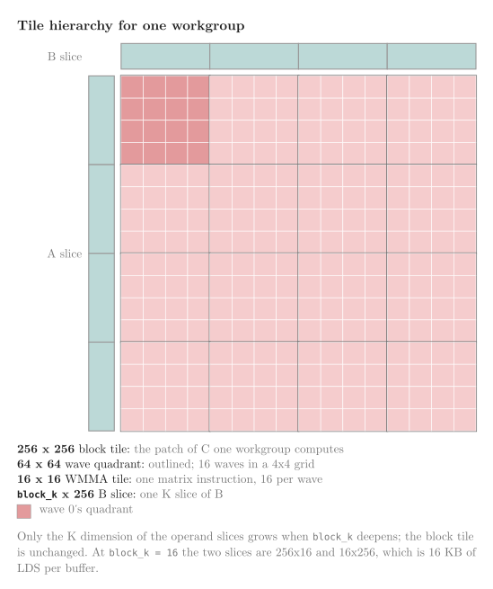
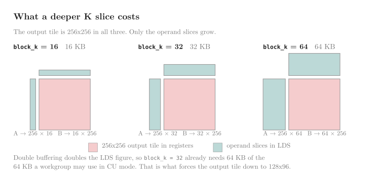
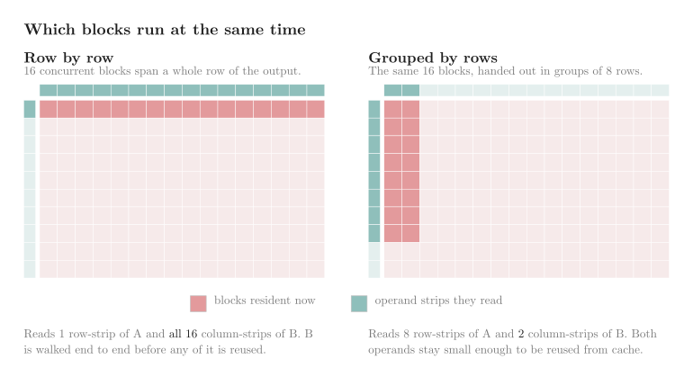

<!---
Copyright (c) 2026 Advanced Micro Devices, Inc. (AMD)

Permission is hereby granted, free of charge, to any person obtaining a copy
of this software and associated documentation files (the "Software"), to deal
in the Software without restriction, including without limitation the rights
to use, copy, modify, merge, publish, distribute, sublicense, and/or sell
copies of the Software, and to permit persons to whom the Software is
furnished to do so, subject to the following conditions:

The above copyright notice and this permission notice shall be included in all
copies or substantial portions of the Software.

THE SOFTWARE IS PROVIDED "AS IS", WITHOUT WARRANTY OF ANY KIND, EXPRESS OR
IMPLIED, INCLUDING BUT NOT LIMITED TO THE WARRANTIES OF MERCHANTABILITY,
FITNESS FOR A PARTICULAR PURPOSE AND NONINFRINGEMENT. IN NO EVENT SHALL THE
AUTHORS OR COPYRIGHT HOLDERS BE LIABLE FOR ANY CLAIM, DAMAGES OR OTHER
LIABILITY, WHETHER IN AN ACTION OF CONTRACT, TORT OR OTHERWISE, ARISING FROM,
OUT OF OR IN CONNECTION WITH THE SOFTWARE OR THE USE OR OTHER DEALINGS IN THE
SOFTWARE.
--->

# FP16 GEMM Optimization on AMD RDNA™ 3 and RDNA™ 4 Architectures

In this blog you will learn how to write a fast FP16 GEMM kernel for AMD RDNA™ 3 and RDNA™ 4 GPUs,
one optimization at a time. You will see which techniques pay off on each architecture, why some
help one and hurt the other, and how to measure the effect of every change in time, registers, and
LDS, so you can apply the same approach to your own kernels. This is Part 1 of a two-part series.
Part 2 will port the final kernel from this post to FP8 on RDNA 4.

Computing `C = A × B` is one of the most heavily used kernels in AI and HPC.
On AMD Radeon™ GPUs built on the RDNA architecture, the hardware exposes Wave Matrix
Multiply-Accumulate (WMMA) instructions for it: one cooperative instruction in which all 32
threads in a wave together multiply 16×16×16 matrix tiles and add the result to an accumulator.
This post builds an FP16 GEMM kernel from WMMA one step at a time. We start with a basic GEMM
kernel and end a few percent faster or slower than
[hipBLASLt](https://rocm.docs.amd.com/projects/hipBLASLt/en/latest/), ROCm's tuned GEMM library,
depending on the architecture and GEMM shape.
The goal is not a production library, but a guided walkthrough: each step names the problem it
fixes, shows the code change, and reports what that change cost or saved in time, registers, and
Local Data Share (LDS), fast on-chip memory shared by threads in a workgroup.

The kernel grows through eight steps, numbered the same way as the timing tables later in the post.
Step 1 is a minimal starter kernel, one wave on a small tile, so you can see how far a naive
WMMA loop is from the target. Step 2 applies four standard GEMM techniques at once: a larger
tile, wide 128-bit memory copies, double buffering, and a staged commit. That is the only step that
changes more than one thing at a time; those four changes together reach a conventional tiled
kernel that every later step builds on.
Steps 3 through 8 each change one thing:

- Avoid LDS bank conflicts: consecutive rows of a tile can map to the same LDS bank and serialize;
  padding or permuting the layout spreads accesses apart.
- Use buffer resource descriptors for global loads: out-of-bounds addresses return zero, so tile
  sizes need not divide the matrix dimensions evenly.
- Deepen the K slice: hold several WMMA steps of K in LDS at once, doing more arithmetic between
  global-memory copies and barriers.
- Reorder blocks for cache reuse: launch output tiles in an order that keeps concurrent blocks
  reading overlapping regions of A and B.
- Interleave prefetches with WMMA: issue global loads between matrix instructions so memory
  latency hides behind arithmetic the wave already has to run.
- Revisit double buffering: with interleaving in place, test whether two LDS buffers are still
  worth their occupancy cost, or whether one buffer and more resident workgroups is faster.

> **Note:** [FP8 GEMM Optimization on AMD CDNA™ 4 Architecture](https://rocm.blogs.amd.com/software-tools-optimization/cdna4-gemm-kernels/README.html)
> covers the same optimization progression on CDNA hardware, in FP8.

Each step is measured on three GPUs: an AMD Radeon™ PRO W7800 (gfx1100, RDNA 3), an AMD Radeon™ RX
9070 XT (gfx1201, RDNA 4), and an AMD Radeon™ 8060S (gfx1151, RDNA 3.5). The latter uses the same
WMMA instructions as RDNA 3, so one kernel binary serves both, but it reaches memory through
system RAM rather than dedicated GDDR, resulting in lower absolute throughput on gfx1151 even with
optimization. Several steps help one architecture and hurt another; those cases are called out as
they appear.

To work through the examples you need a ROCm installation with the hipBLASLt development package, an
RDNA 3, RDNA 3.5, or RDNA 4 GPU, and working familiarity with HIP and the basics of GEMM tiling
(how a large matrix multiply is split into blocks, waves, and K slices). All timings in this post
come from ROCm 10.

Most code snippets below are pseudo-code that shows structure and control flow. Full HIP appears
where the details matter: WMMA built-ins, the buffer resource descriptor, and the address arithmetic
behind LDS permutation. A complete implementation of every step, with the benchmark driver, is in
the [accompanying repository](./src). Part 2 of this series will apply the same progression to FP8
on RDNA 4.

## What We Are Computing

Every kernel in this post computes `C = A × B` in FP16. Matrix A is stored row-major and matrix B
is stored column-major. That pairing is deliberate: K is the dimension the multiply sums over, and
with these layouts both operands are contiguous along K. When a workgroup copies a tile of A or B
into LDS, each lane can walk K with consecutive addresses and no transpose on the way in. Every LDS
tile in this post puts K last in the indexing, and the copy loops for A and B are mirror images of
each other. The benchmark fills A and B directly in these layouts; real data may need to be
transposed first to match what the kernel expects. The kernel writes C in the same column-major
layout hipBLASLt uses, with leading dimension M, so the two outputs line up element for element.

hipBLASLt labels this pairing TN, a name that recurs throughout the rest of this post.

Alongside timing it, the benchmark checks each stage against hipBLASLt. It draws each element of A
and B as -1 or +1 and compares the two exactly, with no tolerance: every product is then ±1 and
every partial sum an integer. With random inputs those sums stay near ±√K, well inside the range
FP16 represents exactly, so no rounding happens whatever order each side reduces in, and a correct
kernel must match hipBLASLt bit for bit. This runs at both benchmark shapes, so the non-divisible
tiling of the wide case is covered too.

## Wave Matrix Multiply Accumulate on RDNA

Section 1 introduces WMMA as the building block for this kernel. Before the optimization steps
begin, this section covers what the instruction expects in registers and how that differs between
RDNA 3 and RDNA 4. Those differences show up later in register pressure, LDS layout choices, and
which architecture gains from a given step.

WMMA is a wave-wide instruction: all 32 lanes in a wave cooperate on one 16×16×16 matrix
multiply-accumulate. One instruction multiplies a 16×16 tile of A by a 16×16 tile of B and adds
the result into a 16×16 tile of C.

The two architectures spread each operand across the wave's registers differently. On RDNA 3, WMMA
treats the 32-lane wave as two cooperating 16-lane halves that share operand data but write
different portions of the 16×16 output tile. The operand fragments are therefore replicated: lanes
0–15 and lanes 16–31 hold the same data, and every lane carries all 16 K values for its row. The
kernel must load those full K rows into every lane even though only half the accumulator elements
are used. On RDNA 4 the two halves of the wave hold different data: lanes 0–15 carry K values 0–7 and
lanes 16–31 carry 8–15. As Figure 1 shows, every lane on RDNA 3 holds the full K range, while on
RDNA 4 each half of the wave holds half of it.

<div align="center">


</div>

<p align="center">Figure 1: The operand layout the instruction expects. A and B are laid out the same way.</p>

Each lane must hold the correct elements before the instruction issues. The A and B tiles in LDS are
K-contiguous, so each lane can copy its fragment with a single address calculation:

```cpp
// Both operands are read the same way; only the tile pointer differs.
// `row` is the tile row this fragment starts at, `k` the K position within the tile.
const int offset = (row + lane % 16) * stride + k + k_offset(lane);
__builtin_memcpy(&fragment, &tile[offset], sizeof(fragment));
```

`lane % 16` selects the row within the 16-wide tile. `k_offset` is zero on RDNA 3 and
`8 * (lane / 16)` on RDNA 4, which splits the two halves of the wave on RDNA 4. The fragment type
sets the copy width, so the same `memcpy` moves 32 bytes on RDNA 3 and 16 on RDNA 4.

The accumulator is split across lanes the same way. On RDNA 3, with `OPSEL = false`, lane L holds
column `L mod 16` and accumulator element `2g` holds row `2g + L/16`. On RDNA 4 the results are
packed: lane L holds column `L mod 16` and accumulator element `g` holds row `8*(L/16) + g`.

Two consequences matter for the rest of the post:

- An RDNA 3 fragment is twice as wide as an RDNA 4 fragment. Reading it from LDS takes two 128-bit
  loads instead of one, and any LDS address permutation has half as many places to move data to.
- An RDNA 3 accumulator uses twice the registers for the same output tile. Register pressure
  therefore limits tile shape differently on the two architectures.

Three constants appear throughout the code:

```cpp
/// Size of the WMMA instruction's output tile, and of its K step.
constexpr int wmma_tile = 16;
/// FP16 values moved by one 128-bit access: 128 bits / 16 bits per value.
constexpr int elems_per_b128 = 8;
/// Lanes in a wave32 wavefront.
constexpr int wave_size = 32;
```

`elems_per_b128` is the widest single load a lane can issue and sets the granularity of every copy:
an RDNA 4 fragment is one such access, an RDNA 3 fragment two.

Rather than maintain two separate kernels, the code hides the architecture differences behind a
policy: a struct of types and static functions, one per architecture, that the kernel is templated
on. The choice resolves at compile time. The two policies disagree in four places:

| | RDNA 3 (gfx11) | RDNA 4 (gfx12) |
| --- | --- | --- |
| Fragment and accumulator width | 16 FP16 | 8 FP16 |
| K values a lane reads | all 16, replicated | 0-7 or 8-15, by lane half |
| Accumulator elements used | every second one | all of them |
| Matrix instruction | `..._w32(a, b, acc, false)` | `..._w32_gfx12(a, b, acc)` |

<p align="center">Table 1. What the two policies disagree about. Everything else in the kernel is shared.</p>

The builtin names differ, and the RDNA 3 call carries an extra argument:

```cpp
// RDNA 3. The trailing false is OPSEL, which selects whether results land in the
// low or high half of each accumulator register. The builtin has no default for it:
// the argument is required, and passing false is what puts the results in the even
// elements described above.
acc = __builtin_amdgcn_wmma_f16_16x16x16_f16_w32(a, b, acc, /*OPSEL=*/false);

// RDNA 4. Same logical operation, different builtin.
acc = __builtin_amdgcn_wmma_f16_16x16x16_f16_w32_gfx12(a, b, acc);
```

Each policy also supplies the fragment read and the accumulator write-out, since both depend on the
lane mapping above. The rest of the kernel does not see the difference.

The AMD ROCm Optimization Guide documents the fragment and accumulator layouts of each
architecture, with the matching builtins:
[RDNA3 dense WMMA builtins](https://rocm-handbook.amd.com/projects/amd-rocm-optimization-guide/en/latest/compiler-builtins/rdna/rdna3-dense-wmma-builtins.html#fragment-layouts)
and
[RDNA4 dense WMMA builtins](https://rocm-handbook.amd.com/projects/amd-rocm-optimization-guide/en/latest/compiler-builtins/rdna/rdna4-dense-wmma-builtins.html#fragment-layouts).
For an introduction to these instructions, see
[How to accelerate AI applications on RDNA 3 using WMMA](https://gpuopen.com/learn/wmma_on_rdna3/)
and [Using the Matrix Cores of AMD RDNA 4 architecture GPUs](https://gpuopen.com/learn/using_matrix_core_amd_rdna4/)
on GPUOpen. The encodings are in the
["RDNA 3"](https://www.amd.com/content/dam/amd/en/documents/radeon-tech-docs/instruction-set-architectures/rdna3-instruction-set-architecture.pdf)
and
["RDNA 4"](https://www.amd.com/content/dam/amd/en/documents/radeon-tech-docs/instruction-set-architectures/rdna4-instruction-set-architecture.pdf)
ISA guides, and
[AMD matrix cores](https://rocm.blogs.amd.com/software-tools-optimization/matrix-cores/README.html)
covers the MFMA instructions that play the same role on CDNA.

## The Target

Every step in the progression is timed against hipBLASLt on the same problem: FP16 GEMM with A
row-major and B column-major (TN), at `M = N = K = 8192` unless noted otherwise. Throughput is
reported as `2MNK / t` TFLOPS/s, where `t` is the average kernel time in seconds.

The benchmark calls hipBLASLt directly rather than through rocBLAS. The heuristic either returns a
solution or the run stops. Both our kernels and the baseline accumulate in FP16
(`HIPBLAS_COMPUTE_16F`), matching the WMMA instructions in this post. A request for
`HIPBLAS_COMPUTE_32F` would accumulate in FP32 instead. That is more accurate over a long K, but
not what is measured here.

hipBLASLt at `M = N = K = 8192`[^1]:

| GPU | Avg ms | Avg TFLOPS/s |
| --- | ---: | ---: |
| Radeon PRO W7800 (gfx1100) | `19.34` | `56.86` |
| Radeon 8060S (gfx1151) | `28.14` | `39.07` |
| Radeon RX 9070 XT (gfx1201) | `8.05` | `136.58` |

<p align="center">Table 2. hipBLASLt throughput at `M=N=K=8192`, the baseline every step is measured against.</p>

These figures are the target range. Each optimization step below reports its timing against them.
hipBLASLt is tuned per shape and architecture; our kernel uses one configuration across the
progression unless a step says otherwise.

The peak FP16 throughput is 90.4 TFLOPS/s on the W7800, 59.4 on the 8060S, and 195 on the 9070 XT.
hipBLASLt reaches 63% to 70% of that.

## CU Mode and WGP Mode

Every kernel in this post runs in CU mode which is enabled at compile time by passing
`-mcumode` as a compiler option. Without it the compiler defaults to WGP mode. With HIP runtime
compilation, include `-mcumode` in the options array passed to `hiprtcCompileProgram()`. The
benchmark in the accompanying repository passes the same flag to `amdclang++` at build time. We did
not benchmark WGP mode, so CU mode is a fixed part of the setup rather than a tuned parameter.

On RDNA, two compute units (CUs) form a work-group processor (WGP), each CU holding two SIMD32
units. The mode decides how many of a block's waves execute together and how much LDS they get:

- WGP mode: four waves of a block execute across all four SIMD32s of the WGP, over one contiguous
  LDS.
- CU mode: two waves of a block execute on the two SIMD32s of one CU, over half the WGP LDS.

WGP mode can raise occupancy, and can cost performance for kernels relying on atomics or heavy
inter-wave communication. CU mode keeps the two CUs independent, which suits workloads that avoid
heavy inter-wave communication. Either way a workgroup may share up to 64 KB of LDS, per the
["RDNA 3" ISA guide](https://www.amd.com/content/dam/amd/en/documents/radeon-tech-docs/instruction-set-architectures/rdna3-instruction-set-architecture.pdf),
and that is the budget Table 9 works from. For more detail see
[CU mode vs WGP mode](https://rocm.docs.amd.com/projects/HIP/en/latest/how-to/hip_rtc.html#cu-mode-vs-wgp-mode)
in the HIP documentation, and the
[LDS bank conflict analysis](https://rocm-handbook.amd.com/projects/amd-rocm-optimization-guide/en/latest/patterns/examples/matrix-multiply-optimization.html#lds-bank-conflict-analysis)
in the AMD ROCm Optimization Guide, which explains how each mode maps a workgroup onto the LDS banks.

## Step 1: Starting Simple, One Wave and One Tile

Step 1 is the baseline everything else is measured against. One wave owns a 32×32 output tile, a
2×2 grid of 16×16 WMMA tiles held in four accumulators. Each K iteration copies a slice of A and B
into LDS, multiplies out of LDS, and repeats.

Three bottlenecks dominate the timing: only one wave runs per block, each lane copies one element
at a time, and the loop pays two barriers for every 16 values of K.

```cpp
for(int k_tile = 0; k_tile < num_k_tiles; ++k_tile)
{
    // One element per lane per step.
    for(int i = lane; i < block_m * block_k; i += wave_size)
    {
        tile_a[i / block_k][i % block_k] = A[(block_row + i / block_k) * K + k_tile * block_k + i % block_k];
    }
    // ... the same for B ...
    __syncthreads();

    typename Policy::FragmentA a[tiles_m];
    typename Policy::FragmentB b[tiles_n];
    // load_a/load_b are a memcpy from LDS into a vector register: a fixed address calculation
    // per architecture (see the WMMA section above).
    for(int m = 0; m < tiles_m; ++m)
    {
        Policy::load_a(a[m], &tile_a[0][0], m * wmma_tile, 0, lane, block_k);
    }
    for(int n = 0; n < tiles_n; ++n)
    {
        Policy::load_b(b[n], &tile_b[0][0], n * wmma_tile, 0, lane, block_k);
    }
    for(int m = 0; m < tiles_m; ++m)
    {
        for(int n = 0; n < tiles_n; ++n)
        {
            // Policy::mma calls the architecture's WMMA built-in (Table 1) directly, with no
            // inline assembly.
            Policy::mma(acc[m][n], a[m], b[n]);
        }
    }

    // The next iteration overwrites the tiles, so every lane must be done reading.
    __syncthreads();
}
```

`tile_a[m][k]` and `tile_b[n][k]` are both indexed with K last, matching the row-major A and
column-major B layouts from earlier. The two copy loops are mirror images of each other. The
performance numbers are as follows[^1]:

| GPU | Avg ms | hipBLASLt (ms) |
| --- | ---: | ---: |
| gfx1100 | `148.26` | `19.34` |
| gfx1151 | `334.95` | `28.14` |
| gfx1201 | `150.12` | `8.05` |

<p align="center">Table 3. Step 1: one wave per block, a 32×32 output tile.</p>

That is 150 ms versus the 8 to 28 ms hipBLASLt target. The steps that follow
remove the costs above one at a time.

### Measuring Resources

Alongside timings, each step reports the LDS a block needs and the occupancy that follows from it.
Occupancy is how many waves a SIMD can keep resident, which the compiler derives from register and
LDS demand:

```bash
amdclang++ -O3 -std=c++17 --offload-arch=gfx1100 -mcumode \
    -Rpass-analysis=kernel-resource-usage -c your_kernel.hip -o /dev/null
```

The [HIP performance guidelines](https://rocm.docs.amd.com/projects/HIP/en/latest/how-to/performance_guidelines.html)
cover what occupancy does and does not buy you. The AMD ROCm Optimization Guide goes into
[improving occupancy](https://rocm-handbook.amd.com/projects/amd-rocm-optimization-guide/en/latest/conceptual/introduction/guidelines.html#improving-occupancy)
and works through
[register pressure and occupancy](https://rocm-handbook.amd.com/projects/amd-rocm-optimization-guide/en/latest/patterns/examples/matrix-multiply-optimization.html#step-6-register-pressure-and-occupancy)
in a GEMM kernel.

To confirm those figures against what the hardware actually launched, take a
[rocprofv3](https://rocm.docs.amd.com/projects/rocprofiler-sdk/en/latest/how-to/using-rocprofv3.html)
kernel trace:

```bash
rocprofv3 --kernel-trace --output-format csv -d resources -o trace -- ./your_benchmark
```

The resulting `kernel_trace.csv` holds one row per kernel dispatch. The `LDS_Block_Size` column
gives the LDS allocated per block in bytes — divide by 1024 to get kilobytes. It agrees exactly
with the compiler's figure, confirming the occupancy calculation.

## Step 2: Tiling for Reuse and a Software Pipeline

Step 1 reads 16 values of A and B from global memory for every 32 outputs. Step 2 applies four
standard GEMM techniques at once to reach a conventional tiled kernel. This is the only step that
changes more than one thing at a time.

1. A bigger tile. Each block now computes a 256×256 patch of C through a 4×4 grid of waves. Each
   wave owns a 4×4 grid of WMMA tiles, so 16 accumulators. The block holds a 256×16 slice of A and
   a 16×256 slice of B in LDS and reads each element once for 256 outputs instead of once for 32.
2. Wider copies. Each lane moves eight FP16 values per access instead of one, using the full
   128-bit load path.
3. Double buffering. Two LDS tiles per operand let the waves multiply out of one buffer while the
   next K slice copies into the other.
4. A staged commit. The incoming tile waits in registers and reaches LDS only after the current
   one has been read, which removes the second barrier per K step.

The first change sets up the tile hierarchy the rest of the post uses. Figure 2 shows how the block
tile divides into wave tiles and WMMA tiles, and which operand slices it reads:

<div align="center">



</div>

<p align="center">Figure 2: What one workgroup owns. The block tile is the patch of C it computes; the operand slices are what it holds in LDS.</p>

The four changes define the loop every later step keeps: prefetch, multiply, commit, one barrier.

```cpp
// Two LDS buffers per operand: one is read while the other is filled.
LdsTile tile[2];
int current = 0, next = 1;

load_tile_to_lds(tile[current], /*k_tile=*/0);
block_sync();

for (int t = 0; t < num_k_tiles - 1; ++t) {
    // Issue the next tile's global reads into registers. They have the whole
    // multiply below to complete in.
    staged = load_tile_to_registers(/*k_tile=*/t + 1);

    multiply_from_lds(tile[current], acc);

    // Only here do those reads have to have landed.
    store_registers_to_lds(tile[next], staged);
    block_sync();
    swap(current, next);
}

// The loop stops one tile short. The last tile is already in LDS and has
// nothing left to overlap with, so it is multiplied on its own.
multiply_from_lds(tile[current], acc);
```

Double buffering alone does not fix everything. Without the staged commit, the loop writes the
incoming tile to LDS as soon as it lands, which forces the wave to wait on that global read
immediately:

```text
global_load next
wait for global_load          # stall: nothing else was issued to overlap it
ds_write next LDS buffer
ds_read current LDS buffer
wait for ds_read
WMMA
```

Staging the read in registers until after the current tile has been multiplied moves that wait
behind real work instead of in front of it:

```text
global_load next
ds_read current LDS buffer
wait for ds_read
WMMA                          # the global load's latency overlaps this
wait for global_load          # much of it is already hidden
ds_write next LDS buffer
wait for ds_write
```

Timings for the four changes together, against Step 1[^1]:

| GPU | Step 1 (ms) | Avg ms | vs step 1 | hipBLASLt (ms) |
| --- | ---: | ---: | ---: | ---: |
| gfx1100 | `148.26` | `36.89` | `4.0x` | `19.34` |
| gfx1151 | `334.95` | `88.24` | `3.8x` | `28.14` |
| gfx1201 | `150.12` | `30.25` | `5.0x` | `8.05` |

<p align="center">Table 4. Step 2: 256×256 output tile, wide copies, double buffering, and a staged commit.</p>

The resource report shows what the bigger tile costs. Each wave now accumulates 16 WMMA tiles
instead of four, and the two LDS buffers take 32 KB:

| | LDS | Waves/SIMD |
| --- | ---: | ---: |
| RDNA 3 | `32 KB` | `8` |
| RDNA 4 | `32 KB` | `12` |

<p align="center">Table 5. Step 2 resource usage. RDNA 3 keeps fewer waves resident for the same tile because its accumulators are twice as wide.</p>

The same kernel and the same tile, but RDNA 3's wider accumulators raise its register pressure. At
32 KB the LDS budget would allow more waves, so registers bind here and cost RDNA 3 four resident
waves.

## Step 3: Avoiding LDS Bank Conflicts

When every lane reads its WMMA fragment from a different row of an LDS tile, the row stride decides
which LDS bank each access hits. LDS has 32 banks of four bytes. If the stride aligns rows to the
same banks, those accesses serialize. For the mechanism and both fixes below in detail, see
[Avoiding LDS Bank Conflicts on AMD GPUs with CK-Tile](https://rocm.blogs.amd.com/software-tools-optimization/lds-bank-conflict/README.html)
and the
[LDS bank conflict analysis](https://rocm-handbook.amd.com/projects/amd-rocm-optimization-guide/en/latest/patterns/examples/matrix-multiply-optimization.html#lds-bank-conflict-analysis)
in the AMD ROCm Optimization Guide.

Padding adds unused elements to each row so consecutive rows start in different banks:

```cpp
/// Padded row stride: the fix in this step.
constexpr int padded_stride = block_k + lds_pad;   // 16 + 8
```

Permutation keeps the tile the same size and scrambles where each block of elements lands within a
row. Two quantities set it up. `unit` is the run of elements that must stay together, which is
`Policy::fragment_elems`: 16 on RDNA 3, 8 on RDNA 4. Anything smaller would split a fragment across
two places. `blocks` is how many such runs fit in a row, `block_k / unit`. Element `(row, k)` then
moves to block `(k / unit) XOR (row % blocks)`:

```cpp
/// Offset of element (row, k) once the row's blocks have been permuted.
auto swizzle = [](int row, int k)
{ return row * block_k + ((k / unit) ^ (row % blocks)) * unit + (k % unit); };
```

At `block_k = 16` an RDNA 3 fragment is 16 elements, exactly one row, so `blocks = 1` and the
permutation does nothing on gfx1100. That is why the two timing columns agree there in Table 7.

| `block_k` | RDNA 3 blocks | RDNA 4 blocks |
| ---: | ---: | ---: |
| 16 | `1` | `2` |
| 32 | `2` | `4` |
| 64 | `4` | `8` |

<p align="center">Table 6. Blocks available to permute between, per LDS row. One block means the permutation is the identity.</p>

Timings for both layouts[^1]:

| GPU | Padded (ms) | Permuted (ms) | hipBLASLt (ms) |
| --- | ---: | ---: | ---: |
| gfx1100 | `37.02` | `36.71` | `19.34` |
| gfx1151 | `88.90` | `88.08` | `28.14` |
| gfx1201 | `30.25` | `30.37` | `8.05` |

<p align="center">Table 7. Step 3: padding compared against XOR permutation, at a 256×256 output tile.</p>

The resource report shows what padding costs:

| | LDS | Waves/SIMD |
| --- | ---: | ---: |
| RDNA 3, padded | `48 KB` | `8` |
| RDNA 3, permuted | `32 KB` | `8` |
| RDNA 4, padded | `48 KB` | `8` |
| RDNA 4, permuted | `32 KB` | `12` |

<p align="center">Table 8. Step 3 resource usage. Padding grows the tile by half, which costs RDNA 4 four resident waves.</p>

Padding adds 16 KB of LDS. At 48 KB only one block fits in the 64 KB budget, which drops RDNA 4
from 12 resident waves to 8. Permutation keeps the tile at 32 KB and keeps that occupancy, but
does nothing on RDNA 3 at this tile size.

Neither fix changes the timing at this tile shape: Table 7's padded and permuted numbers match
Table 4's 36.89 ms/88.24 ms/30.25 ms to within measurement noise. This is likely because `block_k`
is still 16 here, so only one K slice sits in LDS per barrier and there is little concurrent LDS
traffic for bank conflicts to affect. We did not confirm that at a deeper `block_k`; either fix may
matter more once Step 5 deepens K.

The rest of the post uses padding. Permutation is fragment-size-specific: a different WMMA tile
width would need a different permutation pattern, while padding just adds unused columns and works
at any width that is a multiple of the fragment size. More importantly, occupancy is not the only lever on performance. Step 5 deliberately
trades the 16 KB that padding adds back for a deeper K slice — more arithmetic between global
copies — rather than spending it on more resident blocks. Higher occupancy hides latency; deeper K
reduces how much latency there is to hide. The numbers show that the K-depth trade is the better
one here.

## Step 4: Buffer Resource Descriptors for Global Loads

Steps 1 through 3 assume every global address a block reads is in bounds. That forces tile
dimensions to divide the matrix evenly: a 96-wide strip of A against `M = 8192` would read past the
end of the allocation in the trailing block.

Step 4 switches global loads to buffer resource descriptors. The hardware knows the size of the
allocation and returns zero for out-of-bounds addresses instead of faulting:

```cpp
/// A plain untyped buffer whose reads are bounds-checked against the size it is given.
/// The field layout is in the ISA guides, under the buffer resource descriptor.
constexpr unsigned buffer_config_word = 0x31004000;

/// Loads issued against this descriptor return zero for out-of-bounds addresses instead
/// of faulting, which is what allows block tiles that do not divide the matrix evenly.
__device__ __forceinline__ __amdgpu_buffer_rsrc_t make_buffer(const void* ptr, unsigned bytes)
{
    return __builtin_amdgcn_make_buffer_rsrc(const_cast<void*>(ptr),
                                             /*stride=*/0,
                                             bytes,
                                             buffer_config_word);
}
```

`bytes` is the whole allocation, since that is what the hardware clamps against. Trailing blocks
that overlap the matrix edge read zeros and contribute nothing to the result. The buffer resource
descriptor field layout is documented in the
["RDNA 3" ISA guide](https://www.amd.com/content/dam/amd/en/documents/radeon-tech-docs/instruction-set-architectures/rdna3-instruction-set-architecture.pdf)
and
["RDNA 4" ISA guide](https://www.amd.com/content/dam/amd/en/documents/radeon-tech-docs/instruction-set-architectures/rdna4-instruction-set-architecture.pdf),
under the buffer resource descriptor section.

This step does not change timings at the same tile size: the output tile is still 256×256 and LDS
is unchanged at 48 KB. It unlocks Step 5, which picks a 128×96 output tile that divides neither M
nor N evenly.

## Step 5: Trading Tile Area for K Depth

Steps 1 through 4 keep one WMMA step of K in LDS at a time: 16 values along K, one matrix
instruction per accumulator, then a barrier and a fresh global copy. Step 5 holds four WMMA steps of
K in LDS instead. That cuts barriers by four and gives each wave four rounds of arithmetic per
copy, at the cost of a wider operand slice.

Deepening K widens both operand tiles while the output tile stays the same, as Figure 3 shows for
`block_k` of 16, 32, and 64:

<div align="center">



</div>

<p align="center">Figure 3: Deepening K widens the operand slices and leaves the output tile unchanged.</p>

At a 256×256 output tile the 64 KB LDS budget runs out immediately, so the output tile has to shrink
to buy the depth:

| Output tile | `block_k` | A tile | B tile | Buffers | LDS |
| --- | ---: | ---: | ---: | ---: | ---: |
| 256×256 | 16 | 256×16 | 16×256 | 2 | `48 KB` |
| 256×256 | 32 | 256×32 | 32×256 | 2 | `80 KB` (too large) |
| 128×128 | 64 | 128×64 | 64×128 | 2 | `72 KB` (too large) |
| 128×96 | 64 | 128×64 | 64×96 | 2 | `63 KB` |

<p align="center">Table 9. Operand tiles and the LDS they need per block. The 64 KB budget rules out the middle two.</p>

These figures include the eight-element pad on each row from Step 3, which is why the last row is
63 KB rather than the 56 KB the element count alone would give.

The 96-wide output tile is only viable because of Step 4: 96 divides neither 8192 nor 28672, so
without out-of-bounds clamping the trailing block would read past the end of A.

Timings against Step 3 padded[^1]:

| GPU | Avg ms | vs step 3 padded | hipBLASLt (ms) |
| --- | ---: | ---: | ---: |
| gfx1100 | `35.44` | `1.04x` | `19.34` |
| gfx1151 | `72.40` | `1.23x` | `28.14` |
| gfx1201 | `20.81` | `1.45x` | `8.05` |

<p align="center">Table 10. Step 5: four WMMA steps of K per tile, on a 128×96 output tile. Measured against step 3 padded, since step 4 changed only how reads are issued.</p>

This is the largest resource change in the progression. The 63 KB tile leaves room for one block per
compute unit, so occupancy falls from eight resident waves per SIMD to two. Both architectures also
sit near the register limit at this tile size. The timings still improve despite the occupancy
drop, though by how much depends on the architecture: RDNA 4 gains the most (1.45x), RDNA 3.5 less
(1.23x), and RDNA 3 barely at all (1.04x). Each wave holds four times as much arithmetic between
barriers, and the larger tile stages proportionally more data from global memory each iteration.
The register limit is what caps the tile from growing further.

## Step 6: Block Scheduling for Cache Reuse

Step 6 changes only the order in which blocks are assigned output tiles. The kernel is otherwise
the same as Step 5. The GPU launches far more blocks than it can run at once and dispatches them in
index order, so consecutive block indices are the ones resident together. Where those blocks sit in
the output grid decides how much of A and B they share: if their reads overlap, the second block to
arrive finds the data in L2 rather than going back to memory. Figure 4 compares the two schedules
this step tries, showing which strips of A and B 16 concurrent blocks read under each.

<div align="center">



</div>

<p align="center">Figure 4: The same 16 blocks under both schedules, with the operand strips they read between them.</p>

Row-by-row assignment spreads concurrent blocks across a full row of the output. They touch one
strip of A but all column strips of B before any of B is reused. Grouping blocks into a tall region
keeps concurrent reads overlapping on both operands, so more of A and B stays in L2 across the
group.

The mapping is a few lines of index arithmetic. Here `tiles_m` and `tiles_n` count blocks in the
output grid, not the WMMA tiles per wave used earlier in the post:

```cpp
// tiles_m, tiles_n: the number of output tiles the grid is divided into, in each dimension.
const int index_n = block % tiles_n;
const int index_m = block / tiles_n;

// The last group is short when the rows do not divide evenly.
const int group_rows = (index_m < tiles_m - tiles_m % GroupSize) ? GroupSize : tiles_m % GroupSize;
const int group      = index_m / GroupSize;
const int local      = index_n + (index_m % GroupSize) * tiles_n;

*tile_row = (local % group_rows + group * GroupSize) * BlockM;
*tile_col = (local / group_rows) * BlockN;
```

This matches Composable Kernel's `BlockToCTileMap_M00_N0_M01Adapt` in
[`block_to_ctile_map.hpp`](https://github.com/ROCm/rocm-libraries/blob/develop/projects/composablekernel/include/ck/tensor_operation/gpu/grid/block_to_ctile_map.hpp),
with `GroupSize` set to 8.

Timings against Step 5[^1]:

| GPU | Avg ms | vs step 5 | hipBLASLt (ms) |
| --- | ---: | ---: | ---: |
| gfx1100 | `21.66` | `1.64x` | `19.34` |
| gfx1151 | `43.19` | `1.68x` | `28.14` |
| gfx1201 | `11.94` | `1.74x` | `8.05` |

<p align="center">Table 11. Step 6: tiles handed to blocks in groups of rows rather than row by row.</p>

Resource usage is unchanged from Step 5: 63 KB LDS and two resident waves per SIMD on both
architectures. Every GPU gains between 64% and 74%. The gain comes from cache reuse alone.

## Step 7: Interleave Prefetches with WMMA

For each K tile held in LDS, the wave runs every WMMA matrix instruction needed to consume it. In
this kernel that is 48 of them: a 4×3 grid of output tiles across four K slices. This is separate
from the prefetch and fragment-read instructions Step 7 interleaves between them, below. The
implementation calls that fixed, ordered sequence the *fold*, and the struct that unrolls it is
named `FoldStep` for the same reason.

Through Step 6, all global reads for the next K tile are issued before the fold begins. That clears
them from the critical path but bunches them into one burst. Each thread has 14 reads to issue for
its share of the next tile. When those finish early in the sequence, most of the fold runs with
nothing else keeping the memory system busy.

Step 7 spreads those prefetches across the fold instead, issuing one every second WMMA instruction
and alternating operands. Figure 5 contrasts the instruction order before and after:

<div align="center">


</div>

<p align="center">Figure 5: The same instructions for one K tile, issued in two different orders. Labels like
<code>A0</code> and <code>B5</code> name the 14 prefetch chunks — <code>chunks_a = 8</code> for A,
<code>chunks_b = 6</code> for B, from <code>FoldContext</code> — not WMMA fragments. An ellipsis
stands for more of the same.</p>

Each read is issued one instruction ahead of its consumer. A read directly in front of the
instruction that uses it stalls the wave; with a matrix instruction in between, the latency
overlaps arithmetic the wave was already going to run.

Interleaving changes only the global prefetches. Fragment reads from LDS stay sparse because the
traversal runs `n` fastest: a fragment of A is read once per row of the wave's tile grid, and a
fragment of B only in the first row of a K slice before being reused down the remaining rows.

The 14 prefetch chunks finish by instruction 14 of 48, so the last two thirds of the fold still run
without global traffic. The burst is staggered, not removed:

```cpp
// Step 0:  acc[0][0] += A0 * B0
prefetch_a_chunk(0);      // one chunk of the next K tile
read_fragment(b[1]);      // for step 1
matrix_multiply(acc[0][0], a[0], b[0]);

// Step 1:  acc[0][1] += A0 * B1
prefetch_b_chunk(0);
read_fragment(b[2]);
matrix_multiply(acc[0][1], a[0], b[1]);

// Step 2:  acc[0][2] += A0 * B2
prefetch_a_chunk(1);
read_fragment(a[1]);
matrix_multiply(acc[0][2], a[0], b[2]);

// ... 45 more steps.
```

This is a standard software pipelining technique, also used in libraries such as hipBLASLt, where
in-flight memory operations overlap with compute. The specific instruction-level interleaving
schedule here is inspired by [HipKittens: Fast and Furious AMD Kernels](https://arxiv.org/abs/2511.08083),
which assigns whole waves to either memory or math. The 32-lane waves and smaller register file on RDNA make per-instruction interleaving more natural
than wave-level specialization.

`prefetch_a_chunk`/`prefetch_b_chunk` carry each chunk from global memory into a vector register
(`staged_a`/`staged_b` in the real code), interleaved with the fold as shown. The write from those
registers into the next K tile's LDS buffer is a separate step: it runs after the whole fold, as
one batched commit, before the barrier that swaps buffers. With two buffers that write goes to the
buffer the fold is not reading, so it needs no barrier before it. With one buffer (Step 8) it
overwrites the buffer the fold just read, so a barrier is needed before the commit to make every
wave finish reading first.

Two things are required to make it work.

The fold must be fully unrolled at compile time. Each step in the sequence picks a fragment and an
accumulator in vector registers, which cannot be indexed dynamically at runtime without spilling to
scratch. The recursive template below supplies the step index as a compile-time constant:

```cpp
template<typename Policy, int Step, /* tile shape... */>
struct FoldStep
{
    using here = FoldPosition<Step, tiles_m, tiles_n>;
    using next = FoldPosition<Step + 1, tiles_m, tiles_n>;

    __device__ static void run(const Context& ctx)
    {
        constexpr int chunk = Step / 2;
        if constexpr(Step % 2 == 0 && chunk < Context::chunks_a)
        {
            ctx.reader_a.template prefetch<chunk>(ctx.staged_a);
        }
        else if constexpr(Step % 2 == 1 && chunk < Context::chunks_b)
        {
            ctx.reader_b.template prefetch<chunk>(ctx.staged_b);
        }

        if constexpr(Step + 1 < Context::steps)
        {
            if constexpr(next::a_index != here::a_index)
            {
                ctx.reader_a.template read_fragment<next::m, next::slice>(ctx.a[next::a_index]);
            }
            if constexpr(next::b_index != here::b_index)
            {
                ctx.reader_b.template read_fragment<next::n, next::slice>(ctx.b[next::b_index]);
            }
        }

        __builtin_amdgcn_s_setprio(1);
        Policy::mma(ctx.acc[here::m][here::n], ctx.a[here::a_index], ctx.b[here::b_index]);
        __builtin_amdgcn_s_setprio(0);

        if constexpr(Step + 1 < Context::steps)
        {
            FoldStep<Policy, Step + 1, /* ... */>::run(ctx);
        }
    }
};
```

The snippet above is abbreviated. The full `FoldStep`, together with `FoldContext` and
`FoldPosition`, is in [`stage07_interleave.hip`](./src/stage07_interleave.hip) in the accompanying
repository. Address hoisting lives in `OperandReader` in [`gemm_common.hpp`](./src/gemm_common.hpp).

Addresses must also be cheap at the point of use. Both a fragment read from LDS and a prefetch
chunk from global have a thread-dependent part and a position-dependent part. Earlier steps rebuild
both on every read, which an upfront burst hides behind its own stall. Here a read sits between two
matrix instructions, so every address calculation competes for an issue slot. We hoist the
thread-dependent part into a pointer before the loop and fold the rest into template arguments.

Interleaving puts the prefetch and fragment reads in the same issue window as the matrix
instruction, so the two now compete for the wave's issue slots. Raising the wave's scheduler
priority around the WMMA and dropping it again afterward biases the hardware toward issuing the
matrix instruction first, letting the interleaved reads fill the issue slots it leaves rather than
displace it:

```cpp
__builtin_amdgcn_s_setprio(1);
Policy::mma(ctx.acc[here::m][here::n], ctx.a[here::a_index], ctx.b[here::b_index]);
__builtin_amdgcn_s_setprio(0);
```

`s_setprio` is a runtime hint: it biases which wave wins arbitration for a shared execution port
when several waves resident on the same SIMD are ready to issue, which matters here because this
kernel holds 2 to 4 waves per SIMD at this tile size (Table 13). We did not find that adding
explicit schedule constraints for the compiler, such as `__builtin_amdgcn_sched_barrier`, helped or
were necessary: the compiler already keeps the interleaved order the source lays out.

Register use falls on both architectures, from 252 to 205 VGPRs on RDNA 3 and from 245 to 138 on
RDNA 4, but neither moves occupancy, which the 63 KB tile has already fixed at two waves per SIMD
(Table 13 lists the figures for Steps 6 to 8).

Timings against Step 6[^1]:

| GPU | Avg ms | vs step 6 | hipBLASLt (ms) |
| --- | ---: | ---: | ---: |
| gfx1100 | `17.10` | `1.27x` | `19.34` |
| gfx1151 | `31.21` | `1.38x` | `28.14` |
| gfx1201 | `9.85` | `1.21x` | `8.05` |

<p align="center">Table 12. Step 7: global prefetches issued from inside the fold rather than in a burst before it.</p>

All three GPUs gain 21% to 38%. Interleaving exposes the address arithmetic, and hoisting removes it
from the issue slots the schedule competes for.

## Step 8: Revisit Double Buffering

Step 2 introduced two LDS buffers per operand so the next K slice could copy in while the current
one was being multiplied. Step 7 interleaved global prefetches with WMMA across the fold.
Step 8 asks a separate question: at a 63 KB tile, is the second LDS buffer still worth its
occupancy cost?

The kernel is the same as Step 7 with one buffer instead of two, so the comparison isolates that
choice. Interleaving is unchanged. What changes is the two-buffer pipeline from Step 2: with a
single buffer the commit overwrites the tile the wave just read, so an extra barrier is required
before each write.

```cpp
// With two buffers the commit writes to the tile nobody is reading, so it
// needs one barrier. With one buffer it overwrites the tile just read, so
// every wave has to finish reading first:
block_sync();                  // extra: read-before-write
store_registers_to_lds(tile, staged);
block_sync();
```

The resource trade is visible before running either variant. The two-buffer row matches Step 7.
Step 6 is included for reference, since Step 7 is where register use changes.

| Variant | LDS per block | Waves per SIMD | VGPRs, RDNA 3 | VGPRs, RDNA 4 |
| --- | ---: | ---: | ---: | ---: |
| Step 6 | `64512 B` (63 KB) | `2` | `252` | `245` |
| Step 7, two buffers | `64512 B` (63 KB) | `2` | `205` | `138` |
| Step 8, one buffer | `32256 B` (31.5 KB) | `4` | `200` | `133` |

<p align="center">Table 13. LDS, occupancy, and vector register (VGPR) use for Steps 6 to 8, at a 128×96 output tile with 128×64 and 64×96 operand tiles. The RDNA 3 figures are identical on gfx1100 and gfx1151.</p>

Halving LDS doubles occupancy from two to four waves per SIMD on both architectures. Register use
moves only slightly, by 5 VGPRs on both RDNA 3 and RDNA 4, and does not change that occupancy
step.

Table 14 times the one-buffer variant and compares it against Step 7 (Table 12), which is the final
two-buffer kernel[^1]:

| GPU | Avg ms | vs step 7 | hipBLASLt (ms) |
| --- | ---: | ---: | ---: |
| gfx1100 | `15.50` | `1.10x` | `19.34` |
| gfx1151 | `27.06` | `1.15x` | `28.14` |
| gfx1201 | `8.71` | `1.13x` | `8.05` |

<p align="center">Table 14. Step 8: one LDS buffer instead of two.</p>

All three GPUs gain 10% to 15%. Whether to keep the second buffer is a per-target decision. This
step comes last because it reverses the two-buffer pipeline from Step 2, not the prefetch schedule
from Step 7.

## Where That Leaves Us

The final kernel against hipBLASLt at the square shape used throughout the progression[^1]:

| GPU | Final (ms) | hipBLASLt (ms) | Final (TFLOPS/s) | hipBLASLt (TFLOPS/s) |
| --- | ---: | ---: | ---: | ---: |
| gfx1100 | `15.50` | `19.34` | `70.92` | `56.86` |
| gfx1151 | `27.06` | `28.14` | `40.63` | `39.07` |
| gfx1201 | `8.71` | `8.05` | `126.17` | `136.58` |

<p align="center">Table 15. Final kernel against hipBLASLt at `M=N=K=8192`.</p>

The kernel lands a few percent faster or slower than hipBLASLt depending on the
architecture and GEMM shape, and is written entirely in HIP.

Real workloads are rarely square, so the final kernel also runs at `M = 8192`, `N = 28672`,
`K = 8192`, a wide, N-heavy shape of the kind a transformer feed-forward projection produces[^1]:

| GPU | Final (ms) | hipBLASLt (ms) | Final (TFLOPS/s) | hipBLASLt (TFLOPS/s) |
| --- | ---: | ---: | ---: | ---: |
| gfx1100 | `54.55` | `67.81` | `70.55` | `56.75` |
| gfx1151 | `93.33` | `100.52` | `41.23` | `38.28` |
| gfx1201 | `29.55` | `28.54` | `130.24` | `134.82` |

<p align="center">Table 16. Final kernel against hipBLASLt at `M=8192`, `N=28672`, `K=8192`.</p>

The same tile configuration is used for both shapes with no shape-specific tuning. The 128 side of
the output tile divides `M = 8192` evenly, but the 96 side does not divide `N = 28672`; buffer
descriptors from Step 4 make that legal by returning zero for out-of-bounds reads in the trailing N
blocks.

Both shapes are large and one tile configuration serves both. A 128×96 tile across four K steps
assumes enough work to fill the GPU several times over. For a skinny GEMM, or a small one that fits
in cache, it is the wrong shape, and nothing here adapts to that. Covering a range of sizes needs a
set of configurations and a way to pick between them.

## Tuning Further

The progression fixed the tile shape at Step 5 and kept it through Step 8 so each later change
could be measured on its own. A kernel headed for production would tune that choice. Three
parameters trade against each other:

- Tile area: a wider tile reads less of A and B per unit of output, but costs LDS, and LDS decides
  how many blocks a compute unit holds.
- K depth: a deeper slice amortizes the barrier over more arithmetic, but costs LDS again.
- Wave grid: more waves per block means fewer accumulators per wave and fewer registers, but gives
  each wave less arithmetic to hide latency behind.

The resource report from Step 1 narrows the search before you run anything, ruling out combinations
that cannot be resident.

The wave grid interacts with the fragment widths from the WMMA section. At 128×96 with a 2×2 grid,
each wave holds a 4×3 grid of accumulators; a 4×2 grid halves that to 2×3. On RDNA 4 that frees
enough registers to raise occupancy. On RDNA 3, where each accumulator is twice as wide, the same
change starts from a higher register count and does not reach the next occupancy step.

Between that report, a kernel trace to confirm it, and a handful of timed runs, the search space
here is small enough to walk by hand.

Sweeping these parameters on gfx1201 finds tiles that do better than the 128×96 the progression
settled on. A 192×224 tile on a 4×2 wave grid, single-buffered at the same K depth, fits the 64 KB
budget at 58.5 KB and improves on Step 8 at both shapes[^1]:

| Shape | Step 8 128×96 (ms) | Tuned 192×224 (ms) | hipBLASLt (ms) | Tuned (TFLOPS/s) |
| --- | ---: | ---: | ---: | ---: |
| `M=N=K=8192` | `8.71` | `7.73` | `8.05` | `142.30` |
| `M=8192, N=28672, K=8192` | `29.55` | `26.64` | `28.54` | `144.46` |

<p align="center">Table 17. A tuned tile against Step 8 and hipBLASLt on gfx1201.</p>

The progression keeps 128×96 because it is the tile the earlier steps build on and the one whose
resource trade-offs the post explains; the larger tile is what a per-architecture sweep settles on
once that reasoning is in hand. The single buffering from Step 8 is what makes it fit: a 192×224
tile at four K steps would need 117 KB with two buffers, and only drops under the 64 KB budget with
one.

## The Same Problem, One Level Up

Every step in this post picked a configuration, and several picks came out differently on each GPU.
A library faces that across every shape, data type, and layout a caller might ask for, on every
supported architecture.

hipBLASLt ships solutions tuned across many sizes per architecture and picks between them at
runtime, which is why it is the baseline used throughout this post. Those solutions can also be
tuned further offline for a particular size and applied at runtime.

The parameters an offline sweep searches over are the ones tuned by hand above. These posts cover
the tooling:

- [GEMM Tuning within hipBLASLt - Part 1](https://rocm.blogs.amd.com/software-tools-optimization/hipblaslt-offline-tuning-part1/README.html)
  and [Part 2](https://rocm.blogs.amd.com/software-tools-optimization/hipblaslt-offline-tuning-part2/README.html),
  which walk through tuning a problem size with
  [hipblaslt-bench](https://rocm.docs.amd.com/projects/hipBLASLt/en/latest/conceptual/hipblaslt-clients.html#hipblaslt-bench)
  and applying the result at runtime.
- [hipBLASLt Online GEMM Tuning](https://rocm.blogs.amd.com/artificial-intelligence/hipblaslt_online_tuning/README.html),
  for tuning from inside a running framework.

## Summary

In this blog you built an FP16 GEMM kernel for AMD RDNA 3 and RDNA 4 GPUs, starting from a minimal
one-wave WMMA kernel (Step 1) and reaching a conventional tiled GEMM in Step 2. You then refined it
in six further steps: padding to avoid LDS bank conflicts (Step 3), buffer resource descriptors for
bounded global loads (Step 4), a deeper K slice (Step 5), block ordering for cache reuse (Step 6),
prefetches interleaved with WMMA (Step 7), and a revisit of double buffering for occupancy
(Step 8). The final kernel lands within a few percent of hipBLASLt on all three GPUs.

Along the way you saw how the WMMA fragment and accumulator layouts differ between RDNA 3 and
RDNA 4 and how a single policy-templated kernel serves both. You also saw that no single
configuration wins everywhere: several steps moved the three GPUs by different amounts, and two
choices (permutation versus padding, and one LDS buffer versus two) came out differently per
target. The same measure-then-decide approach, using the compiler's resource report and a
`rocprofv3` kernel trace, carries over to your own kernels.

Part 2 of this series will pick up where this post ends. It will port the final kernel to FP8 on
RDNA 4 (gfx1201) and show how the smaller element size opens up larger tiles and deeper K slices
that did not fit in LDS at FP16, benchmarked on GEMM shapes drawn from transformer workloads.

## Additional Resources

The AMD ROCm Optimization Guide, which covers the builtins and GEMM patterns used in this post:

- [AMD ROCm Optimization Guide](https://rocm-handbook.amd.com/projects/amd-rocm-optimization-guide/en/latest/)
- [Optimizing GEMM in HIP](https://rocm-handbook.amd.com/projects/amd-rocm-optimization-guide/en/latest/patterns/examples/matrix-multiply-optimization.html)
- [RDNA3 dense WMMA builtins](https://rocm-handbook.amd.com/projects/amd-rocm-optimization-guide/en/latest/compiler-builtins/rdna/rdna3-dense-wmma-builtins.html)
- [RDNA4 dense WMMA builtins](https://rocm-handbook.amd.com/projects/amd-rocm-optimization-guide/en/latest/compiler-builtins/rdna/rdna4-dense-wmma-builtins.html)
- [Performance guidelines](https://rocm-handbook.amd.com/projects/amd-rocm-optimization-guide/en/latest/conceptual/introduction/guidelines.html)

The RDNA matrix instructions and the architecture behind them:

- [How to accelerate AI applications on RDNA 3 using WMMA](https://gpuopen.com/learn/wmma_on_rdna3/)
- [Using the Matrix Cores of AMD RDNA 4 architecture GPUs](https://gpuopen.com/learn/using_matrix_core_amd_rdna4/)
- ["RDNA 3" instruction set architecture reference guide](https://www.amd.com/content/dam/amd/en/documents/radeon-tech-docs/instruction-set-architectures/rdna3-instruction-set-architecture.pdf)
- ["RDNA 4" instruction set architecture reference guide](https://www.amd.com/content/dam/amd/en/documents/radeon-tech-docs/instruction-set-architectures/rdna4-instruction-set-architecture.pdf)
- [AMD GPU architecture programming documentation](https://gpuopen.com/amd-gpu-architecture-programming-documentation/)

HIP reference for the hardware model and the flags used here:

- [HIP documentation](https://rocm.docs.amd.com/projects/HIP/en/latest/)
- [HIP hardware implementation](https://rocm.docs.amd.com/projects/HIP/en/latest/understand/hardware_implementation.html)
- [CU mode vs WGP mode](https://rocm.docs.amd.com/projects/HIP/en/latest/how-to/hip_rtc.html#cu-mode-vs-wgp-mode)
- [HIP performance guidelines](https://rocm.docs.amd.com/projects/HIP/en/latest/how-to/performance_guidelines.html)

The library and the profiler:

- [hipBLASLt documentation](https://rocm.docs.amd.com/projects/hipBLASLt/en/latest/)
- [Application tracing and profiling using rocprofv3](https://rocm.docs.amd.com/projects/rocprofiler-sdk/en/latest/how-to/using-rocprofv3.html)

The same techniques on AMD Instinct™ hardware, where the register file, wave size and matrix
instructions all differ, so the numbers do not carry over:

- [FP8 GEMM Optimization on AMD CDNA™ 4 Architecture](https://rocm.blogs.amd.com/software-tools-optimization/cdna4-gemm-kernels/README.html)
- [Avoiding LDS Bank Conflicts on AMD GPUs with CK-Tile](https://rocm.blogs.amd.com/software-tools-optimization/lds-bank-conflict/README.html)
- [AMD matrix cores](https://rocm.blogs.amd.com/software-tools-optimization/matrix-cores/README.html)

## Notes

[^1]: Testing done by AMD by the authors. Results may vary based on configuration, usage, software
version, and optimizations.

### System Configuration

- GPUs: AMD Radeon™ PRO W7800 (`gfx1100`), AMD Radeon™ 8060S (`gfx1151`),
  AMD Radeon™ RX 9070 XT (`gfx1201`)
- ROCm stack: ROCm 10.0
- Compiler: `amdclang++` with `-O3 -std=c++17 -mcumode`
- Workload: FP16 GEMM with FP16 output and FP16 accumulation, A row-major and B column-major
  (TN), at `M=N=K=8192` and `M=8192, N=28672, K=8192`
- Reference: hipBLASLt called directly, `HIPBLAS_COMPUTE_16F`, the solution returned by
  `hipblasLtMatmulAlgoGetHeuristic`
- Methodology: 10 warm-up launches, then the mean of 30 timed launches; TFLOPS/s computed as `2MNK/t`
- Resource figures: `-Rpass-analysis=kernel-resource-usage` at compile time, confirmed against a
  `rocprofv3 --kernel-trace` run on each GPU

## Disclaimers

The information presented in this document is for informational purposes only and may contain technical inaccuracies, omissions, and typographical errors. The information contained herein is subject to change and may be rendered inaccurate for many reasons, including but not limited to product and roadmap changes, component and motherboard version changes, new model and/or product releases, product differences between differing manufacturers, software changes, BIOS flashes, firmware upgrades, or the like. Any computer system has risks of security vulnerabilities that cannot be completely prevented or mitigated. AMD assumes no obligation to update or otherwise correct or revise this information. However, AMD reserves the right to revise this information and to make changes from time to time to the content hereof without obligation of AMD to notify any person of such revisions or changes. THIS INFORMATION IS PROVIDED ‘AS IS.” AMD MAKES NO REPRESENTATIONS OR WARRANTIES WITH RESPECT TO THE CONTENTS HEREOF AND ASSUMES NO RESPONSIBILITY FOR ANY INACCURACIES, ERRORS, OR OMISSIONS THAT MAY APPEAR IN THIS INFORMATION. AMD SPECIFICALLY DISCLAIMS ANY IMPLIED WARRANTIES OF NON-INFRINGEMENT, MERCHANTABILITY, OR FITNESS FOR ANY PARTICULAR PURPOSE. IN NO EVENT WILL AMD BE LIABLE TO ANY PERSON FOR ANY RELIANCE, DIRECT, INDIRECT, SPECIAL, OR OTHER CONSEQUENTIAL DAMAGES ARISING FROM THE USE OF ANY INFORMATION CONTAINED HEREIN, EVEN IF AMD IS EXPRESSLY ADVISED OF THE POSSIBILITY OF SUCH DAMAGES. AMD, the AMD Arrow logo, and combinations thereof are trademarks of Advanced Micro Devices, Inc. Other product names used in this publication are for identification purposes only and may be trademarks of their respective companies. © 2026 Advanced Micro Devices, Inc. All rights reserved
