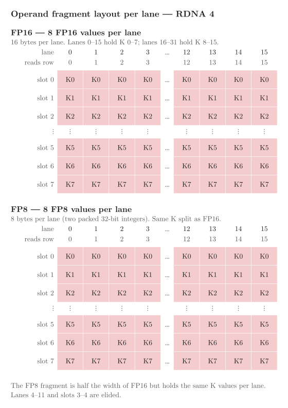

<!---
Copyright (c) 2026 Advanced Micro Devices, Inc. (AMD)

Permission is hereby granted, free of charge, to any person obtaining a copy
of this software and associated documentation files (the "Software"), to deal
in the Software without restriction, including without limitation the rights
to use, copy, modify, merge, publish, distribute, sublicense, and/or sell
copies of the Software, and to permit persons to whom the Software is
furnished to do so, subject to the following conditions:

The above copyright notice and this permission notice shall be included in all
copies or substantial portions of the Software.

THE SOFTWARE IS PROVIDED "AS IS", WITHOUT WARRANTY OF ANY KIND, EXPRESS OR
IMPLIED, INCLUDING BUT NOT LIMITED TO THE WARRANTIES OF MERCHANTABILITY,
FITNESS FOR A PARTICULAR PURPOSE AND NONINFRINGEMENT. IN NO EVENT SHALL THE
AUTHORS OR COPYRIGHT HOLDERS BE LIABLE FOR ANY CLAIM, DAMAGES OR OTHER
LIABILITY, WHETHER IN AN ACTION OF CONTRACT, TORT OR OTHERWISE, ARISING FROM,
OUT OF OR IN CONNECTION WITH THE SOFTWARE OR THE USE OR OTHER DEALINGS IN THE
SOFTWARE.
--->

# FP8 GEMM Optimization on AMD RDNA™ 4 Architecture

In this blog you will learn how to port an FP16 GEMM kernel to FP8 on AMD RDNA™ 4 GPUs. You will
see what the FP8 WMMA instruction changes, how the smaller element size lets larger tiles and
deeper K slices fit in LDS, and how four tile configurations compare against hipBLASLt on GEMM
shapes from transformer workloads.

This is Part 2 of a two-part series. [Part 1](https://rocm.blogs.amd.com/software-tools-optimization/rdna-fp16-gemm/README.html) built an FP16 GEMM
kernel from scratch on RDNA 3 and RDNA 4 GPUs, one optimization at a time, ending within a few
percent of hipBLASLt on all three targets. This post takes the final kernel from that progression and ports it to FP8 on
gfx1201 (RDNA 4). Rather than repeat the step-by-step derivation, it focuses on what changes at the
instruction level and what those changes unlock in tile shape and K depth.

FP8 WMMA is only available on gfx12, so this post covers one GPU: the AMD Radeon™ RX 9070 XT
(gfx1201). All of the structural choices from [Part 1](https://rocm.blogs.amd.com/software-tools-optimization/rdna-fp16-gemm/README.html) carry over unchanged: the TN memory layout,
buffer resource descriptors for bounded global loads, a deep K slice in LDS, the cache-reusing
block schedule, and the interleaved prefetch fold. What changes is the data type and the instruction,
and those two changes open up tile configurations that did not fit the LDS budget at FP16.

The post compares four configurations on four problem shapes drawn from transformer workloads.
Config 1 is the FP16 final kernel with element types swapped, to establish how much headroom the
FP8 instruction leaves on its own. Configs 2 and 3 explore the larger tiles that the smaller element
size makes possible, and Config 4 is the tile selected through a sweep of the search space. A
complete implementation is in the
[accompanying repository](https://github.com/ROCm/rocm-blogs/tree/release/blogs/software-tools-optimization/rdna-fp8-gemm/src).

To work through the examples you need a ROCm installation with the hipBLASLt development package,
an RDNA 4 GPU, and working familiarity with [Part 1](https://rocm.blogs.amd.com/software-tools-optimization/rdna-fp16-gemm/README.html). All timings in this post come from ROCm 10.0.

## What Changes at FP8

The FP16 kernel multiplied two 16×16 tiles of `_Float16` values and accumulated into `_Float16`.
The FP8 kernel uses a different instruction, one of the FP8 and BF8 builtins listed in the
[RDNA4 dense WMMA builtins](https://rocm-handbook.amd.com/projects/amd-rocm-optimization-guide/en/latest/compiler-builtins/rdna/rdna4-dense-wmma-builtins.html)
reference in the AMD ROCm Optimization Guide:

```cpp
// RDNA 4 FP8. Both operands are FP8 E4M3, accumulator is FP32.
acc = __builtin_amdgcn_wmma_f32_16x16x16_fp8_fp8_w32_gfx12(a, b, acc);
```

Three things change relative to the FP16 instruction on RDNA 4, and one thing is deliberately left
for future work.

**Operand type.** Each operand element is one byte (E4M3 FP8) rather than two bytes (FP16).
A single 128-bit load therefore moves 16 FP8 values instead of 8. The constant `elems_per_b128`
doubles from 8 to 16, and that one change propagates through every LDS size and copy count
calculation in the kernel.

**Fragment type.** On RDNA 4 an FP16 fragment is 8 values at 2 bytes each, 16 bytes per lane. An
FP8 fragment is 8 values at 1 byte each, 8 bytes per lane: two 32-bit registers holding four FP8
values each (the guide documents the full
[fragment layouts](https://rocm-handbook.amd.com/projects/amd-rocm-optimization-guide/en/latest/compiler-builtins/rdna/rdna4-dense-wmma-builtins.html#fragment-layouts)).
The builtin takes both operands as two packed 32-bit integers, not as an FP8 vector type, so the
fragment is declared as two `int` values:

```cpp
// Each operand: two 32-bit registers, four FP8 values each.
using FragmentA = int [[clang::ext_vector_type(2)]];
using FragmentB = int [[clang::ext_vector_type(2)]];
```

The load is still one 8-byte `__builtin_memcpy` from an LDS pointer; only the destination type
differs. Figure 1 shows the FP16 and FP8 fragments side by side: both hold eight K values per
lane, in 16 and 8 bytes respectively.

<div align="center">



</div>

<p align="center">Figure 1. Operand fragment layout per lane on RDNA 4. The FP8 fragment holds the same K values as FP16 at half the width.</p>

**Accumulator type.** FP8 WMMA accumulates into FP32; there is no FP16 accumulator variant. Each
lane holds 8 FP32 values (32 bytes), and the output matrix `C` is `float`. The layout is the same
as RDNA 4 FP16: lane `L` holds column `L % 16`, and accumulator element `i` holds row `8*(L/16) + i`. The kernel
writes `C` in the same column-major layout hipBLASLt uses, with leading dimension M, so the two
outputs line up element for element.

**No scale factors.** The kernel operates on raw FP8 values: the WMMA instruction multiplies E4M3
operands and accumulates into FP32 internally, with no per-tensor or per-row scale applied before or
after. A production quantized inference kernel would typically carry scale factors; this kernel is
the foundation that a follow-up would build on.

## Config 1: A Direct Port (128×96, K=64)

The first configuration is the FP16 final kernel with the element type changed and nothing else. The
output tile is 128×96, `block_k` is 64 (four WMMA steps of K in LDS), the wave grid is 2×2 (four
waves, 128 threads), and there is one LDS buffer.

```cpp
Config<128, 96, 64, 2, 2, /*single_buffer=*/true>
```

Each wave owns a 4×3 grid of 16×16 WMMA tiles and carries 4×3 = 12 accumulators, now FP32 rather
than FP16. At FP8 the operand slices cost half as much LDS as they did at FP16:

| | A slice | B slice | LDS |
| --- | ---: | ---: | ---: |
| FP16, `block_k = 64` | 128 × 80 × 2 B | 96 × 80 × 2 B | 63 KB |
| FP8, `block_k = 64` | 128 × 80 × 1 B | 96 × 80 × 1 B | 17.5 KB |

The row stride includes the 16-byte LDS pad from [Part 1](https://rocm.blogs.amd.com/software-tools-optimization/rdna-fp16-gemm/README.html) (`block_k + lds_pad = 64 + 16 = 80`). At
17.5 KB the block fits comfortably in the 64 KB budget and leaves most of it unused.

This configuration establishes the baseline: the FP8 instruction on its own, before any tile is
resized to take advantage of the smaller element.

## Config 2: A Larger Tile (256×256, K=64)

Config 1 leaves 46.5 KB of LDS unspent. At FP16 the natural next step, a 256×256 output tile with
`block_k = 64`, would need 80 KB — more than the 64 KB budget. At FP8 the same tile costs 40 KB and
fits with room to spare.

```cpp
Config<256, 256, 64, 4, 4, /*single_buffer=*/true>
```

The wave grid expands to 4×4: 16 waves sharing the 256×256 output tile, each wave covering a 64×64
quadrant as a 4×4 grid of WMMA tiles. Each wave carries 16 accumulators, the same structure as the
FP16 Step 2 kernel from [Part 1](https://rocm.blogs.amd.com/software-tools-optimization/rdna-fp16-gemm/README.html).

More arithmetic per LDS fill means each barrier is amortized over more work. The fold for this
configuration has 64 steps (4 K slices × 4×4 wave tiles) against Config 1's 48.

## Config 3: Deeper K (256×160, K=128)

Config 3 pushes `block_k` to 128, doubling the K depth from the previous two configurations. Eight
WMMA steps of K fit in LDS at once instead of four, halving the barrier frequency again. The output
tile is 256×160 with a 4×2 wave grid (eight waves, 256 threads):

```cpp
Config<256, 160, 128, 4, 2, /*single_buffer=*/true>
```

Each wave owns a 4×5 grid of WMMA tiles (4 rows × 5 columns). The fold has 160 steps (8 K slices ×
4×5 wave tiles). The operand slices at `block_k = 128`:

| | A slice | B slice | LDS total |
| --- | ---: | ---: | ---: |
| 256 × (128+16) × 1 B | 36,864 B | — | — |
| 160 × (128+16) × 1 B | — | 23,040 B | 58.5 KB |

At 58.5 KB the block still fits the 64 KB budget. The fold must carry 8 + 5 = 13 prefetch chunks
(the ceiling of 256×128 / (256×16) for A, and 160×128 / (256×16) for B). With 160 steps and one
chunk issued every second step, all 13 chunks are dispatched by step 26, which satisfies the
constraint that `2 * chunks ≤ steps` for both operands.

The 4×2 wave grid was chosen over 4×4 because a 4×4 grid does not divide a 160-wide tile into whole
WMMA tiles: four wave columns would leave each wave 40 columns, which is 2.5 WMMA tiles wide. With
two wave columns each wave owns 80 columns, a 4×5 grid of WMMA tiles with 20 accumulators, where
Config 2's 4×4 grid has 16. Each LDS fill therefore feeds more WMMA instructions per wave.

## Config 4: A Square Tile (192×192, K=128)

Config 4 keeps Config 3's K depth of 128 and uses a square 192×192 output tile on a 2×4 wave grid
(eight waves, 256 threads). The tile came out of a manual sweep of tile shapes and wave grids:

```cpp
Config<192, 192, 128, 2, 4, /*single_buffer=*/true>
```

Each wave owns a 96×48 region of the tile, a 6×3 grid of WMMA tiles, so it carries 18 accumulators,
two fewer than Config 3. The fold has 144 steps (8 K slices × 6×3 wave tiles) and carries 6 + 6 = 12
prefetch chunks, which satisfies the constraint that `2 * chunks ≤ steps` for both operands. The
operand slices at `block_k = 128`:

| | A slice | B slice | LDS |
| --- | ---: | ---: | ---: |
| FP8, `block_k = 128` | 192 × 144 × 1 B | 192 × 144 × 1 B | 54.0 KB |

At 54.0 KB the block uses 4.5 KB less LDS than Config 3. The compiler's resource report
(`-Rpass-analysis=kernel-resource-usage`) shows 210 VGPRs for Config 4 against 235 for Config 3, at
the same four waves per SIMD.

## Results

All four shapes are benchmarked on the AMD Radeon™ RX 9070 XT (gfx1201), and each is checked for
correctness against hipBLASLt.[^1] Drawing every element of A and B as -1 or +1 makes each product ±1
and each partial sum an integer, well inside the range FP32 accumulation represents exactly, so a
correct kernel must match hipBLASLt bit for bit with no tolerance.

The problem shapes match transformer workloads with K=8192 as the hidden dimension of a 70B-class
model (Llama-2/3-70B, Qwen2-72B):

| Shape | Workload |
| --- | --- |
| M=8192, N=8192, K=8192 | Attention output projection (square) |
| M=8192, N=28672, K=8192 | MLP up-projection (wide N) |
| M=8192, N=10240, K=8192 | GQA QKV projection |
| M=3072, N=4096, K=8192 | Smaller non-square |

hipBLASLt is called with `HIPBLAS_COMPUTE_32F`, since FP8 WMMA accumulates into FP32.

### M=8192, N=8192, K=8192

| Kernel | Avg ms | TFLOP/s | LDS | vs hipBLASLt |
| --- | ---: | ---: | ---: | ---: |
| hipBLASLt | `4.22` | `260.8` | — | — |
| Config 1 (128×96, K=64, 2×2) | `5.01` | `219.6` | `17.5 KB` | `−18.8%` |
| Config 2 (256×256, K=64, 4×4) | `4.78` | `230.1` | `40.0 KB` | `−13.3%` |
| Config 3 (256×160, K=128, 4×2) | `4.47` | `246.0` | `58.5 KB` | `−6.0%` |
| Config 4 (192×192, K=128, 2×4) | `4.39` | `250.5` | `54.0 KB` | `−4.1%` |

<p align="center">Table 1. Throughput at M=N=K=8192, verified for correctness.</p>

### M=8192, N=28672, K=8192

| Kernel | Avg ms | TFLOP/s | vs hipBLASLt |
| --- | ---: | ---: | ---: |
| hipBLASLt | `14.90` | `258.3` | — |
| Config 1 (128×96, K=64, 2×2) | `18.11` | `212.5` | `−21.6%` |
| Config 2 (256×256, K=64, 4×4) | `16.79` | `229.3` | `−12.7%` |
| Config 3 (256×160, K=128, 4×2) | `15.68` | `245.5` | `−5.2%` |
| Config 4 (192×192, K=128, 2×4) | `15.59` | `246.8` | `−4.7%` |

<p align="center">Table 2. Throughput at M=8192, N=28672, K=8192.</p>

### M=8192, N=10240, K=8192

| Kernel | Avg ms | TFLOP/s | vs hipBLASLt |
| --- | ---: | ---: | ---: |
| hipBLASLt | `5.28` | `260.5` | — |
| Config 1 (128×96, K=64, 2×2) | `6.34` | `216.8` | `−20.2%` |
| Config 2 (256×256, K=64, 4×4) | `6.03` | `227.8` | `−14.4%` |
| Config 3 (256×160, K=128, 4×2) | `5.60` | `245.3` | `−6.2%` |
| Config 4 (192×192, K=128, 2×4) | `5.57` | `246.6` | `−5.7%` |

<p align="center">Table 3. Throughput at M=8192, N=10240, K=8192.</p>

### M=3072, N=4096, K=8192

| Kernel | Avg ms | TFLOP/s | vs hipBLASLt |
| --- | ---: | ---: | ---: |
| hipBLASLt | `1.16` | `177.9` | — |
| Config 1 (128×96, K=64, 2×2) | `1.01` | `203.9` | `+12.8%` |
| Config 2 (256×256, K=64, 4×4) | `0.93` | `221.2` | `+19.6%` |
| Config 3 (256×160, K=128, 4×2) | `0.86` | `239.2` | `+25.7%` |
| Config 4 (192×192, K=128, 2×4) | `0.89` | `231.5` | `+23.2%` |

<p align="center">Table 4. Throughput at M=3072, N=4096, K=8192.</p>

As Tables 1–3 show, Config 4 lands within a few percent of hipBLASLt on the large shapes, and
Table 4 shows it ahead of hipBLASLt on the small one. Config 1 trails on the large square and
rectangular shapes (Tables 1–3) because a 128×96 tile, designed for the FP16 LDS budget, leaves
compute capacity unused when the element size halves. Config 2 closes most of that gap by using a
larger tile; Config 3 closes more by deepening K; Config 4, selected through a sweep of the search
space, closes the rest with a 192×192 tile on a 2×4 wave grid. On the smallest shape
(M=3072, N=4096, Table 4), Config 3's 256×160 tile is faster than Config 4: no single tile is best
across every shape.

## Tuning Further

The four configurations sampled a slice of the available search space. The parameters to
vary are the same three examined in [Part 1](https://rocm.blogs.amd.com/software-tools-optimization/rdna-fp16-gemm/README.html) — tile area, K depth, and wave grid — but the viable range
shifts at FP8. An element that is one byte rather than two means the same LDS budget supports
larger tiles: a 256×256 tile with `block_k = 64` costs 40 KB at FP8, where at FP16 it would
need 80 KB and would not fit. The LDS-versus-occupancy trade-off therefore occurs at a larger tile
size than it did in [Part 1](https://rocm.blogs.amd.com/software-tools-optimization/rdna-fp16-gemm/README.html).

The FP32 accumulator (eight `float` values per lane, 32 bytes) has a larger register footprint
than the RDNA 4 FP16 accumulator (eight `_Float16` values, 16 bytes). That raises register
pressure relative to the FP16 kernel at the same tile shape and wave grid, and registers — not
LDS — become the binding constraint sooner as tile area grows.

## The Same Problem, One Level Up

The parameters tuned by hand here — tile shape, K depth, wave grid — are the same parameters
hipBLASLt sweeps across shapes, data types, and architectures. The FP8 data type adds a
dimension to that sweep: tile configurations ruled out at FP16 by the LDS budget are candidates
at FP8. These posts cover the tooling for offline and online tuning:

- [GEMM Tuning within hipBLASLt - Part 1](https://rocm.blogs.amd.com/software-tools-optimization/hipblaslt-offline-tuning-part1/README.html)
  and [Part 2](https://rocm.blogs.amd.com/software-tools-optimization/hipblaslt-offline-tuning-part2/README.html)
- [hipBLASLt Online GEMM Tuning](https://rocm.blogs.amd.com/artificial-intelligence/hipblaslt_online_tuning/README.html)

## Summary

In this blog you ported an FP16 GEMM kernel to FP8 on AMD RDNA™ 4. Three things changed: the WMMA
instruction (`wmma_f32_16x16x16_fp8_fp8_w32_gfx12`), the operand fragment type (two packed 32-bit
integers), and the accumulator type (eight FP32 values), so the output matrix changes from
`_Float16` to `float`. Everything else from [Part 1](https://rocm.blogs.amd.com/software-tools-optimization/rdna-fp16-gemm/README.html) carried over: TN
layout with K-contiguous operands, buffer resource descriptors for out-of-bounds clamping, the LDS
pad that staggers bank accesses, the block swizzle for L2 reuse, and the interleaved prefetch fold
with compile-time-unrolled `FoldStep`. The fold's constraint (`2 * chunks_a ≤ steps` and
`2 * chunks_b ≤ steps`) determines which configurations are reachable from a given tile shape and
K depth.

You also saw what the smaller element makes possible. At half the size of FP16, the same LDS
budget buys a tile that would not have fit before. Config 1 is the FP16 final kernel unchanged;
Config 3 is what that budget makes available when the tile shape is rethought for FP8. Across four
transformer-sized shapes, Config 4 lands within a few percent of hipBLASLt on the large shapes and
ahead of it on the smallest, and no single tile is best on every shape.

Together with [Part 1](https://rocm.blogs.amd.com/software-tools-optimization/rdna-fp16-gemm/README.html), this gives you a complete progression for FP16 and FP8 GEMM on RDNA. The
same approach, which is to tune tile area, K depth, and wave grid against the LDS and register
budgets, carries over to your own kernels.

## Additional Resources

The AMD ROCm Optimization Guide, which covers the builtins and GEMM patterns used in this post:

- [AMD ROCm Optimization Guide](https://rocm-handbook.amd.com/projects/amd-rocm-optimization-guide/en/latest/)
- [Optimizing GEMM in HIP](https://rocm-handbook.amd.com/projects/amd-rocm-optimization-guide/en/latest/patterns/examples/matrix-multiply-optimization.html)
- [RDNA4 dense WMMA builtins](https://rocm-handbook.amd.com/projects/amd-rocm-optimization-guide/en/latest/compiler-builtins/rdna/rdna4-dense-wmma-builtins.html)
- [Performance guidelines](https://rocm-handbook.amd.com/projects/amd-rocm-optimization-guide/en/latest/conceptual/introduction/guidelines.html)

The RDNA 4 matrix instructions and the architecture behind them:

- [Using the Matrix Cores of AMD RDNA 4 architecture GPUs](https://gpuopen.com/learn/using_matrix_core_amd_rdna4/)
- ["RDNA 4" instruction set architecture reference guide](https://www.amd.com/content/dam/amd/en/documents/radeon-tech-docs/instruction-set-architectures/rdna4-instruction-set-architecture.pdf)
- [AMD GPU architecture programming documentation](https://gpuopen.com/amd-gpu-architecture-programming-documentation/)

HIP FP8 types and the hardware model:

- [HIP low-precision floating-point types](https://rocm.docs.amd.com/projects/HIP/en/latest/reference/low_fp_types.html)
- [HIP documentation](https://rocm.docs.amd.com/projects/HIP/en/latest/)
- [HIP hardware implementation](https://rocm.docs.amd.com/projects/HIP/en/latest/understand/hardware_implementation.html)
- [CU mode vs WGP mode](https://rocm.docs.amd.com/projects/HIP/en/latest/how-to/hip_rtc.html#cu-mode-vs-wgp-mode)

The library and related posts:

- [hipBLASLt documentation](https://rocm.docs.amd.com/projects/hipBLASLt/en/latest/)
- [FP16 GEMM Optimization on AMD RDNA™ 3 and RDNA™ 4 Architectures](https://rocm.blogs.amd.com/software-tools-optimization/rdna-fp16-gemm/README.html) — Part 1 of this series
- [FP8 GEMM Optimization on AMD CDNA™ 4 Architecture](https://rocm.blogs.amd.com/software-tools-optimization/cdna4-gemm-kernels/README.html) — the same techniques on Instinct hardware
- [Avoiding LDS Bank Conflicts on AMD GPUs with CK-Tile](https://rocm.blogs.amd.com/software-tools-optimization/lds-bank-conflict/README.html)
- [AMD matrix cores](https://rocm.blogs.amd.com/software-tools-optimization/matrix-cores/README.html)

## Notes

[^1]: Testing done by AMD. Results may vary based on configuration, usage, software
version, and optimizations.

### System Configuration

- GPU: AMD Radeon™ RX 9070 XT (`gfx1201`)
- ROCm stack: ROCm 10.0
- Compiler: `amdclang++` with `-O3 -std=c++17 -mcumode`
- Workload: FP8 (E4M3) GEMM with FP32 output, A row-major and B column-major (TN), at
  `M=N=K=8192`, `M=8192, N=28672, K=8192`, `M=8192, N=10240, K=8192`, and `M=3072, N=4096, K=8192`
- Reference: hipBLASLt called directly, `HIPBLAS_COMPUTE_32F`, the solution returned by
  `hipblasLtMatmulAlgoGetHeuristic`
- Methodology: 10 warm-up launches, then the mean of 30 timed launches; TFLOP/s computed as `2MNK/t`
- Resource figures: `-Rpass-analysis=kernel-resource-usage` at compile time

## Disclaimers

The information presented in this document is for informational purposes only and may contain technical inaccuracies, omissions, and typographical errors. The information contained herein is subject to change and may be rendered inaccurate for many reasons, including but not limited to product and roadmap changes, component and motherboard version changes, new model and/or product releases, product differences between differing manufacturers, software changes, BIOS flashes, firmware upgrades, or the like. Any computer system has risks of security vulnerabilities that cannot be completely prevented or mitigated. AMD assumes no obligation to update or otherwise correct or revise this information. However, AMD reserves the right to revise this information and to make changes from time to time to the content hereof without obligation of AMD to notify any person of such revisions or changes. THIS INFORMATION IS PROVIDED ‘AS IS.” AMD MAKES NO REPRESENTATIONS OR WARRANTIES WITH RESPECT TO THE CONTENTS HEREOF AND ASSUMES NO RESPONSIBILITY FOR ANY INACCURACIES, ERRORS, OR OMISSIONS THAT MAY APPEAR IN THIS INFORMATION. AMD SPECIFICALLY DISCLAIMS ANY IMPLIED WARRANTIES OF NON-INFRINGEMENT, MERCHANTABILITY, OR FITNESS FOR ANY PARTICULAR PURPOSE. IN NO EVENT WILL AMD BE LIABLE TO ANY PERSON FOR ANY RELIANCE, DIRECT, INDIRECT, SPECIAL, OR OTHER CONSEQUENTIAL DAMAGES ARISING FROM THE USE OF ANY INFORMATION CONTAINED HEREIN, EVEN IF AMD IS EXPRESSLY ADVISED OF THE POSSIBILITY OF SUCH DAMAGES. AMD, the AMD Arrow logo, and combinations thereof are trademarks of Advanced Micro Devices, Inc. Other product names used in this publication are for identification purposes only and may be trademarks of their respective companies. © 2026 Advanced Micro Devices, Inc. All rights reserved
