<!---
Copyright (c) 2026 Advanced Micro Devices, Inc. (AMD)
Permission is hereby granted, free of charge, to any person obtaining a copy
of this software and associated documentation files (the "Software"), to deal
in the Software without restriction, including without limitation the rights
to use, copy, modify, merge, publish, distribute, sublicense, and/or sell
copies of the Software, and to permit persons to whom the Software is
furnished to do so, subject to the following conditions:
The above copyright notice and this permission notice shall be included in all
copies or substantial portions of the Software.
THE SOFTWARE IS PROVIDED "AS IS", WITHOUT WARRANTY OF ANY KIND, EXPRESS OR
IMPLIED, INCLUDING BUT NOT LIMITED TO THE WARRANTIES OF MERCHANTABILITY,
FITNESS FOR A PARTICULAR PURPOSE AND NONINFRINGEMENT. IN NO EVENT SHALL THE
AUTHORS OR COPYRIGHT HOLDERS BE LIABLE FOR ANY CLAIM, DAMAGES OR OTHER
LIABILITY, WHETHER IN AN ACTION OF CONTRACT, TORT OR OTHERWISE, ARISING FROM,
OUT OF OR IN CONNECTION WITH THE SOFTWARE OR THE USE OR OTHER DEALINGS IN THE
SOFTWARE.
--->

# Device Memory Load Issue Stalls and Scheduling Opportunities in Lock-Stepped Kernels on AMD Instinct™ MI300X

In this series of ROCm blogs, we are studying the impact of instruction
scheduling on memory operations executed in lock-step. This post follows
the [introductory post](https://rocm.blogs.amd.com/software-tools-optimization/scheduling_memory_ops_gfx942/README.html) and will focus on loading data from device memory
and its cache hierarchy on the AMD Instinct™ MI300X class of GPUs.

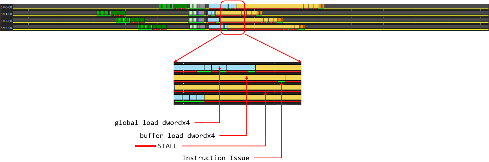

<p align="center">Figure 1. Example ATT trace showing stalls attributed to VMEM instruction classes of interest.</p>

Figure 1 highlights some of the common optimization opportunities
observed with VMEM loads[^1]. In what follows, we will dive into why
some of these load instructions are stalled for a disproportionate
number of cycles before being issued for execution. We will investigate techniques to avoid such extraneous stalls and explore how "free" issue slots can be used to issue instructions under the shadow of other instructions.

### Scope and Experimental Setup

A vector memory (VMEM) load can issue only after the instruction decodes and clears all checks. At most one such load can issue per compute unit (CU) per issue slot. The checks include operand readiness, an available slot in the per-wave VMEM tracker, and acceptance by the VMEM issue port.
Once issued, the request traverses the memory hierarchy, hits cache or device memory, returns, retires in the tracker, and finally writes the data into the destination vector register(s) (VGPR(s)). 
Any consumer of the data fetched must wait till these actions complete; the compiler usually ensures this by the appropriate insertions of <span>s_waitcnt</span> instructions. 
In this post, we explore an important performance optimization opportunity: reducing stalls that commonly occur before device memory read instructions are issued in lock-step kernels (see our Introduction post), creating valuable headroom for improving throughput via effective scheduling. 
What Figure 1 highlights is that a period of heavy VMEM activity can significantly reduce the rate at which new memory loads are issued. 
Recognizing these patterns, particularly the long red stall lines beneath memory operations, helps pinpoint where optimization efforts can have the biggest impact.

Sixteen-byte VMEM reads come in three flavors on AMD MI300X GPUs: <span>global_load_dwordx4</span>, <span>buffer_load_dwordx4</span>, and <span>flat_load_dwordx4</span>. 
Plain <span>flat_load_dwordx4</span> is deliberately out of scope for this article: resolving the segment at runtime per lane complicates correctness and comparisons to the fixed-segment workloads we assemble by hand. 
<span>global_load_dwordx4</span> and <span>buffer_load_dwordx4</span> are both sixteen-byte loads into VGPRs per lane, but <span>buffer_\*</span> carries a statically bound Shader Resource Descriptor (SRD), whereas <span>global_\*</span> uses explicit global-segment addressing. 
In AMD MI300X GPU instruction set, the <span>dwordx4</span> form designates a 128-bit (4 × 32-bit) load/store that moves four consecutive DWORDs in one instruction, delivering twice the per-instruction bandwidth of a <span>dwordx2</span> (64 bits), and four times that of a single <span>dword</span> (32 bits). 
This blog post focuses only on <span>dwordx4</span> form of VMEM operations as they are more commonly encountered in AI kernels. 
It also focuses solely on <span>global_load_dwordx4</span> instructions, but all presented observations translate to <span>buffer_load_dwordx4</span> instructions as well.
We begin with an extreme, but instructive schedule: all global loads clustered at the top of each inner loop iteration, followed by dependent VALU work, with <span>s_barrier</span> between iterations so waves in each workgroup are lock-stepped. 
That exaggerated pattern stresses the vector-memory subsystem and exaggerates stalls we analyze in this article. 
Subsequent sections revisit the same computational intent while giving the scheduler more room to reduce issue stalls and/or to hide vector-memory latency.
We manually modify and link the assembly programs for the various scenarios presented in this study to provide insights into how they behave on the GPU[^2].


### Baseline: Clustered Global Loads

We start from the following pseudo code as the loop body. 
It somewhat resembles what happens in Phase 2 of each iteration of the tiled GEMM inner loop in the Introduction post of this series; LDS usage and VGPR-based double buffering are intentionally left out of discussion in this article. 
Our primary focus is on efficiently issuing VMEM loads (i.e., at the beginning of load instruction execution); how the loaded data is subsequently consumed after <span>s_waitcnt</span>, when the load instruction in question finishes executing, is out of scope for this post. 
To highlight the challenge at hand, we start from a baseline where all loads are clustered together in four lock-stepping waves.

```python
LoopBodyTop:
s_barrier
Repeat sub-block 8 times
    global_load_dwordx4 // Load A
    global_load_dwordx4 // Load B
Repeat sub-block 8 times (vmcnt counts down by 2 each time: 14 → 12 → ... → 0):
    s_waitcnt vmcnt(N) // SALU: partial VMEM drain --- N = 14,12,10,8,6,4,2,0
    2× v_pk_fma_f32 // VALU: consume the next A/B dword×4 pair from v\[...\]
    2× v_mfma_f32_32x32x8_f16 // XDL/MFMA: RAW from VALU dst; B side reuses load operands
s_barrier
... pointer bump + trip count + branch back to LoopBodyTop ...
```
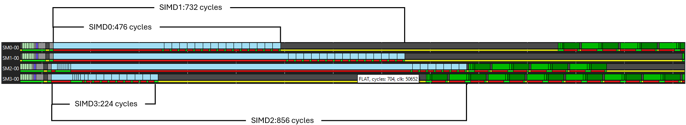

<p align="center">Figure 2. Sixteen <span>global_load_dwordx4</span> issued before any VALU and MFMA instructions representing severe instruction issue stalls.</p>

As seen in Figure 2, many of the blue instruction boxes are noticeably wide, indicating significant instruction-issue stalls (red lines underneath). 
For example, the longest stalling load in Figure 2 on SIMD 2 (SM2-00) takes 704 cycles before it is finally sent to the VMEM execution unit. 
The hardware is unable to issue VMEM instructions fast enough when so many VMEM loads are queued back-to-back. 
In short, this amount of concurrent VMEM traffic overwhelms the system and imposes an outsized "penalty". Under ideal circumstances, 16 <span>global_load_dwordx4</span> instructions in each iteration for each workgroup should be issued in 64 cycles (each load issues in a quad cycle per SIMD=16x4). How can we achieve that?

### Removing Barriers: Natural Skew

Without the barriers, LDS reads and writes across the workgroup would be unordered, and the tiled GEMM results would be wrong. They also pin every wave to the same schedule, and that lock-step is a large part of the penalty in Figure 2. What if we temporarily remove the barriers from this loop to see how much of the stall they account for? Waves are then free to drift, and a natural skew emerges.

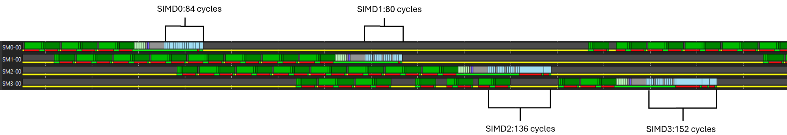

<p align="center">Figure 3. Sixteen <span>global_load_dwordx4</span> instructions issued without barriers to allow natural skew.</p>

As Figure 3 shows, that skew brings the sixteen back-to-back loads down to between 80 and 152 cycles per iteration, much closer to the 64-cycle ideal. The drop from the stalled trace in Figure 2 to this window is the cost of keeping the barriers while the loads stay clustered. The schedules in the rest of the article try to recover as much of that as they can, with the barriers left in place.

### How Many Loads Are Too Many?

Figure 2 showed that sixteen back-to-back VMEM loads lead to severe stalls in a four wave per workgroup lock-stepped configuration. 
If we filter out all non-memory instructions in the loop within the barriers, issue only two VMEM loads in the inner loop, and followed them with an <span>s_waitcnt vmcnt(0)</span>, we still observe instruction issue stalls (see Figure 4 below). 
In Figure 4, SIMD3 (SM3-00) takes an average of 16 cycles per VMEM load. 
In Figure 3, the corresponding SIMD3 requires an average of 9.5 cycles per load. Therefore, if we adhere to the lock-stepping pattern proposed in the baseline example (Figure 2), even two consecutive VMEM loads can stall.

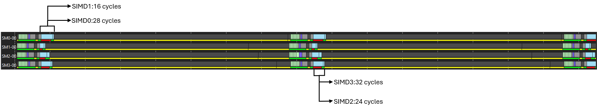

<p align="center">Figure 4. Two <span>global_load_dwordx4</span> instructions issued back-to-back in lock-step across all waves.</p>

Figure 3 in the previous section has shown that the removal of barriers introduces a natural skew that helps reduce the severity of instruction stalls. 
Can we partially mimic that without losing the barrier enforced lock-stepping nature of the kernel? 
We can achieve that by placing an <span>s_waitcnt vmcnt(0)</span> at the head of the loop, just after the first barrier, which allows all outstanding VMEM operations to return before the new set of loads are in-flight. 
This reduces the total VMEM concurrent traffic in the VMEM subsystem, leading to more efficient VMEM load issues. 
With such a setup, in Figure 5, starting from 16 consecutive loads at the top trace, we gradually reduce the number of loads to 14, 13, and 12 towards the bottom trace. 
At 12 and 13 consecutive loads, stalls completely disappear, while some stalls are still visible at 14 consecutive loads.

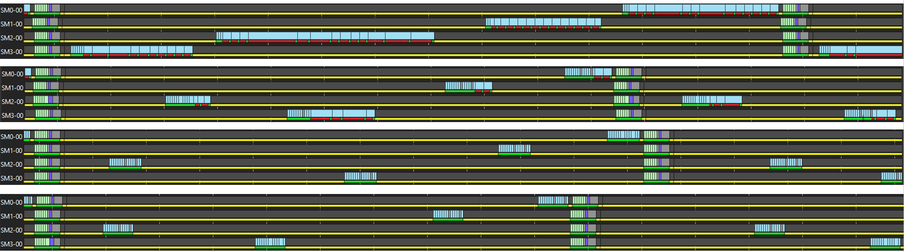

<p align="center">Figure 5. Lock-stepped behavior of consecutive <span>global_load_dwordx4</span> instructions. Top to bottom: traces with 16, 14, 13, 12 consecutive loads per iteration per wave.</p>

In a lock-stepped execution with four waves per workgroup on an AMD MI300X GPU, we observe that the hardware can only sustain 13 in-flight <span>global_load_dwordx4</span> (or <span>buffer_load_dwordx4</span>) instructions per wave without introducing instruction-issue stalls, as shown in Figure 5, despite the skews. This limit is not an artificial threshold imposed by the ISA. Hardware counters place that limit on Sequencer issue wait, which stays flat through 13 consecutive loads and then jumps at 14. 
The SQ_WAIT_INST_ANY performance counter, which counts the number of cycles spent waiting for any instruction to issue, highlights this: its value jumps ~2.6x from 13 to 14 consecutive global loads. 
L1 and L2 hit rates do not, both remaining almost constant at ~50% and ~80% respectively. 
Stalls on the address path into L1 and on pending L1 returns grow more linearly than Sequencer issue wait does as more loads stay in flight. 
TA_ADDR_STALLED_BY_TC counts the cycles the texture addressing path is stalled waiting on the texture cache; it rises ~1.4x over the same 13-to-14 step. 
TCP_PENDING_STALL counts the cycles the L1 pipe waits for outstanding returns and moves only ~1.1x. 
Both counters therefore reflect a busier L1 path as more loads remain outstanding, rather than the discontinuity observed at instruction issue. 
This indicates that the extra stall is incurred before the load is accepted for issue, not from a matching increase in L1 return time.
More details about such hardware performance counters for AMD MI300X GPUs can be found [here](https://rocm.docs.amd.com/en/develop/reference/gpu-arch/mi300-mi200-performance-counters.html) and guidance on profiling with rocprofv3 on AMD GPUs is available [here](https://rocm.docs.amd.com/projects/rocprofiler-sdk/en/develop/how-to/using-rocprofv3.html).

The penalty for crossing this “13 consecutive load” knee is sharply non-linear: the average per-load issue stall jumps from ~0 cycles/operation at 13 consecutive loads, to ~5 cycles/operation (max 356 cycles) at 14, to ~15 cycles/operation (max 680 cycles) at 16.
Overall, trying to issue multiple VMEM loads within a small window of cycles across multiple waves tends to create bottlenecks in the VMEM subsystem. 
Introducing natural skew helps spread consecutive <span>global_load_dwordx4</span> instructions across a wider window of cycles, but we still seem to hit a hard limit at 13 loads due to hardware traffic.
We observe the same limit with either one or two workgroups per CU.

These highlight an opportunity for smarter scheduling to help regulate such VMEM pressure, improve overall throughput, and alleviate such oversized penalties. 
First, let’s investigate whether optimizing memory addressing can improve behavior on hardware.

### Does Memory Coalescing Help?

Before modifying instruction scheduling, we first consider whether improved memory access patterns could alleviate the problem.
Hardware memory coalescing allows the 64 lane addresses of a VMEM instruction to collapse onto a smaller number of cache lines, improving efficiency.

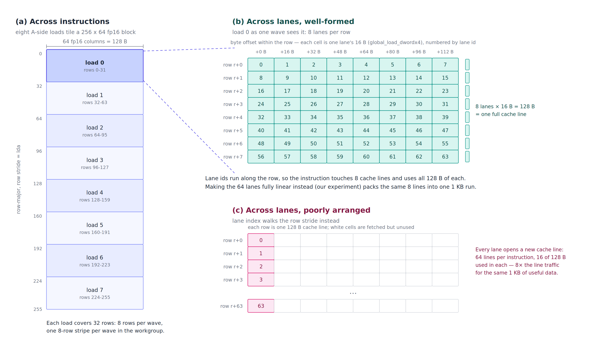

<p align="center">Figure 6. Address tiling of a tiled GEMM load: (a) across the eight A-side <span>global_load_dwordx4</span> of an iteration, (b) across the 64 lanes of one well-formed load, and (c) across the 64 lanes of a poorly arranged load.</p>

Tiled GEMM loads already rely on coalescing, and Figure 6 shows how their addresses are laid out. 
Each <span>global_load_dwordx4</span> covers an eight-row stripe of the tile per wave, and the eight lanes assigned to a row read 64 consecutive fp16 elements, which is exactly one 128-byte cache line. 
One instruction therefore touches eight cache lines and uses every byte of each. 
Successive loads step the row block by 32 rows, so the eight A-side loads tile a 256×64 element block, and the eight B-side loads do the same for B. 
A poorly arranged tiled load maps the lane index onto the row stride instead, placing every lane on its own cache line: the same 1 KB of useful data then costs 64 line fills, with 112 of every 128 bytes discarded.

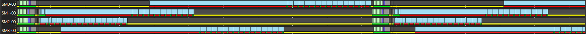

<p align="center">Figure 7. 16 consecutive coalesced <span>global_load_dwordx4</span> per iteration per wave.</p>

To isolate the effect of coalescing, we manually modified address calculations so that all 64 lanes access consecutive 16-byte chunks. 
Between iterations, the base address advances to a non-overlapping region, preserving the same pattern.
Despite improved L1 and L2 hit rates, Figure 7 shows that instruction-issue stalls persist. 
Coalescing improves cache efficiency but does not resolve VMEM issue pressure when too many loads are issued in close succession, as cache friendly access patterns matter more after VMEM load instructions are issued and while fetching data from cache lines. 

### Software Pipelining: Interleaving Loads and Compute

Given that clustering global loads is problematic, the natural next step is to distribute VMEM traffic more evenly. 
Figure 2 shows how costly consecutive VMEM load issues are.
Following the GEMM execution model, we apply software pipelining: prefetch a block of loads in the prologue, consume them while issuing the next block, and maintain a steady-state pipeline. 
In this sketch we deliberately throttle loads so that two new loads are issued only after the two oldest loads have returned data, maintaining a steady-state pipeline depth of 16.
```python
SWP_PROLOGUE:
    16 × global_load // "K block 0" into A/B staging registers

LOOP:
    s_barrier
    // Steady state: 16 prior loads still completing while we consume them and
    // issue the next 16 for the following iteration.

    repeat 8 times: // one "sub-block" per A/B lane-group pair
        s_waitcnt vmcnt(14) // here, vmcnt always counts down to 14 to allow 2 oldest VMEM ops to finish
        2× v_pk_fma_f32 // VALU: consume the next A/B dword×4 pair from v\[...\]
        2× v_mfma_f32_32x32x8_f16 // XDL/MFMA: RAW from VALU dst; B side reuses load operands
        2× global_load_dwordx4 // VMEM: prefetch next K+1 stripe into slots that are now available for reuse (operand reads already issued)
    // After 8 sub-blocks: 16 new global_loads issued (next K), still in flight.
    s_barrier

EPILOGUE:
    // No new global_loads. Last tile data still draining from VMEM.
    repeat 8 times:
        s_waitcnt vmcnt(N) // SALU: partial VMEM drain --- N = 14,12,10,8,6,4,2,0
        2× v_pk_fma_f32
        2× v_mfma_f32_32x32x8_f16
```
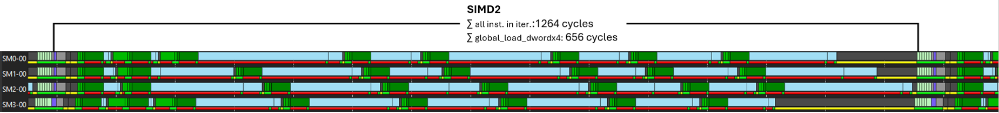

<p align="center">Figure 8. Software-pipelined loop with VALU and MFMA interleaved between global loads.</p>

Although VMEM stalls persist in Figure 8, interleaving loads with compute cuts VMEM load issue stalls by ~23% relative to Figure 2.
On SIMD2 (SM2-00), all sixteen <span>global_load_dwordx4</span> instructions finish in ~656 cycles (1264 cycles per iteration overall), down from 856 cycles in Figure 2, reinforcing the value of spreading VMEM traffic rather than bursting it. 
Figure 8 schedules blocks of two VALU, MFMA, and <span>global_load_dwordx4</span> back-to-back; next, we refine further to a 1×1×1 interleave.

```python
SWP_PROLOGUE:
    16 × global_load // "K block 0" into A/B staging registers

LOOP:
    s_barrier
    repeat 8 times:
        s_waitcnt vmcnt(14)
        repeat 2 times
            1× v_pk_fma_f32
            1× v_mfma_f32_32x32x8_f16
            1× global_load_dwordx4
    s_barrier

EPILOGUE:
    ...
```
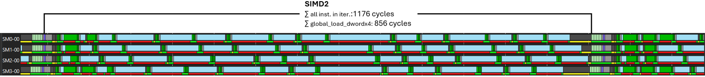

<p align="center">Figure 9. VALU, MFMA, and <span>global_load_dwordx4</span> interleaved with each other in the loop following software pipelining.</p>

Despite applying our earlier learning of avoiding two back-to-back <span>global_load_dwordx4 instructions</span>, Figure 9 does not reduce VMEM stalls.  
Load attribution remains ~856 cycles per iteration (1176 cycles total), matching Figure 2. 
Removing barriers in Figure 3 or placing <span>s_waitcnt vmcnt(0)</span> before all loads in Figure 5 introduced enough wave skew to keep fewer VMEM loads in flight at once; here, that skew is absent.
Figure 9 does, however, eliminate MFMA-related stalls. 
On AMD Instinct MI300X GPUs, MFMAs of these sizes have a documented 32-cycle execution time; LLVM models it as an eight-pass matrix operation with an eight-cycle initiation interval. 
Two adjacent independent MFMAs therefore leave seven intervening issue slots. 
In Figure 8, ATT attributes ~28 clocks to the second MFMA of each pair (~224 clocks across eight pairs). 
Interleaving other instructions into those slots in Figure 9 removes the stall. 
Although orthogonal to our main focus, this illustrates the broader payoff of careful instruction mixing: those MFMA stall cycles vanish in Figure 9, leaving less time for preceding VMEM loads to return and thus increasing VMEM subsystem pressure.
Overall, interleaving MFMA, VALU, and VMEM loads improves per-iteration latency by ~7% in Figure 9 versus Figure 8. 
Against the Figure 2 baseline, which averages 1954 cycles per iteration, Figures 8 and 9 finish in 1264 and 1176 cycles, gains of ~35% and ~39%.

### Adding More Compute Between Loads

Building on top of the 1x1x1 interleave experiment in Figure 9, we insert more VALU instructions between memory operations to approximate realistic workloads where compute and memory traffic are interleaved. 
This spacing allows the memory subsystem's internal queues to partially drain between accesses, which can reduce back-pressure stalls at the issue stage, modeling the behavior of production kernels more closely than a tight memory-only loop.

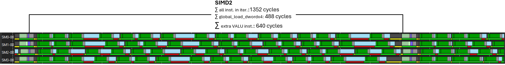

<p align="center">Figure 10. Eight dummy VALU instructions inserted before each <span>global_load_dwordx4</span>.</p>

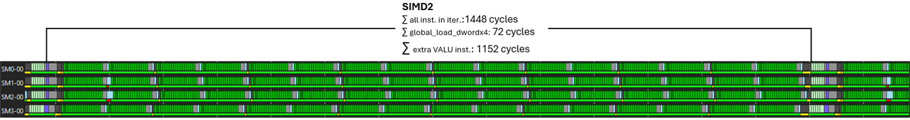

<p align="center">Figure 11. Sixteen dummy VALU instructions inserted before each <span>global_load_dwordx4</span>.</p>

As Figures 10 and 11 show, increasing the amount of compute between VMEM loads dramatically reduces issue stalls (~488 and ~72 cycles respectively to finish all loads in SM2-00). 
In real kernels, the feasibility of this strategy depends on the available computation.

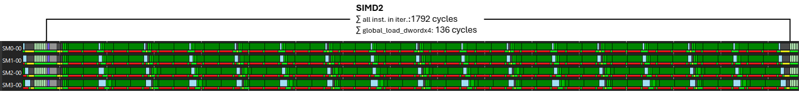

<p align="center">Figure 12. Two extra MFMAs inserted before each <span>global_load_dwordx4</span>.</p>

Our motivating tiled GEMM example issues 256 MFMAs per iteration, and in a GEMM-shaped kernel those MFMAs themselves can be scheduled to spread out the consecutive VMEM loads to reduce the severity of instruction issue stalls (e.g., ~136 cycles to finish issuing all loads in Figure 12). 
With matrix work at this density, per-MFMA stalls become unavoidable. 
The small residual stalls visible on the global loads are simply the SIMD's issue front-end queueing behind the back-to-back MFMAs. 
Therefore, to reduce stalls with VMEM instruction issues the takeaway is clear:

- Break up clusters of VMEM instructions.
- Distribute compute as evenly as possible between memory operations.

### Waiting Early vs. Waiting Late

Finally, we revisit the placement of <span>s_waitcnt</span>. What happens when, instead of gradually draining VMEM operations throughout the loop, we place <span>s_waitcnt vmcnt(0)</span> at the head of each iteration?

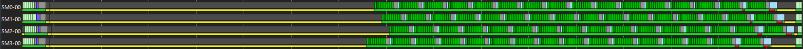

<p align="center">Figure 13. Eight dummy VALU instructions before each VMEM load with <span>s_waitcnt</span> <span>vmcnt(0)</span> at loop entry.</p>

In this configuration, significantly fewer compute instructions are required to eliminate VMEM issue stalls (8 in Figure 13, versus 16 in Figure 11). 
By waiting early, the VMEM pipeline is mostly empty during the loop body, and the remaining loads can be handled without excessive pressure. 
The presence of interleaved VALU and MFMA instructions further helps the cause by allowing VMEM loads more cycles to return. 
However, this approach introduces longer per-iteration waits and is beneficial only if sufficient compute exists at the tail of the loop to effectively hide those waits.

### Applying Interleaved Load Scheduling to the Tiled GEMM Kernel

In the tiled GEMM kernel from our motivating example in the introduction, eight consecutive <span>buffer_load_dwordx4</span> instructions were clustered together in each loop iteration. 
This dense packing caused instruction issue stalls because subsequent loads had to wait for the previous ones to clear, creating a cascade of stalls.

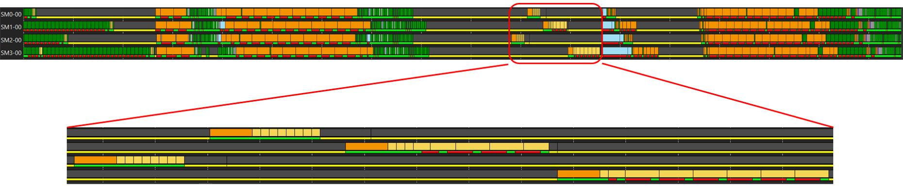

<p align="center">Figure 14. Stalls while issuing consecutive <span>buffer_load_dwordx4</span> instructions in the tiled GEMM motivating example.</p>

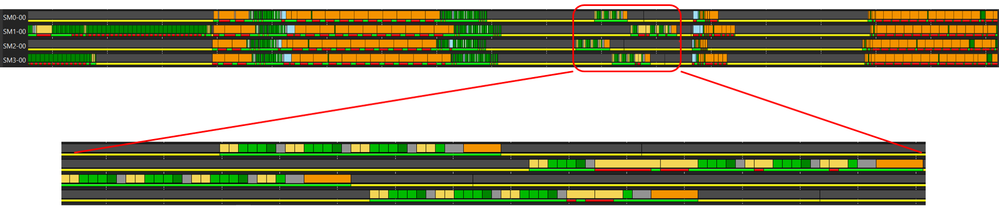

<p align="center">Figure 15. Fewer stalls while issuing <span>buffer_load_dwordx4</span> instructions in the tiled GEMM motivating example after interleaving between VALU and MFMA operations.</p>

By interleaving these loads with the surrounding MFMA and VALU work, we spread VMEM pressure across the iteration. 
Figure 14 zooms into the part of the trace where the consecutive loads cause instruction issue stalls. 
Figure 15 zooms into the comparable section of the trace where loads, MFMA, and VALU are interleaved, showing significant reduction (roughly threefold) in instruction issue stalls.
Loads now issue with minimal delay, as the intervening compute instructions give the memory subsystem time to absorb each request before the next request arrives. 
In spite of these improvements, the same figures show that LDS traffic (orange boxes in the un-zoomed part of figures) still dominates stalls in this kernel, which we will investigate in the next two Parts of the blog series. 
Nonetheless, the learnings from this study are still valuable while designing or revising instruction scheduling for VMEM loads, especially for lock-stepped memory-bound kernels.


### Summary

In this post, we explored a key optimization opportunity in lock-step kernels: the stalls that can occur when memory loads are issued in close succession. Starting from a deliberately challenging baseline, where 16 <span>global_load_dwordx4</span> instructions were clustered at the top of a barrier-synchronized loop, we uncovered how contention in the VMEM subsystem can limit effective throughput. The analysis showed that the greatest performance gains come not from changing memory addresses, but from strategically scheduling instructions to make more efficient use of available memory bandwidth. Compilers already schedule loads early to hide latency; here we showed how finer-grained interleaving can further reduce issue-stage pressure in VMEM-bound, lock-stepped kernels. Key takeaways:

- Clustering VMEM loads in lock-stepped kernels can overwhelm the memory hierarchy and cause severe issue stalls.

- Hardware can sustain only a limited number of in-flight VMEM operations per wave, irrespective of the number of workgroups dispatched per CU, under the scenarios discussed in this study.

- Coalescing improves cache behavior but does not solve VMEM issue
  pressure.

- Software pipelining and careful interleaving of compute and memory
  instructions significantly improve throughput and reduce VMEM load
  instruction issue stalls, irrespective of the number of workgroups
  dispatched per CU.

- The placement of <span>s_waitcnt</span> is a powerful tuning lever, but it introduces trade-offs between latency hiding and synchronization cost.

- Removal of lock-stepping through barriers allows more loads to be issued back-to-back with minor stalls. If barriers are unavoidable, inserting VALU and/or MFMA instructions between consecutive VMEM loads can improve VMEM load issue latency, potentially matching the latency observed in the absence of lock-stepping (see Figures 3, 9, 10, 11, and 12).

You can find reproducers for the above in this [Github repo](https://github.com/ROCm/rocm-blogs/tree/release/blogs/software-tools-optimization/scheduling_VMEM_loads_gfx942/artifacts).

In Part 2, we turn our attention to LDS write operations and examine how
similar scheduling principles apply to shared-memory traffic.

### Additional Resources

- [Memory Instruction Scheduling for Lock-Stepped Kernels on AMD Instinct™ MI300X: Introducing the Series](https://rocm.blogs.amd.com/software-tools-optimization/scheduling_memory_ops_gfx942/README.html).
- [AMD Instinct MI300 CDNA 3 Instruction Set Architecture](https://www.amd.com/content/dam/amd/en/documents/instinct-tech-docs/instruction-set-architectures/amd-instinct-mi300-cdna3-instruction-set-architecture.pdf).
- [A Guide to Understanding AMDGCN Assembly](https://rocm.blogs.amd.com/software-tools-optimization/amdgcn-isa/README.html).
- [Understanding GPU performance (HIP)](https://rocm.docs.amd.com/projects/HIP/en/latest/understand/performance_optimization.html).
- [Vector L1 cache (vL1D) in ROCm Compute Profiler](https://rocm.docs.amd.com/projects/rocprofiler-compute/en/latest/conceptual/cdna/vector-l1-cache.html).
- [Using thread trace (ATT)](https://rocm.docs.amd.com/projects/rocprofiler-sdk/en/latest/how-to/using-thread-trace.html).

[^1]: Global load, buffer load, and VMEM load are used interchangeably in this article's text. All observations presented in this article hold for both global and buffer loads. 
Most figures show behavior of global loads for uniformity.

[^2]:The compiler calculated the occupancy of the kernel from the motivating example as one. Therefore, in all experiments, we have assumed that the maximum number of registers is available, and our instruction scheduling tweaks do not consider register allocation or spilling problems.

## Disclaimers

Performance may vary by hardware configuration, workload, and software version.

## Third-Party Content Disclaimer

Third-party content is licensed to you directly by the third party that owns the content and is not licensed to you by AMD. ALL LINKED THIRD-PARTY CONTENT IS PROVIDED “AS IS” WITHOUT A WARRANTY OF ANY KIND. USE OF SUCH THIRD-PARTY CONTENT IS DONE AT YOUR SOLE DISCRETION AND UNDER NO CIRCUMSTANCES WILL AMD BE LIABLE TO YOU FOR ANY THIRD-PARTY CONTENT. YOU ASSUME ALL RISK AND ARE SOLELY RESPONSIBLE FOR ANY DAMAGES THAT MAY ARISE FROM YOUR USE OF THIRD-PARTY CONTENT.

The information presented in this document is for informational purposes only and may contain technical inaccuracies, omissions, and typographical errors. The information contained herein is subject to change and may be rendered inaccurate for many reasons, including but not limited to product and roadmap changes, component and motherboard version changes, new model and/or product releases, product differences between differing manufacturers, software changes, BIOS flashes, firmware upgrades, or the like. Any computer system has risks of security vulnerabilities that cannot be completely prevented or mitigated. AMD assumes no obligation to update or otherwise correct or revise this information. However, AMD reserves the right to revise this information and to make changes from time to time to the content hereof without obligation of AMD to notify any person of such revisions or changes. THIS INFORMATION IS PROVIDED ‘AS IS.” AMD MAKES NO REPRESENTATIONS OR WARRANTIES WITH RESPECT TO THE CONTENTS HEREOF AND ASSUMES NO RESPONSIBILITY FOR ANY INACCURACIES, ERRORS, OR OMISSIONS THAT MAY APPEAR IN THIS INFORMATION. AMD SPECIFICALLY DISCLAIMS ANY IMPLIED WARRANTIES OF NON-INFRINGEMENT, MERCHANTABILITY, OR FITNESS FOR ANY PARTICULAR PURPOSE. IN NO EVENT WILL AMD BE LIABLE TO ANY PERSON FOR ANY RELIANCE, DIRECT, INDIRECT, SPECIAL, OR OTHER CONSEQUENTIAL DAMAGES ARISING FROM THE USE OF ANY INFORMATION CONTAINED HEREIN, EVEN IF AMD IS EXPRESSLY ADVISED OF THE POSSIBILITY OF SUCH DAMAGES. AMD, the AMD Arrow logo, and combinations thereof are trademarks of Advanced Micro Devices, Inc. Other product names used in this publication are for identification purposes only and may be trademarks of their respective companies. © 2026 Advanced Micro Devices, Inc. All rights reserved

<style>
  span, pre {
    font-family: "Consolas" !important;
  }
  figcaption {
    text-align: center
  }
  img {
    display: block;
    margin-left: auto;
    margin-right: auto;
  }
</style>
