<!---
Copyright (c) 2026 Advanced Micro Devices, Inc. (AMD)

Permission is hereby granted, free of charge, to any person obtaining a copy
of this software and associated documentation files (the "Software"), to deal
in the Software without restriction, including without limitation the rights
to use, copy, modify, merge, publish, distribute, sublicense, and/or sell
copies of the Software, and to permit persons to whom the Software is
furnished to do so, subject to the following conditions:

The above copyright notice and this permission notice shall be included in all
copies or substantial portions of the Software.

THE SOFTWARE IS PROVIDED "AS IS", WITHOUT WARRANTY OF ANY KIND, EXPRESS OR
IMPLIED, INCLUDING BUT NOT LIMITED TO THE WARRANTIES OF MERCHANTABILITY,
FITNESS FOR A PARTICULAR PURPOSE AND NONINFRINGEMENT. IN NO EVENT SHALL THE
AUTHORS OR COPYRIGHT HOLDERS BE LIABLE FOR ANY CLAIM, DAMAGES OR OTHER
LIABILITY, WHETHER IN AN ACTION OF CONTRACT, TORT OR OTHERWISE, ARISING FROM,
OUT OF OR IN CONNECTION WITH THE SOFTWARE OR THE USE OR OTHER DEALINGS IN THE
SOFTWARE.
--->

# Faster Stable Diffusion on AMD Ryzen™ AI with TeaCache

In this blog, you will learn how to accelerate Stable Diffusion 3 and 3.5 image generation on AMD Ryzen AI neural processing units (NPUs) with TeaCache, without retraining. Explore how TeaCache reuses intermediate outputs, compare naive and rescaled caching, and learn how to integrate caching into an ONNX-based pipeline. Use the latency and image-quality results to guide your caching settings, then follow the setup steps to try TeaCache on your Ryzen AI machine.

## The Problem: Redundant Computation in Diffusion Models

Diffusion models generate high-quality images but are often slow during inference. They rely on a denoising loop that runs a backbone network, typically a UNet (U-shaped convolutional network) or DiT (diffusion transformer), for dozens of sequential timesteps. Each step depends on the previous one, so latency scales linearly with the number of steps (often 20-100). Starting from noise, the model progressively refines a latent representation, requiring a full forward pass through the network at every timestep.

Most of the computation occurs in the backbone network. In DiT models, self-attention layers dominate memory and compute due to their quadratic cost. In UNet models, convolution and MLP blocks process high-dimensional features across multiple resolutions. Despite this cost, adjacent timesteps produce highly similar outputs. Early steps make larger structural changes, while later steps only introduce smaller refinements.

As a result, many intermediate activations such as attention outputs and feature maps change only slightly between steps. Yet, the model recomputes these latents from scratch each time, causing substantial redundant computation. Figure 1 illustrates this: while the model repeatedly executes the same blocks, the outputs become increasingly similar across timesteps.

This inefficiency leads to the question: if intermediate computations remain largely unchanged across timesteps, can we reuse them instead of recomputing? TeaCache builds on this idea by introducing a mechanism to cache and reuse outputs across the denoising loop.

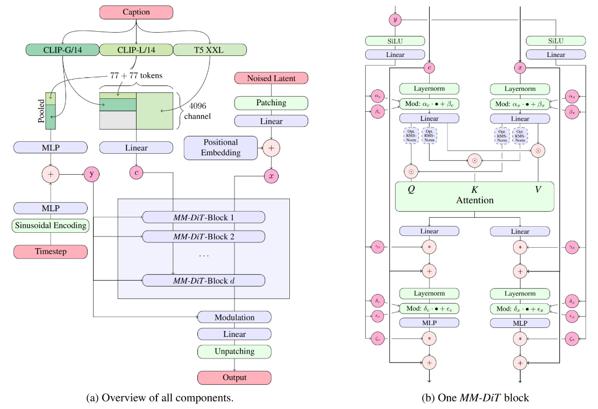

*Figure 1: Diagram of stabilityai/stable-diffusion-3-medium pipeline. [^1]*

## TeaCache

The authors of [Timestep Embedding Tells: It's Time to Cache for Video Diffusion Model](https://arxiv.org/pdf/2411.19108) introduced TeaCache as a strategy for video diffusion models [^2]. The core idea is that the timestep embedding can predict how similar adjacent outputs will be, allowing the model to skip redundant computation when changes are small. We adapt this technique to image diffusion on AMD Ryzen™ AI, extending it to work within a static ONNX-based pipeline. Importantly, it does not require retraining or architectural modifications.

TeaCache tracks how much the model's latent is changing and dynamically decides whether a full forward pass is necessary for each timestep. If the change is sufficiently small, it skips the full forward pass and reuses cached outputs, only recomputing when the accumulated change exceeds a predefined threshold. To track the magnitude of change, TeaCache measures the relative L1 distance between the intermediate representations across timesteps, starting from the last timestep that ran a full forward pass.

There are two approaches to defining this caching strategy: **naive caching** and **rescaled caching**.

### Naive Caching

1. For timestep *t*, TeaCache computes the timestep embedding *F_t* and sets *δ* as the threshold
2. After computing the model output from the full forward pass, TeaCache adds the relative L1 distance `L1_rel(F, t)` for each subsequent timestep from `t−1` through `b−1`.

3. If at timestep *t* the relative L1 distance is less than the caching threshold *δ*, TeaCache reuses the cached model output; otherwise, it computes the new model output and resets the accumulated L1 distance to 0

### Rescaled Caching

Rescaled caching performs similarly, with one major change: instead of using the timestep embeddings *F* directly, it applies a polynomial function *f* to rescale the data and reduce bias. For the same timesteps, it adds `f(L1_rel(F, t))` to the running total instead.

The polynomials can be optimized for specific models to improve performance.

Figures 2 through 4 demonstrate where TeaCache falls in the pipeline, what parts are run on the Neural Processing Unit (NPU), and how the decision process works.

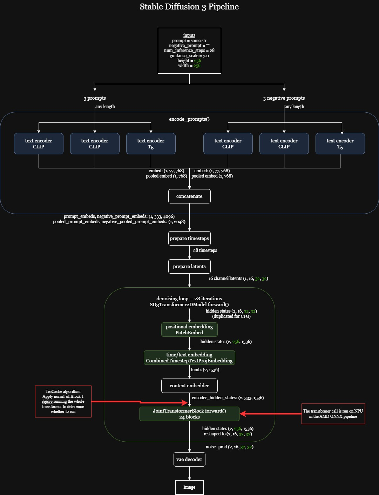

*Figure 2: Pipeline of SD3 showing where TeaCache is applied and when computation moves to NPU. [^1]*

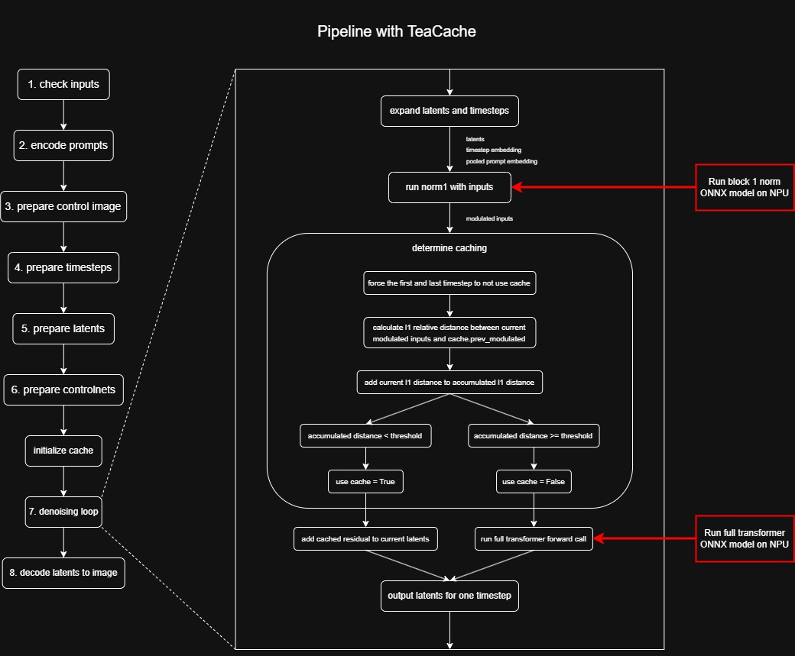

*Figure 3: Decision process in denoising loop.*

To evaluate TeaCache on Stable Diffusion 3 (SD3), we tested three prompts using both naive and rescaled caching strategies. Because TeaCache has not published any SD specific coefficients, we experimented with simple polynomial coefficients (1,0), (2,1,0), and predefined Flux coefficients.

We implemented TeaCache by adding a wrapper class that replaces the `JointTransformerBlocks` with `CachedTransformerBlocks` such that the model runs a different forward call. In this approach, caching is implemented inside the model's transformer blocks (similar to the design used in xDiT [^3]; see also [Accelerating Diffusers and xDiT Image Generation with MXFP4 using AMD Quark on AMD Instinct™ MI350 GPUs](https://rocm.blogs.amd.com/artificial-intelligence/quark-xdit/README.html) for related AMD work on xDiT pipelines). Instead of controlling caching at the loop level as described in the paper, individual `CachedTransformerBlocks` decide whether to reuse previously computed latents in their forward calls. This design is closer to production systems as it encapsulates caching within the model architecture and allows reuse across different pipelines.

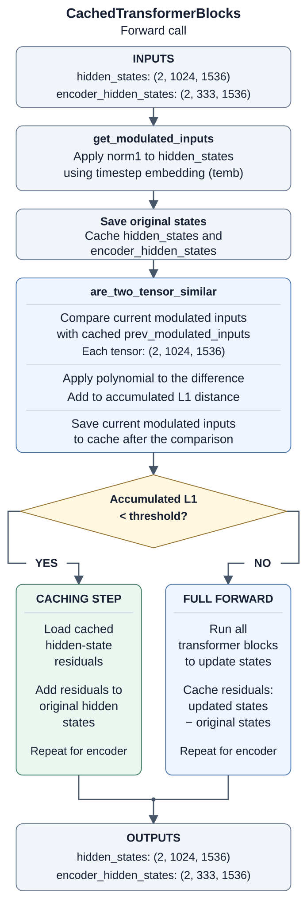

*Figure 4: CachedTransformerBlocks forward call showing the caching decision path.*

## AMD Ryzen AI SD Pipeline

For background on running Stable Diffusion through ONNX Runtime on AMD hardware, see [Efficient image generation with Stable Diffusion models and ONNX Runtime using AMD GPUs](https://rocm.blogs.amd.com/artificial-intelligence/stable-diffusion-onnx-runtime/README.html). If you want to generate images and video locally on a Ryzen AI system, see [Local Image and Video Generation on AMD Ryzen™ AI Max+ Processor (Windows)](https://rocm.blogs.amd.com/artificial-intelligence/comfyui-windows/README.html).

The standard Stable Diffusion pipeline performs the following steps:

1. The CPU prepares inputs (prompt embeddings, initial noise, scheduler state)
2. ONNX Runtime dispatches model execution across the NPU and CPU
3. The transformer runs on the NPU in each timestep of the denoising loop, producing updated latents
4. The VAE decoder converts the final latents into the output image

The Ryzen AI NPU has AMD XDNA architecture, which is a spatial dataflow NPU architecture consisting of a tiled array of AI Engine processors. Each AI Engine contains a VLIW SIMD vector processor, RISC scalar processor, and local data and program memories. The engine uses on-chip memories and custom dataflow and can run over 1.3 GHz for AI and signal processing workloads.

While the NPU accelerates the heavy computations, the SD pipeline itself runs mostly on CPU, which makes it straightforward to integrate different models. The current pipeline supports SD3 and SD3.5 as these are transformer-based diffusion models. Many other SD models use UNet architecture, which requires a different pipeline.

## Mapping TeaCache to the ONNX-Based Ryzen AI SD Pipeline

The key limitation of the standard pipeline is that the transformer ONNX model is treated as a black box — we cannot extract the norm or a single block of the transformer as TeaCache requires. To solve this, we add two key features.

First, we include an additional ONNX model that performs the operations of Block 1 norm. That way, instead of breaking apart the transformer model, we run the norm 1 module preemptively as a separate ONNX RT call before the full transformer call.

Second, we utilize a `TeaCacheState` that is only initialized if TeaCache is enabled. This allows us to compare the latents and observe accumulated L1 distance externally, rather than inserting logic directly into the denoising loop. This part of the TeaCache algorithm remains on CPU as there are minimal calculations involved.

Note that the transformer forward call always runs on the first and last timestep regardless of accumulated distance. You can also configure additional parameters such as image resolution, number of timesteps, classifier-free guidance (CFG) scale, and negative prompt. CFG controls how strongly the model follows the text prompt: higher values push the output to match the prompt more closely, at the cost of less variety.

## System Configuration

All TeaCache experiments were conducted on AMD Ryzen AI platforms based on Strix, Kraken, GPT, and GPT2 processors. The software environment consisted of Microsoft Windows and Ryzen AI Software 1.8.0. Experiments were run from the GenAI-SD package included in the Ryzen AI installation, using the `ryzen-ai-1.8.0` Conda environment and the ONNX Runtime Vitis AI Execution Provider bundled with Ryzen AI Software 1.8.0. TeaCache was enabled for Stable Diffusion 3.0 and Stable Diffusion 3.5 by launching `run.py` with the `-O1` option.

In our profiling, peak system memory usage for Stable Diffusion 3.0 and Stable Diffusion 3.5 text-to-image generation ranged from approximately 9.0 GB to 10.5 GB at 512×512 and 1024×1024 resolutions, with approximately 5.5 GB to 6.1 GB of NPU memory usage. ControlNet workloads used up to approximately 11.9 GB of system memory. The most memory-intensive case, Stable Diffusion 3.0 inpainting at 1024×1024, reached approximately 15.1 GB of system memory and 9.1 GB of NPU memory usage.

We therefore recommend a system with 32 GB of RAM to run these workloads reliably. A 16 GB system may run basic text-to-image generation, but it leaves limited headroom for the operating system and other applications and is not recommended for ControlNet or inpainting workloads.

## Experiments

We performed experiments on three different pipelines. Table 1 summarizes the model settings, TeaCache settings, prompts, and metrics for each pipeline. The prompts used are:

1. "A cat holding a sign that says hello world"
2. "A golden retriever playing in a park"
3. "A round cake showcasing side layers: bottom layer of red velvet sponge, middle layer of cream cheese frosting, topped by a thick transparent orange-tinted jelly layer representing a vibrant culinary market. On the jelly, detailed miniature figures of chefs cooking, surrounded by fondant vegetables and cookie crumb spices."
4. "Anime style illustration of a girl wearing a suit. A moon in sky"

| Pipeline | Model Conditions | TeaCache Conditions | Prompts | Metrics |
| --- | --- | --- | --- | --- |
| PyTorch SD3 with TeaCache | 20 timesteps, CFG = 7.0, Resolution: 1024x1024 | Threshold = 0.2, Coefficients: (1,0), (2,1,0), Flux | 1–3 | L1 per timestep, Latency per timestep, SSIM |
| SD3 and SD3.5 ONNX text2image | 40 timesteps, CFG = 7.0, CFG scale = 4.5, Resolution: 1024x1024 | Thresholds: 0, 0.1, 0.15, 0.2, 0.25; Coefficients: (1,0), (2,1,0), Flux | 1–3 | Full execution latency (T), Number of full transformer runs `(R)`, SSIM |
| SD3 ONNX ControlNet-Canny | 50 timesteps, CFG scale = 4.5, ControlNet conditioning scale = 0.5, Resolution: 1024x1024 | Thresholds: 0, 0.1, 0.15, 0.2, 0.25; Coefficients: (1,0), (2,1,0), Flux | 4 | Full execution latency (T), Number of full transformer runs `(R)`, SSIM |

*Table 1: Experiment configurations, prompts, and evaluation metrics.*

Note that `guidance` and `guidance_scale` are two distinct controls. `guidance` is a value fed into the SD3 transformer as conditioning, signaling the guidance strength the model was trained to expect. `guidance_scale` is the classifier-free guidance (CFG) scale applied during inference to push the output toward the prompt.

The control image used in the SD3 ONNX ControlNet-Canny experiment is the standard canny reference published on the [InstantX/SD3-Controlnet-Canny model card](https://huggingface.co/InstantX/SD3-Controlnet-Canny), used under that repository's Apache-2.0 license [^4]. For licensing information about the model weights and generated images, see reference [^5].

We measured timestep latency by timing each iteration of the denoising loop, collected L1 scores at the end of each timestep, and measured full execution latency from the pipeline call to final image generation. We report image quality with SSIM (Structural Similarity Index Measure), which compares each cached result against the no-caching baseline on a 0–1 scale, where 1.0 means the images are identical and lower values indicate more deviation.

## Results

### CPU Baseline

Figure 5 shows the L1 accumulation for each timestep. Each column shows the different sets of polynomial coefficients for prompt 1. The peaks mark the timesteps where the accumulated distance crosses the threshold and triggers a full forward pass. Figure 6 shows the latency improvement after applying caching — the orange line represents no caching. The timesteps where caching is used (latencies near 0) correspond to the timesteps where L1 is below the threshold, showing reduced overall latency with TeaCache in these runs.

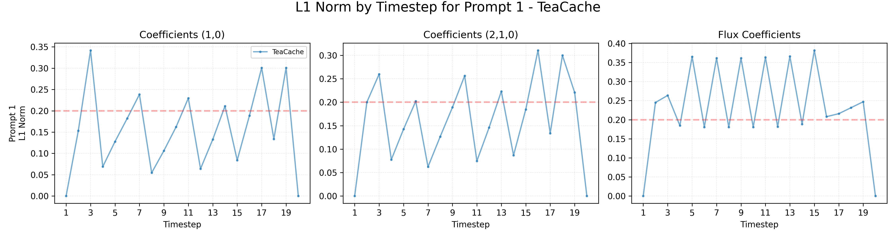

*Figure 5: L1 scores for each timestep for prompt 1.*

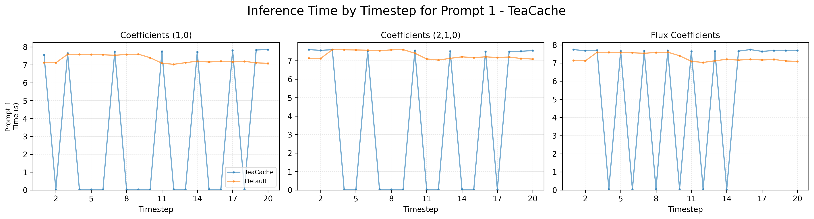

*Figure 6: Latency for each timestep for prompt 1.*

Table 2 shows a detailed overview of timestep latencies for Prompt 1. With no caching, the full pipeline takes ~2.4 minutes. Across the three sets of coefficients, total pipeline time fell by up to 3x in these runs at 20 timesteps, CFG = 7.0, and 1024x1024 resolution, depending on the polynomial. With Flux coefficients, total time dropped from 146.0 to 107.8 seconds while SSIM stayed at 0.74 against the no-caching baseline (Figure 7). Minor details in the images may be lost but overall image content remains. We observed similar results for prompts 2 and 3.

| Timestep | Default Time (in seconds) | Flux TeaCache Time (in seconds) |
| --- | --- | --- |
| 1 | 7.1344 | 7.7395 |
| 2 | 7.1152 | 7.6729 |
| 3 | 7.5886 | 7.7066 |
| 4 | 7.5843 | 0.0413 |
| 5 | 7.5757 | 7.6594 |
| 6 | 7.5618 | 0.0407 |
| 7 | 7.5366 | 7.6709 |
| 8 | 7.5794 | 0.0404 |
| 9 | 7.5966 | 7.6865 |
| 10 | 7.3989 | 0.0405 |
| 11 | 7.0915 | 7.6479 |
| 12 | 7.0295 | 0.0378 |
| 13 | 7.1223 | 7.6504 |
| 14 | 7.2046 | 0.0360 |
| 15 | 7.1571 | 7.6536 |
| 16 | 7.2060 | 7.7401 |
| 17 | 7.1644 | 7.6388 |
| 18 | 7.1947 | 7.6896 |
| 19 | 7.1138 | 7.6875 |
| 20 | 7.0834 | 7.6896 |
| **Total** | **146.0396** | **107.7709** |
| **SSIM** | **1.0000** | **0.7391** |

*Table 2: Prompt 1 timestep latency (in seconds).*

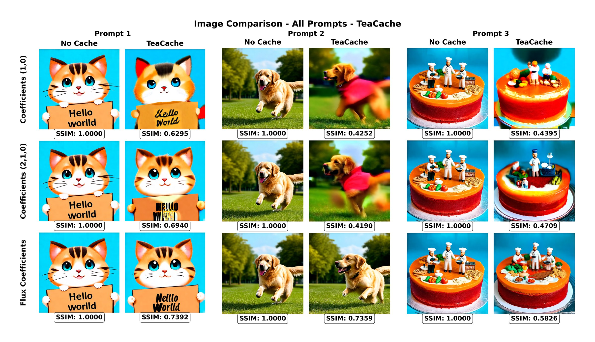

*Figure 7: Image comparison for all three prompts.*

### ONNX on NPU Results

In each result grid, S denotes SSIM, T denotes execution time in seconds, and `R` denotes the number of full transformer runs.

#### SD3 and SD3.5 Text-to-Image

Figure 8 shows the SD3 results for prompt 1. Figures 11 and 12 in [Appendix A](#teacache-extra-prompts) show prompts 2 and 3. For SD3, coefficients (1,0) and (2,1,0) begin to degrade image quality at threshold = 0.15 (SSIM as low as ~0.63), so we recommend staying at or below δ = 0.1 for those settings. Flux coefficients preserved the baseline images at δ = 0.1 and 0.15 in these examples, but added runtime overhead: for prompt 1 at δ = 0.1, latency increased from 61.05 to 69.11 seconds. Our selected SD3 configuration therefore uses coefficients (1,0) and δ = 0.1; Table 3 summarizes its speedup and SSIM across prompts.

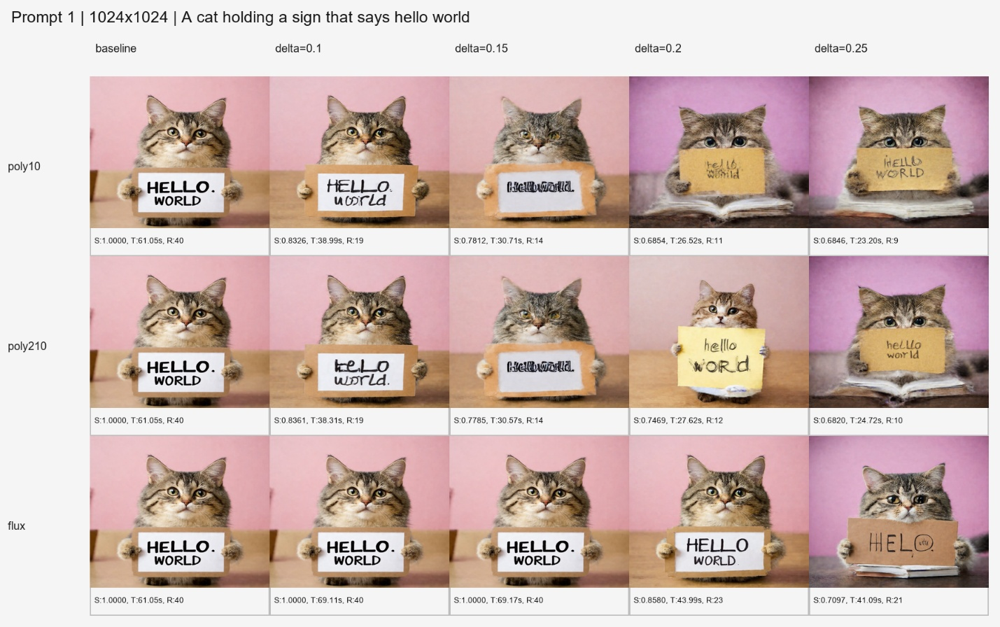

*Figure 8: SD3 t2i, prompt 1 results on NPU.*

Figure 9 shows the SD3.5 results for prompt 1; Figures 13 and 14 in [Appendix A](#teacache-extra-prompts) show prompts 2 and 3. For SD3.5 with Flux coefficients and δ = 0.25, execution time fell from approximately 81 seconds to 52 seconds across prompts 1–3. SSIM ranged from 0.681 to 0.868, with the cake prompt showing the largest deviation from the baseline. Table 3 reports this selected configuration alongside the other pipelines.

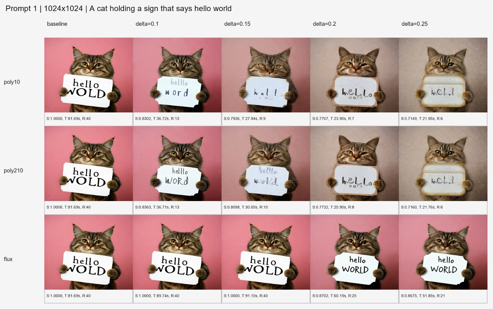

*Figure 9: SD3.5 t2i, prompt 1 results on NPU.*

#### SD3 ControlNet-Canny

Figure 10 shows the SD3 ControlNet-Canny results for prompt 4. This model adds a second conditioning path for structure. The ControlNet module forces the diffusion model to follow the structure that Canny extracts from an input image. Quality held for most parameters we tested, with SSIM staying above 0.8 for (2,1,0) and Flux coefficients. In these runs, execution time decreased from ~95 seconds to as low as ~30 seconds, up to a 3x reduction.

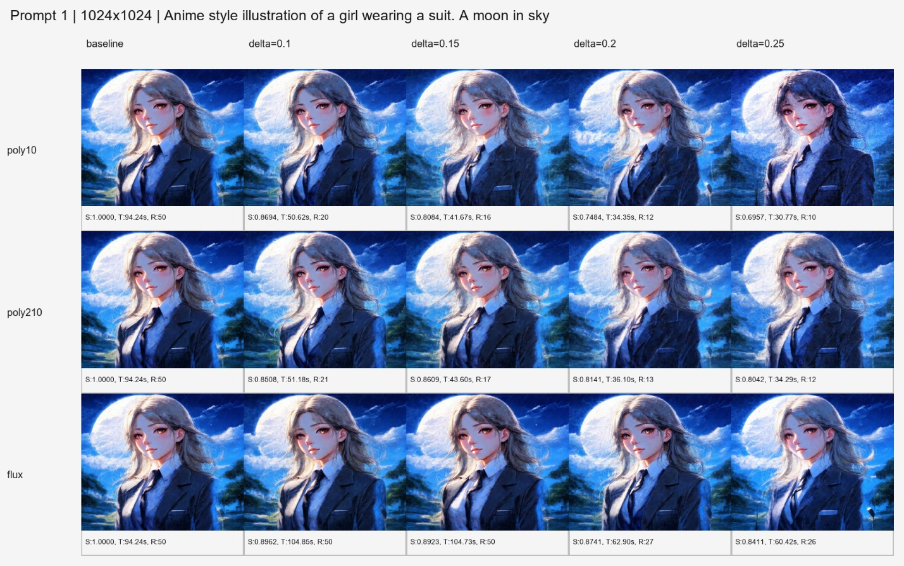

*Figure 10: SD3 ControlNet-Canny prompt 4 results on NPU.*

### Key Takeaways

Overall, we reproduced TeaCache in our SD ONNX pipeline.

Table 3 summarizes the selected configurations reported below. Speedups are the averages reported for each configuration; the SSIM ranges come from the corresponding prompt results in Figures 8–14 and compare cached outputs against the no-caching baseline. Text-to-image ranges cover prompts 1–3; ControlNet uses prompt 4 only.

| Pipeline | Coefficients; threshold | Reported average speedup | SSIM at selected setting |
| --- | --- | --- | --- |
| SD3 text-to-image | (1,0); δ = 0.1 | 1.57x | 0.833–0.895 |
| SD3.5 text-to-image | Flux; δ = 0.25 | 1.56x | 0.681–0.868 |
| SD3 ControlNet-Canny | (1,0); δ = 0.15 | 2.23x | 0.808 |

*Table 3: Selected TeaCache configurations, reported average speedups, and SSIM against the no-caching baseline.*

- **SD3 T2I**: in our tests with polynomial coefficients (1,0) and δ = 0.1, we observed **1.57x speedup** on average
- **SD3.5 T2I**: in our tests with Flux coefficients and δ = 0.25, we observed **1.56x speedup** on average
- **SD3 ControlNet-Canny**: in our tests with polynomial coefficients (1,0) and δ = 0.15, we observed **2.23x speedup** on average

## Try TeaCache on Your Ryzen AI System

In our tested configurations, TeaCache reduced diffusion inference runtime by identifying adjacent timesteps with highly correlated intermediate latents, allowing us to skip redundant computation and reuse cached results. In our implementation, TeaCache integrates cleanly into the existing Stable Diffusion pipeline without requiring retraining or major architectural changes. Even within the constraints of static ONNX graphs, we handle the caching logic on the CPU side and perform heavy computation on the NPU.

Get started with your Ryzen AI machine using the references below to explore TeaCache, run Stable Diffusion pipelines, and experiment with faster inference!

### 1. Set Up Ryzen AI

Refer to the official setup guide: [Ryzen AI Software 1.8.0 Documentation](https://ryzenai.docs.amd.com/en/latest/inst.html)

### 2. Navigate to the Test Directory

```bash
cd $RYZEN_AI_INSTALLATION_PATH/GenAI-SD/test
```

### 3. Activate the Environment

```bash
conda activate ryzen-ai-1.8.0
```

### 4. Run Stable Diffusion Pipelines with TeaCache Enabled

TeaCache acceleration is enabled using the `-O1` option.

#### SD3.5 Text-to-Image

```bash
python ./run.py -C None \
  --model_id "stabilityai/stable-diffusion-3.5-medium-amdnpu" \
  -n 30 \
  --prompt "a beautiful landscape" \
  -O1
```

#### SD3.0 Text-to-Image

```bash
python ./run.py -C None \
  --model_id "stabilityai/stable-diffusion-3-medium-amdnpu" \
  -n 30 \
  --prompt "a beautiful landscape" \
  -O1
```

#### SD3.0 ControlNet — Canny

```bash
python ./run.py -C canny \
  --model_id "stabilityai/stable-diffusion-3-medium-amdnpu" \
  -n 30 \
  --prompt "Anime style illustration of a girl wearing a suit. A moon in the sky. A large rainstorm approaching in the background. Text 'InstantX' on image" \
  --guidance_scale 7.0 \
  --control_image_path "ref/canny.jpg" \
  -O1
```

#### SD3.0 ControlNet — Pose

```bash
python ./run.py -C pose \
  --model_id "stabilityai/stable-diffusion-3-medium-amdnpu" \
  -n 30 \
  --prompt "Anime style illustration of a girl wearing a suit. A moon in the sky. A large rainstorm approaching in the background. Text 'InstantX' on image" \
  --guidance_scale 7.0 \
  --control_image_path "ref/pose.jpg" \
  -O1
```

#### SD3.0 ControlNet — Tile

```bash
python ./run.py -C tile \
  --model_id "stabilityai/stable-diffusion-3-medium-amdnpu" \
  -n 30 \
  --prompt "Anime style illustration of a girl wearing a suit. A moon in the sky. A large rainstorm approaching in the background. Text 'InstantX' on image" \
  --guidance_scale 7.0 \
  --control_image_path "ref/tile.jpg" \
  -O1
```

#### SD3.0 ControlNet — Depth

```bash
python ./run.py -C depth \
  --model_id "stabilityai/stable-diffusion-3-medium-amdnpu" \
  -n 30 \
  --prompt "A panda cub perched on a tree trunk in a forest, close-up photography, lush green foliage in the background, shallow depth of field, National Geographic style" \
  --guidance_scale 7.0 \
  --control_image_path "ref/depth.jpg" \
  -O1
```

Generated images will be saved to:

```text
$RYZEN_AI_INSTALLATION_PATH/GenAI-SD/test/generated_images
```

Experiment with different thresholds and prompts to find the δ that balances speedup and quality for your use case.

## Summary

In this blog, you learned how TeaCache accelerates Stable Diffusion 3 and 3.5 on AMD Ryzen AI NPUs by reusing intermediate outputs across similar timesteps, without retraining. You explored how the timestep embedding predicts output similarity and how an accumulated relative L1 distance determines when to reuse cached transformer outputs.

We adapted TeaCache from video to image diffusion on AMD Ryzen AI. The obstacle was the static ONNX pipeline, which treats the transformer as a black box and blocks access to the Block 1 norm TeaCache needs. We added a separate ONNX model to run that norm ahead of the full transformer call, and a CPU-side `TeaCacheState` to track accumulated distance outside the denoising loop — heavy compute stays on the NPU, the caching decision costs almost nothing.

In our tests, average speedups were **1.57x** on SD3 text-to-image (coefficients (1,0), δ = 0.1), **1.56x** on SD3.5 (Flux coefficients, δ = 0.25), and **2.23x** on SD3 ControlNet-Canny (coefficients (1,0), δ = 0.15). Coefficient choice mattered as much as threshold — (1,0) and (2,1,0) degraded SSIM past δ = 0.15 on SD3, while Flux coefficients held quality further out.

You also learned how to map TeaCache onto a static ONNX graph, compare coefficient-threshold pairs using latency and image-quality results, and enable caching with `-O1`. Use these results as a starting point for your own experiments.

As a next step, we plan to integrate TeaCache into the Ryzen AI pipeline.

To explore related AMD work, read about [accelerating Diffusers and xDiT image generation with MXFP4 using AMD Quark](https://rocm.blogs.amd.com/artificial-intelligence/quark-xdit/README.html), [running Stable Diffusion with ONNX Runtime on AMD GPUs](https://rocm.blogs.amd.com/artificial-intelligence/stable-diffusion-onnx-runtime/README.html), and [local image and video generation with ComfyUI on Windows using AMD Ryzen AI Max+](https://rocm.blogs.amd.com/artificial-intelligence/comfyui-windows/README.html).

(teacache-extra-prompts)=

## Appendix A: Additional Prompt Results

Figures 11 and 12 show SD3 results for prompts 2 and 3; Figures 13 and 14 show the corresponding SD3.5 results. These grids use the same thresholds and metrics as the prompt 1 grids in the main results section.

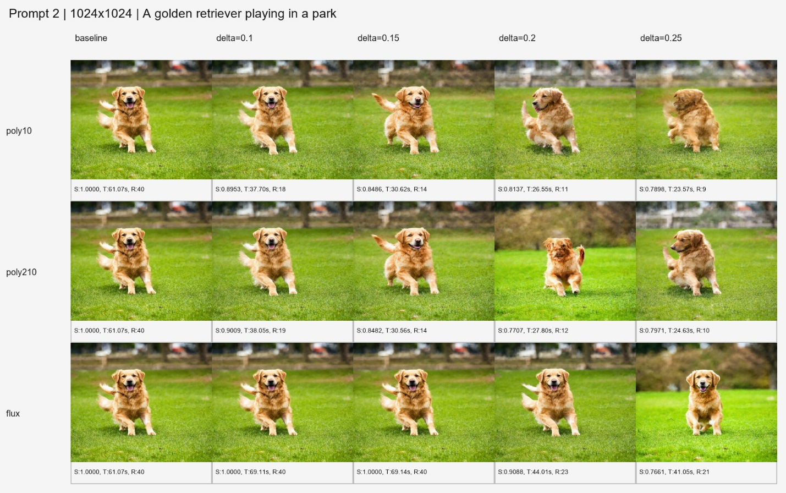

*Figure 11: SD3 t2i, prompt 2 results on NPU.*

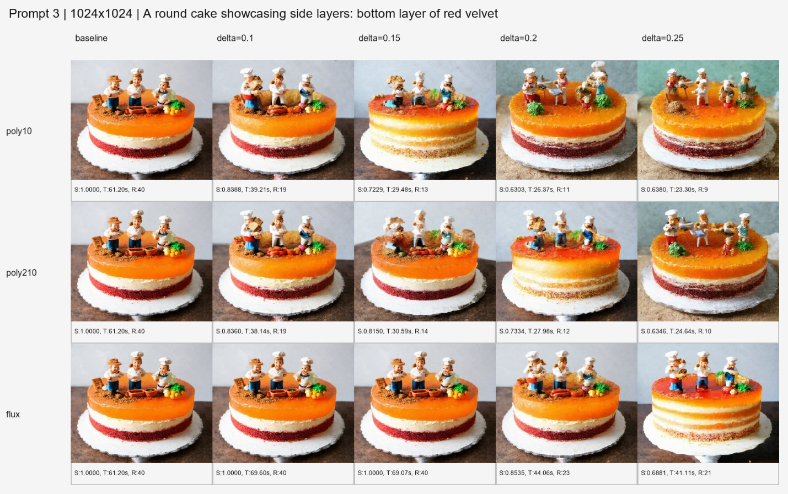

*Figure 12: SD3 t2i, prompt 3 results on NPU.*

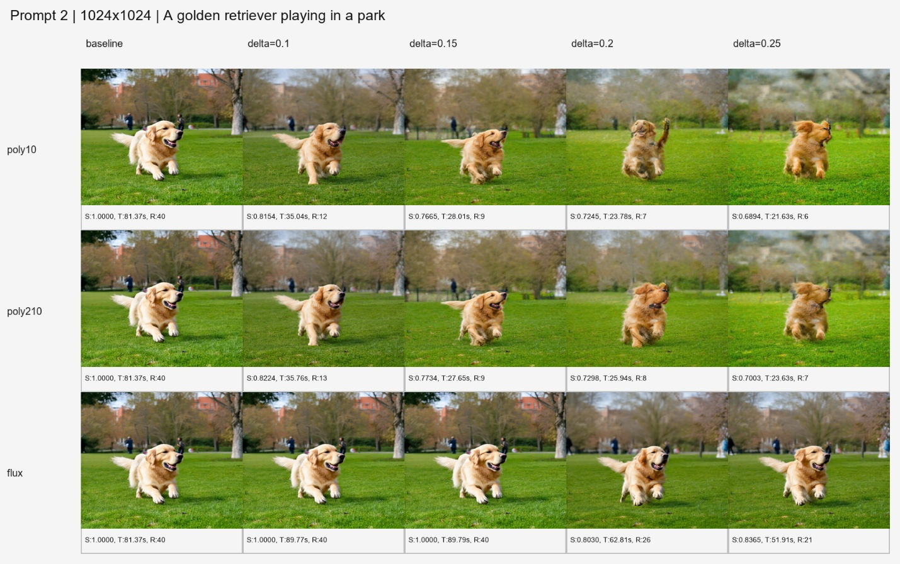

*Figure 13: SD3.5 t2i, prompt 2 results on NPU.*

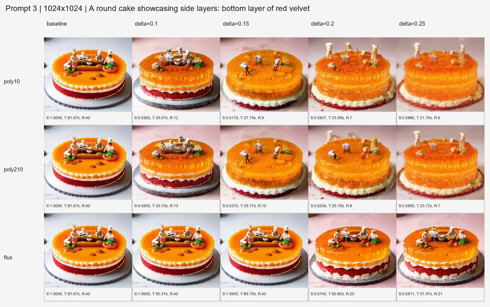

*Figure 14: SD3.5 t2i, prompt 3 results on NPU.*

## Disclaimers

Performance results are based on AMD testing using the Stable Diffusion 3 and 3.5 pipelines, prompts, timestep counts, thresholds, coefficients, hardware platforms, software versions, and configurations described in this article. Results are based on specific test configurations and may vary. Actual results will vary depending on model, prompt, workload, software stack, system configuration, and optimization settings.

The information presented in this document is for informational purposes only and may contain technical inaccuracies, omissions, and typographical errors. The information contained herein is subject to change and may be rendered inaccurate for many reasons, including but not limited to product and roadmap changes, component and motherboard version changes, new model and/or product releases, product differences between differing manufacturers, software changes, BIOS flashes, firmware upgrades, or the like. Any computer system has risks of security vulnerabilities that cannot be completely prevented or mitigated. AMD assumes no obligation to update or otherwise correct or revise this information.
However, AMD reserves the right to revise this information and to make changes from time to time to the content hereof without obligation of AMD to notify any person of such revisions or changes.
THIS INFORMATION IS PROVIDED "AS IS." AMD MAKES NO REPRESENTATIONS OR WARRANTIES WITH RESPECT TO THE CONTENTS HEREOF AND ASSUMES NO RESPONSIBILITY FOR ANY INACCURACIES, ERRORS, OR OMISSIONS THAT MAY APPEAR IN THIS INFORMATION. AMD SPECIFICALLY DISCLAIMS ANY IMPLIED WARRANTIES OF NON-INFRINGEMENT, MERCHANTABILITY, OR FITNESS FOR ANY PARTICULAR PURPOSE. IN NO EVENT WILL AMD BE LIABLE TO ANY PERSON FOR ANY RELIANCE, DIRECT, INDIRECT, SPECIAL, OR OTHER CONSEQUENTIAL DAMAGES ARISING FROM THE USE OF ANY INFORMATION CONTAINED HEREIN, EVEN IF AMD IS EXPRESSLY ADVISED OF THE POSSIBILITY OF SUCH DAMAGES.

Third-party content is licensed to you directly by the third party that owns the content and is not licensed to you by AMD. ALL LINKED THIRD-PARTY CONTENT IS PROVIDED "AS IS" WITHOUT A WARRANTY OF ANY KIND. USE OF SUCH THIRD-PARTY CONTENT IS DONE AT YOUR SOLE DISCRETION AND UNDER NO CIRCUMSTANCES WILL AMD BE LIABLE TO YOU FOR ANY THIRD-PARTY CONTENT. YOU ASSUME ALL RISK AND ARE SOLELY RESPONSIBLE FOR ANY DAMAGES THAT MAY ARISE FROM YOUR USE OF THIRD-PARTY CONTENT.

AMD, the AMD Arrow logo, AMD Ryzen, AMD Instinct, AMD XDNA, and combinations thereof are trademarks of Advanced Micro Devices, Inc. Other product names used in this publication are for identification purposes only and may be trademarks of their respective companies. PyTorch, the PyTorch logo and any related marks are trademarks of The Linux Foundation. ONNX is a trademark of The Linux Foundation. Stable Diffusion is a trademark of Stability AI. Hugging Face is a trademark of Hugging Face, Inc.
© 2026 Advanced Micro Devices, Inc. All rights reserved

## References

[^1]: SD3 Model Card Pipeline — [stabilityai/stable-diffusion-3-medium on Hugging Face](https://huggingface.co/stabilityai/stable-diffusion-3-medium)

[^2]: TeaCache article: [Timestep Embedding Tells: It's Time to Cache for Video Diffusion Model](https://liewfeng.github.io/TeaCache/)

[^3]: xDiT repository: [xDiT/xfuser/model_executor/cache/utils.py](https://github.com/xdit-project/xDiT/blob/main/xfuser/model_executor/cache/utils.py)

[^4]: ControlNet control image: [InstantX/SD3-Controlnet-Canny](https://huggingface.co/InstantX/SD3-Controlnet-Canny) (Apache-2.0)

[^5]: Model weights: Stable Diffusion 3 and 3.5 Medium are used under the [Stability AI Community License](https://stability.ai/community-license-agreement). All generated images shown in Figures 7 through 14 are outputs of those models and are subject to the same license terms.
