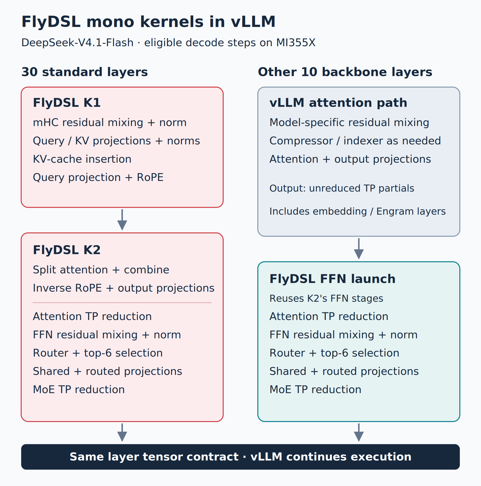
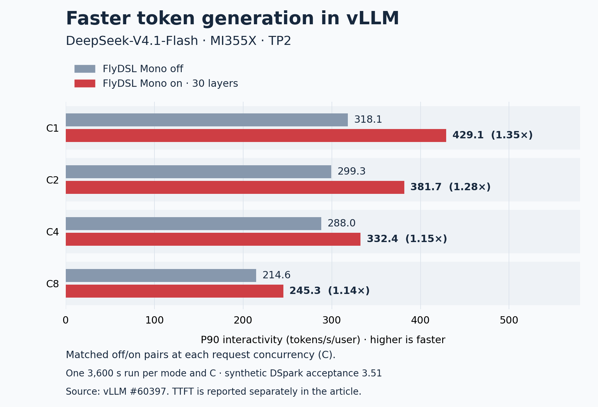
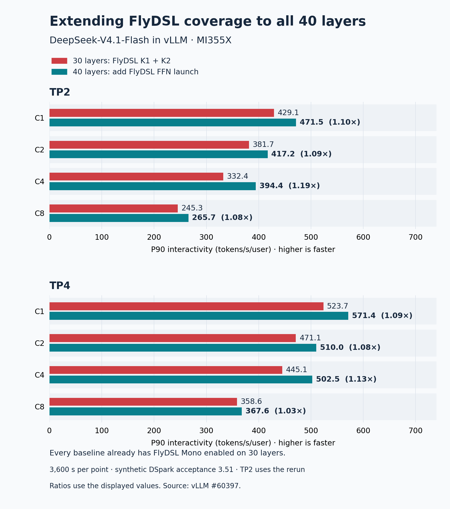

# Accelerating vLLM Decode with FlyDSL Mono Kernels on AMD Instinct MI355X

For an interactive coding agent, faster token generation means reaching the next tool call sooner. At small decode batches, however, a GPU may spend much of a layer waiting: for another short kernel to finish, for weights to arrive, or for a tensor-parallel reduction.

**FlyDSL mono kernels address these waits by bringing related computations and communication into a shared GPU schedule.** [FlyDSL][1] supplies the Python kernel language, explicit layouts, low-level GPU controls, and just-in-time (JIT) compilation. [vLLM][2] integrates these kernels into serving, supplying the model weights, KV caches, step metadata, and graph execution.

DeepSeek-V4.1-Flash on AMD Instinct MI355X shows the result. A standard-layer measurement at tensor parallelism four (TP4) falls from **180 to 94 µs, a 1.91× speedup**. In a separate TP2 serving comparison at concurrency one, enabling FlyDSL Mono on 30 layers increases P90 interactivity from **318.1 to 429.1 tokens/s/user, a 1.35× gain**. The merged vLLM implementation also adds a FlyDSL FFN kernel to the other 10 backbone layers. [2]

This article follows that implementation: how the FlyDSL kernels execute a layer, how vLLM connects them to its runtime, and what the measurements establish. Implementation links are pinned to the reviewed revision, `f6b54daade30`; performance and quality results are reported by [vLLM PR #60397][2]. No new GPU benchmarks were run for this article.

## From separate operations to a FlyDSL schedule

Small-batch decode has limited work per operation. Launching normalization, projections, attention, routing, expert computations, and reductions separately introduces repeated boundaries. On one GPU stream, the next dependent kernel executes after the previous kernel completes. HIP Graph replay reduces CPU submission overhead, but those device execution boundaries remain.

FlyDSL lets developers replace this sequence with a schedule in which **workgroups (thread blocks in HIP)** stay active across multiple stages of a kernel invocation. Producers publish ready results, consumers begin when their own inputs are available, and weight loads can overlap preceding computation. Cross-GPU reductions can participate in the same schedule.

The developer controls this design. FlyDSL exposes tiling, layouts, work assignment, memory operations, and synchronization down to the instruction level. Its JIT compiler builds specialized variants on demand and caches compiled kernels, making it practical to tune for token-row count, TP size, and attention type. It does not automatically choose which operations to fuse or establish a correct schedule. [1], [3]

## Two launches for a standard layer

DeepSeek-V4.1-Flash has 40 backbone layers. In this vLLM implementation, 30 standard layers use two persistent FlyDSL launches, **K1 and K2**, replacing approximately 40 separate kernels per layer. These layers have the standard residual-mixing path and no compressor or indexer of their own; they include consumers of compressed KV data. [2], [3]

**K1 prepares attention.** It combines the manifold-constrained hyper-connections (mHC) seam—the residual mixing and normalization around attention—with the query/KV projections, query and KV normalization, KV-cache insertion, the second query projection, and rotary position embeddings (RoPE).

**K2 connects attention to the feed-forward network (FFN).** It computes split attention and combines the partial results, applies inverse RoPE and the two output projections, and reduces the attention output across TP ranks. It then runs the FFN mHC seam, mixture-of-experts (MoE) routing and top-6 expert selection, the shared expert, the routed experts' up/gate and down projections, and the final TP reduction.

*Figure 1. FlyDSL launch boundaries in vLLM's DeepSeek-V4.1-Flash decode path. The FFN launch reuses K2's FFN stages after vLLM computes attention. The diagram shows dependencies, not timing. [3]*

The other 10 layers include the embedding-broadcast seam, Engram processing, and compressor/indexer work. They keep vLLM's attention path, then enter a **FlyDSL FFN launch** at the unreduced attention output. That launch performs the attention TP reduction, FFN seam, MoE, and MoE TP reduction. All 40 backbone layers therefore use FlyDSL kernels for eligible decode steps, while the DSpark draft layers retain their existing path. The layer inputs and outputs keep the same tensor contract, allowing the two implementations to interleave. [3], [4]

## How the kernels reduce waits

### Reuse workgroups and load weights before waiting

The cited kernels launch 256 workgroups of 512 threads: eight **64-thread wavefronts (wave64)** per workgroup, targeting one resident workgroup per MI355X compute unit. Workgroups follow stage task tables and reuse their execution resources as the layer advances. Local Data Share (LDS), the CU-local, software-managed on-chip memory, is reused across stages. [3]

Within a matrix-vector task, weight loads are issued before polling for the activation input. This gives memory access time to progress while earlier stages produce that input. FlyDSL's explicit layouts and GPU instruction controls also allow the projections and experts to use the model's low-precision operands with native **MFMA (matrix fused multiply-add) instructions**. [3], [5]

Residency is part of correctness: consumers must not occupy the GPU while the producers they need cannot run. The compiled register/LDS footprint and task order must support progress; a grid size equal to the CU count alone is insufficient. Early loads also extend live register ranges and can compete for memory bandwidth, so their placement needs measurement.

### Pass ready payloads directly to consumers

The FlyDSL implementation uses tagged mailboxes for handoffs between workgroups and TP ranks. A 32-bit payload word is paired with a tag identifying the current invocation. A consumer polls the pair and obtains the payload in the same loads that check readiness. Some stages instead publish ordinary data followed by a readiness signal with the required ordering. [6]

Device-scope accesses serve workgroups on the same GPU; system-scope accesses serve peer GPUs. The tag identifies the invocation, while the publication and memory-access protocol supplies visibility. Consumers can proceed when the portions they need are ready, without waiting for a separate producer kernel to finish everywhere.

### Keep TP reductions inside the kernel

Each rank has symmetric, peer-accessible memory and the addresses of the other ranks' buffers. Attention and expert partials are pushed to peers, then summed inside the FlyDSL schedule. The reductions accumulate in FP32 in rank order and round to BF16, matching the exact reduction path vLLM uses for these small decode shapes. [3]

On the 10 FFN-launch layers, vLLM leaves `wo_b` unreduced so the FlyDSL kernel can own that reduction. For steps that use the regular path, the decoder performs the usual all-reduce. This handoff ensures the attention output is reduced once in either case. [4]

## Integrating with vLLM's runtime

The kernels read **vLLM's loaded weights in place**. Attention projections use row-major MXFP8 weights with 32×32 E8M0 scale blocks; routed experts retain AITER's shuffled MXFP4 layout. The shared expert follows vLLM's MXFP8 computation and clamped activation. Avoiding a second weight copy keeps this integration compatible with the model's existing storage. [3], [4]

Attention also consumes vLLM's paged `fp8_ds_mla` KV representation. The adapter exposes cache views shaped as `[blocks, block_size, 584]` bytes, while the device code honors the cache's data and scale placement. It passes slot mappings, sliding-window indices, compressed-cache block tables, and selected-key indices into the kernels. The kernel therefore works directly with vLLM's cache layout and metadata. [4], [5]

**Graph replay requires stable state.** vLLM eagerly initializes the runner and peer memory before graph capture. The kernels advance their epoch on the GPU and use fixed device pointers, avoiding a host callback to clear mailboxes on every step. Each token-row count has its own scratch allocation: reusing one allocation across different layouts could make a payload from one shape look like a valid tag for another. The implementation allocates roughly 3–16 MB per width, with at most eight widths under the reported DSpark setup. [2], [3]

**Dispatch must agree across ranks.** Every TP rank makes the same decision from shared step metadata, because the kernels wait for peer contributions. At this revision, the opt-in switch is `VLLM_ROCM_MONO_DECODE=1`, with these main requirements: [4]

- MI355X / gfx950, TP2 or TP4, FlyDSL and the required AITER helpers, and at least 256 compute units.
- Decode-only steps with at most 48 token rows, including speculative tokens and graph padding. Eight requests with five drafts each already require 48 rows before extra padding.
- Eager execution or a FULL graph. PIECEWISE graph replay, prefill, mixed batches, and larger steps use the regular path.
- For K1 + K2, the supported KV layout and causal sliding-window metadata; the FFN launch has its own narrower input contract.

An explicitly enabled but incompatible deployment, such as expert/data parallelism or an unsupported MoE backend, raises an error. Ordinary unsupported steps fall back. The 48-row limit is a supported-shape boundary, not a measured performance crossover.

## Measured performance in vLLM

The [measurement provenance](data/measurement-provenance.json) records the recipe and code history. Initial K1 + K2 results were collected while the kernels were hosted in AITER; the FFN-launch results used the in-tree vLLM copy. These performance runs predate the scratch-isolation fix described above. A subsequent 24-point kernel-timing check reports a mean post-fix runtime ratio of 1.000, with a range of 0.996–1.009. [2]

### Layer latency: fewer boundaries inside graph replay

The layer harness compares FlyDSL K1 + K2 against vLLM's own modules on MI355X, with real checkpoint weights, eight layers chained in one HIP graph, and cold weights. The selected results below use standard layers with compression ratio 1 and six token rows per request: one target token plus five DSpark drafts. All times are microseconds per layer. [2]

| TP | Rows | Separate | FlyDSL | Speedup |
| ---: | ---: | ---: | ---: | ---: |
| 2 | 6 | 209 | 122 | 1.71× |
| 2 | 12 | 262 | 179 | 1.46× |
| 2 | 24 | 336 | 280 | 1.20× |
| 2 | 48 | 474 | 427 | 1.11× |
| 4 | 6 | 180 | 94 | **1.91×** |
| 4 | 12 | 218 | 123 | 1.77× |
| 4 | 24 | 256 | 192 | 1.33× |
| 4 | 48 | 324 | 282 | 1.15× |

These are layer measurements, not full-model latency. They compare complete execution paths, including their device bodies, layouts, communication, and schedules; they do not isolate savings from launch reduction or any one overlap mechanism. Ratios here and in the figures are calculated from the displayed values.

The [layer data](data/layer-latency.csv) also includes compression-ratio-2 layers and the FFN-only measurements. The latter chain ten FFN layers in a HIP graph with cold weights. At TP4 and six rows, the FFN path falls from **111 to 57 µs (1.95×)**; at TP2 and 48 rows it is close to parity, **345 to 342 µs (1.01×)**. The relative gains shrink as more rows give separate kernels more useful parallel work.

### Serving interactivity: a matched off/on comparison

InferenceX AgentX replays multi-turn agent sessions. **P90 interactivity is the reciprocal of P90 inter-token latency**, expressed in tokens/s/user. It describes the pace of generation at the slower end of the request distribution. [7]

The following same-node TP2 comparison uses DeepSeek-V4.1-Flash on MI355X, with FlyDSL Mono disabled versus K1 + K2 enabled on 30 standard layers. Each mode has one 3,600-second run per concurrency. The four concurrency settings run concurrently on one eight-GPU node. Both modes use DSpark with five drafts and a **synthetic acceptance length of 3.51**, including the target token. [2]

*Figure 2. P90 interactivity with a matched baseline at each concurrency. Higher is faster; the largest measured gain is 1.35× at concurrency one. [2]*

Interactivity columns use tokens/s/user; TTFT shows P90 seconds, off → on. C denotes request concurrency.

| C | Mono off | Mono on | Gain | TTFT, s |
| ---: | ---: | ---: | ---: | ---: |
| 1 | 318.1 | 429.1 | **1.35×** | 1.18 → 1.28 |
| 2 | 299.3 | 381.7 | 1.28× | 1.10 → 1.08 |
| 4 | 288.0 | 332.4 | 1.15× | 1.27 → 1.26 |
| 8 | 214.6 | 245.3 | 1.14× | 1.01 → 1.08 |

At concurrency one, the interactivity change corresponds to P90 inter-token latency falling from approximately **3.14 to 2.33 ms**, a 25.9% reduction. Time to first token (TTFT) moves in both directions across concurrency settings. With one run per point, these results establish the observed decode benefit but do not establish a repeatable TTFT improvement or statistical confidence interval.

Synthetic acceptance fixes the amount of speculative progress for this experiment; it bypasses natural rejection sampling. Real serving performance also depends on draft acceptance, prompt processing, scheduling, and tool waits. The [serving data](data/serving-interactivity.csv) retains the source's input-plus-output throughput separately. That metric includes cached input tokens and should not be read as generated-output throughput.

### Extending FlyDSL coverage from 30 to 40 layers

The follow-up comparison adds the FFN launch to the remaining 10 backbone layers using the same recipe and protocol. **Its baseline already has FlyDSL K1 + K2 enabled.** At TP2/C1, interactivity rises from 429.1 to **471.5 tokens/s/user (1.10×)**; at TP4/C1, it rises from 523.7 to **571.4 (1.09×)**. [2]

*Figure 3. Paired 30-layer and 40-layer configurations at each concurrency. These are incremental gains over an existing FlyDSL Mono path; the raw pairs are in the [coverage data](data/coverage-interactivity.csv). [2]*

Across C1/C2/C4/C8, the incremental gains are **1.10× / 1.09× / 1.19× / 1.08× at TP2** and **1.09× / 1.08× / 1.13× / 1.03× at TP4**. The median per-request inter-token-latency ratios correspond to roughly 7–9% faster decode at every point. TP2 uses a rerun after an earlier round encountered node-wide stalls. The source also compares against external InferenceX runs; those comparisons are not used as the off/on baseline here.

## Checking correctness alongside speed

The vLLM contribution reports checks at several levels: dispatch tests, stage-by-stage comparisons against vLLM operations, model-layer integration tests, and graph replay stress tests. After giving each width its own scratch, alternating 6-row and 48-row launches completed 100,000 replays on each of three tested layers without a mismatch. The GPU numerics tests at TP2 and TP4 report per-token output cosine similarity of at least 0.9993 and relative errors of 0.3–0.5%. These are measured numerical tolerances, not a claim that the two implementations produce bit-identical outputs. [2]

Task evaluations use actual DSpark rejection sampling. At TP2, the reported post-fix GPQA-Diamond pass@1 is **85.1 ± 2.2**, versus **85.3 ± 2.2** with Mono off; AIME25 is **98.3 ± 0.8**, versus **99.4 ± 0.3**. The ± values are standard errors across questions. RULER needle-retrieval evaluations report 40/40 in both modes for each of three tasks at 32K, 128K, and 256K context. These evaluations provide quality evidence for the tested configuration and remain separate from the synthetic-acceptance performance runs. [8], [9]

## Applying the approach to another vLLM model

Start by profiling the decode shapes that matter to your users. Use FlyDSL to express the expensive stage handoffs as well as the computation: workgroup task assignment, early weight loads, ready-data publication, and peer reductions. Choose fusion boundaries that fit the GPU's register and LDS budgets.

Then connect the kernels to vLLM's actual weight formats, cache layout, and layer tensor contract. Make rank-consistent dispatch and fallback explicit, warm up allocations before graph capture, and validate state reuse across different graph shapes. Finally, measure layer latency and serving interactivity separately, using paired baselines at each concurrency and quality evaluations with natural speculative acceptance.

The [vLLM adapter][4], [FlyDSL layer composition][3], and [reported benchmark protocol][2] provide concrete starting points. They show how FlyDSL's control over computation and communication translates into faster decode within vLLM's serving runtime.

## References

1. [FlyDSL language, layouts, and JIT compiler](https://github.com/ROCm/FlyDSL).
2. [vLLM #60397: DeepSeek-V4.1-Flash mono decode implementation and measurements](https://github.com/vllm-project/vllm/pull/60397).
3. [Pinned FlyDSL kernel design and layer composition in vLLM](https://github.com/vllm-project/vllm/tree/f6b54daade305b3387feb4666e0df7d908a2bec3/vllm/models/deepseek_v41/amd/mono).
4. [Pinned vLLM runtime adapter and dispatch](https://github.com/vllm-project/vllm/blob/f6b54daade305b3387feb4666e0df7d908a2bec3/vllm/models/deepseek_v41/amd/mono_decode.py).
5. [Pinned FlyDSL attention stages for vLLM](https://github.com/vllm-project/vllm/tree/f6b54daade305b3387feb4666e0df7d908a2bec3/vllm/models/deepseek_v41/amd/mono/attention).
6. [Pinned tagged-mailbox implementation](https://github.com/vllm-project/vllm/blob/f6b54daade305b3387feb4666e0df7d908a2bec3/vllm/models/deepseek_v41/amd/mono/common/sync.py).
7. [InferenceX AgentX request metrics](https://github.com/SemiAnalysisAI/InferenceX/blob/8b25006fa0b23c7e157438996a3d2a90ff5e8cd2/inferencex-e2e/infx/results/agentic/request_metrics.py).
8. [vLLM task-quality evaluation and scratch-isolation fix](https://github.com/vllm-project/vllm/pull/60397#issuecomment-6051909168).
9. [vLLM long-context evaluation](https://github.com/vllm-project/vllm/pull/60397#issuecomment-6052301592).

[1]: https://github.com/ROCm/FlyDSL
[2]: https://github.com/vllm-project/vllm/pull/60397
[3]: https://github.com/vllm-project/vllm/tree/f6b54daade305b3387feb4666e0df7d908a2bec3/vllm/models/deepseek_v41/amd/mono
[4]: https://github.com/vllm-project/vllm/blob/f6b54daade305b3387feb4666e0df7d908a2bec3/vllm/models/deepseek_v41/amd/mono_decode.py
[5]: https://github.com/vllm-project/vllm/tree/f6b54daade305b3387feb4666e0df7d908a2bec3/vllm/models/deepseek_v41/amd/mono/attention
[6]: https://github.com/vllm-project/vllm/blob/f6b54daade305b3387feb4666e0df7d908a2bec3/vllm/models/deepseek_v41/amd/mono/common/sync.py
[7]: https://github.com/SemiAnalysisAI/InferenceX/blob/8b25006fa0b23c7e157438996a3d2a90ff5e8cd2/inferencex-e2e/infx/results/agentic/request_metrics.py
[8]: https://github.com/vllm-project/vllm/pull/60397#issuecomment-6051909168
[9]: https://github.com/vllm-project/vllm/pull/60397#issuecomment-6052301592
