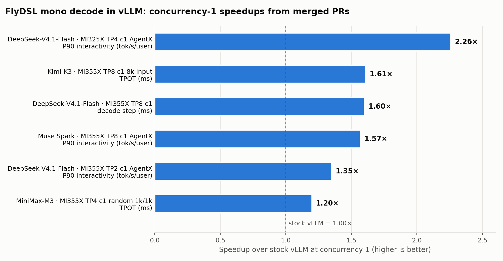

# FlyDSL MonoKernels in vLLM: Fast Decode for Interactive LLM Serving on AMD Instinct GPUs

## Overview

Extremely high interactivity is critical for LLM applications with strict latency requirements. A coding agent can't call its next tool until it has generated its current action, so decode latency sits directly on the critical path of the task. Serving at this level of interactivity means trading aggregate throughput for per-user speed and running each replica at low concurrency, such as the one to eight concurrent requests measured in this post. That is exactly where decode on today's large MoE models wastes the most time. A decode step launches thousands of short GPU kernels. Each kernel waits for the previous one to finish completely, and none of them has enough work to keep the GPU busy.

This post describes how we addressed this in vLLM with **MonoKernels**: persistent kernels written in [FlyDSL](https://github.com/ROCm/FlyDSL) that run most of a decoder layer, including its tensor-parallel all-reduces, in one or two launches. Since October 2026, mono decode has been merged into vLLM `main` for **DeepSeek-V4.1-Flash**, **DeepSeek-V4-Pro**, **MiniMax-M3**, **Kimi-K3**, and **Muse Spark**, on both MI355X and MI300X/MI325X. Ports for GLM-5.x, Qwen3.8, and MiniMax-M3.1 are in review. It is opt-in with a single flag, `--monokernel`. In the merged PRs it delivers:

- up to **2.26× P90 interactivity** on the AgentX benchmark (DeepSeek-V4.1-Flash, MI325X), and
- up to **1.61× lower time per output token** (Kimi-K3, MI355X),

with GSM8K, GPQA-Diamond, AIME25, and RULER NIAH accuracy within run-to-run noise.

## The Small-Batch Decode Problem

At high batch sizes, decode is a throughput problem, and a sequence of well-tuned GEMM, attention, and communication kernels works fine. At small batch sizes it becomes a latency problem, for three reasons.

First, **there are a lot of kernels.** A MoE decoder layer runs norms, projections, RoPE, the KV-cache insert, attention, the combine, a TP all-reduce, the router, top-k, the shared expert, the routed experts, and a second all-reduce. Each of these is a separate launch, often more than one. CUDA graphs remove the CPU launch cost, but every kernel still has to ramp up and drain on the GPU.

Second, **each stage waits for the whole previous stage.** A projection can't start until the entire previous kernel has finished, even if the rows it needs were ready long before.

Third, **there isn't enough work to fill the GPU.** A few token rows can't occupy 256 compute units. The time goes into streaming weights from HBM, and between kernels the GPU sits idle.

RFC [#60904](https://github.com/vllm-project/vllm/issues/60904), which set the vLLM standard for this work, measured the problem on GLM-5.2-MXFP4 (TP8, 8× MI350X). A graph-mode decode step in vLLM issues about **2,459 kernels**. With MonoKernels it issues about **210**: 75 MonoKernel launches plus the dense layers, input preparation, and the head.

| GLM-5.2-MXFP4, TP8, MI350X | vLLM | MonoKernel | Speedup |
|---|---|---|---|
| Time per token, batch 1 / 8 | 13.70 / 17.33 ms | 5.92 / 11.44 ms | 2.31× / 1.51× |
| Time per token, batch 1, FP8 attention | 13.70 ms | 4.80 ms | 2.85× |
| AgentX time between tokens, 1 / 8 users | 15.0 / 20.4 ms | 6.5 / 12.7 ms | 2.28× / 1.68× |

The gain is largest at batch one and shrinks as the batch grows. That is the pattern throughout this post, and it is why mono decode targets latency-bound serving.

## FlyDSL: The Language Behind the Kernels

A MonoKernel is an unusual kernel. It fuses a dozen stages with different shapes, layouts, and data types. It has to be specialized for one model, one TP size, and one step width. And it has to coordinate thread blocks within a GPU and across GPUs. Writing and maintaining this in raw HIP or assembly for every model wouldn't scale. Writing it in a high-level tile language would give up the control that makes it fast.

[FlyDSL](https://github.com/ROCm/FlyDSL) is AMD's Python DSL and MLIR compiler for high-performance kernels on ROCm, and it sits between those two options:

- **Kernels are Python, compiled just in time.** Kernels are written with `@flyc.kernel` / `@flyc.jit`, compiled on first use, and cached. vLLM builds the variant for each step width at warm-up (for example 6, 7, 28, or 48 token rows) and replays it under CUDA graphs.
- **Control from the grid down to individual instructions.** A single kernel decides how work is split across blocks, waves, and threads, what layout and tiling each stage uses, when each load is issued, and when each result is published. Where it matters, the schedule can name specific MFMA and buffer instructions.
- **Layout algebra instead of byte offsets.** Tiling, LDS swizzles, and MFMA operand layouts are written as layout operations with copy and MMA atoms. This is what made it possible to port DeepSeek-V4.1 mono decode from CDNA4 (MI355X) to CDNA3 (MI300X/MI325X): the stage code is the same, and only the tile sizes change for the smaller LDS and FNUZ FP8.
- **Native low precision.** Scaled MXFP4/MXFP8 MFMAs and E8M0 scales are built in. On MI355X, the kernels read vLLM's loaded weights in place, including AITER's shuffled MXFP4 expert layout, so no second copy is needed.
- **Easy to ship and review.** The kernel source lives in the model's directory in the vLLM repo and is reviewed like any other model code. The only new runtime dependency is the `flydsl` wheel. Because compilation is deterministic, PRs can show with an ISA diff (`FLYDSL_DUMP_IR` + `COMPILE_ONLY`) that a change leaves unrelated kernels byte-identical, or compare register, spill, and LDS counts before and after.

## How a MonoKernel Works

The design is inspired by [TileRT](https://github.com/tile-ai/TileRT). A MonoKernel is a **persistent** launch: a fixed grid of thread blocks stays resident on the GPU and works through the stages of a layer. Three scheduling principles remove most of the waiting:

1. **Reuse thread blocks across stages.** A block that finishes its share of one stage moves straight on to the next one. It doesn't wait for a new launch.
2. **Load weights early.** Weights for later stages, such as the output projection or the experts' up/gate projections, are prefetched while earlier stages are still computing. This hides HBM traffic, the main cost at small batch, behind compute.
3. **Pass on ready data.** Partial results go into **tagged mailboxes**. A downstream stage, or a reduction on a peer GPU, starts as soon as the tile it needs is tagged ready, without waiting for the whole stage to finish.

DeepSeek-V4.1-Flash ([#60397](https://github.com/vllm-project/vllm/pull/60397)) was the first model in vLLM to use this approach. Each decoder layer that used to issue about 40 kernels now runs as two launches:

| Launch | Stages |
|---|---|
| **K1** | mHC attention seam → attention front: `wqkv`, q/kv norms, KV-cache insert, `wq_b` |
| **K2** | attention back (split attention, combine, `wo_a`, `wo_b`) → **TP all-reduce** → FFN seam → MoE (router, top-6, shared expert, MXFP4 experts) → **TP all-reduce** |

Both TP all-reduces run inside K2 over symmetric peer memory. They are exact (an fp32 sum in rank order, then bf16) and overlap with the surrounding compute.

Running this inside a production serving engine required several more design decisions:

- **Hand-offs are tagged with an epoch instead of being cleared every step.** No host-side hook is needed between steps, so the launches can be captured in FULL CUDA graphs. Each step width gets its own scratch buffer, and a stress test ran 100K graph replays per layer without a mismatch.
- **Mono layers take and return the same tensors as vLLM's layers.** The two paths can run in the same forward pass. Prefill, mixed batches, wider steps, and PIECEWISE graphs fall back to the stock path layer by layer.
- **Failures stop every rank together.** Every in-kernel wait has a timeout. If a rank stalls, it sets a sticky health word, and all TP ranks raise at the same step instead of hanging in a collective.

## Bringing Mono Decode into vLLM

A specialized decode can reach tens of thousands of lines, so after the first PR landed the community agreed on how such code should live in vLLM. RFC [#60904](https://github.com/vllm-project/vllm/issues/60904) set four rules, and every mono PR since then follows them:

1. **Opt-in.** Mono decode is off by default and enabled with one switch, `--monokernel`.
2. **Refuse at startup.** A deployment the kernels don't support fails immediately with one error that lists every reason: wrong TP size, expert parallelism, LoRA, KV connectors, a partitioned GPU, an unsupported KV dtype, and so on. There is no silent fallback.
3. **The model owns the code.** Kernels and their runtime live under `vllm/models/<model>/amd/`. The existing model files only call into that folder. For Kimi-K3 this took 26 added lines, with no changes to `vllm/v1/` or `vllm/config/`.
4. **One `plan()` per step.** The plan picks mono or stock for each layer of the step. It depends only on metadata that every TP rank holds, so all ranks stay in lockstep.

With these rules in place, mono decode spread quickly from one model on one GPU to many. DeepSeek-V4.1-Flash went from 30 layers to all 40 ([#61082](https://github.com/vllm-project/vllm/pull/61082)), to the DSpark draft layers ([#62131](https://github.com/vllm-project/vllm/pull/62131)), to MI300X/MI325X ([#60731](https://github.com/vllm-project/vllm/pull/60731)), and to TP8 ([#64101](https://github.com/vllm-project/vllm/pull/64101)). DeepSeek-V4-Pro, MiniMax-M3, Kimi-K3, and Muse Spark followed. To keep that growth manageable, [#61311](https://github.com/vllm-project/vllm/pull/61311) proposes a thin shared `SpecializedDecode` layer, and [#62256](https://github.com/vllm-project/vllm/pull/62256) adds an authoring guide that walks from architecture through a FlyDSL introduction to a step-by-step implementation.

## Results

All numbers below come from the merged vLLM PRs and were measured by their authors on MI355X or MI325X. AgentX is InferenceX's benchmark built from multi-turn, long-context agent sessions. Each AgentX point is one 3,600-second run. **Interactivity** is 1 / P90 inter-token latency, in tokens/s/user (higher is better).



*Figure 1. Concurrency-1 speedup over stock vLLM for each merged mono decode PR, by the metric each PR reports (interactivity: mono / stock; TPOT and step time: stock / mono). Data: [mono-speedups.csv](data/mono-speedups.csv).*

### DeepSeek-V4.1-Flash

The first measurement compares mono off and on, on the same node at TP2 on MI355X, with K1 + K2 on the 30 standard layers ([#60397](https://github.com/vllm-project/vllm/pull/60397)):

| Concurrency | P90 interactivity (tok/s/user) | Total throughput (tok/s) | P90 TTFT (s) |
|---|---|---|---|
| 1 | 318.1 → 429.1 (**1.35×**) | 21,573 → 25,039 (1.16×) | 1.18 → 1.28 |
| 2 | 299.3 → 381.7 (**1.28×**) | 22,735 → 25,695 (1.13×) | 1.10 → 1.08 |
| 4 | 288.0 → 332.4 (**1.15×**) | 33,043 → 35,885 (1.09×) | 1.27 → 1.26 |
| 8 | 214.6 → 245.3 (**1.14×**) | 58,294 → 60,501 (1.04×) | 1.01 → 1.08 |

Interactivity improves at every concurrency, and the gain narrows as concurrency rises. TTFT is essentially unchanged, because prefill doesn't use the mono path.

The same PR added an FFN launch for the remaining 10 layers, which adds another 1.02–1.19×. At TP4, P90 interactivity at concurrency 1 / 2 / 4 / 8 is **1.66× / 1.56× / 1.64× / 1.38×** that of InferenceX's published run of the same recipe. [#61082](https://github.com/vllm-project/vllm/pull/61082) then runs all 40 layers as K1 + K2, which brings TP4 concurrency-1 P90 interactivity to **562.6 tok/s/user** (+3.9%).

The **MI300X/MI325X port** ([#60731](https://github.com/vllm-project/vllm/pull/60731)) shows the largest end-to-end gain. A standard decoder layer drops from 32 kernels to 2:

| MI325X, TP4, AgentX, concurrency 1 | `main` | `--monokernel` | |
|---|---|---|---|
| P50 interactivity (tok/s/user) | 216.85 | 503.53 | **2.32×** |
| P90 interactivity (tok/s/user) | 182.25 | 411.26 | **2.26×** |
| Total throughput per GPU (tok/s) | 4,024 | 6,546 | 1.63× |
| Standard decoder layer | 320 µs, 32 kernels | 115 µs, 2 kernels | 2.8× |

At concurrency 2 / 4 / 8, P90 interactivity is 2.41× / 2.22× / 1.99× InferenceX's published MI325X points.

At **TP8 on MI355X** ([#64101](https://github.com/vllm-project/vllm/pull/64101)), each rank streams half as many weights while the K1/K2 chain stays the same length. A DSpark decode step at concurrency 1 drops from 8.59 ms to **5.36 ms (−37.5%)**, and the output rate rises from 392 to 580 tok/s.

Finally, the **DSpark draft model** runs on the same kernels ([#62131](https://github.com/vllm-project/vllm/pull/62131)). Its three layers take about 227 µs per step instead of about 640 µs, with no change in acceptance length.

### DeepSeek-V4-Pro

The larger Pro model uses its own copy of the mono package, specialized to its dimensions, at TP8 on MI355X ([#61482](https://github.com/vllm-project/vllm/pull/61482)). AgentX P50 interactivity is **+28.7% / +26.5% / +11.9%** at concurrency 1 / 4 / 8. The baseline is a historical InferenceX run on an older software stack, so these numbers include stack changes as well as the kernels.

### MiniMax-M3

The MiniMax-M3 MXFP4 PR ([#62712](https://github.com/vllm-project/vllm/pull/62712)) shows that a partial fusion already helps. Only the FFN half of layers 3–59 runs as one launch: all-reduce, RMSNorm, router, shared and routed experts, and the final all-reduce. Attention stays on the stock path. At TP4 on MI355X with random 1k/1k prompts:

| Concurrency | TPOT, stock → mono (ms) | Change |
|---|---|---|
| 1 | 5.12 → 4.27 | **−16.6%** |
| 2 | 5.54 → 4.85 | −12.5% |
| 4 | 6.23 → 5.69 | −8.7% |
| 8 | 7.46 → 6.88 | −7.8% |
| 16 | 8.89 → 8.87 | parity |

Full-layer mono decode for M3 and M3.1, which also fuses attention and the sparse indexer, is in review ([#59705](https://github.com/vllm-project/vllm/pull/59705), [#65638](https://github.com/vllm-project/vllm/pull/65638)).

### Kimi-K3

Kimi-K3 mixes KDA linear-attention layers with MLA layers. The first PR ([#60683](https://github.com/vllm-project/vllm/pull/60683)) runs the KDA layers as K1 + K2 and the MoE half of the MLA layers as K2. The follow-up ([#61435](https://github.com/vllm-project/vllm/pull/61435)) adds MLA prologue and epilogue kernels and, at DCP1, fuses a FlyDSL MLA decode-attention stage into K2. An MLA layer then takes two launches. TPOT at TP8 on MI355X, concurrency 1, seven speculative tokens:

| Input length | Stock | #60683 | #60683 + #61435 (DCP1) | Total |
|---|---|---|---|---|
| 8k | 5.47 ms | 4.35 ms | **3.40 ms** | **1.61×** |
| 64k | 5.67 ms | 4.47 ms | **3.56 ms** | **1.59×** |

### Muse Spark

Muse Spark Open MXFP4 ([#63440](https://github.com/vllm-project/vllm/pull/63440)) runs decoder layers 1–60 of every DSpark verify step as persistent launches on 8× MI355X with TP8 and expert parallelism. The comparison is on AgentX's agentic-coding traces (median input length 159k tokens), against the faster of the recipe's two stock configurations at each concurrency:

| Concurrency | Interactivity (tok/s/user) | Total tok/s/GPU |
|---|---|---|
| 1 | 263.1 → 413.8 (**+57%**) | 2,325 → 2,974 (+28%) |
| 2 | 232.7 → 314.1 (+35%) | 2,368 → 3,056 (+29%) |
| 4 | 217.3 → 295.2 (+36%) | 3,585 → 4,430 (+24%) |
| 8 | 143.3 → 208.4 (+45%) | 6,126 → 7,384 (+21%) |

### Accuracy

A fused kernel quantizes, accumulates, and reduces in a different order from the stock path, so every mono PR ships with an accuracy study. The PRs follow the protocol of RFC [#59665](https://github.com/vllm-project/vllm/issues/59665): the full GSM8K set, GPQA-Diamond, AIME25, and RULER NIAH at 32K–256K context or longer, with real speculative acceptance, compared paired by question. The differences stay within noise:

- **DeepSeek-V4.1-Flash, TP2:** GPQA-Diamond 85.3 → 85.1 (Δ −0.2 ± 0.6), AIME25 99.4 → 98.3 (Δ −1.0 ± 0.7), and RULER NIAH 40/40 in every cell.
- **DeepSeek-V4.1-Flash, MI325X:** GSM8K 0.9247 → 0.9270 (p = 0.49).
- **Muse Spark:** GPQA-Diamond 88.5 → 88.7, AIME25 98.3 → 98.6.

Below the end-to-end evaluations, every layer is tested against vLLM's own op chain and an exact fp32 reference: per-token cosine similarity ≥ 0.999 and bit-exact results across hundreds of CUDA-graph replays.

## Try It

Mono decode is opt-in, so add `--monokernel` to a supported recipe. For DeepSeek-V4.1-Flash on MI355X:

```bash
VLLM_ROCM_USE_AITER=1 \
vllm serve deepseek-ai/DeepSeek-V4.1-Flash \
  --tensor-parallel-size 4 \
  --tokenizer-mode deepseek_v41 --trust-remote-code --language-model-only \
  --max-num-seqs 8 --block-size 128 \
  --attention_config.indexer_kv_dtype=mxfp4 \
  --moe-backend aiter \
  --speculative-config '{"method":"dspark","num_speculative_tokens":5}' \
  --monokernel
```

If the deployment isn't supported, vLLM refuses to start and lists every reason. The supported configurations for each model are documented in its package under `vllm/models/<model>/amd/`.

## FlyDSL Beyond Mono Decode

MonoKernels are the most visible use of FlyDSL in vLLM, but they aren't the only one. Many standalone FlyDSL kernels reach vLLM's ROCm path, mostly through AITER:

| Area | PRs |
|---|---|
| GDN (linear attention) prefill, **on by default for gfx942/gfx950** | [#57560](https://github.com/vllm-project/vllm/pull/57560), [#60645](https://github.com/vllm-project/vllm/pull/60645) |
| INT4 QuickReduce all-reduce | [#59478](https://github.com/vllm-project/vllm/pull/59478) |
| MoE: W4A16, MiniMax-M3 MXFP8, Kimi-K3 a4w4 | [#44400](https://github.com/vllm-project/vllm/pull/44400), [#46184](https://github.com/vllm-project/vllm/pull/46184), [#53940](https://github.com/vllm-project/vllm/pull/53940) |
| Sparse-indexer FP8 MQA logits (gfx942) | [#49544](https://github.com/vllm-project/vllm/pull/49544) |
| Attention over 4-bit quantized KV caches (UltraQuant, TurboQuant) | [#57057](https://github.com/vllm-project/vllm/pull/57057), [#47896](https://github.com/vllm-project/vllm/pull/47896), [#61649](https://github.com/vllm-project/vllm/pull/61649) |
| Runtime: reused host launchers, JIT-after-warmup monitoring | [#64008](https://github.com/vllm-project/vllm/pull/64008), [#62481](https://github.com/vllm-project/vllm/pull/62481) |

More is in review, including FP8 MLA prefill ([#59124](https://github.com/vllm-project/vllm/pull/59124)), a fused all-reduce + RMSNorm ([#57547](https://github.com/vllm-project/vllm/pull/57547)), and the first RDNA4 kernels: all-reduce, split-KV attention, and FP8 block-scale GEMM ([#55917](https://github.com/vllm-project/vllm/pull/55917), [#55996](https://github.com/vllm-project/vllm/pull/55996), [#56005](https://github.com/vllm-project/vllm/pull/56005)).

## Scope and Limitations

Mono decode is a latency optimization, and its benefits have limits:

- **Gains shrink with batch size.** On DeepSeek-V4.1-Flash TP2, P90 interactivity improves 1.35× at concurrency 1 but 1.14× at concurrency 8. Its FFN launch at TP2, concurrency 8 is at parity (345 → 342 µs per layer), and MiniMax-M3 reaches parity at 16 rows. At TP8, mono decode is a concurrency-1 configuration; by concurrency 4, two TP4 replicas deliver more throughput.
- **Steps are limited in width.** Each kernel is built for specific step widths, and speculative tokens and graph padding count toward the limit. DeepSeek-V4.1 supports up to 48 rows on MI355X and 42 on MI325X, where LDS is 64 KB instead of 160 KB. MiniMax-M3 and Kimi-K3 support up to 16. Wider steps run on the stock path.
- **Fusion costs registers and LDS.** Fusing more stages can lower occupancy, so each schedule is tuned for its architecture and TP size.
- **Weight copies on gfx942.** MI300X and MI325X have no scaled FP4/FP8 MFMA, so the kernels keep their own copy of the weights. For DeepSeek-V4.1 this is 170 GiB per rank instead of 99 GiB, which fits on MI325X but not on MI300X.
- **Each model needs its own work.** Every model needs its own schedule and ongoing validation. The RFC, the shared runtime layer, and the authoring guide are meant to keep that cost down.

## Building Mono Decode for a New Model

Adding mono decode for a new model follows the path the existing ports took:

1. **Profile the stock decode path.** Find where stages wait for each other and where weight streaming is exposed.
2. **Write the overlap schedule in FlyDSL.** Reuse the existing building blocks: GEMV and MoE stages, the router, the seams, the peer-memory all-reduce, tagged mailboxes, and fail-stop.
3. **Integrate it following RFC #60904.** Add startup refusals, a per-step `plan()`, and layer tests against vLLM's own ops. Then evaluate with real rejection sampling, comparing interactivity, TTFT, throughput, and accuracy at matched concurrency.

The authoring guide ([#62256](https://github.com/vllm-project/vllm/pull/62256)) and the merged DeepSeek-V4.1 package (`vllm/models/deepseek_v41/amd/mono/`) are the best places to start.

## Summary

Small-batch decode spends most of its time between kernels: launching them, waiting for whole stages to finish, and streaming weights while the GPU idles. FlyDSL MonoKernels remove most of that time by running a decoder layer as one or two persistent launches that reuse thread blocks across stages, prefetch weights, pass ready data forward through tagged mailboxes, and reduce across GPUs inside the kernel. FlyDSL makes this practical: kernels are written in Python, specialized and compiled just in time, controlled down to individual instructions, and portable across CDNA3 and CDNA4 through its layout algebra.

In vLLM, mono decode is now merged for five model families and follows a common, opt-in standard. It improves concurrency-1 interactivity or time per output token by 1.20× to 2.26×, with accuracy held within noise. We invite the vLLM community to try `--monokernel` on AMD Instinct GPUs, review the in-flight ports, and use the authoring guide to bring mono decode to new models.

## References

1. [FlyDSL language and compiler](https://github.com/ROCm/FlyDSL)
2. [RFC #60904: A standard for Specialized (MonoKernel) decodes in `vllm/models`](https://github.com/vllm-project/vllm/issues/60904)
3. DeepSeek-V4.1-Flash mono decode: [#60397](https://github.com/vllm-project/vllm/pull/60397), [#61082](https://github.com/vllm-project/vllm/pull/61082), [#60731](https://github.com/vllm-project/vllm/pull/60731), [#62131](https://github.com/vllm-project/vllm/pull/62131), [#64101](https://github.com/vllm-project/vllm/pull/64101)
4. DeepSeek-V4-Pro mono decode: [#61482](https://github.com/vllm-project/vllm/pull/61482)
5. MiniMax-M3 mono decode: [#62712](https://github.com/vllm-project/vllm/pull/62712)
6. Kimi-K3 specialized decode: [#60683](https://github.com/vllm-project/vllm/pull/60683), [#61435](https://github.com/vllm-project/vllm/pull/61435)
7. Muse Spark mono decode: [#63440](https://github.com/vllm-project/vllm/pull/63440)
8. Shared specialized-decode abstractions: [#61311](https://github.com/vllm-project/vllm/pull/61311); MonoKernel authoring guide: [#62256](https://github.com/vllm-project/vllm/pull/62256)
9. [TileRT](https://github.com/tile-ai/TileRT)
10. [InferenceX AgentX metric definitions](https://github.com/SemiAnalysisAI/InferenceX/blob/8b25006fa0b23c7e157438996a3d2a90ff5e8cd2/inferencex-e2e/infx/results/agentic/request_metrics.py)

## Disclaimers

Performance and accuracy numbers in this blog are taken from the linked vLLM pull requests. They were measured by the PR authors on AMD Instinct™ MI355X (gfx950, 288 GB HBM3E) and AMD Instinct™ MI325X (gfx942, 256 GB HBM3E) systems, with the models, software revisions, serving flags, and benchmark settings described in each PR. AgentX results use InferenceX's benchmark client with one 3,600-second run per point. Where a PR compares against a published InferenceX run instead of a same-node baseline, this blog says so.

Third-party content is licensed to you directly by the third party that owns the
content and is not licensed to you by AMD. ALL LINKED THIRD-PARTY CONTENT IS
PROVIDED "AS IS" WITHOUT A WARRANTY OF ANY KIND. USE OF SUCH THIRD-PARTY CONTENT
IS DONE AT YOUR SOLE DISCRETION AND UNDER NO CIRCUMSTANCES WILL AMD BE LIABLE TO
YOU FOR ANY THIRD-PARTY CONTENT. YOU ASSUME ALL RISK AND ARE SOLELY RESPONSIBLE
FOR ANY DAMAGES THAT MAY ARISE FROM YOUR USE OF THIRD-PARTY CONTENT.

Results shown are from specific test configurations and may vary based on workload,
model, and system configuration.

The information presented in this document is for informational purposes only and may contain technical inaccuracies, omissions, and typographical errors. The information contained herein is subject to change and may be rendered inaccurate for many reasons, including but not limited to product and roadmap changes, component and motherboard version changes, new model and/or product releases, product differences between differing manufacturers, software changes, BIOS flashes, firmware upgrades, or the like. Any computer system has risks of security vulnerabilities that cannot be completely prevented or mitigated. AMD assumes no obligation to update or otherwise correct or revise this information.
However, AMD reserves the right to revise this information and to make changes from time to time to the content hereof without obligation of AMD to notify any person of such revisions or changes.
THIS INFORMATION IS PROVIDED "AS IS." AMD MAKES NO REPRESENTATIONS OR WARRANTIES WITH RESPECT TO THE CONTENTS HEREOF AND ASSUMES NO RESPONSIBILITY FOR ANY INACCURACIES, ERRORS, OR OMISSIONS THAT MAY APPEAR IN THIS INFORMATION. AMD SPECIFICALLY DISCLAIMS ANY IMPLIED WARRANTIES OF NON-INFRINGEMENT, MERCHANTABILITY, OR FITNESS FOR ANY PARTICULAR PURPOSE. IN NO EVENT WILL AMD BE LIABLE TO ANY PERSON FOR ANY RELIANCE, DIRECT, INDIRECT, SPECIAL, OR OTHER CONSEQUENTIAL DAMAGES ARISING FROM THE USE OF ANY INFORMATION CONTAINED HEREIN, EVEN IF AMD IS EXPRESSLY ADVISED OF THE POSSIBILITY OF SUCH DAMAGES.
AMD, the AMD Arrow logo, AMD Instinct, AMD EPYC, AMD ROCm, and combinations thereof are trademarks of Advanced Micro Devices, Inc. Other product names used in this publication are for identification purposes only and may be trademarks of their respective companies. Linux is the registered trademark of Linus Torvalds in the U.S. and other countries. PyTorch, the PyTorch logo, vLLM, and any related marks are trademarks of The Linux Foundation. Ubuntu is a registered trademark of Canonical Ltd. All other trademarks and product names referenced in this publication, including MiniMax, DeepSeek, Kimi, Muse Spark, InferenceX, and Hugging Face, are the property of their respective owners.
© 2026 Advanced Micro Devices, Inc. All rights reserved.
